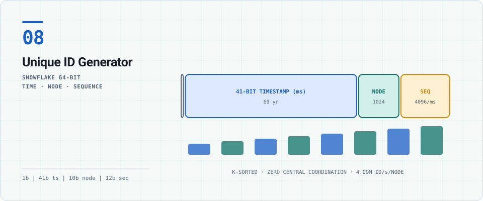
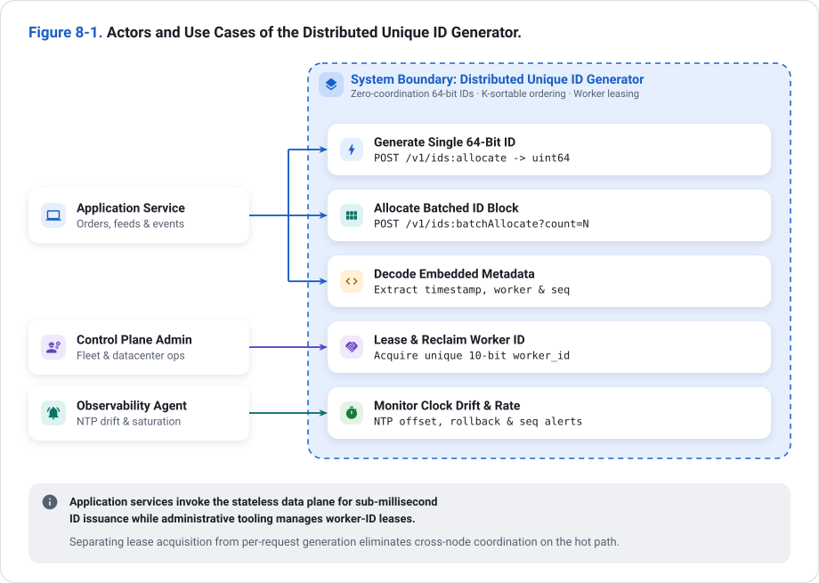
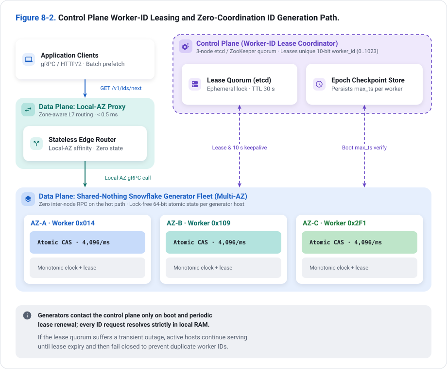
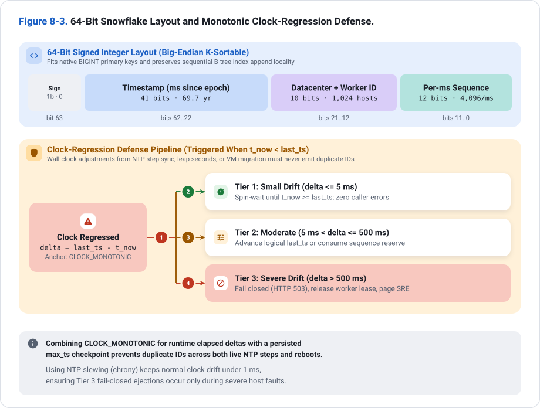

# Chapter 8: Unique ID Generator



Nearly every record in a distributed storage system requires an unambiguous primary key so that orders, invoices, ledger entries, and foreign-key indexes reference exactly one entity across the lifetime of the platform. On a single relational database, a monotonic `BIGSERIAL` or `AUTO_INCREMENT` sequence satisfies uniqueness, compactness, and chronological sort order in one atomic page increment. Once we shard writes across dozens of database nodes and multiple availability zones, routing every record creation through one central sequence reintroduces both a throughput bottleneck and a single point of failure.

In this chapter, I design a distributed 64-bit unique identifier generator that produces roughly time-ordered keys without cross-node coordination on the request path. We begin by establishing requirements, actors, and capacity bounds, then specify wire contracts and separate Raft-backed worker-ID leasing (control plane) from lock-free local generation (data plane). In the deep dives, we derive the 64-bit Snowflake bit budget, compare it against ticket servers, range-block allocators, and UUIDv7, and harden the generator against NTP backward clock steps, leap seconds, and crash-restart reuse using monotonic guards, disk epoch checkpoints, and Hybrid Logical Clocks (HLC).

<div class="covers">

In this chapter, we cover

- actors, functional contracts, sub-millisecond latency SLOs, non-goals, and arithmetic capacity bounds
- HTTP/gRPC single and batched allocation contracts, 64-bit integer string encoding for JSON safety, and lease schemas
- separation of consensus-backed worker-ID leasing (control plane) from shared-nothing local generation (data plane)
- comparative analysis of database counters, multi-master ticket servers, range-block allocators, UUIDv4, UUIDv7, and 64-bit Snowflake layouts
- bit-level Snowflake allocation, per-millisecond sequence exhaustion, B-tree append locality, and range-sharded hotspot trade-offs
- defenses against NTP clock regressions, leap seconds, VM restarts, and worker-ID collisions via epoch checkpoints and Hybrid Logical Clocks
- operational failure modes, SLIs, production deployments (Twitter Snowflake, Instagram, Discord, Sonyflake), and simulation verification

</div>

## 8.1 Requirements, Actors, and Capacity Bounds

### Actors and Use Cases

We organize the unique ID generator around three operational actors: application services requesting identifiers on the hot write path, generator nodes leasing exclusive worker slots during startup, and platform operators auditing clock skew and sequence saturation (Figure 8-1).

<figure class="diagram">

<figcaption><b>Figure 8-1</b> Actors, system boundary, and core use cases of the distributed unique ID generator.</figcaption>
</figure>

| Actor | Operation | Concrete Scenario |
| :--- | :--- | :--- |
| **Application Service** | Request single ID (`POST /v1/ids:allocate`) or batch (`POST /v1/ids:batchAllocate`) | Mint primary keys for newly created orders, chat messages, or telemetry events across sharded databases |
| **Application Service** | Decode embedded metadata | Extract creation timestamp and originating node bits during incident triage or time-range log correlation |
| **Generator Node** | Lease and renew a 10-bit `worker_id` (`0` to `1023`) | Acquire an exclusive worker slot from the etcd control plane at process startup and checkpoint its high-water timestamp |
| **Platform Operator** | Monitor clock drift, sequence exhaustion, and lease churn | Detect NTP stepping faults or approaching sequence saturation before client requests experience wait delays |

### Functional Requirements

| No. | Functional Requirement |
| :--- | :--- |
| 0 | We guarantee global uniqueness across all active, retired, and restarted generator nodes for the entire operational lifetime of the system. |
| 1 | Every generated identifier fits inside a signed 64-bit integer (`int64`, non-negative `0` to `2^63 - 1`) so it maps natively to relational `BIGINT` primary keys and compact B-tree indexes. |
| 2 | Identifiers are roughly time-ordered (k-sortable): an ID minted later sorts numerically greater than an ID minted earlier whenever their creation times differ by more than the maximum inter-node clock skew. |
| 3 | The service supports both single-ID allocation and batched block allocation (`count` up to `4,096` per call) over HTTP/2 and gRPC, as well as an embeddable in-process library mode. |
| 4 | Any node can decode the creation timestamp (millisecond precision), datacenter/worker identifier, and per-millisecond sequence number directly from an ID without external lookups. |

### Non-Functional Requirements and SLOs

| No. | Property | Target Specification | Architectural Consequence |
| :--- | :--- | :--- | :--- |
| 0 | **Latency** | `p50 <= 0.2 ms`, `p99 <= 1.0 ms` over local-AZ RPC; `< 1 microsecond` embedded in-process | Prohibits cross-node consensus or database round trips on the generation path; generation uses strictly local memory and atomic instructions |
| 1 | **Availability** | `99.999%` data-plane availability (`<= 5.26` minutes/year downtime) | Shared-nothing fleet across three availability zones; an active generator continues minting IDs even if the control plane and all peer generators fail |
| 2 | **Throughput and Scale** | Sustained `1,000,000` IDs/s cluster-wide; peak `4,096,000` IDs/s per generator node across up to `1,024` nodes | Requires a 12-bit per-millisecond sequence counter (`2^12 = 4,096` IDs/ms/node) and a 10-bit worker address space |
| 3 | **Uniqueness Consistency** | Absolute (zero duplicates under crashes, restarts, and NTP regressions) | Requires linearizable Raft-backed `worker_id` leasing at startup, monotonic clock guards in RAM, and durable high-water timestamp checkpoints |
| 4 | **Ordering Consistency** | Approximate across hosts (bounded by inter-node NTP skew, typically `2` to `20 ms`); strict within one node | Callers requiring causal or total order across nodes must obtain sequence numbers from a consensus log rather than inferring causality from IDs |

### Non-Goals and Scope Boundaries

To keep the generation path fast and verifiable, we exclude the following properties from this system:

- **Strict gap-free sequentiality:** Sequence numbers reset to `0` on every millisecond tick, and idle milliseconds produce numeric gaps. Callers must never subtract two IDs to count records.
- **Cryptographic unpredictability:** Time-prefixed IDs are enumerable and expose millisecond creation timestamps. Authentication tokens, password-reset links, and public unguessable slugs require a separate CSPRNG token generator (at least 128 random bits).
- **Cross-node causal ordering:** Physical clocks drift across hosts. We do not attempt to use ID comparisons as a substitute for vector clocks, Lamport timestamps, or database transaction commit order.
- **Dynamic bit-field resizing after launch:** Reassigning bit widths between timestamp, worker, and sequence fields after issuing production IDs risks overlapping numeric ranges.

### Back-of-the-Envelope Capacity Bounds

We size the bit budget, throughput ceiling, network bandwidth, and control-plane state from first principles before writing a schema:

| Resource Dimension | Arithmetic Derivation | Provisioned Bound |
| :--- | :--- | :--- |
| **Timestamp Horizon (41 bits)** | `2^41 ms / (1,000 * 60 * 60 * 24 * 365.25)` | `69.73 years` from custom epoch (for example, `2025-01-01T00:00:00Z` lasts until `2094`) |
| **Per-Node Peak Rate (12 bits)** | `2^12 = 4,096 IDs/ms * 1,000 ms/s` | `4,096,000 IDs/s` per generator node |
| **Cluster Maximum Rate (10 bits)** | `2^10 = 1,024 nodes * 4,096,000 IDs/s` | `4.19 billion IDs/s` theoretical ceiling |
| **Baseline Fleet Sizing** | `1,000,000` IDs/s target at `<= 25%` per-node capacity load across 3 AZs | `12` generator nodes (`4` per AZ, `~83,333` IDs/s/node; `~2%` of 4.09M ceiling, leaving huge burst headroom) |
| **RPC Network Bandwidth** | `1,000,000` single calls/s `* 128 B` gRPC frame (or `10,000` batches of `100` IDs `* 1 KB`) | `128 MB/s` (`1.02 Gbps`) single-call; `10 MB/s` (`80 Mbps`) batched |
| **Control-Plane Lease State** | `1,024` worker lease records `* 256 B` (owner, TTL, `max_ts` checkpoint) | `256 KB` total in a 3-node etcd quorum (trivial memory footprint) |

Even `12` lightweight generator instances sustain an order of magnitude above our `1,000,000` IDs/s baseline while leaving over `1,000` worker slots spare for rolling deployments, canary instances, and cooldown quarantine windows.

## 8.2 External API and Data Contracts

We expose a binary gRPC interface for internal microservices, an HTTP/2 REST API for language-agnostic clients, and an embeddable library interface for ultra-low-latency callers that register directly as leased workers.

### External HTTP/2 and gRPC Contracts

Whenever an ID travels over JSON, we serialize the 64-bit integer as a decimal string. IEEE 754 double-precision floating-point numbers used by JavaScript engines and many JSON parsers represent integers exactly only up to `2^53 - 1` (`9,007,199,254,740,991`). Returning a raw 64-bit JSON number causes browsers to round distinct IDs to the same value, corrupting client-side state.

**Single ID allocation (`POST /v1/ids:allocate`):**

```http
POST /v1/ids:allocate HTTP/2
Host: idgen.internal
Accept: application/json
```

```http
HTTP/2 200 OK
Content-Type: application/json
X-Worker-Id: 7

{
  "id": "8388636672",
  "timestamp_ms": 2000,
  "worker_id": 7,
  "sequence": 0
}
```

**Batched ID allocation (`POST /v1/ids:batchAllocate`):**

Batching amortizes network round trips and allows callers to keep a small local buffer without maintaining their own etcd lease. An `Idempotency-Key` header prevents retries from double-charging accounting quotas, though minting a fresh unused ID is harmless for uniqueness.

```http
POST /v1/ids:batchAllocate HTTP/2
Host: idgen.internal
Content-Type: application/json
Idempotency-Key: checkout-pod-19-batch-402

{
  "count": 100
}
```

```http
HTTP/2 201 Created
Content-Type: application/json

{
  "ids": ["8388636672", "8388636673"],
  "count": 100,
  "worker_id": 7
}
```

When a generator node detects a severe backward clock jump exceeding its safe wait threshold (for example, `> 15 ms`), it rejects requests immediately with `503 Service Unavailable` and `Retry-After: 1` while removing itself from load-balancer health checks so local-AZ routers fail over to healthy peers.

**Internal gRPC contract (Protocol Buffers):**

```protobuf
syntax = "proto3";
package idgen.v1;

service IdGeneratorService {
  rpc NextId(NextIdRequest) returns (NextIdResponse);
  rpc NextBatch(NextBatchRequest) returns (NextBatchResponse);
}

message NextIdRequest {}
message NextIdResponse {
  int64 id = 1; // Wire-encoded as varint/fixed64; zero precision loss in gRPC
}

message NextBatchRequest {
  uint32 count = 1; // Bounded to [1, 4096]
}
message NextBatchResponse {
  repeated int64 ids = 1;
}
```

### Control-Plane Lease and Checkpoint Schema

In the etcd control plane, we maintain two key namespaces per worker slot `w` in `[0, 1023]`:

```text
/idgen/workers/{worker_id}/lease      -> { "host": "az-a-node-04", "lease_id": 918273, "started_at_ms": 1763612000000 }  [TTL = 30s]
/idgen/workers/{worker_id}/checkpoint -> { "max_ts_ms": 1763612045000, "retired_at_ms": 0 }                                [Persistent]
```

The `/lease` key is attached to an etcd ephemeral lease (`TTL = 30 s`, renewed every `10 s`). The `/checkpoint` key persists indefinitely so that no future host acquiring `worker_id` can ever mint an ID at a millisecond earlier than `max_ts_ms`.

## 8.3 High-Level Architecture: Control Plane vs. Data Plane

We decouple worker-ID assignment and high-water epoch persistence (control plane) from per-request identifier generation (data plane). Once a generator node holds a valid 10-bit worker ID, it performs zero network I/O to produce identifiers (Figure 8-2).

<figure class="diagram">

<figcaption><b>Figure 8-2</b> Control-plane worker-ID leasing and zero-coordination data-plane ID generation topology.</figcaption>
</figure>

### Component Responsibilities and Failure Domains

| Component | Plane | State Held | Failure Impact and Mitigation |
| :--- | :--- | :--- | :--- |
| **Worker-ID Lease Coordinator (3-node etcd)** | Control | Authoritative map of leased `worker_id` slots (`0` to `1023`) and durable `max_ts_ms` checkpoints | Tolerates `1` node failure transparently. If quorum is lost, running generators continue minting IDs uninterrupted; only new node startups pause until quorum returns |
| **Epoch Checkpoint Store** | Control | Highest timestamp horizon promised by each worker slot, updated asynchronously every `2` to `5 s` | Prevents a restarted or reassigned worker from reusing timestamps after a backward NTP correction |
| **Zone-Aware Edge Router (L7 Proxy)** | Data | Stateless routing table with local-AZ affinity and active health probes | Keeps caller RTT below `0.5 ms` by preferring same-AZ generators; automatically drains any node reporting clock regression (`503`) |
| **Snowflake Generator Fleet (Multi-AZ)** | Data | Leased 10-bit `worker_id`, atomic `(last_ms, sequence)` 64-bit state word, local disk checkpoint file | Shared-nothing across nodes. Losing one node reduces fleet capacity by `1/N` with zero coordination overhead and zero lost uniqueness |

### Hot Data Path Walkthrough

1. **Startup Lease Acquisition (Off Hot Path):** When a generator starts, it runs a compare-and-swap transaction in etcd to claim an unleased `worker_id` whose quarantine cooldown (`retired_at_ms + 60,000 ms`) has elapsed. It reads `checkpoint.max_ts_ms` and refuses to mark itself healthy until its local wall clock strictly exceeds `max_ts_ms`.
2. **Zone-Local Request Routing:** An application service sends `NextId` or `NextBatch` over a persistent HTTP/2 gRPC channel to a same-AZ generator (or calls the in-process library directly).
3. **Lock-Free Bit Packing:** The generator reads its wall clock and monotonic clock delta, verifies the timestamp has not regressed below `last_ms`, increments `sequence` (wrapping and awaiting the next millisecond if `sequence == 4096`), and packs the 64-bit integer in nanoseconds.
4. **Periodic Horizon Checkpointing (Background):** A background thread writes `now_ms + 5,000 ms` to local disk and etcd every `2` seconds. If the process crashes and restarts within `5` seconds on a drifted clock, startup recovery waits until the clock clears the persisted horizon.

## 8.4 Comparative Design Space and 64-Bit Snowflake Layout

Before committing to a composite time-worker-sequence layout, we evaluate the four classical families of distributed ID generation against our requirements.

### Comparing the Four Classical Approaches

1. **Single Database Sequence (`AUTO_INCREMENT`):** Produces compact, gap-free 64-bit integers with exact global ordering. However, every write across the entire platform must serialize on one primary database instance, turning ID generation into a global availability bottleneck.
2. **Multi-Master Ticket Servers (Flickr Pattern):** Deploying `N` databases where server `i` starts at `i` and steps by `N` (`1, 3, 5...` and `2, 4, 6...`) removes the single point of failure. Its operational weakness is rigidity: changing `N` online requires coordinated step reconfiguration without range overlap, and cross-node time order disappears as traffic skews between masters.
3. **Coordinator Range-Block Allocator (Segment Mode):** A durable coordinator hands out blocks of `1,000` to `10,000` contiguous integers to each worker, reducing coordinator RPCs by three to four orders of magnitude. Double-buffering (prefetching the next block at `20%` remaining) hides network stalls. However, worker crashes discard unused block tails, and IDs from slow workers lag far behind busy workers, destroying chronological ordering.
4. **Random and Time-Prefixed 128-Bit UUIDs (UUIDv4 and UUIDv7):**
   - **UUIDv4** uses `122` random bits and requires zero coordination. By the birthday paradox, generating `10^15` IDs (`1,000,000` IDs/s for `31.7` years) yields a collision probability of roughly `n^2 / 2^123`, or `~1 in 10,000,000`. Its practical costs are double storage overhead (`16 bytes` in every primary key, foreign key, and secondary index) and uniform random distribution across B-tree leaf pages. Once an index outgrows RAM, random primary-key inserts trigger a disk read and dirty-page eviction on nearly every write.
   - **UUIDv7 (RFC 9562, 2024)** places a 48-bit Unix millisecond timestamp in the most significant bits followed by `4` version bits, `12` sub-millisecond/counter bits, `2` variant bits, and `62` random bits. UUIDv7 restores B-tree append locality while keeping zero startup coordination. Its sole drawback for our contract is size: `128 bits` cannot fit in a 64-bit `BIGINT` column.

| Dimension | Single DB Sequence | Ticket Servers (`step = N`) | Range Blocks (Segment) | UUIDv4 (128-bit) | UUIDv7 (128-bit) | 64-Bit Snowflake (Chosen) |
| :--- | :--- | :--- | :--- | :--- | :--- | :--- |
| **Width** | `64 bits` | `64 bits` | `64 bits` | `128 bits` | `128 bits` | `64 bits` |
| **Hot-Path Network I/O** | `1` RTT per ID | `1` RTT per ID | `1` RTT per block | None | None | None |
| **Time Ordering** | Exact | None | None | None | K-sorted (ms) | K-sorted (ms) |
| **B-Tree Index Locality** | Sequential append | Sequential per shard | Fragmented by worker | Random page thrashing | Sequential append | Sequential append |
| **Control-Plane Outage** | Total outage | Survives `N - 1` loss | Continues until block empties | Unaffected | Unaffected | Running nodes unaffected |
| **Primary Failure Hazard** | SPOF bottleneck | Rigid cluster resizing | Gaps and cross-node skew | Cloned PRNG seed; index bloat | `16 B` key footprint | Duplicate `worker_id` or clock rollback |

The design adopts the **64-bit Snowflake layout** to fit within a single 64-bit integer key, preserve k-sortable B-tree locality, and eliminate hot-path network coordination.

### 64-Bit Field Layout and Uniqueness Proof

Figure 8-3 details the bit allocation across the 64-bit signed big-endian integer:

- **Bit `63` (1 bit, sign):** Permanently `0` so the value stays non-negative across signed 64-bit integer types in Java, PostgreSQL (`BIGINT`), and Go (`int64`).
- **Bits `62..22` (41 bits, timestamp):** Milliseconds elapsed since a custom system epoch (`epoch_ms`). Placing the timestamp in the most significant bits ensures that ordinary integer comparison orders IDs chronologically.
- **Bits `21..12` (10 bits, datacenter and worker ID):** Uniquely identifies up to `1,024` concurrent generator instances (commonly split into `3` to `5` bits for datacenter/AZ and `5` to `7` bits for host slot so operators can identify the originating zone by bitmasking).
- **Bits `11..0` (12 bits, per-millisecond sequence):** Monotonically increments from `0` to `4,095` within each millisecond on a given node and resets to `0` on the next millisecond tick.

```text
id = ((timestamp_ms - epoch_ms) << 22) | (worker_id << 12) | sequence
```

<figure class="diagram">

<figcaption><b>Figure 8-3</b> 64-bit Snowflake bit budget and monotonic clock-regression handling.</figcaption>
</figure>

Uniqueness follows by case analysis on any two identifiers `A` and `B`:

1. If `A` and `B` are generated by different nodes, they differ in bits `21..12`, provided **Invariant 1** holds: no two active generators share the same `worker_id` within the same clock window.
2. If `A` and `B` are generated by the same node in different milliseconds, they differ in bits `62..22`, provided **Invariant 2** holds: the node's emitted timestamp never returns to a millisecond it has already used.
3. If `A` and `B` are generated by the same node in the same millisecond, they differ in bits `11..0`, provided **Invariant 3** holds: the node never lets the 12-bit sequence overflow into the adjacent `worker_id` bits.

Advancing through Interactive Trace 8.A demonstrates two independent nodes minting six globally unique, roughly time-ordered IDs with zero inter-node communication:

<figure class="steps" data-prefix="figures/steps-idgen-make" data-count="8" data-version="471267fc">

<figcaption><b>Interactive Trace 8.A</b> Two generator nodes mint six unique IDs independently from local time, node ID, and sequence state. Use Next and Back to step through.</figcaption>
</figure>

When a busy node exhausts all `4,096` sequence values in a single millisecond, letting the 12-bit counter wrap or carry into bit `12` would corrupt the `worker_id` field without warning and impersonate a neighboring node. Instead, the generator spins or yields until the clock advances to `last_ms + 1` and resets `sequence = 0`, bounding caller delay to under `1 ms`.

### Storage Engine Trade-Off: B-Tree Locality vs. Range-Partitioned Hotspots

On single-primary or hash-sharded databases backed by B-trees (PostgreSQL, MySQL InnoDB, RocksDB memtables), time-prefixed Snowflake keys append exclusively to the rightmost leaf page. The working set of dirty index pages stays compact in RAM, avoiding random disk I/O.

In range-partitioned distributed databases such as Google Cloud Spanner, CockroachDB, and Bigtable, monotonically increasing primary keys create the opposite pathology: every write across the entire cluster targets the single rightmost tablet range, saturating one storage server while all other tablets sit idle. For range-partitioned stores, engineers either prepend a shard hash prefix (`hash(tenant_id) mod S`), composite-key on `(tenant_id, snowflake_id)`, or bit-reverse the timestamp prefix to scatter inserts evenly across tablets.

## 8.5 Clock Regression, Crash Recovery, and Worker-ID Safety

Because Snowflake trades network coordination for local invariants, violating Invariant 1 or Invariant 2 causes duplicate IDs without triggering any runtime exception inside the generator. Production systems harden all three failure surfaces systematically.

### Handling NTP Backward Steps and Leap Seconds

Hardware quartz oscillators drift by `10` to `100` parts per million (`~1` to `8 seconds` per day). Time synchronization daemons (`chronyd`, `ntpd`) correct drift either by **slewing** (adjusting clock frequency smoothly without jumping backward) or by **stepping** (jumping `CLOCK_REALTIME` backward abruptly when offset exceeds a threshold, or during an unsmeared POSIX leap second).

Interactive Trace 8.B walks through a `3 ms` backward wall-clock jump and the generator's refusal to reuse millisecond `2000`:

<figure class="steps" data-prefix="figures/steps-idgen-clock" data-count="6" data-version="2b4efd8c">

<figcaption><b>Interactive Trace 8.B</b> Monotonic guard refusing ID allocation across a 3 ms wall-clock regression until physical time overtakes the last emitted millisecond. Use Next and Back to step through.</figcaption>
</figure>

We implement a tiered clock-regression policy using both `CLOCK_REALTIME` (for epoch alignment) and `CLOCK_MONOTONIC` (which the OS kernel guarantees never moves backward):

1. **Zero-Regression Normal Operation via Monotonic Anchoring:** At startup, the generator anchors `(anchor_wall_ms, anchor_mono)` once. During operation, it advances timestamps via `anchor_wall_ms + elapsed(anchor_mono)`, slewing gently toward `CLOCK_REALTIME` only when wall time moves ahead. Small backward NTP steps on `CLOCK_REALTIME` never cause the emitted timestamp to step backward.
2. **Tier 1 Small Drift (`delta <= 15 ms`):** If a raw wall-clock check detects a small regression (`now_ms < last_ms` by `<= 15 ms`), the generator waits `2 * delta` milliseconds for physical time to catch up before issuing the next ID.
3. **Tier 2 Medium Drift (`15 ms < delta <= 500 ms`) via Hybrid Logical Clock (HLC) Borrowing:** Rather than stalling callers, an HLC-enhanced generator keeps its logical timestamp pinned at `last_ms` and continues incrementing the 12-bit sequence (or borrows `1 ms` forward) up to a strict drift ceiling (`500 ms`), emitting an urgent metric so operators inspect NTP health.
4. **Tier 3 Severe Drift (`delta > 500 ms`):** The node fails its readiness probe, rejects requests with `503 Service Unavailable`, and alerts SRE immediately. Accepting multi-second future drift risks breaking k-ordering guarantees and exhausting timestamp headroom.
5. **Leap-Second Smearing:** Fleet NTP servers must run uniform leap-second smearing (spreading the extra second over `24 hours`, as practiced by Google and AWS Time Sync Service) so `CLOCK_REALTIME` never repeats a full second.

### Surviving Restarts and Preventing Worker-ID Collisions

In-memory `last_ms` state vanishes on a crash or container restart. Consider a generator that mints an ID at `t = 5000 ms`, crashes, suffers a `50 ms` backward NTP step during host reboot, and restarts at `t = 4970 ms`. Without durable state, it would reissue IDs for milliseconds `4970` through `5000`.

We close this window with three coordinated mechanisms:

1. **Future-Horizon Checkpointing:** Every `2 seconds`, each generator asynchronously persists `horizon_ms = now_ms + 5,000 ms` to local NVMe and to its etcd `/checkpoint` record. On startup, the node reads `max(local_horizon, etcd_horizon)` and sleeps until its clock exceeds that horizon (or fails startup if the delta exceeds `10 seconds`).
2. **Lease-Backed Exclusive `worker_id` Ownership:** We never derive `worker_id` from ephemeral IP octets or static VM templates that can be cloned. Instead, each generator acquires an ephemeral etcd lease (`TTL = 30 s`, renewed every `10 s`). If the node loses lease connectivity and cannot renew within `20 s` (before the `30 s` server expiry), it **self-fences** immediately and stops issuing IDs, eliminating split-brain dual ownership.
3. **Quarantine Cooldown on Slot Reuse:** When a worker lease expires or releases cleanly, the control plane marks `retired_at_ms = now_ms` and forbids reassigning that `worker_id` to any other host for `60 seconds` (far exceeding maximum inter-node NTP skew). With `1,024` slots and `12` to `100` active nodes, plenty of fresh slots remain available for immediate replacement startups.

### Security, Privacy, and Information Leakage

Because Snowflake IDs encode creation time and worker origin in plaintext, external clients can inspect traffic volume and record creation times. Where business confidentiality forbids exposing timestamps or insertion volume (for example, external invoice URLs or tenant counts), we keep Snowflake as the internal `BIGINT` clustered primary key for database speed and map it at the API boundary through either a format-preserving cipher (such as Feistel permutation over 64 bits) or a separate random public UUID column. Regardless of ID format, endpoints must always enforce explicit authorization checks and never treat an identifier as a capability secret.

## 8.6 Failure Modes, SLIs, and Production Systems

### Failure and Recovery Matrix

| Failure Mode | Operational Symptom | Automated Mitigation |
| :--- | :--- | :--- |
| **Small NTP Backward Step (`<= 15 ms`)** | Brief `1` to `15 ms` tail latency bump on affected node | Monotonic clock anchoring prevents timestamp rollback; fallback wait loop pauses until `now_ms > last_ms` |
| **Severe Clock Jump (`> 500 ms`)** | Node returns `503 Service Unavailable` and logs clock-fault alert | Readiness probe fails within `2 s`; local-AZ proxy shifts traffic to healthy peers; operator repairs `chronyd` |
| **Control-Plane (etcd) Quorum Loss** | New generator pods block in startup; existing fleet latency unaffected | Active generators keep serving from local memory while leases remain valid; alerts page on-call to restore etcd before lease expiry |
| **Per-Millisecond Sequence Exhaustion (`> 4,096/ms`)** | Micro-burst callers experience `< 1 ms` wait on one node | Sequence overflow check blocks until next millisecond tick; autoscaler adds generator pods if `sequence_high_water > 3,000` |
| **Generator Crash and Rapid Restart** | Brief pod restart; risk of clock overlap with prior process | Startup checks persisted `horizon_ms` checkpoint and sleeps until clock clears the high-water mark before accepting traffic |
| **Split-Brain Worker Lease Expiry** | Network partition isolates a generator from etcd | Generator self-fences after `20 s` without renewal (`10 s` safety margin before `30 s` lease expiry); control plane quarantines slot for `60 s` |

### Key SLIs and Operational Alerts

We monitor four production signals continuously:

- **Generation Latency SLI:** `p99 <= 1.0 ms` over local-AZ gRPC (`alert` if `p99 > 2.0 ms` for `5 minutes`).
- **Clock Skew and Regression Counter:** `idgen_clock_backward_ms_total` and host NTP offset (`alert` if NTP offset exceeds `10 ms` or any backward step `> 5 ms` occurs).
- **Sequence Saturation Ratio:** `max(sequence_per_ms) / 4096` per node (`page` at `> 75%` sustained so we scale out before microsecond throttling begins).
- **Lease Renewal Headroom:** `lease_ttl_remaining_seconds` (`alert` if any active generator drops below `15 s`, well ahead of its `10 s` self-fencing cutoff).

### Real-World Production Systems

| Production System | Bit Layout / Format | Worker Assignment | Architectural Distinction |
| :--- | :--- | :--- | :--- |
| **Twitter Snowflake (2010)** | `1` sign + `41` ms + `10` worker + `12` seq (`64-bit`) | ZooKeeper coordinated worker IDs | Established the canonical k-sortable 64-bit layout for sharded timelines |
| **Instagram Sharded IDs (2012)** | `41` ms + `13` logical shard + `10` seq (`64-bit`) | Embedded PostgreSQL PL/pgSQL function per logical shard | Zero external ID service; database shards mint IDs directly inside `INSERT` triggers |
| **Discord Snowflake** | `42` ms (epoch `2015-01-01`) + `5` worker + `5` process + `12` seq | Cluster configuration and process manager | Embeds worker and process identity for tracing across Elixir/Rust message pipelines |
| **Sonyflake (Sony)** | `39` bits (`10 ms` units, `174` yr) + `8` seq + `16` machine (`64-bit`) | Lower `16` bits of private IPv4 (or custom callback) | Trades per-ms burst capacity (`256 / 10 ms`) for `65,536` machines and a `174-year` lifetime |
| **Meituan Leaf (Segment + Snowflake)** | Dual mode: DB range blocks and ZooKeeper Snowflake | ZooKeeper persistent sequential nodes + local disk cache | Combines future-timestamp checkpointing with dual-buffer segment caching for heterogeneous workloads |

## 8.7 Simulation Verification

To validate per-millisecond sequence exhaustion, global uniqueness across independent nodes, chronological ordering, and backward clock-step refusal, we execute the repository's `idgen` simulation ([`code/idgen/src/main.rs`](https://github.com/arpanpathak/cracking-the-systems-programming-interview/blob/prep-v2/distributed-systems-from-the-ground-up/code/idgen/src/main.rs)). The test drives `3` independent generator nodes, requesting `5,000` IDs per node across `100` milliseconds (`1,500,000` total requests), and then injects a `2 ms` backward clock jump on node `7`:

```console
$ cargo run --release -p idgen
ids made: 1228800, different ids: 1228800
requests refused because a millisecond was full: 271200
node 7 at time 2000: Some(8388636672), then Some(8388636673)
node 7 at time 2001: Some(8392830976)
node 7 at time 1999, after its clock went back: None
ids sort by time: true
```

Three exact invariants emerge from the observed output:

1. **Zero Collisions Under Exhaustion:** `3 nodes * 100 ms * 4,096 IDs/ms = 1,228,800` minted IDs, with `1,228,800` distinct values (`0` duplicates). The excess `3 * 100 * (5,000 - 4,096) = 271,200` calls are cleanly refused rather than overflowing into the worker-ID bits.
2. **Bit-Exact Encoding:** At `t = 2000 ms`, `worker_id = 7`, `seq = 0`, `(2000 << 22) | (7 << 12) | 0 = 8,388,608,000 + 28,672 = 8,388,636,672`, followed by `8,388,636,673` for `seq = 1`, and `8,392,830,976` at `t = 2001 ms`.
3. **Strict Monotonic Guard:** When node `7` observes `t = 1999 ms` after already emitting at `t = 2001 ms`, it returns `None` instead of reissuing IDs from a past millisecond.

<div class="simulation">

**Run the unique ID generator simulation.** Execute `cargo run --release -p idgen` in [`code/`](https://github.com/arpanpathak/cracking-the-systems-programming-interview/tree/prep-v2/distributed-systems-from-the-ground-up/code) ([`code/idgen/src/main.rs`](https://github.com/arpanpathak/cracking-the-systems-programming-interview/blob/prep-v2/distributed-systems-from-the-ground-up/code/idgen/src/main.rs)) to reproduce the 1,228,800-ID uniqueness, sequence-exhaustion, and clock-regression checks above.

</div>

## 8.8 Terminology and References

### Engineering Glossary

| Term | Definition |
| :--- | :--- |
| **Snowflake ID** | A 64-bit composite integer concatenating a sign bit (`0`), a millisecond timestamp, a unique node/worker identifier, and a per-millisecond sequence counter. |
| **K-Sortable (Roughly Time-Ordered)** | An ordering property where any two identifiers separated by more than the maximum inter-node clock skew sort in true chronological order. |
| **Monotonic Clock (`CLOCK_MONOTONIC`)** | An OS-provided elapsed-time counter guaranteed never to step backward, used to measure elapsed duration safely across NTP adjustments. |
| **Hybrid Logical Clock (HLC)** | A timestamp mechanism combining physical wall time with a logical counter so timestamps remain monotonic and close to physical time even across small clock regressions. |
| **Self-Fencing** | A generator node voluntarily halting ID allocation before its control-plane lease expires when heartbeat renewal fails, preventing dual worker-ID ownership. |
| **Epoch Checkpoint** | A durably persisted high-water timestamp horizon that prevents a crashed and restarted node from emitting IDs earlier than timestamps used before the crash. |
| **UUIDv7 (RFC 9562)** | A 128-bit universally unique identifier embedding a 48-bit Unix millisecond timestamp in its leading bits to preserve B-tree index locality. |
| **Leap-Second Smearing** | Gradually slewing NTP clock frequency over hours to absorb an inserted leap second without repeating a second on `CLOCK_REALTIME`. |

### End-to-End Request Lifecycle and Hop-by-Hop Latency Budget

A write-heavy microservice requesting a batch of 64-bit Snowflake identifiers traverses five network and execution boundaries. Keeping the hot path completely free of synchronous disk writes and cross-AZ consensus calls holds end-to-end `p99` generation latency under `1.0 ms`.

| Hop | Boundary | Protocol and Operation | Typical `p50` | Tail `p99` |
| :--- | :--- | :--- | :--- | :--- |
| 1 | Caller Service to Local Envoy Sidecar | HTTP/2 over localhost Unix socket or loopback (`gRPC` unary `NextBatch`) | `0.06 ms` | `0.15 ms` |
| 2 | Envoy Sidecar to Local-AZ L4/L7 Load Balancer | Persistent mTLS HTTP/2 stream, zone-aware least-request routing | `0.18 ms` | `0.40 ms` |
| 3 | Generator Pod Allocation Path | In-memory atomic compare-and-swap on `(timestamp_ms, sequence)` anchored to `CLOCK_MONOTONIC` | `0.002 ms` | `0.05 ms` |
| 4 | Background Control Plane (Off Critical Path) | Asynchronous `etcd` lease keepalive every `10 s` and periodic `horizon_ms` checkpoint | `0 ms` (async) | `0 ms` (async) |
| 5 | Response Return to Caller Application | gRPC protobuf decode of 64-bit integer array and return to caller thread | `0.15 ms` | `0.35 ms` |
| **Total** | **End-to-End Local-AZ Batch Mint** | **Zero synchronous storage or consensus round trips** | **`0.39 ms`** | **`0.95 ms`** |

### Production Case Studies and Open-Source Comparisons

- **Twitter Snowflake:** Twitter deployed Snowflake in 2010 to replace MySQL auto-increment keys across sharded tweet timelines, allocating 41 timestamp bits (`69.7` years), 10 worker bits (`1,024` nodes coordinated via Apache ZooKeeper), and 12 sequence bits (`4,096` IDs per millisecond per node, exceeding `4.19` million IDs/s per cluster). Nodes remained stateless on the hot path and refused allocation if NTP stepped backward beyond tolerance.
- **Sonyflake:** Sony's open-source Go implementation shifts bit density to 39 timestamp bits in `10 ms` ticks (`174` years of epoch runway), 8 sequence bits (`256` IDs per `10 ms`, or `25,600` IDs/s per machine), and 16 machine-ID bits derived from the lower 16 bits of the private IPv4 address. This layout favors fleets up to `65,536` nodes where moderate per-host throughput is sufficient and external ZooKeeper coordination is undesirable.
- **Instagram PostgreSQL Sharded IDs:** Instagram avoided a dedicated ID microservice by embedding a PL/pgSQL function inside each of its `8,192` logical PostgreSQL shards (41 timestamp bits, 13 logical-shard bits, and 10 sequence bits backed by a local `SEQUENCE` modulo `1,024`). Because each logical shard lives on a physical database host, primary-key generation incurs zero extra network hops while remaining k-sortable across shard migrations.
- **Flickr Ticket Servers:** Flickr operated two redundant MySQL servers configured with `auto_increment_increment = 2` and offsets `1` and `2`, executing `REPLACE INTO Tickets64 (stub) VALUES ('a')` to mint monotonically increasing 64-bit integers. The design requires no specialized daemon and survives single-host failure, though its write throughput is bounded by single-row MySQL durability (`~5,000` to `15,000` IDs/s) and cross-server ordering can drift slightly under uneven load.

<div class="callout keyidea"><span class="label">Key idea</span>Decoupling worker-ID ownership (slow control plane) from per-millisecond sequence minting (lock-free data plane) eliminates consensus latency from every ID request while preserving global uniqueness.</div>

<div class="callout experiment"><span class="label">Experiment</span>Inject a `20 ms` backward wall-clock jump on a single generator node using `date` or a mock clock provider while driving `10,000` IDs/s. Observe that `CLOCK_MONOTONIC` anchoring prevents duplicate timestamps, while a process restart without a persisted `horizon_ms` checkpoint immediately reproduces duplicate IDs.</div>

<div class="callout caution"><span class="label">Common pitfall</span>Treating `CLOCK_REALTIME` as monotonic during NTP step adjustments or leap seconds causes silent bit-level collisions across restarts. Always anchor elapsed time to `CLOCK_MONOTONIC`, persist a high-water epoch checkpoint, and self-fence before control-plane lease expiry.</div>

### References

- R. King, "Announcing Snowflake", Twitter Engineering Blog, 2010.
- Instagram Engineering, "Sharding and IDs at Instagram", 2012.
- K. Elliott-McCrea, "Ticket Servers: Distributed Unique Primary Keys on the Cheap", Flickr Code Blog, 2010.
- K. Davis, B. Peabody, and P. Leach, RFC 9562, *Universally Unique IDentifiers (UUIDs)*, IETF, 2024.
- S. Kulkarni, M. Demirbas, D. Madeppa, B. Avva, and M. Leone, "Logical Physical Clocks and Consistent Snapshots in Globally Distributed Databases", OPODIS, 2014.
- Google Cloud Spanner Documentation, "Schema Design Best Practices: Choosing a Primary Key to Prevent Hotspots".
- Meituan Tech Team, "Leaf: Distributed ID Generation Service at Meituan", 2017.
