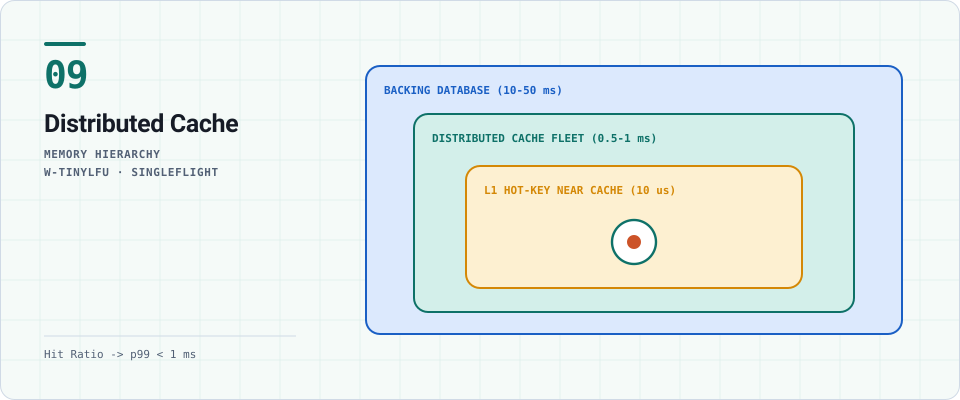
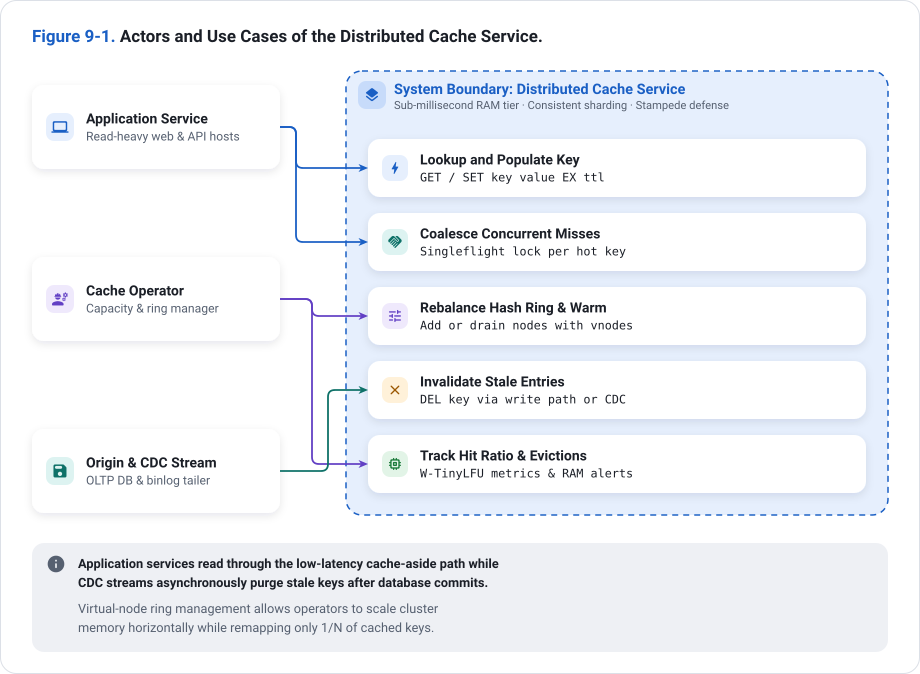
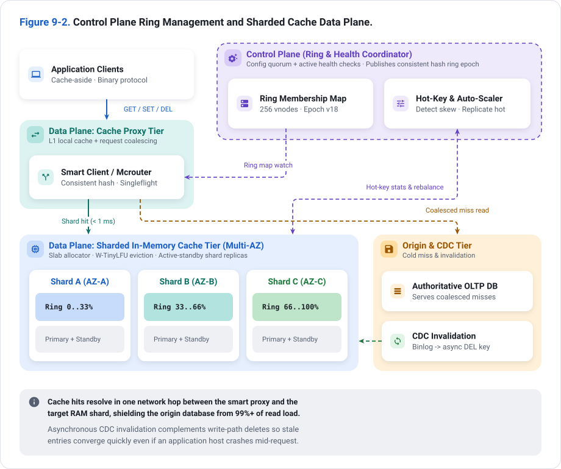
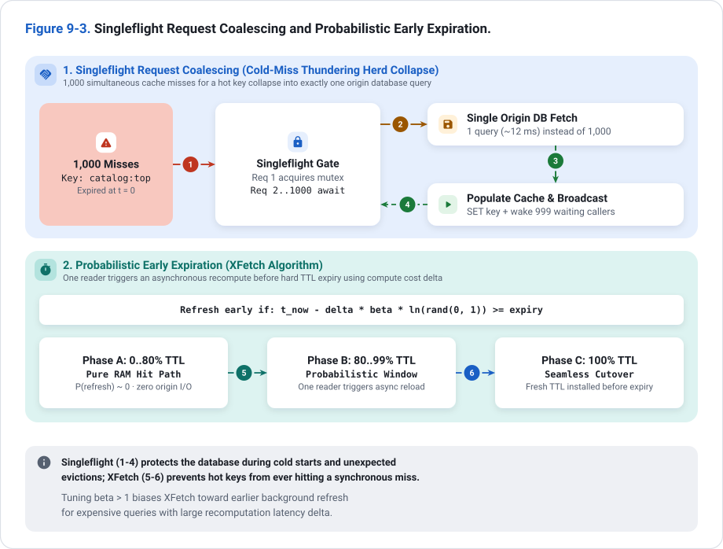

# Chapter 9: Distributed Cache



Every read against a durable database pays for disk I/O, index traversal, lock acquisition, or multi-table joins. When thousands of callers request the same product catalog item or user profile within a few seconds, repeating identical database work wastes backend CPU and bounds overall platform throughput to storage IOPS. A distributed cache keeps hot copies in RAM across a fleet of memory-optimized nodes, answering repeat reads in under a millisecond and insulating backing databases from 90% to 99% of aggregate read volume.

That speedup creates a subtle architectural dependency. Every cached value is a mutable copy that can diverge from its source of truth, memory is finite so the cache must continuously evict entries, and a database sized for `1%` of read traffic collapses immediately if a cold restart or synchronized expiry drops the hit ratio to `0%`. In this chapter, I design a horizontally sharded distributed cache from first principles. We establish capacity bounds and wire contracts, separate ring-membership management (control plane) from sub-millisecond data lookup (data plane), analyze eviction policies from LRU to W-TinyLFU, and engineer defenses against stale-value races, thundering-herd stampedes, hot-key skew, penetration, and cascading avalanches.

<div class="covers">

In this chapter, we cover

- hit-ratio amplification arithmetic, actors, functional contracts, sub-millisecond latency SLOs, non-goals, and fleet memory sizing
- binary/HTTP cache-aside wire contracts, conditional lease tokens (`CAS`), and CDC-driven invalidation interfaces
- separation of consistent hash ring membership and hot-key detection (control plane) from direct-routed in-memory serving (data plane)
- cache topologies (cache-aside, read-through, write-through, write-behind) and eviction mechanics (LRU, LFU, Sampled-LRU, and W-TinyLFU)
- consistent hashing with virtual nodes and bounded loads, hot-key L1 near-caching, and key replication
- stampede defense via singleflight request coalescing and probabilistic early expiration (XFetch), plus cache-aside race prevention, Bloom filters, and TTL jitter
- failure recovery (gutter pools, cold-cluster warmup), SLIs, production architectures (Facebook Memcache/Mcrouter, Redis, Caffeine), and simulation verification

</div>

## 9.1 Requirements, Actors, and Capacity Bounds

### Actors and Use Cases

We organize the distributed cache around three actors: application services reading and invalidating cached entries, an asynchronous Change Data Capture (CDC) invalidation pipeline draining database commit logs, and platform operators managing cluster ring membership and eviction health (Figure 9-1).

<figure class="diagram">

<figcaption><b>Figure 9-1</b> Actors, system boundary, and core use cases of the distributed cache service.</figcaption>
</figure>

| Actor | Operation | Concrete Scenario |
| :--- | :--- | :--- |
| **Application Service** | Lookup (`GET`), populate (`SET` with TTL), and delete (`DEL`) | Serve user profiles and product pages in `< 1 ms` while collapsing concurrent cold misses through singleflight |
| **CDC Invalidation Worker** | Stream committed database writes to cache `DEL` commands | Remove stale cache entries reliably even when an application process crashes immediately after committing a database transaction |
| **Platform Operator** | Scale ring membership, warm replacement nodes, and tune eviction | Add cache shards with minimal key migration using virtual nodes and track hit ratios, eviction rates, and hot-key skew |

### Functional Requirements

| No. | Functional Requirement |
| :--- | :--- |
| 0 | Callers can store an opaque byte value under a string key with a mandatory positive Time-To-Live (TTL) expiration bound. |
| 1 | Callers can fetch a single key or a pipelined batch of keys (`MGET`), receiving either the cached payload or an explicit miss response. |
| 2 | Callers and CDC pipelines can explicitly delete keys (`DEL`) and execute conditional lease-guarded fills (`CAS` / lease token) to prevent stale writes from overwriting newer invalidations. |
| 3 | When a cache node reaches its memory ceiling, it evicts entries automatically according to an admission and eviction policy (LRU or W-TinyLFU) without blocking concurrent reads. |
| 4 | The client routing layer coalesces concurrent cache misses for the same key (singleflight) and supports probabilistic early refresh to protect backing databases from stampedes. |

### Non-Functional Requirements and SLOs

| No. | Property | Target Specification | Architectural Consequence |
| :--- | :--- | :--- | :--- |
| 0 | **Latency** | `p50 <= 0.3 ms`, `p99 <= 1.0 ms`, `p999 <= 3.0 ms` (intra-AZ) | Pure in-memory storage, persistent connection pools, direct single-hop client-to-shard routing via smart client or local proxy (zero central load balancer hop) |
| 1 | **Throughput and Capacity** | `100 GB` active working set; `200,000` sustained reads/s (`600,000` peak burst reads/s) | Sharded across `8` memory-optimized cache nodes (`16 GB` RAM each) using consistent hashing with `256` virtual nodes per shard |
| 2 | **Consistency** | Bounded eventual consistency; staleness upper-bounded strictly by entry TTL | Explicit invalidation via write path plus CDC handles the common case; TTL acts as an unconditional safety net |
| 3 | **Availability and Blast Radius** | Single-node loss affects `<= 1/N` (`12.5%`) of keyspace with zero durable data loss | Cache holds volatile copies only; gutter fallback nodes and origin concurrency limits shield the database during node failure |
| 4 | **Hit-Ratio Sensitivity** | Sustain `>= 98%` hit ratio on Zipfian read traffic (`10x` to `50x` DB load reduction) | Requires scan-resistant eviction (W-TinyLFU) and consistent hashing so topology changes do not flush the entire fleet |

### Non-Goals and Scope Boundaries

- **Durable source-of-truth persistence:** We do not write synchronous WAL files to disk or run Raft consensus per write. Every entry is a reconstructible copy of data stored durably in a primary database.
- **Strong linearizable reads after write:** Financial ledger balances, inventory reservation counts, and permission revocation checks must read the authoritative database (or bypass the cache) rather than tolerating a staleness window.
- **Complex secondary queries or range joins:** The cache serves point lookups (`GET key`) and batched key fetches (`MGET`) only.

### Hit-Ratio Arithmetic and Back-of-the-Envelope Capacity Bounds

Understanding hit-ratio nonlinearity governs every sizing decision in a caching tier. If a cache hit takes `1 ms` and a database read takes `20 ms`, lifting the hit ratio from `90%` to `99%` lowers mean latency from `2.9 ms` to `1.19 ms`, but more importantly cuts database read volume by **10x** (from `10%` of requests down to `1%`). Conversely, if a cache cluster empties completely, database traffic jumps by **100x**.

| Resource Dimension | Arithmetic Derivation | Provisioned Bound |
| :--- | :--- | :--- |
| **Target Working Set** | `100,000,000` cached items `* 1 KB` average value (`+ ~100 B` key and allocator metadata) | `~110 GB` gross memory footprint |
| **Usable RAM per Node** | `16 GB` physical cache RAM `* 0.85` (reserving `15%` for slab fragmentation, metadata, and OS buffers) | `13.6 GB` usable per node |
| **Minimum Shard Count** | `110 GB / 13.6 GB` = `8.09` -> provision `9` nodes (`3` per AZ) | `9` shards (`122.4 GB` usable capacity) |
| **Per-Node Read Throughput** | `200,000` sustained RPS `/ 9` nodes (`600,000` peak `/ 9`) | `22,222` sustained RPS/node (`66,667` peak RPS/node; well below `150k+` single-node Memcached/Redis ceiling) |
| **Network Egress per Node** | `66,667` peak RPS `* 1 KB` payload | `66.7 MB/s` (`~0.53 Gbps` per node; fits comfortably inside `10 Gbps` NICs) |
| **Backing DB Miss Load** | `200,000` RPS `* (1 - 0.99)` at `99%` hit ratio | `2,000` DB reads/s steady state; surges to `22,222` DB reads/s on 1-node loss unless guttered |

## 9.2 External API and Data Contracts

Production caches serve hot-path reads over lightweight binary protocols (Memcached binary protocol or Redis RESP3) to avoid HTTP header and JSON parsing overhead. For clarity across service boundaries, we document the equivalent RESTful contract alongside the conditional lease primitive used to close stale-value races.

### Lookup, Lease-Guarded Fill, and Invalidation Contracts

**Read key (`GET /v1/entries/{key}`):**

On a cache miss, the cache server issues a unique 64-bit `X-Cache-Lease` token alongside `404 Not Found`. Any subsequent `DELETE` on that key invalidates all outstanding lease tokens for that key.

```http
GET /v1/entries/product:8821 HTTP/2
Host: cache-shard-03.internal
```

```http
HTTP/2 404 Not Found
X-Cache-Lease: 90481122
X-Cache-Status: MISS
```

**Conditional populate (`PUT /v1/entries/{key}`):**

The caller fetches the fresh row from the backing database and supplies `If-Match-Lease` together with a jittered `Cache-Control: max-age` TTL. If a writer invalidated `product:8821` while the reader was querying the database, the shard rejects the stale write with `412 Precondition Failed`, preserving cache correctness.

```http
PUT /v1/entries/product:8821 HTTP/2
Host: cache-shard-03.internal
Cache-Control: max-age=317
If-Match-Lease: 90481122
Content-Type: application/octet-stream

<serialized product payload>
```

```http
HTTP/2 204 No Content
```

**Explicit invalidation (`DELETE /v1/entries/{key}`):**

Writers issue `DELETE` only after the primary database transaction commits.

```http
DELETE /v1/entries/product:8821 HTTP/2
Host: cache-shard-03.internal
```

```http
HTTP/2 204 No Content
```

### In-Memory Entry Metadata Layout

Each shard stores compact metadata per entry in slab-allocated memory to avoid heap fragmentation:

```text
EntryHeader {
    key_hash:      u64,   // 64-bit xxHash / SipHash for O(1) bucket probe
    expires_at_ms: u64,   // Absolute monotonic expiry timestamp (enforces TTL)
    lease_epoch:   u64,   // Monotonic per-key invalidation version (for CAS/lease checks)
    flags:         u16,   // Compression flag (LZ4/Zstd) + negative-cache tombstone bit
    val_len:       u32,   // Opaque payload length in bytes
}
```

## 9.3 High-Level Architecture: Control Plane vs. Data Plane

We separate cluster topology management, health probing, and hot-key detection (control plane) from direct client-to-shard reads and writes (data plane) so that a configuration-store hiccup never interrupts sub-millisecond reads (Figure 9-2).

<figure class="diagram">

<figcaption><b>Figure 9-2</b> Control-plane ring management and sharded in-memory data-plane topology.</figcaption>
</figure>

### Component Responsibilities and Failure Domains

| Component | Plane | State Held | Failure Impact and Mitigation |
| :--- | :--- | :--- | :--- |
| **Ring and Health Coordinator** | Control | Authoritative shard membership map, consistent hash ring epoch (`v18`), and active health checks | Smart clients and proxies cache the latest ring snapshot in RAM; control-plane outage pauses scaling edits without affecting reads or writes |
| **Hot-Key Detector and Auto-Scaler** | Control | Sampled heavy-hitter sketches (`Top-K` keys per shard) and memory-pressure telemetry | Pushes hot-key identifiers to L1 near-cache allowlists and triggers key replication before one shard NIC saturates |
| **Smart Client / Proxy Tier (Mcrouter)** | Data | Local ring map, L1 tiny hot-key cache (`1` to `5 s` TTL), singleflight wait table, circuit breakers | Runs co-located as a sidecar or library inside application hosts; eliminates extra network hops and isolates dead shards within `5 ms` |
| **Sharded Cache Fleet (Multi-AZ)** | Data | Slab-allocated key-value entries, W-TinyLFU frequency sketch, TTL expiration heaps | Losing one shard causes misses for `1/N` of keys; proxy routes misses for the failed shard to standby **gutter** nodes rather than overloading peer shards |
| **CDC Invalidation Relay** | Data | Database WAL / binlog offset and idempotent delete queue | Replays committed mutations as cache `DEL` calls asynchronously, repairing any dropped application-level invalidation |

### Read and Write Path Walkthrough

1. **L1 Hot-Key Near-Cache Check:** The application's smart client checks a tiny process-local L1 cache (holding only top `1,000` hot keys with a `1` to `2 s` TTL) in `~10 microseconds`.
2. **Consistent Hash Lookup:** On an L1 miss, the client hashes the key (`xxHash64`) onto the consistent hash ring (with `256` virtual nodes per shard) and sends a direct `GET` over a persistent TCP pool to the owning cache node.
3. **Singleflight Coalescing on Miss:** On a `404` miss with `X-Cache-Lease`, the client acquires an in-process singleflight gate for that key. Concurrent threads requesting the same key await the leader's result instead of issuing redundant database queries.
4. **Origin Fetch and Conditional Fill:** The winning caller reads the backing database, populates the cache shard with `PUT` carrying `If-Match-Lease` and a jittered TTL, and broadcasts the value to all waiting local callers.
5. **Write-Path Invalidation:** On a mutation, the application commits to the primary database first and then issues `DELETE` to the cache shard (backed up asynchronously by the CDC invalidation relay).

## 9.4 Cache Topologies, Eviction Policies, and Sharding Mechanics

### Choosing Cache-Aside Over Write-Through and Write-Behind

We evaluate four canonical arrangements between cache and database:

| Pattern | Cache Population | Write Order | Staleness Profile | Cache-Outage Behavior |
| :--- | :--- | :--- | :--- | :--- |
| **Cache-Aside (Chosen)** | Application populates lazily on miss | Update DB first, then `DELETE` cache key | Bounded by TTL (and race-protected via leases) | Degrades cleanly to DB reads (protected by DB concurrency caps) |
| **Read-Through** | Cache proxy fetches DB on miss | Application updates DB and invalidates cache | Identical to cache-aside | Reads fail unless application maintains a fallback path |
| **Write-Through** | Cache populates synchronously on every write | Write cache + DB synchronously | Near-zero for writes routed through cache | Writes fail or stall on cache outage; pollutes RAM with cold keys never read |
| **Write-Behind (Write-Back)** | Cache accepts write immediately; async DB flush | Write cache now, batch-flush DB later | Cache is newest; DB lags asynchronously | **Data loss** if cache node crashes before flush completes |

Cache-aside keeps the cache strictly optional, loads only keys that callers actually read, and avoids write-behind durability loss.

### Eviction Policies: From LRU and LFU to W-TinyLFU

A steady-state cache is perpetually full; every insertion evicts an existing entry. Choosing the victim governs hit ratio across shifting and scan-heavy workloads.

**Least Recently Used (LRU)** orders entries in a doubly linked list, promoting an entry to the head on every access and evicting from the tail. Advancing through Interactive Trace 9.A reveals LRU's structural weakness: a single sequential scan of cold keys (`B`, `C`, `D`) flushes a genuinely hot key (`A`) that was accessed three times in a row.

<figure class="steps" data-prefix="figures/steps-cache-lru" data-count="9" data-version="064246a2">

<figcaption><b>Interactive Trace 9.A</b> LRU eviction on the access sequence A, A, A, B, C, D, A: one-hit scan keys flush hot key A. Use Next and Back to step through.</figcaption>
</figure>

**Least Frequently Used (LFU)** tracks per-entry access counts and evicts the lowest-count item. As Interactive Trace 9.B illustrates on the exact same sequence, LFU preserves hot key `A` across the scan. However, plain LFU suffers from **cache pollution by historical popularity**: an item accessed `10,000` times yesterday occupies RAM indefinitely even when no longer requested, starving newly trending keys whose count begins at `1`.

<figure class="steps" data-prefix="figures/steps-cache-lfu" data-count="9" data-version="9088afeb">

<figcaption><b>Interactive Trace 9.B</b> LFU eviction on the same sequence A, A, A, B, C, D, A: frequency count protects A from the scan. Use Next and Back to step through.</figcaption>
</figure>

Two production algorithms resolve these trade-offs:

1. **Approximated Sampled-LRU (Redis):** Updating a global doubly linked list on every read creates lock contention across CPU cores and consumes `16 bytes` of pointers per key. Redis instead samples `k = 5` to `10` random keys and evicts the one with the oldest 24-bit idle timestamp, approaching true LRU hit ratios at a fraction of the memory and locking overhead.
2. **Window TinyLFU (W-TinyLFU, used in Caffeine):** Combines recency and frequency with tiny memory overhead:
   - New entries enter a small **Window LRU** (`1%` of cache capacity) to capture sudden bursty locality.
   - Evictions from the Window compete against the eviction victim of the **Main Segmented LRU (SLRU)** (`99%` of capacity, split `20%` probation / `80%` protected) using an admission filter backed by a **4-bit Count-Min Sketch** plus a Bloom doorkeeper.
   - The newcomer displaces the main victim only if its estimated frequency exceeds the victim's frequency. Periodically halving all sketch counters ages out historical popularity, preventing stale heavy hitters from lingering permanently.

| Eviction Policy | Per-Key Metadata | Scan Resistance | Adaptation to Popularity Shift | Production Use |
| :--- | :--- | :--- | :--- | :--- |
| **Strict LRU** | `16 B` list pointers | Poor (flushed by sequential scans) | Fast | Memcached slab LRU (segmented Hot/Warm/Cold) |
| **Decaying LFU** | `8` to `16 B` counter | High | Slow without aggressive decay | Redis `allkeys-lfu` (Morris logarithmic counter) |
| **Sampled-LRU (`k = 5`)** | `3 B` idle clock | Poor | Fast | Redis default `allkeys-lru` |
| **W-TinyLFU** | `~1` to `2 B` amortized sketch | Excellent (rejects one-hit wonders at admission) | Fast (Window LRU + periodic halving) | Caffeine (JVM), Otter (Go), modern L1/L2 caches |

### Consistent Hashing with Virtual Nodes and Bounded Loads

Assigning keys via `hash(key) mod N` remaps `(N - 1) / N` of all keys whenever one shard joins or leaves, causing an instant fleet-wide cache flush. We instead place every physical shard at `256` deterministic positions (**virtual nodes**) around a `2^64` consistent hash ring. Adding a `10th` node to `9` shards moves roughly `1/10` (`10%`) of the keyspace while keeping key-count variance across nodes below `5%`.

Standard consistent hashing still breaks under **hot-key skew**: if one celebrity profile or flash-sale SKU draws `120,000` RPS, the single shard owning that ring token saturates its NIC and CPU while peer shards remain idle. Two production techniques mitigate skew:

1. **Consistent Hashing with Bounded Loads (Mirrokni et al., Google):** Each shard enforces an explicit load cap `ceil((1 + epsilon) * average_load)` (for example, `1.25x` average load). When a target shard hits its cap, the proxy walks clockwise along the ring to the next shard with available headroom, bounding maximum skew mathematically while preserving cache locality.
2. **Hot-Key Replication and L1 Near-Caching:** For extreme single-key floods (`> 50,000` RPS on one key), the control-plane heavy-hitter detector flags the key. Clients either cache the value locally in L1 RAM for `1` to `2 seconds` or scatter reads across `K` replicated key suffixes (`product:8821#0` through `product:8821#7`), trading `K` invalidations on write for `K`-fold read scalability.

## 9.5 Consistency Races, Stampedes, Penetration, and Avalanches

### Closing the Cache-Aside Stale-Value Race

Under cache-aside, writers update the database first and then `DELETE` the cache key (rather than overwriting the cache directly, which lets two out-of-order concurrent writers leave the older value cached). Even with `UPDATE DB -> DELETE cache`, an interleaving between a slow reader and a fast writer can leave a stale value cached permanently until TTL expiry, as demonstrated in Interactive Trace 9.C:

<figure class="steps" data-prefix="figures/steps-cache-race" data-count="7" data-version="7684ca0a">

<figcaption><b>Interactive Trace 9.C</b> Cache-aside read/write interleaving leaving stale price 10 cached after the database commits 20. Use Next and Back to step through.</figcaption>
</figure>

We layer three defenses against this race:

1. **Mandatory TTL Bound:** Every entry carries an explicit expiration, guaranteeing that even a dropped invalidation or undetected race heals automatically within bounded time.
2. **Lease-Guarded Conditional Fill (Facebook Memcache Leases):** On a miss, the cache returns a 64-bit `lease_epoch` token. Any `DELETE` invalidates all outstanding tokens for that key. When the delayed reader in Interactive Trace 9.C attempts to store stale price `10` using its invalidated lease token, the shard rejects the write with `412 Precondition Failed`.
3. **CDC Log-Tailing Invalidation (Delayed Double-Delete Alternative):** Streaming committed changes from the database write-ahead log (via Debezium or Maxwell) guarantees that cache deletes happen in exact commit order even if the originating application server crashes between `COMMIT` and `DELETE`.

### Defending Against Cache Stampedes (Thundering Herd)

When a hot entry receiving `1,000` reads/s expires and takes `12 ms` to recompute from the database, `12` to `1,000` concurrent callers miss simultaneously and launch duplicate origin queries, creating a positive-feedback latency spiral. We deploy two complementary defenses (Figure 9-3):

<figure class="diagram">

<figcaption><b>Figure 9-3</b> Singleflight miss coalescing and Probabilistic Early Expiration (XFetch) stampede prevention.</figcaption>
</figure>

1. **Singleflight Request Coalescing (Cold-Miss Collapse):** Inside each application host or cache proxy, an in-memory map of in-flight miss keys ensures that at most one caller per proxy queries the origin database for a given key. All concurrent local callers subscribe to that singleflight future and receive the populated value together. Across a fleet of `100` hosts, pairing local singleflight with Memcache per-key miss leases (`1` token issued per `10 s` per shard; other missers receive a short retry hint) collapses global origin load to a single query.
2. **Probabilistic Early Expiration (`XFetch`, Vattani et al.):** For hot keys with measurable recomputation time `delta`, we avoid the expiry cliff altogether. Whenever a reader hits a cached entry storing `(value, delta, expiry)`, it triggers an early background recomputation if:

```text
current_time - delta * beta * ln(rand(0, 1)) >= expiry
```

Because `ln(rand(0, 1))` is negative, `-delta * beta * ln(rand(0, 1))` adds a random positive lookahead proportional to recomputation cost `delta` (with tuning factor `beta >= 1.0`). As `current_time` approaches `expiry`, the probability that one reader refreshes the key early rises smoothly while all other callers keep receiving fast hits, eliminating cold expiry spikes with zero distributed locks.

### Defending Against Penetration and Avalanches

- **Cache Penetration (Nonexistent Keys):** Malicious scanners or broken clients querying nonexistent IDs bypass positive caches completely and hammer the database. We combine **short-TTL negative caching** (`30` to `60 s` tombstones for absent keys) with a **front-door Bloom filter** (for `10^9` valid keys at `1%` false-positive rate, `~1.2 GB` of bitset memory rejects `99%` of invalid keys before they touch cache or database).
- **Cache Avalanche (Mass Simultaneous Expiry or Node Loss):** Loading a catalog batch with an identical `3,600 s` TTL causes all entries to expire together. Adding uniform **TTL jitter** (`base_ttl + rand(0, 0.15 * base_ttl)`) spreads expiration evenly. Against single-shard crashes, Facebook's **Gutter Pool** routes failed-shard misses to a small `1%` fleet of standby cache nodes with short TTLs instead of reshuffling keys onto healthy primary shards (which could trigger cascading OOMs). Finally, an independent origin **database concurrency bulkhead** guarantees that even a `0%` hit ratio degrades gracefully via shedding rather than taking down storage.

## 9.6 Failure Modes, SLIs, and Production Systems

### Failure and Recovery Matrix

| Failure Mode | Operational Symptom | Automated Mitigation |
| :--- | :--- | :--- |
| **Single Cache Shard Crash** | `1/N` (`11%`) of requests miss; origin DB read QPS jumps `~11x` | Smart client trips circuit breaker in `5 ms` and routes failed shard's keys to standby **gutter** pool with short TTL; origin bulkhead caps DB concurrency |
| **Cold Cluster Restart (Avalanche)** | Hit ratio plunges to `0%`; DB CPU spikes toward `100%` | Progressive traffic ramp (`5% -> 25% -> 100%`) or peer-cluster cold warmup (reading from an adjacent warm region before hitting DB) |
| **Hot-Key Flood (`100k+` RPS)** | Single shard saturates CPU/NIC while peer shards sit idle | Control-plane heavy-hitter detector enables `1` to `2 s` L1 near-caching and bounded-load overflow or `K`-way key replication |
| **Batch Scan Pollution** | Hit ratio collapses after analytics job reads millions of cold keys | W-TinyLFU admission sketch rejects one-hit keys; batch pipelines explicitly bypass cache via direct read replicas |
| **Dropped Application `DELETE`** | Readers observe stale entry after DB write | CDC WAL invalidation pipeline deletes key asynchronously within `< 500 ms`; mandatory TTL bounds worst-case staleness |
| **Penetration Attack (Random IDs)** | Cache miss rate rises sharply; DB spends CPU on empty lookups | Front-door Bloom filter rejects `99%` of nonexistent keys; `30 s` negative tombstones absorb repeated misses |

### Key SLIs and Operational Alerts

- **Cache Hit Ratio by Keyspace:** Tracked separately per namespace (`alert` if hit ratio drops `> 3%` below rolling 7-day baseline, because a drop from `99%` to `96%` quadruples DB read traffic).
- **Shard Tail Latency (`p99` and `p999`):** Alert when intra-AZ `p99 > 1.5 ms` for `3 minutes` (early warning of hot-key CPU contention or memory swapping).
- **Eviction Rate and Item Lifetime:** Alert if mean time-to-eviction falls below `50%` of configured TTL (indicating an undersized working set causing thrashing).
- **Singleflight Coalesce Ratio and Origin Miss QPS:** Tracks how many concurrent misses collapsed per DB query and alerts if origin miss QPS approaches database read capacity.

### Real-World Production Systems

| Production System | Core Eviction / Routing | Stampede & Consistency Mechanism | Architectural Distinction |
| :--- | :--- | :--- | :--- |
| **Facebook Memcache / Mcrouter** | Segmented LRU (Hot/Warm/Cold slabs) + Mcrouter consistent hash proxy | 64-bit Memcache **leases** (solves both stale-set races and thundering herds) + **Gutter** failover pool | Regional replication pools, cold-cluster warmup from neighboring pools, and MySQL binlog (`McSqueal`) invalidation |
| **Redis Cluster / Valkey** | `16,384` hash slots + Sampled-LRU (`k = 5`) or Morris decaying LFU | Single-threaded atomic Lua scripts + optional client-side tracking invalidations | Rich in-memory data structures (hashes, sorted sets, Bloom modules) alongside raw key-value caching |
| **Caffeine (JVM) / Otter (Go)** | W-TinyLFU (Window LRU + Count-Min Sketch + Segmented LRU) | Lock-free ring buffers for read/write metadata batching | Near-optimal hit ratios across both recency-heavy and scan-heavy workloads |
| **Twitter Pelikan / Cachelib** | Segmented FIFO / S3-FIFO and hybrid RAM+NVMe tiers | Slab-rebalancing and low-overhead lock-free queues | Demonstrated in OSDI 2020 that simple FIFO-family policies match or outperform strict LRU on many production cache traces |

## 9.7 Simulation Verification

To measure empirically how cache capacity translates into hit ratio under skewed Zipfian popularity, we run the repository's `cachesim` benchmark (`code/cachesim/src/main.rs`), which replays `1,000,000` read requests across `100,000` distinct keys against an LRU cache sized at `1%`, `5%`, `10%`, and `25%` of the keyspace:

```console
$ cargo run --release -p cachesim
1000000 requests for 100000 keys, a few of them popular
  cache holds  1% of the keys:  5.7% of requests answered from the cache
  cache holds  5% of the keys: 24.7% of requests answered from the cache
  cache holds 10% of the keys: 42.2% of requests answered from the cache
  cache holds 25% of the keys: 72.7% of requests answered from the cache
```

Holding `25%` of the keyspace (`25,000` keys) absorbs `72.7%` of all requests, cutting backing-store traffic by `3.66x`. Under steeper real-world Zipfian exponents (`alpha >= 1.0`), `5%` to `10%` of the keyspace routinely exceeds `95%` to `99%` hit ratios. In practice, operators must always benchmark miss-ratio curves against real production access traces before finalizing fleet RAM budgets.

<div class="simulation">

**Run the distributed cache hit-ratio simulation.** Execute `cargo run --release -p cachesim` in `code/` ([`code/cachesim/src/main.rs`](https://github.com/arpanpathak/cracking-the-systems-programming-interview/blob/prep-v2/distributed-systems-from-the-ground-up/code/cachesim/src/main.rs)) to reproduce the 1,000,000-request Zipfian hit-ratio curve across 1%, 5%, 10%, and 25% cache capacities.

</div>

## 9.8 Terminology and References

### Engineering Glossary

| Term | Definition |
| :--- | :--- |
| **Cache-Aside** | A topology in which the application checks the cache on reads, queries the database on misses to populate the cache, and deletes the cache key after committing database writes. |
| **W-TinyLFU** | A scan-resistant admission and eviction policy combining a small Window LRU, a Count-Min Sketch frequency filter, and a Segmented Main LRU. |
| **Consistent Hashing with Bounded Loads** | A hash-ring routing algorithm that caps per-shard traffic at `(1 + epsilon)` times average load and overflows hot traffic clockwise to neighboring shards. |
| **Singleflight Coalescing** | Deduplicating concurrent in-flight cache misses for the same key within a host or proxy so only one request queries the backing database. |
| **Probabilistic Early Expiration (XFetch)** | Refreshing a cached entry asynchronously before its TTL expires with probability rising exponentially as remaining lifetime shrinks relative to recomputation time. |
| **Memcache Lease** | A 64-bit token issued by a cache shard on a miss that both throttles concurrent origin queries and rejects stale `SET` operations invalidated by an intervening `DELETE`. |
| **Cache Penetration** | Sustained queries for nonexistent keys that miss the cache on every attempt and hit the backing database directly; mitigated by Bloom filters and negative caching. |
| **Cache Avalanche** | A sudden fleet-wide collapse in hit ratio caused by synchronized TTL expiry or shard failure; mitigated by TTL jitter, gutter pools, and origin load shedding. |
| **Gutter Pool** | A small standby cluster that absorbs misses for a failed cache shard with short TTLs, protecting the database without overloading healthy cache primaries. |

### References

- R. Nishtala, H. Fugal, S. Grimm, M. Kwiatkowski, H. Lee, H. C. Li, R. McElroy, M. Paleczny, D. Peek, P. Saab, D. Stafford, T. Tung, and V. Venkataramani, "Scaling Memcache at Facebook", USENIX NSDI, 2013.
- G. Einziger, R. Friedman, and B. Manes, "TinyLFU: A Highly Efficient Cache Admission Policy", ACM Transactions on Storage, 2017.
- A. Vattani, F. Chierichetti, and K. Lowenstein, "Optimal Probabilistic Cache Stampede Prevention", VLDB, 2015.
- V. Mirrokni, M. Thorup, and M. Zadimoghaddam, "Consistent Hashing with Bounded Loads", ACM-SIAM SODA, 2018.
- J. Yang, Y. Yue, and K. V. Rashmi, "A Large Scale Analysis of Hundreds of In-Memory Cache Clusters at Twitter", USENIX OSDI, 2020.
- B. H. Bloom, "Space/Time Trade-offs in Hash Coding with Allowable Errors", Communications of the ACM, 1970.
- Redis Documentation, "Key Eviction Policies (Approximated LRU and LFU)".
