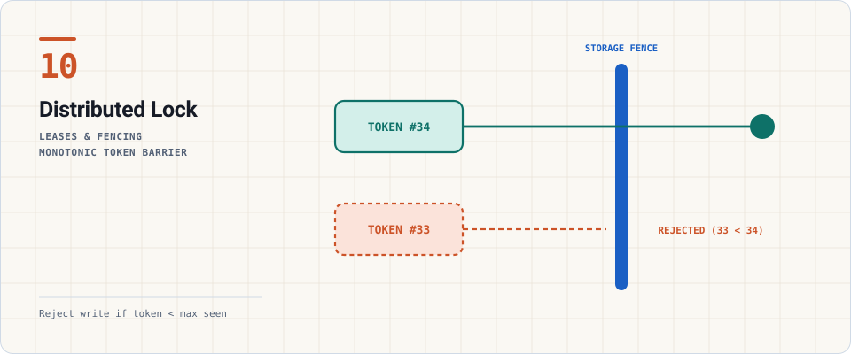
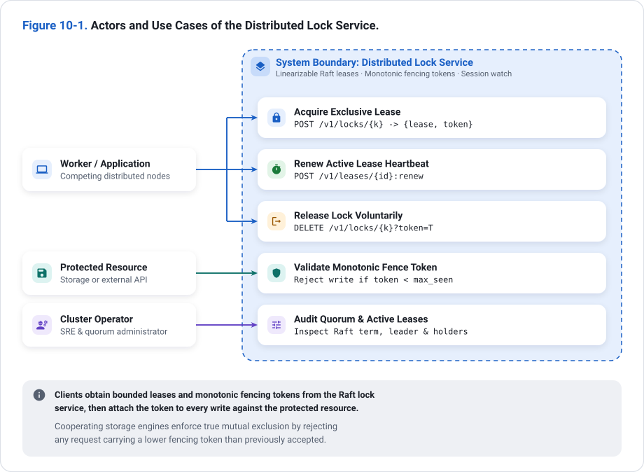
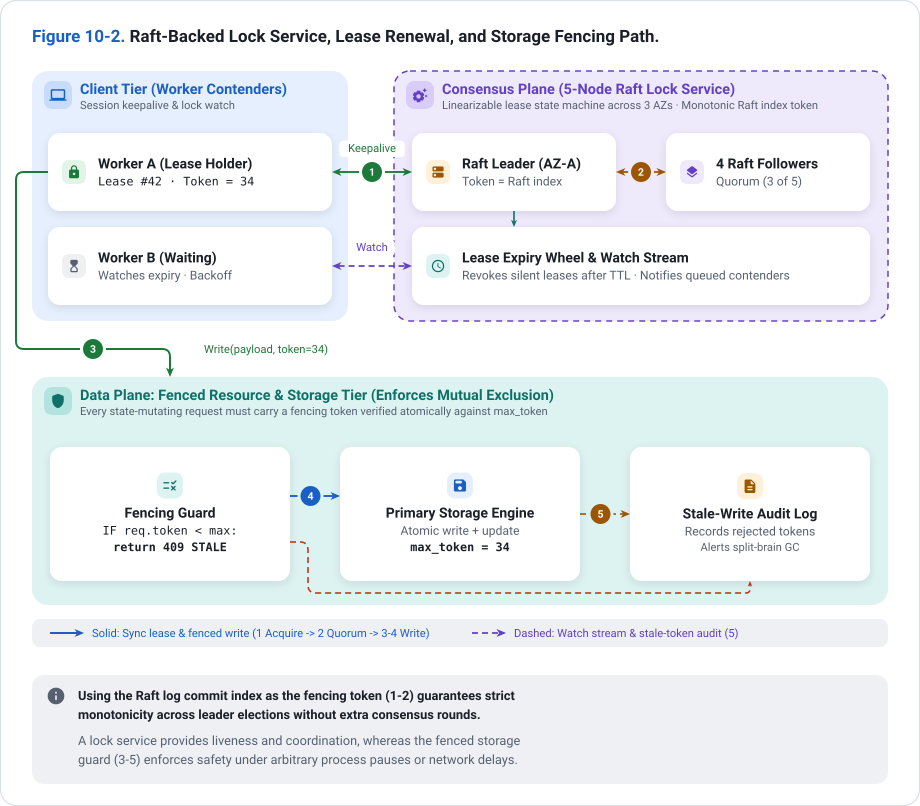
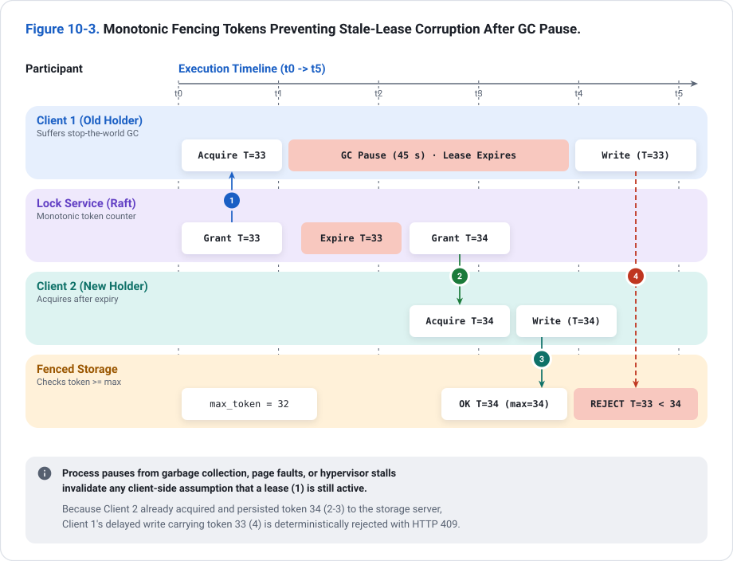

# Chapter 10: Distributed Lock Service



Inside a single operating-system process, a mutex guarantees mutual exclusion because the kernel mediates both thread scheduling and shared memory access. Across a distributed network, no global kernel exists. A worker holding a lock may crash without releasing it, stall for tens of seconds during a stop-the-world garbage collection pause or VM live migration, or lose network connectivity while continuing to send buffered packets toward shared storage. Observers on the network cannot distinguish a dead holder from a slow or paused holder.

In this chapter, I design a linearizable distributed lock service modeled on Google Chubby, Apache ZooKeeper, and etcd. We first separate locks taken for efficiency from locks required for correctness, then establish requirements, capacity bounds, and lease APIs. After detailing a five-node Raft consensus architecture across three availability zones, we examine why time-bounded leases alone cannot guarantee mutual exclusion, evaluate Martin Kleppmann's critique of Redlock, and complete the safety proof by enforcing monotonic **fencing tokens** directly at the protected storage layer.

<div class="covers">

In this chapter, we cover

- efficiency locks versus correctness locks, actors, functional contracts, linearizability SLOs, non-goals, and state sizing
- HTTP/gRPC lease acquisition, heartbeat keepalive, conditional release, and storage-layer fencing DDL contracts
- five-node Raft consensus control plane, monotonic Raft-index token generation, and watch-stream session management
- why process pauses, VM migrations, and clock skew break lease-only mutual exclusion and why Redlock cannot guarantee correctness
- end-to-end fencing token enforcement at the storage layer, conditional release/renewal races, and progress-coupled keepalives
- fair waiter queues (ephemeral sequential watch chains) that eliminate release thundering herds, and when optimistic concurrency replaces locking
- failure modes, SLIs, production coordination services (Chubby, ZooKeeper, etcd, DynamoDB Lock Client), and simulation verification

</div>

## 10.1 Requirements, Actors, and Capacity Bounds

### Efficiency Locks vs. Correctness Locks

Before provisioning consensus hardware, we distinguish two fundamentally different uses of mutual exclusion:

- **Locks for Efficiency:** Prevent redundant work (for example, avoiding duplicate cache recomputations or running an idempotent analytics summary twice). If a lock occasionally fails under a network partition, the cost is extra compute rather than corrupted state.
- **Locks for Correctness:** Prevent concurrent mutations that corrupt persistent data (for example, two database primaries accepting conflicting writes, or two billing workers double-charging a ledger). An occasional mutual-exclusion failure causes permanent data loss or financial inconsistency.

In this chapter, we design for **correctness**, which requires both strongly consistent consensus inside the lock service and monotonic fencing enforcement inside the protected resource.

### Actors and Use Cases

We organize the lock service around three actors: distributed workers contending for exclusive leases, downstream storage systems validating monotonic fencing tokens on every write, and platform operators auditing Raft quorum health and active lease holders (Figure 10-1).

<figure class="diagram">

<figcaption><b>Figure 10-1</b> Actors, system boundary, and core use cases of the distributed lock service.</figcaption>
</figure>

| Actor | Operation | Concrete Scenario |
| :--- | :--- | :--- |
| **Worker / Application** | Acquire lease (`POST /v1/locks/{k}`), renew (`POST /v1/leases/{id}:renew`), release (`DELETE`) | Elect a single active leader for a sharded database partition or serialize a nightly settlement batch |
| **Protected Storage Resource** | Validate monotonic fencing token (`token >= max_seen_token`) | Reject delayed writes arriving from a paused worker whose lease already expired |
| **Platform Operator** | Audit Raft leader, term, quorum latency, and lock wait queues | Detect network partitions, stalled holders renewing indefinitely, or excessive fine-grained lock contention |

### Functional Requirements

| No. | Functional Requirement |
| :--- | :--- |
| 0 | A worker can attempt to acquire an exclusive lease on a named lock key; at most one worker holds an active lease for that key at any point in linearizable history. |
| 1 | Every granted lease carries a bounded server-enforced Time-To-Live (TTL) and a globally strictly increasing 64-bit **fencing token** (`token_new > token_prev`). |
| 2 | A lease holder can extend its active lease via conditional heartbeat keepalive (`POST /v1/leases/{id}:renew`) and release it voluntarily only if it still owns the matching lease token. |
| 3 | Waiting workers can subscribe to ordered watch notifications so lock handoff wakes exactly the next waiter in FIFO order without polling or thundering-herd contention. |
| 4 | Once a lease expires or is released, another worker can acquire the lock with a strictly higher fencing token. |

### Non-Functional Requirements and SLOs

| No. | Property | Target Specification | Architectural Consequence |
| :--- | :--- | :--- | :--- |
| 0 | **Consistency** | Strictly linearizable (`CP` under CAP) for lock acquisition, lease expiration, and monotonic token assignment | Mandates quorum consensus (5-node Raft group committing every grant and token increment to `3` of `5` nodes before returning) |
| 1 | **Availability** | `99.99%` across three availability zones; tolerates `2` simultaneous node failures (or `1` full AZ loss + `1` rolling restart) | Five-node Raft cluster placed `2 + 2 + 1` across three AZs; minority partition refuses grants rather than risking split-brain |
| 2 | **Latency** | `p50 <= 4 ms`, `p99 <= 15 ms` for acquire/release (`1` cross-AZ Raft quorum round trip plus WAL `fsync`) | Coarse-grained locks held for seconds to hours; unsuitable for microsecond per-row hot-path locking |
| 3 | **Scale** | Up to `1,000,000` active locks (`~100 MB` RAM) and `10,000` lock ops/s | Entire active lock table fits inside Raft state-machine RAM backed by NVMe WAL and periodic snapshots |

### Non-Goals and Scope Boundaries

- **Fine-grained, high-frequency per-row locking:** Calling a Raft consensus group `500,000` times per second on every HTTP request saturates leader WAL `fsync` bandwidth. Per-record concurrency belongs in database row locks or optimistic compare-and-set.
- **Correctness without storage-layer cooperation:** No lock service can prevent an already-transmitted TCP packet from a paused client from reaching an unfenced third-party API. If the downstream resource cannot check fencing tokens, callers must redesign mutations to be idempotent.
- **Unbounded eternal locks:** Every lock must attach to a bounded lease so a permanently crashed worker never deadlocks the cluster.

### Back-of-the-Envelope Capacity Bounds

| Resource Dimension | Arithmetic Derivation | Provisioned Bound |
| :--- | :--- | :--- |
| **Per-Lock Memory** | `50 B` key + `30 B` holder ID + `8 B` fencing token + `8 B` expiry + `32 B` index/watch overhead | `~128 B` per active lock |
| **Active State Footprint** | `1,000,000` concurrent locks `* 128 B` | `~128 MB` RAM (fits entirely in Raft state-machine memory) |
| **Quorum Write Throughput** | `10,000` acquires/renewals/s; batched Raft WAL commits sustain `20,000` to `40,000` ops/s on NVMe | `5` Raft nodes (`4` vCPU, `8 GB` RAM, dedicated NVMe WAL volume) |
| **Heartbeat Bandwidth** | `100,000` active sessions renewing every `10 s` = `10,000` keepalives/s `* 128 B` | `1.28 MB/s` (`~10 Mbps` total; negligible network cost) |
| **Raft Snapshot Size** | `128 MB` compressed with LZ4 | `~40 MB` snapshot written asynchronously every `100,000` log entries |

## 10.2 External API and Data Contracts

Every mutation carries explicit identity and fencing metadata so retries and late requests remain safe.

### Lock Service HTTP/gRPC Contracts

**Acquire exclusive lease (`POST /v1/locks/{key}`):**

Supplying `Idempotency-Key` guarantees that if the response to a granted lock is dropped on the network, the same worker retrying receives its existing lease and fencing token rather than failing with `409 Conflict`.

```http
POST /v1/locks/nightly-billing HTTP/2
Host: locks.internal
Content-Type: application/json
Idempotency-Key: worker-a-session-9102

{
  "holder": "worker-a",
  "ttl_seconds": 30
}
```

```http
HTTP/2 201 Created
Content-Type: application/json

{
  "lock_key": "nightly-billing",
  "lease_id": 42,
  "fencing_token": 34,
  "expires_in_seconds": 30
}
```

If another worker already holds an active lease, the service responds with `409 Conflict` and an RFC 9457 error payload (or blocks via a streaming gRPC watch queue if `wait=true` is specified):

```http
HTTP/2 409 Conflict
Content-Type: application/problem+json

{
  "type": "/problems/lock-held",
  "title": "Lock Currently Held",
  "status": 409,
  "detail": "Lock nightly-billing is held under fencing_token 34; retry or attach a watch."
}
```

**Renew lease heartbeat (`POST /v1/leases/{lease_id}:renew`):**

```http
POST /v1/leases/42:renew HTTP/2
Host: locks.internal
Content-Type: application/json

{
  "holder": "worker-a",
  "fencing_token": 34,
  "extend_seconds": 30
}
```

```http
HTTP/2 200 OK
Content-Type: application/json

{
  "lease_id": 42,
  "fencing_token": 34,
  "expires_in_seconds": 30
}
```

**Conditional release (`DELETE /v1/locks/{key}?token={fencing_token}`):**

The Raft state machine deletes the lock key if and only if the currently stored `fencing_token` equals the query parameter (`34`). A stale holder presenting token `33` receives `412 Precondition Failed` instead of deleting its successor's lock.

### Protected Storage Fencing Contract (SQL / KV DDL)

To complete end-to-end correctness, every table or object protected by a distributed lock stores the highest accepted `fence_token` and validates it atomically on every mutation:

```sql
CREATE TABLE billing_ledger_state (
    partition_id   BIGINT PRIMARY KEY,
    last_fence_tok BIGINT NOT NULL DEFAULT 0,
    payload        BYTEA  NOT NULL,
    updated_at     TIMESTAMPTZ NOT NULL
);

-- Atomic fenced update executed by the lock holder:
UPDATE billing_ledger_state
   SET payload        = $1,
       last_fence_tok = $2,
       updated_at     = NOW()
 WHERE partition_id   = $3
   AND last_fence_tok <= $2;
```

If the `UPDATE` affects `0` rows because another worker already committed with a higher token (`last_fence_tok > $2`), the storage layer has safely fenced off the stale holder, and the worker aborts its batch immediately.

## 10.3 High-Level Architecture: Consensus Plane and Fenced Data Path

Unlike a stateless cache or rate limiter, the lock service cannot run with asynchronous replication. If a primary confirms a lock grant and crashes before replicating that entry to a follower, the newly promoted leader sees the lock as free and grants it to a second worker simultaneously. We therefore build the lock service on a five-node **Raft consensus group** spread across three availability zones, while keeping the protected storage tier completely off the consensus data path except for token validation (Figure 10-2).

<figure class="diagram">

<figcaption><b>Figure 10-2</b> Five-node Raft lock service, lease expiry wheel, watch stream, and storage fencing data path.</figcaption>
</figure>

### Component Responsibilities and Failure Domains

| Component | Plane | State Held | Failure Impact and Mitigation |
| :--- | :--- | :--- | :--- |
| **Raft Leader (1 of 5 nodes)** | Consensus / Control | Authoritative lock table, active lease expiry wheel, monotonic Raft log index counter | Commits every acquire, renew, expire, and release to a quorum (`3` of `5`) before replying. On crash, surviving majority elects a new leader within `1` to `3 s` with zero lost locks |
| **Raft Followers (4 nodes across 3 AZs)** | Consensus / Control | Replicated WAL + lock state machine + read-only watch proxies | Tolerate up to `2` node crashes simultaneously while maintaining quorum; minority nodes reject all lock writes |
| **Lease Expiry Wheel & Watch Stream** | Consensus / Control | Hierarchical timer wheel tracking lease deadlines and FIFO watch queues per lock key | When a lease deadline passes, the leader commits an explicit `EXPIRE` log entry through Raft and notifies exactly the head waiter |
| **Protected Storage Layer** | Data | Business records plus `last_fence_tok` column per protected resource | Enforces `incoming_token >= last_fence_tok` atomically on every write; completely eliminates split-brain corruption |

### Request Path Walkthrough

1. **Quorum Lock Acquisition:** Worker A sends `POST /v1/locks/nightly-billing` to the Raft leader. The leader checks that the lock is unheld, appends `(ACQUIRE, key="nightly-billing", holder="worker-a", ttl=30s)` to the Raft log at log index `34`, replicates to at least two followers, and commits.
2. **Monotonic Token Assignment:** Because every committed Raft log entry has a globally unique, strictly increasing 64-bit log index (or key `create_revision` in etcd), the leader returns `fencing_token = 34` directly from the replicated log without any external sequence generator.
3. **Periodic Lease Keepalive:** Every `10 s` (one-third of the `30 s` lease TTL), Worker A sends a keepalive tied to active work progress so two dropped network packets do not trigger premature expiration.
4. **Fenced Storage Writes:** Worker A attaches `fencing_token = 34` to every write sent directly to the protected database or object store. The storage layer persists `last_fence_tok = 34` and refuses any write carrying a token `< 34`.
5. **Conditional Release and Ordered Handoff:** When finished, Worker A sends `DELETE /v1/locks/nightly-billing?token=34`. The leader commits the release through Raft and pushes a single watch event to the next queued waiter.

## 10.4 Process Pauses, Fencing Tokens, and the Redlock Critique

### Why Time-Bounded Leases Cannot Guarantee Mutual Exclusion

A common design mistake assumes that a worker can guarantee safety by checking its local clock right before writing: "My lease expires at `t = 30 s`, my clock currently reads `t = 12 s`, therefore I still hold the lock." That check is structurally unsound in any asynchronous system.

Between the line of code that checks the lease expiration and the moment the resulting network packet arrives at the storage engine, an unbounded pause can occur without the worker's knowledge:

- **Stop-the-World Garbage Collection:** A JVM or Go GC pause can freeze all application threads for `10` to `45 seconds` right after the check passes.
- **Hypervisor / VM Live Migration or CPU Starvation:** A cloud host migrating a virtual machine or swapping memory pages stalls execution invisibly.
- **Network Buffer Delay:** A TCP packet already emitted by the kernel can sit queued inside a congested switch or retransmitted over a flapping link for longer than the remaining lease TTL.

During that pause, the lock service's lease timer expires and legitimately grants the lock to Worker B. When Worker A resumes, both workers believe they hold exclusive access. As Figure 10-3 and Interactive Trace 10.A demonstrate, only a monotonic **fencing token** checked at the storage boundary closes this failure mode completely.

<figure class="diagram">

<figcaption><b>Figure 10-3</b> Monotonic fencing tokens preventing stale-lease corruption after a 45-second GC pause.</figcaption>
</figure>

<figure class="steps" data-prefix="figures/steps-lock-fencing" data-count="7" data-version="80f21130">

<figcaption><b>Interactive Trace 10.A</b> Worker A pauses past its 10-second lease; storage accepts Worker B's write with token 2 and rejects Worker A's late write with token 1. Use Next and Back to step through.</figcaption>
</figure>

Note what fencing tokens change structurally: we no longer require the lock service to solve the impossible problem of preventing two clients from running concurrently across asynchronous pauses. We require the lock service only to issue strictly increasing numbers through Raft consensus, and we enforce mutual exclusion at the single point where mutations become durable: the storage engine itself.

### Evaluating Redlock and Martin Kleppmann's Critique

Because running a dedicated Raft cluster adds operational footprint, Salvatore Sanfilippo proposed **Redlock**, an algorithm attempting distributed locking over `N = 5` completely independent, non-replicated Redis nodes:

1. A client records its local start time `T1` and attempts `SET resource_key random_value NX PX ttl` sequentially on all `5` independent Redis instances with short per-node timeouts.
2. The client computes elapsed time `elapsed = T2 - T1` and considers the lock acquired if it succeeded on a majority (`>= 3` nodes) and `elapsed < ttl`, setting effective validity time to `ttl - elapsed - clock_drift`.

In his 2016 formal analysis, **Martin Kleppmann** demonstrated two fundamental defects that make Redlock unsafe for correctness locks:

1. **Dependence on Bounded Timing and Synchronized Clocks:** Redlock assumes bounded network delays, bounded process pauses, and bounded clock drift rates across all five independent nodes. If Node C experiences a forward NTP clock jump that expires its key early, a second client can acquire the lock on Nodes `{C, D, E}` while the first client still believes its lock is valid on `{A, B, C}`. Even without clock jumps, a GC pause on Client 1 right after acquiring the majority leaves both clients active simultaneously.
2. **Absence of a Monotonic Fencing Token Generator:** Because the five Redis instances are independent and run no consensus protocol, no single node knows the highest token issued by other majorities. Redlock therefore cannot generate globally monotonic fencing tokens, leaving storage engines unable to distinguish stale holders from current holders.

Sanfilippo countered that monotonic clocks (`CLOCK_MONOTONIC`) avoid NTP step jumps on Redis TTLs and that delayed restarts can prevent crash-recovery loss of lock state. Nevertheless, the core systems conclusion stands: **Redlock is acceptable for efficiency locks** (deduplicating best-effort work), whereas **correctness locks require a consensus-backed lock service (Chubby, ZooKeeper, etcd) paired with storage-layer fencing tokens**.

## 10.5 Safe Release, Progress-Coupled Renewal, and Fair Waiter Queues

### Conditional Release and Progress-Coupled Keepalives

Releasing a lock by issuing an unconditional `DELETE key` introduces a classic concurrency bug illustrated in Interactive Trace 10.B: Worker A stalls past its lease deadline, Worker B acquires the lock, and Worker A wakes up and deletes Worker B's active lock, allowing Worker C to enter immediately while Worker B is still running.

<figure class="steps" data-prefix="figures/steps-lock-release" data-count="6" data-version="80d86a10">

<figcaption><b>Interactive Trace 10.B</b> An unconditional release by a delayed worker deletes its successor's active lock. Use Next and Back to step through.</figcaption>
</figure>

We prevent this by requiring every `DELETE` and every `keepalive` renewal to execute an atomic compare-and-delete (`DELETE IF current_token == T`) inside the Raft state machine (or inside a Redis Lua script for efficiency locks).

A subtle liveness hazard also arises with **background lease-renewal threads**. If an SDK spawns an independent daemon thread that renews a lease every `10 s` unconditionally while the main worker thread deadlocks on a mutex or stalls on an infinite loop, the deadlocked worker holds the lock forever, reintroducing the original infinite-lock defect. Production lock clients tie renewal strictly to explicit **work-progress heartbeats** (the renewal loop extends the lease only if the worker updated a monotonic progress counter within the last lease window) and cap maximum total lease hold duration.

### Eliminating the Release Herd with Ephemeral Sequential Queues

If `200` workers watch a single lock key directly, releasing that key broadcasts `200` watch notifications simultaneously. All `200` workers stampede the Raft leader with `POST /v1/locks/{k}` requests, `1` succeeds, and `199` fail and re-register watches (`O(N^2)` network messages to drain `N` waiters).

ZooKeeper and etcd solve this with **ephemeral sequential waiter chains** (`O(N)` total messages, strict FIFO fairness):

1. Every contending worker creates an ephemeral key tied to its active session lease under a prefix with a monotonically assigned Raft sequence suffix: `/locks/nightly-billing/0000000101`, `/0000000102`, `/0000000103`.
2. The worker lists children under `/locks/nightly-billing/`. If its sequence number is the smallest, it holds the lock (using its sequence number as the fencing token).
3. Otherwise, the worker places a watch strictly on the **single immediate predecessor** (`0000000102` watches only `0000000101`).
4. When `0000000101` finishes (or its session expires after a crash), the lock service notifies exactly `0000000102`, waking one worker per transition with zero contention spikes.

### When to Avoid Distributed Locks Entirely

Because correctness locking requires Raft quorum latency, fencing-token plumbing, and lease lifecycle management, we evaluate three lighter primitives before introducing a distributed lock:

- **Idempotent Mutations:** If processing a payment or webhook twice produces the exact same durable state via an idempotency key (Chapter 13 and Chapter 19), mutual exclusion is unnecessary.
- **Optimistic Concurrency Control (CAS):** For single-row or single-document updates, `UPDATE items SET qty = qty - 1, version = version + 1 WHERE id = $1 AND version = $v` achieves linearizable safety in one database round trip with zero lock service dependency.
- **Deterministic Ownership Partitioning:** Assigning each key partition to one active consumer or shard leader (Chapter 11) provides exclusive ownership structurally without per-item lock negotiation.

## 10.6 Failure Modes, SLIs, and Production Systems

### Failure and Recovery Matrix

| Failure Mode | Operational Symptom | Automated Mitigation |
| :--- | :--- | :--- |
| **Worker Crashes While Holding Lock** | Work stalls until lease TTL elapses (`<= 30 s`) | Raft leader expiry wheel commits `EXPIRE` at deadline and notifies next queued waiter with `token + 1` |
| **Worker Suffers 45 s GC Pause** | Lease expires and transfers to Worker B; Worker A resumes late | Worker A's stale writes carry `token 33 < 34` and are rejected by storage fencing; Worker A detects `412` / `0 rows updated` and halts |
| **Single Raft Node or Entire AZ Fails** | Brief `1` to `3 s` leader election if leader was in failed AZ | Remaining `3` or `4` nodes preserve quorum (`3` of `5`) across surviving AZs with zero lost locks or token regressions |
| **Minority Network Partition Isolates Leader** | Isolated leader cannot commit keepalives or new acquires | Raft ReadIndex / leader lease check fails; partitioned leader steps down and refuses lock grants, preventing split-brain |
| **Deadlocked Worker with Background Renewer** | Lock held indefinitely with zero output progress | Progress-coupled keepalive stops renewing when work heartbeat stalls; maximum lease duration cap forces eventual reclamation |
| **Lock Key Contention Spike (`1,000` waiters)** | Elevated CPU on lock service if polling or broadcast watching | Ephemeral sequential watch chain ensures `1` notification per release (`O(1)` wakeups) |

### Key SLIs and Operational Alerts

- **Quorum Commit Latency (`p99`):** Alert if Raft `fsync` + quorum append `p99 > 25 ms` for `2 minutes` (disk latency spikes cause false session expirations across the fleet).
- **Raft Leader Elections per Hour:** Alert immediately on `> 1` unexpected leader election per hour (signals network instability or disk I/O stalls).
- **Fencing Rejection Rate (`storage_fence_rejections_total`):** Every rejected stale token proves the safety net worked, but a sudden spike indicates fleet-wide GC pauses, undersized lease TTLs, or network jitter.
- **Lease Hold Duration (`p99`):** Alert when active leases approach their maximum hold threshold, surfacing stuck workers early.

### Real-World Production Systems

| Production System | Consensus Protocol | Fencing Token Primitive | Architectural Distinction |
| :--- | :--- | :--- | :--- |
| **Google Chubby (2006)** | Multi-Paxos (5 replicas) | **Sequencer** (`{lock_name, mode, generation_number}`) | Pioneered coarse-grained advisory locks, keepalive leases, and client-side read caching with invalidations |
| **Apache ZooKeeper** | Zab (ZooKeeper Atomic Broadcast) | Ephemeral sequential `zxid` / node sequence number | Wait-free FIFO lock recipes using predecessor-only watches to prevent herd wakeups |
| **etcd (Kubernetes Control Plane)** | Raft (3 or 5 nodes) | MVCC `create_revision` (globally monotonic 64-bit integer) | Native `LeaseGrant` / `LeaseKeepAlive` streams and transactional `Txn(If(CreateRevision == 0))` primitives |
| **AWS DynamoDB Lock Client** | DynamoDB strongly consistent conditional writes (`Paxos`) | Version `recordVersionNumber` / monotonic counter attribute | Serverless managed alternative where applications pay per-request without operating a dedicated Raft cluster |

## 10.7 Simulation Verification

To verify end-to-end fencing safety under a long process pause, we execute the repository's `locksim` simulation ([`code/locksim/src/main.rs`](https://github.com/arpanpathak/cracking-the-systems-programming-interview/blob/prep-v2/distributed-systems-from-the-ground-up/code/locksim/src/main.rs)). In this trace, `client-a` acquires the lock at `t = 0` with a `10 s` lease and fencing token `1`, then freezes for `15 seconds` at `t = 2`. At `t = 12`, after the lease expires, `client-b` acquires the lock with token `2` and writes to storage at `t = 13`. When `client-a` wakes at `t = 17` and attempts to write with token `1`, the storage engine rejects the stale write:

```console
$ cargo run --release -p locksim
t=0   client-a acquires the lock: token Some(1), lease until t=10
t=1   client-b asks for the lock: None
t=2   client-a stops for 15 seconds (a long pause of its process)
t=12  the lease has ended. client-b acquires the lock: token Some(2)
t=13  client-b writes with token 2: accepted true
t=17  client-a wakes up, still believes it holds the lock, writes with token 1: accepted false
the storage holds: written by client-b
```

Without storage-layer token verification, `client-a`'s write at `t = 17` would overwrite `client-b`'s committed data without detection. With monotonic fencing enforced at storage, `1 < 2` triggers an unconditional refusal (`accepted false`), preserving `written by client-b` regardless of pause duration or clock skew.

<div class="simulation">

**Run the distributed lock and fencing simulation.** Execute `cargo run --release -p locksim` in [`code/`](https://github.com/arpanpathak/cracking-the-systems-programming-interview/tree/prep-v2/distributed-systems-from-the-ground-up/code) ([`code/locksim/src/main.rs`](https://github.com/arpanpathak/cracking-the-systems-programming-interview/blob/prep-v2/distributed-systems-from-the-ground-up/code/locksim/src/main.rs)) to reproduce the 15-second pause, lease transfer, and storage-layer token rejection trace above.

</div>

## 10.8 Terminology and References

### Engineering Glossary

| Term | Definition |
| :--- | :--- |
| **Lease** | A time-bounded lock that expires automatically if its holder fails to renew it before the deadline, preventing deadlocks after worker crashes. |
| **Fencing Token** | A strictly monotonic integer issued by a consensus-backed lock service on every grant and validated by the protected storage layer to reject delayed writes from expired holders. |
| **Process Pause** | Any involuntary suspension of worker execution (GC stop-the-world, VM migration, OS page fault, or network buffering) during which a lease can expire without the worker's knowledge. |
| **Linearizability** | The strongest single-object consistency guarantee, ensuring every lock acquisition, expiration, and release appears to take effect atomically at a single point in real time. |
| **Redlock** | An algorithm acquiring locks across a majority of independent Redis nodes without consensus; relies on timing assumptions and cannot generate monotonic fencing tokens. |
| **Ephemeral Sequential Watch Chain** | A FIFO queue of session-bound numbered keys where each waiter watches only its immediate predecessor, eliminating release thundering herds. |
| **Optimistic Concurrency Control (CAS)** | Conditional state updates (`WHERE version = expected`) that detect concurrent writes at commit time without acquiring an external distributed lock. |

### End-to-End Request Lifecycle and Hop-by-Hop Latency Budget

Acquiring a linearizable distributed lock and executing a fenced write spans two planes: a quorum-replicated lease acquisition in the consensus plane, followed by a monotonic token check on the storage plane.

| Hop | Boundary | Protocol and Operation | Typical `p50` | Tail `p99` |
| :--- | :--- | :--- | :--- | :--- |
| 1 | Worker Service to Consensus Leader | Persistent gRPC/TLS stream (`AcquireLock` / `Txn` compare-and-swap) | `0.40 ms` | `1.20 ms` |
| 2 | Leader to Majority Followers (`Raft` / `Zab`) | `AppendEntries` RPC across 3 AZs plus `fsync` of WAL entry on quorum (`2/3`) | `2.80 ms` | `9.50 ms` |
| 3 | Leader Commit and Token Return | Apply committed lease entry and return monotonic 64-bit `fencing_token` | `0.30 ms` | `0.90 ms` |
| 4 | Worker to Fenced Storage Service | Data-plane RPC carrying `fencing_token` in request header | `0.50 ms` | `1.50 ms` |
| 5 | Storage Engine Token Validation and Commit | Atomic conditional write (`WHERE last_token < :token`) rejecting stale holders | `1.20 ms` | `4.80 ms` |
| **Total** | **End-to-End Fenced Acquisition and Write** | **Linearizable mutual exclusion with storage-enforced safety** | **`5.20 ms`** | **`17.90 ms`** |

### Production Case Studies and Open-Source Comparisons

- **Google Chubby:** Chubby provides coarse-grained advisory locks and small-file storage for systems such as GFS and Bigtable, running 5-replica Paxos cells where a single master serves leases (`12 s` default KeepAlive interval) and issues monotonically increasing sequencers. Clients cache lock state locally and invalidate leases synchronously via master keepalive responses, allowing a single cell to serve tens of thousands of clients without overwhelming the Paxos log.
- **Apache ZooKeeper (Ephemeral Sequential Znodes):** ZooKeeper implements fair distributed locks via a parent znode containing `EPHEMERAL_SEQUENTIAL` children created by each contender. A client holds the lock when its sequence number is the minimum; every other contender registers a one-shot watch exclusively on its immediate predecessor, reducing release notifications from `O(N)` thundering herds to `O(1)` wakeups and automatically releasing locks if a client session times out.
- **etcd (Lease-Backed Revisions and Fencing):** etcd pairs a Raft-replicated MVCC key-value store with time-bounded leases and a cluster-wide monotonic `mod_revision` counter. Clients acquire a lock via an atomic transaction (`If(create_revision == 0).Then(Put(key, val, lease))`), using the returned `create_revision` directly as a fencing token while a background keepalive stream renews the lease before TTL expiration.

<div class="callout keyidea"><span class="label">Key idea</span>A distributed lock service provides liveness and coordination, whereas the storage tier enforces safety: without monotonic fencing tokens validated on every write, a GC pause or network delay can allow a zombie holder to corrupt state.</div>

<div class="callout experiment"><span class="label">Experiment</span>Acquire a 5-second lease from a worker process, suspend that process for 8 seconds with `SIGSTOP`, let a second worker acquire the lock and write with token `N + 1`, and resume the first worker with `SIGCONT`. Verify that the storage engine rejects the resumed worker's stale write carrying token `N`.</div>

<div class="callout caution"><span class="label">Common pitfall</span>Using wall-clock TTL leases across independent non-consensus nodes (such as uncoordinated cache primaries) assumes bounded clock drift and bounded process pauses. Whenever mutual exclusion protects financial state or metadata integrity, back the lock with a consensus store and verify monotonic fencing tokens at the data sink.</div>

### References

- M. Burrows, "The Chubby Lock Service for Loosely-Coupled Distributed Systems", USENIX OSDI, 2006.
- P. Hunt, M. Konar, F. P. Junqueira, and B. Reed, "ZooKeeper: Wait-free Coordination for Internet-scale Systems", USENIX ATC, 2010.
- D. Ongaro and J. Ousterhout, "In Search of an Understandable Consensus Algorithm (Raft)", USENIX ATC, 2014.
- M. Kleppmann, "How to Do Distributed Locking", martin.kleppmann.com, 2016.
- S. Sanfilippo, "Is Redlock Safe?", antirez.com, 2016.
- C. Gray and D. Cheriton, "Leases: An Efficient Fault-Tolerant Mechanism for Distributed File Cache Consistency", ACM SOSP, 1989.
- etcd Documentation, "Concurrency and Distributed Locks (Lease and MVCC Revision Semantics)".
