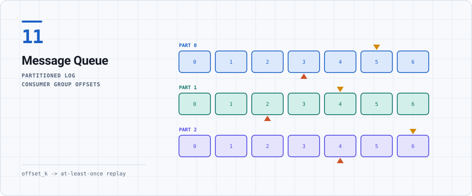
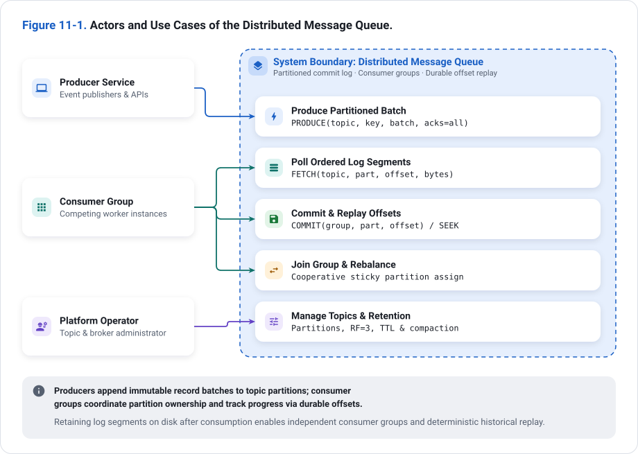
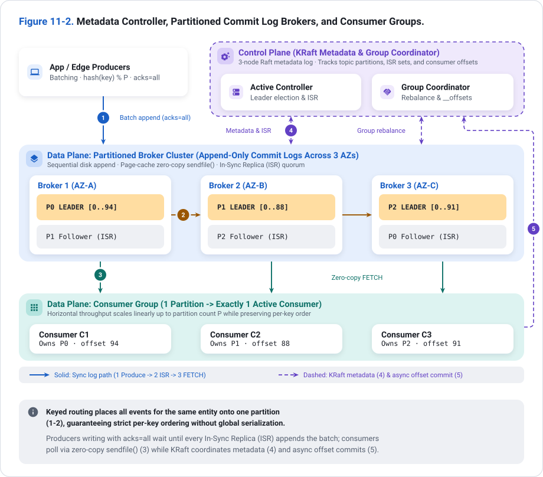
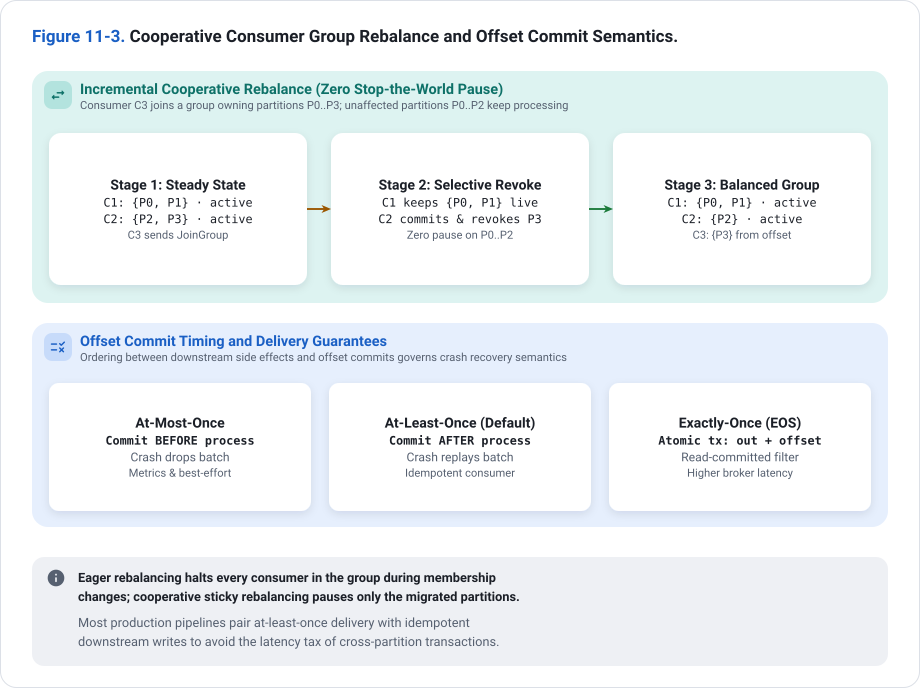

# Chapter 11: Distributed Message Queue



When an order service calls billing, inventory, fraud scoring, and email delivery synchronously over RPC, its availability becomes the product of every downstream dependency and its tail latency becomes the sum of the slowest responders. A spike in checkout traffic overflows downstream worker pools, while a maintenance restart of a non-critical analytics service blocks customer purchases. Placing a durable, partitioned message queue between producers and consumers breaks temporal coupling, absorbs burst traffic into disk-backed backlogs, and enables independent downstream teams to consume the same event stream at their own pace.

In this chapter, I design a high-throughput, Kafka-style distributed commit-log message queue. We establish functional contracts, durability SLOs, and multi-terabyte storage bounds, specify producer and consumer wire protocols, and separate KRaft metadata coordination (control plane) from zero-copy partitioned log brokers (data plane). In the deep dives, we dissect sequential disk I/O and `sendfile()` page-cache mechanics, In-Sync Replica (`ISR`) replication with `acks=all`, cooperative sticky consumer group rebalancing, delivery semantics (at-most-once, at-least-once, and idempotent effectively-once), idempotent producers, and the transactional outbox pattern.

<div class="covers">

In this chapter, we cover

- temporal decoupling, task queues versus durable commit logs, actors, durability SLOs, non-goals, and storage/broker capacity bounds
- partitioned produce, long-poll fetch, idempotent offset commit, and consumer group coordination wire contracts
- separation of KRaft metadata controller and group coordinator (control plane) from partitioned append-only brokers (data plane)
- sequential log segments, OS page-cache zero-copy `sendfile()` transfers, key-based partition ordering, and log compaction
- In-Sync Replica (`ISR`) replication, `acks=all`, `min.insync.replicas`, High Watermark (`HW`) visibility, and broker failover
- cooperative sticky consumer group rebalancing (zero stop-the-world pauses), offset commit ordering, idempotent producers, transactional outbox, and dead-letter queues
- operational failure modes, lag SLIs, production brokers (Apache Kafka, Apache Pulsar, Amazon SQS, RabbitMQ), and simulation verification

</div>

## 11.1 Requirements, Actors, and Capacity Bounds

### Task Queues vs. Partitioned Commit Logs

Two architectures share the label "message queue" while serving distinct workloads:

- **Task Queue (Amazon SQS, RabbitMQ):** Hands each message to one worker, hides it during a visibility timeout, and deletes it permanently upon acknowledgment. Independent consumers cannot replay historical events, and parallel workers scramble strict per-entity ordering.
- **Partitioned Append-Only Log (Apache Kafka, Redpanda, Apache Pulsar):** Appends immutable records sequentially to partitioned disk segments identified by monotonic 64-bit offsets. Reading does not delete records; each consumer group tracks its own offset cursor independently, enabling multi-subscriber fan-out, deterministic replay after bug fixes, and strict per-key ordering within each partition.

In this chapter, I design a **partitioned append-only commit log** because modern microservice platforms require durable multi-consumer fan-out, replayability, and ordered per-key event streams.

### Actors and Use Cases

We organize the message queue around three actors: producer services appending keyed batches, consumer groups polling ordered partitions and committing offsets, and platform operators managing topic partitions, replication factors, and retention policies (Figure 11-1).

<figure class="diagram">

<figcaption><b>Figure 11-1</b> Actors, system boundary, and core use cases of the distributed message queue.</figcaption>
</figure>

| Actor | Operation | Concrete Scenario |
| :--- | :--- | :--- |
| **Producer Service** | Append keyed batch (`PRODUCE` with `acks=all`) | Publish `order-7:created`, `order-7:paid`, and `order-7:shipped` into the same partition with durable replication |
| **Consumer Group** | Poll ordered segments (`FETCH`), commit offsets (`COMMIT`), join rebalance | Billing, warehouse, and analytics services each read the full `orders` topic independently at their own throughput |
| **Platform Operator** | Provision topics, configure retention/compaction, monitor consumer lag | Set `RF=3`, `min.insync.replicas=2`, `7-day` retention, and expand partitions before consumer lag breaches retention |

### Functional Requirements

| No. | Functional Requirement |
| :--- | :--- |
| 0 | Producers append messages to a named topic with an optional partition key; all records sharing a key land in the same partition and remain strictly ordered by monotonically increasing 64-bit offsets. |
| 1 | Consumers pull batches sequentially from any offset within their assigned partitions and commit durable group offsets so restarted consumers resume without losing position. |
| 2 | Multiple independent consumer groups read the same topic concurrently at independent offsets; within a single group, each partition is owned by at most one consumer at a time. |
| 3 | Brokers retain committed messages durably for a configurable retention window (`7 days` default) or compact topics by key to preserve the latest value per key indefinitely. |
| 4 | Producers support idempotent retries via sequence numbers so network timeouts never append duplicate records to a partition log. |

### Non-Functional Requirements and SLOs

| No. | Property | Target Specification | Architectural Consequence |
| :--- | :--- | :--- | :--- |
| 0 | **Throughput and Scale** | `100,000` messages/s sustained (`1 KB` average = `100 MB/s` ingress); `300,000` peak burst messages/s | Partitioned append-only logs using sequential disk I/O, producer batch compression (LZ4/Zstd), and zero-copy `sendfile()` reads |
| 1 | **Durability** | Zero committed data loss across `1` broker or `1` full AZ failure (`RF = 3`, `min.insync.replicas = 2`) | Synchronous replication across `3` AZs with `acks=all`; consumers read only up to the committed High Watermark (`HW`) |
| 2 | **Latency** | `p50 <= 5 ms`, `p99 <= 20 ms` end-to-end produce-to-consume under normal lag | Direct producer/consumer connections to partition leaders (zero central proxy hop) and long-polling fetches |
| 3 | **Consistency and Ordering** | Strong total order within each partition; no global order across partitions | Every consumer observes identical records at identical offsets inside a partition; cross-partition ordering is explicitly omitted |
| 4 | **Delivery Semantics** | At-least-once broker delivery; effectively-once end-to-end with idempotent producers and idempotent consumers | Brokers prioritize zero data loss over duplicate avoidance when consumers crash between work and offset commit |

### Non-Goals and Scope Boundaries

- **Global total ordering across partitions:** Enforcing total order across an entire topic collapses throughput to a single partition leader. Callers requiring strict ordering among related events must assign them the same partition key.
- **Per-message arbitrary deletion or SQL querying:** Offsets advance monotonically; consumers cannot delete an individual message in the middle of a log segment.
- **Broker-side push delivery:** Brokers never push messages to consumers; pull-based fetching lets each consumer apply natural backpressure matched to its own CPU and downstream database capacity.

### Back-of-the-Envelope Capacity Bounds

| Resource Dimension | Arithmetic Derivation | Provisioned Bound |
| :--- | :--- | :--- |
| **Ingress Write Rate** | `100,000` msg/s `* 1 KB` (`300,000` peak) | `100 MB/s` sustained (`300 MB/s` peak) |
| **Daily Raw Storage (1 Copy)** | `100 MB/s * 86,400 s/day` | `8.64 TB/day` |
| **7-Day Retention (RF = 3)** | `8.64 TB/day * 7 days * 3 replicas` | `181.44 TB` total raw replicated disk |
| **Broker Fleet Sizing (Disk)** | `181.44 TB / (4 TB usable NVMe * 0.75 headroom)` = `60.5` -> provision `63` brokers (`21` per AZ) or `24` brokers with `12 TB` NVMe | `24` brokers (`8` per AZ, `12 TB` NVMe each = `288 TB` raw, `63%` steady disk occupancy) |
| **Cluster Network Bandwidth** | `100 MB/s` ingress + `200 MB/s` inter-broker replication (`RF - 1`) + `300 MB/s` fan-out (`3` consumer groups) | `600 MB/s` (`4.8 Gbps` aggregate; `~200 Mbps` per broker on `25 Gbps` NICs) |
| **OS Page-Cache RAM** | Buffer `10` to `15 minutes` of hot tail segments in RAM (`100 MB/s * 600 s * 3`) / `24` brokers | `~7.5 GB` hot tail per broker -> `64 GB` RAM/broker serves almost all real-time consumers from RAM at zero disk-read cost |

## 11.2 External API and Data Contracts

Production brokers speak a compact binary TCP protocol supporting pipelined batched frames, CRC32C checksums, and zero-copy disk slicing. Below we specify the semantic equivalents for produce, long-poll fetch, and idempotent offset commit.

### Produce, Fetch, and Commit Contracts

**Produce a keyed batch (`POST /v1/topics/{topic}/messages`):**

Producers attach `(producer_id, producer_epoch, base_sequence)` so the partition leader detects and drops retried batches idempotently.

```http
POST /v1/topics/orders/messages HTTP/2
Host: broker-04.internal
Content-Type: application/json
X-Producer-Id: 40912
X-Producer-Epoch: 3
X-Base-Sequence: 1088
X-Acks: all

{
  "key": "order-7",
  "records": [
    { "event_type": "order_paid", "amount_cents": 4900 }
  ]
}
```

```http
HTTP/2 201 Created
Content-Type: application/json

{
  "topic": "orders",
  "partition": 1,
  "base_offset": 2,
  "high_watermark": 2
}
```

**Long-poll fetch from partition leader (`GET /v1/topics/{topic}/partitions/{p}/messages`):**

To avoid busy-wait polling when a partition is quiet, the broker holds the fetch open up to `max_wait_ms` until at least `min_bytes` of committed data (`offset <= high_watermark`) become available.

```http
GET /v1/topics/orders/partitions/1/messages?offset=0&max_bytes=1048576&max_wait_ms=500 HTTP/2
Host: broker-04.internal
```

```http
HTTP/2 200 OK
Content-Type: application/octet-stream
X-High-Watermark: 6
X-Next-Offset: 6
```

**Idempotent offset commit (`PUT /v1/topics/{topic}/partitions/{p}/offsets/{group}`):**

```http
PUT /v1/topics/orders/partitions/1/offsets/billing-service HTTP/2
Host: group-coordinator.internal
Content-Type: application/json

{
  "generation_id": 14,
  "member_id": "billing-pod-02",
  "committed_offset": 6
}
```

```http
HTTP/2 204 No Content
```

Validating `generation_id` acts as a fencing token against zombie consumers: if `billing-pod-02` stalled past its session timeout and lost partition `1` in generation `15`, the coordinator rejects its late offset commit with `409 Conflict`, preventing it from rewinding or overwriting the new owner's progress.

### On-Disk Log Segment Schema

Each partition directory on a broker consists of fixed-size rolling segments (for example, `1 GB` each) paired with sparse offset and timestamp indexes:

```text
/var/lib/queue/orders-1/
  00000000000000000000.log       # Sequential append-only record batches (CRC32C, offset, ts, key, value)
  00000000000000000000.index     # Sparse 8-byte (relative_offset: u32, file_position: u32) every 4 KB
  00000000000000000000.timeindex # Sparse (timestamp_ms: u64, relative_offset: u32) for time-based seek
```

Retention cleanup deletes entire closed `.log` segments in `O(1)` `unlink()` calls rather than compacting individual records inside active files.

## 11.3 High-Level Architecture: Control Plane vs. Data Plane

We decouple cluster metadata consensus and consumer group coordination (control plane) from high-volume sequential log appends and zero-copy reads (data plane) so metadata churn never stalls broker disk I/O (Figure 11-2).

<figure class="diagram">

<figcaption><b>Figure 11-2</b> KRaft metadata control plane, partitioned commit-log broker cluster, and consumer groups.</figcaption>
</figure>

### Component Responsibilities and Failure Domains

| Component | Plane | State Held | Failure Impact and Mitigation |
| :--- | :--- | :--- | :--- |
| **KRaft Metadata Controller (3-node Raft)** | Control | Authoritative topic configs, partition leader epochs, and In-Sync Replica (`ISR`) lists | Replaces external ZooKeeper; tolerates `1` node loss with sub-second controller failover; running data plane caches partition leader map |
| **Group Coordinator & `__offsets` Topic** | Control | Consumer group membership, generation IDs, partition assignments, and compacted committed offsets | Hosted on replicated internal partitions (`RF = 3`); failover triggers brief rebalance without losing committed offsets |
| **Partitioned Broker Fleet (Multi-AZ)** | Data | Append-only `.log` segments, sparse indexes, OS page-cache hot tail, per-producer sequence table | Each partition has `1` leader and `2` followers across `3` AZs; losing one broker shifts leadership to an in-sync follower in `< 2 s` |
| **Producers & Consumer Groups** | Data | Cached cluster metadata map, producer sequence numbers, local batch compression buffers | Connect directly to partition leaders; refresh metadata automatically upon `NOT_LEADER_FOR_PARTITION` responses |

### Hot Data Path Walkthrough

1. **Keyed Partition Routing:** A producer computes `partition = murmur2(key) mod P`, compresses a batch of records (for example, `16 KB` or `5 ms` linger), and transmits directly to the leader broker for that partition.
2. **Leader Sequential Append:** The leader verifies `(producer_id, epoch, seq)` for duplicates, assigns consecutive offsets, and appends the batch sequentially to the active `.log` segment (landing directly in Linux page cache).
3. **ISR Replication & High Watermark Advance:** Follower brokers continuously pull new batches from the leader. Once every replica in the current `ISR` (at least `min.insync.replicas = 2` across distinct AZs) has appended the offset, the leader advances the **High Watermark (`HW`)** and sends `201 Created` (`acks=all`).
4. **Zero-Copy Consumer Fetch:** A consumer polls the leader from its committed offset. The broker locates the byte range via binary search on the `.index` file and invokes `sendfile()` so the kernel transfers bytes directly from the OS page cache to the NIC socket buffer via DMA, bypassing user-space copies entirely.
5. **Offset Commit:** After processing the batch, the consumer commits `next_offset` with its fenced `generation_id` to the Group Coordinator.

## 11.4 Storage Mechanics, Replication (`ISR`), and Cooperative Rebalancing

### Why Sequential Logs and Zero-Copy `sendfile()` Deliver High Throughput

Random disk writes require seek overhead and fragmented flash translation updates, whereas modern NVMe drives and even spinning disks sustain sequential appends at hundreds of megabytes to gigabytes per second. By writing strictly to the end of active `.log` segments and relying on the OS page cache rather than duplicating buffers inside application heap memory, brokers avoid GC overhead and cache cold starts across process restarts.

On the read path, a conventional read-then-write loop copies each byte four times (disk -> kernel page cache -> user-space buffer -> kernel socket buffer -> NIC). Invoking Linux `sendfile()` collapses this into a **zero-copy DMA path**: the kernel streams pages directly from the page cache to the network interface card with zero user-space context copies, saturating `25 Gbps` links with minimal CPU usage.

### In-Sync Replicas (`ISR`), `acks=all`, and High Watermark Visibility

A pure Raft quorum requires `2f + 1` replicas to tolerate `f` failures (`3` replicas for `1` failure, `5` replicas for `2` failures). For multi-hundred-terabyte event logs, storing `5` copies is expensive. Kafka-style brokers use an **In-Sync Replica (`ISR`)** protocol coordinated by the KRaft controller:

- A partition configures `RF = 3` (one replica in each AZ) and `min.insync.replicas = 2`.
- Every follower that stays caught up within `replica.lag.time.max.ms` (for example, `10 s`) remains in the `ISR`. A stalled follower is removed from `ISR` by the leader via the KRaft controller so one slow disk does not halt the entire partition.
- With `acks=all`, the leader confirms a write only after **all replicas currently in the `ISR`** replicate it, and refuses writes (`NOT_ENOUGH_REPLICAS`) if `|ISR| < min.insync.replicas`. This guarantees every acknowledged message exists on at least `2` failure domains before the producer sees success.
- **High Watermark (`HW`) Isolation:** Consumers may fetch records strictly up to `offset <= HW`. Never exposing uncommitted leader-only entries prevents consumers from acting on phantom messages that disappear if the leader crashes before replication completes.

### Consumer Groups and Cooperative Sticky Rebalancing

Within a consumer group, each partition belongs to exactly one consumer instance, preserving strict per-key processing order and capping effective parallelism at the partition count `P`. Interactive Trace 11.A walks through partition ownership across joins and departures:

<figure class="steps" data-prefix="figures/steps-queue-group" data-count="5" data-version="c6e3444c">

<figcaption><b>Interactive Trace 11.A</b> Consumer group partition distribution as members join and leave; a fifth member remains idle on a four-partition topic. Use Next and Back to step through.</figcaption>
</figure>

Historically, eager rebalancing stopped the entire consumer group whenever any single pod restarted or scaled out: every member revoked all its partitions simultaneously, waited for everyone to rejoin, and then received a fresh assignment (**stop-the-world rebalance pause**). On large groups with `500` partitions, rolling deployments caused cascading minutes of lag.

Modern brokers eliminate this pause using **Incremental Cooperative Sticky Rebalancing** (Figure 11-3):

<figure class="diagram">

<figcaption><b>Figure 11-3</b> Cooperative sticky consumer group rebalancing eliminating stop-the-world pauses across unaffected partitions.</figcaption>
</figure>

1. **Stage 1 (Join Without Global Revoke):** When Consumer `C3` joins, existing consumers `C1 ({P0, P1})` and `C2 ({P2, P3})` keep processing their current partitions uninterrupted.
2. **Stage 2 (Selective Revocation):** The coordinator computes the minimal delta needed to balance the group (`C2` should transfer only `P3` to `C3`). `C2` finishes its current batch on `P3`, commits its offset, and revokes `P3` while `P0`, `P1`, and `P2` experience zero pause.
3. **Stage 3 (Incremental Handoff):** On the second micro-rebalance round, the coordinator assigns freed `P3` to `C3`. Combined with a dedicated background heartbeat thread (separated from the processing thread so a slow batch does not expire the session) and static group membership (`group.instance.id`), rolling restarts avoid rebalance storms altogether.

## 11.5 Delivery Semantics, Idempotent Producers, and Transactional Outbox

### At-Least-Once vs. At-Most-Once Offset Ordering

A consumer performs two non-atomic side effects across two independent systems: executing business work (writing to a database or calling an API) and committing its new offset to the queue. Because the consumer can crash between those two steps, only two execution orders exist:

1. **Work First, Commit Second (At-Least-Once):** Demonstrated in Interactive Trace 11.B. If the consumer crashes after billing an order and before committing offset `0`, its replacement re-reads from offset `0` and processes the message again. Zero messages are lost; duplicates must be handled idempotently.

<figure class="steps" data-prefix="figures/steps-queue-after" data-count="6" data-version="dbf1d568">

<figcaption><b>Interactive Trace 11.B</b> At-least-once delivery: processing before committing guarantees zero lost messages at the cost of redelivery after a crash. Use Next and Back to step through.</figcaption>
</figure>

2. **Commit First, Work Second (At-Most-Once):** Demonstrated in Interactive Trace 11.C. If the consumer crashes after committing offset `1` and before processing it, the replacement begins at offset `2` and the message is lost permanently. Appropriate only for ephemeral telemetry or sensor metrics where dropping an occasional reading is harmless.

<figure class="steps" data-prefix="figures/steps-queue-before" data-count="6" data-version="8e5f2c39">

<figcaption><b>Interactive Trace 11.C</b> At-most-once delivery: committing before work eliminates duplicates at the cost of permanent message loss on crash. Use Next and Back to step through.</figcaption>
</figure>

**Achieving Effectively-Once Side Effects:** No broker can make an external email or payment API transactional with its offset store. Production systems obtain **effectively-once processing** by pairing **at-least-once delivery** with **idempotent consumers**: the consumer records `(topic, partition, offset)` or a business `event_id` inside the exact same ACID database transaction as its business update (`INSERT INTO processed_events(event_id) ... ON CONFLICT DO NOTHING`). A redelivered message hits the uniqueness constraint and becomes a no-op.

### Idempotent Producers and the Transactional Outbox

Two additional seams require care on the producer side:

- **Idempotent Producer Retries:** If a producer times out waiting for `acks=all`, the broker may have committed the batch and lost only the network ACK. With idempotence enabled (`enable.idempotence=true`), the broker assigns each producer a unique `producer_id (PID)` and tracks the last `5` committed sequence numbers per `(PID, partition)`. A retried batch with an already-seen sequence number returns `201` immediately without appending a duplicate record.
- **Dual-Write Atomicity via Transactional Outbox:** An order service that writes to PostgreSQL and then calls `PRODUCE` can crash between the two calls, leaving an orphan database row with no event (or an orphan event if published first and the DB rolls back). With the **transactional outbox**, the service writes both the domain row (`orders`) and the serialized event row (`outbox_events`) inside a single local ACID database transaction. A Change Data Capture (CDC) relay (such as Debezium tailing PostgreSQL WAL) streams committed outbox rows to the message queue at-least-once, where idempotent consumers complete the end-to-end guarantee.
- **Poison Pills, DLQ, and Log Compaction:** A permanently malformed message causes infinite retry loops that stall its entire partition. After `N` bounded attempts (for example, `5`), the consumer routes the payload plus error metadata to a **Dead-Letter Queue (`DLQ`)** topic and advances the offset (accepting a localized ordering break for that single key unless the topic halts deliberately). For state-snapshot topics (such as latest user addresses), **log compaction** retains the newest record per key indefinitely while garbage-collecting superseded older values.

## 11.6 Failure Modes, SLIs, and Production Systems

### Failure and Recovery Matrix

| Failure Mode | Operational Symptom | Automated Mitigation |
| :--- | :--- | :--- |
| **Partition Leader Broker Crash** | `1` to `2 s` write pause on partitions led by dead broker | KRaft controller promotes an in-sync follower (`ISR`) to leader; producers/consumers refresh metadata and resume cleanly with zero data loss |
| **Slow Follower Falls Out of `ISR`** | Under-replicated partition (`URP > 0`) metric rises | Leader shrinks `ISR` after `replica.lag.time.max.ms` so writes continue uninterrupted on remaining `2` AZs; alert triggers operator disk check |
| **Consumer Crash Before Offset Commit** | Brief lag bump on owned partitions during cooperative rebalance | Group coordinator reassigns partitions; successor replays from last committed offset and idempotent consumer skips already-applied `event_id`s |
| **Poison Pill Message** | Partition lag climbs continuously while consumer throws repeated exceptions | Consumer retries `5` times with backoff, then emits payload + stack trace to `<topic>.dlq` and commits past the poison offset |
| **Hot Partition Key Skew** | One partition lags heavily while sibling partitions remain idle | Identify skew via per-partition lag metrics; split hot keys with explicit sub-key salting (`tenant#0..7`) if cross-subkey ordering is unneeded |
| **Retention Overflow on Sustained Lag** | Consumer lag approaches `7-day` retention boundary; imminent data loss | Page on-call at `50%` retention age; scale consumer instances up to partition count `P` or temporarily extend topic retention TTL |

### Key SLIs and Operational Alerts

- **Consumer Group Lag (Messages and Time-Lag Seconds):** Alert when time-lag exceeds SLO (for example, `> 60 s` for real-time billing) or approaches `25%` of topic retention age.
- **Under-Replicated Partitions (`URP`):** Alert if `URP > 0` for more than `5 minutes` (signals loss of redundancy ahead of a second failure).
- **Offline Partitions (`offline_partitions_count`):** Immediate P0 page whenever `> 0` (indicates a partition has zero available `ISR` replicas).
- **Produce `p99` Latency and `acks=all` Error Rate:** Alert if `p99 > 50 ms` or `NOT_ENOUGH_REPLICAS` errors occur.

### Real-World Production Systems

| Production System | Storage Model | Replication & Consensus | Architectural Distinction |
| :--- | :--- | :--- | :--- |
| **Apache Kafka (KRaft)** | Partitioned local NVMe commit logs + OS page cache (`sendfile`) | `ISR` per partition + Raft-based KRaft metadata controller | Industry standard for ultra-high-throughput partitioned event streaming, log compaction, and cooperative rebalancing |
| **Apache Pulsar** | Tiered separation: stateless Brokers + Apache BookKeeper storage | BookKeeper ensemble quorum writes (segment-level striping) | Decouples serving from storage so scaling brokers or adding partitions requires zero partition-data rebalancing |
| **Amazon SQS (Standard & FIFO)** | Managed multi-AZ task queue | Managed synchronous multi-AZ replication | Serverless pull-based task queue with per-message visibility timeouts, native DLQ redrive, and zero broker ops |
| **RabbitMQ (Quorum Queues)** | Exchange routing + Raft-backed Quorum Queues | Raft consensus per queue | Rich AMQP routing topologies (fanout, topic wildcards, headers) suited for complex workflow routing |

## 11.7 Simulation Verification

To verify partition-key ordering, at-least-once crash recovery, and idempotent consumer deduplication, we execute the repository's `queuesim` simulation (`code/queuesim/src/main.rs`). Six order lifecycle events append sequentially into partition `1` (offsets `0` through `5`). The consumer processes all `6` events and crashes right before committing its offset; upon restarting from committed offset `0`, it replays all `6` records, recognizes each previously processed event ID, and skips duplicate side effects before committing offset `6`:

```console
$ cargo run --release -p queuesim
produced order-7 created: partition 1, offset 0
produced order-8 created: partition 1, offset 1
produced order-7 paid: partition 1, offset 2
produced order-9 created: partition 1, offset 3
produced order-7 shipped: partition 1, offset 4
the consumer reads partition 1 and crashes before it commits
  offset 0: order-7 created -> acted on
  offset 1: order-8 created -> acted on
  offset 2: order-7 paid -> acted on
  offset 3: order-9 created -> acted on
  offset 4: order-7 shipped -> acted on
  offset 5: order-7 delivered -> acted on
it restarts and reads from the committed offset, which is still 0
  offset 0: order-7 created -> seen before, skipped
  offset 1: order-8 created -> seen before, skipped
  offset 2: order-7 paid -> seen before, skipped
  offset 3: order-9 created -> seen before, skipped
  offset 4: order-7 shipped -> seen before, skipped
  offset 5: order-7 delivered -> seen before, skipped
messages in the partition: 6, actions taken: 6, committed offset: 6
```

The final summary confirms end-to-end effectively-once semantics under a crash right before offset commit: `messages in the partition: 6`, `actions taken: 6`, and `committed offset: 6`.

<div class="simulation">

**Run the partitioned message queue simulation.** Execute `cargo run --release -p queuesim` in `code/` ([`code/queuesim/src/main.rs`](https://github.com/arpanpathak/cracking-the-systems-programming-interview/blob/prep-v2/distributed-systems-from-the-ground-up/code/queuesim/src/main.rs)) to reproduce ordered partition appends, consumer crash redelivery, and idempotent deduplication.

</div>

## 11.8 Terminology and References

### Engineering Glossary

| Term | Definition |
| :--- | :--- |
| **Partitioned Commit Log** | A topic split into multiple independent append-only ordered log files distributed across brokers for horizontal write and read parallelism. |
| **Offset** | A monotonically increasing 64-bit integer uniquely identifying a record's sequential position inside its partition. |
| **In-Sync Replicas (`ISR`)** | The dynamic set of partition replicas caught up with the leader within the configured lag threshold; `acks=all` waits for every replica in the `ISR`. |
| **High Watermark (`HW`)** | The highest offset replicated across all in-sync replicas; consumers are permitted to read strictly up to `HW`. |
| **Zero-Copy (`sendfile()`)** | An OS kernel system call transferring log segment bytes directly from page cache to the network card via DMA without copying through user space. |
| **Cooperative Sticky Rebalance** | An incremental consumer-group rebalance protocol that revokes and transfers only the minimal subset of partitions needed, avoiding stop-the-world pauses. |
| **Transactional Outbox** | Writing domain state changes and outbound event rows in one local ACID database transaction, followed by asynchronous CDC relay publishing to the queue. |
| **Dead-Letter Queue (`DLQ`)** | A quarantine topic receiving poison messages that repeatedly fail processing so they do not stall healthy partition traffic. |
| **Log Compaction** | Background retention mode rewriting closed log segments to retain at least the latest record per unique key indefinitely. |

### End-to-End Request Lifecycle and Hop-by-Hop Latency Budget

A durable publish-and-consume cycle with `acks = all` and `min.insync.replicas = 2` balances sequential disk I/O, kernel page-cache zero-copy transfers, and cross-AZ replication to sustain millions of messages per second at low millisecond latency.

| Hop | Boundary | Protocol and Operation | Typical `p50` | Tail `p99` |
| :--- | :--- | :--- | :--- | :--- |
| 1 | Producer Batcher to Partition Leader | Binary TCP (`ProduceRequest`) after micro-batch linger (`linger.ms = 2`) | `2.30 ms` | `4.50 ms` |
| 2 | Partition Leader Local Log Append | Sequential append to active segment file in OS page cache | `0.15 ms` | `0.80 ms` |
| 3 | Leader to In-Sync Followers (`ISR`) | Parallel `Fetch` replication across AZs; high-watermark advances on quorum | `1.40 ms` | `5.20 ms` |
| 4 | Leader to Consumer Group Member | `FetchResponse` via zero-copy `sendfile` directly from page cache to NIC | `0.60 ms` | `2.10 ms` |
| 5 | Consumer Processing and Offset Commit | Business handler execution plus asynchronous `__consumer_offsets` commit | `1.80 ms` | `6.40 ms` |
| **Total** | **End-to-End Produce-to-Consume Latency** | **Durable replicated delivery with zero-copy read amplification** | **`6.25 ms`** | **`19.00 ms`** |

### Production Case Studies and Open-Source Comparisons

- **Apache Kafka (KRaft and Zero-Copy `sendfile`):** Modern Kafka replaces external ZooKeeper clusters with KRaft, an internal Raft metadata quorum supporting millions of partitions with sub-second controller failover. On the data path, Kafka appends records sequentially to disk segments and serves consumers via Linux `sendfile`, moving bytes directly from the kernel page cache to the network interface controller with zero user-space copies and saturating `10 Gbps` to `40 Gbps` links per broker.
- **Redpanda (Thread-per-Core C++):** Redpanda implements the Kafka wire protocol on top of the Seastar C++ framework, pinning one shard per physical CPU core and bypassing the kernel page cache via Direct I/O (`O_DIRECT`) and Raft per partition. Eliminating JVM garbage-collection pauses and cross-core lock contention yields `p99.9` publish latencies roughly `5x` to `10x` lower than tuned JVM brokers under heavy compaction and NVMe saturation.
- **Apache Pulsar (Stateless Brokers and BookKeeper):** Pulsar decouples message serving from durable storage by running stateless brokers in front of Apache BookKeeper storage nodes (`bookies`). Because ledgers are striped into immutable segments across bookies, adding a broker or recovering a failed partition requires zero data rebalancing across disks, simplifying multi-tenant isolation and tiered cold-storage offloading to object stores.

<div class="callout keyidea"><span class="label">Key idea</span>Treating the message broker as an immutable, partitioned append-only log converts random I/O into sequential disk bandwidth and enables independent consumer groups to replay historical streams without duplicating storage.</div>

<div class="callout experiment"><span class="label">Experiment</span>Measure broker CPU utilization and `p99` fetch latency while serving 5 independent consumer groups reading the same `500 MB/s` topic from the tail (page-cache hit) versus from `12` hours in the past (cold disk read). Observe how tail reads remain memory-bound while historical catch-up competes for NVMe IOPS.</div>

<div class="callout caution"><span class="label">Common pitfall</span>Configuring `acks = 1` with unclean leader election enabled drops acknowledged messages without producer notification whenever a partition leader crashes before followers replicate the latest offset. For financial or state-transition pipelines, pair `acks = all` and `min.insync.replicas = 2` with idempotent consumers keyed by message ID.</div>

### References

- J. Kreps, N. Narkhede, and J. Rao, "Kafka: A Distributed Messaging System for Log Processing", NetDB, 2011.
- J. Kreps, "The Log: What Every Software Engineer Should Know About Real-Time Data's Unifying Abstraction", LinkedIn Engineering Blog, 2013.
- Apache Kafka Improvement Proposals: KIP-98 ("Exactly Once Delivery and Transactional Messaging"), KIP-429 ("Kafka Consumer Incremental Rebalance Protocol"), and KIP-500 ("Replace ZooKeeper with a Self-Managed Metadata Quorum").
- C. Richardson, *Microservices Patterns*, Manning Publications, 2018 (Transactional Outbox Pattern).
- Amazon SQS Documentation, "Visibility Timeout and Dead-Letter Queues".
- Apache Pulsar Documentation, "Tiered Storage and BookKeeper Architecture".
