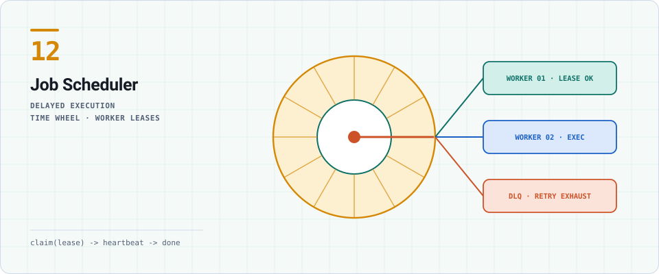
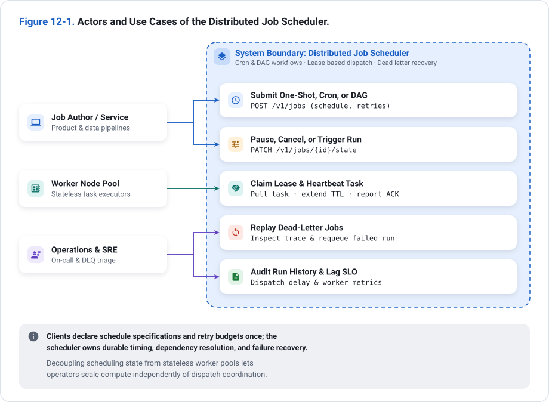
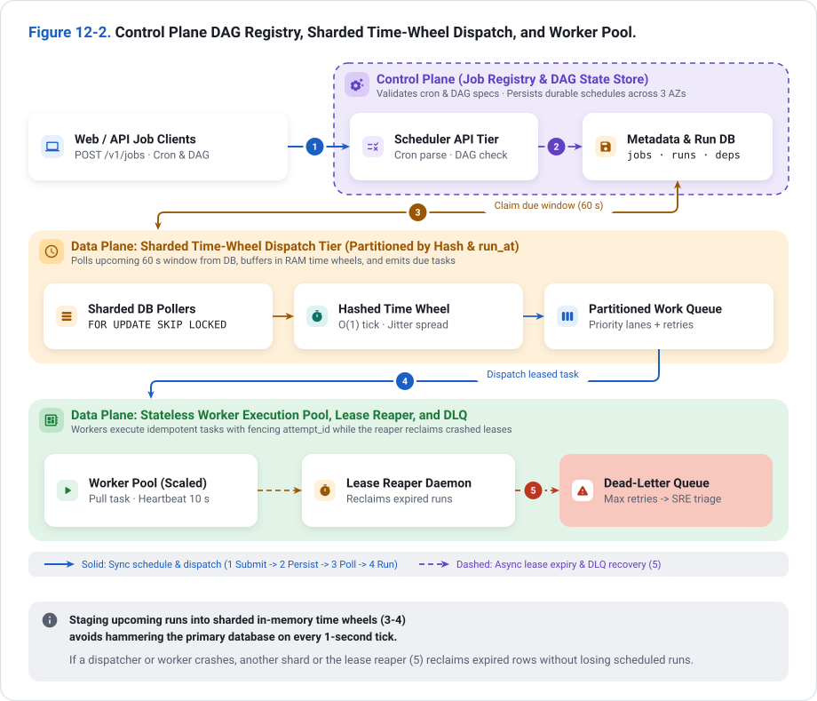
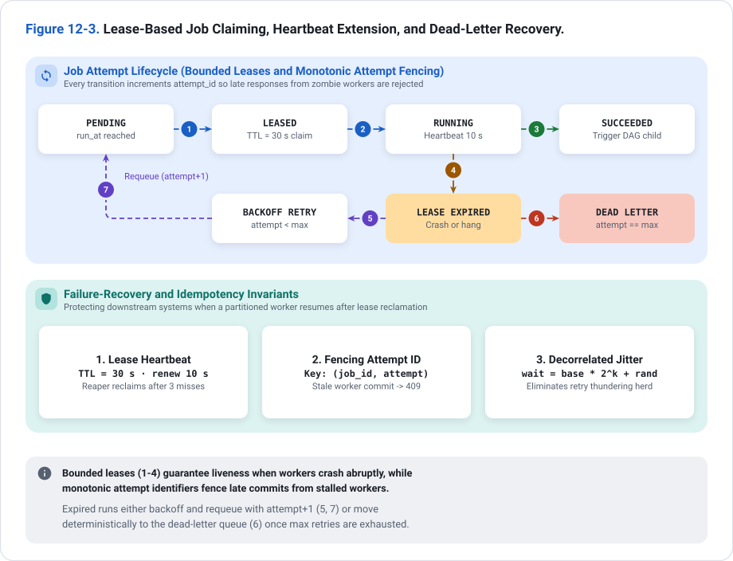

# Chapter 12: Distributed Job Scheduler



Large backend systems execute millions of tasks asynchronously outside the lifecycle of any user-facing HTTP request: transcoding uploaded videos, erasing closed accounts after a 30-day compliance window, reconciling nightly financial ledgers at `02:00 UTC`, or orchestrating multi-stage data pipelines. A distributed job scheduler accepts one-shot, delayed, recurring (cron), and DAG-chained jobs, persists them durably, dispatches each due execution to a worker fleet, and recovers automatically when workers crash or stall mid-flight.

The core systems challenge is partial observability. Once the scheduler hands a job to a worker, it cannot observe the worker's CPU or memory directly; it observes only network heartbeats and completion reports. A silent worker may have crashed, suffered a long pause, or completed the job while losing its completion response on the wire. In this chapter, I design a durable, horizontally scalable distributed job scheduler. We define actors, requirements, and capacity bounds, specify job/lease APIs and PostgreSQL `FOR UPDATE SKIP LOCKED` schemas, separate the DAG/cron registry (control plane) from sharded timing-wheel dispatchers (data plane), and engineer lease fencing, cron DST/idempotency guarantees, priority fairness, and dead-letter recovery.

<div class="covers">

In this chapter, we cover

- job lifecycle state machine, actors, functional contracts, dispatch latency SLOs, non-goals, and throughput/storage bounds
- REST/gRPC job submission, worker lease claiming, heartbeat extension, result fencing, and relational job-store DDL
- separation of DAG and cron registry (control plane) from sharded DB pollers, hashed timing wheels, and worker pools (data plane)
- hierarchical timing wheels versus sharded database polling with `SELECT ... FOR UPDATE SKIP LOCKED`
- lease-based claiming, monotonic `attempt_id` fencing against zombie workers, and at-least-once idempotent execution
- recurring cron idempotency, UTC scheduling against Daylight Saving Time discontinuities, missed-run policies, priority aging, and per-tenant fair queuing
- operational failure modes, lag SLIs, production schedulers (Google Distributed Cron, Temporal, Apache Airflow, Quartz), and simulation verification

</div>

## 12.1 Requirements, Actors, and Capacity Bounds

### Actors and Use Cases

We organize the distributed job scheduler around three actors: job authors and upstream services submitting one-shot, cron, or DAG workflows; stateless execution workers claiming bounded leases and reporting outcomes; and platform operators auditing dispatch lag and replaying dead-letter jobs (Figure 12-1).

<figure class="diagram">

<figcaption><b>Figure 12-1</b> Actors, system boundary, and core use cases of the distributed job scheduler.</figcaption>
</figure>

| Actor | Operation | Concrete Scenario |
| :--- | :--- | :--- |
| **Job Author / Service** | Submit one-shot, delayed, cron, or DAG jobs (`POST /v1/jobs`); pause/cancel (`PATCH`) | Schedule a 30-day account purge, a nightly `02:00 UTC` ledger close, or a 3-step ETL pipeline |
| **Execution Worker** | Claim lease (`POST /v1/leases`), extend TTL heartbeat, report ACK/NACK (`PUT`) | Pull due jobs matched to its queue pool, renew leases during long runs, and return fenced outcomes |
| **Platform Operator** | Inspect and replay dead-letter jobs; audit dispatch lag and retry spikes | Diagnose a defective worker release causing mass DLQ growth and replay failed runs after rollback |

### Functional Requirements

| No. | Functional Requirement |
| :--- | :--- |
| 0 | Callers can submit immediate jobs, delayed future jobs (`run_at`), recurring cron schedules, and parent-child DAG workflows with explicit retry budgets and priority tiers. |
| 1 | The scheduler dispatches each due job under a time-bounded **lease** with a monotonic `attempt_id` so at most one worker is actively assigned a given run at claim time. |
| 2 | Workers renew active leases via periodic heartbeats for long-running tasks and submit completion or failure results fenced by `attempt_id`. |
| 3 | Transient worker crashes, lease timeouts, or retryable errors requeue the job with jittered exponential backoff; exhausting `max_attempts` (`5` default) transitions the job to a durable Dead-Letter Queue (`DEAD`) state for inspection and manual replay. |
| 4 | Callers and operators can query live job state, attempt history, and last failure diagnostics, and can pause, cancel, or trigger ad-hoc runs. |

### Non-Functional Requirements and SLOs

| No. | Property | Target Specification | Architectural Consequence |
| :--- | :--- | :--- | :--- |
| 0 | **Durability** | Zero lost submitted jobs across scheduler node or storage primary crashes | All job definitions and state transitions persist to a synchronously replicated multi-AZ job store before returning `201 Created` |
| 1 | **Dispatch Latency (Precision)** | `p50 <= 200 ms`, `p99 <= 1.0 s` lag from scheduled `run_at` to worker lease claim | Pure cold DB polling at 5-second intervals misses sub-second precision; requires sharded 60-second lookahead buffers feeding in-memory hashed timing wheels |
| 2 | **State Consistency** | Strongly consistent job-state transitions (`PENDING -> LEASED -> RUNNING -> SUCCEEDED|DEAD`) | Atomic `SELECT ... FOR UPDATE SKIP LOCKED` claims and `attempt_id`-fenced updates prevent double-claiming and zombie overwrites |
| 3 | **Execution Semantics** | At-least-once execution (never dropped without notice; jobs must be idempotent) | Because lease expiration cannot distinguish a crashed worker from a stalled worker, safe jobs enforce idempotency keys |
| 4 | **Scale** | `10,000,000` jobs/day (`116` avg jobs/s, `1,160` peak jobs/s); `500,000` active recurring cron definitions | Horizontally sharded job-run tables (`16` to `64` partitions by `hash(job_id)` and `run_at`) and stateless auto-scaled dispatchers/workers |

### Non-Goals and Scope Boundaries

- **Exactly-once side effects without job cooperation:** No scheduler can guarantee an uncooperative external side effect runs once across worker network partitions. Jobs performing financial or external mutations must carry deterministic idempotency keys (Chapter 10 and Chapter 11).
- **Sub-millisecond real-time control loops:** Networked distributed schedulers operate at `100 ms` to `1 s` dispatch precision, rather than hard real-time microsecond kernel interrupts.
- **Arbitrary unbounded worker execution without heartbeats:** Workers running multi-hour jobs must checkpoint progress and renew short leases rather than requesting 24-hour fixed leases that block crash recovery for a full day.

### Back-of-the-Envelope Capacity Bounds

| Resource Dimension | Arithmetic Derivation | Provisioned Bound |
| :--- | :--- | :--- |
| **Average / Peak Job Rate** | `10,000,000 jobs / 86,400 s` = `115.7` avg/s; `10x` burst factor | `116` avg jobs/s; `1,160` peak jobs/s (top-of-the-hour cron spikes can hit `5,000` jobs/s for `10 s`) |
| **State-Transition Write IOPS** | Each job averages `4` state updates (`INSERT`, `CLAIM`, `HEARTBEAT`, `COMPLETE`) `* 1,160` peak | `~4,640` transactional DB writes/s peak (`1` high-IOPS primary or `4` sharded primaries easily sustain `20,000+` TPS) |
| **30-Day Hot Run Storage** | `10,000,000 jobs/day * 30 days * 1.5 KB` (payload + audit + indexes) | `450 GB` hot NVMe storage (`1.35 TB` across `3` replicas); older completed runs archive to object storage |
| **60-Second Lookahead Wheel RAM** | `5,000` peak jobs/s `* 60 s * 256 B` timer entry | `~76.8 MB` across dispatch fleet (fits comfortably inside RAM) |
| **Worker Fleet Sizing** | Assuming `2 s` mean job duration at `1,160` peak jobs/s -> `2,320` concurrent in-flight jobs; `10` concurrent slots/worker | `~232` stateless workers (auto-scaled horizontally by queue depth and dispatch lag) |

## 12.2 External API and Data Contracts

We design the scheduler around pull-based worker claiming (`POST /v1/leases`) so overloaded or draining workers stop requesting work automatically without requiring the scheduler to maintain a live capacity registry for every worker container.

### Submission, Lease Claim, Heartbeat, and Fenced Result APIs

**Submit a job (`POST /v1/jobs`):**

Callers supply `Idempotency-Key` so retrying after a network timeout returns the original job ID rather than scheduling duplicate work.

```http
POST /v1/jobs HTTP/2
Host: scheduler.internal
Content-Type: application/json
Idempotency-Key: video-transcode-88412

{
  "queue": "media-transcode",
  "priority": 1,
  "run_at": "2026-10-14T09:00:00Z",
  "max_attempts": 5,
  "lease_ttl_seconds": 30,
  "payload": { "asset_id": "vid_992", "profiles": ["720p", "1080p"] }
}
```

```http
HTTP/2 201 Created
Location: /v1/jobs/8231
Content-Type: application/json

{
  "job_id": "8231",
  "state": "PENDING",
  "attempt_id": 0,
  "run_at": "2026-10-14T09:00:00Z"
}
```

**Claim a due job lease (`POST /v1/leases`):**

Returns `201 Created` with the job payload and monotonic `attempt_id`, or `204 No Content` when no jobs are due.

```http
POST /v1/leases HTTP/2
Host: scheduler.internal
Content-Type: application/json

{
  "worker_id": "worker-az-a-04",
  "queues": ["media-transcode"],
  "lease_ttl_seconds": 30
}
```

```http
HTTP/2 201 Created
Location: /v1/leases/771
Content-Type: application/json

{
  "lease_id": "771",
  "job_id": "8231",
  "attempt_id": 1,
  "expires_in_seconds": 30,
  "payload": { "asset_id": "vid_992", "profiles": ["720p", "1080p"] }
}
```

**Extend lease heartbeat (`PUT /v1/leases/{lease_id}/heartbeat`) and Report fenced outcome (`PUT /v1/jobs/{job_id}/results/{attempt_id}`):**

```http
PUT /v1/jobs/8231/results/1 HTTP/2
Host: scheduler.internal
Content-Type: application/json

{
  "worker_id": "worker-az-a-04",
  "outcome": "SUCCEEDED",
  "retryable": false
}
```

```http
HTTP/2 204 No Content
```

If `attempt_id = 1` has already been superseded by a reclaimer reissuing `attempt_id = 2`, the scheduler rejects the stale completion with `409 Conflict`, preventing the zombie worker from corrupting the active attempt's state.

### Relational Job-Run Schema and Atomic Claim Query

```sql
CREATE TABLE job_runs (
    job_id          BIGINT PRIMARY KEY,
    idempotency_key TEXT UNIQUE NOT NULL,
    queue_name      TEXT NOT NULL,
    tenant_id       TEXT NOT NULL,
    priority        SMALLINT NOT NULL DEFAULT 5,
    state           TEXT NOT NULL,          -- PENDING, LEASED, RUNNING, SUCCEEDED, DEAD
    attempt_id      INT NOT NULL DEFAULT 0,
    max_attempts    INT NOT NULL DEFAULT 5,
    run_at          TIMESTAMPTZ NOT NULL,
    lease_owner     TEXT,
    lease_expires_at TIMESTAMPTZ,
    payload         JSONB NOT NULL,
    last_error      TEXT
);

-- Covering partial index so due-job queries touch only PENDING rows:
CREATE INDEX idx_job_runs_due
    ON job_runs (queue_name, priority ASC, run_at ASC)
    WHERE state = 'PENDING';

-- Covering partial index for fast lease-expiry reclamation:
CREATE INDEX idx_job_runs_expired_leases
    ON job_runs (lease_expires_at ASC)
    WHERE state IN ('LEASED', 'RUNNING');
```

## 12.3 High-Level Architecture: Control Plane vs. Data Plane

We separate durable schedule validation, cron rule parsing, and DAG dependency storage (control plane) from high-frequency timer dispatch, lease claiming, and worker execution (data plane) (Figure 12-2).

<figure class="diagram">

<figcaption><b>Figure 12-2</b> Control-plane DAG/cron registry and sharded time-wheel dispatch data-plane topology.</figcaption>
</figure>

### Component Responsibilities and Failure Domains

| Component | Plane | State Held | Failure Impact and Mitigation |
| :--- | :--- | :--- | :--- |
| **Scheduler API Tier** | Control | Stateless validators, cron parser, DAG acyclicity checker | Horizontally scaled behind L7 load balancers across 3 AZs; node loss has zero state impact |
| **Metadata and Run DB (Sharded SQL)** | Control / Durable | Authoritative `cron_specs`, `dag_edges`, and `job_runs` tables replicated synchronously across 3 AZs | Primary crash triggers automatic synchronous replica failover in `< 10 s` with zero lost jobs |
| **Sharded Time-Wheel Dispatchers** | Data | In-memory 60-second lookahead hashed timing wheel partitioned by `shard_id` | Completely reconstructible state; if a dispatcher crashes, its shard lease transfers to a standby dispatcher that reloads the next `60 s` window from the DB |
| **Lease Reclaimer Daemon** | Data | Stateless sweep loop querying `idx_job_runs_expired_leases` every `2 s` | Active-standby via distributed lock (Chapter 10); because reclaiming uses conditional `WHERE attempt_id = $a`, momentary dual execution is completely harmless |
| **Worker Pools (Per Queue / Priority)** | Data | Ephemeral task execution context and active lease heartbeat loop | Worker crash leaves job leased until `lease_expires_at`, when the reclaimer returns it to `PENDING` with incremented backoff |

### Hot Data Path Walkthrough

1. **Durable Submission:** A client sends `POST /v1/jobs`. The Scheduler API verifies `Idempotency-Key`, checks DAG acyclicity if parent dependencies exist, and inserts a `PENDING` row into the synchronously replicated Run DB.
2. **60-Second Lookahead Prefetch:** Sharded DB Pollers query their assigned partition every `10 seconds` for `PENDING` jobs whose `run_at <= NOW() + 60 seconds`, buffering lightweight `(job_id, run_at, priority)` handles into an in-memory **Hashed Timing Wheel**.
3. **Sub-Second Wheel Release & Atomic Claim:** When the timing wheel tick reaches `run_at`, the dispatcher makes the job claimable. A worker calls `POST /v1/leases`, executing an atomic `FOR UPDATE SKIP LOCKED` claim that transitions `state = 'LEASED'`, increments `attempt_id`, and sets `lease_expires_at = NOW() + 30 s`.
4. **Execution, Heartbeat, and DAG Fan-Out:** The worker executes the task, renewing `lease_expires_at` every `10 s` while progress advances. On `PUT /v1/jobs/{id}/results/{attempt_id}`, the Run DB validates `attempt_id`, marks `SUCCEEDED`, and atomically decrements remaining-parent counters for any downstream DAG child jobs, promoting ready children to `PENDING`.

## 12.4 Scheduling Engines: Hierarchical Timing Wheels vs. `SKIP LOCKED` Polling

### Scaling Delayed Execution with Hierarchical Timing Wheels

Querying a central SQL table every `100 ms` across `50` dispatchers to fire delayed jobs creates severe B-tree read contention, whereas polling every `10 seconds` violates our `<= 1 s` dispatch precision SLO.

We solve both problems with a **two-tier architecture** pairing durable relational storage with in-memory **Hashed and Hierarchical Timing Wheels** (Varghese and Lauck, SOSP 1987):

- **Long-Horizon Storage (Database):** Millions of jobs scheduled hours, days, or months ahead stay cheaply on disk in `job_runs` indexed by `(shard_id, run_at)` without consuming RAM.
- **Short-Horizon Precision (Hierarchical Timing Wheel in RAM):** Each shard dispatcher maintains an in-memory circular array of buckets (for example, `600` buckets at `100 ms` resolution covering `60 seconds`, plus a coarse upper wheel if wider horizons are needed). Inserting a job into bucket `(current_tick + delta_ticks) mod 600` takes `O(1)` time, and advancing the tick pointer every `100 ms` harvests all due timers in `O(1)` amortized work per timer rather than `O(log N)` heap sift operations.

Because the database remains the durable source of truth, a dispatcher crash loses zero jobs: the replacement dispatcher reads the next `60 seconds` of `PENDING` rows from `idx_job_runs_due` and rebuilds its wheel in milliseconds.

### Lock-Free Worker Claiming with `SELECT ... FOR UPDATE SKIP LOCKED`

Transitioning a job from `PENDING` to `LEASED` must guarantee that at most one worker claims each due run. Reading a `PENDING` row and issuing a separate `UPDATE` introduces a classic check-then-act race illustrated in Interactive Trace 12.A, where two idle workers both read Job 1 as waiting and both start executing it simultaneously.

<figure class="steps" data-prefix="figures/steps-jobs-claim" data-count="6" data-version="31fe08a0">

<figcaption><b>Interactive Trace 12.A</b> Two concurrent workers claim the same waiting job unless claiming executes as a single atomic conditional transition. Use Next and Back to step through.</figcaption>
</figure>

A single compare-and-set update (`UPDATE job_runs SET state = 'LEASED' WHERE job_id = $1 AND state = 'PENDING'`) prevents double claiming, but under `200` concurrent workers polling the same queue, `199` workers collide on the oldest job, fail their CAS, and retry in a lockstorm.

PostgreSQL and MySQL 8 eliminate worker contention natively with `SELECT ... FOR UPDATE SKIP LOCKED`:

```sql
WITH claimed AS (
    SELECT job_id
      FROM job_runs
     WHERE queue_name = $1
       AND state = 'PENDING'
       AND run_at <= NOW()
     ORDER BY priority ASC, run_at ASC
     LIMIT 1
       FOR UPDATE SKIP LOCKED
)
UPDATE job_runs j
   SET state            = 'LEASED',
       attempt_id       = j.attempt_id + 1,
       lease_owner      = $2,
       lease_expires_at = NOW() + make_interval(secs => $3)
  FROM claimed
 WHERE j.job_id = claimed.job_id
RETURNING j.job_id, j.attempt_id, j.payload;
```

When Worker 1 locks row `8231`, Worker 2 skips locked row `8231` immediately without blocking and locks row `8232` on its first round trip. Throughput scales linearly with worker concurrency with zero lock-wait stalls.

## 12.5 Leases, Attempt Fencing, Cron Hazards, and Multi-Tenant Fairness

### Lease Reclamation and Monotonic `attempt_id` Fencing

Figure 12-3 and Interactive Trace 12.B trace the full lifecycle of a worker crash and lease recovery. When Worker 1 crashes mid-execution, its lease expires at `lease_expires_at`. The reclaimer executes an atomic conditional update transitioning the job back to `PENDING` (with jittered exponential backoff `run_at = NOW() + backoff`) so Worker 2 claims it with `attempt_id = 2`.

<figure class="diagram">

<figcaption><b>Figure 12-3</b> Bounded job leases, heartbeat extension, monotonic <code>attempt_id</code> fencing, and DLQ transition.</figcaption>
</figure>

<figure class="steps" data-prefix="figures/steps-jobs-lease" data-count="6" data-version="0cec0bea">

<figcaption><b>Interactive Trace 12.B</b> Worker 1 crashes while holding a lease; upon expiry, the job returns to waiting and Worker 2 completes attempt 2. Use Next and Back to step through.</figcaption>
</figure>

Because lease expiry cannot prove that Worker 1 is dead (it may have stalled on a slow RPC or GC pause), **every state update from a worker carries its `attempt_id` as a fencing token**:

```sql
UPDATE job_runs
   SET state = 'SUCCEEDED', lease_owner = NULL
 WHERE job_id = $1
   AND attempt_id = $2
   AND state IN ('LEASED', 'RUNNING');
```

If zombie Worker 1 wakes up after Worker 2 has already claimed `attempt_id = 2`, Worker 1's report with `attempt_id = 1` matches `0` rows and receives `409 Conflict`. Workers also distinguish **permanent non-retryable failures** (malformed JSON, deleted user account, HTTP `400`) from **transient failures** (`503`, timeouts), moving permanent errors directly to `DEAD` without wasting four retries.

### Recurring Cron Jobs: Idempotency, UTC vs. DST, and Missed-Run Policies

Evaluating recurring cron schedules across multiple scheduler nodes introduces three classic production bugs:

1. **Duplicate Firing Across Scheduler Replicas:** Relying solely on leader election risks double-firing during leadership handoffs. Instead, every cron trigger constructs a **deterministic idempotency key** from `(schedule_id, scheduled_epoch_utc)` (for example, `cron:nightly-billing:2026-10-14T02:00:00Z`) and inserts into `job_runs` with `ON CONFLICT (idempotency_key) DO NOTHING`. Any number of scheduler nodes can evaluate the same minute tick concurrently, and the database guarantees exactly one run row is created.
2. **Daylight Saving Time (DST) Discontinuities:** A job scheduled at `02:30` local time does not exist on the spring-forward night and occurs twice on the fall-back night. We store and evaluate all schedules internally in **UTC** (or require explicit timezone-aware policies defining skip vs. shift semantics for DST transitions).
3. **Explicit Missed-Run Policy (`misfire_policy`):** If the cluster is unavailable from `01:55` to `02:10`, every recurring job must declare one of three explicit policies:
   - `RUN_ONCE` (default for nightly reports): fire a single catch-up run on recovery.
   - `SKIP` (for ephemeral notifications or minute-level health pings): discard missed ticks and wait for the next future tick.
   - `CATCH_UP` (for hourly billing partitions): materialize every missed slot sequentially (capped by a concurrency limit so `180` missed ticks do not launch simultaneously).

### Priority Aging and Per-Tenant Fair Queuing

Strict priority ordering (`ORDER BY priority ASC`) causes **starvation** when continuous `P0` traffic prevents `P3` maintenance jobs from ever executing. Similarly, a shared FIFO queue lets one noisy tenant submitting `500,000` export jobs delay every other tenant's interactive jobs for hours. We counter both pathologies with:

- **Dedicated Priority Pools + Priority Aging:** Reserve explicit minimum worker capacity for each tier (for example, `60% P0`, `30% P1`, `10% P2/P3`) and compute an effective score `effective_priority = base_priority - floor(wait_seconds / aging_interval)` so neglected jobs climb steadily in urgency.
- **Per-Tenant Concurrency Caps and Weighted Fair Queuing:** Track `active_running_jobs[tenant_id]` and enforce a per-tenant in-flight ceiling (`max_concurrent_per_tenant`) while selecting across active tenant queues via Deficit Round Robin (DRR).

## 12.6 Failure Modes, SLIs, and Production Systems

### Failure and Recovery Matrix

| Failure Mode | Operational Symptom | Automated Mitigation |
| :--- | :--- | :--- |
| **Worker Crash Mid-Job** | Job remains `RUNNING` until `lease_expires_at` (`30 s`) | Reclaimer detects expired lease via partial index, transitions job to `PENDING` with jittered backoff, and dispatches attempt `N + 1` |
| **Zombie Worker Stalls Past Lease** | Two workers execute concurrently; late worker reports stale result | `attempt_id` fencing rejects late completion with `409 Conflict`; idempotent job handlers prevent duplicate external side effects |
| **Dispatcher Crash (Lost Timing Wheel)** | `< 2 s` dispatch pause for `1/S` of shards | Standby dispatcher claims shard lease and reloads the next `60 s` window from `job_runs` in `< 200 ms` with zero job loss |
| **Top-of-Hour Cron Thundering Herd (`00:00`)** | `50x` burst of recurring jobs firing at the exact same second | Support hash-jittered cron windows (`H * * * *`) spreading non-time-critical jobs across the minute, plus worker pool autoscaling |
| **Defective Worker Deploy (Mass Failures)** | Dead-Letter Queue (`DEAD`) spike across a specific queue | DLQ rate alert pages on-call within `2 minutes`; operators pause queue consumption, roll back worker image, and batch-replay `DEAD` runs |
| **Noisy Tenant Submits `500k` Jobs** | Single tenant queue depth spikes; other tenants remain unaffected | Per-tenant concurrency cap and DRR fair queuing isolate latency strictly to the flooding tenant |

### Key SLIs and Operational Alerts

- **Dispatch Lag (`actual_claim_time - scheduled_run_at`):** `p99 <= 1.0 s` for `P0` queues (`alert` if `p99 > 5.0 s` for `3 minutes`).
- **Lease Expiration / Reclamation Rate:** Tracks crashed or overloaded workers (`alert` if `> 1%` of jobs expire leases, indicating under-provisioned lease TTLs or failing heartbeat loops).
- **Dead-Letter Queue Growth Rate (`jobs_dead_total`):** Immediate alert on any sustained increase above baseline.
- **Queue Depth Age (Oldest `PENDING` Job):** Alerts immediately on worker starvation or pool exhaustion before backlogs breach SLAs.

### Real-World Production Systems

| Production System | Storage & Coordination | Dispatch Mechanism | Architectural Distinction |
| :--- | :--- | :--- | :--- |
| **Google Distributed Cron** | Paxos-replicated state across datacenters | Leader-driven launch + deterministic run names | Documented explicitly that exactly-once launch is impossible across leader crash seams; enforces idempotent launch tokens |
| **Temporal / Cadence** | Sharded History Service (Cassandra / PostgreSQL / MySQL) | Deterministic event-sourced workflow replay + task queues | Models multi-day durable workflows as ordinary code; persists every activity transition and replays history transparently on worker crash |
| **Apache Airflow** | Relational metadata DB (`SKIP LOCKED` in Scheduler 2.0+) | Multi-scheduler active-active DAG parser + Celery/K8s executors | Rich Python DAG ecosystem for batch data pipelines with backfill, SLA misses, and sensor primitives |
| **PostgreSQL-Backed Queues (River / Oban / Graphile)** | Native PostgreSQL tables + `NOTIFY`/`LISTEN` | `SELECT ... FOR UPDATE SKIP LOCKED` | Eliminates dual-write problems by enqueueing jobs inside the exact same ACID transaction as application domain writes |

## 12.7 Simulation Verification

To verify lease claiming, worker crash recovery via deadline expiration, and bounded attempt accounting, we run the repository's `jobsim` simulation (`code/jobsim/src/main.rs`). Six jobs enter the queue with three workers (`worker 0`, `worker 1`, `worker 2`). At `t = 0`, all three workers claim jobs `0`, `1`, and `2`. Worker `1` crashes while holding `job 1`; at `t = 3`, its lease expires and the reclaimer returns `job 1` to the queue. At `t = 4`, `worker 0` claims `job 1` on its second attempt and completes it at `t = 6`:

```console
$ cargo run --release -p jobsim
t= 0  worker 0 takes job 0
t= 0  worker 1 takes job 1
t= 0  worker 2 takes job 2
t= 2  worker 0 finishes job 0: accepted true
t= 2  worker 0 takes job 3
t= 2  worker 2 finishes job 2: accepted true
t= 2  worker 2 takes job 4
t= 3  job 1 was held by worker 1 past its deadline: back in the queue
t= 4  worker 0 finishes job 3: accepted true
t= 4  worker 0 takes job 1
t= 4  worker 2 finishes job 4: accepted true
t= 4  worker 2 takes job 5
t= 6  worker 0 finishes job 1: accepted true
t= 6  worker 2 finishes job 5: accepted true
jobs done: 6 of 6, attempts per job: 1 2 1 1 1 1
```

All `6` of `6` jobs finish cleanly despite the mid-flight worker failure, with `attempts per job: 1 2 1 1 1 1` confirming exact attempt tracking on `job 1`.

<div class="simulation">

**Run the distributed job scheduler simulation.** Execute `cargo run --release -p jobsim` in `code/` ([`code/jobsim/src/main.rs`](https://github.com/arpanpathak/cracking-the-systems-programming-interview/blob/prep-v2/distributed-systems-from-the-ground-up/code/jobsim/src/main.rs)) to reproduce worker crash detection, lease reclamation, and fenced completion above.

</div>

## 12.8 Terminology and References

### Engineering Glossary

| Term | Definition |
| :--- | :--- |
| **Job Lease** | A time-bounded assignment lending a job run to one worker until a deadline; if unrenewed, the reclaimer returns the job to `PENDING`. |
| **Attempt Fencing (`attempt_id`)** | A monotonically increasing per-job execution counter checked on every worker heartbeat and result report to reject late updates from zombie workers. |
| **Hashed / Hierarchical Timing Wheel** | An `O(1)` in-memory circular bucket structure firing large numbers of short-horizon timers without `O(log N)` priority-queue overhead. |
| **`FOR UPDATE SKIP LOCKED`** | A SQL row-locking clause letting concurrent worker transactions skip already-claimed rows instead of blocking, enabling lock-free queue claiming. |
| **Misfire Policy** | Explicit behavior (`RUN_ONCE`, `SKIP`, or `CATCH_UP`) governing how a recurring cron schedule handles ticks missed during an outage. |
| **Priority Aging** | Gradually increasing a waiting job's effective priority over time to prevent low-priority starvation under sustained high-priority load. |
| **Dead-Letter Queue (`DEAD` State)** | Terminal quarantine state holding jobs that exhausted retry limits or encountered permanent errors, preserving error traces for manual replay. |

### References

- S. Davidovic and K. Guliani, "Reliable Cron Across the Planet", ACM Queue, 2015.
- G. Varghese and A. Lauck, "Hashed and Hierarchical Timing Wheels: Data Structures for the Efficient Implementation of a Timer Facility", ACM SOSP, 1987.
- PostgreSQL Documentation, "SELECT: The Locking Clause (`FOR UPDATE SKIP LOCKED`)".
- Temporal Technologies Documentation, "Workflow Execution, Deterministic Replay, and Event History".
- Apache Airflow Documentation, "Scheduler High Availability and DAG Serialization".
