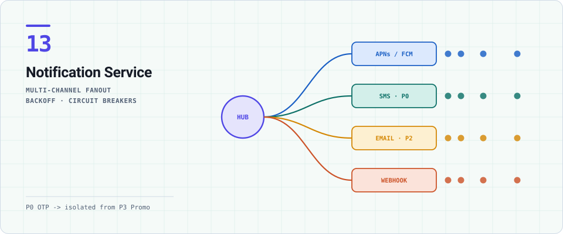
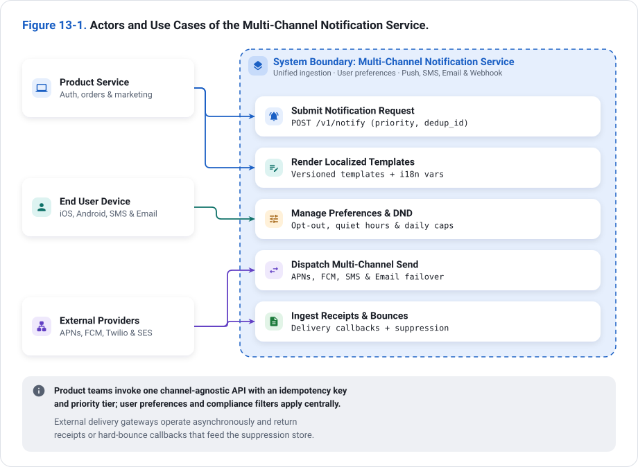
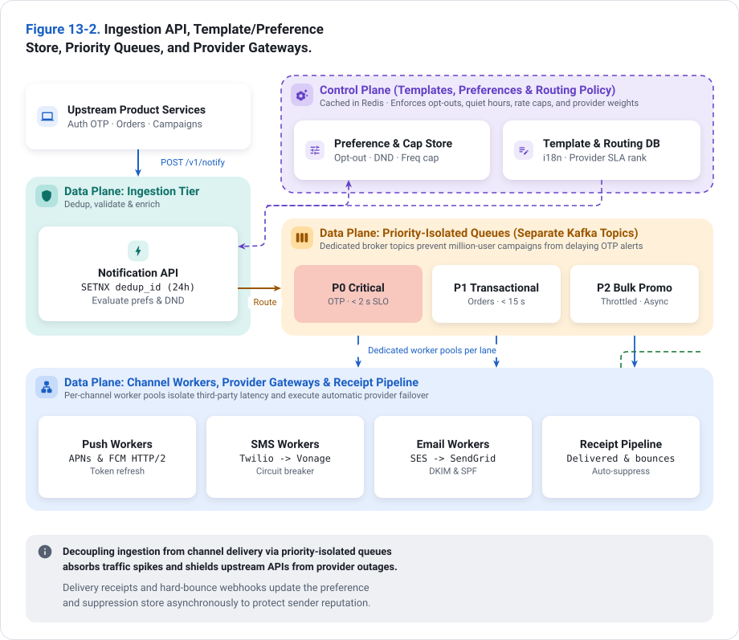
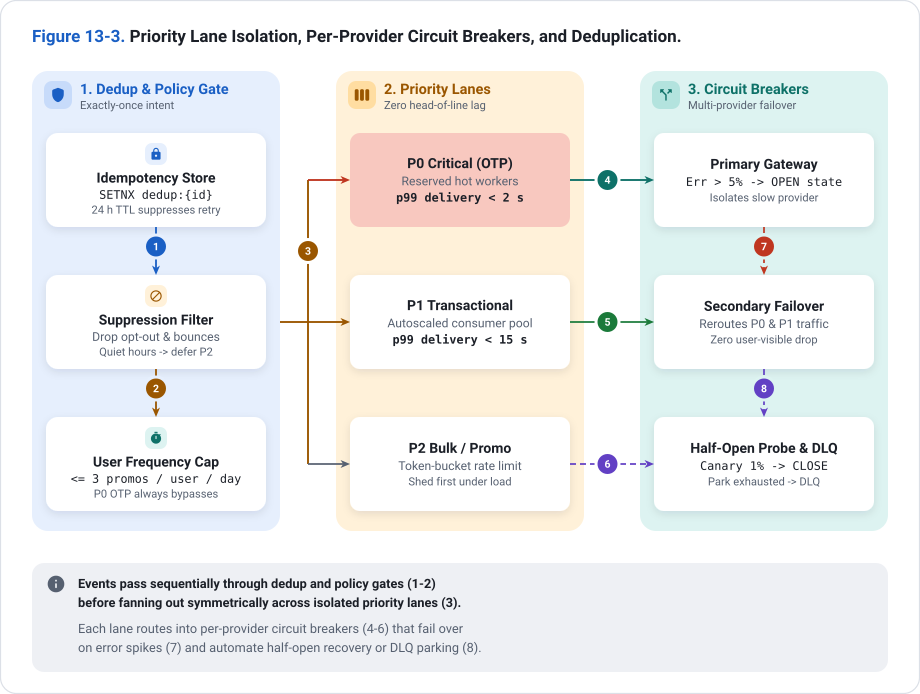

# Chapter 13: Multi-Channel Notification Service



Nearly every product service needs to notify users across push notifications (APNs, FCM), SMS carriers (Twilio, Vonage), email relays (Amazon SES, SendGrid), and customer webhooks. If checkout, authentication, billing, and marketing services each integrate directly with external providers, every team duplicates credential management, localization templates, legal opt-out checks, quiet-hour scheduling, and retry logic. Worse, when an external SMS gateway slows to `15 seconds` per call, synchronous callers inherit that latency directly.

The defining engineering challenge of a notification platform is that its final delivery step leaves our trust boundary and runs on unreliable third-party infrastructure with strict rate ceilings, partial timeouts, and asynchronous delivery receipts. In this chapter, I design a high-throughput, multi-channel notification platform. We specify requirements, actors, and capacity bounds, design an idempotent `202 Accepted` ingestion contract, separate preference/template policy management (control plane) from priority-isolated fan-out and provider dispatch (data plane), and engineer full-jitter exponential backoff, per-provider token buckets and circuit breakers, bounce suppression, and batched campaign fan-out.

<div class="covers">

In this chapter, we cover

- actors, priority tiers (`P0` OTP versus `P3` marketing), functional contracts, latency SLOs, non-goals, and daily volume capacity bounds
- idempotent `202 Accepted` ingestion API, user preference and quiet-hour schemas, and asynchronous provider webhook contracts
- separation of template, preference, and provider routing policy (control plane) from deduplication, priority queues, and sender bulkheads (data plane)
- priority lane isolation eliminating head-of-line blocking, per-provider leaky-bucket pacing, and active-passive multi-provider failover
- transient versus permanent provider error taxonomy, exponential backoff with full jitter, retry budgets, and three-state circuit breakers
- user preferences, legal opt-out and bounce suppression lists, frequency capping, quiet-hour deferral, and two-stage batched fan-out for 10M+ campaigns
- operational failure modes, SLIs, production architectures (Amazon SNS/Pinpoint, Courier, Knock), and simulation verification

</div>

## 13.1 Requirements, Actors, and Capacity Bounds

### Actors and Use Cases

We organize the notification service around four actors: upstream product services emitting notification events, end users managing channel opt-outs and Do-Not-Disturb (DND) quiet hours, external delivery providers (APNs, FCM, SES, Twilio) accepting outbound sends and returning asynchronous delivery webhooks, and platform operators configuring templates and provider failover weights (Figure 13-1).

<figure class="diagram">

<figcaption><b>Figure 13-1</b> Actors, system boundary, and core use cases of the multi-channel notification service.</figcaption>
</figure>

| Actor | Operation | Concrete Scenario |
| :--- | :--- | :--- |
| **Product Service** | Submit notification (`POST /v1/notifications` with `dedup_id` and `priority`) | Trigger a `P0` login OTP SMS within `2 s`, a `P1` order-shipped email, or a `P3` promotional push campaign |
| **End User** | Configure channel opt-outs, locale, and quiet hours (`PUT /v1/users/{id}/preferences`) | Mute promotional pushes between `22:00` and `08:00` local time while keeping security alerts enabled |
| **External Provider** | Accept outbound API sends; emit asynchronous delivery/bounce webhooks | Apple APNs, Google FCM, Amazon SES, and Twilio report delivered, bounced, or unregistered device tokens |
| **Platform Operator** | Author versioned i18n templates; tune provider weights and circuit thresholds | Shift SMS traffic from degraded primary carrier to backup carrier without redeploying application services |

### Functional Requirements

| No. | Functional Requirement |
| :--- | :--- |
| 0 | Product services submit notifications targeting a `user_id` (or bulk audience segment) with a template ID, template parameters, priority class (`P0` critical, `P1` transactional, `P2` lifecycle, `P3` promotional), and mandatory `Idempotency-Key` (`dedup_id`). |
| 1 | The ingestion tier deduplicates repeated requests carrying the same `dedup_id` within a `24-hour` window, returning the original tracking ID without queueing a duplicate send. |
| 2 | Before dispatch, the service centrally enforces user opt-out preferences, legal unsubscribe/bounce suppression lists, local quiet hours (deferring non-`P0` messages until morning), and daily promotional frequency caps (`<= 3` promos/user/day). |
| 3 | The dispatch tier routes notifications to isolated per-priority, per-channel queues, paces outbound calls within each provider's rate limit, retries transient failures with jittered exponential backoff up to `5` attempts, and quarantines exhausted sends to a Dead-Letter Queue (`DLQ`). |
| 4 | The service exposes an idempotent webhook endpoint ingesting provider delivery receipts, hard bounces, and invalid push tokens to update delivery state and maintain suppression lists automatically. |

### Non-Functional Requirements and SLOs

| No. | Property | Target Specification | Architectural Consequence |
| :--- | :--- | :--- | :--- |
| 0 | **Ingestion Availability & Latency** | `99.99%` availability; `p99 <= 25 ms` to return `202 Accepted` | Strict asynchronous decoupling: ingestion validates, deduplicates, and writes to durable queues via transactional outbox; never calls external providers inline |
| 1 | **End-to-End Dispatch Latency** | `P0` (OTP/security): `p99 <= 3 s`; `P1` (transactional): `p99 <= 15 s`; `P3` (marketing): minutes to hours | Physically separate priority topics and dedicated sender worker pools (**bulkheads**) prevent a 10M-user campaign from delaying login codes |
| 2 | **Consistency** | Strongly consistent deduplication store (`SETNX` / unique index) and opt-out enforcement; eventually consistent delivery status | Two API nodes must agree strictly on whether `dedup_id` was seen; provider delivery receipts arrive asynchronously out of order via webhooks |
| 3 | **Delivery Guarantee** | At-least-once to external providers; at-most-once acceptance per `dedup_id` from caller perspective | Propagate `dedup_id` to providers supporting idempotency keys; accept rare duplicates after provider timeouts rather than dropping OTPs unnoticed |
| 4 | **Scale** | `50,000,000` notifications/day (`579` avg/s; `5,790` sustained peak/s; `50,000` burst campaign fan-out/s) | Sharded Redis/SQL dedup store, partitioned Kafka priority queues, and auto-scaled stateless channel sender pools |

### Non-Goals and Scope Boundaries

- **Guaranteed human readership:** A provider returning `200 OK` confirms only handoff to the carrier, never that a user saw or read the message. Critical incident escalation (such as on-call paging) requires explicit human acknowledgment loops with automated escalation timers outside this service.
- **Synchronous delivery confirmation in `POST /v1/notifications`:** Callers receive `202 Accepted` and poll `GET /v1/notifications/{id}` or subscribe to status events rather than holding open HTTP connections while SMTP or SMS networks negotiate.
- **Unthrottled instant campaign blasts:** Dispatching `10,000,000` push notifications in `10 seconds` violates provider quotas and triggers a self-inflicted traffic storm when millions of users open the app simultaneously. Bulk campaigns are always paced over minutes or hours.

### Back-of-the-Envelope Capacity Bounds

| Resource Dimension | Arithmetic Derivation | Provisioned Bound |
| :--- | :--- | :--- |
| **Daily / Peak Send Rate** | `50,000,000 / 86,400 s` = `578.7` avg/s; `10x` transactional peak | `579` avg/s; `5,790` peak/s (split roughly `60%` Push, `30%` Email, `10%` SMS) |
| **24-Hour Dedup Store RAM** | `50,000,000` active keys/day `* (48 B key + 32 B value + 40 B Redis overhead)` | `~6.0 GB` RAM across a 3-shard replicated Redis Cluster (`24h` TTL auto-eviction) |
| **Sender Worker Pool Sizing** | At `50` outbound async HTTP/2 sends/s per worker pod (`~200 ms` avg provider RTT, `10` concurrent streams/pod): `5,790 / 50` | `116` total sender pods partitioned into isolated pools (`30` P0, `40` P1, `46` P2/P3 across APNs/FCM/SES/SMS) |
| **30-Day Audit & Receipt Log** | `50,000,000` records/day `* 30 days * 512 B` compressed | `~768 GB` in partitioned time-series/SQL audit store |
| **Preference & Token Cache** | `10,000,000` active users `* 256 B` (opt-outs, timezone, device tokens, daily promo counter) | `~2.56 GB` (fits comfortably in regional Redis cache ahead of durable SQL) |

## 13.2 External API and Data Contracts

### Asynchronous Ingestion and Preference Contracts

**Submit notification (`POST /v1/notifications`):**

Returning `202 Accepted` signals durable intake without waiting for third-party providers. If the caller retries with the identical `Idempotency-Key`, the API returns `200 OK` with the existing `notification_id` and schedules no duplicate send.

```http
POST /v1/notifications HTTP/2
Host: notify.internal
Content-Type: application/json
Idempotency-Key: order-7-shipped

{
  "user_id": "user-42",
  "priority": "P1",
  "template_id": "order_shipped_v2",
  "channels": ["push", "email"],
  "variables": { "order_id": "order-7", "carrier": "UPS" }
}
```

```http
HTTP/2 202 Accepted
Location: /v1/notifications/5512
Content-Type: application/json

{
  "notification_id": "5512",
  "dedup_id": "order-7-shipped",
  "state": "QUEUED"
}
```

**Update user preferences and quiet hours (`PUT /v1/users/{user_id}/preferences`):**

```http
PUT /v1/users/user-42/preferences HTTP/2
Host: notify.internal
Content-Type: application/json

{
  "locale": "en-US",
  "timezone": "America/New_York",
  "channels": {
    "transactional": ["push", "email"],
    "promotional": ["email"]
  },
  "quiet_hours": {
    "enabled": true,
    "start_local": "22:00",
    "end_local": "08:00"
  }
}
```

### Preference, Suppression, and Delivery State Schema

```sql
CREATE TABLE user_notification_prefs (
    user_id            TEXT PRIMARY KEY,
    locale             TEXT NOT NULL DEFAULT 'en-US',
    timezone           TEXT NOT NULL DEFAULT 'UTC',
    promo_opt_in       BOOLEAN NOT NULL DEFAULT FALSE,
    quiet_start_minute SMALLINT,     -- Minutes past midnight local time (e.g., 1320 = 22:00)
    quiet_end_minute   SMALLINT,     -- e.g., 480 = 08:00
    updated_at         TIMESTAMPTZ NOT NULL
);

CREATE TABLE address_suppression_list (
    channel            TEXT NOT NULL, -- email | sms | apns | fcm
    destination_hash   TEXT NOT NULL, -- SHA-256 of normalized email/phone/device token
    reason             TEXT NOT NULL, -- HARD_BOUNCE | SPAM_COMPLAINT | UNREGISTERED_TOKEN | STOP_SMS
    suppressed_at      TIMESTAMPTZ NOT NULL,
    PRIMARY KEY (channel, destination_hash)
);
```

## 13.3 High-Level Architecture: Control Plane vs. Data Plane

We decouple template authoring, user preference configuration, and provider SLA routing policy (control plane) from high-volume ingestion, deduplication, priority queuing, and provider dispatch (data plane) (Figure 13-2).

<figure class="diagram">

<figcaption><b>Figure 13-2</b> Control-plane preferences/templates and data-plane priority-isolated multi-channel dispatch topology.</figcaption>
</figure>

### Component Responsibilities and Failure Domains

| Component | Plane | State Held | Failure Impact and Mitigation |
| :--- | :--- | :--- | :--- |
| **Preference & Suppression Store** | Control | Authoritative user opt-outs, quiet hours, frequency caps, and bounce suppression lists (SQL + Redis cache) | Cache miss falls back to SQL; fail-closed on promotional opt-out uncertainty (never violate legal unsubscribe rules), fail-open for `P0` security OTPs |
| **Template & Routing Policy DB** | Control | Versioned i18n message templates and per-channel provider health/weight tables | Compiled templates cached in API/sender RAM; control-plane outage pauses edits while live sending continues uninterrupted |
| **Notification Ingestion API** | Data | Stateless validators + strongly consistent `dedup_id` outbox store (`24 h` TTL) | Multi-AZ stateless fleet; writes `dedup_id` and outbox event atomically so crashes never drop accepted requests |
| **Priority-Isolated Queues (Kafka)** | Data | Dedicated topics per `(priority, channel)` pair (`notify.p0.sms`, `notify.p3.email`, etc.) | Buffers hours of backlog during third-party outages; prevents bulk traffic from blocking urgent OTPs |
| **Channel Sender Bulkheads** | Data | Per-provider leaky-bucket rate limiters, three-state circuit breakers, HTTP/2 connection pools | Isolated per channel and priority so a dead SMS carrier cannot exhaust threads needed by APNs or SES |
| **Webhook Receipt Ingestor** | Data | Idempotent callback verifier (HMAC signature validation) updating audit logs and suppression list | Retried by providers for hours; updates `HANDED_TO_PROVIDER -> DELIVERED | BOUNCED` asynchronously |

### Request Path Walkthrough

1. **Atomic Deduplication & Outbox Intake:** The Ingestion API checks `dedup:{id}` atomically (persisting key + outbox row in one transaction so a crash never records a key without enqueuing the send) and returns `202 Accepted` in `< 25 ms`.
2. **Policy, Preference, and Cap Gate:** The enrichment stage checks the user's opt-outs, hard-bounce suppression list, daily promotional frequency cap (`INCR freq:{user}:{yyyy-mm-dd}`), and local quiet hours. `P0` security/OTP alerts bypass quiet hours and frequency caps; `P2`/`P3` messages arriving during quiet hours are deferred via the delayed job scheduler (Chapter 12) until `08:00` local time.
3. **Localized Template Rendering & Priority Routing:** The worker renders the versioned template in the user's locale and publishes the concrete channel payload onto the matching priority topic (`P0`, `P1`, `P2`, or `P3`).
4. **Paced Provider Dispatch:** A dedicated sender from that lane's bulkhead consumes the message, acquires a token from the provider's leaky-bucket pacer, verifies the provider's circuit breaker is `Closed`, and transmits over HTTP/2.
5. **Asynchronous Delivery Verification:** Provider webhooks later update the notification record from `SENT_TO_PROVIDER` to `DELIVERED` or `HARD_BOUNCED` (automatically adding invalid emails or unregistered APNs/FCM tokens to `address_suppression_list`).

## 13.4 Priority Lane Isolation, Provider Pacing, and Circuit Breakers

### Eliminating Head-of-Line Blocking with Priority Lanes and Bulkheads

A single shared queue fails catastrophically as soon as marketing triggers a `10,000,000`-user announcement: every `P0` two-factor login SMS lands behind millions of promotional jobs and arrives `40 minutes` late, locking users out of their accounts. Figure 13-3 illustrates our three-stage isolation pipeline:

<figure class="diagram">

<figcaption><b>Figure 13-3</b> Deduplication and policy gating, isolated priority lanes, and per-provider circuit-breaker failover.</figcaption>
</figure>

- **Dedicated Topics and Worker Bulkheads:** `P0` (OTP, fraud, password reset), `P1` (order confirmations, receipts), and `P2`/`P3` (digests, promotions) run on physically separate queue topics, separate thread pools, and separate provider sub-accounts (so marketing email reputation never contaminates transactional IP reputation).
- **Per-Provider Leaky-Bucket Pacing:** External providers enforce strict rate limits (for example, `500` SMS/s on Twilio or `1,000` emails/s on SES) and return `429 Too Many Requests` when exceeded. Rather than colliding with provider `429` walls, senders pace outbound calls slightly below contracted limits (`90%` ceiling) using a distributed leaky bucket (Chapter 7), letting excess volume sit safely inside Kafka partitions.
- **Two-Stage Batched Campaign Fan-Out:** A `10,000,000`-user broadcast never executes as one giant loop. Stage 1 chunks the audience query into `10,000` batch jobs of `1,000` users each (each checkpointed independently). Stage 2 workers expand each batch into individual `P3` notifications carrying deterministic idempotency keys (`campaign:{camp_id}:user:{uid}`) paced over a configured rollout window (`30` to `120 minutes`), protecting both provider limits and our own app servers from a click-through stampede.

### Three-State Circuit Breakers and Multi-Provider Failover

When an external provider hangs instead of returning fast errors, every sender thread blocks for the full `10-second` socket timeout, starving healthy traffic and cascading timeouts upstream. Placing a **three-state circuit breaker** in front of each provider isolates outages in microseconds, as traced in Interactive Trace 13.A:

<figure class="steps" data-prefix="figures/steps-notify-breaker" data-count="6" data-version="07ad94bb">

<figcaption><b>Interactive Trace 13.A</b> Three-state circuit breaker transitioning from Closed to Open after 5 consecutive failures, failing fast for 30 seconds, and probing via Half-Open. Use Next and Back to step through.</figcaption>
</figure>

- **Closed:** All calls flow through while tracking rolling error rate and consecutive timeouts. Crossing the threshold (for example, `5` consecutive timeouts or `> 50%` 5xx over `20` requests) trips the breaker to **Open**.
- **Open:** All calls fail fast in microseconds without opening sockets to the dead provider, protecting sender threads and giving the provider room to recover. For `P0` SMS OTPs, an open primary-carrier breaker automatically routes traffic to a pre-warmed **secondary SMS carrier** (active-passive failover).
- **Half-Open:** After a `30-second` cooldown, the breaker admits a small probe (`1` to `3` trial sends). Success resets the breaker to **Closed**; failure re-opens it for another cooldown window.

## 13.5 Error Taxonomy, Full-Jitter Exponential Backoff, and Delivery Truth

### Permanent vs. Transient Provider Failures

Retrying every error damages both sender throughput and external deliverability reputation. Senders classify every provider response strictly into four actions:

| Provider Response | Classification | Sender Action |
| :--- | :--- | :--- |
| **`200` / `202` Accepted** | Accepted for relay | Mark `HANDED_TO_PROVIDER`, store `provider_message_id`, await webhook receipt |
| **Invalid Email, Hard Bounce, APNs `410 Unregistered`, FCM `UNREGISTERED`, SMS `STOP`** | **Permanent Failure** | Zero retries; mark `FAILED_PERMANENT`; write destination to `address_suppression_list` immediately to protect sender IP reputation |
| **`429 Too Many Requests`, `500`/`502`/`503`/`504`, Connection Reset** | **Transient Failure** | Schedule retry via exponential backoff with full jitter (respecting `Retry-After` if larger) up to `max_attempts = 5` |
| **Client Read Timeout (Ambiguous Outcome)** | **Ambiguous Transient** | Retry with backoff, passing provider-side idempotency header where supported; accept rare duplicate over silent OTP loss |

### Exponential Backoff with Full Jitter and Retry Budgets

Immediate retries keep an overloaded provider pinned at `100%` saturation. Doubling the wait after each failure (`1 s -> 2 s -> 4 s -> 8 s -> 16 s`, capped at `60 s`) lets brief blips recover on attempt `2` while shedding load rapidly during long outages, as demonstrated in Interactive Trace 13.B:

<figure class="steps" data-prefix="figures/steps-notify-backoff" data-count="6" data-version="7b8f8080">

<figcaption><b>Interactive Trace 13.B</b> Exponential backoff doubling waits (1, 2, 4, 8 s) across four transient failures before succeeding on try 5 at t = 15 s. Use Next and Back to step through.</figcaption>
</figure>

Deterministic doubling alone still synchronizes retries across thousands of senders that failed during the same second, striking a recovering provider with periodic thundering-herd waves. Following Marc Brooker's AWS simulation analysis, we apply **Full Jitter**:

```text
sleep_seconds = random_uniform(0, min(cap_seconds, base_seconds * 2^(attempt - 1)))
```

Full jitter flattens synchronized spikes into a smooth trickle while halving mean retry wait time. To protect against prolonged brownouts where retries still multiply steady-state traffic, we pair full jitter with a **per-provider retry budget** (Google SRE practice): total retry requests across a sender pool may never exceed `10%` of normal first-attempt traffic. Exhausted notifications enter the **Dead-Letter Queue (`DLQ`)** (or expire automatically when their business validity TTL elapses, as with a 5-minute OTP code that would confuse a user if delivered two hours late).

### Separating "Sent" from "Delivered"

Accepting a `200 OK` from SES, APNs, or Twilio means only that the provider accepted responsibility to attempt delivery. Actual inbox placement, carrier handset delivery, or soft/hard bounces arrive seconds to hours later via asynchronous **webhooks** (`POST /v1/webhooks/{provider}`). Because providers retry webhooks at-least-once and out of order, our webhook handler verifies cryptographic signatures (`HMAC-SHA256`), enforces monotonic state transitions (`QUEUED -> SENT_TO_PROVIDER -> DELIVERED | BOUNCED`), and updates suppression lists idempotently.

## 13.6 Failure Modes, SLIs, and Production Systems

### Failure and Recovery Matrix

| Failure Mode | Operational Symptom | Automated Mitigation |
| :--- | :--- | :--- |
| **Primary SMS Carrier Outage** | Consecutive timeouts / `503` on SMS sender pool | Circuit breaker opens after `5` consecutive failures; `P0` SMS pool fails over immediately to pre-warmed secondary SMS carrier |
| **10M-User Marketing Campaign Launch** | `P3` queue depth surges to millions | Dedicated `P0`/`P1` topics and sender bulkheads keep OTP latency `< 3 s`; `P3` campaign paces smoothly over `60 minutes` |
| **Caller Retries `POST /v1/notifications` After Timeout** | Duplicate HTTP requests arrive with identical `Idempotency-Key` | Atomic `SETNX` / outbox uniqueness constraint returns existing `notification_id` (`200 OK`) and emits zero duplicate sends |
| **High Email Hard-Bounce Spike** | SES bounce rate rises toward `5%` suspension threshold | Webhook ingestor auto-suppresses bounced addresses immediately; alert triggers at `2%` bounce rate to halt defective list uploads |
| **Push Device Token Churn (Uninstalled Apps)** | APNs `410` / FCM `UNREGISTERED` errors on push sends | Senders treat as permanent failure (zero retries) and deactivate stale device token in preference store asynchronously |
| **Stale `P0` OTP Delayed by Prolonged Outage** | OTP arrives `15 minutes` late, confusing user | Every message carries a business `valid_until` deadline; senders drop expired OTPs cleanly instead of delivering stale codes |

### Key SLIs and Operational Alerts

- **End-to-End Dispatch Latency by Priority (`p99`):** `P0 <= 3 s` (page immediately at `> 5 s`), `P1 <= 15 s`, `P3 <= 30 minutes`.
- **Provider Circuit-Breaker State (`provider_breaker_open`):** Immediate alert whenever any primary provider circuit opens or failover engages.
- **Email Bounce and Spam-Complaint Rates:** Page if hard bounce rate exceeds `2.0%` or complaint rate exceeds `0.08%` (well below ISP/SES suspension limits of `5%` and `0.1%`).
- **DLQ Volume and Dedup Conflict Rate:** Alert on rising DLQ entries (broken template variables or invalid provider credentials) and monitor dedup hit rate for upstream retry loops.

### Real-World Production Systems

| Production System | Architecture Pattern | Multi-Channel & Policy Features | Architectural Distinction |
| :--- | :--- | :--- | :--- |
| **Amazon SNS + Pinpoint** | Managed pub/sub fan-out + channel endpoints | Push (APNs/FCM), SMS, email, campaign segmentation, quiet hours | Massive horizontal fan-out with built-in provider delivery status logging and topic-level DLQs |
| **Airbnb / Uber Notification Platforms** | Kafka priority lanes + centralized preference/cap service | Strict `P0` vs marketing isolation, multi-vendor SMS routing, user fatigue caps | Enforces global per-user daily frequency budgets centrally so independent product teams cannot spam users |
| **Courier / Knock / Novu** | Unified routing API + workflow state engine | Visual template i18n, provider fallback chains, batch/digest aggregation | Abstracts multi-vendor failover, digest batching ("3 people liked this"), and cross-channel read receipts |
| **Apple APNs & Google FCM (HTTP/2)** | Persistent multiplexed HTTP/2 / TLS streams | Immediate token-invalidation status codes (`410 Unregistered`) | Requires long-lived HTTP/2 connection pooling rather than per-send TLS handshakes to sustain high throughput |

## 13.7 Simulation Verification

To verify caller idempotency deduplication, exponential retry pacing, and bounded DLQ quarantine, we execute the repository's `notifysim` simulation ([`code/notifysim/src/main.rs`](https://github.com/arpanpathak/cracking-the-systems-programming-interview/blob/prep-v2/distributed-systems-from-the-ground-up/code/notifysim/src/main.rs)). Five requests enter the notification service against a simulated provider configured with distinct transient failure counts per key:

```console
$ cargo run --release -p notifysim
order-7-shipped   sent on try 1, 0 seconds after the first try
order-8-shipped   sent on try 3, 3 seconds after the first try
order-7-shipped   submitted before: not sent again
order-9-shipped   sent on try 5, 15 seconds after the first try
order-10-shipped  failed 5 times: set aside for a person to look at
```

Every core delivery invariant appears in the five-line trace:

1. **Immediate Healthy Path:** `order-7-shipped` succeeds on try `1` at `t = 0 s`.
2. **Idempotent Deduplication:** Submitting `order-7-shipped` a second time is recognized by its idempotency key and suppressed (`not sent again`).
3. **Exponential Backoff Timing:** `order-8-shipped` fails twice and succeeds on try `3` after `1 + 2 = 3 s`; `order-9-shipped` fails four times and succeeds on try `5` after `1 + 2 + 4 + 8 = 15 s`.
4. **Bounded Retry Quarantine (DLQ):** `order-10-shipped` fails all `5` permitted attempts and moves to the dead-letter set for human inspection rather than looping indefinitely.

<div class="simulation">

**Run the notification delivery simulation.** Execute `cargo run --release -p notifysim` in [`code/`](https://github.com/arpanpathak/cracking-the-systems-programming-interview/tree/prep-v2/distributed-systems-from-the-ground-up/code) ([`code/notifysim/src/main.rs`](https://github.com/arpanpathak/cracking-the-systems-programming-interview/blob/prep-v2/distributed-systems-from-the-ground-up/code/notifysim/src/main.rs)) to reproduce idempotency suppression, exponential backoff schedules, and five-try dead-letter isolation above.

</div>

## 13.8 Terminology and References

### Engineering Glossary

| Term | Definition |
| :--- | :--- |
| **`202 Accepted`** | HTTP status code confirming a notification request is durably stored and queued for asynchronous delivery without waiting for external providers. |
| **Priority Lane Isolation (Bulkhead)** | Physically separating queues, worker pools, and provider quotas across priority tiers (`P0` OTP vs `P3` marketing) to eliminate head-of-line blocking. |
| **Full-Jitter Exponential Backoff** | Choosing each retry delay uniformly at random in `[0, min(cap, base * 2^(attempt - 1))]`, eliminating synchronized retry waves. |
| **Circuit Breaker** | A three-state (`Closed`, `Open`, `Half-Open`) guard that stops sending traffic to a failing external provider, failing fast or triggering failover until trial probes succeed. |
| **Retry Budget** | A global cap limiting retry volume to a small percentage (for example, `10%`) of healthy first-attempt traffic to prevent cascading overload. |
| **Suppression List** | A durable opt-out and hard-bounce registry preventing further sends to unsubscribed users, invalid addresses, or uninstalled device tokens. |
| **Quiet Hours (Do Not Disturb)** | User-configured local time windows during which non-critical notifications are deferred until morning while `P0` security alerts still pass through. |
| **Webhook Receipt** | An asynchronous HTTP callback sent by an external provider reporting downstream delivery, bounce, or spam complaint events. |

### End-to-End Request Lifecycle and Hop-by-Hop Latency Budget

A high-priority `P0` transactional notification (such as a two-factor authentication code) bypasses promotional queues entirely, completing ingestion, policy validation, and external provider handoff in under `350 ms` at `p99`.

| Hop | Boundary | Protocol and Operation | Typical `p50` | Tail `p99` |
| :--- | :--- | :--- | :--- | :--- |
| 1 | Upstream Producer to Notification API | TLS HTTP/2 `POST /v1/notifications` returning `202 Accepted` with `message_id` | `1.50 ms` | `4.50 ms` |
| 2 | Ingestion Service to Priority Topic (`P0`) | Durable publish to dedicated Kafka `P0` lane (`acks = all`) | `3.20 ms` | `11.00 ms` |
| 3 | Policy, Preference, and Suppression Lookup | Regional Redis cache read for opt-out list, quiet hours, and rate caps | `0.90 ms` | `3.50 ms` |
| 4 | Template Render and Channel Worker Handoff | In-memory i18n template substitution and token-bucket provider pacing | `1.10 ms` | `4.00 ms` |
| 5 | Channel Worker to External Provider (APNs/FCM/SMS) | Persistent multiplexed HTTP/2 TLS stream to external gateway | `65.00 ms` | `290.00 ms` |
| **Total** | **End-to-End `P0` Provider Acceptance** | **External gateway dominates tail latency; internal path stays under 25 ms** | **`71.70 ms`** | **`313.00 ms`** |

### Production Case Studies and Open-Source Comparisons

- **Apple APNs (HTTP/2 Provider API):** APNs requires persistent, multiplexed HTTP/2 connections authenticated via JWT tokens or TLS certificates, supporting hundreds of concurrent in-flight streams per TCP connection to avoid per-send TLS handshake overhead. APNs returns synchronous per-stream status codes (`200 OK`, `410 Unregistered`, `429 Too Many Requests`), enabling workers to purge stale device tokens immediately without waiting for asynchronous feedback queues.
- **Firebase Cloud Messaging (FCM HTTP v1):** FCM routes Android and cross-platform push payloads over OAuth 2.0-authenticated HTTP/2 connections with per-project quota buckets and topic fan-out primitives. Production senders maintain connection pools per region, honor `Retry-After` headers on `429` responses, and prune registration tokens that return `UNREGISTERED` or remain inactive beyond `270` days.
- **Slack and Airbnb Priority Pipelines:** Both Slack and Airbnb isolate real-time transactional notifications (`P0` mentions, OTPs, booking confirmations) from bulk digest and marketing campaigns (`P2`/`P3`) using dedicated Kafka topics, separate worker autoscaling groups, and a centralized user-fatigue budget service. Enforcing global per-user daily caps and quiet-hour deferral centrally prevents independent product teams from saturating provider quotas or degrading user trust.

<div class="callout keyidea"><span class="label">Key idea</span>Physical lane isolation (separate topics, worker pools, and provider connection pools per priority class) ensures that a `10`-million-message marketing blast cannot add even one millisecond of head-of-line queuing delay to a `P0` security alert.</div>

<div class="callout experiment"><span class="label">Experiment</span>Simulate an upstream SMS provider degrading to `50%` HTTP `503` failures while injecting `1,000` req/s. Compare fixed-interval retries against full-jitter exponential backoff paired with a `10%` global retry budget, measuring queue depth and recovery time after the provider stabilizes.</div>

<div class="callout caution"><span class="label">Common pitfall</span>Treating HTTP `200 OK` from an SMS or email gateway as proof of end-user delivery hides carrier filtering, hard bounces, and uninstalled device tokens. Always ingest asynchronous provider webhooks to update delivery state and populate the suppression list automatically.</div>

### References

- M. Brooker, "Exponential Backoff and Jitter", AWS Architecture Blog, 2015.
- M. Brooker, "Timeouts, Retries, and Backoff with Jitter", Amazon Builders' Library.
- B. Beyer, C. Jones, J. Petoff, and N. R. Murphy (editors), *Site Reliability Engineering*, O'Reilly Media, 2016, Chapter 22 ("Addressing Cascading Failures").
- M. Nygard, *Release It* (2nd edition), Pragmatic Bookshelf, 2018 (Circuit Breakers, Timeouts, and Bulkheads).
- R. Fielding, M. Nottingham, and J. Reschke, RFC 9110, *HTTP Semantics*, IETF, 2022 (`202 Accepted` and `Retry-After`).
- Apple Developer Documentation, "Sending Notification Requests to APNs (HTTP/2 Provider API)".
- Firebase Cloud Messaging Documentation, "FCM HTTP v1 API and Best Practices for Registration Token Management".
