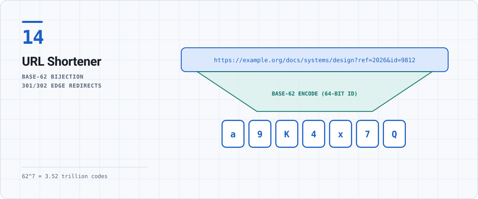
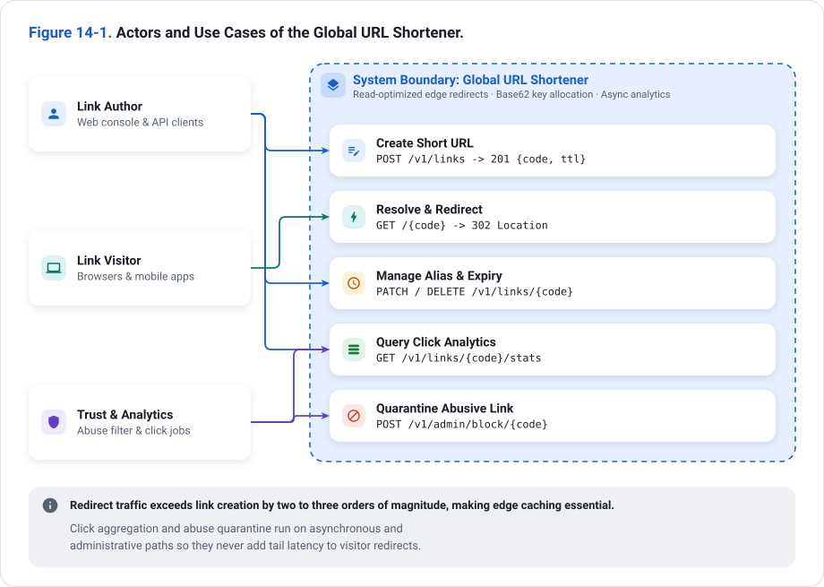
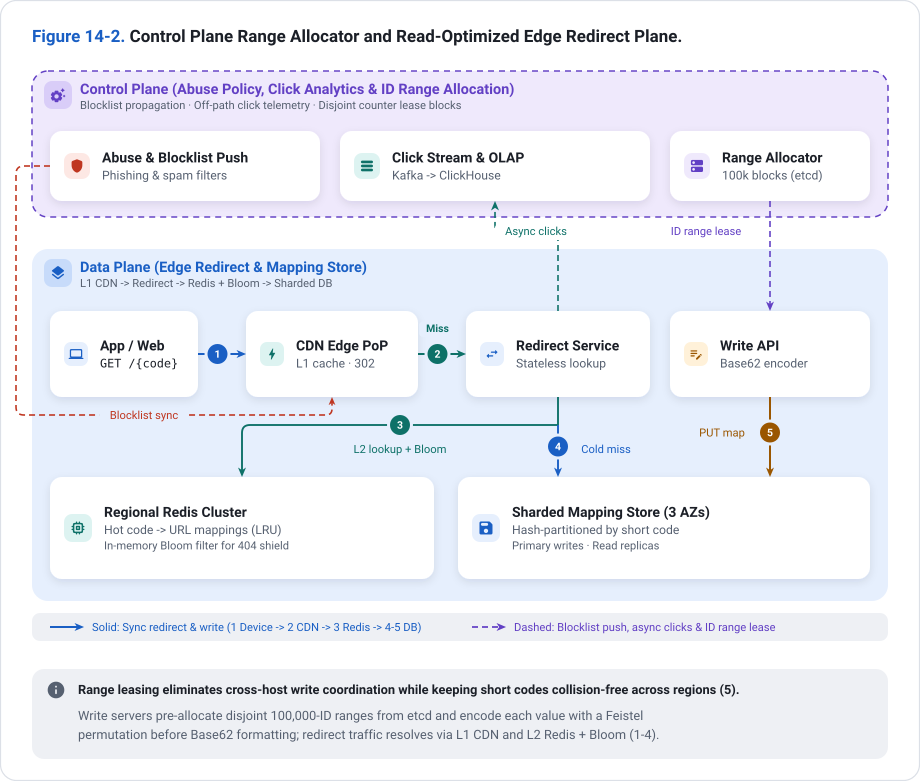
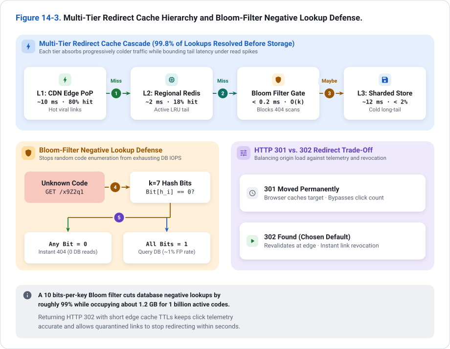

# 14. URL Shortener: System Design

A global URL shortener maps an arbitrary target web address to a compact alias, such as `sho.rt/4C92a7Q`, and redirects every incoming visitor to the original destination within milliseconds. Although the core data model fits into a single key-value relation, operating a public redirect service at internet scale exposes foundational distributed systems tensions: generating short, collision-free, non-enumerable identifiers without cross-node write contention; serving a 100:1 read-heavy workload under extreme Zipfian skew; recording high-volume click analytics without introducing write amplification on the redirect path; and revoking malicious links promptly across globally distributed caches.

In this chapter, we design a globally distributed URL shortener anchored around a strict asymmetry between writes and reads. Creating a link happens at a modest rate and tolerates tens of milliseconds of latency, whereas following a link happens two orders of magnitude more frequently and sits directly on the critical path of every user clicking a link in an email, message, or web page. A brief pause in link creation inconveniences one author; a failed redirect breaks published links for millions of visitors simultaneously.

<div class="covers">

In this chapter, we cover

- actors, use cases, functional requirements, sub-10 ms redirect SLOs, explicit non-goals, and 5-year capacity bounds
- external HTTP/2 contracts for link creation, `301`/`302` redirection, alias management, abuse quarantine, and relational and key-value schemas
- separation of the control plane (range allocation, blocklist propagation, click analytics) from the read-optimized data plane
- key allocation strategies comparing truncated cryptographic hashes, random generation, and disjoint counter range leasing with Base-62 bijection and Feistel scrambling
- multi-tier redirect caching (CDN edge, regional Redis, Bloom filter negative-lookup defense), `301` versus `302` revocation trade-offs, and asynchronous click pipelines
- failure-mode mitigation matrices, operational SLIs, production benchmarks (Bitly, TinyURL, Flickr Base58), and verification via [`code/shortener`](https://github.com/arpanpathak/cracking-the-systems-programming-interview/tree/prep-v2/distributed-systems-from-the-ground-up/code/shortener)

</div>

## 14.1 Requirements, Actors, and Capacity Bounds

### Actors and Use Cases

We partition the URL shortener boundary around three external actor groups (Figure 14-1).

<figure class="diagram">

<figcaption><b>Figure 14-1</b> Actors, system boundary, and core use cases of the global URL shortener.</figcaption>
</figure>

| Actor | Operation | Concrete Scenario |
| :--- | :--- | :--- |
| **Link Author** | Create short link (`POST /v1/links`), update expiry or alias (`PATCH / DELETE /v1/links/{code}`), query analytics (`GET /v1/links/{code}/stats`) | Marketing team or API client shortens a parameterized campaign URL with a 90-day expiry and inspects daily click totals |
| **Link Visitor** | Resolve and follow short link (`GET /{code}`) | Browser or mobile application opens a shared short link and receives a sub-10 ms HTTP redirect to the destination URL |
| **Trust and Analytics Team** | Quarantine abusive link (`POST /v1/links/{code}:block`) and inspect domain threat telemetry | Safety automation detects a phishing destination and blocks resolution across regional caches and CDN edges within seconds |

### Functional Requirements

| No. | Functional Requirement |
| :--- | :--- |
| 0 | An authenticated author submits a valid `http` or `https` URL (up to 4,096 bytes) and receives a unique 7-character Base-62 short code, with optional caller-supplied expiry timestamp and idempotency key. |
| 1 | A visitor requesting `GET /{code}` receives an HTTP redirect (`302 Found` or bounded-TTL `301 Moved Permanently`) carrying the canonical target URL in the `Location` header, or `404 Not Found` / `410 Gone` if the code is absent, expired, or quarantined. |
| 2 | An author can reserve an optional custom alias (distinguished structurally from generated 7-character codes) using atomic create-if-absent semantics. |
| 3 | Once assigned to a URL, a generated short code never maps to a different target URL, and expired or deleted codes are never recycled. |
| 4 | Authors can query time-bucketed click statistics (total clicks, hourly rollups, top referrers) without adding synchronous write latency to redirects. |
| 5 | The platform screens destination URLs against phishing and malware blocklists on creation and periodically thereafter, refuses self-domain redirect loops, and supports rapid administrative quarantine. |

### Non-Functional Requirements and SLOs

| No. | Property | Target Specification | Architectural Consequence |
| :--- | :--- | :--- | :--- |
| 0 | **Redirect Availability** | `99.99%` global availability (`<= 4.3` minutes downtime per month) | Active-active stateless redirect fleets across multiple regions behind Anycast CDN edge caches |
| 1 | **Redirect Latency** | `p50 <= 5 ms` (edge hit), `p99 <= 15 ms` (regional L2 hit), `p999 <= 40 ms` (origin miss) | Eliminates synchronous disk writes, analytics updates, and cross-region consensus from the `GET /{code}` critical path |
| 2 | **Consistency** | Strong read-after-write consistency for link creation (`PC/EC` quorum commit); eventual consistency (`<= 60 s` lag) for click counts | Authors share links immediately after `201 Created`, so mappings require quorum visibility; click dashboards tolerate 1-minute rollup delay |
| 3 | **Unpredictability** | Sequential link creation reveals neither business volume nor neighboring valid codes | Counter values pass through a keyed format-preserving Feistel bijection before Base-62 encoding |
| 4 | **Scale** | `100,000,000` new links per month (`6` billion over 5 years) at a `100:1` read-to-write ratio | Requires `3.52` trillion code capacity (`62^7`), horizontally sharded mapping storage, and multi-tier caching |

### Non-Goals and Scope Boundaries

To keep the architecture focused on core redirect mechanics, we exclude the following capabilities from this design:

- **Arbitrary destination mutation:** Generated links are immutable after creation (excluding expiry and administrative quarantine); mutable dynamic routing tables belong to an enterprise link-management product rather than the core shortener.
- **Per-click financial billing:** Click telemetry uses at-least-once batched aggregation with minute-level eventual consistency; monetized pay-per-click accounting requires exact per-event deduplication and double-entry ledger reconciliation (Chapter 19).
- **Full-page destination proxying or web archiving:** The service issues HTTP redirects and never proxies or caches the HTML body of destination sites.

### Back-of-the-Envelope Capacity Bounds

We size write QPS, read QPS, 5-year storage, cache memory, and egress bandwidth from the baseline of `100` million new links per month and a `100:1` read-to-write ratio:

| Resource Dimension | Arithmetic Derivation | Provisioned Bound |
| :--- | :--- | :--- |
| **Total Links (5 Years)** | `100,000,000 links/mo * 12 mo/yr * 5 yr` | `6,000,000,000` links (`6 billion`) |
| **7-Character Base-62 Space** | `62^7` distinct strings (`0-9`, `A-Z`, `a-z`) | `3,521,614,606,208` codes (`~3.52 trillion`, `< 0.17%` utilization in 5 years) |
| **Write Rate (Sustained / Peak)** | `100,000,000 / (30 * 86,400 s) = 38.6` writes/s; `5x` peak burst | `39` writes/s sustained, `200` writes/s peak |
| **Redirect Rate (Sustained / Peak)** | `39 * 100 = 3,900` reads/s sustained; `10x` viral event spike | `3,900` reads/s sustained, `39,000` reads/s peak |
| **Primary Mapping Storage (5 yr)** | `6 * 10^9 links * 500 B/row` (code, URL, metadata, index overhead) | `3.0 TB` logical (`9.0 TB` raw with `3x` replication) |
| **Regional L2 Redis Cache (Hot 5%)** | `5% * 6 * 10^9 = 300M` hot rows; working daily set (`20M` active links `* 500 B`) | `10 GB` active daily working set (`64 GB` provisioned per region for headroom) |
| **Bloom Filter RAM (All 6B Keys)** | `m = -n ln(p) / (ln 2)^2` at `n = 6 * 10^9`, `p = 0.01` (`9.58` bits/key) | `~7.2 GB` aggregate (`~900 MB` per shard across 8 shards) |
| **Redirect Egress Bandwidth** | `39,000 peak req/s * 600 B` HTTP redirect headers | `23.4 MB/s` (`~187 Mbps` peak aggregate) |
| **Click Event Stream (5 yr raw)** | `3,900 clicks/s * 64 B` compact event ([`code`](https://github.com/arpanpathak/cracking-the-systems-programming-interview/tree/prep-v2/distributed-systems-from-the-ground-up/code), `ts`, `country`, `ref_hash`) | `250 KB/s` (`~21.6 GB/day` raw; `< 2 GB/day` after 1-minute OLAP rollup) |

Because `3.0 TB` of mapping data and `10 GB` of daily hot links are modest by modern server standards, the system is bounded primarily by **tail latency under extreme hot-key skew** (millions of clicks per hour on a single viral link) and **negative-lookup abuse** (scanners probing random 7-character codes to overwhelm storage).

## 14.2 External API and Data Contracts

The platform exposes a JSON-over-HTTP/2 control API for link management and a minimal-overhead HTTP redirect interface at the root path.

### External HTTP Contracts

**Create a short link (idempotent via `Idempotency-Key`):**

```http
POST /v1/links HTTP/2
Host: api.sho.rt
Authorization: Bearer <token>
Idempotency-Key: 7f3c9b12-8a40-4e92-b831-1e2d3f4a5b6c
Content-Type: application/json

{
  "url": "https://example.org/docs/systems/design?ref=2026&id=9812",
  "custom_alias": null,
  "expires_at": "2027-11-20T00:00:00Z",
  "redirect_mode": "302"
}
```

```http
HTTP/2 201 Created
Location: /v1/links/a9K4x7Q
Content-Type: application/json

{
  "code": "a9K4x7Q",
  "short_url": "https://sho.rt/a9K4x7Q",
  "target_url": "https://example.org/docs/systems/design?ref=2026&id=9812",
  "expires_at": "2027-11-20T00:00:00Z",
  "created_at": "2026-11-20T13:08:05Z"
}
```

Status codes follow strict contract semantics: `201 Created` on first allocation (or replay with identical `Idempotency-Key` and payload), `400 Bad Request` for malformed schemes or self-domain loops (`sho.rt`), `409 Conflict` when a requested `custom_alias` already exists, `422 Unprocessable Content` if a destination matches the threat blocklist, and `429 Too Many Requests` when caller creation quotas are exceeded (Chapter 7).

**Resolve and redirect a short link:**

```http
GET /a9K4x7Q HTTP/2
Host: sho.rt
```

```http
HTTP/2 302 Found
Location: https://example.org/docs/systems/design?ref=2026&id=9812
Cache-Control: public, max-age=300, s-maxage=3600
X-Content-Type-Options: nosniff
```

For expired or quarantined codes, the service returns `410 Gone` with `Cache-Control: public, max-age=3600` so intermediate caches stop forwarding repeated traffic for revoked links. Unknown codes return `404 Not Found` with a short negative cache header (`max-age=60`).

**Quarantine an abusive link (control plane):**

```http
POST /v1/links/a9K4x7Q:block HTTP/2
Host: control.sho.rt
Authorization: Bearer <admin-token>
Content-Type: application/json

{
  "reason": "phishing_credential_harvest",
  "purge_cdn": true
}
```

### Storage Schemas

We separate immutable link mappings (optimized for primary-key point lookups) from time-series click rollups (optimized for columnar analytical scans):

```sql
-- Sharded primary mapping store (partitioned by hash(code) across 8 Raft-replicated shards)
CREATE TABLE short_links (
    code          VARCHAR(64)  PRIMARY KEY,   -- 7-char Base-62 or custom alias
    target_url    VARCHAR(4096) NOT NULL,
    owner_id      BIGINT       NOT NULL,
    redirect_code SMALLINT     NOT NULL DEFAULT 302, -- 301 or 302
    status        SMALLINT     NOT NULL DEFAULT 1,   -- 1=active, 2=expired, 3=blocked
    created_at    TIMESTAMPTZ  NOT NULL DEFAULT NOW(),
    expires_at    TIMESTAMPTZ  NULL
);

-- Separate idempotency cache (24-hour TTL) to prevent duplicate allocations on client retry
CREATE TABLE link_idempotency (
    owner_id        BIGINT       NOT NULL,
    idempotency_key VARCHAR(128) NOT NULL,
    request_hash    BYTEA        NOT NULL,
    assigned_code   VARCHAR(64)  NOT NULL,
    created_at      TIMESTAMPTZ  NOT NULL,
    PRIMARY KEY (owner_id, idempotency_key)
);

-- OLAP analytical store (ClickHouse) aggregated in 1-minute windows
CREATE TABLE link_clicks_1m (
    code          String,
    bucket_minute DateTime,
    country_iso   LowCardinality(String),
    referrer_host String,
    click_count   UInt64
) ENGINE = SummingMergeTree()
PARTITION BY toYYYYMM(bucket_minute)
ORDER BY (code, bucket_minute, country_iso, referrer_host);
```

## 14.3 High-Level Architecture: Control Plane vs. Data Plane

We isolate all coordination, safety enforcement, and analytics aggregation inside a control plane so that the hot redirect data plane remains stateless, memory-resident, and insulated from background outages (Figure 14-2).

<figure class="diagram">

<figcaption><b>Figure 14-2</b> Control-plane range allocator, abuse policy, and analytics pipeline decoupled from the read-optimized edge redirect data plane.</figcaption>
</figure>

### Component Responsibilities

| Component | Plane | State Held | Failure Impact and Mitigation |
| :--- | :--- | :--- | :--- |
| **Range Allocator (`etcd` / Raft)** | Control | Authoritative high-water counter cursor (`next_block_start`) | Write workers hold in-memory leases of `100,000` IDs; brief allocator outage causes zero write disruption until a worker exhausts its local block |
| **Abuse and Blocklist Service** | Control | Threat intelligence feeds, domain blocklists, revocation log | Pushes compiled blocklists to Write APIs and publishes invalidation events to regional Redis clusters and CDN purge APIs |
| **Click Stream and OLAP Pipeline** | Control | Partitioned Kafka click log and ClickHouse `link_clicks_1m` rollups | Redirect servers emit events asynchronously via non-blocking ring buffers; broker outage drops or spills telemetry locally without delaying HTTP redirects |
| **CDN Edge PoPs (Anycast)** | Data | L1 HTTP response cache for viral `301`/`302` redirects (`80%` hit ratio) | Automatic BGP Anycast rerouting shifts visitors to the nearest healthy PoP within seconds |
| **Stateless Redirect Service** | Data | In-memory Bloom filter snapshot, L2 Redis connection pools | Horizontally auto-scaled across three AZs per region; losing any instance shifts traffic immediately via load balancer health checks |
| **Regional Redis + Sharded Store** | Data | L2 hot link cache (`64 GB`) and L3 durable mapping shards (`8 shards x 3 replicas`) | Redis miss falls through to L3 store; shard leader crash triggers Raft election in `1 to 3 s` while reads continue from cache and followers |

### Write and Read Lifecycles

**Write path (`POST /v1/links`):**
1. The Write API authenticates the author, enforces per-account creation rate limits (Chapter 7), validates URI syntax, rejects self-domain URLs (`sho.rt`), and checks the destination host against an in-memory compiled threat blocklist.
2. If an `Idempotency-Key` is supplied, the Write API checks `link_idempotency` and returns the prior allocation on an exact payload match.
3. For standard generated links, the Write API atomically increments its local in-memory leased counter (`AtomicU64`), passes the integer through the keyed Feistel permutation, and encodes the scrambled value into a 7-character Base-62 string. No read-before-write uniqueness probe is required.
4. For custom aliases, the Write API validates namespace separation (length greater than 7 characters or containing a hyphen) and issues a quorum conditional insert (`INSERT ... ON CONFLICT DO NOTHING`) to the owning L3 shard.
5. Upon quorum commit across three AZs, the Write API updates the shard's Bloom filter (and broadcasts the bit set asynchronously to redirect workers), optionally warms L2 Redis, and returns `201 Created`.

**Read path (`GET /{code}`):**
1. A visitor's DNS resolution routes via Anycast to the nearest CDN Edge PoP (L1). Roughly `80%` of requests hit a cached viral link and return a redirect in under `10 ms` without contacting origin infrastructure.
2. On an L1 miss, the request reaches a regional Stateless Redirect Service instance, which queries L2 Regional Redis (`~18%` of total traffic, resolved in `~2 ms`).
3. On an L2 miss, the Redirect Service tests the local in-memory Bloom filter (`< 0.2 ms`, `O(k)` hash probes). If the filter returns *definitely absent*, the service immediately replies `404 Not Found` without touching disk storage.
4. On a positive Bloom match, the Redirect Service fetches the mapping from the owning L3 shard (`< 2%` of total traffic, `~12 ms`), populates L2 Redis (or sets a short-TTL negative cache entry if the Bloom check was a false positive), checks `status` and `expires_at`, appends a non-blocking click record to the local Kafka producer buffer, and returns the redirect response.

## 14.4 Key Allocation: Range Leasing, Base-62 Bijection, and Scrambling

### Alphabet Size and Code Length

Every short code is drawn from the 62-character URL-safe alphanumeric alphabet (`0-9`, `A-Z`, `a-z`), which requires no percent-encoding in RFC 3986 path segments. A 6-character code space yields 62<sup>6</sup> = 56,800,235,584 (`~56.8` billion) identifiers. Against our 5-year projection of `6` billion links, a 6-character space would exceed `10.5%` occupancy, making blind guessing succeed on more than 1 in 10 probes and risking mid-life schema migration if growth accelerates. Extending to 7 characters expands the space to 62<sup>7</sup> = 3,521,614,606,208 (`~3.52` trillion) codes, reducing 5-year occupancy to `0.17%` (roughly 1 valid link per 587 random guesses).

For contexts where humans read codes aloud or transcribe them from printed material, operators adopt **Base-58** (omitting visually ambiguous glyphs `0`, `O`, `I`, and `l`), yielding 58<sup>7</sup> ≈ 2.21 trillion codes while eliminating transcription errors.

### Comparing Three Code-Generation Strategies

| Strategy | Uniqueness Guarantee | Read-Before-Write Cost | Coordination State | Enumeration Resistance |
| :--- | :--- | :--- | :--- | :--- |
| **Truncated Hash (SHA-256 prefix)** | Probabilistic; requires store check and salt retry on collision | Mandatory lookup on every write | Stateless | High (pseudorandom output) |
| **CSPRNG Random Draw** | Probabilistic; requires atomic create-if-absent retry | Mandatory conditional insert on every write | Stateless | High (cryptographic entropy) |
| **Leased Counter + Feistel Bijection (Chosen)** | Deterministic by construction (`0` collisions) | None (`1` blind quorum write) | `etcd` range allocator consulted once per `100,000` links | High while Feistel round keys remain secret |

**Why truncated hashes fail without retry loops:** Under the birthday bound, drawing *n* codes uniformly from a space of size *N* yields approximately n<sup>2</sup> / (2N) colliding pairs. In the repository simulation ([`code/shortener`](https://github.com/arpanpathak/cracking-the-systems-programming-interview/tree/prep-v2/distributed-systems-from-the-ground-up/code/shortener)), hashing `2,000,000` distinct URLs and truncating to 6 characters produced **97 collisions**. Sending even 1 visitor in 20,000 to an unrelated website violates functional requirement 3. Resolving hash collisions forces a read-before-write check plus iterative salting, turning every link creation into a conditional read-modify-write cycle. Furthermore, deterministic hashing of the destination URL causes two different authors shortening the same URL to share one code, coupling their analytics and expiry lifetimes.

**Disjoint counter range leasing:** We assign monotonically increasing integers from a strongly consistent `etcd` / Raft range allocator (Chapter 8). Each Write API instance requests a contiguous block of `100,000` integers (`[start, start + 99,999]`) in a single quorum write and dispenses numbers lock-free from RAM via `fetch_add(1)`. At `39` writes/s sustained, the entire fleet consults the allocator roughly once every `42 minutes`. If a Write API node crashes mid-block, the remaining unallocated integers are discarded permanently; against `3.52` trillion codes, forfeiting tens of thousands of IDs on a crash is negligible compared to the operational simplicity of zero write-path coordination.

### Base-62 Encoding Step by Step

Converting a non-negative integer *x* to Base-62 proceeds by repeated Euclidean division by `62`, emitting each remainder as the next least-significant glyph in `0..9A..Za..z`. Interactive Trace 14.A steps through encoding the counter value `1,000,000` into `4C92`.

<figure class="steps" data-prefix="figures/steps-short-encode" data-count="6" data-version="d0e5eca4">

<figcaption><b>Interactive Trace 14.A</b> Converting integer <code>1000000</code> to Base-62 (<code>4C92</code>) by repeated division by 62. Use Next and Back to step through all 6 stages.</figcaption>
</figure>

### Preventing Enumeration with Format-Preserving Encryption

Encoding raw sequential counters directly exposes two severe vulnerabilities. First, an adversary holding `4C92` can enumerate `4C91`, `4C93`, and `4C94` to harvest unlisted shared documents, private calendar invitations, or capability URLs that rely on secrecy of the link. Second, observing the integer difference between codes created at midnight on consecutive days reveals exact daily link volume to competitors.

Shuffling the 62-character alphabet does not prevent analysis, because consecutive integers still differ only in their rightmost character. Instead, we pass each 42-bit counter value x \in [0, 62<sup>7</sup> - 1] through a **keyed 4-round balanced Feistel network** (a standard Format-Preserving Encryption construction, Bellare et al. 2009) using HMAC-SHA256 truncated to 21 bits as the round function F<sub>k</sub>, combined with **cycle walking** whenever an intermediate 42-bit output exceeds 62<sup>7</sup> - 1:

```rust
// Bijective scrambling over domain [0, 62^7 - 1] via 4-round Feistel + cycle walking.
// Distinct counter inputs always map to distinct outputs (zero collisions).
const DOMAIN: u64 = 3_521_614_606_208; // 62^7 (< 2^42 = 4_398_046_511_104)
const HALF_BITS: u32 = 21;
const HALF_MASK: u64 = (1u64 << HALF_BITS) - 1;

fn scramble_id(counter: u64, round_keys: &[u64; 4]) -> u64 {
    let mut v = counter;
    loop {
        let mut left = (v >> HALF_BITS) & HALF_MASK;
        let mut right = v & HALF_MASK;
        for &key in round_keys {
            let f = keyed_prf_21bit(right, key);
            let next_right = left ^ f;
            left = right;
            right = next_right;
        }
        v = (left << HALF_BITS) | right;
        if v < DOMAIN {
            return v;
        }
    }
}
```

Because a Feistel network is mathematically invertible for any round function *F*, the mapping is a strict bijection on [0, 2<sup>42</sup> - 1], and cycle walking preserves bijectivity strictly inside [0, 62<sup>7</sup> - 1] with an expected `1.25` iterations per call (2<sup>42</sup> / 62<sup>7</sup> ≈ 1.249). Adjacent counter values produce statistically independent 7-character Base-62 codes while retaining zero-collision deterministic generation.

## 14.5 Read-Path Optimization: Redirects, Multi-Tier Caching, and Analytics

### HTTP Redirect Semantics: `301` vs. `302` vs. `307`/`308`

Selecting the HTTP redirect status code directly determines browser caching behavior, origin traffic volume, analytics completeness, and security revocation latency:

| Status Code | Semantic Contract | Browser Caching | Click Visibility | Abuse Revocation Latency |
| :--- | :--- | :--- | :--- | :--- |
| **`301 Moved Permanently`** (unbounded) | Permanent replacement; method may rewrite to `GET` | Indefinite heuristic caching by browsers | Misses repeat visits from the same browser | Unbounded (cannot reliably revoke from client caches) |
| **`301` + `Cache-Control: max-age=86400`** | Permanent with explicit 24-hour freshness bound | Cached up to 24 hours per browser | Counts unique browser-days; misses rapid repeats | Bounded to `<= 24 hours` |
| **`302 Found`** (default here) | Temporary redirect; browser revalidates or uses explicit `max-age` | Controlled via `Cache-Control: max-age=300, s-maxage=3600` | Captures origin and CDN edge click logs cleanly | Sub-minute via CDN surrogate-key purge + 5-minute client ceiling |
| **`307` / `308`** | Strict method-preserving temporary / permanent redirect | Matches `302` / `301` respectively | Same as `302` / `301` | Preserves `POST` bodies; rarely needed for browser `GET` links |

In production, unbounded `301` responses create a severe safety hazard: once a phishing URL is cached permanently inside millions of browsers, disabling the link at the origin cannot stop affected visitors from being redirected. Our default issues `302 Found` with `Cache-Control: public, max-age=300, s-maxage=3600` (5-minute browser cache, 1-hour CDN cache), allowing CDN edge servers to absorb viral surges while preserving fast surrogate-key purge when Trust and Safety quarantines a link. For high-volume static links where click analytics are disabled, authors may explicitly opt into bounded `301` redirects.

### Multi-Tier Cache Cascade and Bloom Filter Defense

Short-link traffic follows a steep Zipf distribution in which fewer than `1%` of links generate over `80%` of redirect volume. Meanwhile, automated credential-stuffing or link-enumeration bots routinely issue thousands of requests per second for nonexistent 7-character codes, causing **cache penetration** straight through LRU caches to disk storage. We defend the read path with a four-tier cascade (Figure 14-3).

<figure class="diagram">

<figcaption><b>Figure 14-3</b> Multi-tier redirect cache hierarchy and Bloom-filter negative-lookup gate resolving 99.8% of traffic before persistent storage.</figcaption>
</figure>

1. **L1 CDN Edge PoP (`~80%` hit ratio, `~10 ms` client RTT):** Global Anycast PoPs serve hot viral links directly from edge RAM, shielding origin regions from sudden social-media traffic spikes. Edge log shipping streams sampled or complete `302` hit logs asynchronously to the analytics ingestion pipeline so cached hits are not lost from click counts.
2. **L2 Regional Redis Cluster (`~18%` hit ratio, `~2 ms` intra-region RTT):** Holds the active working set using an `allkeys-lfu` eviction policy. Because link targets are immutable, cache entries require invalidation only on administrative quarantine or explicit deletion, published over a control-plane pub/sub channel.
3. **Bloom Filter Negative Gate (`< 0.2 ms`, `O(k)` bit probes):** Each Redirect Service shard maintains a partitioned Counting or Scalable Bloom Filter covering all valid codes in the store. For `6` billion keys at a `1%` false-positive rate (p = 0.01), optimal sizing requires k = 7 hash functions and $9.58$ bits per key (`~7.2 GB` total, or `900 MB` per shard). Every nonexistent code rejected by the Bloom filter returns `404 Not Found` immediately in RAM without issuing an L3 query, blocking `99%` of random enumeration scans. The remaining `1%` false positives that miss L3 populate a short-TTL (`60 s`) negative tombstone in L2 Redis and increment a per-IP `404` GCRA rate limiter (Chapter 7).
4. **L3 Sharded Mapping Store (`< 2%` traffic, `~12 ms`):** Serves cold long-tail links from SSD-backed Raft-replicated shards partitioned by `hash(code)`.

### Asynchronous Click Analytics and Abuse Controls

Incrementing a relational counter row on every redirect would convert a `3,900` to `39,000` QPS read workload into a write-contended hotspot on popular rows. Instead, Redirect Services and CDN edge log collectors emit compact 64-byte click events ([`code`](https://github.com/arpanpathak/cracking-the-systems-programming-interview/tree/prep-v2/distributed-systems-from-the-ground-up/code), `timestamp_ms`, `country_iso`, `referrer_hash`) into a partitioned Kafka topic via non-blocking ring buffers. Stream consumers aggregate counts in 1-minute tumbling windows in memory and flush bulk batches into ClickHouse (`SummingMergeTree`), reducing persistent write volume by over `1,000x` for viral links while isolating redirect latency completely from analytics pipeline backpressure.

Public redirectors are primary targets for phishing concealment. Three layered safeguards protect domain reputation: synchronous URL inspection against local threat feeds (such as Google Safe Browsing prefix lists) at link creation, periodic background re-scanning of active high-click destinations to catch delayed page swaps, and an instant quarantine endpoint (`POST /v1/links/{code}:block`) that marks `status = 3` in L3, broadcasts an L2 Redis invalidation, and triggers a CDN purge API call so malicious links return `410 Gone` globally within `5 seconds`.

## 14.6 Failure Modes, SLIs, and Production Systems

### Failure Mode and Mitigation Matrix

| Failure Mode | Blast Radius | Detection Signal | Automated Mitigation |
| :--- | :--- | :--- | :--- |
| **L2 Regional Redis Shard Crash** | Elevated latency (`2 ms` to `12 ms`) for `1/N` of regional cache misses | Redis health probe failure and L3 read QPS jump | Redirect Service bypasses dead shard directly to L3 with singleflight request coalescing to prevent cache stampede; Redis replica promotes in `< 10 s` |
| **Range Allocator (`etcd`) Outage** | Zero immediate impact; write path degrades only when workers exhaust local `100,000`-ID blocks | Allocator lease-renewal errors and low-water local block alert (`< 20%` remaining) | Workers continue issuing IDs from pre-leased RAM blocks (`~40 minutes` runway); ops restores quorum before exhaustion |
| **Random 404 Enumeration Flood** | Risk of saturating L3 storage IOPS via cache penetration | `404` response ratio spikes above `5%` of total traffic | In-memory Bloom filter drops `99%` of invalid probes in `< 0.2 ms`; L2 negative cache and per-IP `404` rate limiter absorb the `1%` false-positive residual |
| **Kafka Analytics Broker Partition** | Click dashboard freshness lags beyond 60 s; zero redirect impact | Producer ring-buffer drop counter and consumer lag alert | Redirect Service drops or spools telemetry locally rather than blocking `GET /{code}`; consumers catch up after broker recovery |
| **Phishing Domain Slip-Through** | Risk of mail filters blacklisting the entire `sho.rt` domain | Automated Safe Browsing rescan alert or abuse report webhook | Control plane marks `status = 3`, evicts L2 Redis key, and issues CDN surrogate-key purge within `5 s` |

### Operational SLIs, SLOs, and Alert Thresholds

- **Redirect Availability SLI:** Fraction of valid `GET /{code}` requests returning `301`/`302` (excluding client `4xx` errors), targeting `99.99%` over a 30-day rolling window; page on-call when 5-minute error burn exceeds `14.4x` budget.
- **Origin Redirect Latency SLI:** `p99 <= 15 ms` for L2 hits and `p999 <= 40 ms` for L3 misses; alert when `p99` exceeds `25 ms` for 5 minutes.
- **Cache Efficiency and Penetration SLI:** Combined L1 + L2 hit ratio `>= 97%` and L3 negative-miss rate `<= 0.5%` of total traffic; alert if Bloom filter false-positive rate drifts above `2%` (indicating scheduled filter rebuild is overdue).
- **Quarantine Propagation SLI:** End-to-end elapsed time from `POST /v1/links/{code}:block` to global CDN `410 Gone` enforcement, targeting `p99 <= 10 s`.

### Production Benchmarks

| Production System | Key Encoding & Length | Redirect & Caching Pattern | Architectural Distinction |
| :--- | :--- | :--- | :--- |
| **Bitly** | 7-character Base-62 (`bit.ly`) with custom branded domains | `301` / configurable `302` via global CDN edge + regional key-value stores | Separates enterprise analytics ingestion from edge redirection; operates multi-billion-link threat scanning to protect domain reputation |
| **Flickr (`flic.kr`)** | Base-58 encoding of sequential photo IDs | Compact photo shortlinks mapped deterministically without extra lookup tables | Omits visually ambiguous glyphs (`0`, `O`, `I`, `l`) to eliminate manual transcription errors |
| **TinyURL** | Base-62 generated codes plus user-defined custom aliases | Read-optimized key-value lookups with permanent link retention | Separates namespace validation for custom aliases from generated alphanumeric keys |
| **YouTube (`youtu.be`)** | 11-character URL-safe Base-64 video identifiers (`64^11`) | Stateless edge redirect to canonical watch URLs | Uses `64`-bit random video identifiers directly, avoiding any secondary mapping table on the redirect tier |

## 14.7 Simulation Verification

<div class="simulation">

**Reproduce the Base-62 bijection and hash-collision benchmark.** Run `cargo run --release -p shortener` inside `distributed-systems-from-the-ground-up/code/` to verify Base-62 round-trip encoding boundaries and compare collision counts across `2,000,000` shortened URLs for counter-based versus 6-character hash-truncated allocation.

</div>

```console
$ cargo run --release -p shortener
             0 -> 0        -> Some(0)
            61 -> z        -> Some(61)
            62 -> 10       -> Some(62)
       1000000 -> 4C92     -> Some(1000000)
 3521614606207 -> zzzzzzz  -> Some(3521614606207)
2000000 URLs, codes from a counter: 0 collisions
2000000 URLs, 6 characters of a hash: 97 collisions
codes of 7 characters: 3521614606208 possible
```

From this benchmark output, we verify three quantitative properties of our design:

1. **Exact boundary bijection:** The Base-62 encoder and decoder round-trip cleanly from `0` (`0`) through `1,000,000` (`4C92`) up to the maximum 7-character value `3,521,614,606,207` (`zzzzzzz`), confirming `3,521,614,606,208` (`62^7`) total distinct codes.
2. **Empirical birthday collision penalty:** Truncating a hash to 6 characters produced **97 collisions** across `2,000,000` URLs (`~1` collision per `20,618` inserts), proving that hash-based shorteners cannot omit read-before-write existence checks and retry loops.
3. **Zero-collision counter generation:** Counter allocation produced **0 collisions** across all `2,000,000` URLs without a single existence probe, validating disjoint range leasing paired with bijective Feistel scrambling for the write path.

## 14.8 Terminology and References

### Engineering Glossary

| Term | Definition |
| :--- | :--- |
| **Base-62 Encoding** | Positional numeral representation using the 62 URL-safe alphanumeric characters (`0-9`, `A-Z`, `a-z`), packing `3.52` trillion integers into 7 bytes. |
| **Format-Preserving Encryption (FPE)** | A keyed invertible cipher (such as a Feistel network with cycle walking) whose ciphertext occupies the exact same finite integer domain as its plaintext, preventing sequential code enumeration without introducing collisions. |
| **Range Leasing** | Pre-allocating disjoint contiguous blocks of integers from a strongly consistent allocator into stateless worker memory to amortize write-path coordination. |
| **Cache Penetration** | A workload pattern in which requests for nonexistent keys bypass caches repeatedly and strike persistent storage directly, mitigated by Bloom filters and short-TTL negative caching. |
| **`301` vs. `302` Redirect** | HTTP status codes signaling permanent (`301`, aggressively browser-cached) versus temporary (`302`, controlled by explicit `Cache-Control` freshness headers) redirection. |
| **Surrogate-Key Purge** | A CDN invalidation mechanism allowing the control plane to evict a quarantined short link from global edge PoPs within seconds. |

### End-to-End Request Lifecycle and Hop-by-Hop Latency Budget

URL shortening is strongly read-dominated (`100:1` to `1,000:1`). Pushing hot short codes to CDN edge caches keeps `p99` global redirect latency under `25 ms`, while origin misses resolve through a Bloom-filter-guarded regional cache and key-value store.

| Hop | Boundary | Protocol and Operation | Edge Hit `p99` | Origin Miss `p99` |
| :--- | :--- | :--- | :--- | :--- |
| 1 | Browser / Mobile Client to Anycast CDN PoP | DNS lookup (cached) plus TLS 1.3 HTTP/2 `GET /{code}` | `14.00 ms` | `14.00 ms` |
| 2 | CDN Edge PoP Cache Lookup | Edge KV / cache hit returning `301`/`302` with `Location` header | `1.50 ms` | `2.00 ms` |
| 3 | CDN Origin Shield to Regional Redirect Service | Persistent mTLS HTTP/2 backhaul; in-memory Bloom filter drops invalid codes | `0 ms` | `8.50 ms` |
| 4 | Redirect Service to L2 Redis and L3 KV Store | L2 Redis miss (`0.8 ms`) followed by L3 primary-key lookup (`8.5 ms`) | `0 ms` | `9.30 ms` |
| 5 | Async Click Telemetry Emission | Non-blocking ring-buffer enqueue to Kafka analytics topic | `0 ms` (async) | `0.05 ms` |
| **Total** | **End-to-End Global Redirect Latency** | **Edge hits finish in ~15 ms; origin misses stay under 35 ms** | **`15.50 ms`** | **`33.85 ms`** |

### Production Case Studies and Open-Source Comparisons

- **Bitly:** Bitly processes billions of monthly clicks across 7-character Base-62 codes and custom branded domains, routing redirect traffic through a global edge tier backed by regionally replicated key-value stores. Click telemetry is decoupled from the redirect path via asynchronous streaming pipelines, while continuous threat-intelligence scanning allows the control plane to quarantine malicious links and propagate edge invalidations globally within seconds.
- **TinyURL:** TinyURL pairs compact alphanumeric generated keys with a user-defined custom-alias namespace, prioritizing permanent link durability and backward compatibility across decades of published URLs. Separating custom-alias uniqueness validation from generated-key allocation allows standard shortening writes to remain fast while protecting reserved aliases from collisions.
- **Cloudflare Workers KV Edge Redirects:** Cloudflare Workers KV stores short-code mappings in central durable storage and caches reads automatically across `300+` global edge PoPs. Redirect logic executes inside V8 isolates at the nearest edge location with cold starts under `5 ms`, serving hot links with single-digit millisecond server latency and zero origin round trips while accepting eventual consistency (`<= 60 s` propagation) for newly created or updated links.

<div class="callout keyidea"><span class="label">Key idea</span>Combining disjoint range leasing with a bijective Format-Preserving Encryption (Feistel) permutation gives the write path zero-collision, coordination-free key minting while preventing adversaries from enumerating sequential short URLs.</div>

<div class="callout experiment"><span class="label">Experiment</span>Direct a synthetic flood of `20,000` req/s containing nonexistent random 7-character codes at the Redirect Service with and without a `1%` false-positive Bloom filter and `30 s` negative caching. Measure L3 database read IOPS and `p99` latency for legitimate concurrent redirects.</div>

<div class="callout caution"><span class="label">Common pitfall</span>Serving permanent `301 Moved Permanently` redirects for links that require real-time click analytics or rapid phishing takedown causes browsers to bypass the redirect service entirely on repeat visits. Use `302 Found` with bounded `Cache-Control` freshness headers whenever analytics accuracy or rapid revocation is required.</div>

### References

- IETF, RFC 9110, *HTTP Semantics*, Sections 15.4.2 to 15.4.9 (status codes `301`, `302`, `307`, and `308`), 2022.
- M. Bellare, T. Ristenpart, P. Rogaway, and T. Stegers, "Format-Preserving Encryption", *Selected Areas in Cryptography (SAC)*, 2009.
- J. Black and P. Rogaway, "Ciphers with Arbitrary Finite Domains", *CT-RSA*, 2002.
- B. H. Bloom, "Space/Time Trade-offs in Hash Coding with Allowable Errors", *Communications of the ACM*, 13(7), 1970.
- Flickr API Documentation, "URLs and Base58 Short Identifiers".
- Google Safe Browsing API Documentation, "Update API (v4) Local Prefix-List Checking".
