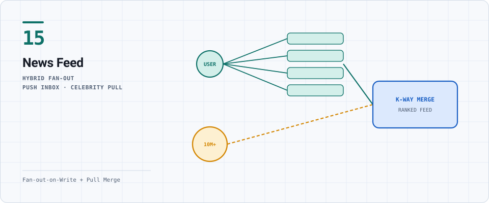
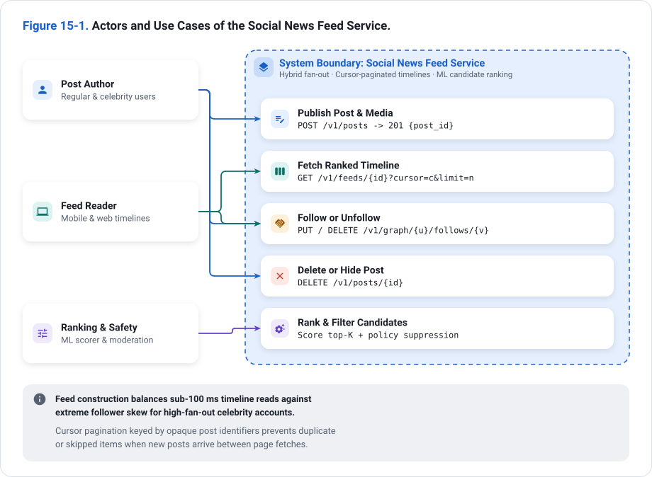
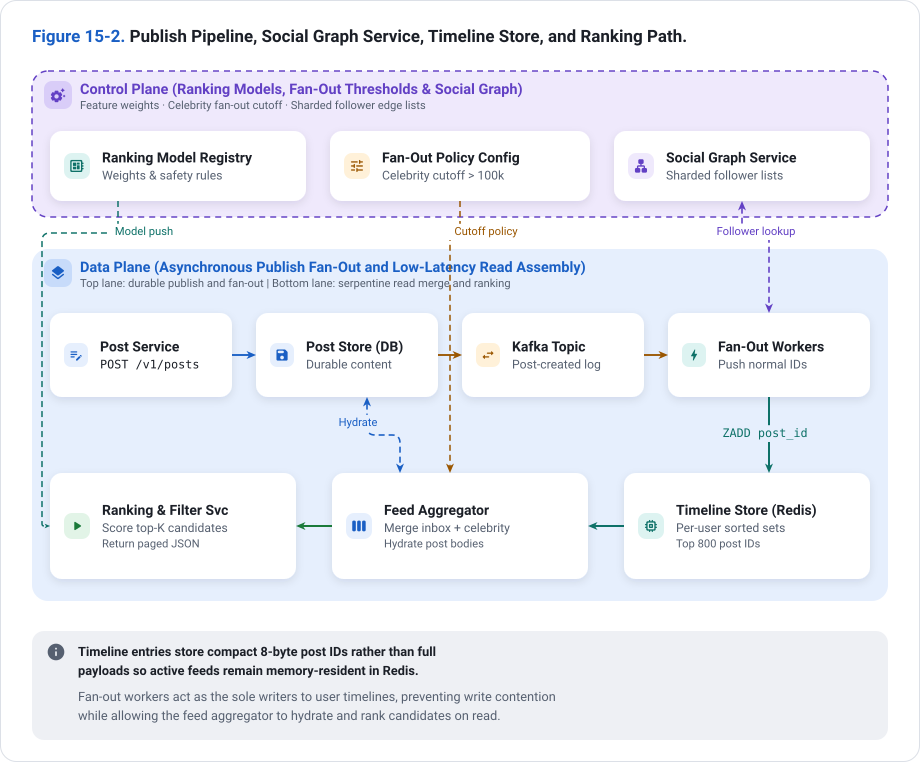
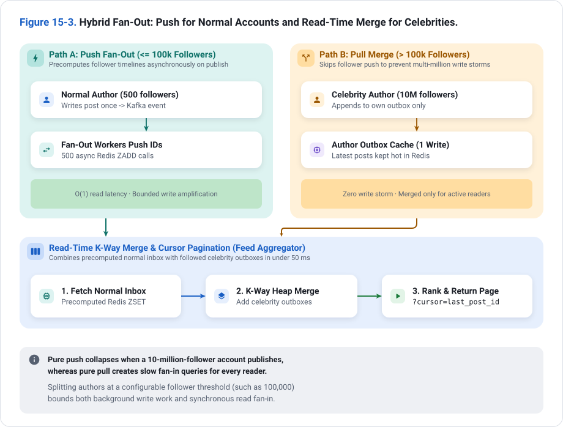

# 15. News Feed: System Design

A social news feed aggregates recent posts published by the accounts a member follows into a single paginated stream ordered by recency or predicted relevance. Expressed as a relational query, a chronological feed requires joining a follow graph against a posts table and sorting by timestamp. At modest scale on a single database, that query executes cleanly. At tens of millions of members, however, the workload exhibits two hostile properties simultaneously: reads outnumber writes by an order of magnitude (`20:1` or higher), and the follower degree distribution follows a heavy power law in which most accounts have a few hundred followers while a small fraction have millions.

In this chapter, we design a distributed news feed service that resolves this asymmetry by shifting work dynamically between write time and read time. Precomputing follower timelines at publish time makes reads fast for ordinary accounts, whereas deferring assembly to read time prevents celebrity posts from triggering multi-million-write storms. Combining both paths behind a configurable follower threshold reduces total cluster work by roughly `50x` while preserving sub-200 ms feed latency.

<div class="covers">

In this chapter, we cover

- actors, use cases, functional requirements, latency and availability SLOs, explicit non-goals, and cache, storage, and fan-out capacity bounds
- external HTTP/2 contracts for publishing, cursor-paginated feed retrieval, social-graph edges, and normalized storage schemas
- separation of the control plane (ranking model registry, celebrity fan-out thresholds, social graph) from the asynchronous publish and read-assembly data plane
- push fan-out on write, pull fan-out on read, and hybrid K-way merge backed by interactive traces and [`code/feedsim`](https://github.com/arpanpathak/cracking-the-systems-programming-interview/tree/prep-v2/distributed-systems-from-the-ground-up/code/feedsim) measurements
- keyset cursor pagination, read-time hydration and safety filtering, multi-stage ML candidate ranking, hot-celebrity outbox caching, and author read-own-writes guarantees
- failure-mode mitigation matrices, operational SLIs, production architectures (Twitter/X Home Timeline, Meta Multifeed and TAO, LinkedIn FollowFeed), and simulation verification

</div>

## 15.1 Requirements, Actors, and Capacity Bounds

### Actors and Use Cases

We organize the news feed platform around three interacting actor groups (Figure 15-1).

<figure class="diagram">

<figcaption><b>Figure 15-1</b> Actors, system boundary, and core use cases of the social news feed service.</figcaption>
</figure>

| Actor | Operation | Concrete Scenario |
| :--- | :--- | :--- |
| **Post Author** | Publish post (`POST /v1/posts`), delete post (`DELETE /v1/posts/{id}`) | Regular member or 10-million-follower celebrity publishes text and media attachments and expects immediate visibility in their own feed |
| **Feed Reader** | Fetch paginated timeline (`GET /v1/feeds/{id}?cursor=c&limit=n`), follow or unfollow (`PUT / DELETE /v1/users/{u}/following/{v}`) | Mobile client opens the home feed, scrolls smoothly across multiple pages without duplicates, and unfollows an account with immediate suppression |
| **Ranking and Safety Team** | Deploy ranking model weights, tune celebrity fan-out cutoffs, and apply moderation suppression | Trust engineering deploys a updated scoring model or hides a policy-violating post immediately across all active readers |

### Functional Requirements

| No. | Functional Requirement |
| :--- | :--- |
| 0 | A member can publish a post containing text and media references and receive a monotonically time-ordered `post_id` within `250 ms`. |
| 1 | A member can follow or unfollow another account; unfollowed, blocked, or deleted content disappears from the member's feed immediately on the next read. |
| 2 | A member can fetch their home timeline in stable cursor-paginated pages (`limit` default `20`, maximum `100`) ordered chronologically or by ranked score. |
| 3 | New posts from ordinary followed accounts appear in active followers' feeds within `5 seconds` (`p99`), and posts from celebrity accounts become visible immediately upon publish. |
| 4 | An author observes their own newly published post immediately upon reloading their feed (author read-own-writes consistency). |
| 5 | The feed pipeline supports pluggable read-time ranking and policy suppression without rewriting precomputed follower inboxes. |

### Non-Functional Requirements and SLOs

| No. | Property | Target Specification | Architectural Consequence |
| :--- | :--- | :--- | :--- |
| 0 | **Feed Read Latency** | `p50 <= 50 ms`, `p99 <= 200 ms` (hydrated and ranked) | Prohibits arbitrary scatter-gather across hundreds of database shards on read; mandates precomputed in-memory inboxes plus bounded celebrity outbox merges |
| 1 | **Publish Latency** | `p99 <= 250 ms` (durable post commit only) | Decouples follower fan-out from the synchronous publish HTTP response via Kafka |
| 2 | **Availability** | `99.95%` for feed reads (`<= 21.6` minutes downtime/month) | Active-active stateless feed aggregators across three AZs; graceful degradation to chronological unranked feed if the ML ranker times out |
| 3 | **Consistency** | Strong consistency for durable posts and follow edges; eventual consistency (`<= 5 s`) for fan-out inbox delivery | Feed caches are derived, disposable views that can be rebuilt on cache loss from durable post and graph stores |
| 4 | **Scale** | `10,000,000` daily active members (`DAU`), `2` posts/member/day, `20` feed reads/member/day (`20:1` read-to-write ratio) | `20` million posts/day, `200` million feed reads/day (`~2,315` sustained read QPS, `~15,000` peak read QPS) |

### Non-Goals and Scope Boundaries

We exclude the following adjacent subsystems so the design focuses on timeline assembly and fan-out mechanics:

- **Direct messaging and real-time chat:** Bidirectional private conversations with strict per-channel sequence numbers are designed in Chapter 18.
- **Media transcoding and CDN delivery:** Storing and streaming attached images and videos are handled by the object store (Chapter 16) and adaptive video streaming pipeline (Chapter 17); posts store only immutable media asset identifiers.
- **Offline ML model training pipelines:** We cover online candidate retrieval and inference budgets on the read path, treating offline feature-store ETL and gradient training as upstream control-plane inputs.

### Back-of-the-Envelope Capacity Bounds

We derive memory, storage, and QPS bounds for `10,000,000` active members (each following `200` accounts on average, including `5` celebrity accounts above the fan-out cutoff):

| Resource Dimension | Arithmetic Derivation | Provisioned Bound |
| :--- | :--- | :--- |
| **Post Write Rate (Avg / Peak)** | `(10,000,000 * 2) / 86,400 s = 231.5` posts/s; `5x` peak | `232` posts/s avg, `1,160` posts/s peak |
| **Feed Read Rate (Avg / Peak)** | `(10,000,000 * 20) / 86,400 s = 2,315` reads/s; `6x` peak | `2,315` reads/s avg, `14,000` reads/s peak |
| **Fan-Out Write Ops (Hybrid)** | `232 posts/s * 200 avg followers` (excluding celebrities) | `~46,400` Redis `ZADD` ops/s avg (`~232,000` ops/s peak) |
| **Precomputed Inbox Cache RAM** | `10,000,000 members * 500 entries * 16 B` (`8 B post_id + 8 B ts`) | `80 GB` raw (`~160 GB` with Redis `ZSET` overhead and `2x` replication across 12 cache nodes) |
| **Celebrity Outbox Cache RAM** | `50,000 celebrities * 200 recent posts * 16 B` | `160 MB` (fits inside local L1 RAM and replicated Redis shards) |
| **Post Content Storage (5 yr)** | `20,000,000 posts/day * 365 * 5 * 1 KB` avg post row | `36.5 TB` logical (`109.5 TB` raw at `3x` replication) |
| **Follow Graph Storage** | `10,000,000 members * 200 edges * 24 B` (indexed both directions) | `96 GB` logical (`288 GB` raw across 9 replicated graph shards) |

Storing only 16-byte `(post_id, timestamp)` references inside follower inboxes keeps the entire `10`-million-member timeline cache inside `160 GB` of RAM, whereas storing full 1 KB post bodies inside every inbox would inflate cache memory by `64x` (`> 5 TB`) and make post edits or deletions unmanageable.

## 15.2 External API and Data Contracts

The service exposes RESTful JSON-over-HTTP/2 endpoints with explicit idempotency keys on mutations and opaque cursor tokens on timeline pagination.

### External HTTP Contracts

**Publish a post:**

```http
POST /v1/posts HTTP/2
Host: api.feed.example
Authorization: Bearer <token>
Idempotency-Key: 9b4e2f10-3c8a-4d7e-91c2-0a1b2c3d4e5f
Content-Type: application/json

{
  "body": "Shipped the new release with hybrid fan-out.",
  "media_ids": ["obj_9a3f11c2"],
  "visibility": "followers"
}
```

```http
HTTP/2 201 Created
Location: /v1/posts/726190441827532801
Content-Type: application/json

{
  "post_id": "726190441827532801",
  "author_id": "u_ada",
  "created_at": "2026-11-20T13:08:05.412Z"
}
```

The `post_id` is a 64-bit time-ordered Snowflake identifier (Chapter 8), ensuring lexicographical and numerical ordering aligns with creation time without centralized clock locks.

**Fetch a paginated home feed:**

```http
GET /v1/feeds/u_ada?limit=20&cursor=eyJ0cyI6MTc5NTE4MDA4NTQxMiwiaWQiOiI3MjYxOTA0NDE4Mjc1MzI4MDEifQ HTTP/2
Host: api.feed.example
Authorization: Bearer <token>
```

```http
HTTP/2 200 OK
Content-Type: application/json

{
  "items": [
    {
      "post_id": "726190441827532801",
      "author_id": "u_grace",
      "body": "Found the pagination boundary defect.",
      "created_at": "2026-11-20T13:08:05.412Z",
      "rank_score": 0.942
    }
  ],
  "next_cursor": "eyJ0cyI6MTc5NTE3OTk0MTIwMCwiaWQiOiI3MjYxODk4MzU2MDExNDAyMjQifQ",
  "has_more": true
}
```

**Update social graph edges:**

- `PUT /v1/users/{follower_id}/following/{followed_id}` returns `204 No Content` (idempotent follow edge creation; asynchronously triggers backfill of the followed account's recent posts into the follower's inbox if the followed account is below the celebrity threshold).
- `DELETE /v1/users/{follower_id}/following/{followed_id}` returns `204 No Content` (marks edge deleted in the social graph; read-time filtering hides that author's posts immediately without scanning cached inboxes).

### Storage Schemas and Cache Structures

```sql
-- Authoritative post content store (sharded by hash(author_id) for fast author outbox scans,
-- with secondary lookup index or separate KV store keyed by post_id for hydration)
CREATE TABLE posts (
    post_id     BIGINT      PRIMARY KEY,    -- 64-bit Snowflake ID
    author_id   BIGINT      NOT NULL,
    body        TEXT        NOT NULL,
    media_ids   JSONB       NOT NULL DEFAULT '[]',
    deleted_at  TIMESTAMPTZ NULL,           -- Tombstone checked during read-time hydration
    created_at  TIMESTAMPTZ NOT NULL
);

-- Bidirectional social graph (sharded by follower_id for read-time follow list,
-- and replicated/inverted by followed_id for push fan-out follower iteration)
CREATE TABLE follow_edges (
    follower_id BIGINT      NOT NULL,
    followed_id BIGINT      NOT NULL,
    created_at  TIMESTAMPTZ NOT NULL,
    PRIMARY KEY (follower_id, followed_id)
);
CREATE INDEX idx_follow_by_followed ON follow_edges (followed_id, follower_id);
```

In Redis, each member's precomputed inbox (`inbox:{user_id}`) and each celebrity's outbox (`outbox:{author_id}`) are stored as bounded Sorted Sets (`ZSET`) scored by `post_id` (encoding timestamp in the high bits) and trimmed on write via `ZREMRANGEBYRANK key 0 -501` so every list caps strictly at `500` entries.

## 15.3 High-Level Architecture: Control Plane vs. Data Plane

We decouple policy thresholds, ranking model distribution, and social-graph metadata (control plane) from the latency-sensitive publish and timeline-assembly paths (data plane) (Figure 15-2).

<figure class="diagram">

<figcaption><b>Figure 15-2</b> Control-plane ranking models, fan-out cutoffs, and social graph separated from asynchronous publish fan-out and low-latency read assembly.</figcaption>
</figure>

### Component Responsibilities

| Component | Plane | State Held | Failure Impact and Mitigation |
| :--- | :--- | :--- | :--- |
| **Ranking Model Registry** | Control | Versioned ML scoring weights, feature schemas, safety suppression rules | Aggregators cache last known good model bundle in RAM; control-plane outage pauses model deploys without affecting reads |
| **Fan-Out Policy Config** | Control | Dynamic follower threshold (`celebrity_cutoff`, e.g., `100,000`) and inactive-user TTL | Broadcast via configuration watch; workers continue using cached cutoff values |
| **Social Graph Service** | Control / Data | Bidirectional follower/followed edge lists + cached per-user celebrity follow list | Sharded across 9 replicated nodes with read-through Redis caching (`TAO`-style graph cache) |
| **Post Service and Post Store** | Data | Durable posts and `Idempotency-Key` records across `30` sharded DB nodes (`10 shards x 3 replicas`) | Writes commit synchronously to quorum and emit a Kafka event via transactional outbox before replying `201 Created` |
| **Kafka Topic + Fan-Out Workers** | Data | Partitioned `post-created` event log; stateless worker pool (`60` workers) | Workers consume at-least-once and execute idempotent Redis `ZADD` operations; worker crash triggers partition rebalance with zero data loss |
| **Feed Cache (Redis Cluster)** | Data | Bounded `500`-entry `ZSET` inboxes per active member + hot celebrity outboxes | Disposable derived cache; losing a shard triggers lazy collect-on-read reconstruction from durable Post and Graph stores |
| **Feed Aggregator and Ranker** | Data | Stateless read orchestrator, local L1 celebrity outbox cache, embedded ML scorer | Auto-scaled across three AZs; falls back to reverse-chronological ordering if ML inference exceeds a `40 ms` deadline |

### Write and Read Lifecycles

**Publish path (`POST /v1/posts`):**
1. The Post Service authenticates the author, allocates a 64-bit Snowflake `post_id`, and writes the post row plus a `post-created` outbox event atomically to the durable Post Store.
2. The Post Service appends the `post_id` synchronously to the author's own Redis outbox (`outbox:{author_id}`) and returns `201 Created` immediately so the author never waits on follower fan-out.
3. The outbox relay publishes the `post-created` event to Kafka.
4. A Fan-Out Worker reads the event, checks the author's follower count against the configured `celebrity_cutoff`:
   - If `follower_count <= celebrity_cutoff` (normal account), the worker paginates the author's active followers from the Social Graph Service (skipping users inactive for more than `30 days`) and pipelines `ZADD inbox:{follower_id} <score> <post_id>` + `ZREMRANGEBYRANK` into the Feed Cache.
   - If `follower_count > celebrity_cutoff` (celebrity account), the worker skips follower push entirely; the post is already live in `outbox:{author_id}` for read-time pull merging.

**Read path (`GET /v1/feeds/{user_id}`):**
1. The Feed Aggregator reads the member's precomputed `inbox:{user_id}` candidate IDs (up to `500` items) from the Feed Cache in one Redis pipeline call.
2. Concurrently, it fetches the compact list of celebrity accounts followed by `user_id` (typically `0 to 15` accounts) plus `user_id`'s own recent outbox (guaranteeing author read-own-writes) and reads their latest post IDs from the hot celebrity outbox cache.
3. The aggregator executes a **K-way merge** across the push inbox and the pulled celebrity outboxes, filtering out any author whom the member recently unfollowed or blocked.
4. For ranked timelines, the aggregator scores candidates with the active ranking model within a strict `40 ms` budget; for chronological timelines, it slices directly by `(timestamp_ms, post_id)` cursor.
5. Finally, the aggregator batch-hydrates full post bodies and author profiles from the Post Cache/Store for the top `limit` (`20`) post IDs, drops any post carrying a `deleted_at` tombstone or moderation flag, and returns the page alongside an encoded `next_cursor`.

## 15.4 Hybrid Fan-Out: Push Inboxes, Celebrity Pull Merge, and Threshold Calibration

### Pure Push (Fan-Out on Write)

Under pure fan-out on write, every published post triggers background workers to insert a 16-byte pointer into every follower's cached inbox (Interactive Trace 15.A).

<figure class="steps" data-prefix="figures/steps-feed-push" data-count="5" data-version="a62e5f91">

<figcaption><b>Interactive Trace 15.A</b> Fan-out on write (push): storing a post once and inserting a compact reference into each follower's cached inbox. Use Next and Back to step through all 5 stages.</figcaption>
</figure>

Pure push delivers `O(1)` feed read latency because the timeline is pre-sorted before the reader arrives. However, it suffers from three operational costs: write amplification scales linearly with follower count; background workers waste writes maintaining inboxes for dormant accounts that never log in; and a single celebrity post with `2,000,000` followers generates `2,000,000` cache writes. At `10,000` writes/s per worker pool, fanning out one celebrity post takes `200 seconds`, saturating Kafka consumer lag and delaying ordinary users' posts behind a head-of-line queue.

### Pure Pull (Fan-Out on Read)

Under pure fan-out on read, publishing writes a single record to the author's own outbox. When a member opens their feed, the aggregator queries the recent posts of every followed account and merges them in memory (Interactive Trace 15.B).

<figure class="steps" data-prefix="figures/steps-feed-pull" data-count="5" data-version="fd606b4a">

<figcaption><b>Interactive Trace 15.B</b> Fan-out on read (pull): zero precomputed inboxes; the aggregator fetches each followed author's recent posts and merges them on demand. Use Next and Back to step through all 5 stages.</figcaption>
</figure>

Pure pull eliminates write amplification and wasted work for inactive readers, and follow or unfollow changes reflect instantaneously. Its penalty is paid on the frequent read path: a member following `200` accounts triggers `200` parallel outbox fetches on every feed load, subjecting tail latency to the straggler distribution (`max` of `200` network RPCs).

### Hybrid Fan-Out and Threshold Calibration

Real social graphs exhibit extreme degree skew: in [`code/feedsim`](https://github.com/arpanpathak/cracking-the-systems-programming-interview/tree/prep-v2/distributed-systems-from-the-ground-up/code/feedsim), modeling `1,000` ordinary accounts (`200` followers each, `2` posts/day, `20` reads/day) alongside **one** celebrity account (`2,000,000` followers, `10` posts/day) reveals that the single celebrity generates `20,000,000` of the `20,400,000` daily push copies (`98.0%` of total write load). Conversely, pure pull executes `4,000,500` daily outbox fetches, `99.5%` of which come from ordinary accounts.

Hybrid fan-out partitions authors by a follower threshold T<sub>celeb</sub> (`10,000` in the simulation, typically `50,000 to 100,000` in production systems such as Twitter/X) (Figure 15-3).

<figure class="diagram">

<figcaption><b>Figure 15-3</b> Hybrid fan-out: asynchronous push for ordinary accounts combined with read-time K-way merge of cached celebrity outboxes.</figcaption>
</figure>

| Strategy | Publish Work | Read Work | Delivery Lag | Dormant-Member Overhead |
| :--- | :--- | :--- | :--- | :--- |
| **Pure Push (Fan-Out on Write)** | `O(followers)` per post | `1` inbox lookup | Proportional to fan-out queue depth (minutes for celebrities) | High unless inactive TTL eviction is enforced |
| **Pure Pull (Fan-Out on Read)** | `O(1)` (`1` outbox append) | `O(followed_accounts)` parallel fetches | `0 ms` (immediate) | Zero |
| **Hybrid (`T_celeb`, Chosen)** | `O(followers)` capped at `T_celeb`; `O(1)` above cutoff | `1` inbox lookup + `K` cached celebrity outboxes (`K <= 15`) | `< 5 s` normal; `0 ms` celebrity | Bounded by `30`-day active-user push filter |

**Calibrating T<sub>celeb</sub> mathematically:** An author with *F* followers publishing *P* posts/day and read by fraction \alpha of active followers reading *R* feeds/day costs F · P write operations under push versus \alpha · F · R outbox reads under pull. Because celebrity outboxes sit in L1/Redis RAM (serving reads `10x` cheaper than cross-shard inbox writes), setting T<sub>celeb</sub> around `50,000 to 100,000` followers keeps worst-case single-post push latency under `2 seconds` while ensuring that `99.9%` of users follow fewer than `15` accounts above the cutoff.

**Hot-celebrity outbox protection:** When a mega-celebrity with `50` million followers posts during a breaking news event, hundreds of thousands of feed aggregators simultaneously read `outbox:{celeb_id}`. To prevent a single Redis shard from melting under hot-key read traffic, each Feed Aggregator maintains a **short-TTL (`2 to 5 s`) in-process L1 cache** of hot celebrity outboxes refreshed via singleflight coalescing, capping backend Redis QPS per celebrity strictly at `aggregator_count / TTL` regardless of reader concurrency.

## 15.5 Cursor Pagination, Candidate Ranking, and Consistency Mechanics

### Keyset Cursor Pagination vs. Offset Pagination

Offset pagination (`OFFSET 20 LIMIT 20`) breaks structurally on live feeds where new posts are continuously prepended at the head of the timeline (Interactive Trace 15.C).

<figure class="steps" data-prefix="figures/steps-feed-page" data-count="4" data-version="b2de92bc">

<figcaption><b>Interactive Trace 15.C</b> Offset pagination anomaly: inserting a new post shifts indices downward, causing the second page to repeat items already displayed on page 1. Use Next and Back to step through all 4 stages.</figcaption>
</figure>

Every new insertion shifts indices downward (causing duplicate posts on the next page), and every deletion shifts indices upward (omitting unseen posts without notice). Moreover, deep offsets force `O(offset)` scans in sorted indices. We replace positional offsets with an **opaque keyset cursor** encoding the `(created_at_ms, post_id)` pair of the last item returned on the preceding page. The next page queries `ZREVRANGEBYSCORE inbox:{user_id} (cursor_score -inf LIMIT 0 20` and fetches celebrity outbox entries strictly older than `cursor_score`, achieving `O(log N + limit)` seek performance with zero boundary drift.

### Authoritative Read-Time Filtering and Multi-Stage Ranking

Attempting to purge references from millions of follower inboxes whenever a post is deleted, moderated, or an author is unfollowed is slow and error-prone. We enforce a strict invariant: **precomputed inboxes are candidate hints, never authoritative visibility decisions.** During read-time hydration, the Feed Aggregator applies three deterministic filters in memory:
1. Drop any post whose `author_id` is no longer in the reader's current follow set or appears in the reader's block/mute set.
2. Drop any post whose hydrated record carries a non-null `deleted_at` tombstone or active trust-and-safety suppression flag.
3. Attach parent posts alongside replies when the parent has not yet arrived in the reader's inbox, preventing orphaned reply anomalies.

For engagement-ranked feeds (Meta Multifeed, LinkedIn FollowFeed, X Home), the hybrid inbox + celebrity merge supplies the **L0 candidate pool** (`~500` recent post IDs). A lightweight **L1 filter** prunes stale or seen candidates down to `~150` items using a per-user Bloom filter of recently impressed post IDs, and an **L2 ML scoring tier** predicts engagement probabilities (`P(click)`, `P(reply)`, `P(dwell)`) within a `40 ms` timeout budget. Because ranked order can change between requests, the aggregator freezes the top `100` scored `post_id`s in a short-lived session cache (`TTL = 10 min`) keyed by `session_id` and serves subsequent pages deterministically from that frozen snapshot.

### Consistency Properties Visible to Members

Even though feed delivery is eventually consistent, three user-facing invariants prevent jarring product defects:
- **Author read-own-writes:** Because background Kafka fan-out can lag by `1 to 5 s`, the Feed Aggregator unconditionally merges the member's own `outbox:{user_id}` at read time, guaranteeing an author never reloads their timeline and thinks a newly published post disappeared.
- **Monotonic reads within a session:** Consistent hashing of `user_id` onto a primary Redis cache replica prevents a reader from observing a post on replica A and seeing it vanish on a lagging replica B seconds later.
- **Lazy inbox reconstruction on cache miss:** If a member's inbox is evicted after `30 days` of inactivity or lost during a Redis shard outage, the aggregator executes a one-time collect-on-read rebuild over the member's followed accounts, populates `inbox:{user_id}` asynchronously, and serves the first page immediately.

## 15.6 Failure Modes, SLIs, and Production Systems

### Failure Mode and Mitigation Matrix

| Failure Mode | Blast Radius | Detection Signal | Automated Mitigation |
| :--- | :--- | :--- | :--- |
| **Feed Cache (Redis) Shard Loss** | Cache miss spike for `1/12` of members; elevated read latency (`50 ms` to `180 ms`) | Redis health check failure and cache hit-rate drop below `95%` | Aggregator falls back to collect-on-read rebuild from Post Store/Outbox cache with per-user singleflight lock; Redis replica promotes in `< 10 s` |
| **Fan-Out Worker Lag / Kafka Backlog** | Ordinary posts appear late in followers' timelines (`> 5 s`); publishes and celebrity reads unaffected | Kafka consumer-group lag alert (`> 50,000` events or `> 5 s` age) | Horizontal worker auto-scaling; priority topic isolates low-follower accounts from medium-follower bursts; drop push for users inactive `> 7 days` under shed mode |
| **ML Ranking Service Degradation** | Potential timeout on `GET /v1/feeds/{id}` | Ranker RPC `p99 > 40 ms` or error rate `> 1%` | Strict `40 ms` circuit breaker degrades gracefully to reverse-chronological ordering so feeds stay `99.95%` available |
| **Celebrity Hot-Key Traffic Surge** | Single celebrity outbox key receives `100,000+` RPS | Redis per-key hot-slot CPU alert (`> 80%`) | Aggregator L1 in-process cache (`3 s` TTL) with singleflight coalescing absorbs `> 99%` of duplicate reads |
| **Post Deletion / Moderation Delay** | Risk of displaying deleted or abusive content from stale cached inboxes | Moderation audit mismatch | Read-time hydration verifies `deleted_at` and policy flags against authoritative Post Store/Cache before serialization |

### Operational SLIs, SLOs, and Alert Thresholds

- **Feed Read Availability SLI:** Percentage of `GET /v1/feeds/{id}` calls returning `200 OK` (including graceful chronological fallback), targeting `99.95%` monthly; page when 5-minute error rate exceeds `0.5%`.
- **Feed Read Latency SLI:** `p99 <= 200 ms`, `p50 <= 50 ms`; alert when `p99` exceeds `200 ms` for 5 consecutive minutes.
- **Fan-Out Freshness SLI:** Elapsed time between post commit timestamp and Redis `ZADD` completion across `99%` of active followers, targeting `p99 <= 5 s`; alert above `10 s`.
- **Empty-Feed / Hydration-Drop SLI:** Fraction of requests returning zero items for members with `>= 5` followed accounts; sudden spikes detect broken social-graph lookups or cache corruption.

### Production Benchmarks

| Production System | Fan-Out Topology | Storage & Graph Tier | Architectural Distinction |
| :--- | :--- | :--- | :--- |
| **Twitter / X Home Timeline** | Hybrid (push inboxes in Redis + pull merge for high-follower accounts) | Manhattan / Redis timeline cache + FlockDB social graph | Pioneered bounded `~800`-entry Redis timeline inboxes, `5 s` delivery SLA, and celebrity pull cutoffs after observing mega-account fan-out storms |
| **Meta (Facebook) Multifeed** | Pull-dominant leaf aggregator tree | TAO read-optimized distributed graph cache over sharded MySQL | Because friend counts are bounded (`<= 5,000`) and ranking incorporates heterogeneous story types, leaf servers assemble and score candidates on read |
| **LinkedIn FollowFeed** | Pull-oriented with inverted activity indices and multi-tier ranking | Espresso distributed document store + Venice derived feature store | Prioritizes heavy ML feature hydration and multi-pass candidate scoring over static chronological push inboxes |
| **Instagram Home Feed** | Hybrid push inbox + pull for large creator accounts | Sharded PostgreSQL + Redis + Memcached TAO-derived graph | Separates lightweight timeline ID assembly from media CDN URL signing and multi-stage neural ranking |

## 15.7 Simulation Verification

<div class="simulation">

**Reproduce the push, pull, and hybrid fan-out cost benchmark.** Run `cargo run --release -p feedsim` inside `distributed-systems-from-the-ground-up/code/` to simulate `1,000` ordinary accounts (`200` followers each, `2` posts/day, `20` reads/day) alongside `1` celebrity account (`2,000,000` followers, `10` posts/day) under pure push, pure pull, and hybrid fan-out (`cutoff = 10,000`).

</div>

```console
$ cargo run --release -p feedsim
copy on write for every account:   20400000 copies per day
collect on read for every account:  4000500 lists fetched per day
mixture, copy unless the author has over 10000 followers:
      400000 copies per day,    20005 lists fetched per day
```

From these measurements, we observe the exact quantitative impact of the hybrid boundary:

1. **Pure push blow-up:** `1,000` ordinary accounts generate `400,000` daily copies (`1,000 * 2 * 200`), while the **single** celebrity account generates `20,000,000` copies (`10 * 2,000,000`), accounting for **`98.04%`** of total system write work (`20,400,000` copies/day).
2. **Pure pull read amplification:** Skipping precomputed inboxes forces `20,000` daily feed reads across `200` followed ordinary accounts plus `1` celebrity, totaling **`4,000,500`** outbox fetches per day.
3. **Hybrid efficiency gain:** Applying the `10,000`-follower cutoff collapses total daily operations to **`400,000` push copies plus `20,005` celebrity outbox fetches** (`420,005` total operations), cutting total work by **`48.6x`** compared to pure push and **`9.5x`** compared to pure pull while eliminating celebrity head-of-line fan-out storms completely.

## 15.8 Terminology and References

### Engineering Glossary

| Term | Definition |
| :--- | :--- |
| **Fan-Out on Write (Push)** | Precomputing follower timelines asynchronously on post publication by inserting compact post references into each follower's cached inbox. |
| **Fan-Out on Read (Pull)** | Assembling a reader's timeline dynamically at request time by fetching and merging recent posts from every followed author's outbox. |
| **Hybrid Fan-Out** | Partitioning authors at a follower-count threshold so ordinary accounts push to follower inboxes while high-follower celebrity accounts merge on read via K-way merge. |
| **Keyset Cursor Pagination** | Requesting the next page of a live stream relative to an immutable `(timestamp, post_id)` marker rather than a positional offset, preventing duplicates and skips under concurrent writes. |
| **Read-Time Hydration and Filtering** | Resolving compact cached `post_id` references into full post objects on read while enforcing authoritative deletions, unfollows, blocks, and moderation rules. |
| **Author Read-Own-Writes** | Guaranteeing an author immediately observes their newly published post on reload by merging their own outbox during read assembly regardless of background fan-out lag. |

### References

- R. Krikorian, "Timelines at Scale", *QCon San Francisco*, 2012.
- N. Bronson, Z. Amsden, G. Cabrera, P. Chakka, P. Dimov, H. Ding, J. Ferris, A. Giardullo, S. Kulkarni, H. Li, M. Marchukov, D. Petrov, L. Puzar, Y. J. Song, and V. Venkataramani, "TAO: Facebook's Distributed Data Store for the Social Graph", *USENIX ATC*, 2013.
- Facebook Engineering, "Serving Facebook Multifeed: Efficiency and Performance Gains Through Redesign", 2015.
- LinkedIn Engineering, "FollowFeed: LinkedIn's Feed Made Faster and Smarter", 2016.
- Twitter Engineering, "The Infrastructure Behind Twitter: Scale", 2017.

## 15.9 End-to-End Request Lifecycle and Production Case Studies

### Hop-by-Hop Request Lifecycle and Latency Budget

A `GET /v1/feeds/home` request traverses six network and storage boundaries from a mobile client to hydrated timeline items, targeting a `p99` end-to-end budget of `180 ms`.

| Hop | Boundary Payload | Typical Latency Budget |
| :--- | :--- | :--- |
| **1. Mobile / Browser to Edge PoP (Anycast TLS)** | HTTP/3 `GET` with bearer JWT, `cursor=(ts, post_id)`, and `limit=20`; terminates TLS 1.3 at the nearest edge PoP | `15 to 30 ms` (WAN RTT) |
| **2. Edge PoP to L4/L7 Load Balancer** | Reused persistent HTTP/2 connection carrying validated session headers and regional routing tags | `5 to 12 ms` (backbone) |
| **3. L7 LB to Feed API Gateway** | Authenticated gRPC request enforcing per-member rate limits and extracting viewer locale and experiment cohorts | `2 to 5 ms` |
| **4. Feed Gateway to Timeline Aggregator** | Fan-in RPC requesting precomputed inbox IDs (`ZREVRANGE`) plus parallel celebrity outbox pulls and L1 singleflight lookups | `8 to 18 ms` |
| **5. Aggregator to ML Ranker and Post Hydration Store** | Batch of `200` candidate `(post_id, author_id, feature_vec)` tuples scored under a `40 ms` deadline, followed by batched `MGET` hydration for the top `20` items | `25 to 45 ms` |
| **6. Hydration Store to Client Serialization** | Filtered JSON or Protobuf payload with signed CDN media URLs and an opaque next-page cursor streamed back over the edge connection | `10 to 20 ms` |

### Production Case Studies and Open-Source Comparisons

**X (Twitter) Home Timeline Hybrid Fan-Out.** Production telemetry published by Twitter engineering documented a `~800`-entry per-user Redis timeline cache backed by asynchronous fan-out workers delivering ordinary posts within a `5 s` SLA. High-follower accounts exceeding the celebrity threshold bypass write-time fan-out altogether and merge at read time via an in-memory outbox cache, avoiding multi-minute Redis write queues when accounts with tens of millions of followers publish simultaneously.

**Meta TAO and Multifeed.** Meta serves home feeds through a pull-dominant leaf-aggregator tree sitting above TAO, a read-optimized distributed graph cache layered over sharded MySQL. TAO handles billions of reads per second at `99.9%` cache hit rates by partitioning social-graph edges across follower-tier caches and routing writes synchronously through leader tiers; because personal friend counts stay bounded (at or below `5,000`), Multifeed leaf nodes can gather recent candidate stories on read and apply deep neural ranking without maintaining static push inboxes for every member.

<div class="callout keyidea"><span class="label">Key idea</span> Hybrid fan-out decouples write amplification from read amplification by placing a follower-count threshold between two complementary storage paths. Ordinary accounts pay a small asynchronous write cost to keep reads sub-50 ms, while celebrity accounts absorb zero fan-out storms by deferring merge work to read-time cached outboxes.</div>

<div class="callout experiment"><span class="label">Experiment</span> In [`code/feedsim`](https://github.com/arpanpathak/cracking-the-systems-programming-interview/tree/prep-v2/distributed-systems-from-the-ground-up/code/feedsim), raise the celebrity cutoff from `10,000` to `5,000,000` and compare daily copy volume against the default hybrid configuration. Observe how a single high-follower author shifts `98%` of total cluster write traffic back onto the fan-out workers while barely changing read-side list fetches.</div>

<div class="callout caution"><span class="label">Common pitfall</span> Caching full post bodies inside every follower's Redis inbox multiplies memory footprint by average follower count and makes edits, deletions, and moderation takedowns eventually inconsistent. Store compact `(timestamp, post_id)` references in the inbox and hydrate authoritative content and visibility flags once at read time.</div>
