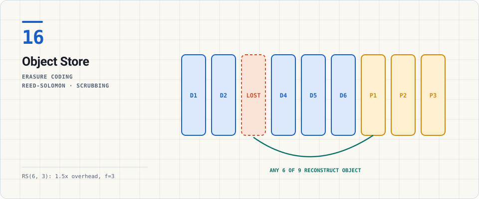
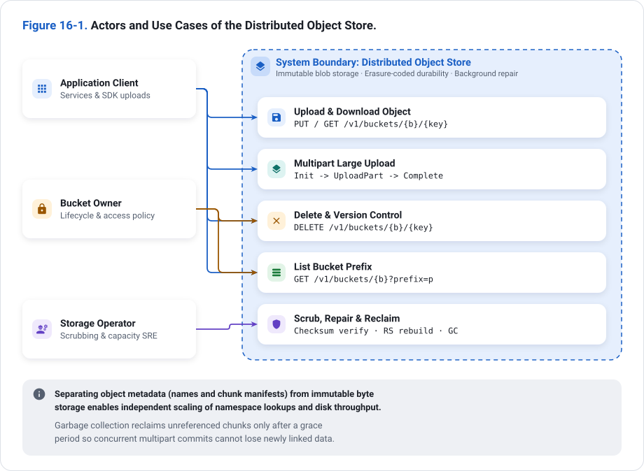
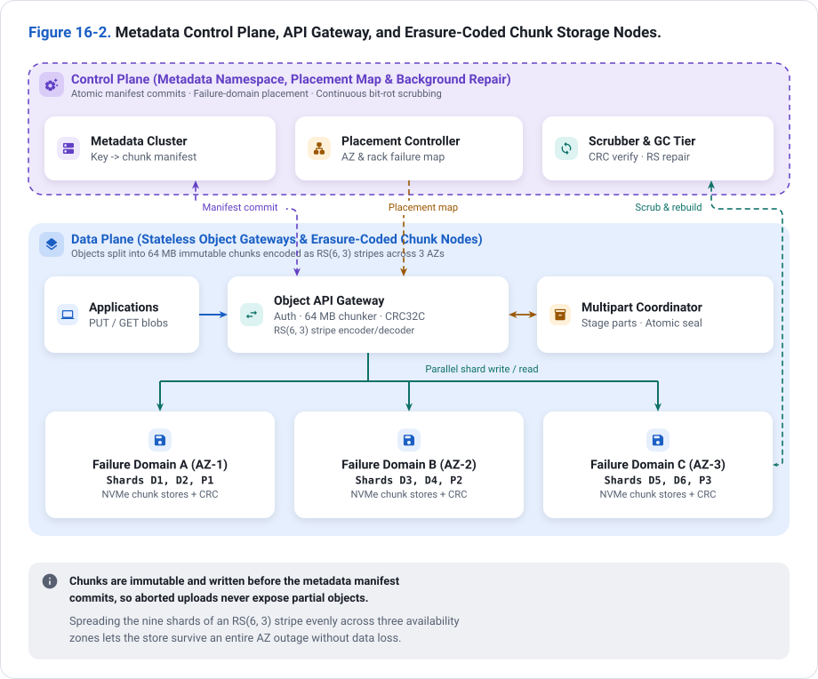
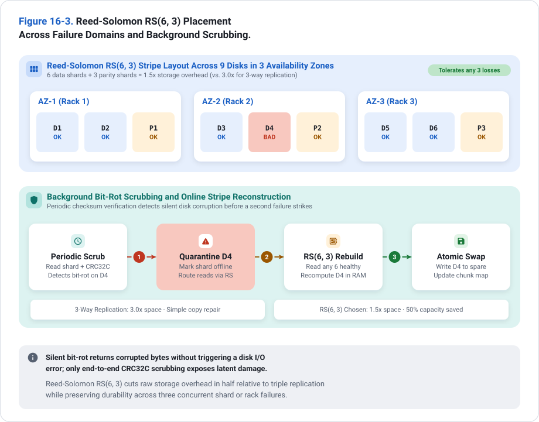

# 16. Object Store: System Design

A distributed object store persists immutable binary blobs ranging from kilobyte thumbnails to multi-terabyte archival datasets and serves them by flat key within a bucket over HTTP. At exabyte scale spanning tens of thousands of spinning disks and NVMe drives, hardware failure ceases to be an anomaly and becomes a continuous background process: with a `2%` annual drive failure rate across `20,000` disks, roughly one drive fails every single day, while firmware defects and magnetic decay introduce unannounced silent bit corruption.

In this chapter, we design an S3-compatible distributed object store that converts fragile commodity hardware into eleven-nines durability (`99.999999999%` annual object survival). By restricting the data model to immutable whole-object replacement rather than POSIX random-access file mutation, we separate strongly consistent object metadata from erasure-coded chunk storage, eliminate in-place update divergence, and execute continuous background checksum scrubbing and prioritized repair before correlated failures can exhaust redundancy.

<div class="covers">

In this chapter, we cover

- actors, use cases, functional requirements, durability and read-after-write consistency SLOs, explicit non-goals, and petabyte-scale disk and metadata capacity bounds
- S3-style HTTP/2 object contracts (`PUT`, `GET`, `Range` partial reads, multipart upload lifecycle, presigned capability URLs) and metadata manifest schemas
- separation of the control plane (metadata cluster, failure-domain placement controller, background scrubber and garbage collector) from the stateless chunking and erasure-coding data plane
- Reed-Solomon `RS(6, 3)` coding over `GF(2^8)`, failure-domain placement across three availability zones, Copyset correlation control, continuous bit-rot scrubbing, and MTTR-driven durability
- write-chunks-first atomic metadata commits, resumable multipart sealing, small-object Haystack packing, versioning, and grace-period garbage collection
- failure-mode mitigation matrices, operational SLIs, production architectures (Amazon S3, Ceph RADOS, Facebook Haystack and f4, Azure Storage LRC), and verification via `code/objectsim`

</div>

## 16.1 Requirements, Actors, and Capacity Bounds

### Actors and Use Cases

We organize the object storage boundary around three actor groups (Figure 16-1).

<figure class="diagram">

<figcaption><b>Figure 16-1</b> Actors, system boundary, and core use cases of the distributed object store.</figcaption>
</figure>

| Actor | Operation | Concrete Scenario |
| :--- | :--- | :--- |
| **Application Client** | Upload/download object (`PUT / GET /v1/buckets/{b}/{key}`), multipart upload (`Init -> UploadPart -> Complete`), list prefix (`GET /v1/buckets/{b}?prefix=p`) | Media pipeline uploads a 50 GB master video in parallel 64 MB parts and video players stream arbitrary byte ranges via presigned URLs |
| **Bucket Owner** | Configure versioning, lifecycle tiering, and bucket IAM policy; delete objects (`DELETE /v1/buckets/{b}/{key}`) | Compliance team enables immutable versioning to prevent accidental overwrites and transitions objects older than 30 days to erasure-coded cold storage |
| **Storage Operator** | Manage hardware decommissioning, monitor bit-rot scrubbers, tune repair bandwidth, and verify garbage collection | Automated fleet orchestration drains a failing rack and verifies Reed-Solomon reconstruction completes within target MTTR |

### Functional Requirements

| No. | Functional Requirement |
| :--- | :--- |
| 0 | An application can upload an immutable object from `0 bytes` up to `5 TB` under a flat string key inside a named bucket (using single-request `PUT` up to `5 GB` and resumable multipart upload up to `5 TB`). |
| 1 | An application can download an entire object or an arbitrary byte interval via HTTP `Range` requests (`206 Partial Content`). |
| 2 | An application can list keys within a bucket in lexicographical order by prefix with cursor pagination. |
| 3 | Every returned byte is verified end-to-end against cryptographic or CRC32C checksums; corrupted data is repaired transparently from surviving redundancy or rejected with an explicit error rather than returned without warning. |
| 4 | Applications can issue time-bounded HMAC-signed presigned URLs authorizing direct browser or device transfers against the object gateway. |
| 5 | Buckets support optional object versioning and safe deletion with asynchronous reclamation of unreferenced storage chunks. |

### Non-Functional Requirements and SLOs

| No. | Property | Target Specification | Architectural Consequence |
| :--- | :--- | :--- | :--- |
| 0 | **Durability** | `99.999999999%` (`11` nines) annual object survival across single-disk, node, rack, and single-AZ outages | `RS(6, 3)` erasure coding spread evenly across 3 AZs (`3` shards per AZ) plus continuous bit-rot scrubbing and prioritized `< 1 hour` MTTR repair |
| 1 | **Consistency** | Strong read-after-write consistency for all `PUT`, `DELETE`, and `LIST` metadata operations (`PC/EC` quorum commit) | Metadata resides in a Raft-replicated sharded key-value cluster; chunk bytes are immutable and content-addressed, eliminating version skew |
| 2 | **Availability** | `99.95%` regional API availability (`<= 21.6` minutes/month) | Stateless API gateways across three AZs; `RS(6, 3)` serves reads even if an entire AZ (`3` shards) is offline simultaneously |
| 3 | **Latency** | Time-to-first-byte `p50 <= 25 ms`, `p99 <= 100 ms` (metadata lookup + parallel shard read) | Decouples metadata index from sequential disk I/O; replicates small hot objects (`< 1 MB`) 3 ways to avoid erasure-coding fan-out overhead |
| 4 | **Scale** | `1,000,000,000` (`1 billion`) objects totaling `100 PB` logical data | Demands `1.5x` erasure-coded overhead (`150 PB` raw) instead of `3.0x` replication (`300 PB` raw), saving `150 PB` of physical drives |

### Non-Goals and Scope Boundaries

Object stores achieve petabyte scale specifically by omitting expensive POSIX file-system guarantees:

- **No in-place partial overwrites or appends:** Modifying a single byte requires uploading a new immutable object version; POSIX byte-range locking and random writes belong to block stores or distributed file systems.
- **No atomic directory renames:** Slashes inside keys (such as `2026/11/video.mp4`) are visual prefix conventions only; renaming a prefix requires copying each underlying object metadata entry.
- **No cross-tenant deduplication:** Although content-addressed chunks support deduplication within a single tenant or backup domain (as demonstrated in `code/objectsim`), public multi-tenant stores prohibit cross-customer deduplication because timing side channels would allow one tenant to probe whether another tenant holds a specific file.

### Back-of-the-Envelope Capacity Bounds

We contrast raw hardware requirements for `100 PB` of logical customer data (`1 billion` objects) under 3-way replication versus `RS(6, 3)` erasure coding:

| Resource Dimension | Arithmetic Derivation | Provisioned Bound |
| :--- | :--- | :--- |
| **Raw Storage (3-Way Replication)** | `100 PB * 3.0` copies | `300 PB` raw (`20,834` drives of `16 TB` at `90%` fill) |
| **Raw Storage (`RS(6, 3)` Chosen)** | `100 PB * (9 / 6) = 100 PB * 1.5` overhead | `150 PB` raw (`10,417` drives of `16 TB` at `90%` fill, saving `10,417` drives) |
| **Logical Chunks (`64 MB` / `4 MB`)** | `100 PB / 64 MB = 1.56 billion` chunks (`25 billion` at `4 MB`) | `1.56 billion` 64 MB chunks (`~14.0 billion` RS shards) |
| **Metadata Store Capacity** | `1,000,000,000 objects * 1 KB` avg manifest + index | `1.0 TB` logical (`3.0 TB` raw across `20` Raft shards x `3` replicas) |
| **Storage Node Fleet (`RS(6, 3)`)** | `10,417 disks / 36 disks per dense storage chassis` | `~290` dense storage nodes (`~97` nodes per AZ across 3 AZs) |
| **Daily Expected Disk Failures** | `10,417 disks * 2% AFR / 365 days` | `~0.57` failed disks per day (roughly `4` drive replacements per week) |
| **Scrubbing Read Bandwidth** | Full `150 PB` scrub every `14 days`: `150 PB / (14 * 86,400 s)` | `124 GB/s` cluster-wide (`~12 MB/s` sequential background read per disk) |

Sizing the background scrubber at `~12 MB/s` per drive consumes under `8%` of a modern `16 TB` HDD's `180 MB/s` sequential throughput while guaranteeing every byte on disk is checksum-verified every two weeks.

## 16.2 External API and Data Contracts

The gateway exposes an HTTP/2 REST interface patterned after Amazon S3, carrying content integrity digests in headers and isolating binary payload streaming from metadata coordination.

### External HTTP Contracts

**Single-request object upload (`<= 5 GB`):**

```http
PUT /v1/buckets/holiday/2026/video.mp4 HTTP/2
Host: objects.example
Authorization: AWS4-HMAC-SHA256 Credential=...
Content-Type: video/mp4
Content-Length: 10485760
x-amz-checksum-crc32c: 9a3f11c2

<10485760 raw bytes>
```

```http
HTTP/2 201 Created
ETag: "sha256:4f8d2e1c9a3f11c2-3"
x-amz-version-id: v_01JDCX9M8K2N4P6Q7R8S
```

**Byte-range download (`206 Partial Content`):**

```http
GET /v1/buckets/holiday/2026/video.mp4 HTTP/2
Host: objects.example
Range: bytes=0-1048575
```

```http
HTTP/2 206 Partial Content
Content-Range: bytes 0-1048575/10485760
Content-Length: 1048576
ETag: "sha256:4f8d2e1c9a3f11c2-3"
Accept-Ranges: bytes

<1048576 raw bytes>
```

**Multipart upload lifecycle (objects `> 100 MB` up to `5 TB`):**
1. `POST /v1/buckets/{b}/{key}?uploads` allocates an `upload_id` in the Multipart Coordinator (`200 OK`).
2. `PUT /v1/buckets/{b}/{key}?partNumber=1&uploadId={id}` streams each `64 MB` part independently in parallel and returns a verified per-part `ETag` (`200 OK`). Failed parts retry independently without restarting the entire transfer.
3. `POST /v1/buckets/{b}/{key}?uploadId={id}` submits the ordered list of `(part_number, etag)` pairs; the coordinator atomically commits the final object manifest into the Metadata Cluster (`200 OK`). Until step 3 commits, no reader observes the object.

### Metadata and Chunk Placement Schemas

```sql
-- Strongly consistent sharded metadata store (range-partitioned on (bucket_id, object_key)
-- to support lexicographical prefix listing, with prefix-hash salting on hot buckets)
CREATE TABLE object_manifests (
    bucket_id        BIGINT        NOT NULL,
    object_key       VARCHAR(1024) NOT NULL,
    version_id       UUID          NOT NULL,
    is_latest        BOOLEAN       NOT NULL DEFAULT TRUE,
    is_delete_marker BOOLEAN       NOT NULL DEFAULT FALSE,
    size_bytes       BIGINT        NOT NULL,
    etag             VARCHAR(128)  NOT NULL,
    storage_class    SMALLINT      NOT NULL, -- 1=REPLICATED_3X, 2=RS_6_3, 3=RS_10_4
    chunks_json      JSONB         NOT NULL, -- Ordered [{chunk_id, offset, length, pg_id, crc32c}]
    created_at       TIMESTAMPTZ   NOT NULL,
    PRIMARY KEY (bucket_id, object_key, version_id)
);

-- Placement group directory maintained by the Placement Controller
CREATE TABLE placement_groups (
    pg_id            BIGINT        PRIMARY KEY,
    coding_scheme    VARCHAR(16)   NOT NULL, -- 'RS_6_3' or 'REP_3'
    shard_nodes      JSONB         NOT NULL, -- 9 ordered (az_id, rack_id, node_id, disk_id) tuples
    epoch            BIGINT        NOT NULL, -- Monotonic fencing epoch on membership change
    state            VARCHAR(16)   NOT NULL  -- 'HEALTHY', 'DEGRADED', 'RECOVERING'
);
```

## 16.3 High-Level Architecture: Control Plane vs. Data Plane

We isolate namespace metadata, failure-domain topology management, and background durability maintenance inside the control plane while keeping the high-throughput byte-streaming path stateless and horizontally scalable (Figure 16-2).

<figure class="diagram">

<figcaption><b>Figure 16-2</b> Control-plane metadata namespace, failure-domain placement controller, and scrubbing tier decoupled from the erasure-coded data plane.</figcaption>
</figure>

### Component Responsibilities

| Component | Plane | State Held | Failure Impact and Mitigation |
| :--- | :--- | :--- | :--- |
| **Metadata Cluster (`20` Raft shards x `3` replicas)** | Control | Authoritative `(bucket, key, version) -> chunk_manifest` table and multipart upload state | Leader failure triggers Raft election in `1 to 3 s`; synchronous 3-AZ quorum ensures strict read-after-write visibility |
| **Placement Controller** | Control | Cluster hardware topology (`AZ -> Rack -> Host -> Disk`), active placement groups (`pg_id`), epoch fencing | Gateways cache placement maps locally with epoch verification; brief controller outage pauses rebalancing without halting reads or writes |
| **Scrubber, Repair, and GC Tier** | Control | Disk scan watermarks, degraded placement-group priority queue, unreferenced-chunk grace table | Runs continuously off the request path; rate-limited to protect foreground client IOPS |
| **Object API Gateway (`200` stateless hosts)** | Data | Request authentication, presigned-URL verifier, `64 MB` streaming chunker, SIMD `RS(6, 3)` codec, CRC32C verifier | Auto-scaled across three AZs; losing a host mid-upload leaves unreferenced staging chunks reclaimed by GC without corrupting metadata |
| **Multipart Coordinator** | Data | In-flight staging manifests for large multi-part uploads | Persists part commits to Metadata Cluster; background reaper expires incomplete uploads after `7 days` |
| **Storage Nodes (`290` dense hosts)** | Data | Immutable content-addressed shard blobs and per-shard CRC32C metadata on raw disks | Loss of any disk, host, rack, or entire AZ (`<= 3` shards per stripe) is masked transparently by `RS(6, 3)` reconstruction |

### Write and Read Lifecycles

**Write path (`PUT /v1/buckets/{b}/{key}`):**
1. The Object API Gateway verifies caller credentials (or presigned HMAC token + expiration), validates bucket policy, and streams incoming bytes in `64 MB` chunks (`4 MB` in `code/objectsim`).
2. For each chunk, the gateway computes its cryptographic content hash (`SHA-256`) and hardware-accelerated `CRC32C`. For small hot objects (`< 1 MB`), it selects a 3-way replicated placement group; for large objects (`>= 1 MB`), it splits the `64 MB` chunk into `6` equal `10.67 MB` data shards and computes `3` Reed-Solomon parity shards via SIMD `GF(2^8)` arithmetic.
3. The gateway writes all `9` shards concurrently to the `9` distinct disks assigned to the chosen Placement Group (`3` shards in AZ-1, `3` in AZ-2, `3` in AZ-3). A chunk write succeeds once at least `8` of `9` shards acknowledge durable `fsync` (strict quorum with immediate asynchronous repair of the 9th shard if one disk is transiently slow), or all `9` under strict full-stripe durability mode.
4. **Atomic metadata commit (last step):** Only after every chunk of the object is durably persisted on storage nodes does the gateway write the single `object_manifests` row to the Metadata Cluster and return `201 Created`. An interrupted upload never exposes a half-written or dangling object name.

**Read path (`GET /v1/buckets/{b}/{key}` with optional `Range`):**
1. The gateway queries the Metadata Cluster for the object's latest manifest (or explicit `version_id`) and determines the exact subset of chunks intersecting the requested byte range `[start, end]`.
2. For each required chunk, the gateway reads the `6` primary data shards in parallel from the Placement Group's storage nodes (preferring AZ-local replicas when reading replicated hot chunks) and verifies every shard's `CRC32C` on arrival.
3. If any data shard fails its checksum or times out (hedged tail request after `20 ms`), the gateway fetches parity shards from surviving nodes, reconstructs the missing data shard in memory via `RS(6, 3)` matrix inversion, streams the verified byte slice to the client, and enqueues an asynchronous repair event for the corrupt shard.

## 16.4 Durability Engineering: Reed-Solomon Erasure Coding, Placement, and Scrubbing

### From Parity Addition to Reed-Solomon `RS(6, 3)` over `GF(2^8)`

3-way replication provides simple, fast reads and 1-to-1 repair, yet wastes `200 PB` of raw capacity for every `100 PB` of stored data. Erasure coding eliminates most of that overhead by storing computed parity shards instead of full duplicates. Interactive Trace 16.A builds intuition using ordinary arithmetic addition over 3 data values and 1 sum.

<figure class="steps" data-prefix="figures/steps-obj-parity" data-count="5" data-version="8a34afed">

<figcaption><b>Interactive Trace 16.A</b> Single-parity erasure reconstruction: storing 3 data blocks plus 1 parity sum across 4 disks tolerates any 1 disk loss at 1.33x overhead. Use Next and Back to step through all 5 stages.</figcaption>
</figure>

To tolerate $m > 1$ simultaneous failures without integer overflow, production object stores execute **Reed-Solomon `RS(k, m)` coding** over the finite Galois Field $\text{GF}(2^8)$, where every byte is a polynomial element of degree at most 7, addition is bitwise `XOR`, and multiplication executes modulo an irreducible degree-8 polynomial (`0x11d`). Given $k = 6$ data shards arranged as a vector $\mathbf{d}$, multiplying by a $9 \times 6$ systematic Cauchy generator matrix $\mathbf{G}$ (whose top $6 \times 6$ submatrix is the identity matrix $\mathbf{I}_6$) produces the $6$ unaltered data shards plus $3$ parity shards (`P1`, `P2`, `P3`). Because every $6 \times 6$ submatrix of a Cauchy matrix is guaranteed invertible over $\text{GF}(2^8)$, **any 6 surviving shards out of 9** uniquely recover all 6 original data shards via $\mathbf{d} = \mathbf{G}_{\text{surv}}^{-1} \mathbf{y}_{\text{surv}}$.

Modern CPUs execute `GF(2^8)` multiply-accumulate via 4-bit nibble lookup tables using AVX2/AVX-512 `VPSHUFB` (or ARM NEON `VTBL`) instructions at **`> 10 GB/s` per core**, making CPU encoding overhead negligible compared to disk and network bandwidth.

| Durability Scheme | Storage Overhead | Fault Tolerance (`f`) | Normal Read Fan-Out | Single-Shard Repair Read Cost | Primary Use Case |
| :--- | :--- | :--- | :--- | :--- | :--- |
| **3-Way Replication** | `3.00x` (`300 PB` / `100 PB`) | Any `2` losses | `1` shard (lowest latency) | `1` shard read | Small objects (`< 1 MB`), metadata, ultra-hot blobs |
| **Reed-Solomon `RS(6, 3)` (Chosen)** | `1.50x` (`150 PB` / `100 PB`) | Any `3` losses (full AZ outage) | `6` parallel shards | `6` shards read | Warm and standard multi-AZ objects (`>= 1 MB`) |
| **Reed-Solomon `RS(10, 4)`** | `1.40x` (`140 PB` / `100 PB`) | Any `4` losses | `10` parallel shards | `10` shards read | Cold archival blobs (Facebook `f4`) |
| **Azure LRC `(12, 2, 2)`** | `1.33x` (`133 PB` / `100 PB`) | Any `3` losses (most `4`-loss patterns) | `12` parallel shards | `6` shards read (half local group) | Cloud cold storage minimizing cross-rack repair traffic |

### Failure-Domain Placement, Copysets, and Background Scrubbing

Redundancy count alone guarantees nothing if shards share a correlated failure domain: placing all 9 shards in the same rack loses the entire object when one top-of-rack switch fails. Our Placement Controller maps every `RS(6, 3)` stripe strictly across **9 distinct disks, 9 distinct hosts, and 3 distinct Availability Zones** (`3` shards per AZ: `{D1, D2, P1}` in AZ-1, `{D3, D4, P2}` in AZ-2, `{D5, D6, P3}` in AZ-3) (Figure 16-3).

<figure class="diagram">

<figcaption><b>Figure 16-3</b> Reed-Solomon <code>RS(6, 3)</code> placement across three availability zones with continuous CRC32C bit-rot detection and reconstruction.</figcaption>
</figure>

This topology ensures that even if an entire Availability Zone goes offline (`3` shards unreachable simultaneously), the `6` surviving shards across the remaining two AZs satisfy `k = 6`, preserving both zero data loss and full read availability without interruption. Furthermore, following the **Copysets** analysis (Cidon et al. 2013), rather than picking 9 random nodes from 290 hosts per chunk (which spreads combinations across nearly every possible 4-node subset so any correlated 4-node power failure destroys *some* chunk), we constrain shards onto fixed **Placement Groups** (`PGs`) of 9 nodes. Copysets dramatically lower the probability of data loss during correlated cluster-wide power outages while bounding repair coordination state.

To defeat silent bit corruption on cold archive drives that applications may not read for years, every storage node runs a rate-limited **local bit-rot scrubber** that sweeps every disk sector every 14 days, verifying stored bytes against each shard's recorded `CRC32C` and content hash (Interactive Trace 16.B).

<figure class="steps" data-prefix="figures/steps-obj-scrub" data-count="5" data-version="de6807ac">

<figcaption><b>Interactive Trace 16.B</b> Silent bit-rot detection and self-healing: checksum verification catches a corrupted disk byte, reads cleanly from a healthy peer, and replaces the damaged copy. Use Next and Back to step through all 5 stages.</figcaption>
</figure>

**Why MTTR governs eleven-nines durability:** Durability is governed by the race between **Mean Time To Repair (`MTTR`)** and subsequent independent failures inside the exposure window. Under `RS(6, 3)`, losing 1 shard triggers prioritized reconstruction onto a healthy replacement disk in the same AZ. Shrinking `MTTR` from `1 week` (`168 hours`) down to `1 hour` shrinks the exposure window for compound failures by orders of magnitude. To balance stability against speed, the Placement Controller applies a **`10`-minute grace delay** before starting repair on an unreachable host (avoiding terabyte storms during rolling OS reboots) and schedules repairs in strict **deficit priority** (stripes missing `2` shards jump ahead of stripes missing `1` shard), throttled below `20%` of inter-rack bandwidth.

## 16.5 Small-Object Packing, Multipart Sealing, and Safe Garbage Collection

### Small-Object Packing (Haystack Pattern)

Erasure coding a `20 KB` thumbnail across 9 disks in 3 AZs wastes 9 network RPCs, 9 disk seeks, and metadata space exceeding the object payload itself. Following Facebook's **Haystack** design, storage nodes pack millions of small objects (`< 1 MB`) sequentially into large append-only `64 GB` **volume files** (`3`-way replicated across 3 AZs) accompanied by a compact in-memory `(chunk_id -> volume_id, offset, length)` index. Serving a small object therefore requires **one single disk seek** with zero filesystem directory or inode traversal overhead. As objects age into cold tiers, an offline compaction worker aggregates thousands of immutable small objects into `64 MB` packed containers and erasure-codes the resulting container with `RS(6, 3)`.

### Versioning and Grace-Period Garbage Collection

Replication and erasure coding protect against hardware failure, never against software defects or accidental operator `DELETE` commands, because a mistaken deletion is faithfully committed to the metadata quorum. Enabling **bucket versioning** converts every `DELETE` into an append-only `is_delete_marker = TRUE` metadata record and retains prior `version_id` manifests until lifecycle rules explicitly expire them.

When an object version is permanently expired, its metadata entry disappears immediately, while physical shard deletion runs asynchronously in the background **Garbage Collector (GC)**. Deleting chunks immediately creates a notorious data-loss race under content addressing or concurrent multipart commits:
1. The GC scans metadata at time $t_0$ and marks chunk `c9` as unreferenced.
2. At time $t_1$, a concurrent upload produces identical chunk `c9`, sees `c9` already exists on storage nodes, and commits a new manifest referencing `c9`.
3. At time $t_2$, the GC deletes `c9` from its stale $t_0$ candidate list, permanently corrupting the newly uploaded object.

We eliminate this race with a **two-phase mark-and-grace protocol**: the GC only reclaims chunks that have remained unreferenced continuously for a `24-hour` grace window (`t_now - last_referenced_at > 24 h`) and acquires an epoch-fenced tombstone lock before reclaiming storage blocks, while any upload reusing an existing chunk refreshes `last_referenced_at` atomically prior to manifest commit.

## 16.6 Failure Modes, SLIs, and Production Systems

### Failure Mode and Mitigation Matrix

| Failure Mode | Blast Radius | Detection Signal | Automated Mitigation |
| :--- | :--- | :--- | :--- |
| **Single HDD / NVMe Drive Failure** | `1` shard degraded per hosted Placement Group; zero client errors | SMART I/O error or storage-node health report | Immediate degraded read via surviving shards (`RS(6, 3)` reconstructs transparently); Placement Controller schedules prioritized rebuild onto spare drive within `1 hour` |
| **Entire Availability Zone Outage** | `3` of `9` shards unreachable per stripe; zero data loss | Cross-AZ heartbeat quorum loss | Gateways read remaining `6` shards across the `2` healthy AZs; new writes spill onto temporary 2-AZ/3-rack placement groups and rebalance automatically after AZ recovery |
| **Silent Disk Bit Rot** | `1` corrupt shard returns altered bytes without OS error | Read-path `CRC32C` mismatch or 14-day background scrubber failure | Gateway rejects bad shard, reconstructs clean data from parity, serves verified bytes to client, and overwrites bad shard on disk |
| **Abandoned Multipart Upload Leak** | Orphaned staging chunks accumulate without visibility on storage nodes | Uncommitted staging byte quota alert (`> 2%` cluster raw capacity) | Lifecycle reaper automatically aborts and deletes staging parts older than `7 days` |
| **Metadata Prefix Hotspot** | Sequential keys (`logs/2026-11-20/00001...`) concentrate writes on one metadata Raft shard | Per-shard write latency `p99 > 50 ms` | Dynamic range splitting splits hot key ranges automatically across metadata shards within minutes |

### Operational SLIs, SLOs, and Alert Thresholds

- **Data Integrity SLI:** Zero unrecoverable `CRC32C` or `SHA-256` checksum failures served to clients (`target = 0`); any unrecoverable stripe (`>= 4` simultaneous shard losses) triggers an immediate Sev-1 durability incident.
- **Under-Replicated Stripe Age SLI:** Maximum age of any Placement Group with `>= 2` missing shards must stay below `30 minutes`; alert if repair backlog exceeds `1%` of total stripes.
- **Read-After-Write Availability and TTFB SLI:** `99.95%` success rate on `PUT`/`GET`; `p99` time-to-first-byte `<= 100 ms` for regional reads.
- **Scrubbing Coverage SLI:** `100%` of active disks must complete a full checksum scrub within every `14-day` rolling window; alert on any node whose last scrub timestamp exceeds `16 days`.

### Production Benchmarks

| Production System | Durability Scheme | Metadata & Placement Engine | Architectural Distinction |
| :--- | :--- | :--- | :--- |
| **Amazon S3** | Multi-AZ erasure coding across `>= 3` AZs (`11` nines durability) | Sharded strong read-after-write key-index (launched Dec 2020) | Supports `5 TB` objects, strong read-after-write consistency across all operations, and `ShardStore` Rust-based formally verified storage nodes |
| **Ceph RADOS** | Configurable `3x` replication or `RS(k, m)` per pool | CRUSH deterministic pseudo-random placement algorithm across Placement Groups | Eliminates central lookup table on data path; clients compute exact OSD targets from compact cluster map + `CRUSH(pg_id)` |
| **Facebook Haystack & f4** | Haystack `3.6x` effective (hot photos); `f4` `RS(10, 4)` `1.4x` intra-DC + XOR geo-parity (`2.1x` total) | Append-only needle volumes + in-memory index | Proved single-seek volume packing for billions of small photos and tiered warm-blob erasure coding |
| **Microsoft Azure Storage** | Local Reconstruction Codes `LRC(12, 2, 2)` (`1.33x` overhead) | Paxos-replicated Stream Layer + Partition Layer | Adds local parity blocks covering half-groups so single-shard repair reads `6` fragments instead of `12` |

## 16.7 Simulation Verification

<div class="simulation">

**Reproduce content-addressed chunking, deduplication, and silent bit-rot repair.** Run `cargo run --release -p objectsim` inside `distributed-systems-from-the-ground-up/code/` to split a `10 MB` blob into `4 MB` content-addressed chunks replicated across `6` storage nodes, verify zero-write deduplication on an identical upload, inject a `1`-byte bit flip on `node 4`, and verify transparent checksum detection and automated self-healing on read.

</div>

```console
$ cargo run --release -p objectsim
video.mp4, 10 MB: 3 chunks written, 0 already there
copy-of-video.mp4, the same bytes: 0 chunks written, 3 already there
chunks on each of the 6 nodes: 2 1 0 1 2 3
1 byte is damaged in the copy of chunk 1 on node 4
video.mp4 read back: 10485760 bytes, equal to the original: true, copies repaired: 1
```

From this execution transcript, we verify three core invariants of the storage engine:

1. **Chunking and deduplication:** Splitting `video.mp4` (`10,485,760` bytes) at a `4 MB` boundary produced `3` chunks replicated `3` times across `6` nodes (`9` total copies distributed as `2 1 0 1 2 3`). Re-uploading identical bytes under `copy-of-video.mp4` wrote **`0` new chunks**, reusing all `3` existing content-addressed chunks while adding only a second metadata entry.
2. **End-to-end corruption detection:** Injecting a single-byte silent corruption into chunk `1` on `node 4` did not leak altered bytes to the reader; checksum verification caught the mismatch immediately during `GET`.
3. **Read-repair self-healing:** The reader fell back to a healthy replica, returned all **`10,485,760` bytes bit-for-bit identical** (`equal to the original: true`), and restored full redundancy (`copies repaired: 1`).

## 16.8 Terminology and References

### Engineering Glossary

| Term | Definition |
| :--- | :--- |
| **Content Addressing** | Naming immutable data chunks by a cryptographic hash of their byte payload, enabling intrinsic integrity checks and deduplication. |
| **Reed-Solomon `RS(k, m)`** | Maximum-distance separable erasure coding over `GF(2^8)` splitting data into `k` data shards and `m` parity shards so any `k` of `k + m` shards reconstruct the original data. |
| **Failure Domain** | A physical or logical boundary (disk, server, rack power supply, availability zone) whose components can fail simultaneously due to a shared fault. |
| **Placement Group (Copyset)** | A fixed group of storage disks spanning distinct failure domains that hosts stripes together, bounding correlated multi-node data-loss probability. |
| **Bit-Rot Scrubbing** | Continuous background verification reading every chunk on every disk in rotation against stored checksums to detect silent media corruption before redundancy expires. |
| **Multipart Upload** | A three-phase protocol (`Init`, parallel `UploadPart`, atomic `Complete`) allowing multi-terabyte objects to transfer resumable parts while exposing the final object atomically. |
| **Presigned URL** | A time-limited HMAC-authenticated HTTP URL delegating one specific object operation directly to a client without proxying bytes through application servers. |

### References

- S. Ghemawat, H. Gobioff, and S. Leung, "The Google File System", *ACM SOSP*, 2003.
- D. Beaver, S. Kumar, H. C. Li, J. Sobel, and P. Vajgel, "Finding a Needle in Haystack: Facebook's Photo Storage", *USENIX OSDI*, 2010.
- B. Calder et al., "Windows Azure Storage: A Highly Available Cloud Storage Service with Strong Consistency", *ACM SOSP*, 2011.
- C. Huang, H. Simitci, Y. Xu, A. Ogus, B. Calder, P. Gopalan, J. Li, and S. Yekhanin, "Erasure Coding in Windows Azure Storage", *USENIX ATC*, 2012.
- A. Cidon, S. Rumble, R. Stutsman, S. Katti, J. Ousterhout, and M. Rosenblum, "Copysets: Reducing the Frequency of Data Loss in Cloud Storage", *USENIX ATC*, 2013.
- S. Muralidhar et al., "f4: Facebook's Warm BLOB Storage System", *USENIX OSDI*, 2014.
- S. A. Weil, S. A. Brandt, E. L. Miller, and C. Maltzahn, "CRUSH: Controlled, Scalable, Decentralized Placement of Replicated Data", *SC '06*, 2006.
- J. Bornholt et al., "Using Lightweight Formal Methods to Validate a Key-Value Storage Node in Amazon S3 (ShardStore)", *ACM SOSP*, 2021.
