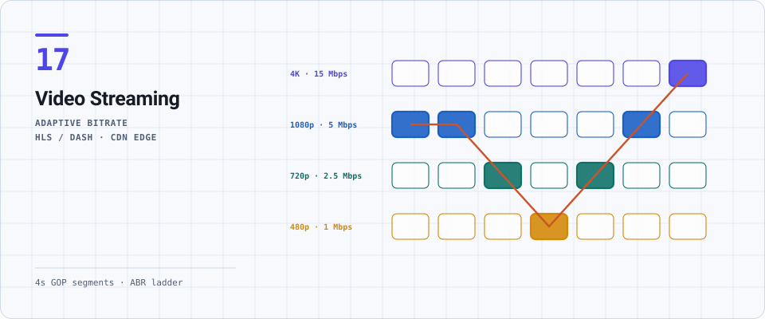
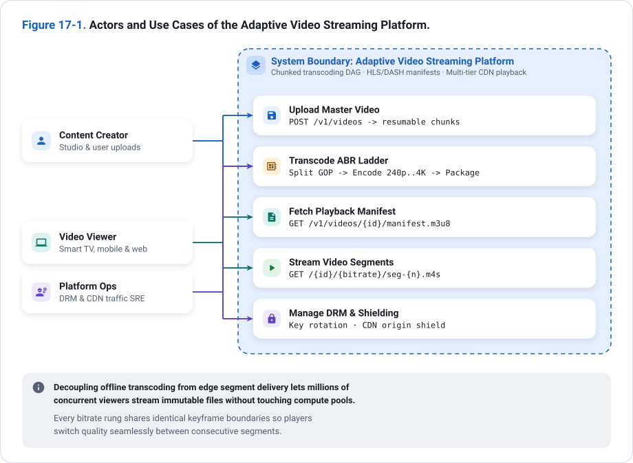
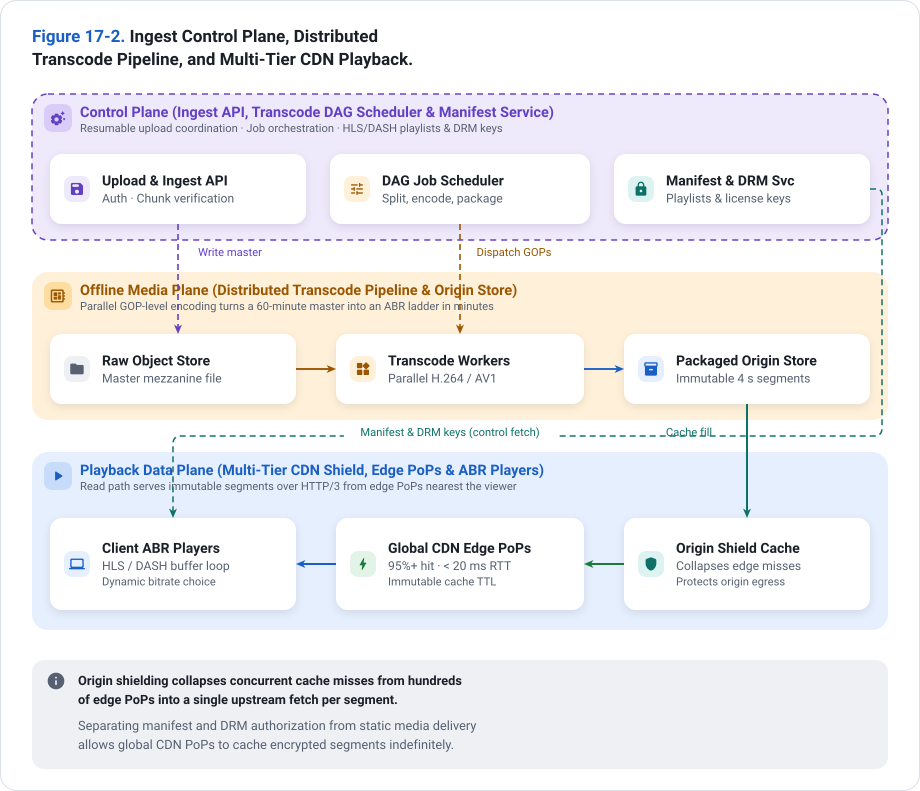
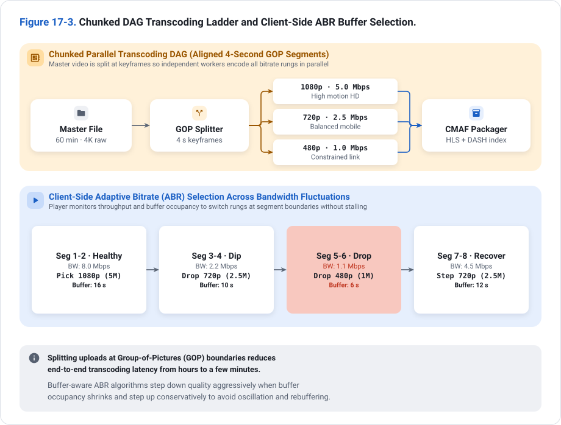

# 17. Video Streaming Platform: System Design

A two-hour high-definition film occupies roughly `4.5 GB`. A viewer pressing play on a fluctuating mobile network or a fiber-connected television expects the first frame within a second and continuous playback without freezes, even while millions of viewers stream simultaneously across continents. Video accounts for the majority of global internet downstream traffic, turning a streaming platform into a large-scale content-processing pipeline paired with a bandwidth-constrained global delivery fabric.

In this chapter, we design a global adaptive video streaming platform grounded in one foundational architectural simplification: **a video is transformed into a sequence of short, immutable HTTP files**. Slicing every video into time-aligned 4-second segments across multiple quality renditions converts stateful media streaming into stateless HTTP object delivery. Origin storage reuses the erasure-coded object store (Chapter 16), global CDN edge caches serve immutable segments from ISP-adjacent disks without per-viewer state, and the client player independently adapts playback quality to live network conditions on every segment boundary.

<div class="covers">

In this chapter, we cover

- actors, use cases, functional requirements, startup-latency and rebuffer SLOs, explicit non-goals, and petabyte-ingest and terabit-egress capacity bounds
- external HTTP/2 contracts for resumable master ingest, HLS/DASH CMAF playback manifests, immutable segment delivery, and catalogue metadata schemas
- separation of the control plane (ingest coordination, DAG scheduler, manifest and DRM service), offline transcoding plane, and multi-tier CDN playback plane
- chunked parallel DAG transcoding across closed-GOP keyframes, unified CMAF packaging, per-title VMAF bitrate optimization, and permanent source archival
- client-side Adaptive Bitrate (ABR) control algorithms (throughput margin, BBA, BOLA, MPC), CDN origin shielding against stampedes, egress economics, and low-latency live streaming
- failure-mode mitigation matrices, QoE SLIs, production architectures (Netflix Open Connect, YouTube, Twitch LL-HLS), and simulation verification via `code/streamsim`

</div>

## 17.1 Requirements, Actors, and Capacity Bounds

### Actors and Use Cases

We organize the streaming platform boundary around three external actor groups (Figure 17-1).

<figure class="diagram">

<figcaption><b>Figure 17-1</b> Actors, system boundary, and core use cases of the adaptive video streaming platform.</figcaption>
</figure>

| Actor | Operation | Concrete Scenario |
| :--- | :--- | :--- |
| **Content Creator / Studio** | Initiate resumable upload (`POST /v1/videos`), monitor encoding status (`GET /v1/videos/{id}`) | Studio or creator uploads a `10 GB` 4K mezzanine file in parallel parts and tracks parallel ABR transcoding progress until publication |
| **Video Viewer** | Fetch playback manifest (`GET /v1/videos/{id}/manifest.m3u8`), stream segments (`GET /{id}/{bitrate}/seg-{n}.m4s`) | Mobile or television player fetches the manifest, starts playback within `1 second`, seeks arbitrarily, and switches resolution automatically across network fluctuations |
| **Platform Operations** | Manage DRM license keys, pre-warm blockbuster releases onto edge caches, and tune CDN origin shields | Release engineering pre-positions a major premiere across global ISP edge caches overnight before launch hour |

### Functional Requirements

| No. | Functional Requirement |
| :--- | :--- |
| 0 | A creator can upload a source video up to `10 GB` (or multi-hundred-gigabyte studio mezzanine files) using resumable multipart HTTP transfers. |
| 1 | The platform transcodes every uploaded video into a multi-bitrate ABR ladder (`240p` to `1080p` / `4K`) sliced into time-aligned `4`-second closed-GOP segments packaged as unified CMAF files for both HLS and DASH players. |
| 2 | A viewer's player fetches a manifest listing available renditions and segment URLs, starting initial playback within `2 seconds` (`1 second` to first segment). |
| 3 | The player dynamically adapts bitrate on any `4`-second segment boundary in response to changing link throughput and buffer occupancy without playback discontinuity. |
| 4 | A viewer can seek to any timestamp in the video by requesting the corresponding segment index directly without downloading preceding video data. |
| 5 | The platform enforces playback entitlement checks and optional DRM key delivery before issuing signed manifest and segment URLs. |

### Non-Functional Requirements and SLOs

| No. | Property | Target Specification | Architectural Consequence |
| :--- | :--- | :--- | :--- |
| 0 | **Playback Availability** | `99.95%` global playback availability (`<= 21.6` minutes/month) | Multi-CDN DNS steering and ISP-embedded edge PoPs isolate playback from origin or single-CDN outages |
| 1 | **Startup & Rebuffer QoE** | Time-to-first-frame `p95 <= 1.0 s`; rebuffer ratio `< 0.2%` of total watch hours | Players initiate playback on a low-bitrate rung (`400 kbps`) and maintain a `10 to 30 s` ABR safety buffer |
| 2 | **Consistency** | Strong consistency for catalogue metadata and video publication state; immutable segments require zero cache coherence | Segments carry `Cache-Control: max-age=31536000, immutable`; eventual visibility delay equals transcode completion time |
| 3 | **Ingest & Egress Scale** | `10,000,000` concurrent viewers (`~25 Tbps` aggregate egress) and `500` hours of video uploaded per minute | Egress exceeds single-region datacenter capacity by two orders of magnitude, mandating multi-tier CDN caching and Origin Shields |
| 4 | **Transcode Throughput** | `60`-minute 4K upload playable within `5 to 10 minutes` | Prohibits single-node sequential encoding; mandates chunked GOP-aligned DAG transcoding across spot compute pools |

### Non-Goals and Scope Boundaries

We exclude the following workloads from this chapter's architecture:

- **Sub-second interactive video conferencing:** Two-way video calls require sub-`200 ms` UDP/RTP media transport (`WebRTC` with ICE/STUN/TURN and SFU routers) that sacrifices retransmission reliability for conversational immediacy; HTTP segmented streaming serves Video-on-Demand (VoD) and one-to-many broadcasts (`2 to 30 s` latency).
- **Recommendation engines and social comments:** Content discovery feeds follow the fan-out and ranking design of Chapter 15.
- **Low-level codec mathematics:** We treat H.264, HEVC, and AV1 compression kernels as black-box encoders parameterized by closed-GOP keyframe cadence, bitrate caps, and perceptual VMAF quality targets.

### Back-of-the-Envelope Capacity Bounds

We size aggregate egress bandwidth, daily transcode storage growth, and object counts for `10,000,000` concurrent viewers averaging `2,500 kbps` (`720p`) and `500` hours of new video uploaded per minute across a 4-rung ladder (`400`, `1,200`, `2,500`, `5,000` kbps; total `9,100` kbps):

| Resource Dimension | Arithmetic Derivation | Provisioned Bound |
| :--- | :--- | :--- |
| **Aggregate Playback Egress** | `10,000,000 viewers * 2,500 kbit/s` | `25,000 Gbit/s` (`25 Tbps` / `3.125 TB/s` sustained) |
| **Segment Request Rate** | `10,000,000 viewers / 4 s per segment` | `2,500,000` HTTP `GET` requests/s across global CDN edges |
| **Encoded Storage per Video Hour** | `(400 + 1,200 + 2,500 + 5,000) kbit/s * 3,600 s / 8` | `4.095 GB` (`~4.1 GB` per hour across 4 renditions) |
| **Daily New Encoded Storage** | `500 hrs/min * 60 * 24 = 720,000 hrs/day * 4.1 GB` | `2.95 PB/day` (`~1.08 EB/year` logical before `RS(6, 3)` coding) |
| **Daily New Segments Created** | `720,000 hrs/day * (3,600 / 4) * 4 renditions` | `2.59 billion` immutable segment objects per day |
| **Transcode Compute Fleet** | `720,000` video hrs/day `* 4` rungs `= 2.88M` encode-hours/day (`~2x` real-time CPU) | `~240,000` vCPUs (`~3,750` 64-core spot/ASIC transcode hosts) |

Two numbers dominate the economics: **`25 Tbps` of egress** (impossible to serve from centralized cloud origins without ISP-embedded CDNs) and **`2.95 PB/day` of newly encoded segments** (motivating unified CMAF packaging and popularity-gated multi-codec encoding).

## 17.2 External API and Data Contracts

Playback splits into a lightweight, authenticated API call to retrieve the manifest and DRM token, followed by hundreds of unauthenticated (or signed-cookie) immutable HTTP `GET` segment fetches directly against CDN edge nodes.

### External HTTP Contracts

**Fetch HLS/CMAF Master Manifest (`GET /v1/videos/{id}/manifest.m3u8`):**

```http
GET /v1/videos/8842/manifest.m3u8 HTTP/2
Host: video.example
Authorization: Bearer <viewer-jwt>
```

```http
HTTP/2 200 OK
Content-Type: application/vnd.apple.mpegurl
Cache-Control: private, max-age=60

#EXTM3U
#EXT-X-VERSION:7
#EXT-X-INDEPENDENT-SEGMENTS
#EXT-X-STREAM-INF:BANDWIDTH=400000,RESOLUTION=426x240,CODECS="avc1.4d4015"
https://cdn.example/8842/400/index.m3u8
#EXT-X-STREAM-INF:BANDWIDTH=1200000,RESOLUTION=854x480,CODECS="avc1.4d401f"
https://cdn.example/8842/1200/index.m3u8
#EXT-X-STREAM-INF:BANDWIDTH=2500000,RESOLUTION=1280x720,CODECS="avc1.64001f"
https://cdn.example/8842/2500/index.m3u8
#EXT-X-STREAM-INF:BANDWIDTH=5000000,RESOLUTION=1920x1080,CODECS="avc1.640028"
https://cdn.example/8842/5000/index.m3u8
```

**Fetch an immutable 4-second CMAF media segment from the CDN Edge:**

```http
GET /8842/1200/seg-17.m4s HTTP/2
Host: cdn.example
```

```http
HTTP/2 200 OK
Content-Type: video/iso.segment
Cache-Control: public, max-age=31536000, immutable
Content-Length: 600000

<600000 bytes of encrypted CMAF video segment>
```

Setting `Cache-Control: public, max-age=31536000, immutable` guarantees that every intermediate proxy, ISP cache, and edge PoP retains segments indefinitely until LRU/LFU eviction without ever issuing conditional `If-None-Match` origin revalidation traffic.

### Catalogue and Transcode Job Schemas

```sql
-- Strongly consistent video catalogue and publication state machine
CREATE TABLE videos (
    video_id          BIGINT       PRIMARY KEY,
    creator_id        BIGINT       NOT NULL,
    title             VARCHAR(256) NOT NULL,
    duration_ms       INTEGER      NOT NULL,
    raw_object_key    VARCHAR(512) NOT NULL,  -- Permanent archival source in Object Store
    state             VARCHAR(24)  NOT NULL,  -- 'UPLOADING', 'TRANSCODING', 'READY', 'FAILED'
    drm_key_id        UUID         NULL,
    created_at        TIMESTAMPTZ  NOT NULL
);

-- Individual chunked transcode DAG tasks scheduled by the Job Scheduler (Chapter 12)
CREATE TABLE transcode_tasks (
    task_id           UUID         PRIMARY KEY,
    video_id          BIGINT       NOT NULL REFERENCES videos(video_id),
    chunk_index       INTEGER      NOT NULL,  -- e.g., 60-second GOP-aligned source slice
    rendition_kbps    INTEGER      NOT NULL,  -- 400, 1200, 2500, 5000, 15000
    codec             VARCHAR(16)  NOT NULL,  -- 'h264', 'hevc', 'av1'
    status            VARCHAR(16)  NOT NULL,  -- 'PENDING', 'LEASED', 'DONE', 'FAILED'
    output_prefix     VARCHAR(512) NOT NULL,
    UNIQUE (video_id, chunk_index, rendition_kbps, codec)
);
```

## 17.3 High-Level Architecture: Control Plane vs. Data Plane

We partition the video platform into three distinct operational planes separated by both latency sensitivity and geography: a **Control Plane** for upload coordination, DAG scheduling, and manifest/DRM authorization; an **Offline Media Plane** for CPU-heavy parallel transcoding and durable origin storage; and a globally distributed **CDN Playback Plane** (Figure 17-2).

<figure class="diagram">

<figcaption><b>Figure 17-2</b> Control plane, parallel offline transcoding pipeline, and globally distributed CDN playback plane.</figcaption>
</figure>

### Component Responsibilities

| Component | Plane | State Held | Failure Impact and Mitigation |
| :--- | :--- | :--- | :--- |
| **Upload and Ingest API** | Control | Multipart session credentials, source container inspection metadata | Stateless fleet; broken creator uploads resume from last acknowledged `64 MB` part via Object Store multipart protocol |
| **DAG Job Scheduler** | Control | Transcode task dependency graph (`Split -> Encode -> Package -> Publish`) | Lease-based distributed scheduler (Chapter 12); crashed worker lease expires and another spot worker re-runs one 60 s chunk idempotently |
| **Manifest and DRM License Service** | Control | Video catalogue cache, viewer entitlement rules, Widevine/FairPlay/PlayReady license keys | Active-active multi-region tier; edge-cached manifests continue serving active streams during brief control-plane hiccups |
| **Raw & Packaged Object Store (Origin)** | Offline Media | Master mezzanine files + all immutable `4 s` `.m4s` segments (Chapter 16) | Erasure-coded `RS(6, 3)` across 3 AZs; zero single-disk or single-AZ durability loss |
| **Transcode Worker Fleet** | Offline Media | Ephemeral chunk buffers, hardware/CPU encoders (`FFmpeg`, `SVT-AV1`, ASICs) | Runs on preemptible spot capacity; `100%` idempotent outputs allow instant preemption without losing completed chunks |
| **Origin Shield + CDN Edge PoPs** | Playback Data | Multi-tier NVMe/HDD segment caches (`> 98%` edge offload) in ISP PoPs worldwide | Origin Shield collapses regional misses into 1 origin fetch; Anycast DNS routes around failed PoPs automatically |

### Ingest-to-Playback Lifecycles

**Upload and transcode lifecycle:**
1. The creator invokes `POST /v1/videos`, receiving presigned multipart upload URLs targeting the Raw Object Store. Once all parts complete, the Upload API validates the container header and persists `state = 'TRANSCODING'`.
2. The DAG Job Scheduler launches a lightweight **GOP Splitter** job that demuxes the master video at closed-GOP keyframe boundaries into independent `60`-second source chunks (zero pixel decoding required).
3. For a `60`-minute film across `4` bitrate rungs, the scheduler fans out `60 * 4 = 240` independent transcode jobs onto preemptible Transcode Workers. Each worker encodes its 60-second slice, aligns IDR keyframes strictly every `4.000 seconds`, encrypts segments with Common Encryption (`CENC`), and writes `15` immutable `.m4s` segments directly to the Packaged Origin Store.
4. Once all DAG leaf jobs report `DONE`, a **CMAF Packager** writes the HLS (`.m3u8`) and DASH (`.mpd`) manifests and atomically transitions the catalogue row to `state = 'READY'`.

**Playback lifecycle:**
1. A viewer presses play; the player requests `GET /v1/videos/8842/manifest.m3u8` from the Manifest Service, which checks entitlement, issues a DRM license (if required), and returns CDN segment templates plus a short-lived signed cookie.
2. Because the player has not yet measured network throughput, it requests `seg-0.m4s` from the **lowest bitrate rung (`400 kbps`, `200 KB`)** from the nearest CDN Edge PoP so the first frame renders in `< 500 ms`.
3. Every `4` seconds (or sooner while filling the initial buffer), the player's ABR controller inspects measured download throughput and current buffer occupancy to pick the optimal bitrate rung for `seg-(n+1).m4s`.
4. If the CDN Edge PoP misses a cold segment, it forwards the request to the regional **Origin Shield**, which coalesces concurrent misses across dozens of PoPs into a single `GET` against the Packaged Object Store, caches the response, and returns it down the hierarchy.

## 17.4 Chunked Parallel DAG Transcoding and Unified CMAF Packaging

### Parallel GOP-Level Transcoding and Per-Title Optimization

Encoding a 2-hour 4K master sequentially on a single multi-core server requires hours of wall-clock time, making timely publication impossible and turning mid-job hardware faults into costly restarts. Splitting the source at closed **Group of Pictures (GOP)** keyframe boundaries eliminates inter-chunk dependencies completely (Figure 17-3, top panel). Every `60`-second slice across every bitrate rung executes in parallel on a separate machine, shrinking a 4-hour sequential encode into roughly `5 minutes` of wall-clock latency while bounding any single worker crash to `1 minute` of re-work.

<figure class="diagram">

<figcaption><b>Figure 17-3</b> Chunked parallel DAG transcoding into aligned 4-second CMAF segments and client-side ABR adaptation across bandwidth shifts.</figcaption>
</figure>

**Mandatory IDR alignment across rungs:** Video compression stores most frames (`P`-frames and `B`-frames) as motion deltas referencing neighboring frames. For a player to switch cleanly from `seg-17.m4s` at `2,500 kbps` to `seg-18.m4s` at `1,200 kbps` without visual artifacts or decoder stalls, **every rendition must place an Instantaneous Decoder Refresh (IDR) keyframe at the exact same presentation timestamp (`t = 0.0 s, 4.0 s, 8.0 s, ...`)**. Choosing a `4`-second segment duration balances rapid ABR switching and fast seeking against compression efficiency (shorter `1 s` segments force frequent keyframes that inflate bitrate by `15% to 25%` and quadruple HTTP request rates).

**Popularity-tiered and per-title encoding:** Because video views obey a steep power law where most user-generated uploads receive fewer than 50 views, encoding every upload with slow multi-pass AV1 presets wastes millions of dollars in CPU time. Production platforms run a two-tier encoding policy:
1. **Immediate baseline publish:** Encode all uploads rapidly in H.264 (`240p`, `480p`, `720p`) so creators can publish within minutes.
2. **Per-title / per-shot convex-hull optimization:** For videos crossing a popularity threshold (or all premium studio titles), analyze scene complexity using perceptual metrics (`VMAF`) to generate a custom bitrate ladder: low-motion animation achieves transparent 1080p quality at `1.5 Mbps`, whereas high-motion sports requires `6.0 Mbps`. Retaining the original mezzanine master permanently in cold object storage allows re-encoding the entire popular catalog years later as superior codecs (`AV1`, `VVC`) mature without compounding generation loss.

### Unified CMAF Packaging (HLS + DASH Deduplication)

Historically, Apple ecosystems demanded MPEG-2 Transport Stream (`.ts`) segments under HLS (RFC 8216), while web browsers, Android devices, and smart TVs demanded fragmented MP4 (`.m4s`) segments under MPEG-DASH (ISO/IEC 23009-1). Storing and caching both container formats doubled origin storage (`+2.95 PB/day`) and halved CDN edge cache hit ratios. Adopting **CMAF (Common Media Application Format)** stores one single canonical set of fragmented MP4 (`.m4s`) media segments referenced simultaneously by both `.m3u8` HLS playlists and `.mpd` DASH manifests, halving storage footprint and concentrating `100%` of edge cache capacity onto shared byte objects.

## 17.5 Client-Side ABR Control, CDN Origin Shielding, and Live Streaming

### Client-Side Adaptive Bitrate (ABR) Control Theory

Moving adaptation logic out of servers into the client player is the single largest scalability enabler in video streaming: the server never tracks per-viewer congestion state, while the player directly observes exact segment download times, viewport resolution, decoder thermal limits, and remaining playback buffer.

Interactive Trace 17.A steps through a throughput-based ABR rule (`80%` safety margin on the preceding download speed) as a viewer's connection plunges from `6,000 kbps` to `1,500 kbps` and `700 kbps` before recovering.

<figure class="steps" data-prefix="figures/steps-stream-adapt" data-count="10" data-version="949cd732">

<figcaption><b>Interactive Trace 17.A</b> Client-side ABR adaptation across 10 segments during sudden link degradation and recovery. Use Next and Back to step through all 10 stages.</figcaption>
</figure>

In Interactive Trace 17.A, we observe an intrinsic physical constraint: **throughput estimators always lag reality by at least one segment**. When bandwidth drops abruptly from `6,000 kbps` to `1,500 kbps` during piece `4`, the player has already requested a `2,500 kbps` segment that takes `6.7 seconds` to arrive. Only the `8.7 seconds` of previously buffered video prevents a visible freeze. Production players therefore combine throughput estimation with explicit buffer-state feedback:

| ABR Algorithm | Control Signal | Core Mechanism | Production Trade-Off |
| :--- | :--- | :--- | :--- |
| **Throughput-Based (EWMA + Margin)** | Recent segment download rate | Selects highest rung `<= 0.8 * throughput_ewma` | Simple and fast at startup; oscillates on spiky cellular networks when TCP congestion windows fluctuate |
| **BBA (Buffer-Based Approach, Netflix)** | Current playback buffer occupancy $B(t)$ | Maps $B(t)$ linearly across reservoir $[B_{\min}, B_{\max}]$ to bitrate ladder | Cuts rebuffer events by `10% to 20%` during steady state; requires throughput bootstrap during initial empty-buffer startup |
| **BOLA (Lyapunov Optimization)** | Buffer level + logarithmic utility $v_m$ | Chooses rung maximizing $(V \cdot v_m + \gamma p - B(t)) / S_m$ | Mathematically near-optimal balance of average bitrate vs. rebuffer probability; default in `dash.js` |
| **MPC / Pensieve (Hybrid)** | Throughput forecast + buffer + switching penalty | Optimizes multi-step QoE reward (bitrate minus rebuffer and flicker penalties) | Highest QoE across diverse networks; higher implementation complexity |

All production ABR policies enforce two asymmetric QoE laws: **never rebuffer to chase sharper pixels** (viewers abandon streams far more rapidly after a single stall than after 15 seconds of 480p video), and **apply hysteresis** (step down immediately on buffer drain, step up only after multiple consecutive healthy segments) to avoid jarring resolution flicker. Players also cap maximum forward buffer to `15 to 30 seconds`: downloading 10 minutes ahead wastes enormous egress bandwidth whenever viewers abandon a video after 90 seconds.

### Multi-Tier CDN Architecture and Origin Shielding

Delivering `25 Tbps` globally requires placing thousands of edge cache servers directly inside last-mile ISP networks (the model pioneered by **Netflix Open Connect** appliances, where ISPs host free NVMe/HDD caching boxes inside regional peering facilities so `> 95%` of bytes never traverse paid transit networks).

To protect the Packaged Origin Store from thundering-herd cache stampedes during viral launches or live events, the CDN inserts a mid-tier **Origin Shield** (one designated regional cache cluster sitting between hundreds of edge PoPs and the origin):
1. When `200` edge PoPs miss `seg-0.m4s` of a newly released blockbuster within the same millisecond, all `200` requests converge on the Origin Shield.
2. The Origin Shield applies **request coalescing (collapsed forwarding)**: it issues exactly **one** `GET` to the Packaged Origin Store and streams the arriving bytes simultaneously to all `200` waiting edge PoPs.
3. For scheduled major premieres, the control plane executes **proactive overnight off-peak pre-positioning**, pushing top-title segments to ISP edge disks when network links are idle (`02:00 to 06:00` local time). For cold long-tail catalog items, edge caches pin only the **prefix (`seg-0` through `seg-2`, first `12 s`)** so playback starts instantaneously from the edge while the Origin Shield fetches `seg-3+` asynchronously only if the viewer continues watching.

### Live Streaming and Low-Latency CMAF Extensions

Live broadcasts reuse the identical segmented HTTP + CDN architecture, replacing static playlists with a **sliding-window manifest** updated every `4` seconds as live encoders emit new segments (`Cache-Control: public, max-age=1`). Because a player waits for a full 4-second segment to finish encoding plus 3 buffered segments before display, standard HLS/DASH incurs `15 to 30 seconds` of glass-to-glass live latency. **Low-Latency HLS (LL-HLS)** and **LL-DASH** cut live latency to **`2 to 4 seconds`** by publishing `200 to 500 ms` **CMAF partial chunks** over HTTP/2 chunked transfer encoding while the parent 4-second segment is still being encoded, paired with blocking playlist reloads that eliminate polling jitter.

## 17.6 Failure Modes, SLIs, and Production Systems

### Failure Mode and Mitigation Matrix

| Failure Mode | Blast Radius | Detection Signal | Automated Mitigation |
| :--- | :--- | :--- | :--- |
| **Regional CDN PoP Outage** | Elevated startup latency for viewers in one metro area | Synthetic edge probe failure or BGP withdrawal | Anycast / GeoDNS steers viewers to next-nearest healthy PoP within `30 s`; active players fail over automatically on the next 4-second segment URL |
| **Origin Stampede on Premiere Launch** | Risk of saturating Origin Object Store egress links | Origin `GET` RPS spikes `> 5x` baseline | Origin Shield request coalescing collapses duplicate PoP misses into 1 origin fetch; overnight pre-warming eliminates cold misses for major titles |
| **Transcode Worker Preemption / Crash** | Single 60-second chunk delayed by `1 to 3 minutes` | Task lease heartbeat timeout in DAG Job Scheduler | Scheduler reassigns the failed `(video_id, chunk_index, rung)` task to another spot worker; all other chunks continue undisturbed |
| **Corrupt Source Container / Codec Failure** | Single creator upload fails to reach `READY` state | Encoder exit code or VMAF/ffprobe validation failure | Dead-letter queue isolates malformed file after `3` retries and surfaces structured diagnostic error to the creator dashboard |
| **Manifest / DRM Service Degradation** | New playback starts fail; active viewers already streaming continue uninterrupted | Manifest API `5xx > 0.5%` or `p99 > 500 ms` | Multi-region active-active failover; clients cache DRM keys across entire session duration so live playback survives control-plane blips |

### Operational SLIs, SLOs, and Alert Thresholds

- **Video Startup Failure Rate (VSF) SLI:** Fraction of viewer play clicks failing to render frame 1 within `10 s`, targeting `< 0.5%`; page on-call above `1.0%` over 5 minutes.
- **Time-to-First-Frame (TTFF) SLI:** `p95 <= 1.0 s` on broadband and `<= 2.0 s` on cellular networks; alert on `> 20%` regional regression.
- **Rebuffer Ratio SLI:** `(Total stall duration / Total watch duration)`, targeting `< 0.2%` globally; segmented by ISP ASN and CDN provider to trigger automated multi-CDN steering away from congested networks.
- **CDN Cache Hit Ratio (CHR) and Origin Offload SLI:** Byte hit ratio `>= 96%` at edge PoPs and `>= 99.5%` combined with Origin Shield; drop below `94%` indicates cache key fragmentation or broken `Cache-Control` headers.

### Production Benchmarks

| Production System | ABR & Packaging Standard | CDN & Edge Delivery | Architectural Distinction |
| :--- | :--- | :--- | :--- |
| **Netflix** | CMAF / DASH + Per-Title & Per-Shot AV1/HEVC/H.264 ladders + BBA ABR | Proprietary **Open Connect** appliances embedded directly inside thousands of ISPs | Proactively fills ISP edge caches overnight with predicted regional catalog hits, achieving `> 95%` local ISP traffic offload |
| **YouTube** | DASH / HLS (`VP9`, `AV1`, `H.264`) + custom VCU hardware transcoding ASICs | Google Global Cache (GGC) edge servers across global ISP networks | Processes `500+` hours of uploaded video per minute via popularity-gated multi-pass encoding and custom silicon Video Coding Units |
| **Twitch (Live)** | LL-HLS with `2 s` segments and sub-second CMAF partial chunks | Dedicated ingest PoPs + global low-latency edge replication | Achieves `2 to 4 s` glass-to-glass live broadcast latency for millions of concurrent viewers with request-coalesced live edge caches |
| **Apple TV+ / HLS** | RFC 8216 HLS + LL-HLS over CMAF with FairPlay DRM | Multi-CDN steering (Akamai, Fastly, CloudFront, proprietary edge) | Standardized HTTP segmented streaming (`EXT-X-PART` low-latency manifests) and client-driven ABR across mobile ecosystems |

## 17.7 Simulation Verification

<div class="simulation">

**Reproduce the adaptive bitrate (ABR) throughput and buffer simulation.** Run `cargo run --release -p streamsim` inside `distributed-systems-from-the-ground-up/code/` to step through `10` consecutive `4`-second video segments across a `400 / 1200 / 2500 / 5000 kbps` ladder as link bandwidth drops from `6,000 kbps` to `1,500 kbps` and `700 kbps` before recovering to `6,000 kbps`.

</div>

```console
$ cargo run --release -p streamsim
piece  speed  chosen  download  buffered
    1   6000     400     0.3 s     4.0 s
    2   6000    2500     1.7 s     6.3 s
    3   6000    2500     1.7 s     8.7 s
    4   1500    2500     6.7 s     6.0 s
    5   1500    1200     3.2 s     6.8 s
    6    700    1200     6.9 s     4.0 s
    7    700     400     2.3 s     5.7 s
    8   3200     400     0.5 s     9.2 s
    9   6000    2500     1.7 s    11.5 s
   10   6000    2500     1.7 s    13.9 s
time without video after the start: 0.1 s
```

From this simulation transcript, we quantify three critical dynamics of adaptive streaming:

1. **Fast cold start:** Starting piece `1` on the `400 kbps` rung downloads in `0.3 s` and populates `4.0 s` of immediate buffer, immediately revealing the `6,000 kbps` link capacity so piece `2` upgrades directly to `2,500 kbps`.
2. **Buffer absorption of 1-segment estimator lag:** When throughput collapses by `75%` at piece `4` (`6,000 -> 1,500 kbps`), the in-flight `2,500 kbps` segment requires `6.7 s` to finish (`2.7 s` longer than its `4.0 s` playback duration), draining the buffer from `8.7 s` to `6.0 s` without stalling. A second drop to `700 kbps` at piece `6` takes `6.9 s` and drains the buffer from `6.8 s` to `4.0 s` before the player steps down to `400 kbps` at piece `7`.
3. **Near-zero stall time across severe link degradation:** Across an `8.6x` bandwidth drop (`6,000 -> 700 kbps`), maintaining a `20%` throughput safety margin plus a modest `4 to 14 s` buffer kept total post-start rebuffering to **`0.1 s`** (`< 0.25%` of the 40-second clip).

## 17.8 Terminology and References

### Engineering Glossary

| Term | Definition |
| :--- | :--- |
| **ABR (Adaptive Bitrate Streaming)** | Client-side control loop selecting the optimal encoded rendition for each upcoming video segment based on measured link throughput and playback buffer occupancy. |
| **Closed GOP / IDR Keyframe** | A self-contained sequence of compressed video frames beginning with an Instantaneous Decoder Refresh frame, allowing clean bitrate switching and seeking on segment boundaries. |
| **CMAF (Common Media Application Format)** | Unified fragmented MP4 (`.m4s`) segment container readable by both HLS and MPEG-DASH players, halving origin storage and CDN cache duplication. |
| **DAG Transcoding Pipeline** | Splitting a source video at keyframe boundaries into independent time chunks encoded concurrently across distributed workers and joined into unified manifests. |
| **Origin Shield** | A mid-tier regional CDN cache cluster using request coalescing to collapse concurrent edge-PoP misses into a single origin fetch. |
| **BBA / BOLA** | Buffer-based and Lyapunov-optimal ABR algorithms that govern bitrate selection directly from buffer occupancy to minimize rebuffer stalls. |
| **LL-HLS / LL-DASH** | Low-latency streaming extensions delivering `200 to 500 ms` partial CMAF chunks before a full segment finishes encoding, reducing live delay to `2 to 4 seconds`. |

### References

- R. Pantos and W. May, IETF RFC 8216, *HTTP Live Streaming*, 2017.
- ISO/IEC 23009-1, *Dynamic Adaptive Streaming over HTTP (DASH)*, 2022.
- T.-Y. Huang, R. Johari, N. McKeown, M. Trunnell, and M. Watson, "A Buffer-Based Approach to Rate Adaptation: Evidence from a Large Video Streaming Service", *ACM SIGCOMM*, 2014.
- X. Yin, A. Jindal, V. Sekar, and B. Sinopoli, "A Control-Theoretic Approach for Dynamic Adaptive Video Streaming over HTTP", *ACM SIGCOMM*, 2015.
- K. Spiteri, R. Urgaonkar, and R. K. Sitaraman, "BOLA: Near-Optimal Bitrate Adaptation for Online Videos", *IEEE INFOCOM*, 2016.
- H. Mao, R. Netravali, and M. Alizadeh, "Neural Adaptive Video Streaming with Pensieve", *ACM SIGCOMM*, 2017.
- Netflix Technology Blog, "Per-Title Encode Optimization", 2015, and "High Quality Video Encoding at Scale", 2015.
