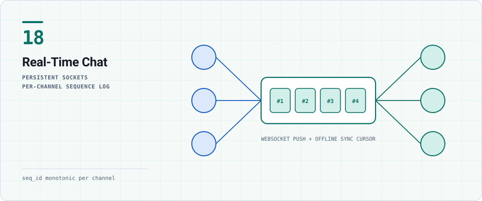
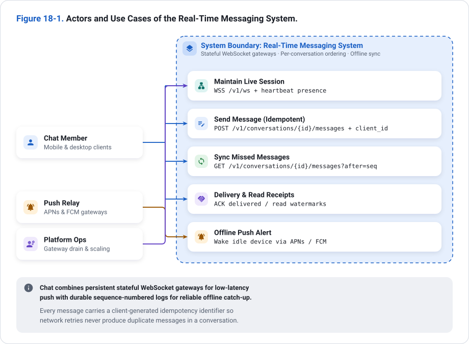
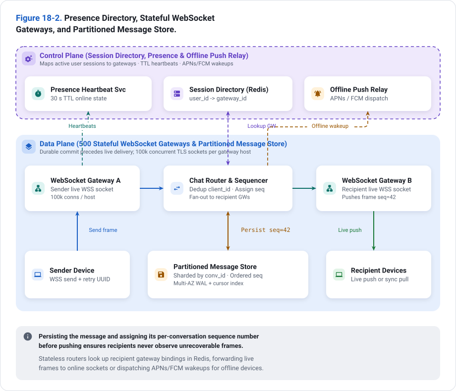
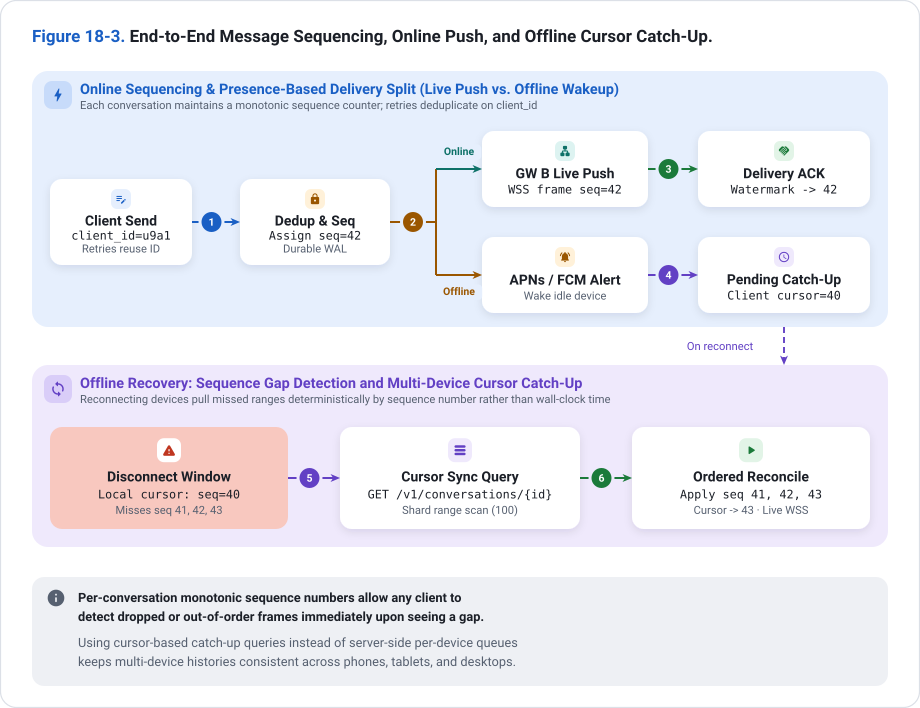

# 18. Real-Time Chat: System Design

A real-time messaging platform delivers conversational text and media across unreliable mobile networks while upholding strict perceptual invariants: messages must appear on online recipients' screens in under half a second, survive hours or days of offline disconnection without loss, never duplicate under retries, and render in the exact same causal order on every participant's device. Users detect violations immediately because an out-of-order reply or a repeated message renders a conversation visibly broken.

In this chapter, we design a globally scalable real-time chat system supporting `50,000,000` concurrent online connections and `20,000,000,000` messages per day. By separating minimal stateful **WebSocket Gateways** from stateless **Chat Routers** and anchoring every conversation to a **strongly consistent per-conversation monotonic sequence number**, we collapse reliable delivery, gap detection, duplicate suppression, multi-device synchronization, and offline recovery into a single cursor arithmetic protocol.

<div class="covers">

In this chapter, we cover

- actors, use cases, functional requirements, sub-500 ms delivery and ordering SLOs, explicit non-goals, and 50-million-connection gateway and storage capacity bounds
- WebSocket wire frames, idempotent HTTP/2 message submission, cursor catch-up APIs, and time-bucketed Cassandra/ScyllaDB message schemas
- separation of the control plane (presence heartbeat service, Redis session directory, APNs/FCM offline push relay) from stateful WebSocket gateways and partitioned message logs
- transport selection (polling, long polling, WebSocket), gateway connection isolation, monotonic per-conversation sequencing, `client_id` deduplication, and offline cursor recovery via interactive traces
- 1:1 versus large-group fan-out, multi-device cursors and cumulative watermarks, viewport-scoped presence control, hot-channel storage partitioning, and Signal Double Ratchet E2EE implications
- failure-mode mitigation matrices, operational SLIs, production architectures (WhatsApp Erlang/FreeBSD, Discord ScyllaDB, Slack, Facebook Messenger MQTT), and verification via [`code/chatsim`](https://github.com/arpanpathak/cracking-the-systems-programming-interview/tree/prep-v2/distributed-systems-from-the-ground-up/code/chatsim)

</div>

## 18.1 Requirements, Actors, and Capacity Bounds

### Actors and Use Cases

We organize the real-time messaging boundary around three external actor groups (Figure 18-1).

<figure class="diagram">

<figcaption><b>Figure 18-1</b> Actors, system boundary, and core use cases of the real-time messaging system.</figcaption>
</figure>

| Actor | Operation | Concrete Scenario |
| :--- | :--- | :--- |
| **Chat Member** | Maintain WebSocket (`WSS /v1/ws`), send message (`POST /v1/conversations/{id}/messages`), sync cursor (`GET /v1/conversations/{id}/messages?after=seq`), send read/delivery watermarks | Mobile or desktop client sends messages reliably across elevator disconnects and synchronizes state consistently across phone, tablet, and laptop |
| **External Push Relay (APNs / FCM)** | Dispatch wake-up notification for offline devices | Operating system wakes a suspended background application or renders an alert when a message commits while the recipient has no open WebSocket |
| **Platform Operations** | Orchestrate rolling gateway drains, scale hot-channel partitions, and monitor delivery latency | SRE drains stateful gateway hosts in small batches so reconnecting phones spread TLS handshakes cleanly across healthy gateways |

### Functional Requirements

| No. | Functional Requirement |
| :--- | :--- |
| 0 | A member can send text and media-reference messages to 1:1 conversations and group channels (from `2` members up to `100,000` community members). |
| 1 | Every online recipient device receives a newly committed message over its persistent WebSocket connection within `500 ms` (`p99`). |
| 2 | Every message within a conversation is assigned a strict gapless monotonic sequence number (`1, 2, 3, ...`), ensuring all participants observe an identical total message order. |
| 3 | Retried message submissions carrying the same caller-generated `client_id` are stored and sequenced exactly once (end-to-end send idempotency). |
| 4 | A device reconnecting after any offline interval recovers all missed messages deterministically by presenting its local `last_received_seq` cursor, suppressing out-of-order gaps and duplicate deliveries. |
| 5 | The system supports multi-device synchronization per user, cumulative `sent` / `delivered` / `read` watermarks, scoped online presence, and optional End-to-End Encryption (E2EE) over opaque ciphertext payloads. |

### Non-Functional Requirements and SLOs

| No. | Property | Target Specification | Architectural Consequence |
| :--- | :--- | :--- | :--- |
| 0 | **Delivery Latency** | `p50 <= 80 ms`, `p99 <= 500 ms` end-to-end (sender submit to online receiver render, intra-region) | Mandates persistent full-duplex WebSockets (`RFC 6455`) and in-memory Redis session directory lookups (`< 2 ms`) |
| 1 | **Durability & Ordering** | Zero loss of any message confirmed as `sent`; strict linearizable per-conversation sequence order (`PC/EC`) | Durable quorum commit in the conversation shard leader precedes both the sender `sent` ACK and recipient gateway push |
| 2 | **Availability** | `99.95%` sending and receiving availability (`<= 21.6` minutes/month) | Multi-AZ stateful gateway pools with client exponential-backoff reconnects; session directory treated strictly as a hint |
| 3 | **Secondary Consistency** | Eventual consistency (`1 to 10 s`) for presence status, typing indicators, and read watermarks | Keeps secondary signals off the durable message commit path so presence storms never block chat messages |
| 4 | **Scale** | `50,000,000` concurrent online connections and `20,000,000,000` messages per day (`~231,500` msg/s avg, `~1,000,000` msg/s peak) | Demands `500+` tuned WebSocket gateways (`100,000` sockets/host) and horizontally sharded LSM-tree message storage |

### Non-Goals and Scope Boundaries

We exclude the following capabilities so the architecture remains centered on reliable real-time messaging:

- **Real-time audio and video calling:** Interactive voice/video calls operate over UDP/SRTP (`WebRTC`) with jitter buffers and media SFUs rather than reliable TCP/WebSocket message logs.
- **Full-text search inside E2EE conversations:** Because end-to-end encrypted payloads are opaque ciphertext on servers, E2EE search executes locally over each device's decrypted SQLite index.
- **Rich media storage and transcoding:** Attached images, voice notes, and video clips are uploaded out-of-band to the Object Store (Chapter 16) and referenced by immutable signed object IDs inside chat frames.

### Back-of-the-Envelope Capacity Bounds

We size gateway concurrency, socket memory, write throughput, and message storage for `50,000,000` concurrently online devices and `20,000,000,000` daily messages averaging `200 bytes` per record:

| Resource Dimension | Arithmetic Derivation | Provisioned Bound |
| :--- | :--- | :--- |
| **WebSocket Gateway Fleet** | `50,000,000 open sockets / 100,000 sockets per host` | `500` gateway hosts (`~167` hosts per AZ across 3 AZs; `+20%` headroom = `600` hosts) |
| **Per-Gateway Socket Memory** | `100,000 sockets * ~40 KB` (kernel TCP + TLS state + user-space ring buffers) | `~4.0 GB` RAM per gateway (fits comfortably inside standard `32 GB` instances) |
| **Session Directory RAM (Redis)** | `50,000,000 active device sessions * 128 B` (`user_id`, `device_id`, `gw_id`, `ttl`) | `6.4 GB` raw (`~19.2 GB` across 12 sharded Redis nodes with replication) |
| **Message Write Rate (Avg / Peak)** | `20,000,000,000 / 86,400 s = 231,481` msg/s; `4x` peak event burst | `231,500` msg/s avg, `926,000` msg/s peak |
| **Daily Message Storage Growth** | `20,000,000,000 msg/day * 200 B` | `4.0 TB/day` logical (`12.0 TB/day` raw at `3x` replication; `~1.46 PB/year` logical) |
| **Presence Heartbeat Traffic** | `50,000,000 devices / 30 s` lease renewal interval | `1.67 million` lightweight lease renewals/s (handled via batched per-gateway heartbeats) |

Notice a key systems optimization in the final row: if `50,000,000` devices each issued individual Redis `EXPIRE` RPCs every 30 seconds, the Session Directory would endure `1.67M` ops/s of presence overhead alone. Instead, gateways keep per-socket liveness locally over WebSocket `PING`/`PONG` frames and renew their host-level session lease in bulk batches, cutting Session Directory RPC volume by two orders of magnitude.

## 18.2 External API and Data Contracts

Clients maintain one persistent TLS-encrypted WebSocket (`WSS /v1/ws`) for low-latency bidirectional push frames and use idempotent HTTP/2 (or multiplexed WebSocket RPCs) for message submission and cursor catch-up.

### External Wire and HTTP Contracts

**Send a message (idempotent via `Idempotency-Key` / `client_id`):**

```http
POST /v1/conversations/301/messages HTTP/2
Host: api.chat.example
Authorization: Bearer <token>
Idempotency-Key: u9a1-phone-a-000512
Content-Type: application/json

{
  "client_id": "u9a1-phone-a-000512",
  "ciphertext_b64": "YW55IGNpcGhlcnRleHQ...",
  "content_type": "text/plain"
}
```

```http
HTTP/2 201 Created
Content-Type: application/json

{
  "conversation_id": "301",
  "seq": 42,
  "client_id": "u9a1-phone-a-000512",
  "committed_at": "2026-11-20T13:08:05.112Z"
}
```

**Catch up after disconnection (`GET /v1/conversations/{id}/messages?after=seq`):**

```http
GET /v1/conversations/301/messages?after=1&limit=100 HTTP/2
Host: api.chat.example
Authorization: Bearer <token>
```

```http
HTTP/2 200 OK
Content-Type: application/json

{
  "conversation_id": "301",
  "messages": [
    { "seq": 2, "sender_id": "u_bob", "body": "hello?", "committed_at": "2026-11-20T13:07:10Z" },
    { "seq": 3, "sender_id": "u_bob", "body": "we are starting", "committed_at": "2026-11-20T13:07:15Z" },
    { "seq": 4, "sender_id": "u_bob", "body": "table 4", "committed_at": "2026-11-20T13:07:22Z" }
  ],
  "has_more": false
}
```

**Server-to-client WebSocket push frame (`WSS /v1/ws`):**

```json
{
  "type": "message.push",
  "conversation_id": "301",
  "seq": 42,
  "sender_id": "u_alice",
  "client_id": "u9a1-phone-a-000512",
  "payload": "YW55IGNpcGhlcnRleHQ...",
  "committed_at": "2026-11-20T13:08:05.112Z"
}
```

### Partitioned Message Store Schema (ScyllaDB / Cassandra Layout)

Messages are append-only and read overwhelmingly as contiguous recent ranges (`seq > cursor`). Partitioning solely by `conversation_id` causes unbounded partition growth for multi-year channels; adding a 10-day time bucket keeps every partition bounded below `100 MB` while keeping recent range scans inside a single partition:

```sql
-- Wide-column LSM-tree table (ScyllaDB / Cassandra) optimized for sequential range catch-up
CREATE TABLE conversation_messages (
    conversation_id BIGINT,
    time_bucket     INT,           -- floor(unix_seconds / 864000) -> 10-day bucket
    seq             BIGINT,        -- Strict monotonic per-conversation sequence number
    client_id       TEXT,          -- Sender-generated UUID for write deduplication
    sender_id       BIGINT,
    payload_bytes   BLOB,          -- Plaintext or Signal Double Ratchet ciphertext
    committed_at    TIMESTAMP,
    PRIMARY KEY ((conversation_id, time_bucket), seq)
) WITH CLUSTERING ORDER BY (seq ASC);

-- Per-user shared read watermark (synchronized across phone, tablet, and desktop)
CREATE TABLE read_watermarks (
    user_id         BIGINT,
    conversation_id BIGINT,
    last_read_seq   BIGINT,
    updated_at      TIMESTAMP,
    PRIMARY KEY (user_id, conversation_id)
);
```

## 18.3 High-Level Architecture: Control Plane vs. Data Plane

We isolate session discovery, presence liveness, and offline push notification dispatch inside the control plane while dedicating `500` lightweight stateful WebSocket Gateways and partitioned message sequencers to the low-latency delivery data plane (Figure 18-2).

<figure class="diagram">

<figcaption><b>Figure 18-2</b> Control-plane session directory, presence heartbeats, and offline push relay decoupled from stateful WebSocket gateways and partitioned message stores.</figcaption>
</figure>

### Component Responsibilities

| Component | Plane | State Held | Failure Impact and Mitigation |
| :--- | :--- | :--- | :--- |
| **Session Directory (Redis Cluster)** | Control | Ephemeral `(user_id, device_id) -> gateway_id` mapping with `30 s` lease TTL | Treated strictly as a routing hint; losing a shard delays live push until devices renew or reconnect, while zero messages are lost |
| **Presence Heartbeat Service** | Control | Online/idle status with `15 to 30 s` offline grace debounce and viewport subscription maps | Eventual consistency; isolates high-fan-out presence churn from message delivery |
| **Offline Push Relay (Chapter 13)** | Control | APNs / FCM device push tokens and badge counters | Asynchronous queue-backed dispatch; wakes suspended mobile apps so they reconnect and pull via cursor |
| **WebSocket Gateways (`500` stateful hosts)** | Data | `100,000` live TLS/WebSocket file descriptors per host (`epoll`/`kqueue`), auth context | Minimal proxy logic so feature deploys never drop sockets; host crash triggers jittered client reconnect + cursor catch-up |
| **Chat Router and Sequencer (`200` hosts)** | Data | Stateless routing tier + conversation-sharded sequencer leases (`dedup` LRU + monotonic `next_seq`) | Auto-scaled across three AZs; consistent hashing routes each `conversation_id` to its owning sequencer shard |
| **Partitioned Message Store (`100` shards x `3` replicas)** | Data | Durable ordered conversation logs and `client_id` deduplication table | Quorum 3-AZ commit ensures confirmed messages survive any disk, host, or AZ failure |

### End-to-End Message Lifecycle

1. **Client Submit:** Sender's device generates a random UUID `client_id` (`u9a1`), renders the message optimistically as *pending* in the local UI, and sends it over its open WebSocket to **Gateway A** (or via `POST /v1/conversations/{id}/messages`).
2. **Deduplication and Sequencing:** Gateway A forwards the frame to the owning **Chat Router and Sequencer** for `conversation_id = 301`. The sequencer checks `(conversation_id, sender_id, client_id)` against its deduplication store. If seen previously, it returns the original `seq` without writing; otherwise it assigns the next monotonic `seq = 42` and commits durably to the **Partitioned Message Store** quorum.
3. **Sender `sent` ACK:** Immediately upon durable quorum commit, the sequencer replies `{seq: 42}` to Gateway A -> Sender's device, which transitions the UI message from *pending* to *sent* and slots it at position `42`.
4. **Live Push or Offline Wakeup:** The Chat Router queries the **Session Directory** for every recipient's active `(device_id -> gateway_id)` mappings (plus the sender's *other* logged-in devices). For every online device (for example, Receiver on **Gateway B**), the router pushes `{conv: 301, seq: 42, payload}` over an internal gRPC stream to Gateway B, which writes the WebSocket frame down the recipient's socket. For recipients with no active session, the router enqueues a wake-up alert to the **Offline Push Relay** (APNs/FCM).
5. **Delivery & Read Watermarks:** Once Receiver's device persists `seq = 42` locally, it sends a lightweight cumulative `delivery_ack(conv=301, seq=42)` watermark back up its WebSocket, which routes to the sender's online devices.

## 18.4 Stateful Gateways, Sequencing, Idempotency, and Offline Catch-Up

### Transport Comparison: Why Persistent WebSockets Win

Ordinary HTTP request-response forces clients to initiate every exchange. Three patterns overcome server-to-client push, with sharply different network and CPU costs:

| Transport Pattern | Delivery Latency | Idle Request Overhead | Server Per-Client State | Suitability at 50M Devices |
| :--- | :--- | :--- | :--- | :--- |
| **Short Polling (`1 s`)** | `0 to 1,000 ms` (`500 ms` avg) | `50,000,000` empty HTTP requests/s (`4.3` trillion/day) | None | Unviable; wastes massive radio battery and server CPU |
| **HTTP Long Polling** | Near-zero (`< 100 ms`) | Re-establishes request every `30 s` + after every message | `1` held HTTP socket | Fallback only for restrictive corporate proxies blocking WebSocket upgrades |
| **WebSocket (`RFC 6455`) / MQTT (Chosen)** | Near-zero (`< 50 ms`) | Zero HTTP headers; lightweight `2`-byte ping frames every `30 s` | `1` persistent TCP/TLS socket (`~40 KB` RAM) | Standard production choice for real-time mobile and web messaging |

### Isolating Stateful Gateways and Preventing Reconnect Storms

Holding `100,000` long-lived TLS connections per server introduces a critical operational hazard: restarting a gateway binary drops `100,000` active sessions instantaneously. Two architectural rules contain this blast radius:
1. **Strip all business logic from gateways:** Gateways terminate TLS, validate auth tokens on handshake, maintain the in-memory `socket_id -> fd` table, and forward frames over multiplexed internal gRPC pools to stateless Chat Routers. Because gateways rarely change code, feature deployments occur dozens of times daily with zero socket churn.
2. **Jittered client reconnection backoff:** When a gateway host crashes unexpectedly, `100,000` mobile devices detect TCP teardown within seconds. If all `100,000` phones reconnect immediately, the resulting TLS handshake storm can cascade across healthy gateways. Client SDKs therefore apply **truncated exponential backoff with full jitter** (`sleep = random(0, min(30s, 1s * 2^attempt))`), spreading reconnection load smoothly over `15 to 30 seconds`.

### Idempotent Send and Per-Conversation Cursor Recovery

Mobile links drop acknowledgements routinely. Without deduplication, retrying an unacknowledged send appends the same text under two consecutive sequence numbers. Interactive Trace 18.A walks through `client_id` deduplication across a lost confirmation.

<figure class="steps" data-prefix="figures/steps-chat-send" data-count="5" data-version="a60bd9ad">

<figcaption><b>Interactive Trace 18.A</b> Idempotent send retry: attaching a client-generated UUID ensures a lost server confirmation causes zero duplicate stored messages. Use Next and Back to step through all 5 stages.</figcaption>
</figure>

On the receiving side, wall-clock timestamps fail because phone clocks skew by seconds or minutes, placing replies ahead of questions. Assigning strict gapless integers (`1, 2, 3, ...`) per conversation at the shard leader enables every recipient device to maintain one integer cursor (`last_displayed_seq`) and enforce a deterministic three-branch state machine on every incoming frame `m`:
- **`m.seq == cursor + 1`:** Display `m` immediately and advance `cursor = m.seq`.
- **`m.seq > cursor + 1` (Gap detected):** Do not display `m` out of order (optionally buffer in memory); immediately issue `GET /v1/conversations/{id}/messages?after={cursor}` to fetch the missing interval cleanly.
- **`m.seq <= cursor` (Duplicate):** Discard `m` without modifying UI state.

Interactive Trace 18.B steps through all three faults (disconnect gap, out-of-order frame arrival, and duplicate redelivery) on a single mobile phone.

<figure class="steps" data-prefix="figures/steps-chat-catchup" data-count="7" data-version="d7621933">

<figcaption><b>Interactive Trace 18.B</b> Client cursor arithmetic: ignoring out-of-order message 4, recovering missed messages 2 to 4 after reconnect, and suppressing duplicate message 3. Use Next and Back to step through all 7 stages.</figcaption>
</figure>

In Figure 18-3, we combine the online push path and offline cursor catch-up path, showing why the server never tracks per-device delivery queues: whether a phone entered a subway tunnel for `10 seconds` or remained powered off for `7 days`, recovery executes the identical `GET ?after={cursor}` range query.

<figure class="diagram">

<figcaption><b>Figure 18-3</b> End-to-end online push sequencing paired with deterministic offline cursor catch-up across multi-device sessions.</figcaption>
</figure>

## 18.5 Group Fan-Out, Presence Control, Hot Channels, and E2EE

### 1:1 vs. Large-Group Fan-Out and Multi-Device Sync

For 1:1 chats and ordinary group conversations (`<= 500` members), the Chat Router resolves active sessions for all members in one batched Redis `MGET`, groups recipients by target `gateway_id`, and dispatches one coalesced RPC per gateway.

For massive broadcast channels (`10,000 to 500,000` members in Slack workspaces or Discord communities), pushing every message body immediately to `100,000` sockets creates the same write/egress fan-out storm analyzed in Chapter 15. Large channels therefore switch automatically at a membership threshold (`N > 500`) to **subscription-scoped pub/sub**: only gateways hosting members who currently have that specific channel *open in the foreground* subscribe to the channel's live fan-out topic; all other members receive an eventual unread badge (`latest_seq`) and pull messages lazily from their cursor when opening the channel.

Multi-device users (phone + laptop + tablet) require zero extra storage duplication: every device tracks its own local `delivered_seq` cursor independently so a powered-off laptop catches up fully on boot, while a single per-user `read_watermarks` table (`max(last_read_seq)`) synchronizes unread counters immediately across all devices.

### Controlling Presence Fan-Out and Hot Channels

Unfiltered presence broadcasting (pushing `"online"` / `"offline"` to all `500` contacts every time a mobile radio toggles between Wi-Fi and LTE) routinely generates `5x to 10x` more network traffic than actual chat messages. Three controls bound presence cost:
1. **Viewport-scoped subscriptions:** Clients subscribe only to presence updates for contacts currently visible on screen (typically `15 to 30` rows), unsubscribing immediately upon scrolling away.
2. **Offline hysteresis debounce (`15 to 30 s`):** When a WebSocket disconnects, the Presence Service delays broadcasting `offline` for `20 seconds`; brief cellular handoffs reconnect within the grace window with zero status flicker.
3. **Ephemeral typing frames:** Typing indicators (`"Alice is typing"`) bypass persistent storage completely and expire client-side after `5 seconds`.

On the storage tier, a single viral Discord channel receiving `500` messages/s and `50,000` concurrent readers creates an extreme **hot partition** on `(conversation_id, time_bucket)`. Production deployments place a **Read-Through Request-Coalescing Service** in front of ScyllaDB (Discord's Rust *Data Services* tier) that holds the hottest `50` recent messages of active channels in memory and coalesces `10,000` identical catch-up range queries into a single storage read.

### End-to-End Encryption (E2EE) Architectural Consequences

Enabling E2EE via the **Signal Double Ratchet** protocol preserves the entire messaging pipeline unchanged: servers still assign `seq` numbers, commit opaque `payload_bytes`, route frames through WebSocket gateways, and replay missed ranges by cursor. Every property depending on server visibility, however, shifts to client devices:
- **Key distribution and group rekeying:** For 1:1 chats, the server hosts a signed public PreKey Bundle (`X3DH`) so a sender can initiate an encrypted session even while the recipient is offline. For encrypted groups, each sender distributes a symmetric **Sender Key** encrypted pairwise to every group member; removing any member forces every remaining participant to rotate Sender Keys (`O(N)` pairwise key exchanges), capping encrypted group sizes practically around `1,000` members (addressed at larger scale by IETF **MLS / TreeKEM**, `O(log N)`).
- **Offline notifications and history sync:** APNs/FCM notifications carry either an opaque wake-up signal or encrypted payload decrypted by a mobile notification service extension, and newly linked devices must transfer historical decryption keys directly from an existing authenticated device over an encrypted local channel.

## 18.6 Failure Modes, SLIs, and Production Systems

### Failure Mode and Mitigation Matrix

| Failure Mode | Blast Radius | Detection Signal | Automated Mitigation |
| :--- | :--- | :--- | :--- |
| **WebSocket Gateway Crash** | `100,000` connected devices drop sockets (`0.2%` of fleet); zero messages lost | Gateway health check failure and sudden drop in active socket count | Clients reconnect to healthy gateways using full-jitter exponential backoff (`1 to 30 s`) and issue `GET ?after=cursor` to recover any messages sent during the gap |
| **Session Directory (Redis) Shard Loss** | Live push temporarily misses `1/12` of users until sessions refresh | Redis cluster slot error or push-miss fallback ratio spike | Durable store still commits every message; gateways re-register live session leases automatically within `30 s`, and offline push / cursor sync heals missed live frames |
| **Message Store Shard Leader Failure** | `1 to 3 s` write pause for `1%` of conversations (`1` of `100` shards) | Raft leader heartbeat loss / sequencer commit timeout | Follower wins election within `1 to 3 s`; clients retry with identical `client_id`, guaranteeing zero duplicates and monotonic `seq` continuity |
| **Hot Community Channel Overload** | Single ScyllaDB partition saturates disk/CPU under `50,000` concurrent readers | Per-partition read latency `p99 > 100 ms` | Read-through request-coalescing cache layer collapses identical `GET ?after=seq` bursts into 1 storage read; `10`-day time buckets prevent unbounded partition growth |
| **APNs / FCM Push Provider Outage** | Delayed background wake-up banners for offline phones; online chats unaffected | Push relay error rate `> 5%` or queue depth surge | Circuit breaker queues alerts with TTL expiry (`5 min`); users opening the app recover all messages cleanly via cursor sync |

### Operational SLIs, SLOs, and Alert Thresholds

- **End-to-End Online Delivery Latency SLI:** Elapsed time from server commit to recipient device `delivery_ack` on online 1:1 sessions, targeting `p99 <= 500 ms` (intra-region); alert if `p99 > 800 ms` for 5 minutes.
- **Message Commit Availability & Durability SLI:** `99.95%` write success rate on `POST /v1/conversations/{id}/messages` with zero sequence gaps (`max_seq - count == 0` per conversation audit).
- **Gateway Connection Churn SLI:** Rolling 1-minute disconnect rate across the gateway fleet; spikes above `3%` per minute indicate network brownouts or accidental simultaneous gateway restarts.
- **Cursor Catch-Up Latency SLI:** `p99 <= 150 ms` for `GET /v1/conversations/{id}/messages?after=seq` (100-message page), ensuring snappy conversation recovery immediately after subway or tunnel reconnects.

### Production Benchmarks

| Production System | Gateway / Transport Layer | Storage & Sequencing Engine | Architectural Distinction |
| :--- | :--- | :--- | :--- |
| **WhatsApp** | Erlang/OTP (`ejabberd`-derived) on tuned FreeBSD holding `2 to 3 million` sockets per server | Mnesia / ephemeral relay queues (store-and-forward deleted after delivery) + client SQLite history | Famous extreme socket density per host and strict Signal E2EE where servers retain zero permanent plaintext history |
| **Discord** | Elixir gateway cluster (`Guild` actors) over WebSockets + Rust Data Services coalescer | Migrated from MongoDB -> Cassandra -> **ScyllaDB** (`(channel_id, bucket)` + Snowflake ID) | Documented scaling past trillions of messages; Rust request-coalescing middleware eliminated Cassandra/ScyllaDB hot-channel partition storms |
| **Slack** | Stateful Channel Servers (`Flannel` edge cache) over WebSockets | Vitess-sharded MySQL per workspace | Uses workspace-scoped edge caches (`Flannel`) to offload bootstrap metadata and presence fan-out during enterprise morning login spikes |
| **Facebook Messenger** | Lightweight **MQTT** persistent broker connections | Iris / HBase / MySQL message storage | Chose MQTT over raw HTTP/WebSocket on early mobile networks for minimal byte framing overhead and low radio power consumption |

## 18.7 Simulation Verification

<div class="simulation">

**Reproduce sequence-gap detection, cursor catch-up, and duplicate suppression.** Run `cargo run --release -p chatsim` inside `distributed-systems-from-the-ground-up/code/` to simulate a phone receiving message `1` online, disconnecting while messages `2`, `3`, and `4` commit on the server, receiving message `4` alone out of order, reconnecting with cursor `1`, and receiving a duplicate redelivery of message `3`.

</div>

```console
$ cargo run --release -p chatsim
the phone is online
  phone shows 1: are you coming?
the phone loses its connection, and 3 messages are sent
  server stores 2: hello?
  server stores 3: we are starting
  server stores 4: table 4
message 4 reaches the phone alone, over a connection that drops again
  phone ignores 4: message 2 is missing
the phone reconnects and reports that it has message 1
  phone shows 2: hello?
  phone shows 3: we are starting
  phone shows 4: table 4
the server repeats message 3, because an acknowledgement was lost
  phone ignores 3: already shown
messages on the server: 4, shown on the phone: 4
```

From this execution transcript, we validate all three invariants of the per-conversation cursor protocol:

1. **Out-of-order protection:** When message `4` arrived while the phone's cursor stood at `1`, the rule `4 > 1 + 1` prevented rendering message `4` ahead of missing messages `2` and `3`.
2. **Exact gap recovery:** Reporting cursor `1` upon reconnect allowed the server to replay the exact suffix `[2, 3, 4]` without tracking any per-device delivery queue on the server.
3. **Idempotent duplicate suppression:** When a lost acknowledgement triggered a duplicate delivery of message `3` while the cursor stood at `4`, the rule `3 <= 4` discarded the duplicate cleanly, terminating with **`4` messages on the server and the exact same `4` messages displayed once in strict order on the phone**.

## 18.8 Terminology and References

### Engineering Glossary

| Term | Definition |
| :--- | :--- |
| **WebSocket (`RFC 6455`)** | A full-duplex persistent framing protocol upgraded from HTTP/1.1 or HTTP/2 allowing low-latency bidirectional push over a single TCP/TLS connection. |
| **Stateful Gateway** | A minimal edge server dedicated exclusively to terminating and maintaining hundreds of thousands of long-lived client sockets, isolated from stateless application logic. |
| **Session Directory** | An in-memory lease-based mapping (`(user_id, device_id) -> gateway_id`) used as a fast routing hint for live message push. |
| **Per-Conversation Sequence Number** | A strict gapless monotonic integer (`1, 2, 3, ...`) assigned by a conversation's shard leader that defines the single canonical message order for all participants. |
| **Client Sync Cursor** | The highest contiguous sequence number persisted and displayed by a specific device, used to detect gaps, suppress duplicates, and fetch missed history deterministically. |
| **Cumulative Watermark Receipt** | A single integer (`delivered_seq` or `read_seq`) acknowledging all messages up to and including that sequence number in one idempotent update. |
| **Double Ratchet / Sender Keys** | Cryptographic primitives of the Signal E2EE protocol deriving fresh per-message keys for forward secrecy and post-compromise security. |

### References

- I. Fette and A. Melnikov, IETF RFC 6455, *The WebSocket Protocol*, 2011.
- R. Reed, "1 Million Is So 2011 (2 Million Concurrent Connections on FreeBSD/Erlang)", *WhatsApp Engineering Blog*, 2012.
- S. Vishnevskiy, "How Discord Stores Billions of Messages", *Discord Engineering Blog*, 2017.
- B. Ingram, "How Discord Stores Trillions of Messages", *Discord Engineering Blog*, 2023.
- M. Marlinspike and T. Perrin, "The Double Ratchet Algorithm", *Signal Specifications*, 2016.
- IETF RFC 9420, *The Messaging Layer Security (MLS) Protocol*, 2023.
- L. Zhang, "Building Facebook Messenger", *Facebook Engineering Blog*, 2011.

## 18.9 End-to-End Request Lifecycle and Production Case Studies

### Hop-by-Hop Request Lifecycle and Latency Budget

Delivering a live chat message from a sender's mobile device to an online recipient's screen traverses six hops across persistent stateful connections and partitioned message storage, targeting a `p99` end-to-end delivery budget of `150 ms` within a continental region.

| Hop | Boundary Payload | Typical Latency Budget |
| :--- | :--- | :--- |
| **1. Sender Client to Edge L4 Load Balancer** | Encrypted WebSocket frame carrying `(conversation_id, client_msg_id, ciphertext)` over an already-established TLS 1.3 TCP/QUIC socket | `15 to 30 ms` (client RTT) |
| **2. Edge LB to Sender Stateful Chat Gateway** | L4 DSR or persistent tunnel forwarding the frame to the exact gateway worker holding the sender's file descriptor | `2 to 5 ms` |
| **3. Chat Gateway to Conversation Shard Leader** | Internal RPC validating membership, deduplicating `client_msg_id`, and assigning the next gapless `seq_id` | `4 to 10 ms` |
| **4. Shard Leader to Message Store (Quorum Commit)** | Append of `(conversation_id, seq_id, sender_id, payload)` to partitioned ScyllaDB or Raft-replicated log before sender `ACK` | `6 to 15 ms` |
| **5. Fan-Out Router to Session Directory and Recipient Gateway** | Lookup of `(recipient_id, device_id) -> gateway_id` lease followed by an internal gRPC push to each active recipient gateway | `5 to 12 ms` |
| **6. Recipient Gateway to Recipient Client (or APNs/FCM)** | WebSocket push frame over the recipient's persistent socket, or fallback mobile push notification if the session lease expired | `15 to 35 ms` |

### Production Case Studies and Open-Source Comparisons

**Discord Elixir/Rust Gateways and ScyllaDB Migration.** Discord coordinates millions of concurrent guilds using Elixir (BEAM) processes for stateful WebSocket fan-out while offloading CPU-intensive hot-path state structures (such as Sorted Sets for large member lists) to Rust NIFs. At the persistence layer, Discord migrated trillions of historical messages from Apache Cassandra to ScyllaDB, a C++ shard-per-core rewrite of Cassandra, cutting `p99` read latency from `40 to 125 ms` down to `15 ms` and eliminating JVM garbage-collection pauses while reducing cluster node count from `177` Cassandra nodes to `72` ScyllaDB nodes.

**WhatsApp Erlang BEAM Architecture.** WhatsApp engineered its connection tier on Erlang/OTP running over tuned FreeBSD kernels, sustaining over `2 million` concurrent persistent TCP connections on a single server through lightweight BEAM processes (`~2 KB` initial heap) and lock-free message passing. By restricting server-side storage to transient offline queues purged upon delivery receipt and encrypting payloads end-to-end with the Signal Double Ratchet protocol, WhatsApp keeps per-message storage and compute costs minimal.

**Slack Edge Cache (Flannel).** Slack introduced Flannel, an application-level edge caching layer deployed in geographically distributed PoPs between desktop clients and central workspace shards. Flannel terminates WebSocket connections close to users, serves workspace metadata and channel-membership lookups from local memory, and coalesces reconnect storms after network blips so central database shards avoid thundering-herd bootstrap queries.

<div class="callout keyidea"><span class="label">Key idea</span> Treating the persistent WebSocket gateway as a replaceable delivery hint while anchoring canonical ordering to a per-conversation sequence number (`seq_id`) guarantees exact gapless history recovery even when connections drop mid-flight.</div>

<div class="callout experiment"><span class="label">Experiment</span> In [`code/chatsim`](https://github.com/arpanpathak/cracking-the-systems-programming-interview/tree/prep-v2/distributed-systems-from-the-ground-up/code/chatsim), simulate a recipient disconnecting for `20` messages while two other participants interleave sends, then reconnect with the stale cursor. Verify that cursor-based range sync (`seq > last_seen`) reconstructs the identical total order on every device without duplicating previously delivered messages.</div>

<div class="callout caution"><span class="label">Common pitfall</span> Broadcasting presence transitions (online, typing, idle) eagerly to every member of a `100,000`-user channel generates quadratic fan-out traffic that starves actual message delivery. Scope presence updates strictly to active viewport subscribers and throttle heartbeat refreshes to `30 to 60 s` intervals.</div>
