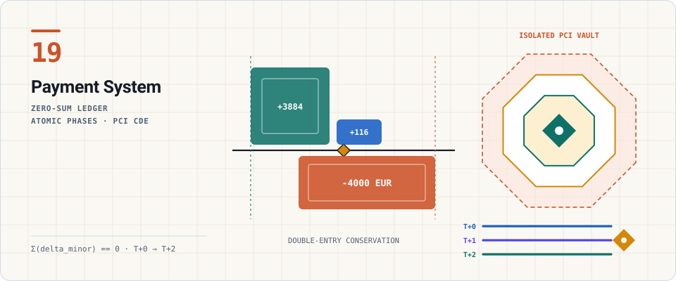
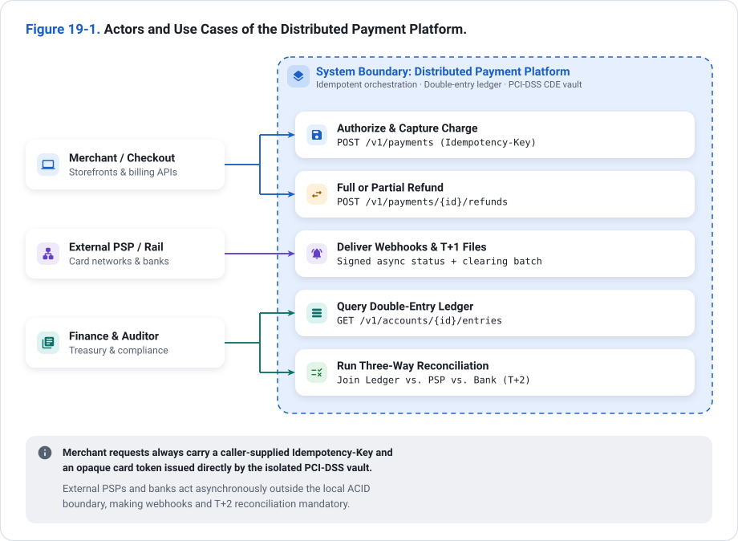
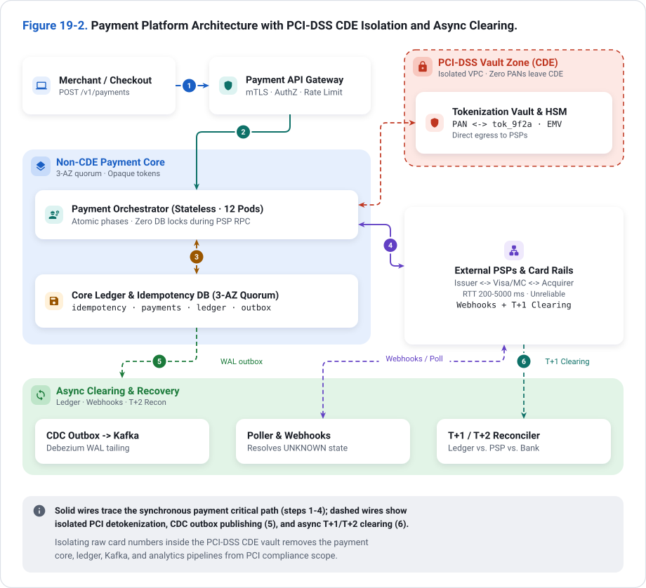
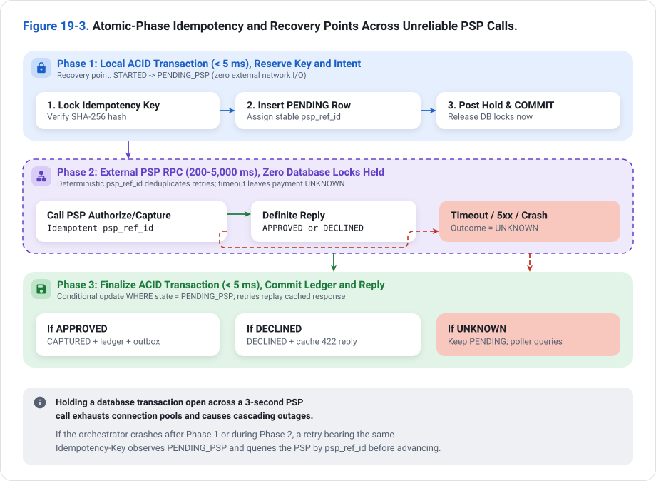
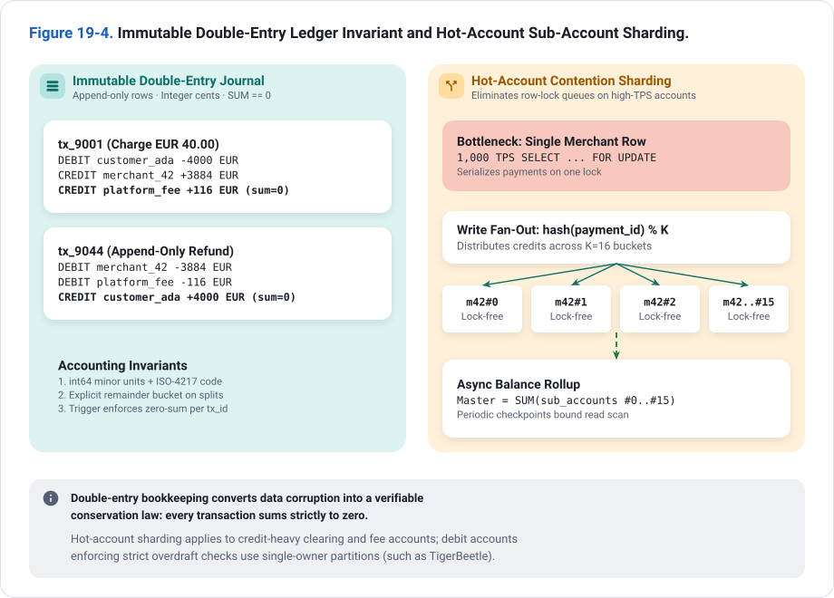
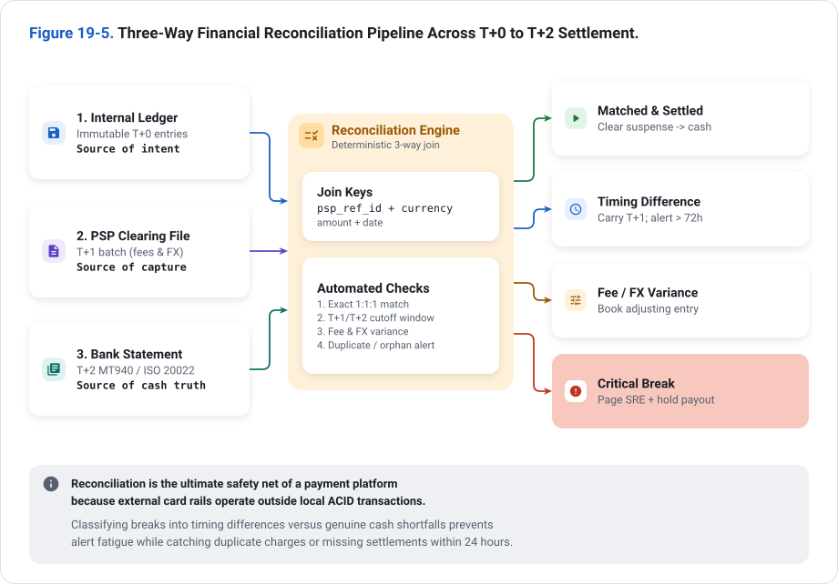

# 19. Payment System: System Design

A distributed payment platform orchestrates monetary transfers across payers, merchants, and external banking rails while maintaining an immutable, zero-sum accounting ledger. In contrast to caches, news feeds, or rate limiters where bounded staleness or occasional duplicate execution is an acceptable engineering trade-off, financial infrastructure operates under strict legal and monetary invariants: double-charging a card withdraws real funds from a customer's account, and recording an uncollected payment causes unrecoverable inventory loss. In this chapter, we design an architecture that places transactional correctness, auditability, and idempotent state recovery strictly ahead of raw availability.

<div class="covers">

In this chapter, we cover

- actors, use cases, verifiable functional requirements, strong-consistency SLOs, and storage, TPS, and 7-year audit capacity bounds
- idempotent HTTP/2 payment APIs, strict payment state machines, and relational ledger DDL using signed integer minor units
- PCI-DSS Cardholder Data Environment (CDE) isolation, EMV network tokenization, and non-CDE payment core architecture
- Stripe-style atomic-phase execution and recovery points that eliminate database locks during slow external PSP RPCs while modeling network timeouts as a first-class `UNKNOWN` state
- immutable double-entry ledger invariants, deterministic rounding/remainder allocation, and `K`-way hot-account sub-account sharding to eliminate row-lock serialization
- transactional outbox with WAL CDC, saga compensation semantics, and T+0 to T+2 three-way financial reconciliation across internal ledger, PSP clearing files, and bank statements
- failure matrices, financial SLIs, production architectures (Stripe, Adyen, Uber LedgerStore, TigerBeetle), and verification via `code/paysim`

</div>

## 19.1 Requirements and Capacity Envelope

What appears to a shopper as an instantaneous checkout click is a multi-day distributed workflow spanning four autonomous parties: the **issuing bank** (holding the cardholder's account), the **card network** (Visa or Mastercard, routing messages and enforcing dispute rules), the **acquiring bank / Payment Service Provider (PSP)** (settling funds on behalf of the merchant), and the **payment platform** we design here. Every card payment traverses four distinct lifecycle stages: **Authorization** (seconds; verifies funds and places a hold without moving cash), **Capture** (at shipment; confirms the final amount `<=` authorized amount), **Settlement** (T+1 to T+3 batch transfer of actual cash between banks), and **Refund or Chargeback Dispute** (possible for up to 120 to 180 days). Because external banking networks cannot participate in a distributed two-phase commit (`2PC`) with our internal databases, we achieve financial correctness through idempotent state machines, immutable accounting journals, and automated reconciliation.

### Actors and Use Cases

Three classes of external actors interact across the boundary of the payment platform (Figure 19-1).

<figure>

<figcaption><b>Figure 19-1</b> Actors, system boundary, and core use cases of the distributed payment platform.</figcaption>
</figure>

| Actor | Operation | Concrete Scenario |
| :--- | :--- | :--- |
| **Merchant / Checkout Service** | Authorize, capture, or charge (`POST /v1/payments`) | Collect payment for an order using an opaque card token and caller-supplied `Idempotency-Key` |
| **Merchant / Support System** | Full or partial refund (`POST /v1/payments/{id}/refunds`) | Reverse all or part of a captured charge via append-only compensating ledger transactions |
| **External PSP / Card Network** | Asynchronous status webhook and T+1 clearing file | Report delayed capture outcomes, interchange fees, FX settlement rates, or cardholder disputes |
| **Finance / Auditor** | Account journal query and daily three-way reconciliation | Prove that every account balance equals the exact sum of its immutable ledger rows and matches bank statements |

### Functional Requirements

| No. | Functional Requirement |
| :--- | :--- |
| 0 | The platform supports both single-step (`authorize + capture`) and two-step (`authorize`, followed by full or partial `capture`) charges in any ISO-4217 currency. |
| 1 | Every mutating endpoint mandates a caller-supplied `Idempotency-Key`. Retries bearing the same key and identical request payload return the original cached result (including declines) with zero duplicate side effects; reusing a key with a different payload returns `422 Unprocessable Content`. |
| 2 | Every monetary state transition records balanced debit and credit entries in an append-only ledger whose signed integer amounts sum strictly to zero per transaction and currency (`SUM(delta_minor) == 0`). Existing rows are never updated or deleted. |
| 3 | The platform supports full and multi-partial refunds whose cumulative amount never exceeds the captured amount, recorded exclusively as new reversing ledger entries. |
| 4 | Raw Primary Account Numbers (PANs) and CVVs are strictly confined to an isolated PCI-DSS Cardholder Data Environment (CDE) and never enter the payment core, ledger database, message broker, or application logs. |
| 5 | An automated pipeline reconciles internal ledger records daily against PSP clearing files and bank settlement statements, surfacing unexplained cash breaks within 24 hours. |

### Non-Functional Requirements and SLOs

| No. | Property | Target Specification | Architectural Consequence |
| :--- | :--- | :--- | :--- |
| 0 | **Consistency** | Strict ACID Serializability / Linearizability across idempotency keys, payment state, and ledger entries | Synchronous 3-AZ quorum commit (`PC/EC`): refuse new charges during a quorum partition rather than risking unverified or duplicate mutations |
| 1 | **Durability** | Zero loss of any committed payment or ledger entry under any single host, disk, or AZ failure; `7-10` year immutable audit retention | 3-AZ synchronous replication (Raft or PostgreSQL synchronous standby in a remote AZ) plus continuous encrypted WAL archival to WORM object storage |
| 2 | **Availability** | `99.99%` core API availability (`<= 4.3` minutes/month) excluding external PSP outages | Active-active stateless orchestrators across three AZs; automated multi-PSP failover routing when a single acquirer degrades |
| 3 | **Latency** | Core internal orchestration overhead `p99 <= 40 ms` (excluding `200-3,000 ms` external PSP RTT) | Prohibits holding database transactions open during external network I/O; relies on short local ACID phases |
| 4 | **Scale** | `1,000` sustained payments/s (`5,000` peak flash-sale TPS) | `86.4` million payments/day; requires hot-account sharding so high-fan-in merchant or fee rows do not serialize database writes |

### Capacity and Resource Envelope

Financial infrastructure is constrained by **transactional lock contention, cross-AZ synchronous `fsync` latency, and multi-year regulatory retention**, rather than raw network bandwidth:

| Resource Dimension | Derivation | Provisioned Bound |
| :--- | :--- | :--- |
| **Daily Payment Volume** | `1,000 payments/s * 86,400 s` | `86.4M` payments/day |
| **Daily Ledger Journal Rows** | `86.4M payments * 3 entries` (payer debit, merchant credit, platform-fee credit) | `~259M` rows/day |
| **Daily Storage Growth** | `259M rows * ~180 B` (tuple + indexes) + `86.4M` payment and idempotency rows (`~300 B`) | `~72 GB/day` (`~26 TB/year`) |
| **7-Year Audit Retention** | Hot NVMe tier (`90` days: `~6.5 TB`) + immutable compressed Parquet/WORM archive (`7` years) | `~6.5 TB` active NVMe; `~35 TB` cold WORM archive |
| **Peak ACID Write Rate** | `5,000 peak TPS * 2` short local DB transactions/payment (Phase 1 intent + Phase 3 finalize) | `10,000` ACID tx/s -> partitioned PostgreSQL (by `merchant_id` / account shard) or distributed SQL plus hot-account sharding |

## 19.2 External API, State Machine, and Data Contracts

### Idempotent HTTP/2 Payment API

Because HTTP `POST` is not inherently idempotent, every mutating request requires a caller-supplied `Idempotency-Key` header (scoped uniquely per `(merchant_id, idempotency_key)`). Monetary values are represented strictly as signed 64-bit integers in the currency's smallest minor unit paired with an ISO-4217 currency code (`4000` with `"EUR"` denotes `40.00 EUR`; `500` with `"JPY"` denotes `500 JPY`, which has zero fractional subunits).

**Create a payment (initial attempt):**

```http
POST /v1/payments HTTP/2
Host: pay.example
Authorization: Bearer sk_live_merchant_42
Idempotency-Key: order-7
Content-Type: application/json

{
  "payer_account": "acct_ada",
  "merchant_account": "acct_shop_42",
  "payment_method_token": "tok_9f2a8c11",
  "amount_minor": 4000,
  "currency": "EUR",
  "capture_mode": "automatic"
}
```

```http
HTTP/2 201 Created
Location: /v1/payments/pay_9001
Content-Type: application/json

{
  "payment_id": "pay_9001",
  "state": "CAPTURED",
  "amount_minor": 4000,
  "currency": "EUR",
  "psp_reference_id": "psp_ref_01J9X7"
}
```

Four behavioral contracts ensure idempotency protection holds under real network failures:

1. **Atomic Persistence:** The idempotency key record, payment state transition, and ledger entries commit inside the same ACID database transaction. A crash can never commit a charge without also persisting its deduplication key.
2. **Caching Terminal Failures:** Declines (such as `422 Unprocessable Content` for insufficient funds) are cached under the key identically to successes. If a merchant already informed a customer that `order-8` failed, a delayed retry must replay `422` rather than charging the card later once funds arrive.
3. **Concurrent In-Flight Exclusion:** When a second request bearing an active `Idempotency-Key` arrives while the first is still running, the unique key lock returns `409 Conflict` with `Retry-After: 1` instead of launching a concurrent duplicate PSP call.
4. **Payload Fingerprinting:** Storing the SHA-256 hash of the canonical request payload detects accidental key reuse (such as submitting `40000` cents under a key originally bound to `4000` cents) and rejects the call with `422 Unprocessable Content`.

### Strict Payment State Machine and Relational Schema

Every payment transitions along a directed acyclic state machine guarded at the database layer by optimistic version checks (`WHERE payment_id = $1 AND state = 'PENDING_PSP' AND version = $2`), making illegal transitions (such as `DECLINED -> CAPTURED` or double-capturing a settled charge) structurally impossible:

```text
CREATED -> PENDING_PSP -> AUTHORIZED -> CAPTURED -> SETTLED
                |             |            |
                v             v            v
            DECLINED        VOIDED   PARTIALLY_REFUNDED -> REFUNDED / DISPUTED
```

Before examining the DDL below, note the role of each table: `idempotency_keys` tracks the request SHA-256 digest, current `recovery_point`, and serialized HTTP reply; `payments` holds the canonical state machine and the deterministic `psp_reference_id` shared with the external acquirer; and `ledger_entries` records immutable signed minor-unit deltas verified by a deferrable transaction-commit trigger asserting `SUM(delta_minor) == 0` per `(tx_id, currency)`.

```sql
CREATE TABLE idempotency_keys (
    merchant_id      TEXT        NOT NULL,
    idem_key         TEXT        NOT NULL,
    request_sha256   BYTEA       NOT NULL,
    recovery_point   TEXT        NOT NULL, -- 'STARTED' | 'PENDING_PSP' | 'FINISHED'
    response_status  INT,
    response_body    JSONB,
    locked_at        TIMESTAMPTZ NOT NULL,
    expires_at       TIMESTAMPTZ NOT NULL,
    PRIMARY KEY (merchant_id, idem_key)
);

CREATE TABLE payments (
    payment_id       TEXT        PRIMARY KEY,
    merchant_id      TEXT        NOT NULL,
    psp_reference_id TEXT        NOT NULL UNIQUE,
    amount_minor     BIGINT      NOT NULL CHECK (amount_minor > 0),
    currency         CHAR(3)     NOT NULL,
    state            TEXT        NOT NULL,
    version          BIGINT      NOT NULL DEFAULT 1,
    created_at       TIMESTAMPTZ NOT NULL DEFAULT now()
);

CREATE TABLE ledger_entries (
    entry_id         BIGINT      GENERATED ALWAYS AS IDENTITY PRIMARY KEY,
    tx_id            UUID        NOT NULL,
    account_id       TEXT        NOT NULL,
    currency         CHAR(3)     NOT NULL,
    delta_minor      BIGINT      NOT NULL CHECK (delta_minor <> 0),
    created_at       TIMESTAMPTZ NOT NULL DEFAULT now()
);
-- Deferrable constraint trigger verifies SUM(delta_minor) = 0 per (tx_id, currency) at COMMIT.
```

## 19.3 System Architecture: PCI-DSS Isolation and Async Clearing

We enforce two explicit structural boundaries across the payment platform: a **security boundary** isolating raw card numbers inside a minimal PCI-DSS Cardholder Data Environment (CDE), and a **transactional boundary** separating short local ACID commits from slow external PSP network calls and multi-day settlement pipelines (Figure 19-2).

<figure>

<figcaption><b>Figure 19-2</b> Payment platform architecture with PCI-DSS CDE isolation and asynchronous settlement.</figcaption>
</figure>

### Component Responsibilities and Failure Domains

| Component | Compliance Scope | State Held | Failure Impact and Mitigation |
| :--- | :--- | :--- | :--- |
| **Tokenization Vault and HSM** | PCI-DSS CDE | Encrypted PAN <-> opaque token (`tok_*`), HSM key material | Isolated VPC with direct egress allow-list to card networks; active-active across three AZs; keeps the entire payment core out of PCI audit scope |
| **Payment API Gateway** | Non-CDE | None (stateless mTLS, auth, fail-closed rate limit) | Multi-AZ active-active deployment; rejects malformed or unauthorized calls at ingress |
| **Payment Orchestrator (x12)** | Non-CDE | None (stateless atomic-phase runner) | Pod crash mid-flight leaves durable `PENDING_PSP` recovery point in DB; caller retries or pollers resume safely |
| **Core Ledger and Idempotency DB** | Non-CDE | `idempotency_keys`, `payments`, `ledger_entries`, `outbox_events` | 3-AZ synchronous quorum (Raft or Postgres sync standby); rejects writes during quorum loss rather than risking split-brain double charges |
| **CDC Outbox Relay (Debezium)** | Async Tier | WAL replication slot offset | Streams committed `outbox_events` into Kafka with at-least-once delivery; downstream consumers deduplicate by `event_id` |
| **Pending Poller and Webhooks** | Async Tier | Polling queue and webhook deduplication keys | Resolves `UNKNOWN` payments via PSP status queries and verifies HMAC-signed PSP webhooks |
| **T+1 / T+2 Reconciliation Engine** | Async Tier | Clearing and bank statement snapshots | Executes deterministic three-way join across internal ledger, PSP clearing files, and bank cash statements |

## 19.4 Atomic-Phase Idempotency and Unknown Outcomes

Opening a database transaction, holding row locks while issuing a remote HTTP call to an external PSP (`200 ms` to `5,000 ms`), and committing when the PSP replies fails catastrophically under production concurrency. By Little's Law (`L = lambda * W`), sustaining `1,000 TPS` across a `2`-second PSP slowdown holds `2,000` database connections and row locks open simultaneously, exhausting connection pools and cascading a single acquirer's latency spike into a total platform outage.

Following the pattern documented by Stripe and Airbnb, we decompose every payment into **Atomic Phases** separated by durable **recovery points**, enforcing one strict invariant: **no external network RPC may ever execute inside an open database transaction** (Figure 19-3).

<figure>

<figcaption><b>Figure 19-3</b> Three-phase atomic execution decoupling local ACID transactions from unreliable external PSP network calls.</figcaption>
</figure>

### Treating `UNKNOWN` as a First-Class Durable State

When Phase 2 times out after `5 seconds`, receives an HTTP `502`, or suffers an orchestrator crash before reading the socket, the outcome at the issuing bank is genuinely unknown. Marking the payment `DECLINED` on timeout invites the customer to retry with a new order, double-charging their card when the first charge actually settled. Conversely, blindly re-submitting a new charge without the deterministic `psp_reference_id` persisted in Phase 1 causes the PSP to process two separate charges.

Instead, the payment remains durably in `PENDING_PSP` until one of three convergent paths resolves it:

1. **Idempotent Caller Retry:** A retry carrying the same `Idempotency-Key` reads `recovery_point = 'PENDING_PSP'`, skips Phase 1, and queries or re-submits to the PSP using the persisted `psp_reference_id`.
2. **Signed PSP Webhook:** When the PSP completes settlement asynchronously, its HMAC-verified webhook triggers Phase 3 via a conditional transition (`WHERE state = 'PENDING_PSP'`).
3. **Background Status Poller:** A sweeper inspects payments remaining in `PENDING_PSP` past `30 seconds`, queries the PSP status endpoint with exponential backoff, and drives them to `CAPTURED`, `DECLINED`, or manual operations escalation after `24 hours`.

Advance through the interactive step-by-step trace below to observe how durable `PENDING` intent and a stable PSP reference resolve a dropped network reply without double-charging:

<figure class="steps" data-prefix="figures/steps-pay-pending" data-count="6" data-version="37645ef4">

<figcaption><b>Interactive Trace 19.A</b> Step-by-step recovery from a dropped card-network reply using durable <code>PENDING</code> state and a stable reference. Use Next and Back to step through.</figcaption>
</figure>

## 19.5 Immutable Double-Entry Ledger and Hot-Account Sharding

Mutating a single `accounts.balance` column in place destroys audit provenance and permits partial-update corruption if a crash occurs between debiting one account and crediting another. Financial systems instead implement **double-entry bookkeeping**: every monetary movement appends an immutable set of journal rows whose signed minor-unit deltas sum strictly to zero (`SUM(delta_minor) == 0`). Any bug that fails to balance a transfer violates the database constraint and aborts the transaction before committing corrupt state.

### Exact Monetary Arithmetic and Deterministic Rounding

Binary IEEE-754 floating-point values (`f32`/`f64`) cannot represent decimal tenths exactly (`0.10 + 0.20 != 0.30` in binary), accumulating unexplained cent discrepancies across millions of percentage fees and currency conversions. Storing all amounts as signed 64-bit integer minor units paired with an ISO-4217 currency code guarantees exact integer arithmetic. Whenever a percentage fee or multi-way payout split produces a fractional cent (such as dividing `100` cents across `3` recipients), the ledger applies a deterministic rounding policy (round-half-even or largest-remainder allocation) and routes the exact integer remainder to a designated remainder account so the transaction remains strictly zero-sum.

Executing `code/paysim` validates idempotent replay (`order-7`, `order-9`), cached refusal replay (`order-8`), and zero-sum conservation (`10,000` cents total before and after all operations):

```console
$ cargo run --release -p paysim
start: {"ada": 10000, "shop": 0}, total 10000
order-7: 4000 cents from ada to shop: Done, ada has 6000
order-7: 4000 cents from ada to shop: Done, ada has 6000
order-8: 9000 cents from ada to shop: Refused, ada has 6000
order-9: 6000 cents from ada to shop: Done, ada has 0
order-9: 6000 cents from ada to shop: Done, ada has 0
end: {"ada": 0, "shop": 10000}, total 10000
```

Inspect the append-only journal mechanics across two charges and an immutable reversing refund below:

<figure class="steps" data-prefix="figures/steps-pay-ledger" data-count="5" data-version="56bbe801">

<figcaption><b>Interactive Trace 19.B</b> Append-only double-entry ledger recording charges and an immutable reversing refund with invariant zero-sum balance. Use Next and Back to step through.</figcaption>
</figure>

### Eliminating Hot-Account Row-Lock Serialization

At `1,000-5,000` TPS, maintaining a single materialized balance row per account introduces severe **row-level lock contention** on high-fan-in accounts such as `acct:platform_fees`, a global PSP clearing account, or a flagship merchant during a flash sale. Executing `SELECT balance FROM accounts WHERE id = 'platform_fees' FOR UPDATE` on every payment serializes all concurrent transactions behind a single database row lock, collapsing write throughput regardless of cluster size.

We eliminate hot-account serialization through two complementary designs (Figure 19-4):

<figure>

<figcaption><b>Figure 19-4</b> Zero-sum double-entry invariants and <code>K</code>-way sub-account sharding for high-contention credit accounts.</figcaption>
</figure>

1. **`K`-Way Sub-Account Sharding (Credit-Heavy Clearing and Fee Accounts):** Partition high-TPS credit accounts logically into `K` sub-accounts (`merchant_42#0` through `merchant_42#15`) selected deterministically by `hash(payment_id) % K`. Concurrent credits lock independent rows across `K` buckets, scaling throughput linearly by factor `K`. A periodic asynchronous rollup worker writes balance checkpoints (`SUM(sub_accounts #0..#15)`), bounding read query cost to entries created since the latest checkpoint.
2. **Single-Threaded Partitioned Ledger Engines (High-TPS Debit Accounts):** Debit accounts enforcing strict synchronous non-negative overdraft checks cannot split debits arbitrarily across independent rows without risking concurrent overdrafts. Workloads demanding `100,000+` debit TPS on hot accounts route account partitions to dedicated single-threaded, memory-first, Raft-replicated ledger engines (such as TigerBeetle) that execute batched double-entry transfers sequentially in microseconds with zero SQL lock overhead.

### Cross-Service Consistency: Transactional Outbox and Sagas

Publishing a `PaymentCaptured` event to Kafka directly from application code after committing the database transaction creates a **dual-write hazard**: a process crash between the two commits money without notifying order fulfillment, whereas publishing before commit emits phantom events on rollback. Phase 3 resolves this by inserting an `outbox_events` row inside the exact same ACID transaction as the ledger entries. A Change Data Capture (CDC) relay (such as Debezium tailing the PostgreSQL WAL) streams committed outbox rows into Kafka with at-least-once delivery, while downstream consumers deduplicate by `event_id`.

For business workflows spanning independent services (inventory reservation, loyalty points, and card capture), an orchestrator executes a **Saga**: a sequence of local transactions paired with idempotent compensating transactions on failure. Reversible local steps (inventory holds) execute before irreversible external steps (card capture) so partial failures unwind cleanly.

## 19.6 Three-Way Reconciliation and Multi-Currency FX

Because external PSPs, card networks, and settlement banks operate outside our ACID boundary, internal records can diverge from actual bank cash due to delayed chargebacks, silent PSP duplicate processing, FX rate movement between authorization (`T+0`) and settlement (`T+2`), or variable interchange fees. We run an automated **Three-Way Financial Reconciliation Pipeline** daily to detect and classify these breaks (Figure 19-5).

<figure>

<figcaption><b>Figure 19-5</b> Automated three-way reconciliation pipeline across T+0 intent, T+1 clearing, and T+2 cash settlement.</figcaption>
</figure>

### Clearing Suspense Accounts and Multi-Currency Conservation

Double-entry accounting prevents premature merchant payouts by routing captured funds through explicit **clearing suspense accounts**:

1. **On Capture (`T+0`):** Debit `clearing:psp_receivable`, Credit `merchant:pending_payout` and `platform:fee_revenue`.
2. **On Bank Settlement (`T+2`):** Debit `bank:operating_cash`, Credit `clearing:psp_receivable`. When cross-currency settlement occurs (for example, payer billed `EUR` and merchant settled `USD`), each currency maintains an independently balanced zero-sum pair bridged through explicit `fx:trading_eur` and `fx:trading_usd` clearing accounts so single-currency conservation holds everywhere.
3. **Deterministic Break Classification:** Unmatched records route into **Timing Differences** (in-flight UTC cutoff items aged out after 72 hours), **Fee or FX Variances** (auto-booked to a tracked variance account within configured tolerances), and **Critical Breaks** (duplicate charges or missing bank cash), which page on-call engineers and automatically freeze affected merchant payout releases until resolved.

## 19.7 Security, Failure Modes, Production Systems, and Verification

### PCI-DSS Scope Minimization and Network Tokenization

Storing, transmitting, or logging raw 16-digit PANs pulls every server, database, message broker, and log aggregator touching that data into full PCI-DSS Level 1 audit scope. The checkout client submits raw card fields directly to the isolated **Tokenization Vault** (via hosted iframe or direct TLS session into the CDE), receiving an opaque token (`tok_9f2a8c11`) safe for storage in the Non-CDE core. Modern platforms additionally replace static PANs with **EMV Network Tokens** (Visa Token Service and Mastercard MDES), which automatically update expired credentials and cryptographically bind tokens to a single merchant domain, raising authorization approval rates while removing raw PAN exposure.

### Failure and Recovery Matrix

| Failure Scenario | Blast Radius | Automated Recovery and Preserved Invariant |
| :--- | :--- | :--- |
| **Client Connection Drops Before Reply** | Single payment | Client retries with same `Idempotency-Key`; returns cached response or resumes from `PENDING_PSP` with zero double charge |
| **PSP Timeout / `5xx` in Phase 2** | Single payment or one acquirer rail | Zero DB locks held; payment remains `PENDING_PSP` (`UNKNOWN`) and resolves via webhook or status poller using `psp_reference_id`; circuit breaker routes new traffic to secondary PSP |
| **Core Ledger Primary Crash / AZ Loss** | All writes for `1-3 s` | Synchronous 3-AZ quorum promotes up-to-date standby with zero RPO (`0` lost transactions); incoming charges receive `503` during failover |
| **Duplicate PSP Webhook Delivery** | Single payment | Conditional transition `WHERE state = 'PENDING_PSP'` plus unique webhook `event_id` table guarantees single application |
| **High-TPS Merchant Row-Lock Spike** | Hot merchant / fee account | `K=16` logical sub-account sharding eliminates serial row locks while async rollup preserves exact master balances |
| **Bank Settlement Shortfall** | Financial integrity | T+2 three-way reconciliation raises a Critical Break alert within 24 hours and holds affected payout disbursements |

### Financial Observability: SLIs and Alerts

Four specialized signals monitor financial integrity beyond standard HTTP metrics: **authorization approval rate** segmented by issuer BIN, country, and PSP (a sudden `> 3%` drop exposes acquirer regressions even while HTTP status remains `200`); a continuous **ledger conservation verifier** asserting `SUM(delta_minor) == 0` per `tx_id` and currency (`SEV-1` on any non-zero sum); **pending payment aging** alerting when payments linger in `PENDING_PSP` past `15 minutes`; and **unreconciled suspense aging** escalating funds remaining in `clearing:psp_receivable` past `T+3`.

### How Production Systems Implement Payments

| Production System | Core Architecture | Architectural Distinction |
| :--- | :--- | :--- |
| **Stripe** | Atomic-phase idempotency keys, sharded relational ledger, isolated PCI vault | Formalized recovery-point idempotency strictly separating ACID transactions from external network RPCs, paired with multi-acquirer smart retries |
| **Adyen** | Unified platform connected directly to Visa/Mastercard card schemes | Removes intermediate gateway hops to cut latency and boost authorization rates; native three-way settlement reconciliation |
| **Uber (`LedgerStore`)** | Immutable, cryptographically tamper-evident append-only double-entry store | Enforces immutability and Merkle-tree audit verification at the storage engine layer across billions of daily entries |
| **TigerBeetle** | Purpose-built distributed financial accounting database (Viewstamped Replication + `io_uring`) | Executes strict double-entry transfers in single-threaded deterministic batches (`1M+ TPS`), eliminating SQL hot-account lock contention natively |

### Verification in the Repository

<div class="simulation">

**Run the payment ledger and idempotency simulation.** Execute `cargo run --release -p paysim` in `code/` to verify idempotent deduplication (`order-7`, `order-9`), cached insufficient-funds refusal replay (`order-8`), and strict zero-sum double-entry conservation across all operations.

</div>

### Engineering Glossary

| Term | Definition |
| :--- | :--- |
| **Atomic Phase / Recovery Point** | Structuring a payment workflow into short local ACID transactions separated from slow external RPCs so retries resume cleanly without holding DB locks across network I/O. |
| **Double-Entry Ledger** | Append-only accounting model in which every monetary transfer records balanced debit and credit rows summing strictly to zero per currency. |
| **Hot-Account Sharding** | Partitioning high-TPS credit accounts (such as platform fees or clearing suspense accounts) into `K` logical sub-accounts to remove serial database row-lock contention. |
| **PCI-DSS CDE** | Cardholder Data Environment: network-isolated security perimeter confining raw PANs to a tokenization vault and HSM so the payment core stays out of compliance scope. |
| **Three-Way Reconciliation** | Automated daily join across internal ledger records (`T+0`), PSP clearing files (`T+1`), and bank statements (`T+2`) to surface and classify cash discrepancies. |
| **Transactional Outbox** | Writing domain events in the same ACID database transaction as ledger mutations and streaming them via WAL CDC to prevent dual-write drift. |

### References

- B. Leach, "Implementing Stripe-like Idempotency Keys in Postgres", brandur.org, 2017.
- Stripe Engineering, "Designing robust and predictable APIs with idempotency", 2017.
- J. Chew, "Avoiding Double Payments in a Distributed Payments System", Airbnb Engineering Blog, 2019.
- Uber Engineering, "LedgerStore: A Ledger Database for High-Volume Financial Data", 2023.
- TigerBeetle Architecture Documentation, "Strict Serializability and Double-Entry Accounting at Scale".
- H. Garcia-Molina and K. Salem, "Sagas", ACM SIGMOD, 1987.
- J. Gray and A. Reuter, *Transaction Processing: Concepts and Techniques*, Morgan Kaufmann, 1992.

## 19.8 End-to-End Request Lifecycle and Production Case Studies

### Hop-by-Hop Request Lifecycle and Latency Budget

An online card charge (`POST /v1/payments`) spans six strict isolation boundaries, separating fast local ACID state transitions from slow external card-network authorization RPCs within a `p99` end-to-end latency budget of `800 to 1,500 ms` (dominated by the issuing bank).

| Hop | Boundary Payload | Typical Latency Budget |
| :--- | :--- | :--- |
| **1. Checkout Client to PCI Vault / Edge Tokenization** | Browser or SDK posts raw PAN directly to the isolated PCI-DSS CDE vault over TLS 1.3 and receives an opaque `tok_...` surrogate token | `40 to 90 ms` |
| **2. Merchant Backend to Payment API Gateway** | Signed HTTPS `POST` carrying `Idempotency-Key`, `amount_minor`, `currency`, and `tok_...` (zero raw card data crosses the core API) | `15 to 35 ms` |
| **3. Payment Orchestrator to Ledger DB (Atomic Phase 1)** | Short local ACID transaction inserting the idempotency lock (`IN_PROGRESS`) and validating payload fingerprint before releasing DB locks | `8 to 20 ms` |
| **4. Payment Orchestrator to External Acquirer / Card Network** | ISO 8583 or REST authorization request forwarded through the acquiring bank and Visa/Mastercard switch to the cardholder's issuing bank | `350 to 900 ms` (external) |
| **5. Orchestrator to Double-Entry Ledger DB (Atomic Phase 2)** | ACID commit appending balanced debit/credit journal entries, updating payment state to `CAPTURED`, and recording the outbox event | `10 to 25 ms` |
| **6. Outbox Relay to Webhook / Settlement Pipeline** | Asynchronous WAL CDC delivery notifying the merchant webhook endpoint and queueing the `T+1` clearing batch for three-way reconciliation | `50 to 200 ms` (async) |

### Production Case Studies and Open-Source Comparisons

**Stripe Idempotency Keys and Ledger Immutability.** Stripe formalized recovery-point idempotency by persisting atomic phase transitions around every external acquirer call: each client-supplied `Idempotency-Key` binds to a request-parameter hash for `24 hours`, ensuring network retries replay the exact stored response rather than charging a card twice. Internally, Stripe maintains an immutable double-entry ledger that continuously reconciles every balance movement against bank settlement files, surfacing sub-cent discrepancies automatically before payout batches execute.

**Adyen Unified Direct-to-Scheme Architecture.** Adyen eliminates intermediate payment-gateway hops by connecting its single processing platform directly to Visa, Mastercard, and local payment schemes across global regions. Direct acquiring reduces network round trips, exposes granular issuer decline codes for automated smart retries, and unifies authorization, capture, and `T+1` settlement data inside one reconciliation pipeline.

**Square Books Double-Entry Ledger.** Square built Books, a globally distributed, strongly consistent double-entry accounting service backed by Google Cloud Spanner to record immutable financial journal entries across Cash App and merchant payouts. Every transaction enforces strict zero-sum balance invariants per currency and supports idempotent append-only corrections (reversing entries rather than in-place `UPDATE` mutations) so auditors can reconstruct exact historical balances at any timestamp.

<div class="callout keyidea"><span class="label">Key idea</span> Holding an open relational database transaction across an external acquiring-bank RPC exhausts connection pools whenever a downstream bank slows down. Split each payment into short local ACID recovery phases separated by lock-free external network calls so retries resume deterministically without wedging the ledger.</div>

<div class="callout experiment"><span class="label">Experiment</span> In `code/paysim`, replay the identical `order-7` idempotency key three times in succession and inspect the resulting ledger journal. Confirm that the sum of all debit entries equals the sum of all credit entries strictly to zero and that the customer balance decrements once rather than three times.</div>

<div class="callout caution"><span class="label">Common pitfall</span> Treating a client-side HTTP timeout during an external PSP call as a confirmed payment failure causes automatic retries to double-charge cardholders when the issuer actually approved the first request. Transition timed-out charges into an `UNKNOWN` reconciliation state and query the PSP's status API with the same idempotency key before issuing a retry or refund.</div>
