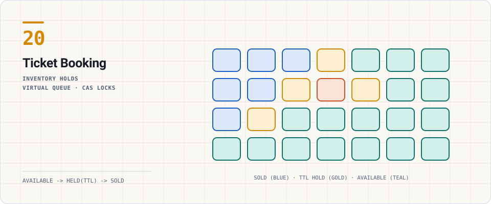
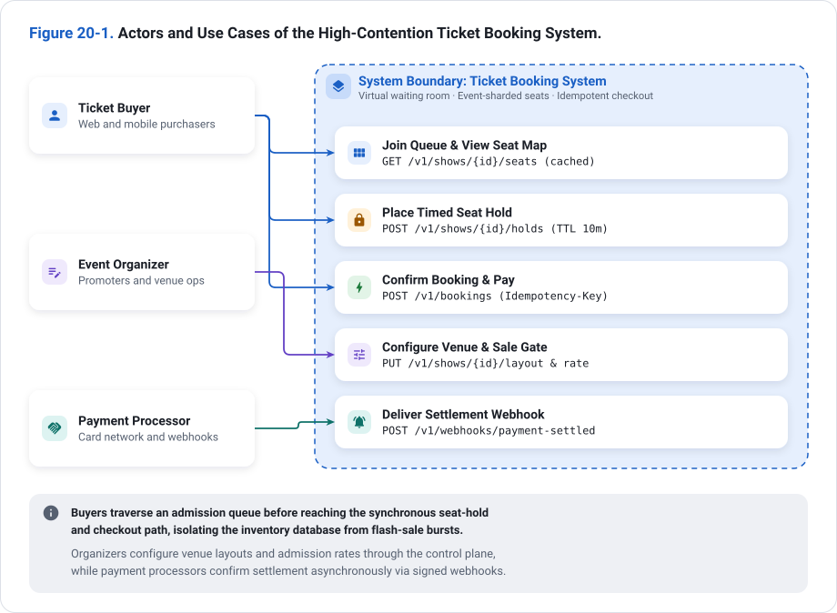
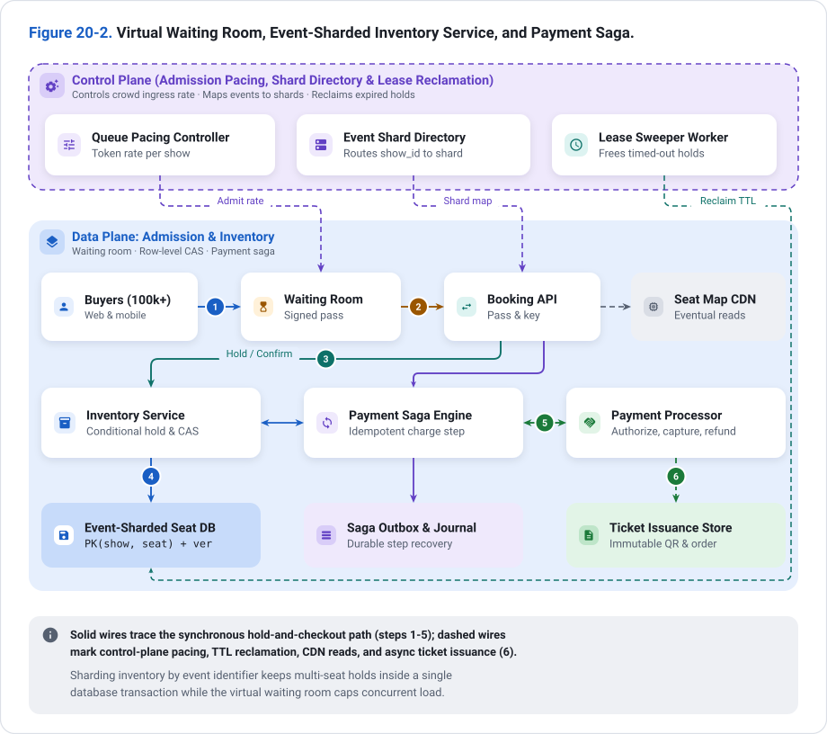
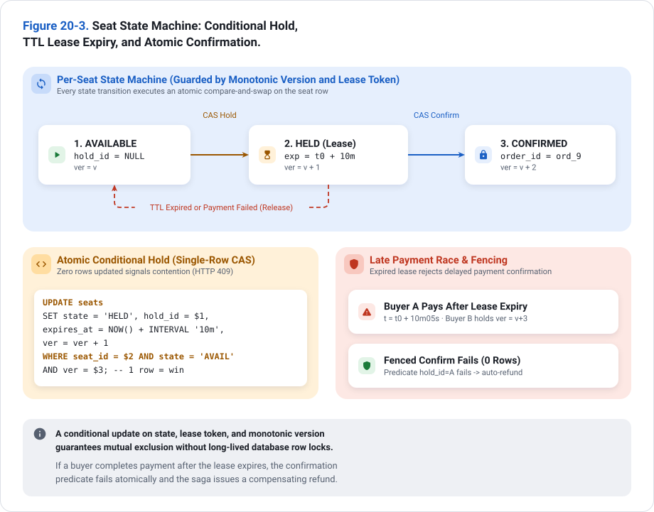

# Chapter 20: Ticket Booking: System Design



A high-contention ticket booking platform sells finite, non-fungible inventory, such as stadium seats, cinema seats, or airline cabins, where each seat can belong to at most one confirmed buyer. While this invariant is trivial under sequential single-node execution, real ticket drops combine extreme ingress bursts (millions of concurrent buyers arriving within seconds of an on-sale opening) with long, unreliable checkout phases spanning external payment authorization. In this chapter, I design a distributed booking architecture that enforces zero double-selling through event-sharded relational state machines and atomic compare-and-swap holds, while absorbing flash-sale demand behind a cryptographically gated virtual waiting room.

<div class="covers">

In this chapter, we cover

- actors, use cases, verifiable functional requirements, strong-consistency SLOs, explicit non-goals, and flash-sale capacity bounds
- idempotent HTTP/2 seat-map, hold, and booking APIs, HMAC admission tokens, and relational DDL for seat inventory and booking uniqueness
- control-plane vs. data-plane separation across the virtual waiting room, event-sharded inventory tier, seat-map cache, and payment saga engine
- flash-sale admission control with randomized pre-sale lottery pools, HMAC-signed pass tokens, and layered anti-bot rate limits
- per-seat state machine (`AVAILABLE -> HELD -> BOOKED`), conditional CAS SQL predicates, multi-seat deadlock-free locking, and compensating payment sagas
- failure matrices, booking SLIs/SLOs, production architectures (Ticketmaster, Stripe, Cloudflare Waiting Room), and verification via `code/bookingsim`

</div>

## 20.1 Requirements, Actors, and Capacity Bounds

Every ticket purchase crosses two distinct operational regimes. Before checkout, millions of prospective buyers browse venue layouts and wait for a sale to open; this traffic is overwhelmingly read-heavy and tolerates bounded staleness of one to two seconds. Once a buyer selects seats and enters payment details, the platform enters a strict transactional regime where every state transition on a seat must serialize across concurrent callers and survive orchestrator crashes or delayed payment network replies.

### Actors and Use Cases

Three external actor classes interact across the boundary of the ticket booking platform, as illustrated in Figure 20-1.

<figure class="diagram">

<figcaption><b>Figure 20-1</b> Actors, system boundary, and core use cases of the high-contention ticket booking platform.</figcaption>
</figure>

| Actor | Operation | Concrete Scenario |
| :--- | :--- | :--- |
| **Ticket Buyer** | Join queue, inspect seat map (`GET /v1/shows/{id}/seats`), place timed hold (`POST /v1/shows/{id}/holds`), and confirm booking (`POST /v1/bookings`) | Wait in a virtual queue during a stadium concert drop, reserve two adjacent seats for 10 minutes, and complete checkout idempotently |
| **Event Organizer** | Configure venue layout, seat pricing tiers, and admission pacing (`PUT /v1/shows/{id}/layout`) | Publish a 50,000-seat stadium manifest and throttle checkout ingress to 500 admitted buyers per second |
| **Payment Processor** | Authorize, capture, refund, and deliver signed settlement webhooks (`POST /v1/webhooks/payment-settled`) | Confirm card capture asynchronously or execute an automated compensating refund if a seat lease expired |

### Functional Requirements

| No. | Functional Requirement |
| :--- | :--- |
| 0 | A buyer can view a showing's seat map reflecting each seat's current status (`AVAILABLE`, `HELD`, or `BOOKED`) with bounded staleness. |
| 1 | A buyer holding a valid admission token can place a timed hold on one or more seats for a configurable TTL (5 to 10 minutes). |
| 2 | A multi-seat hold request executes atomically: the buyer receives all requested seats or none. |
| 3 | At any instant, each seat of a showing is held by or booked to at most one buyer; expired holds become immediately claimable without waiting for background cleanup. |
| 4 | A buyer can confirm a held booking by supplying a payment token and an `Idempotency-Key`; duplicate submissions return the original confirmation without double-charging. |
| 5 | If payment succeeds after the seat lease has expired and another buyer has claimed the seat, the system rejects the booking and triggers an automatic compensating refund. |
| 6 | During flash sales, the system queues excess arrivals in a virtual waiting room and admits buyers into the booking tier at a controlled rate. |

### Non-Functional Requirements and SLOs

| No. | Property | Target Specification | Architectural Consequence |
| :--- | :--- | :--- | :--- |
| 0 | **Consistency** | Strict ACID Serializability / Linearizability for seat holds and booking confirmations; eventual consistency (`<= 2 s` lag) for seat-map reads | Event-sharded 3-AZ synchronous quorum relational database (`PC/EC`) for seat inventory; CDN and read-through cache for seat maps |
| 1 | **Availability** | `99.95%` booking API availability (`<= 21.6` minutes/month); fail closed on inventory quorum loss | Refuse new holds if a shard loses majority quorum rather than risking split-brain double sales |
| 2 | **Latency** | Seat-map read `p99 <= 50 ms`; seat-hold CAS `p99 <= 150 ms`; booking confirmation orchestration overhead `p99 <= 200 ms` (excluding external PSP RTT) | Single-shard local ACID transactions with zero database locks held during external payment network calls |
| 3 | **Flash-Sale Scale** | `100,000` active showings; `2,000,000` buyer arrivals within 60 seconds (`~33,333` arrivals/s) for a single flagship event | Edge-hosted virtual waiting room absorbs arrival spikes and caps core booking ingress to `500` admitted buyers/s per event shard |
| 4 | **Abuse Resistance** | Bounded holds per buyer account/session (`<= 6` seats) and cryptographic enforcement of queue order | HMAC-signed short-lived admission tokens validated at the Booking API gateway; layered IP, device, and account rate limits |

### Non-Goals and Explicit Scope Boundaries

To focus on inventory correctness and flash-sale stability, we explicitly exclude the following concerns from this design:

- **Secondary ticket resale and peer-to-peer transfers:** Transferring issued barcodes between accounts introduces escrow and ticket-reissuance workflows outside primary inventory allocation.
- **Airline revenue management and dynamic overbooking optimization:** Deliberately overselling physical capacity relies on historical no-show statistical models; our inventory invariant enforces exact configured capacity limits.
- **Full card-network PCI-DSS tokenization internals:** We rely on opaque payment tokens (`tok_*`) and the idempotent payment platform architecture designed in Chapter 19 rather than handling raw PANs inside the booking core.
- **Venue physical turnstile validation:** Offline barcode scanning at stadium gates consumes issued ticket manifests asynchronously and operates independently of online seat locking.

### Back-of-the-Envelope Capacity Bounds

Ticket booking storage requirements are modest compared to media or telemetry platforms; the binding engineering constraints are **flash-sale ingress burst absorption** and **per-row write contention** on desirable seats.

| Resource Dimension | Derivation | Provisioned Bound |
| :--- | :--- | :--- |
| **Active Seat Inventory** | `100,000` active showings `* 300` average seats/showing | `30,000,000` seat rows |
| **Seat Table Storage (Hot NVMe)** | `30M` rows `* 180 B` (tuple, version, lease fields, primary + secondary indexes) | `~5.4 GB` active working set (fits entirely in database buffer pool RAM) |
| **Annual Confirmed Bookings** | `50M` bookings/year `* 350 B` (booking + saga journal rows) | `~17.5 GB/year` |
| **Peak Flash-Sale Arrival Rate** | `2,000,000` arrivals `/ 60 s` at on-sale opening | `~33,333` queue-join req/s handled at CDN edge |
| **Waiting-Room Polling Bandwidth** | `2,000,000` queued clients polling every `10 s` `* 512 B` JSON payload | `200,000` req/s; `~820 Mbit/s` edge egress |
| **Core Inventory Admitted Write Rate** | Pacing controller admits `500` buyers/s per flagship show shard `* 2` CAS writes (hold + confirm) | `1,000` ACID tx/s per shard; `50,000` stadium seats clear in `~100 to 180 s` |
| **Cached Seat-Map Read Traffic** | `5,000` concurrent admitted browsers refreshing every `2 s` | `2,500` req/s absorbed by `2 s` TTL edge/Redis cache (`0.5` origin queries/s per showing) |

## 20.2 External API and Data Contracts

All mutating endpoints accept HTTP/2 JSON payloads, require a valid bearer identity, and enforce a caller-supplied `Idempotency-Key` header. During gated flash sales, callers must also present the signed `X-Admission-Token` header issued by the virtual waiting room; requests lacking a valid, unexpired signature fail fast at the API gateway with `403 Forbidden`.

### Seat-Map Read Endpoint

```http
GET /v1/shows/881/seats HTTP/2
Host: tickets.example
Authorization: Bearer usr_eyJhbGci...
X-Admission-Token: v1.show881.usr42.1760436600.9f8e7d6c...
```

```http
HTTP/2 200 OK
Content-Type: application/json
Cache-Control: public, max-age=2
ETag: "show881-v40912"

{
  "show_id": 881,
  "snapshot_at": "2026-10-14T10:00:00Z",
  "seats": [
    { "seat_id": "A1", "tier": "orchestra", "price_minor": 12500, "state": "AVAILABLE", "version": 4 },
    { "seat_id": "A2", "tier": "orchestra", "price_minor": 12500, "state": "HELD", "version": 7 },
    { "seat_id": "A3", "tier": "orchestra", "price_minor": 12500, "state": "BOOKED", "version": 9 }
  ]
}
```

The `Cache-Control: public, max-age=2` header declares that the seat map is advisory and may lag the authoritative seat store by up to two seconds. Clients pass the returned `version` (or allow the server to evaluate current state directly) when attempting a hold.

### Atomic Multi-Seat Hold Endpoint

```http
POST /v1/shows/881/holds HTTP/2
Host: tickets.example
Authorization: Bearer usr_eyJhbGci...
X-Admission-Token: v1.show881.usr42.1760436600.9f8e7d6c...
Idempotency-Key: 5d1c-hold-1
Content-Type: application/json

{
  "seat_ids": ["A1", "A4"]
}
```

```http
HTTP/2 201 Created
Location: /v1/shows/881/holds/hld_7730
Content-Type: application/json

{
  "hold_id": "hld_7730",
  "show_id": 881,
  "seat_ids": ["A1", "A4"],
  "expires_at": "2026-10-14T10:10:00Z",
  "total_minor": 25000,
  "currency": "USD"
}
```

If any requested seat is already held (with an unexpired lease) or booked, the transaction rolls back all seats in the batch and returns `409 Conflict` with an RFC 9457 `application/problem+json` body identifying the contested seat IDs:

```http
HTTP/2 409 Conflict
Content-Type: application/problem+json

{
  "type": "/problems/seat-unavailable",
  "title": "One or more requested seats are no longer available",
  "status": 409,
  "unavailable_seats": ["A1"]
}
```

### Idempotent Booking Confirmation Endpoint

```http
POST /v1/bookings HTTP/2
Host: tickets.example
Authorization: Bearer usr_eyJhbGci...
Idempotency-Key: 5d1c-book-1
Content-Type: application/json

{
  "hold_id": "hld_7730",
  "show_id": 881,
  "payment_token": "tok_83hf91a"
}
```

```http
HTTP/2 201 Created
Location: /v1/bookings/bkg_55102
Content-Type: application/json

{
  "booking_id": "bkg_55102",
  "show_id": 881,
  "seat_ids": ["A1", "A4"],
  "state": "CONFIRMED",
  "payment_id": "pay_9001"
}
```

If the buyer's hold expired prior to payment submission, the endpoint returns `410 Gone` before invoking the payment processor. If a network retry repeats `Idempotency-Key: 5d1c-book-1` after a lost response, the service returns the persisted `201 Created` confirmation without issuing a second charge.

### Relational Inventory and Booking Schema

All seats belonging to a single `show_id` reside on the same relational shard so multi-seat holds execute inside a local ACID transaction without distributed two-phase commit (`2PC`). Two structural defenses protect the invariant: every seat row carries a monotonic `version` and `hold_expires_at` timestamp, and the `booking_seats` table enforces a `UNIQUE (show_id, seat_id)` constraint as an application-independent database backstop.

```sql
CREATE TABLE seats (
    show_id         BIGINT      NOT NULL,
    seat_id         TEXT        NOT NULL,
    tier            TEXT        NOT NULL,
    price_minor     BIGINT      NOT NULL CHECK (price_minor > 0),
    state           TEXT        NOT NULL CHECK (state IN ('AVAILABLE', 'HELD', 'BOOKED')),
    hold_id         TEXT,
    holder_user_id  TEXT,
    hold_expires_at TIMESTAMPTZ,
    booking_id      TEXT,
    version         BIGINT      NOT NULL DEFAULT 1,
    PRIMARY KEY (show_id, seat_id)
);

CREATE INDEX idx_seats_active_holds
    ON seats (show_id, hold_expires_at)
    WHERE state = 'HELD';

CREATE TABLE bookings (
    booking_id      TEXT        PRIMARY KEY,
    show_id         BIGINT      NOT NULL,
    user_id         TEXT        NOT NULL,
    hold_id         TEXT        NOT NULL UNIQUE,
    idem_key        TEXT        NOT NULL,
    payment_id      TEXT        UNIQUE,
    state           TEXT        NOT NULL CHECK (state IN ('PENDING_PAYMENT', 'CONFIRMED', 'COMPENSATED', 'FAILED')),
    created_at      TIMESTAMPTZ NOT NULL DEFAULT now(),
    UNIQUE (user_id, idem_key)
);

CREATE TABLE booking_seats (
    show_id         BIGINT      NOT NULL,
    seat_id         TEXT        NOT NULL,
    booking_id      TEXT        NOT NULL REFERENCES bookings(booking_id),
    PRIMARY KEY (show_id, seat_id) -- Second line of defense against double booking
);
```

## 20.3 High-Level Architecture: Control Plane vs. Data Plane

We isolate flash-sale crowd management and operational configuration from the synchronous transactional seat path by splitting the platform into a **Control Plane** and a **Data Plane**, as depicted in Figure 20-2.

<figure class="diagram">

<figcaption><b>Figure 20-2</b> Control plane and data plane separation across the virtual waiting room, event-sharded inventory service, and payment saga.</figcaption>
</figure>

### Control Plane Responsibilities

The control plane governs traffic shaping, shard routing, and asynchronous housekeeping without sitting on the critical per-seat checkout path:

- **Queue Pacing Controller:** Computes the admission release rate per showing (`tokens/s`) by monitoring inventory database CPU, lock-wait latency, and remaining seat counts. When a showing sells out, the controller flips the waiting-room state to `SOLD_OUT`, immediately terminating polling for millions of queued browsers.
- **Event Shard Directory:** Maintains the mapping from `show_id` to its assigned 3-AZ synchronous relational shard. High-demand stadium shows receive dedicated shards prior to on-sale openings so a flagship concert drop cannot degrade latency for concurrent theater or cinema shows.
- **Lease Sweeper Worker:** Periodically scans `idx_seats_active_holds` to reset expired `HELD` rows back to `AVAILABLE` and invalidate cached seat maps. Correctness never depends on sweeper punctuality because the hot-path SQL predicates treat any row with `hold_expires_at < now()` as available immediately.

### Data Plane Responsibilities

The data plane executes the synchronous buyer journey across four decoupled tiers:

| Component | State Held | Failure Impact and Mitigation |
| :--- | :--- | :--- |
| **Virtual Waiting Room (Edge)** | Queue positions, randomized lottery ranks, HMAC signing keys | Runs across CDN edge PoPs; node failure reconstructs queue rank from signed client queue cookies; already admitted buyers retain valid pass tokens |
| **Seat Map CDN and Cache** | Eventual read-only seat availability snapshots (`2 s` TTL) | Cache miss or Redis outage falls back to a single coalesced read replica query per showing per 2 seconds (singleflight) |
| **Booking API and Inventory Service** | Stateless (`X-Admission-Token` verification, CAS SQL, idempotency) | Multi-AZ stateless pods; pod crash mid-request allows safe client retry via `Idempotency-Key` |
| **Event-Sharded Seat DB** | `seats`, `bookings`, `booking_seats`, `outbox_events` (3-AZ sync quorum) | Primary crash promotes synchronous standby within `1 to 3 s` with zero RPO (`0` lost bookings); writes pause until quorum recovers |
| **Payment Saga Engine** | Durable saga journal and transactional outbox | Resumes interrupted payment confirmations or issues compensating refunds via Chapter 19 idempotent payment calls |

## 20.4 Deep Dive: Flash-Sale Virtual Waiting Room and Admission Control

When 2,000,000 buyers arrive within 60 seconds for 50,000 stadium seats, 97.5% of arrivals cannot end in a purchase. Exposing the inventory database directly to `33,333` concurrent hold requests per second saturates database connection pools, triggers massive row-lock thrashing on front-row seats, and collapses throughput for everyone.

### Pre-Sale Lottery Pool and FIFO Pacing

If queue order were determined strictly by arrival timestamp at `10:00:00.000 UTC`, automated ticket bots colocated near edge PoPs with sub-millisecond jitter would capture the entire front of the queue. Instead, we divide admission into two phases:

1. **Pre-Sale Lobby (`T - 30 min` to `T = 0`):** Every authenticated buyer arriving before the opening enters an unordered lobby pool. At `T = 0`, the waiting room applies a cryptographically seeded permutation (Fisher-Yates shuffle or HMAC-derived sort key over `(show_id, user_id, epoch_secret)`) to assign each lobby participant a uniform random queue rank. Buyers arriving after `T = 0` append strictly in FIFO order behind the randomized lobby cohort.
2. **Controlled Token Release:** Each second, the Queue Pacing Controller advances a monotonic `admitted_rank_watermark` in edge KV storage by `R` slots (for example, `R = 500` buyers/s). Queued clients poll a lightweight edge endpoint every `10 seconds` displaying their remaining offset (`rank - watermark`).

### Cryptographically Signed HMAC Admission Tokens

Once a client's `rank <= admitted_rank_watermark`, the edge waiting room mints a stateless, short-lived admission token signed with HMAC-SHA256 using a key rotated every hour via KMS:

```text
payload   = base64url("v1|" + show_id + "|" + user_id + "|" + issued_at + "|" + expires_at + "|" + nonce)
signature = HMAC_SHA256(edge_signing_key, payload)
token     = payload + "." + base64url(signature)
```

Every call to `POST /v1/shows/{id}/holds` must include `X-Admission-Token`. The Booking API verifies three conditions in constant time without calling the waiting room: (1) valid HMAC signature, (2) `show_id` and `user_id` match the authenticated caller and path, and (3) `now() < expires_at` (typically a 15-minute shopping window). Direct API scraping attempts that bypass the waiting room fail at ingress in under `1 ms` without touching the inventory database.

### Layered Anti-Bot and Hold-Hoarding Defenses

Malicious resellers often attempt **inventory hoarding**: holding hundreds of seats across automated sessions without paying to starve legitimate buyers and force resale demand. We counter this at three layers:

1. **Waiting-Room Gate:** Requires account verification (phone or payment-instrument history) and adaptive proof-of-interaction challenges before issuing a lottery rank.
2. **Per-Account Hold Quotas:** Enforces a strict cap (such as at most 6 held or booked seats per `(show_id, user_id)`) inside the Inventory Service transaction and tracks abandoned-hold velocity per account and IP subnet using sliding-window rate limiters (Chapter 7).
3. **General Admission Counter Sharding:** For unnumbered standing-room events (such as 5,000 floor tickets), updating a single `remaining_count` row serializes all concurrent buyers on one database lock. We pre-split capacity into `K = 50` sub-counters of `100` places each, routing buyers to `hash(user_id) % K` and probing adjacent non-empty shards only as buckets approach zero.

## 20.5 Deep Dive: Seat State Machine, Conditional CAS, and Payment Sagas

At the core of the Inventory Service lies the race condition that breaks unsynchronized read-modify-write implementations. If two servers read seat `12`, observe `state = 'AVAILABLE'`, and independently write their respective buyers' IDs, both buyers receive confirmation for the same seat. Advance through the interactive trace below to inspect how separating the read from the write permits double booking, and how a conditional write eliminates the race.

<figure class="steps" data-prefix="figures/steps-booking-race" data-count="6" data-version="5ad509b8">

<figcaption><b>Figure 20.1</b> 2 requests read the same free seat, and both write, unless the write is made conditional on the seat still being free. Use Next and Back to move through the 6 steps.</figcaption>
</figure>

### Per-Seat State Machine and Conditional CAS SQL

We model every numbered seat as a three-state machine (`AVAILABLE -> HELD -> BOOKED`) guarded by monotonic `version` fencing and explicit `hold_expires_at` timestamps, as shown in Figure 20-3.

<figure class="diagram">

<figcaption><b>Figure 20-3</b> Seat state machine with conditional compare-and-swap holds, lease expiry reclamation, and fenced booking confirmation.</figcaption>
</figure>

To acquire a single seat without holding long pessimistic locks, the Inventory Service executes a single atomic conditional `UPDATE` that treats expired holds as immediately available:

```sql
UPDATE seats
SET state           = 'HELD',
    hold_id         = $1,
    holder_user_id  = $2,
    hold_expires_at = now() + INTERVAL '10 minutes',
    version         = version + 1
WHERE show_id = $3
  AND seat_id = $4
  AND (
      state = 'AVAILABLE'
      OR (state = 'HELD' AND hold_expires_at < now())
  )
RETURNING seat_id, version, hold_expires_at;
```

If the database returns `1` row, the caller holds an exclusive lease on the seat. If `0` rows match, another transaction already won the race (or the seat is `BOOKED`), and the API immediately returns `409 Conflict` with zero lock queuing.

### Multi-Seat Atomicity and Deadlock Prevention

When a group requests multiple seats (`["A1", "A4", "A2"]`), the Inventory Service sorts the requested `seat_ids` lexicographically (`["A1", "A2", "A4"]`) before executing the batch `UPDATE` inside one shard-local ACID transaction:

```sql
UPDATE seats
SET state           = 'HELD',
    hold_id         = $1,
    holder_user_id  = $2,
    hold_expires_at = now() + INTERVAL '10 minutes',
    version         = version + 1
WHERE show_id = $3
  AND seat_id = ANY($4::text[]) -- pre-sorted lexicographically
  AND (
      state = 'AVAILABLE'
      OR (state = 'HELD' AND hold_expires_at < now())
  )
RETURNING seat_id;
```

Sorting `seat_ids` establishes a strict global lock-acquisition order across concurrent transactions, making circular wait (deadlock) structurally impossible. If the count of returned rows is strictly less than `array_length($4, 1)`, the service issues `ROLLBACK`, releasing every partial hold atomically and returning `409 Conflict` listing the contested seats.

### Comparing Concurrency Control Strategies

| Mechanism | Contention Behavior | DB Connections Held While Waiting | Application-Bug Safety |
| :--- | :--- | :--- | :--- |
| **Pessimistic Lock (`SELECT ... FOR UPDATE`)** | Losing callers block in a row-lock queue until the holder commits | Yes; slow holders stall pool capacity | None if a code path omits `FOR UPDATE` |
| **Optimistic Conditional CAS (`UPDATE ... WHERE`)** | One caller wins immediately; losers fail fast with `409 Conflict` | No; zero waiting across transactions | Relies on predicate discipline on every mutation |
| **Database Uniqueness Constraint (`PRIMARY KEY (show_id, seat_id)`)** | Second insert into `booking_seats` fails with unique-violation error | No | Enforced by storage engine regardless of application bugs |

Our architecture combines **Conditional CAS** on `seats` for fast contention resolution with the **`booking_seats` primary key constraint** as an unbypassable final invariant check.

### Lease Expiry, Late-Payment Races, and Saga Compensation

Because checkout requires a buyer to enter payment credentials and await external card-network authorization (`200 ms to 15 s`), a hold can expire while payment is in flight. Step through the interactive trace below to observe how an expired hold allows a second buyer to acquire the seat cleanly and how the system rejects the first buyer's late confirmation.

<figure class="steps" data-prefix="figures/steps-booking-hold" data-count="6" data-version="09c68547">

<figcaption><b>Figure 20.2</b> Ada holds a seat and does not pay, the hold runs out, Bob takes the seat, and Ada's late payment is refused. Use Next and Back to move through the 6 steps.</figcaption>
</figure>

Following the atomic-phase pattern from Chapter 19, we never hold a database transaction open while invoking the external payment service. Instead, the **Payment Saga Engine** executes three short local phases around the payment RPC:

1. **Phase 1: Conditional Grace-Window Extension (Local ACID, `< 5 ms`):** Before charging the card, the saga atomically verifies the hold is still owned by the caller and extends `hold_expires_at` by a 60-second payment grace buffer while inserting a `PENDING_PAYMENT` row in `bookings` and a durable saga journal step:
   ```sql
   UPDATE seats
   SET hold_expires_at = now() + INTERVAL '60 seconds',
       version         = version + 1
   WHERE show_id = $1 AND hold_id = $2 AND holder_user_id = $3
     AND state = 'HELD' AND hold_expires_at >= now();
   ```
   If `0` rows update, the hold already lapsed; the saga aborts with `410 Gone` and zero card charge occurs.
2. **Phase 2: External Payment Capture (No DB Locks Held):** The saga invokes the Payment Platform (`POST /v1/payments`) using `Idempotency-Key = hold_id`, guaranteeing at most one card charge across orchestrator retries.
3. **Phase 3: Fenced Booking Confirmation or Automatic Compensation (Local ACID, `< 5 ms`):** Upon payment approval, the saga conditionally transitions the seats to `BOOKED` and inserts rows into `booking_seats`:
   ```sql
   UPDATE seats
   SET state = 'BOOKED', booking_id = $1, version = version + 1
   WHERE show_id = $2 AND hold_id = $3 AND holder_user_id = $4 AND state = 'HELD';
   ```
   In the extreme case where an external payment took longer than the 60-second grace buffer and another buyer claimed the seat in the meantime, the fenced `UPDATE` returns `0` rows (or `booking_seats` raises a uniqueness violation). The saga never overrides the inventory invariant: it marks the booking `COMPENSATED`, writes an outbox event triggering an idempotent full refund (`POST /v1/payments/{id}/refunds`), and informs the buyer.

## 20.6 Failure Modes, SLIs, and Production Systems

### Failure and Recovery Matrix

| Failure Scenario | Blast Radius | Automated Recovery and Preserved Invariant |
| :--- | :--- | :--- |
| **Buyer Abandons Checkout Mid-Hold** | Held seats unavailable for up to `10 min` | `hold_expires_at < now()` predicate immediately releases seats to subsequent CAS callers at exact expiry |
| **Payment Gateway Latency Spike (`> 60 s`)** | Single checkout session | Phase 1 grace extension absorbs typical slowness; if lease still expires and another buyer claims the seat, Phase 3 fencing fails and triggers automatic compensating refund |
| **Client Retries `POST /v1/bookings` After Dropped Reply** | Single booking | `UNIQUE (user_id, idem_key)` replays original `201 Created` confirmation without double-charging or failing on the consumed hold |
| **Event Shard Primary Crash or AZ Outage** | Single event shard for `1 to 3 s` | 3-AZ synchronous Raft/PostgreSQL standby promotes with zero RPO; callers receive `503 Service Unavailable` during election and retry safely |
| **Seat Map Cache Outage** | Read latency rises briefly | Singleflight coalescing reconstructs showing snapshots from read replicas at `<= 1` query per showing per 2 seconds |
| **Flash-Sale Bot Storm (`33k+` req/s)** | Waiting-room ingress tier | Edge PoPs absorb queue joins; Booking API rejects forged or missing HMAC admission tokens in `< 1 ms` without hitting the database |

### Operational SLIs and SLOs

We monitor four domain-specific Service Level Indicators alongside standard HTTP saturation metrics:

1. **Inventory Conservation Invariant (Zero-Tolerance Audit):** Continuous background verification asserting zero duplicate `(show_id, seat_id)` rows in `booking_seats` and zero seats marked `BOOKED` without a matching `CONFIRMED` booking (`SEV-1` page on any non-zero violation).
2. **Hold Contention Ratio (`409 / total hold attempts`):** Normal values sit below `15%`; spikes above `60%` signal stale seat-map caching or excessive admission pacing (`R` set too high relative to remaining seats).
3. **Late-Payment Compensation Rate:** Fraction of authorized payments requiring automatic refund due to lease expiration (`SLO < 0.01%`). Elevated rates indicate payment gateway latency approaching the Phase 1 grace window.
4. **Waiting-Room Pacing Stability:** Difference between configured target admission rate `R` and observed Booking API hold-attempt rate, ensuring admission tokens are neither hoarded nor bypassed.

### How Production Systems Implement Ticket Booking

| Production System | Core Architecture | Architectural Distinction |
| :--- | :--- | :--- |
| **Ticketmaster (Smart Queue and Inventory Core)** | Edge virtual waiting room with randomized pre-sale lobby, event-partitioned inventory services, verified-fan account gating | Isolates stadium on-sale bursts behind multi-layered bot scoring and randomized lobby ranking before admitting buyers to strongly consistent seat locks |
| **Cloudflare Waiting Room** | Edge-native FIFO and random-lottery queue running on globally distributed PoPs with signed admission cookies | Keeps millions of polling browsers completely off origin infrastructure while dynamically adjusting admission rates based on active checkout sessions |
| **Stripe Checkout and Payment Intents** | Atomic-phase idempotency keys paired with `PaymentIntent` state machines and webhook settlement | Provides the external compensating-refund and idempotent capture substrate required by booking sagas to guarantee zero double charges |
| **Alibaba / JD Flash-Sale Inventory Engines** | Pre-sharded in-memory Lua atomic counter decrements (Redis/Tair) backed by asynchronous durable order queues | Trades per-seat numbering for extreme throughput (`100,000+` stock decrements/s) on fungible SKU counts, followed by asynchronous database reconciliation |

## 20.7 Simulation Verification

To verify conditional seat holds, contention rejection, lease expiry without a background reaper, and late-payment fencing, run the `bookingsim` crate in the repository's `code/` workspace:

```console
$ cargo run --release -p bookingsim
minute 0: ada holds seat 1: true
minute 1: bob holds seat 1: false
minute 1: bob holds seat 2: true
minute 3: bob pays for seat 2: true
minute 6: ada's hold has run out. bob holds seat 1: true
minute 7: ada pays for seat 1: false
minute 8: bob pays for seat 1: true
seat 0: Free
seat 1: Sold { buyer: "bob" }
seat 2: Sold { buyer: "bob" }
```

The observed transcript confirms four invariants on a three-seat hall with a 5-minute hold TTL:
- At minute `1`, Bob's attempt to hold seat `1` fails (`false`) because Ada holds an active lease; Bob successfully acquires seat `2` and confirms it at minute `3`.
- At minute `6`, after Ada's 5-minute lease expires, Bob's conditional hold on seat `1` succeeds immediately (`true`) without requiring a background sweeper.
- At minute `7`, Ada's delayed payment attempt for seat `1` is fenced out (`false`), preserving single-owner exclusivity so Bob completes the purchase at minute `8`.

<div class="simulation">

**Run the ticket booking simulation.** Execute `cargo run --release -p bookingsim` in [`code/bookingsim`](https://github.com/arpanpathak/cracking-the-systems-programming-interview/blob/prep-v2/distributed-systems-from-the-ground-up/code/bookingsim/src/main.rs) to reproduce conditional CAS holds, automatic lease expiration, and fenced late-payment rejection.

</div>

## 20.8 Terminology and References

### Engineering Glossary

| Term | Definition |
| :--- | :--- |
| **Compare-and-Swap (CAS) Hold** | An atomic conditional database update that transitions a seat to `HELD` only if it is currently `AVAILABLE` or its existing `hold_expires_at` timestamp has passed. |
| **Fencing Predicate** | A conditional check (`WHERE hold_id = $2 AND state = 'HELD'`) on booking confirmation that rejects delayed payment completions after lease expiry. |
| **HMAC Admission Token** | A cryptographically signed, short-lived pass minted by the virtual waiting room and verified statelessly at the Booking API to enforce queue pacing. |
| **Inventory Hoarding** | Automated abuse in which bots reserve large blocks of seats with no intention of paying, countered by per-account hold caps and waiting-room vetting. |
| **Payment Saga Compensation** | An automated idempotent refund triggered when an external payment succeeds after the corresponding seat lease has already been reclaimed by another buyer. |
| **Virtual Waiting Room** | An edge-hosted queueing and randomized lottery tier that absorbs flash-sale bursts and meters buyer ingress to match core database throughput. |

### References

- H. T. Kung and J. T. Robinson, "On Optimistic Methods for Concurrency Control", *ACM Transactions on Database Systems*, vol. 6, no. 2, 1981.
- H. Garcia-Molina and K. Salem, "Sagas", *Proceedings of ACM SIGMOD*, 1987.
- PostgreSQL Global Development Group, "Explicit Locking and Concurrency Control", PostgreSQL Documentation.
- Cloudflare Engineering, "Waiting Room Architecture: Edge Queueing and Cryptographic Admission Tokens", Cloudflare Docs.
- Stripe Engineering, "Designing Robust and Predictable APIs with Idempotency", 2017.
- RFC 9110, *HTTP Semantics*, IETF, 2022 (status codes `409 Conflict` and `410 Gone`).
- RFC 9457, *Problem Details for HTTP APIs*, IETF, 2023.
