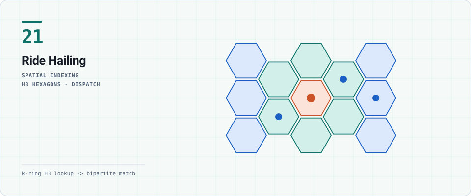
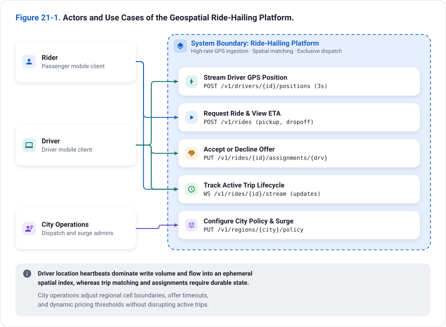
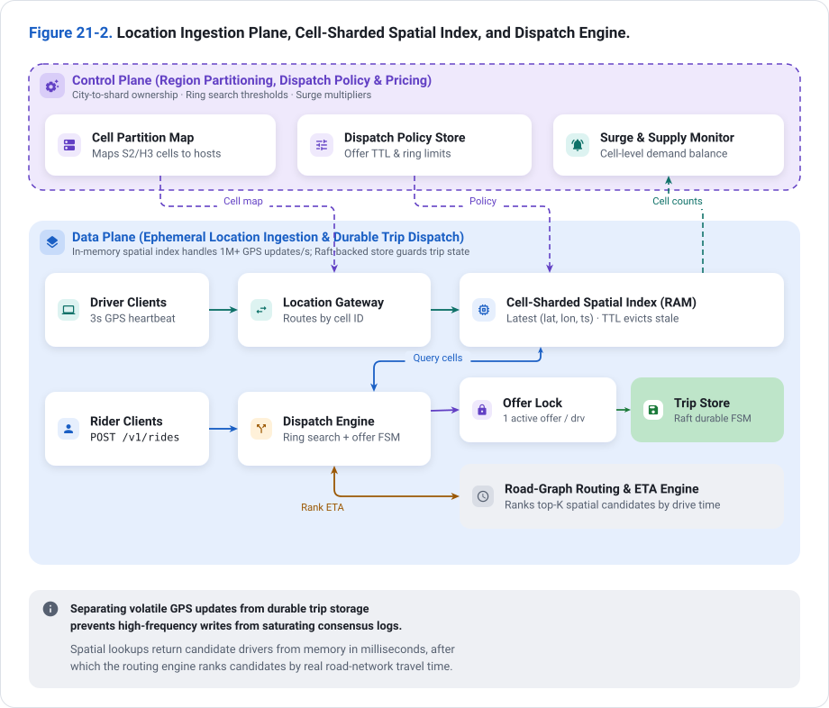
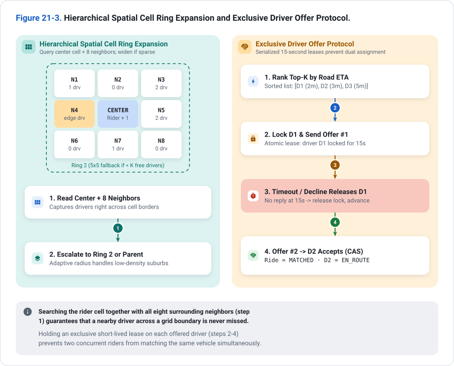

# Chapter 21: Ride Hailing: System Design



A ride-hailing platform matches moving passengers with nearby idle drivers under two opposing data-management constraints. Driver coordinates arrive continuously at hundreds of thousands to millions of updates per second, yet every coordinate becomes obsolete within three to four seconds and requires zero disk durability for live matching. Trip lifecycles, by contrast, carry binding financial and physical invariants: a ride must be assigned to at most one driver, a driver must hold at most one active ride, and every state transition must survive process crashes. In this chapter, I design a geographically partitioned architecture that splits ephemeral in-memory spatial indexing from strongly consistent trip state management, combining H3/S2 spatial indexing, road-network ETA ranking, exclusive dispatch offer locks, and cell-level surge aggregation.

<div class="covers">

In this chapter, we cover

- actors, use cases, verifiable functional requirements, split-consistency SLOs, explicit non-goals, and GPS ingestion capacity bounds
- HTTP/2 and WebSocket APIs for GPS heartbeats, idempotent ride requests, exclusive driver acceptance, and live trip tracking, alongside relational trip DDL
- control-plane vs. data-plane separation across region partitioning, cell-sharded RAM indexes, road-graph ETA engines, and Raft-backed trip stores
- H3 hexagonal and S2 Hilbert-curve spatial indexing compared with geohash boundary distortion, plus TTL-leased driver heartbeat ingestion
- adaptive k-ring cell expansion, Contraction Hierarchies ETA ranking, serialized 15-second exclusive offer locks, and H3 cell-level surge pricing aggregation
- failure matrices, dispatch SLIs/SLOs, production architectures (Uber H3/DISCO, Lyft, Google S2), and verification via `code/nearbysim`

</div>

## 21.1 Requirements, Actors, and Capacity Bounds

One-dimensional B-tree indexes order records along a single key and cannot efficiently answer two-dimensional proximity queries: intersecting a latitude range scan with a longitude range scan examines thousands of irrelevant drivers across an entire city. To reduce candidate lookup time from `O(N)` across the entire fleet to `O(K)` local candidates, we project spherical coordinates onto discrete hierarchical spatial cells and pair that volatile read/write tier with a durable state machine for trip assignments.

### Actors and Use Cases

Three external actor classes interact across the boundary of the ride-hailing platform, as illustrated in Figure 21-1.

<figure class="diagram">

<figcaption><b>Figure 21-1</b> Actors, system boundary, and core use cases of the geospatial ride-hailing platform.</figcaption>
</figure>

| Actor | Operation | Concrete Scenario |
| :--- | :--- | :--- |
| **Driver Client** | Stream GPS heartbeats (`POST /v1/drivers/{id}/positions` or persistent binary stream) and accept/decline offers (`PUT /v1/rides/{id}/assignments/{drv}`) | Broadcast `(lat, lon, heading, speed)` every 3 to 4 seconds while online and accept a 15-second dispatch offer |
| **Rider Client** | Request ride (`POST /v1/rides`) and follow approaching vehicle (`WS /v1/rides/{id}/stream`) | Submit pickup and dropoff coordinates with an `Idempotency-Key`, view ETA, and watch live vehicle telemetry |
| **City Operations** | Configure regional dispatch policy and surge caps (`PUT /v1/regions/{city}/policy`) | Adjust ring search radius, offer TTL, and dynamic pricing thresholds during concerts, storms, or airport surges |

### Functional Requirements

| No. | Functional Requirement |
| :--- | :--- |
| 0 | Online drivers transmit GPS coordinates every 3 to 4 seconds; drivers who cease reporting automatically vanish from active matching within 15 seconds. |
| 1 | A rider can request a ride specifying pickup and dropoff coordinates with a caller-supplied `Idempotency-Key` so retries never summon two vehicles. |
| 2 | The platform discovers nearby available drivers via spatial cell indexing, ranks candidates by road-network Estimated Time of Arrival (ETA), and offers the ride sequentially. |
| 3 | Each ride is assigned to at most one driver, and each driver is concurrently offered or assigned to at most one ride. |
| 4 | Once assigned, the rider receives real-time location updates of the approaching driver and durable state transitions across the trip lifecycle (`REQUESTED -> OFFERED -> ACCEPTED -> ARRIVING -> IN_PROGRESS -> COMPLETED`). |
| 5 | The system continuously aggregates real-time rider demand and idle driver supply per spatial cell to compute dynamic surge pricing multipliers. |

### Non-Functional Requirements and SLOs

| No. | Property | Target Specification | Architectural Consequence |
| :--- | :--- | :--- | :--- |
| 0 | **Spatial Lookup Latency** | Nearby candidate discovery + ETA ranking `p99 <= 100 ms`; full end-to-end match initiation `<= 250 ms` | Lock-free or fine-grained sharded in-memory spatial index co-located with precomputed Contraction Hierarchies road graphs |
| 1 | **Split Consistency** | Eventual consistency (`<= 4 s` staleness) for live driver coordinates; strict ACID Linearizability for trip state and driver assignment | Dual storage architecture: volatile RAM spatial index for heartbeats (`AP`), 3-AZ Raft-replicated relational/KV store for trips (`CP`) |
| 2 | **Availability** | `99.95%` ride request availability per metro region (`<= 21.6` minutes/month) | Independent regional deployments (a failure in London never impacts Tokyo); volatile location index rebuilds automatically in 4 seconds |
| 3 | **Split Durability** | Zero durability required for live driver matching index; zero RPO (`0` lost trips) for ride states and billing GPS bread-crumb logs | Live coordinates remain in RAM without `fsync`; active-trip route points stream asynchronously to a durable Kafka/object-store billing log |
| 4 | **Scale** | `500,000` active drivers (`125,000 to 167,000` GPS writes/s globally; up to `1,000,000+` writes/s at global peak) and `1,000` ride requests/s peak per large region | Consistent-hash cell sharding across in-memory location nodes; binary gRPC/WebSocket framing to minimize connection overhead |

### Non-Goals and Explicit Scope Boundaries

To keep our architectural focus on real-time spatial matching and dispatch exclusivity, we exclude the following concerns:

- **Turn-by-turn navigation and map-tile rendering:** Client map SDKs render vector tiles and compute voice navigation instructions independently of backend dispatch.
- **Multi-passenger pooled carpooling optimization (Ride-Share Routing):** Dynamic vehicle-routing with time windows (VRPTW) for shared trips extends the single-rider matching problem with combinatorial detour constraints.
- **Driver background verification, payout disbursements, and tax reporting:** Offline compliance workflows and settlement payouts build on the payment ledger architecture in Chapter 19.
- **Offline map-data ingestion from OpenStreetMap or satellite imagery:** Road-graph compilation runs in batch map-engineering pipelines outside the real-time dispatch plane.

### Back-of-the-Envelope Capacity Bounds

In ride hailing, **write throughput on driver heartbeats** exceeds rider matching reads by more than two orders of magnitude, while the total memory footprint of all live driver positions fits comfortably in RAM.

| Resource Dimension | Derivation | Provisioned Bound |
| :--- | :--- | :--- |
| **Sustained GPS Write Rate** | `500,000` active drivers `/ 4 s` interval (or `/ 3 s` in dense metros) | `125,000 to 167,000` updates/s (`~1M` updates/s at global mega-scale) |
| **In-Memory Driver State** | `500,000` drivers `* 128 B` (`driver_id`, `lat`, `lon`, `h3_cell`, `status`, `expires_at`, heading) | `~64 MB` raw state (`~256 MB` with hash-table and cell-set overhead) |
| **GPS Ingress Bandwidth** | `167,000` updates/s `* 64 B` compact protobuf/binary frame | `~10.7 MB/s` (`~86 Mbit/s`) per mega-region |
| **Spatial Search Candidate Fan-Out** | Center cell + 1-ring (`7` H3 hexagons or `9` S2 squares) `* ~20` idle drivers/cell | `~140 to 180` candidate drivers filtered to top `10 to 20` for road-graph ETA |
| **Daily Completed Trips** | `1,000` peak req/s `* 0.35` average utilization `* 86,400 s` | `~30,000,000` rides/day |
| **Active Trip Route Telemetry** | `150,000` concurrent in-trip cars `* 1` point/`4 s` `* 40 B` `* 86,400 s` | `~130 GB/day` compressed billing breadcrumb log in object storage |

## 21.2 External API and Data Contracts

Driver telemetry runs over persistent bidirectional HTTP/2 (gRPC) or WebSocket connections using compact binary payloads, while trip creation and offer acceptance expose explicit idempotent REST semantics.

### Driver Location Heartbeat Contract

```http
POST /v1/drivers/7056/positions HTTP/2
Host: rides.example
Authorization: Bearer drv_eyJhbGci...
Content-Type: application/json

{
  "latitude": 38.7223,
  "longitude": -9.1393,
  "heading_deg": 270,
  "speed_mps": 8.4,
  "status": "AVAILABLE",
  "client_ts_ms": 1760436004120
}
```

```http
HTTP/2 204 No Content
```

In production mobile clients, the same logical payload serializes into a `48` to `64` byte Protocol Buffers message pushed over a long-lived TLS stream so cellular radios avoid repeated TCP/TLS handshakes.

### Idempotent Ride Request Endpoint

```http
POST /v1/rides HTTP/2
Host: rides.example
Authorization: Bearer rdr_eyJhbGci...
Idempotency-Key: 3f7a-ride-1
Content-Type: application/json

{
  "pickup":  { "latitude": 38.7169, "longitude": -9.1399 },
  "dropoff": { "latitude": 38.7742, "longitude": -9.1342 },
  "product_tier": "standard",
  "quoted_surge_multiplier": 1.4
}
```

```http
HTTP/2 201 Created
Location: /v1/rides/ride_501
Content-Type: application/json

{
  "ride_id": "ride_501",
  "state": "REQUESTED",
  "pickup_h3_cell": "88392a4945fffff",
  "estimated_pickup_sec": 240
}
```

### Exclusive Driver Offer Acceptance Endpoint

```http
PUT /v1/rides/ride_501/assignments/7056 HTTP/2
Host: rides.example
Authorization: Bearer drv_eyJhbGci...
Content-Type: application/json

{
  "offer_id": "off_9912",
  "offer_version": 3
}
```

```http
HTTP/2 200 OK
Content-Type: application/json

{
  "ride_id": "ride_501",
  "driver_id": "7056",
  "state": "ACCEPTED",
  "version": 4
}
```

Using `PUT` on a driver-scoped assignment URI makes retries by the accepted driver naturally idempotent. If the 15-second offer lease has expired or another driver has already accepted, the endpoint returns `409 Conflict`.

### Active Trip Telemetry Stream

Once `state = 'ACCEPTED'`, the rider client opens `GET /v1/rides/ride_501/stream` (`Upgrade: websocket`). The Location Gateway fans out the assigned driver's GPS heartbeats directly onto the rider's socket (using the session routing model from Chapter 18) until the trip reaches `COMPLETED` or `CANCELLED`.

### Durable Trip Store Schema

The volatile spatial index holds only RAM structs, whereas the strongly consistent Trip Store persists every trip state transition and active offer lease:

```sql
CREATE TABLE rides (
    ride_id          TEXT             PRIMARY KEY,
    city_id          TEXT             NOT NULL,
    rider_id         TEXT             NOT NULL,
    idem_key         TEXT             NOT NULL,
    driver_id        TEXT,
    pickup_lat       DOUBLE PRECISION NOT NULL,
    pickup_lon       DOUBLE PRECISION NOT NULL,
    pickup_h3_cell   BIGINT           NOT NULL,
    dropoff_lat      DOUBLE PRECISION NOT NULL,
    dropoff_lon      DOUBLE PRECISION NOT NULL,
    surge_multiplier NUMERIC(4,2)     NOT NULL DEFAULT 1.00,
    state            TEXT             NOT NULL CHECK (state IN (
                         'REQUESTED', 'OFFERED', 'ACCEPTED', 'ARRIVING',
                         'IN_PROGRESS', 'COMPLETED', 'CANCELLED', 'NO_DRIVER'
                     )),
    active_offer_id  TEXT,
    offer_expires_at TIMESTAMPTZ,
    version          BIGINT           NOT NULL DEFAULT 1,
    created_at       TIMESTAMPTZ      NOT NULL DEFAULT now(),
    UNIQUE (rider_id, idem_key)
);

CREATE TABLE driver_active_locks (
    driver_id        TEXT        PRIMARY KEY,
    ride_id          TEXT        NOT NULL UNIQUE REFERENCES rides(ride_id),
    lock_type        TEXT        NOT NULL CHECK (lock_type IN ('OFFER', 'TRIP')),
    expires_at       TIMESTAMPTZ -- NULL once transitioned to active TRIP
);
```

## 21.3 High-Level Architecture: Control Plane vs. Data Plane

Because rides never cross geographic continents, we deploy independent regional cells per metropolitan area (or metro cluster) and separate operational policy management from real-time telemetry ingestion and dispatch, as shown in Figure 21-2.

<figure class="diagram">

<figcaption><b>Figure 21-2</b> Control plane and data plane separation across regional cell partitioning, ephemeral location ingestion, and durable trip dispatch.</figcaption>
</figure>

### Control Plane Responsibilities

- **Cell Partition Map:** Assigns coarse parent H3/S2 spatial regions to specific shards of the Cell-Sharded Spatial Index using consistent hashing (Chapter 1) with dynamic splitting in high-density urban cores.
- **Dispatch Policy Store:** Publishes per-city parameters (default H3 search resolution, maximum k-ring escalation depth, 15-second offer TTL, and batch-matching window duration) to stateless Dispatch Engine nodes.
- **Surge and Supply Monitor:** Consumes cell-level counts of `AVAILABLE` drivers and incoming `REQUESTED` rides over sliding 60-second windows, publishing smoothed surge multipliers per H3 resolution-7/8 hexagon.

### Data Plane Responsibilities

The data plane deliberately combines two storage tiers at opposite ends of the consistency-durability spectrum:

| Component | Storage Engine & Consistency | Failure Impact and Mitigation |
| :--- | :--- | :--- |
| **Location Gateway** | Stateless persistent TLS/WebSocket terminators | Driver mobile SDKs reconnect automatically to healthy gateways within `1 to 3 s` |
| **Cell-Sharded Spatial Index** | Ephemeral in-memory hash maps partitioned by parent cell ID (Eventual, zero disk `fsync`) | Node crash loses one city partition's live positions; incoming 3 to 4 second driver heartbeats rebuild the index completely within 4 seconds |
| **Road-Graph Routing and ETA Engine** | In-memory Contraction Hierarchies road graph with live edge-weight updates from GPS stream | Stateless replicas per region; fallback to straight-line Haversine distance multiplied by historical city speed if traffic feed lags |
| **Dispatch Engine and Offer Lock** | Stateless matching coordinator + atomic single-driver lease store | Crash mid-offer leaves durable `OFFERED` state and `offer_expires_at` in Trip Store; another coordinator resumes immediately upon TTL expiry |
| **Trip Store** | 3-AZ Raft-replicated relational/KV database (Strict Linearizability, full durability) | Leader crash promotes synchronous follower in `1 to 3 s` with zero lost trips |

## 21.4 Deep Dive: Spatial Indexing (H3, S2, Geohash) and Heartbeat Ingestion

Choosing the spatial cell geometry directly determines boundary edge cases, neighbor-lookup arithmetic, and surge-pricing uniformity.

### Comparing Geohash, Google S2, and Uber H3

1. **Geohash (Latitude/Longitude Rectangles):** Interleaves quantized latitude and longitude bits into a base-32 string where longer shared prefixes denote finer nested rectangles. Although simple to compute, geohash suffers from severe **latitude distortion** (cells narrow dramatically toward the poles) and **edge discontinuity** (two points separated by 10 meters across the equator or prime meridian share zero prefix characters). Furthermore, every rectangular cell has two distinct neighbor distances: 4 edge-adjacent neighbors at distance `d` and 4 corner-adjacent neighbors at distance `sqrt(2) * d`.
2. **Google S2 (Cube-Projected Hilbert Curve):** Projects the Earth's sphere onto six cube faces and enumerates hierarchical quadtree cells along a **Hilbert space-filling curve** into 64-bit unsigned integers (`S2CellId`). The Hilbert curve preserves locality far better than Z-order curves (used by geohash), enabling arbitrary geographic regions to be covered by a small union of contiguous 64-bit integer intervals. S2 cells remain square-like and still have 8 neighbors at two distinct center-to-center distances.
3. **Uber H3 (Hierarchical Hexagonal Grid):** Projects the Earth onto an icosahedron and tiles each face with regular hexagons across 16 resolutions (each parent hexagon contains approximately 7 child hexagons, plus exactly 12 pentagons globally placed over ocean areas). Hexagons provide a decisive mathematical advantage for mobility platforms: **every hexagon has exactly 6 neighbors whose centers lie at the exact same Euclidean distance** from the center cell. This symmetry eliminates diagonal corner bias during k-ring radius searches, smooths gradient calculations for surge pricing, and guarantees uniform area across latitudes.

| Property | Geohash | Google S2 | Uber H3 |
| :--- | :--- | :--- | :--- |
| **Cell Shape** | Rectangle (lat/lon aligned) | Spherical quadrilateral | Regular hexagon (+ 12 pentagons) |
| **Neighbor Center Distances** | 2 distinct distances (`d` and `1.414 d`) | 2 distinct distances (`d` and `1.414 d`) | 1 uniform distance across all 6 neighbors |
| **Area Distortion Across Globe** | Severe near poles | Low (quadratic projection) | Minimal (gnomonic icosahedron projection) |
| **Exact Parent-Child Containment** | Exact (`1 -> 32` or `1 -> 4`) | Exact (`1 -> 4` quadtree) | Approximate (`1 -> 7` aperture-7 tiling) |
| **Primary Strength** | Zero-dependency string prefixing | Exact polygon containment and range scans | Uniform k-ring search and smooth surge spatial aggregation |

### High-Throughput Driver Heartbeat Write Path

When a driver's client transmits `(driver_id, lat, lon, ts)` every 3 to 4 seconds, the Location Gateway computes the driver's target H3 index at the city's matching resolution (typically **H3 Resolution 8**, edge length `~461 m`, area `~0.74 km^2`, or **Resolution 9**, edge length `~174 m`) and routes the update to the owning Spatial Index shard via the Cell Partition Map:

1. **In-Place Same-Cell Update (Common Path, `> 90%` of Heartbeats):** The shard looks up `driver_id` in its local `DriverMap`. If `new_cell == old_cell`, it overwrites `(lat, lon, heading, expires_at = now + 15 s)` in place with zero structural allocations.
2. **Cell-Boundary Crossing:** If `new_cell != old_cell`, the shard removes `driver_id` from `CellMap[old_cell]` and inserts it into `CellMap[new_cell]`. If `new_cell` belongs to a neighboring index shard, the gateway sends an asynchronous remove to the old shard and an upsert to the new shard; even if the remove drops, the `15 s` TTL lease evicts the stale ghost entry automatically.
3. **Silent Offline Eviction via TTL Leases:** When a driver enters a tunnel, kills the app, or loses battery, no disconnect packet arrives. Because every entry carries `expires_at = last_seen + 15 s`, both read-time filtering (`entry.expires_at > now`) and a lightweight periodic bucket sweep remove silent drivers without distributed failure detectors.
4. **Dual-Path Billing Persistence:** For drivers currently in state `IN_PROGRESS`, the Location Gateway asynchronously forks the GPS coordinate onto a partitioned Kafka topic (`trip-breadcrumbs`) so fare reconciliation and dispute resolution have durable history without adding disk latency to the matching RAM index.

## 21.5 Deep Dive: k-Ring Expansion, ETA Ranking, Exclusive Dispatch, and Surge Aggregation

Finding candidate drivers and assigning exactly one car to one rider requires uniting spatial retrieval, road-network graph routing, and strongly consistent distributed locking, as depicted in Figure 21-3.

<figure class="diagram">

<figcaption><b>Figure 21-3</b> Adaptive spatial ring expansion and exclusive serialized driver offer protocol.</figcaption>
</figure>

### Adaptive k-Ring Expansion and Road-Graph ETA Ranking

Querying only the rider's single cell misses an idle driver parked 30 meters away on the opposite side of a cell boundary. The Dispatch Engine therefore executes an **adaptive k-ring search**:

1. **Ring 1 Lookup (`k = 1`):** Computes the rider's H3 cell and fetches `gridDisk(center_cell, 1)` (the center cell plus its 6 surrounding hexagons, or 9 squares in an S2/Cartesian grid), issuing parallel in-memory scatter reads to the owning shards (typically 1 shard, or 2 shards near a partition border).
2. **Ring Escalation (`k = 2` or Coarser Parent):** In dense downtown cores, Ring 1 yields 50 to 200 idle drivers immediately. In sparse suburbs at 03:00 local time, if Ring 1 returns fewer than `K_min = 10` free drivers, the engine expands to Ring 2 (`19` H3 cells or `25` squares) and up to a configurable city radius cap (for example, `5 km`) before returning `NO_DRIVER`.
3. **Road-Network ETA Ranking via Contraction Hierarchies:** Euclidean straight-line distance misleads whenever rivers, highways, medians, or one-way streets separate driver and rider. The Dispatch Engine passes the top `20 to 30` spatially closest candidates to the **Routing and ETA Engine**. Running textbook Dijkstra on a continental road graph per request is far too slow; instead, the engine precomputes **Contraction Hierarchies (CH)** (or Customizable Contraction Hierarchies, CCH) over arterial shortcuts, answering exact shortest-path drive times in under `1 ms` per candidate while continuously updating road-segment travel speeds from the fleet's own GPS telemetry stream.

### Exclusive Single-Driver Offer Protocol and CAS Assignment

Broadcasting a ride offer simultaneously to five drivers minimizes dispatch latency but forces four drivers who tapped "Accept" to see a withdrawn offer, degrading driver retention and triggering race storms. Instead, we execute an **exclusive serialized offer protocol** with bounded 15-second leases. Advance through the interactive trace below to observe how sequential offers, offer expiry, and conditional writes prevent double assignment even when an earlier driver's acceptance arrives late.

<figure class="steps" data-prefix="figures/steps-nearby-match" data-count="6" data-version="656e8bbd">

<figcaption><b>Figure 21.3</b> A ride is offered to the nearest driver, who does not answer, and then to the next, who accepts, after which the first driver's late acceptance is refused. Use Next and Back to move through the 6 steps.</figcaption>
</figure>

Two atomic database invariants enforce strict one-to-one exclusivity inside the Trip Store:

1. **Acquiring an Exclusive Offer Lease:** Before pushing an offer notification to driver `D1`, the Dispatch Engine atomically claims `D1` in `driver_active_locks` (succeeding only if `D1` has no unexpired `OFFER` or `TRIP` lock) and transitions the ride to `OFFERED` with `active_offer_id = off_1` and `offer_expires_at = now() + INTERVAL '15 seconds'`. This guarantees `D1` never receives overlapping offers from two simultaneous riders.
2. **Conditional CAS Acceptance:** When driver `D2` responds `PUT /v1/rides/ride_501/assignments/7056`, the Trip Store executes a single ACID transaction:
   ```sql
   UPDATE rides
   SET state           = 'ACCEPTED',
       driver_id       = $1,
       active_offer_id = NULL,
       version         = version + 1
   WHERE ride_id         = $2
     AND state           = 'OFFERED'
     AND active_offer_id = $3
     AND offer_expires_at >= now()
   RETURNING ride_id, version;
   ```
   Alongside upgrading `driver_active_locks.lock_type` from `'OFFER'` to `'TRIP'` (`expires_at = NULL`). If `D1`'s delayed acceptance arrives after `off_1` expired and `off_2` was accepted by `D2`, the predicate `active_offer_id = $3` matches `0` rows and returns `409 Conflict`.

### Batch Matching and Cell-Level Surge Pricing Aggregation

Greedy first-come-first-served matching can produce globally suboptimal pairings when two nearby riders request trips within 1 second of each other. In dense urban zones, the Dispatch Engine buffers incoming requests within an H3 resolution-6 region for a short batch window (`2 to 5 seconds`) and solves a **minimum-weight bipartite matching** (Hungarian algorithm or min-cost max-flow) over the `(riders x candidate_drivers)` ETA matrix, reducing aggregate pickup wait times across the city by 15% to 25%.

Simultaneously, the **Surge and Supply Monitor** aggregates real-time `demand_count` (unmatched ride requests and fare-estimate views) and `supply_count` (idle drivers with valid leases) inside each H3 resolution-7/8 hexagon every `30 seconds`. Because hexagons share identical edge-to-edge neighbor geometry, applying a spatial smoothing kernel across each cell and its 6 neighbors eliminates sharp price cliffs across street boundaries where walking 20 meters would otherwise drop a fare by half.

## 21.6 Failure Modes, SLIs, and Production Systems

### Failure and Recovery Matrix

| Failure Scenario | Blast Radius | Automated Recovery and Preserved Invariant |
| :--- | :--- | :--- |
| **Driver Phone Enters Tunnel or Crashes** | Single driver | 15-second TTL lease expires automatically; driver leaves spatial index without sending a disconnect message |
| **Spatial Index Shard Crash** | One geographic sub-region for `<= 4 s` | Replacement shard starts empty; incoming 3 to 4 second GPS heartbeats reconstruct full fleet visibility automatically |
| **Driver Ignores or Drops Offer** | Single ride delayed by `15 s` | `offer_expires_at` lapses; Dispatch Engine releases driver lock and offers to next lowest-ETA candidate |
| **Two Drivers Send Concurrent Acceptances** | Single ride | `WHERE state = 'OFFERED' AND active_offer_id = $3` CAS accepts exactly the active offer holder; late caller receives `409 Conflict` |
| **Rider Client Retries After Network Timeout** | Single ride | `UNIQUE (rider_id, idem_key)` returns existing `ride_501` without dispatching a duplicate vehicle |
| **Routing / ETA Engine Outage** | Single region ETA accuracy degrades | Dispatch Engine degrades gracefully to Haversine straight-line distance divided by historical zone speed until routing pods recover |
| **Trip Store Shard Leader Failure** | New trip transitions pause `1 to 3 s` | 3-AZ Raft consensus elects synchronous follower with zero lost committed trips; in-flight clients retry safely |

### Operational SLIs and SLOs

Four domain-specific Service Level Indicators track dispatch health beyond raw HTTP error rates:

1. **Spatial Index Freshness (`p99` Heartbeat Ingestion Lag):** Measures time from client GPS timestamp to Spatial Index visibility (`SLO <= 500 ms`); rising lag indicates gateway saturation or GC pauses.
2. **Time to First Offer and Match Completion Rate:** Tracks `p95` elapsed seconds from `POST /v1/rides` to driver `ACCEPTED` (`SLO <= 30 s`) and percentage of requests reaching `NO_DRIVER`.
3. **ETA Prediction Error (MAE):** Compares predicted pickup ETA at dispatch against actual driver arrival timestamp; persistent positive drift alerts to stale road-graph traffic edge weights.
4. **Exclusivity Audit Invariant:** Continuous background verifier confirming zero active rides share a `driver_id` and zero `ACCEPTED` rides lack a matching `driver_active_locks` entry (`SEV-1` on any non-zero violation).

### How Production Systems Implement Ride Hailing

| Production System | Core Architecture | Architectural Distinction |
| :--- | :--- | :--- |
| **Uber (DISCO, H3, and Ringpop)** | H3 hexagonal spatial index sharded across stateful dispatch workers via consistent hashing and SWIM gossip membership | Pioneered H3 aperture-7 hexagonal tiling to eliminate diagonal neighbor distortion in k-ring matching and surge smoothing, paired with batched bipartite dispatch |
| **Lyft (Dispatch and ETA Platform)** | S2 hierarchical spatial indexing combined with regional dispatch microservices and real-time road-graph traffic estimation | Uses dynamic batch windows to optimize global driver utilization and integrates driver heading and multi-stop trajectories directly into ETA ranking |
| **Google Maps / S2 Geometry** | Cube-projected Hilbert-curve 64-bit `S2CellId` hierarchy paired with Contraction Hierarchies routing | Enables compact range-scan covering of arbitrary city polygons and sub-millisecond continental shortest-path queries |
| **Didi Chuxing** | Reinforcement-learning assisted batched bipartite dispatch over hexagonal urban grids | Extends short-horizon ETA minimization to multi-minute repositioning value, balancing immediate pickup time against future zone liquidity |

## 21.7 Simulation Verification

To verify the asymptotic speedup and exact equivalence of spatial grid indexing versus full-fleet scanning, execute the `nearbysim` crate in the repository's `code/` workspace:

```console
$ cargo run --release -p nearbysim
20000 drivers on a map of 100 by 100 units
measuring every driver: 20000 distances, nearest: driver 19862 at 0.19, driver 7056 at 0.84, driver 17908 at 0.85
using the grid: 15 distances, nearest: driver 19862 at 0.19, driver 7056 at 0.84, driver 17908 at 0.85
```

On a `100 x 100` unit map containing `20,000` uniformly placed drivers:
- Scanning the full fleet requires `20,000` distance computations per rider query.
- Querying the rider's cell plus its 8 immediate neighbors evaluates only `15` distance calculations, a `1,333x` reduction in work, while returning the exact same three nearest drivers (`driver 19862` at `0.19`, `driver 7056` at `0.84`, and `driver 17908` at `0.85`).

<div class="simulation">

**Run the spatial indexing simulation.** Execute `cargo run --release -p nearbysim` in [`code/nearbysim`](https://github.com/arpanpathak/cracking-the-systems-programming-interview/blob/prep-v2/distributed-systems-from-the-ground-up/code/nearbysim/src/main.rs) to verify exact top-3 driver equivalence and the `1,333x` reduction in candidate distance evaluations using a neighbor-aware spatial grid.

</div>

## 21.8 Terminology and References

### Engineering Glossary

| Term | Definition |
| :--- | :--- |
| **Contraction Hierarchies (CH)** | A road-graph preprocessing technique that inserts shortcut edges along major arterial corridors, accelerating shortest-path ETA queries to under one millisecond. |
| **Exclusive Offer Lock** | A time-bounded lease (`15 s`) binding one candidate driver to at most one pending ride offer so concurrent matchers cannot double-offer the same vehicle. |
| **Geohash** | A base-32 spatial encoding formed by interleaving quantized latitude and longitude bits; suffers from polar area distortion and edge prefix discontinuities. |
| **H3 Hexagonal Index** | Uber's open-source hierarchical spatial index tiling the sphere with aperture-7 regular hexagons where all six neighbors lie at equal center-to-center distances. |
| **k-Ring Expansion** | Searching a center spatial cell together with concentric rings of neighboring cells (`k = 1, 2, ...`) to capture cross-border drivers and handle sparse suburbs. |
| **S2 Geometry** | Google's spherical geometry library mapping six cube faces along a Hilbert space-filling curve into locality-preserving 64-bit integer cell identifiers. |
| **Surge Pricing Aggregation** | Computing smoothed real-time ratios of rider demand to idle driver supply across hexagonal cells to balance marketplace liquidity. |

### References

- I. Brodsky, "H3: Uber's Hexagonal Hierarchical Spatial Index", Uber Engineering Blog, 2018.
- Google, "S2 Geometry Library: S2 Cells and Space-Filling Curves", s2geometry.io Documentation.
- R. Geisberger, P. Sanders, D. Schultes, and D. Delling, "Contraction Hierarchies: Faster and Simpler Hierarchical Routing in Road Networks", *Workshop on Experimental Algorithms (WEA)*, 2008.
- G. Niemeyer, "Geohash Encoding Specification", geohash.org, 2008.
- A. Guttman, "R-Trees: A Dynamic Index Structure for Spatial Searching", *Proceedings of ACM SIGMOD*, 1984.
- Uber Engineering, "Ringpop: Scalable, Fault-Tolerant Application-Layer Sharding", Uber Engineering Blog, 2016.
- L. Zhang et al., "A Taxi Order Dispatch Model Based On Combinatorial Optimization", *Proceedings of ACM KDD*, 2017.
