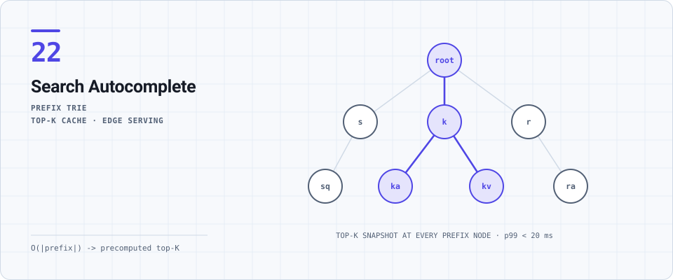
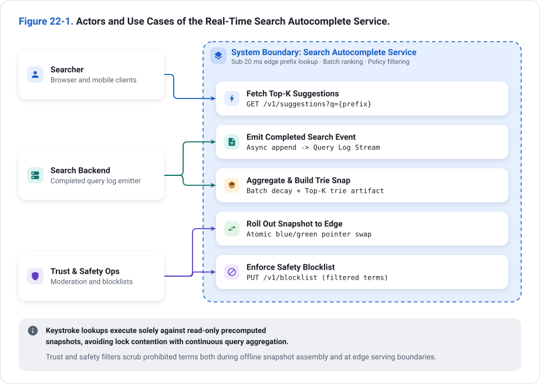
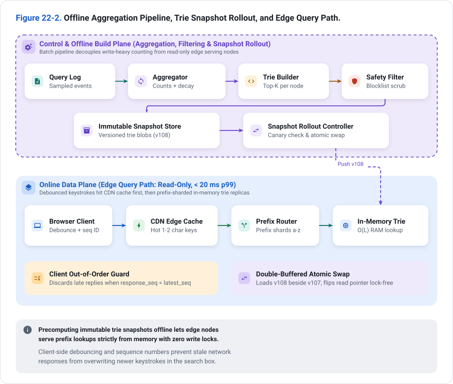
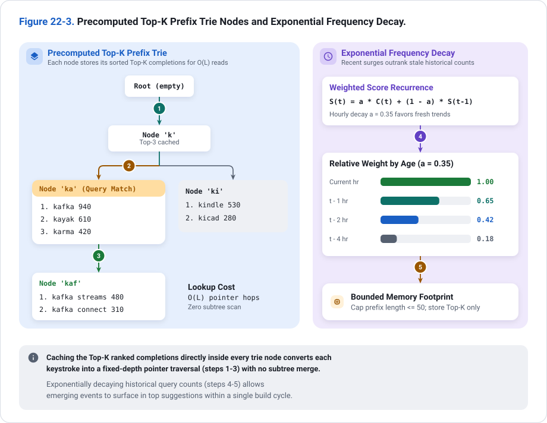

# Chapter 22: Search Autocomplete: System Design



A real-time search autocomplete (typeahead) service proposes complete queries as a user types each character into a search input. Compared with full-text search, autocomplete amplifies request volume by an order of magnitude (emitting up to one request per keystroke rather than one per submitted query) while enforcing an end-to-end latency budget under 100 milliseconds, of which network round-trip time consumes the majority. Because server-side execution must finish within 10 to 20 milliseconds at `p99`, any design that scans or ranks matching queries online collapses on short prefixes such as `a` or `k`. In this chapter, I design a read-only, edge-cached serving architecture backed by precomputed top-K prefix trie snapshots, offline MapReduce and Flink exponential-decay aggregation, lock-free blue-green snapshot swaps, frequency-balanced prefix sharding, and layered safety and privacy filtering.

<div class="covers">

In this chapter, we cover

- actors, use cases, verifiable functional requirements, sub-20 ms server SLOs, explicit non-goals, and keystroke QPS and RAM capacity bounds
- cacheable HTTP/2 `GET` suggestion APIs, client out-of-order sequence guards, blocklist moderation contracts, and compact immutable trie snapshot schemas
- control-plane and offline build pipeline separation from the lock-free, read-only online serving data plane
- precomputed top-K prefix trie nodes achieving `O(L)` lookup, exponential frequency decay, fast-lane Flink trending overlays, and double-buffered atomic snapshot swaps
- load-balanced prefix range sharding across serving nodes, client debouncing, CDN caching trade-offs, k-anonymity privacy gates, and PII/profanity filtering
- failure matrices, typeahead SLIs/SLOs, production architectures (Google Suggest, Elasticsearch FST, Meta Typeahead, Microsoft Top-k Completion), and verification via [`code/typeahead`](https://github.com/arpanpathak/cracking-the-systems-programming-interview/tree/prep-v2/distributed-systems-from-the-ground-up/code/typeahead)

</div>

## 22.1 Requirements, Actors, and Capacity Bounds

Autocomplete is an advisory acceleration layer whose failure must never block core search submission. This asymmetry permits aggressive offline precomputation, multi-tier HTTP caching, and eventual consistency (minutes to hours for the global corpus, under one minute for breaking trends) in exchange for predictable sub-20 ms server tail latency at 1,000,000+ global requests per second.

### Actors and Use Cases

Three external actor classes interact across the boundary of the search autocomplete service, as illustrated in Figure 22-1.

<figure class="diagram">

<figcaption><b>Figure 22-1</b> Actors, system boundary, and core use cases of the real-time search autocomplete service.</figcaption>
</figure>

| Actor | Operation | Concrete Scenario |
| :--- | :--- | :--- |
| **Searcher (Browser / Mobile Client)** | Fetch top-K completions (`GET /v1/suggestions?q={prefix}`) | Type `ka` with client debouncing and receive `["kafka", "karaoke near me", "kayak"]` within 100 ms end-to-end |
| **Search Backend** | Emit completed query events asynchronously to the Query Log Stream | Log normalized submitted searches (never raw partial prefixes) for offline MapReduce decay and real-time Flink trend detection |
| **Trust and Safety Operations** | Publish moderation exclusions (`PUT /v1/blocklist`) | Remove defamatory, violent, or leaked PII completions across all edge serving replicas within minutes |

### Functional Requirements

| No. | Functional Requirement |
| :--- | :--- |
| 0 | Given a normalized UTF-8 prefix string `q` (1 to 20 characters), the service returns up to `K = 5` (configurable up to `10`) highest-ranked matching query completions. |
| 1 | Suggestions are ranked by time-decayed historical search frequency so recent sustained interest outranks stale multi-year totals. |
| 2 | Breaking queries that surge dramatically within the last 60 minutes appear in suggestions within 1 to 2 minutes without waiting for a full batch rebuild. |
| 3 | Every candidate query must satisfy a minimum distinct-user privacy threshold (`k`-anonymity) before entering any suggestion snapshot. |
| 4 | Automated policy filters scrub PII patterns and prohibited terms during offline trie builds, and an emergency edge blocklist suppresses reported suggestions within minutes. |
| 5 | The service degrades gracefully: if the autocomplete tier is unreachable or slow, the client allows uninterrupted typing and search submission. |

### Non-Functional Requirements and SLOs

| No. | Property | Target Specification | Architectural Consequence |
| :--- | :--- | :--- | :--- |
| 0 | **Latency** | End-to-end keystroke-to-display `<= 100 ms`; origin server `p99 <= 20 ms` (`p50 <= 3 ms`) | Zero online subtree traversal or sorting; all top-K lists precomputed at every trie node and held entirely in RAM |
| 1 | **Availability** | `99.9%` (`<= 43.2` minutes/month) for autocomplete; `100%` fault isolation from core search | Stateless read-only serving replicas behind CDN edge caches; browser enforces strict `80 ms` request timeouts |
| 2 | **Consistency** | Eventual consistency: `1 to 24 hours` for the main corpus snapshot; `<= 60 s` for trending overlay; `<= 5 min` for emergency blocklist propagation | Decouples write-heavy counting completely from read-only edge serving via versioned immutable snapshot artifacts |
| 3 | **Scale** | `1,000,000` peak keystroke requests/s globally (`100,000` submitted searches/s `* ~10` keystrokes/search); `100,000,000` distinct eligible queries | Browser + CDN caching absorbs `~80%` of traffic (especially hot 1 to 2 character prefixes); origin serving tier handles `200,000` req/s |
| 4 | **Safety and Privacy** | Zero exposure of single-user private queries; rapid removal of abusive completions | Distinct-user HyperLogLog / count threshold (`>= 100` distinct users) plus dual-stage offline and online blocklist enforcement |

### Non-Goals and Explicit Scope Boundaries

To focus on low-latency prefix indexing and snapshot distribution, we exclude the following extensions from the base architecture:

- **Per-user personalized search history ranking:** Personal history completions are typically stored locally in browser IndexedDB or fetched from a small per-user cache and merged client-side ahead of global typeahead results.
- **Full-text fuzzy edit-distance spelling correction:** Supporting Levenshtein edit distance `>= 2` across arbitrary mid-word typos requires phonetic/BK-tree or trigram indexes rather than strict prefix tries.
- **Multi-language morphology and CJK input-method composition (IME):** Character composition states prior to word commit require locale-specific tokenizers outside standard prefix lookup.

### Back-of-the-Envelope Capacity Bounds

Autocomplete is constrained by **tail latency on hot short prefixes** and **in-memory working set size** across prefix shards.

| Resource Dimension | Derivation | Provisioned Bound |
| :--- | :--- | :--- |
| **Global Keystroke QPS** | `100,000` searches/s `* 10` keystrokes/search (reduced ~50% by debouncing, offset by editing) | `~1,000,000` req/s gross |
| **Origin Serving QPS** | `1,000,000` req/s `* 20%` cache miss rate past browser + CDN edge (`max-age=300`) | `~200,000` req/s at origin |
| **Distinct Eligible Queries** | Filtered to queries issued by `>= 100` distinct users over 30 days | `100,000,000` unique strings |
| **Indexed Prefix Nodes** | Prefix length capped at `L <= 20` chars; shared prefixes collapse ~4x | `~500,000,000` distinct prefix nodes |
| **Precomputed Snapshot RAM** | `500M` nodes `* ~50 B` (compact node header + 5 integer string-table IDs) + `100M * 25 B` string pool | `~27.5 GB` total immutable snapshot (`~32 GB` per shard group with index metadata) |
| **Daily Raw Query Log** | `100,000` searches/s `* 86,400 s` `* 40 B` (sampled `10%` to `100%`) | `~345 GB/day` unsampled (`~35 GB/day` at 10% uniform sampling) |
| **Origin Egress Bandwidth** | `200,000` req/s `* 256 B` average JSON response | `~51 MB/s` (`~410 Mbit/s`) |

## 22.2 External API and Data Contracts

Because global suggestions for a given normalized prefix are identical across users within a locale, the read endpoint uses a cacheable HTTP/2 `GET` with explicit `Cache-Control` headers so both browsers and CDN edge PoPs absorb the majority of short-prefix load.

### Prefix Suggestion Lookup Endpoint

```http
GET /v1/suggestions?q=ka&locale=en-US&limit=5&seq=14 HTTP/2
Host: search.example
Accept: application/json
```

```http
HTTP/2 200 OK
Content-Type: application/json
Cache-Control: public, max-age=300, stale-while-revalidate=60
X-Snapshot-Version: v108

{
  "prefix": "ka",
  "seq": 14,
  "suggestions": [
    { "text": "kafka", "score": 900, "source": "main" },
    { "text": "karaoke near me", "score": 800, "source": "main" },
    { "text": "kayak", "score": 450, "source": "main" }
  ]
}
```

Three contract details govern client correctness and caching efficiency:

1. **Prefix Echo and Sequence Guard (`seq`):** Network replies can arrive out of order: a slow reply for `ka` (`seq=14`) may arrive after a fast reply for `kaf` (`seq=15`). The browser discards any response whose `seq < latest_sent_seq` or whose echoed `prefix` no longer matches the active input box, and aborts superseded in-flight HTTP requests via `AbortController`.
2. **Caching Empty Results:** A prefix with zero completions (such as `q=kafx`) still returns `200 OK` with `"suggestions": []` and `Cache-Control: public, max-age=300`, protecting origin shards against repeated cache-penetration misses on typos.
3. **Cache TTL vs. Takedown Latency Trade-Off:** Setting `max-age=300` (5 minutes) rather than 5 hours bounds the maximum time a newly blocklisted offensive term can linger in downstream browser or edge caches.

### Emergency Blocklist Control Endpoint

```http
PUT /v1/blocklist/terms HTTP/2
Host: admin.search.example
Authorization: Bearer ops_eyJhbGci...
Content-Type: application/json

{
  "locale": "en-US",
  "action": "DENY_EXACT_OR_SUBSTRING",
  "pattern": "redacted-harmful-phrase",
  "reason": "policy-ticket-4921"
}
```

```http
HTTP/2 202 Accepted
Content-Type: application/json

{
  "blocklist_version": 841,
  "propagation_slo_sec": 60
}
```

### Compact Immutable Trie Snapshot Schema

Rather than storing pointer-heavy heap objects or repeating full query strings across millions of ancestor nodes, the offline builder serializes each shard snapshot into two contiguous memory-mapped (`mmap`) binary arrays:

```text
1. String Pool (arena.bin):
   Contiguous UTF-8 bytes of all distinct eligible completions, addressed by u32 offset + u16 len.

2. Trie Node Array (trie_shard_k.bin):
   struct TrieNode {
       char_code:       u16,       // UTF-16 / compressed byte edge label
       first_child_idx: u32,       // Contiguous child slice start (binary-searched)
       child_count:     u16,       // Number of outgoing edges
       top_k_ids:       [u32; 5],  // Indexes into String Pool, pre-sorted by score
       top_k_scores:    [u32; 5],  // Fixed-point decayed scores for merge with trending overlay
   }
```

Storing integer `string_pool` offsets instead of duplicated text cuts RAM consumption by 4x to 6x, eliminates garbage-collection pause spikes, and enables instant zero-parse loading via `mmap`.

## 22.3 High-Level Architecture: Control Plane vs. Data Plane

We strictly decouple asynchronous query aggregation and snapshot compilation from the read-only serving path, as illustrated in Figure 22-2.

<figure class="diagram">

<figcaption><b>Figure 22-2</b> Offline aggregation and snapshot rollout control plane decoupled from the read-only online edge query path.</figcaption>
</figure>

### Control and Offline Build Plane

No online request ever writes to a serving trie. Instead, an offline pipeline compiles immutable versioned artifacts:

- **Query Log Stream (Kafka):** Receives completed search submissions (sampled uniformly at 10% to 100%) asynchronously from the Search Backend, adding zero latency to search execution.
- **Batch Aggregator (Spark / MapReduce) and Fast-Lane Streamer (Flink):** Normalizes query strings (Unicode NFKC, lowercase, whitespace collapsing), tracks distinct-user counts via HyperLogLog sketches, applies exponential frequency decay, and emits two outputs: hourly/daily global scores and 1-minute breaking-trend deltas.
- **Safety Filter and Trie Builder:** Scrubs PII (email addresses, phone numbers, national IDs via regex and NER classifiers) and policy-prohibited phrases, then constructs per-shard precomputed top-K trie binary blobs (`v108`) stored in immutable object storage.
- **Snapshot Rollout Controller:** Validates candidate snapshots against canary prefix regression suites (verifying non-empty top queries, bounded size delta, and zero blocklist leaks) before orchestrating a staggered push to serving replicas.

### Online Data Plane

| Component | State Held | Failure Impact and Mitigation |
| :--- | :--- | :--- |
| **Browser Client** | In-memory prefix cache, debounce timer (`50 to 100 ms`), monotonic `seq` counter | Caches recent prefix replies locally so backspace is instantaneous; aborts slow requests after `80 ms` so search stays unaffected |
| **CDN Edge Cache** | Public HTTP cache keyed by `(locale, normalized_prefix)` (`300 s` TTL) | Absorbs `~80%` of global volume, especially single-character and two-character prefixes; serves stale-while-revalidate during brief origin blips |
| **Prefix Router (L7 LB)** | Prefix range partition map (`aa..ap -> shard 0`, ...) | Stateless routing across 3 AZs; retries read-only `GET` idempotently on another shard replica on timeout |
| **In-Memory Trie Replicas** | Read-only `mmap` trie snapshot (`v108`), tiny trending hash map (`< 50 MB`), and hot blocklist set (`< 10 MB`) | Zero write locks; every replica within a shard holds an identical immutable snapshot and serves reads concurrently |

## 22.4 Deep Dive: Precomputed Top-K Trie, Exponential Decay, and Atomic Snapshot Swap

A sorted array or uncached prefix trie finds the starting node for prefix `ka` in `O(log N)` or `O(L)` time, yet still must enumerate and sort every completion in the subtree beneath `ka`. On short prefixes such as `k` or `s`, that subtree holds millions of queries, making online sorting incompatible with a 10 to 20 ms server budget.

### Precomputed Top-K Nodes Achieving `O(L)` Lookup

Because the top 5 completions of any prefix `p` depend only on the query corpus and remain invariant across callers between rebuilds, we compute them bottom-up once during the offline build and store the sorted top-K list directly inside every trie node, as depicted in Figure 22-3.

<figure class="diagram">

<figcaption><b>Figure 22-3</b> Precomputed top-K prefix trie nodes achieving <code>O(L)</code> lookup and exponential frequency decay scoring.</figcaption>
</figure>

During offline assembly, a single post-order traversal computes each node's top-K list by merging the top-K lists of its immediate children plus any query terminating at the node itself. For an alphabet of 26 lowercase characters and `K = 5`, each node evaluates at most `26 * 5 + 1 = 131` entries, yielding total build complexity linear in the number of trie nodes (`O(N_nodes * K)`). At query time, traversing a prefix of length `L <= 20` requires at most `L` pointer or array hops and zero subtree scanning. Advance through the interactive trace below to follow how each keystroke resolves in a single precomputed lookup.

<figure class="steps" data-prefix="figures/steps-type-lists" data-count="5" data-version="96e5e89e">

<figcaption><b>Figure 22.2</b> Each keystroke is answered by reading the row that was prepared for the prefix. Use Next and Back to move through the 5 steps.</figcaption>
</figure>

### Exponential Frequency Decay and Fast-Lane Trending Overlay

Raw cumulative counts freeze past events at the top of suggestions indefinitely. To balance historical stability with recency, the batch aggregator computes an exponentially weighted moving score at every time bucket `t` (hourly or daily):

```text
S(t) = alpha * C(t) + (1 - alpha) * S(t - 1)
```

With an hourly decay factor `alpha = 0.35`, the weight of a query's volume from `h` hours ago decays geometrically by `(1 - alpha)^h = 0.65^h`, ensuring that sustained current demand smoothly overtakes stale peaks without abrupt cliff effects at midnight boundaries.

Because a full global trie rebuild takes 15 to 45 minutes in MapReduce/Spark, breaking news queries (such as an unexpected sports result or major outage) would otherwise lag by an hour. We close this freshness gap with a **two-tier hybrid serving lookup**:

1. **Main Immutable Trie (`~32 GB` per cluster, rebuilt hourly):** Covers the entire 100M-query corpus with decayed scores.
2. **Trending Overlay Table (`< 50 MB`, updated every 60 s by Apache Flink):** Consumes the live Kafka query stream over a 15-minute sliding window, computing z-score velocity `(recent_rate - baseline_rate) / stddev`. Only queries exceeding a surge threshold (and passing distinct-user `k`-anonymity and safety filters) enter the tiny trending prefix map.
3. **Online Merge (`< 0.2 ms`):** Each serving replica looks up prefix `p` in both the main trie and the small trending map, merges the two sorted top-5 lists by boosted score, strips any terms present in the hot emergency blocklist, and returns the final 5 suggestions.

### Lock-Free Double-Buffered Blue-Green Snapshot Swap

Updating a live trie in place under `200,000` concurrent reads/s introduces reader-writer lock contention, memory fragmentation, and partial-update inconsistency. Instead, every serving node performs a **double-buffered atomic pointer swap**:

1. While serving traffic from `Arc<TrieSnapshot>` (`v107`), a background loader downloads `v108` from object storage, verifies its SHA-256 checksum, maps it into memory (`mmap`), and warms critical top-level pages (`L <= 3`) via synthetic prefix probes.
2. Once warmed and verified, the loader executes a single atomic pointer swap (`atomic_ptr.store(v108, Ordering::Release)`).
3. In-flight requests holding references to `v107` complete without interruption; once the reference count of `v107` drops to zero, the process unmaps `v107`. If canary metrics detect an anomaly in `v108`, the Rollout Controller reverts the pointer back to `v107` in under one second.

## 22.5 Deep Dive: Prefix Sharding, Caching, and Safety/Privacy Controls

### Frequency-Balanced Prefix Range Sharding

Partitioning the `27.5 GB` trie directly by the first ASCII letter (`a` through `z` across 26 shards) creates extreme load skew: English queries starting with `s`, `c`, or `p` carry more than 20 times the volume of `x`, `q`, or `z`. We compare two production sharding schemes:

- **Measured-Load Prefix Range Sharding (Preferred for Locality):** The offline Trie Builder inspects observed query-frequency histograms and computes variable-length lexicographic boundaries so every shard carries roughly equal RAM and QPS (for example, `aa..an` on Shard 0, `ao..az` on Shard 1, while `w..z` share Shard 15). Prefix routing requires a tiny in-memory boundary table at the L7 router and keeps consecutive prefixes co-located on the same shard for warm CPU L2/L3 cache locality during multi-keystroke typing sessions.
- **Consistent Hashing by Prefix String:** Hashes every full prefix string uniformly across shards. This eliminates range-rebalancing logic automatically when storing flat prefix-to-top-K tables, at the cost of splitting a single user's typing sequence (`k`, `ka`, `kaf`) across different machines and losing shared trie-node prefix compression.

### PII Scrubbing, `k`-Anonymity, and Moderation Hygiene

Because autocomplete surfaces crowd-sourced text directly beneath the search bar, two classes of failures carry severe legal and reputational risk:

1. **Private Data Leakage (`k`-Anonymity Gate):** A user accidentally pasting a Social Security number, street address, or medical record into a search box must never expose that string to strangers typing the same opening characters. The aggregator enforces strict **distinct-user `k`-anonymity** (requiring at least `k = 100` distinct authenticated users or unique IP/cookie HyperLogLog estimates across multiple days, never raw query count, since one user can repeat a private query 500 times) combined with deterministic regex scrubbing for digits resembling credit cards, phones, and emails.
2. **Defamatory, Hateful, and Unsafe Completions:** High search volume around an unverified rumor or harmful query can elevate it into top-K predictions. Defense operates in depth: (a) deterministic blocklists and ML safety classifiers filter candidates during offline snapshot assembly at zero online latency cost, and (b) an in-memory **Emergency Exclusion Set** pushed to all serving nodes within 60 seconds strips newly reported terms on the read path immediately without waiting for the next hourly snapshot build.

## 22.6 Failure Modes, SLIs, and Production Systems

### Failure and Recovery Matrix

| Failure Scenario | Blast Radius | Automated Recovery and Preserved Invariant |
| :--- | :--- | :--- |
| **Origin Serving Tier Outage** | Uncached long prefixes (`L >= 3`) return empty suggestions | CDN edge continues serving cached hot prefixes (`stale-while-revalidate`); browser timeout (`80 ms`) ensures core search submission works uninterrupted |
| **Corrupted or Empty Trie Snapshot (`v108`)** | Canary shard only | Rollout Controller canary gate aborts promotion; if already promoted, instant atomic pointer rollback reinstates `v107` in `< 1 s` |
| **Offline Batch Aggregator Fails** | Global corpus freshness lags past 1 hour | Serving replicas continue serving `v107` indefinitely without downtime; Flink trending overlay keeps breaking news current |
| **Out-of-Order Network Replies at Client** | Single user's dropdown flicker | Client checks `response.seq >= latest_seq` and `response.prefix == input_box`, discarding stale late responses cleanly |
| **Newly Reported Harmful Suggestion** | Visible up to `5 min` edge cache TTL | Ops publishes entry to Emergency Blocklist (`< 60 s` to origin) and triggers targeted CDN surrogate-key purge for affected prefixes |
| **Hot Single-Letter Prefix Burst (`q=a`)** | Edge PoP only | `Cache-Control: public, max-age=300` absorbs `99.9%+` of hot short-prefix bursts at CDN edge; origin sees near-zero traffic |

### Operational SLIs and SLOs

Four domain-specific Service Level Indicators track autocomplete quality and responsiveness:

1. **Origin Lookup Latency (`p99 <= 20 ms`, `p50 <= 3 ms`):** Monitored per prefix shard to detect memory-page faults after snapshot swaps or GC jitter.
2. **Client-Observed End-to-End Latency and Timeout Drop Rate:** Telemetry from browsers measuring actual keystroke-to-render duration (`p95 <= 100 ms`) and percentage of requests cancelled or timed out.
3. **Suggestion Click-Through Rate (CTR) and Mean Reciprocal Rank (MRR):** Measures ranking quality; a sudden CTR drop after a `v108` rollout signals normalization mismatch or broken decay weights.
4. **Snapshot Staleness and Blocklist Propagation Lag:** Alerts if the active serving snapshot age exceeds `2 hours` or if any replica lags the latest `blocklist_version` by more than `60 seconds`.

### How Production Systems Implement Search Autocomplete

| Production System | Core Architecture | Architectural Distinction |
| :--- | :--- | :--- |
| **Google Suggest** | Globally distributed prefix-sharded in-memory trees, real-time trending pipelines, strict policy/safety classifiers, and locale-aware ranking | Combines global decayed volume with geographic locality, fresh breaking-event overlays, and automated enforcement of published prediction safety policies |
| **Elasticsearch Completion Suggester** | Finite State Transducer (FST) stored in Lucene segment files and loaded directly into off-heap memory | Compresses both shared prefixes and shared suffixes into a deterministic weighted automaton, answering top-K prefix queries in microseconds with minimal RAM |
| **Meta (Facebook) Typeahead** | Browser-side bootstrapped personal graph + parallel backend type-specific indexes merged by a stateless aggregator | Preloads a user's immediate social connections into browser RAM before the first keystroke so personal queries resolve in `< 1 ms` with zero network RTT |
| **Microsoft Top-k Completion (RMQ / Path-Compressed Trie)** | Space-efficient path-compressed trie annotating internal nodes with max-subtree scores and priority-queue traversal | Avoids storing redundant top-K lists at every node when memory budgets are tight, achieving near-optimal space with bounded top-K extraction time |

## 22.7 Simulation Verification

To verify prefix lookup, frequency-ordered top-K ranking, and empty-prefix handling, execute the `typeahead` crate in the repository's [`code/`](https://github.com/arpanpathak/cracking-the-systems-programming-interview/tree/prep-v2/distributed-systems-from-the-ground-up/code) workspace:

```console
$ cargo run --release -p typeahead
k    -> kubernetes (950), kafka (900), karaoke near me (800)
ka   -> kafka (900), karaoke near me (800), kayak (450)
kaf  -> kafka (900), kafka vs rabbitmq (300)
ke   -> key value store (700), keyboard (650)
ra   -> raft (600), rate limiter (500)
x    -> no suggestion
```

The observed output validates the precomputed prefix-table behavior across six representative prefixes:
- Short prefix `k` immediately returns the top 3 completions across the entire `k*` subtree (`kubernetes (950)`, `kafka (900)`, `karaoke near me (800)`) ordered strictly by descending score.
- Narrowing from `k` to `ka` and `kaf` progressively refines the candidate set down to `kafka (900)` and `kafka vs rabbitmq (300)`.
- Prefix `x` returns an explicit empty result (`no suggestion`), matching our API contract for cacheable empty `200 OK` responses.

<div class="simulation">

**Run the search autocomplete simulation.** Execute `cargo run --release -p typeahead` in [`code/typeahead`](https://github.com/arpanpathak/cracking-the-systems-programming-interview/blob/prep-v2/distributed-systems-from-the-ground-up/code/typeahead/src/main.rs) to reproduce top-K prefix ranking across progressively narrowed prefixes and verify empty-prefix handling.

</div>

### End-to-End Request Lifecycle and Hop-by-Hop Latency Budget

A debounced prefix lookup traverses five bounded stages from browser keystroke to immutable trie read, targeting a P99 end-to-end budget under 60 ms.

| Hop | Component | Operation | P50 | P99 |
| :--- | :--- | :--- | :--- | :--- |
| 1 | Client / Edge PoP | Debounce (50 ms client-side), TLS 1.3 session reuse, CDN edge cache check | 6 ms | 18 ms |
| 2 | L7 Load Balancer | Prefix-hash routing (`prefix[0..2]`) to a sticky regional trie shard | 1 ms | 3 ms |
| 3 | Typeahead Service | Unicode normalization, locale extraction, and safety-filter policy check | 0.5 ms | 2 ms |
| 4 | In-Memory Trie / FST | Lock-free `ArcSwap` pointer load and `O(L)` prefix traversal to precomputed top-K list | 0.1 ms | 0.8 ms |
| 5 | Async Log Pipeline | Non-blocking ring-buffer enqueue of query telemetry to Kafka for offline aggregation | 0.2 ms | 1 ms |

### Production Case Studies and Open-Source Comparisons

Google Suggest partitions its global query corpus by prefix range across geographically replicated in-memory trees, pairing offline decayed-frequency builds with a streaming trending overlay so breaking news surfaces within minutes while policy classifiers filter unsafe completions before publication. Elasticsearch's Completion Suggester encodes weighted phrases into an immutable Lucene Finite State Transducer (FST) loaded directly into off-heap memory, compressing shared prefixes and suffixes into a compact automaton that serves microsecond lookups without per-node top-K duplication. Both designs decouple online serving from index construction: readers traverse immutable snapshots lock-free while background pipelines rebuild and atomically swap updated structures.

<div class="callout keyidea">
<span class="label">Key idea</span>
<p>Precomputing top-K lists at every internal trie node trades offline build compute and extra RAM for deterministic <code>O(L)</code> read latency that stays flat regardless of subtree size. Double-buffered atomic pointer swaps eliminate reader-writer lock contention during snapshot refreshes.</p>
</div>

<div class="callout experiment">
<span class="label">Experiment</span>
<p>Run <code>cargo run --release -p typeahead</code> and insert a high-frequency query with a shared 2-character prefix such as <code>ka</code>. Observe how narrowing from <code>k</code> to <code>ka</code> and <code>kaf</code> prunes candidates strictly by descending decayed score while returning a cacheable empty result for unmatched prefixes.</p>
</div>

<div class="callout caution">
<span class="label">Common pitfall</span>
<p>Omitting monotonic client sequence numbers (<code>seq</code>) allows an earlier slow response for <code>k</code> to overwrite a faster response for <code>kaf</code> in the UI dropdown. Dropping any response whose <code>seq</code> trails the latest keystroke prevents visual flicker and stale suggestions.</p>
</div>

## 22.8 Terminology and References

### Engineering Glossary

| Term | Definition |
| :--- | :--- |
| **Debouncing** | Delaying outgoing autocomplete requests by a short quiet window (`50 to 100 ms`) after each keystroke to avoid wasting bandwidth on intermediate letters while typing rapidly. |
| **Double-Buffered Snapshot Swap** | Loading a new immutable trie version alongside the active snapshot and flipping a single atomic read pointer lock-free so zero online queries stall during updates. |
| **Exponential Frequency Decay** | Weighting historical query counts via `S(t) = alpha * C(t) + (1 - alpha) * S(t - 1)` so recent popularity outranks outdated cumulative volume. |
| **Finite State Transducer (FST)** | A compact directed acyclic automaton that shares both common prefixes and common suffixes across keys while associating numeric weights with paths. |
| **`k`-Anonymity Threshold** | Admitting a query into autocomplete only after at least `k` distinct users have issued it, preventing private single-user searches from leaking to strangers. |
| **Precomputed Top-K Trie** | A prefix tree in which every internal node stores the pre-sorted top-K completions of its entire subtree, reducing lookup complexity to `O(L)` pointer hops. |
| **Sequence-ID Out-of-Order Guard** | Tagging each client request with a monotonic integer `seq` and discarding late responses whose `seq` trails a newer keystroke. |

### References

- B. J. Hsu and G. Ottaviano, "Space-Efficient Data Structures for Top-k Completion", *Proceedings of the 22nd International World Wide Web Conference (WWW)*, 2013.
- Facebook Engineering, "The Life of a Typeahead Query", Meta Engineering Blog, 2010.
- Elastic NV, "Completion Suggester and Finite State Transducers", Elasticsearch Documentation.
- Google Search Help, "How Google Autocomplete Predictions Work and Autocomplete Policies".
- L. Sweeney, "k-Anonymity: A Model for Protecting Privacy", *International Journal of Uncertainty, Fuzziness and Knowledge-Based Systems*, vol. 10, no. 5, 2002.
- RFC 9111, *HTTP Caching*, IETF, 2022 (`Cache-Control: public, max-age, stale-while-revalidate`).
