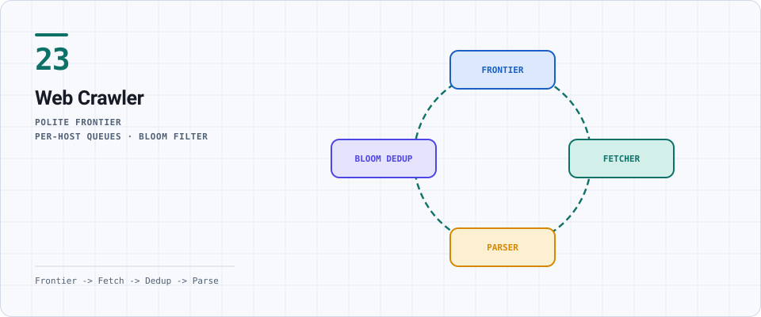
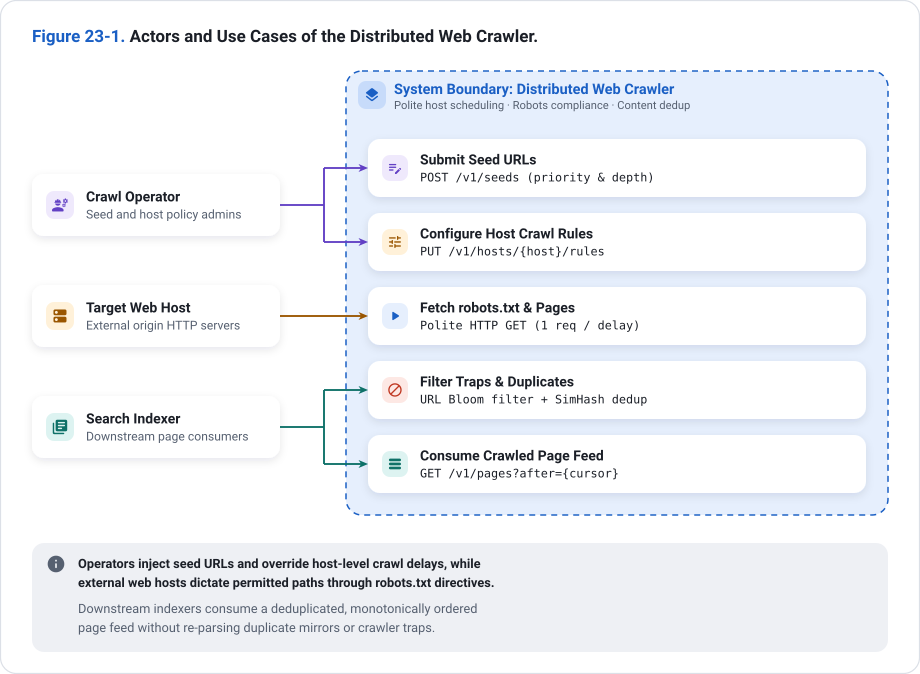
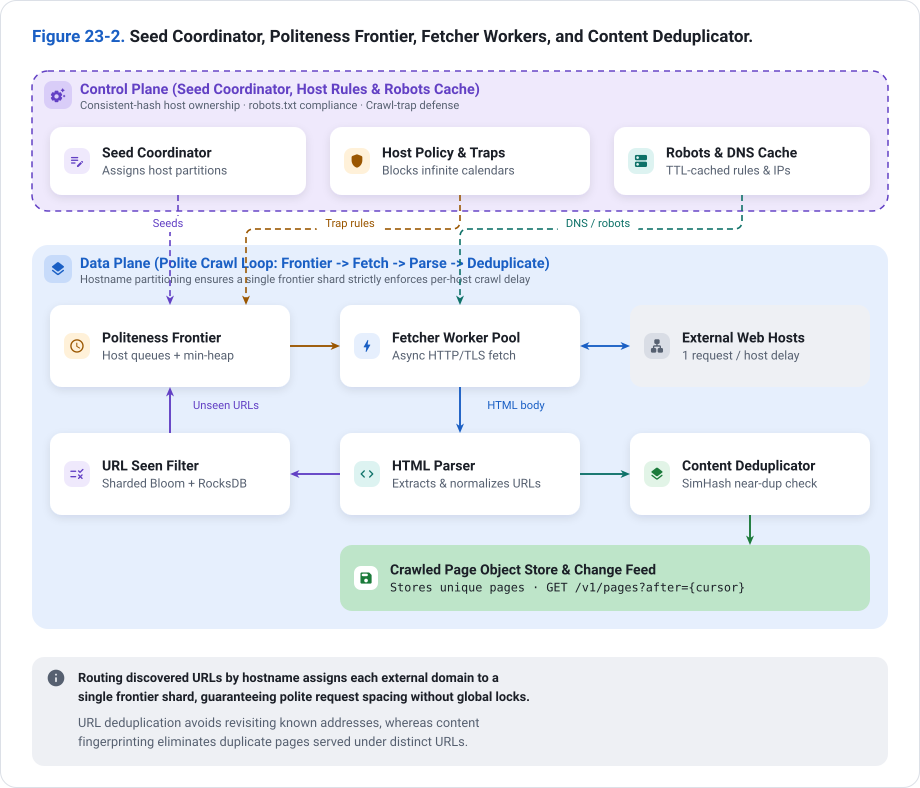
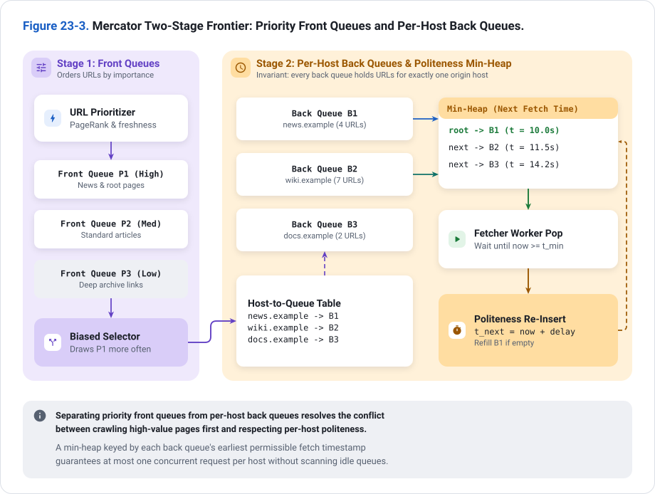

# Chapter 23: Web Crawler: System Design



A distributed web crawler traverses the public web graph continuously, discovering billions of URLs, fetching HTML and structured resources, and feeding deduplicated documents into downstream search indexers or archival corpora. Although breadth-first graph traversal requires ten lines of code in memory, operating against the live internet introduces five severe distributed systems constraints: the graph contains tens of billions of vertices that mutate while being traversed, infinite dynamically generated spider traps lure workers into unbounded loops, more than a quarter of pages duplicate existing content across distinct URLs, DNS resolution saturates standard resolvers, and every origin server belongs to an external operator who will block any crawler that violates politeness limits. In this chapter, I design a host-partitioned crawler built around the Mercator two-stage politeness frontier, RFC 9309 `robots.txt` compliance, Bloom-filter and RocksDB URL deduplication, 64-bit SimHash near-duplicate detection, and multi-layered spider-trap defenses.

<div class="covers">

In this chapter, we cover

- actors, use cases, verifiable functional requirements, strict politeness SLOs, explicit non-goals, and petabyte-scale crawl capacity bounds
- operator control APIs for seed injection and host policy overrides, monotonic cursor page-feed contracts, and frontier/host metadata schemas
- control-plane vs. data-plane separation across the Seed Coordinator, DNS and `robots.txt` caches, host-partitioned frontier shards, async fetcher pools, and object storage
- Mercator two-stage politeness frontier (priority front queues, per-host back queues, and next-fetch min-heap), consistent-hash host ownership, and adaptive `429` backoff
- URL canonicalization, sharded Bloom filter + RocksDB seen-set deduplication, 64-bit SimHash / MinHash near-duplicate detection, spider-trap budgets, and conditional `304` revisit scheduling
- failure matrices, crawl SLIs/SLOs, production architectures (Googlebot, Mercator, IRLbot, Common Crawl), and verification via [`code/crawlsim`](https://github.com/arpanpathak/cracking-the-systems-programming-interview/tree/prep-v2/distributed-systems-from-the-ground-up/code/crawlsim)

</div>

## 23.1 Requirements, Actors, and Capacity Bounds

Web crawling exhibits an unusual error-tolerance asymmetry. Missing 0.5% of long-tail URLs due to a Bloom filter false positive, or re-fetching a small fraction of pages after a worker crash, causes negligible harm to a search index. Violating per-host politeness, however, harms external website operators, triggers IP-block blacklists, and degrades the crawler's global reach. Every architectural boundary in this design therefore treats **per-host politeness** as a strict invariant while allowing **approximate deduplication** and **eventual consistency** across the broader crawl loop.

### Actors and Use Cases

Three external actor classes interact across the boundary of the distributed web crawler, as illustrated in Figure 23-1.

<figure class="diagram">

<figcaption><b>Figure 23-1</b> Actors, system boundary, and core use cases of the distributed web crawler.</figcaption>
</figure>

| Actor | Operation | Concrete Scenario |
| :--- | :--- | :--- |
| **Crawl Operator** | Inject seed URLs (`POST /v1/seeds`) and override host rules (`PUT /v1/hosts/{host}/rules`) | Bootstrap a fresh crawl from high-authority seed domains or cap page budgets and crawl delays for a sensitive partner host |
| **Target Web Host** | Publish `robots.txt` directives and respond to polite HTTP/TLS `GET` requests | Specify disallowed URL prefixes, optional `Crawl-delay`, `ETag` validators, and `429 Too Many Requests` rate signals |
| **Search Indexer** | Consume deduplicated crawl stream (`GET /v1/pages?after={cursor}`) | Read unique newly fetched or modified documents in monotonic sequence order without re-parsing mirrors or infinite traps |

### Functional Requirements

| No. | Functional Requirement |
| :--- | :--- |
| 0 | Starting from operator-supplied seed URLs, the system discovers, normalizes, and fetches reachable web pages by following extracted hyperlinks. |
| 1 | Before fetching any page on an origin host, the crawler retrieves, parses, caches, and strictly obeys that host's `robots.txt` exclusion rules (RFC 9309). |
| 2 | The crawler enforces strict per-host politeness: at most one in-flight request per host (or configured concurrency cap) separated by a minimum crawl delay (`>= 1 s` default, scaled dynamically on slow or `429` responses). |
| 3 | The crawler deduplicates normalized URLs against a durable seen set so the same URL is not re-crawled unnecessarily within a single crawl epoch. |
| 4 | The crawler identifies exact duplicate pages (via SHA-256 content hash) and near-duplicate mirrors (via 64-bit SimHash) before persisting to the page store and downstream feed. |
| 5 | The crawler defends against infinite spider traps through per-host depth caps, page budgets, URL length caps, and path-repetition filters. |
| 6 | The crawler revisits previously fetched pages at adaptive intervals driven by observed change frequency, using HTTP `If-None-Match` / `If-Modified-Since` conditional headers. |

### Non-Functional Requirements and SLOs

| No. | Property | Target Specification | Architectural Consequence |
| :--- | :--- | :--- | :--- |
| 0 | **Scale and Throughput** | `10,000,000,000` (10B) pages crawled per 30-day cycle (`~3,860` pages/s sustained; `10,000` pages/s burst) | Horizontal partitioning across `40+` disk-backed frontier shards and `300+` asynchronous non-blocking fetcher workers (`epoll`/`io_uring`) |
| 1 | **Politeness** | `<= 1` active request per origin host at any instant; `>= 1 s` inter-request pause (`100%` enforcement across cluster) | Consistent-hash partitioning by hostname ensures exactly one frontier machine owns all scheduling state for a given host |
| 2 | **Durability** | Frontier queues, host politeness state, and URL-seen database survive machine restarts without losing days of graph discovery | Disk-backed frontier queues (RocksDB/segmented logs) with replica checkpoints; pages written to replicated object storage (Chapter 16) |
| 3 | **Consistency** | Eventual consistency across URL deduplication (`<= 1%` Bloom filter false-positive skip rate acceptable, or `0%` with RocksDB backing) | Loose asynchronous batch forwarding of cross-host links over Kafka eliminates synchronous cross-shard locks |
| 4 | **Robustness** | Zero worker crashes or memory exhaustion from malformed HTML, decompression bombs, slow-loris streams, or infinite redirects | Hard per-fetch socket timeout (`10 s`), max body byte cap (`10 MB`), max redirect hops (`5`), and sandboxed streaming HTML parsers |

### Non-Goals and Explicit Scope Boundaries

To keep our focus on distributed crawling, politeness, and deduplication, we exclude the following concerns:

- **Full headless-browser JavaScript rendering at 100% coverage:** Executing Chromium/V8 for single-page applications multiplies CPU cost by 20x to 50x; production crawlers route only a selective subset of JS-heavy domains to a separate rendering pool after static HTML fetch.
- **Inverted-index construction, PageRank computation, and query serving:** Downstream search engines consume our immutable object store and change feed asynchronously.
- **Authenticated crawling behind login walls or anti-bot gates:** This architecture crawls strictly public, `robots.txt`-permitted web resources and never circumvents access controls.

### Back-of-the-Envelope Capacity Bounds

Web crawling is bounded simultaneously by **distinct active hosts in the frontier** (politeness concurrency), **URL-seen memory/disk footprint**, and **petabyte-scale object storage**.

| Resource Dimension | Derivation | Provisioned Bound |
| :--- | :--- | :--- |
| **Sustained Fetch Rate** | `10,000,000,000 pages / (30 days * 86,400 s)` | `~3,858` pages/s (provisioned for `5,000` pages/s) |
| **Minimum Active Hosts for Politeness** | `5,000 pages/s * 1 s` minimum delay (or `2 s` average delay) | `>= 10,000` distinct ready hosts active simultaneously |
| **Ingress Network Bandwidth** | `5,000 pages/s * 100 KB` average HTML payload `* 8 bits` | `~4.0 Gbit/s` sustained HTTP ingress |
| **Monthly Raw Content Storage** | `10B pages * 100 KB` (`~70%` unique after exact/near dedup, `~4x` zstd compression) | `~1.0 PB` uncompressed; `~175 TB` compressed unique pages/month |
| **URL-Seen Set (Exact 64-Bit Hash / RocksDB)** | `10B URLs * 16 B` (128-bit MD5/xxHash128 + metadata in LSM-tree) | `~160 GB` on NVMe SSD across 8 shards (`20 GB`/shard) |
| **URL-Seen In-Memory Bloom Filter** | `10B URLs * 10 bits` (`~0.8%` false-positive rate) | `~12.5 GB` total RAM (`~1.6 GB`/shard) fronting RocksDB |
| **DNS Resolution Rate** | `5,000 fetches/s` with `95%` local DNS cache hit rate (respecting TTLs) | `~250` external recursive DNS lookups/s |

## 23.2 External API and Data Contracts

The crawler exposes a narrow internal control API for operators to manage seeds and host budgets, and a pull-based monotonic change feed for downstream search indexers.

### Seed Injection Endpoint

```http
POST /v1/seeds HTTP/2
Host: crawler.internal
Authorization: Bearer ops_eyJhbGci...
Content-Type: application/json

{
  "crawl_id": "web-2026-10",
  "seeds": [
    { "url": "https://news.example/", "priority": 1, "max_depth": 4 },
    { "url": "https://docs.example/", "priority": 2, "max_depth": 6 }
  ]
}
```

```http
HTTP/2 202 Accepted
Content-Type: application/json

{
  "crawl_id": "web-2026-10",
  "accepted": 2,
  "rejected_invalid": 0
}
```

### Host Politeness and Trap-Guard Policy Override

```http
PUT /v1/hosts/calendar.example/rules HTTP/2
Host: crawler.internal
Authorization: Bearer ops_eyJhbGci...
Content-Type: application/json

{
  "min_crawl_delay_ms": 5000,
  "max_pages_per_epoch": 1000,
  "max_depth": 6,
  "deny_path_regexes": ["^/calendar/[0-9]{4}-[0-9]{2}-[0-9]{2}$"]
}
```

```http
HTTP/2 204 No Content
```

### Downstream Deduplicated Page Feed Endpoint

```http
GET /v1/pages?after=880213&limit=2 HTTP/2
Host: crawler.internal
Accept: application/json
```

```http
HTTP/2 200 OK
Content-Type: application/json

{
  "pages": [
    {
      "seq_id": 880214,
      "canonical_url": "https://news.example/a",
      "fetched_at": "2026-10-14T09:00:02Z",
      "http_status": 200,
      "etag": "\"v92a1\"",
      "content_sha256": "e3b0c44298fc...",
      "simhash64": "9182736455120934812",
      "object_uri": "s3://crawl-pages/2026-10/880214.html.zst"
    },
    {
      "seq_id": 880215,
      "canonical_url": "https://shop.example/item-1",
      "fetched_at": "2026-10-14T09:00:03Z",
      "http_status": 200,
      "etag": "\"itm-1\"",
      "content_sha256": "8a91bc0241ef...",
      "simhash64": "4019283746501928374",
      "object_uri": "s3://crawl-pages/2026-10/880215.html.zst"
    }
  ],
  "next_after": 880215
}
```

### Frontier Host Metadata and Seen-Set Schema

Each frontier shard maintains durable host scheduling state and page fingerprints locally in RocksDB (or partitioned relational metadata for host policies):

```sql
CREATE TABLE host_state (
    host_name        TEXT        PRIMARY KEY,
    shard_id         INT         NOT NULL,
    next_ready_at    TIMESTAMPTZ NOT NULL,
    crawl_delay_ms   INT         NOT NULL DEFAULT 1000,
    ewma_rtt_ms      INT         NOT NULL DEFAULT 200,
    pages_fetched    INT         NOT NULL DEFAULT 0,
    page_budget      INT         NOT NULL DEFAULT 10000,
    robots_fetched_at TIMESTAMPTZ,
    robots_expires_at TIMESTAMPTZ,
    robots_rules_raw BYTEA,
    consecutive_err  INT         NOT NULL DEFAULT 0
);
```

## 23.3 High-Level Architecture: Control Plane vs. Data Plane

We partition the crawler into a **Control Plane** that governs host ownership, compliance policies, and DNS caching, and a streaming **Data Plane** that executes the continuous `Frontier -> Fetch -> Parse -> Deduplicate -> Store` pipeline, as illustrated in Figure 23-2.

<figure class="diagram">

<figcaption><b>Figure 23-2</b> Control plane and data plane separation across consistent-hash host ownership, polite fetching, and deduplication.</figcaption>
</figure>

### Control Plane Responsibilities

- **Seed Coordinator:** Maintains the consistent-hash ring mapping normalized hostnames (`hash(host)`) onto Frontier shards. Adding or removing a frontier node rebalances only `1/N` of hosts while preserving single-owner politeness guarantees.
- **Host Policy and Trap Guard:** Distributes operator overrides, domain authority page budgets, and regex trap rules to all parsers and frontier shards.
- **Robots and DNS Cache:** Caches parsed `robots.txt` directives (24-hour TTL, honoring `Cache-Control` and negative caching on `404` for 24 hours; fail-closed backoff on `5xx`) and resolved IP addresses (honoring DNS record TTLs) so fetchers never block on external UDP resolvers.

### Data Plane Responsibilities

| Component | State Held | Failure Impact and Mitigation |
| :--- | :--- | :--- |
| **Politeness Frontier (x40 Shards)** | Disk-backed priority front queues, per-host back queues, and min-heap of `next_ready_at` times | Host-partitioned with WAL replication to standby; shard crash fails over its host partitions to standby without losing discovered URLs |
| **Fetcher Worker Pool (x300 Nodes)** | Ephemeral in-flight HTTP/TLS sockets (thousands of async connections per node) | Worker crash drops in-flight URLs; frontier tracks leased URLs with a 60-second lease timeout and re-enqueues unacknowledged URLs |
| **HTML Parser and Normalizer (x60 Nodes)** | Stateless streaming HTML/UTF-8 parser | Crash replays page from durable fetch buffer; strict byte/nesting limits isolate malformed markup |
| **URL Seen Filter (x8 Shards)** | In-memory Bloom filter backed by on-disk RocksDB 128-bit URL hash table | Crash reloads from replicated NVMe RocksDB shard; cross-host new URLs route in batches via Kafka to owning frontier shard |
| **Content Deduplicator** | Exact SHA-256 hash store + 64-bit SimHash permutation tables | Prevents duplicate mirrors from entering object storage or triggering redundant downstream link expansion |
| **Page Object Store and Change Feed** | Compressed unique HTML artifacts (`s3://crawl-pages/...`) + append-only sequence log | Erasure-coded multi-AZ object storage (Chapter 16) serves downstream indexers via cursor pagination |

## 23.4 Deep Dive: Mercator Two-Stage Politeness Frontier and `robots.txt` Compliance

A single FIFO frontier queue fails immediately on the live web. Because pages link heavily to other pages on the same domain, a FIFO queue produces long runs of consecutive URLs targeting one host (`news.example/1`, `news.example/2`, ...). Either the crawler launches parallel requests and floods `news.example` (triggering an IP ban), or workers sit idle waiting on `news.example`'s crawl delay while thousands of other hosts sit ready behind it in the queue.

### Mercator Two-Stage Frontier Architecture

Following the classic Mercator architecture, we decouple **what is important to crawl** (priority) from **when a host may be contacted** (politeness) using two distinct queue stages, as depicted in Figure 23-3.

<figure class="diagram">

<figcaption><b>Figure 23-3</b> Mercator two-stage frontier combining priority front queues with per-host back queues and a politeness min-heap.</figcaption>
</figure>

1. **Stage 1: Priority Front Queues (`F` Queues):** Incoming unseen URLs are scored by a **URL Prioritizer** using domain authority (in-link count / PageRank), expected freshness (news homepages vs. static archives), and shallow path depth, then appended to one of `F` disk-backed priority queues (`P1` High through `PF` Low). A **Biased Selector** draws from `P1` far more frequently than from `PF` (for example, weighted probabilities `0.6 / 0.3 / 0.1`), preventing starvation of low-priority URLs while favoring high-value pages.
2. **Stage 2: Per-Host Back Queues (`B` Queues) and Min-Heap:** The frontier maintains `B` active back queues (typically `B = 3x` to `5x` the number of fetcher threads per shard), enforcing one strict invariant: **every non-empty back queue contains URLs belonging to exactly one origin host**. A **Host-to-Queue Table** maps `host -> back_queue_id`, and a **Min-Heap** orders all active back queues by their earliest legal fetch timestamp `next_ready_at`.
3. **Polite Dispatch Loop:** When a fetcher worker asks for work, the frontier pops the root of the min-heap (`B1`, ready at `t = 10.0 s`). If `now < B1.next_ready_at`, the worker sleeps until `10.0 s` (in practice, with `10,000+` hosts, the root is always immediately ready). The frontier pops one URL from `B1`, hands it to the fetcher, and computes the next allowed timestamp dynamically from the server's own response time:
   ```text
   next_ready_at = fetch_complete_time + max(min_crawl_delay_ms, 10 * last_rtt_ms)
   ```
   Multiplying observed response latency by `10` automatically slows down against struggling small servers while moving briskly across well-provisioned origins. If a host returns HTTP `429 Too Many Requests` or `503 Service Unavailable`, the frontier respects any `Retry-After` header and applies exponential backoff (`2x` per failure up to 24 hours). When `B1` empties, the frontier pulls from the Biased Selector until a fresh host populates `B1`.

Advance through the interactive step-by-step trace below to observe how per-host queues and a 2-second host interval keep fetchers busy across three hosts without ever violating politeness.

<figure class="steps" data-prefix="figures/steps-crawl-frontier" data-count="5" data-version="53461153">

<figcaption><b>Figure 23.1</b> A crawl of 3 hosts, each of which may be asked once every 2 seconds. Use Next and Back to move through the 5 steps.</figcaption>
</figure>

### Host-Ownership Sharding and `robots.txt` Compliance

Enforcing politeness locally on each machine breaks if two frontier nodes hold queues for `news.example` simultaneously, doubling its incoming request rate. Partitioning frontier shards strictly by `consistent_hash(origin_host)` guarantees a single authoritative scheduler and `robots.txt` cache entry per host. Because `80%` to `85%` of hyperlinks on a web page point to other pages on the **same** host, host partitioning also minimizes cross-node network forwarding: only the remaining `15%` to `20%` of cross-host links travel through Kafka batches to remote shards.

Before fetching any path on a newly encountered host, the fetcher requests `https://{host}/robots.txt` with an identifiable `User-Agent` string and contact URL, obeying RFC 9309 longest-match `Allow`/`Disallow` prefix precedence:
- `2xx`: Parse directives and cache for 24 hours (or `Cache-Control` max-age).
- `4xx` (including `404 Not Found`): Assume full crawl permission and negative-cache for 24 hours.
- `5xx` or timeout: Assume temporary disallow (fail closed) and retry with exponential backoff so the crawler never hammers an unhealthy origin.

## 23.5 Deep Dive: URL Deduplication, SimHash Near-Duplicates, and Spider-Trap Defenses

### URL Canonicalization and Hybrid Bloom Filter + RocksDB Seen Set

Before checking whether a discovered link has already been queued, the parser applies deterministic **URL canonicalization**: lowercasing scheme and host, stripping default ports (`:80`, `:443`), removing URL fragments (`#section`), resolving relative dot-segments (`/a/../b -> /b`), sorting query parameters lexicographically, and stripping known tracking parameters (`utm_*`, `fbclid`, `sessionid`).

Checking `50,000+` extracted links per second against 10 billion seen URLs (`~800 GB` as raw 80-byte strings) exceeds single-node RAM. We resolve this with a two-tier sharded lookup (partitioned by `hash(host)` so every shard validates its own host's links locally):

1. **Tier 1: In-Memory Sharded Bloom Filter (`12.5 GB` total across 8 shards at `10 bits/URL`):** Answers "definitely unseen" in under `100 ns` with zero disk I/O. If the crawl tolerates missing `~0.8%` of new URLs due to Bloom false positives, the filter alone suffices.
2. **Tier 2: On-Disk RocksDB 128-Bit Hash Table (`160 GB` NVMe SSD):** For exact deduplication (`0%` false-positive drops), any positive Bloom hit probes the local RocksDB LSM-tree keyed by `xxHash128(canonical_url)`. Because most newly discovered links on the web are duplicates, batching RocksDB point lookups and keeping an LRU cache of hot URLs (such as site navigation links appearing on every page) eliminates `> 90%` of SSD reads.

### Exact Checksums and 64-Bit SimHash Near-Duplicate Detection

Roughly `25%` to `30%` of fetched web pages duplicate content already stored under another URL (`http` vs. `https`, `www` vs. apex domain, printer-friendly views, syndicated articles). Exact duplicates are caught immediately by hashing normalized body text with SHA-256.

Near-duplicates, however, differ slightly in timestamps, ad banners, or view counters, causing cryptographic hashes like SHA-256 to diverge completely. Following Google's Manku et al. algorithm, we compute a locality-sensitive **64-bit SimHash fingerprint** for every fetched document:

1. Extract overlapping word shingles (for example, 3-word n-grams) from the visible text and assign TF-IDF weights.
2. Hash each shingle to a 64-bit integer; maintain a 64-element float vector `V`, adding `+weight` to `V[i]` if bit `i` of the hash is `1`, or `-weight` if `0`.
3. Collapse `V` into a 64-bit fingerprint `F` where bit `i = 1` if `V[i] > 0`, else `0`.
4. **Near-Duplicate Index Lookup (Hamming Distance `<= 3`):** Two pages whose 64-bit fingerprints differ in at most `k = 3` bit positions are classified as near-duplicates. Comparing against 10 billion fingerprints linearly is infeasible; instead, by the pigeonhole principle, partitioning each 64-bit fingerprint into `4` blocks of `16` bits (or `6` blocks across permuted sorted tables) guarantees that any two fingerprints with Hamming distance `<= 3` share at least one **exact** 16-bit prefix block. Probing 4 sorted permutation tables reduces candidate comparisons from billions to a handful of entries in microseconds.

### Spider-Trap Containment and Adaptive Revisit Scheduling

Dynamically generated websites create infinite URL spaces: online calendars linking `day-1 -> day-2 -> ...` forever, e-commerce faceted filter permutations (`?color=red&size=m&sort=asc`), or symlinks causing recursive path loops (`/a/b/a/b/a/b/...`). Because no algorithm can decide in general whether an arbitrary web server generates an infinite graph, we enforce four orthogonal hard bounds:

1. **Per-Host Authority-Weighted Page Budget (IRLbot Model):** Every host receives a finite page budget per crawl epoch proportional to its external in-degree (number of distinct referring domains), preventing low-authority traps from consuming crawler capacity.
2. **Depth and URL-Length Limits:** Cap link-hop depth from the host root (default `max_depth = 8`), maximum URL length (`2,048` bytes), and repeated path segments (reject any URL where a path component repeats `>= 3` times).
3. **Hard Fetch Resource Limits:** Enforce strict TCP connect (`3 s`), total download (`10 s`), max payload (`10 MB`), and redirect hop (`<= 5`) limits to block slow-loris and gzip-bomb traps.
4. **Adaptive Revisit Scheduling:** Rather than revisiting every page uniformly or strictly proportional to change frequency (Cho and Garcia-Molina proved that proportional revisiting wastes budget on ultra-volatile pages that grow stale immediately), we schedule conditional revisits (`If-None-Match: "<etag>"`) prioritizing moderate-change, high-importance pages, confirming unchanged documents via lightweight `304 Not Modified` responses.

## 23.6 Failure Modes, SLIs, and Production Systems

### Failure and Recovery Matrix

| Failure Scenario | Blast Radius | Automated Recovery and Preserved Invariant |
| :--- | :--- | :--- |
| **Fetcher Worker Crashes Mid-Download** | In-flight URLs on 1 worker | Frontier lease (`60 s`) expires without completion ACK; URL returns to host back queue for retry |
| **Frontier Shard Machine Crash** | `1/40` of origin hosts pause briefly | Replicated WAL promotes standby shard owning those host partitions; zero loss of discovered queue state |
| **Target Origin Returns `429` or `503`** | Single external origin host | Frontier honors `Retry-After` and exponentially increases `crawl_delay_ms`; after 5 consecutive failures, quarantines host for 24 hours |
| **Infinite Calendar or Faceted Filter Trap** | Single origin host | Per-host `page_budget`, `max_depth`, and path-repetition guards halt expansion before frontier disk fills |
| **Malformed HTML or Gzip Decompression Bomb** | Single fetch task | Streaming byte-counter aborts download at `10 MB` decompressed limit; sandboxed parser drops corrupt document without crashing worker |
| **External Recursive DNS Slowdown** | Fetcher connection setup | Dedicated in-cluster DNS Resolver Cache absorbs `95%+` of lookups; circuit breaker pauses uncached host resolution rather than exhausting worker threads |

### Operational SLIs and SLOs

Four domain-specific Service Level Indicators govern crawl efficiency and external safety:

1. **Per-Host Politeness Violation Rate:** Audit metric verifying zero inter-request intervals below `min_crawl_delay_ms` or `robots.txt` `Disallow` violations (`SLO = 0.000%`, `SEV-1` on any violation).
2. **Useful-Byte Yield (Unique / Total Fetched Ratio):** Percentage of fetched bytes passing exact SHA-256 and SimHash deduplication (`target >= 65%`); sudden drops signal an uncontained spider trap or URL normalization regression.
3. **Frontier Queue Starvation and Active Host Count:** Tracks number of distinct ready hosts in the min-heap (`target >= 10,000` active hosts) and fetcher thread utilization.
4. **HTTP Status Distribution (`2xx` / `304` / `4xx` / `429` / `5xx`):** Rising `429` or `403` share signals overly aggressive default crawl delays or IP reputation issues requiring immediate pacing adjustment.

### How Production Systems Implement Web Crawling

| Production System | Core Architecture | Architectural Distinction |
| :--- | :--- | :--- |
| **Googlebot** | Massively distributed host-partitioned crawler with adaptive crawl-budget optimization, SimHash near-dedup, and decoupled Chromium Evergreen JS rendering pipeline | Dynamically computes per-host crawl capacity from live error/latency telemetry and splits fast static HTML fetching from GPU/CPU-intensive JavaScript rendering |
| **Mercator (Compaq SRC)** | Two-stage frontier (priority front queues + per-host back queues + politeness min-heap) with disk-backed URL-seen batching | Defined the canonical politeness frontier data structure still used across modern large-scale crawlers |
| **IRLbot (Texas A&M)** | Single-server extreme-efficiency crawler using disk-based DRUM (Disk Repository with Update Management) batch seen-set checks and STAR domain-budgeting | Crawled 6.38 billion pages in 41 days from a single machine, demonstrating that authority-weighted per-domain budgets are essential to defeat spider traps |
| **Common Crawl (Apache Nutch / StormCrawler)** | Open-source distributed politeness-partitioned crawler publishing petabyte-scale monthly WARC archives on S3 | Exposes public, standardized WARC/WET crawl snapshots with strict RFC 9309 compliance for open web research and ML corpora |

## 23.7 Simulation Verification

To verify per-host politeness scheduling, URL-seen deduplication, and per-host spider-trap page budgets, execute the `crawlsim` crate in the repository's [`code/`](https://github.com/arpanpathak/cracking-the-systems-programming-interview/tree/prep-v2/distributed-systems-from-the-ground-up/code) workspace:

```console
$ cargo run --release -p crawlsim
t= 0  fetch news/
t= 1  fetch calendar/day-1, shop/
t= 2  fetch news/a
t= 3  fetch calendar/day-2, shop/item-1
t= 4  fetch news/b
t= 5  fetch calendar/day-3, shop/item-2
t= 7  fetch calendar/day-4
pages fetched: 10
links to addresses already seen: 7
links not followed because a host had given 4 pages: 1
```

The observed transcript confirms all three core crawler invariants across three hosts (`news`, `calendar`, `shop`) configured with a 2-second per-host politeness interval and a 4-page per-host trap budget:
- **Zero politeness violations:** `news` is fetched strictly at `t = 0, 2, 4`; `calendar` at `t = 1, 3, 5, 7`; and `shop` at `t = 1, 3, 5`. No host is ever contacted twice within 2 seconds, while fetchers remain busy across interleaved hosts.
- **URL deduplication:** `7` links pointing to already-discovered URLs are filtered out cleanly before re-entering the frontier.
- **Spider-trap containment:** The infinite `calendar/day-1 -> day-2 -> day-3 -> day-4 -> day-5` chain terminates cleanly at `calendar/day-4`, dropping `day-5` (`1` link blocked by the 4-page host cap).

<div class="simulation">

**Run the web crawler simulation.** Execute `cargo run --release -p crawlsim` in [`code/crawlsim`](https://github.com/arpanpathak/cracking-the-systems-programming-interview/blob/prep-v2/distributed-systems-from-the-ground-up/code/crawlsim/src/main.rs) to reproduce per-host 2-second politeness scheduling, URL deduplication (`7` duplicates filtered), and infinite calendar trap termination at 4 pages.

</div>

### End-to-End Request Lifecycle and Hop-by-Hop Latency Budget

A single crawl cycle spans frontier dequeue, politeness-gated HTTP retrieval, content deduplication, and durable archival; network RTT to external origin servers dominates the latency budget.

| Hop | Component | Operation | P50 | P99 |
| :--- | :--- | :--- | :--- | :--- |
| 1 | Mercator Frontier | Pop ready host from min-heap and dequeue next canonical URL from per-host back queue | 0.4 ms | 2 ms |
| 2 | Local DNS & `robots.txt` Cache | Resolve host IP and verify RFC 9309 allow/disallow rules from in-memory cache | 0.5 ms | 15 ms |
| 3 | Async Fetcher Pool | HTTP/1.1 or HTTP/2 GET with connect/read timeouts and streaming body cap (2 MiB) | 120 ms | 1,800 ms |
| 4 | Parser & Deduplicator | HTML link extraction, URL canonicalization, Bloom filter check, and 64-bit SimHash lookup | 2 ms | 12 ms |
| 5 | Durable Object Store | Batch append compressed response payload into WARC segment and flush frontier WAL | 8 ms | 35 ms |

### Production Case Studies and Open-Source Comparisons

Googlebot popularized the Mercator two-stage frontier architecture, separating priority front queues (which rank crawl importance by PageRank and change frequency) from host-pinned back queues governed by a next-fetch min-heap so thousands of concurrent fetchers respect per-domain politeness delays. Common Crawl operates an open-source distributed pipeline built on Apache Nutch and StormCrawler, partitioning hosts consistently across workers and publishing monthly petabyte-scale WARC archives on object storage with strict `robots.txt` compliance. Whereas Apache Nutch traditionally executes MapReduce batch crawl cycles with high disk I/O between phases, StormCrawler and modern Rust async fetchers stream URLs continuously through in-memory politeness queues to sustain high link utilization without batch-boundary stalls.

<div class="callout keyidea">
<span class="label">Key idea</span>
<p>Separating crawl priority from host politeness via Mercator front and back queues lets a distributed crawler maximize global throughput across millions of domains while guaranteeing at most one in-flight request per origin host.</p>
</div>

<div class="callout experiment">
<span class="label">Experiment</span>
<p>Execute <code>cargo run --release -p crawlsim</code> and inspect the timestamps for <code>news</code>, <code>calendar</code>, and <code>shop</code>. Notice how interleaved scheduling keeps the fetcher busy every tick while strictly enforcing the 2-second per-host cooldown and capping the infinite calendar trap at 4 pages.</p>
</div>

<div class="callout caution">
<span class="label">Common pitfall</span>
<p>Relying on an unbounded in-memory hash set for URL deduplication exhausts RAM within hours at web scale, while omitting per-host depth and page budgets lets dynamic calendar or faceted-search traps consume the entire crawl quota.</p>
</div>

## 23.8 Terminology and References

### Engineering Glossary

| Term | Definition |
| :--- | :--- |
| **Bloom Filter** | A compact probabilistic bit-array set membership structure (`~10 bits/element`) with zero false negatives and a tunable low false-positive rate. |
| **Mercator Frontier** | A two-stage URL scheduler combining priority front queues (deciding crawl importance) with per-host back queues and a next-fetch min-heap (enforcing politeness). |
| **Politeness Constraint** | Restricting crawler concurrency to at most one active request per origin host separated by a minimum crawl delay so external servers are never overloaded. |
| **Robots Exclusion Protocol (`robots.txt`)** | Standardized site-root directives (RFC 9309) specifying disallowed URL paths and crawler policies that compliant crawlers fetch and cache prior to crawling. |
| **SimHash** | A locality-sensitive 64-bit document fingerprint in which near-duplicate pages differ in at most a few bits (small Hamming distance), enabling fast mirror detection. |
| **Spider Trap (Crawler Trap)** | A dynamically generated or cyclical URL structure (such as an infinite calendar or faceted filter graph) capable of producing unbounded distinct URLs. |
| **URL Canonicalization** | Normalizing case, default ports, relative paths, fragments, and query parameter order so equivalent URLs map to a single canonical key. |

### References

- A. Heydon and M. Najork, "Mercator: A Scalable, Extensible Web Crawler", *World Wide Web Journal*, vol. 2, no. 4, 1999.
- S. Brin and L. Page, "The Anatomy of a Large-Scale Hypertextual Web Search Engine", *Proceedings of WWW*, 1998.
- H. T. Lee, D. Leonard, X. Wang, and D. Loguinov, "IRLbot: Scaling to 6 Billion Pages and Beyond", *Proceedings of WWW*, 2008.
- G. S. Manku, A. Jain, and A. Das Sarma, "Detecting Near-Duplicates for Web Crawling", *Proceedings of WWW*, 2007.
- J. Cho and H. Garcia-Molina, "Effective Page Refresh Policies for Web Crawlers", *ACM Transactions on Database Systems*, vol. 28, no. 4, 2003.
- RFC 9309, *Robots Exclusion Protocol*, IETF, 2022.
- RFC 9110, *HTTP Semantics*, IETF, 2022 (`If-None-Match`, `304 Not Modified`, and `429 Too Many Requests`).
