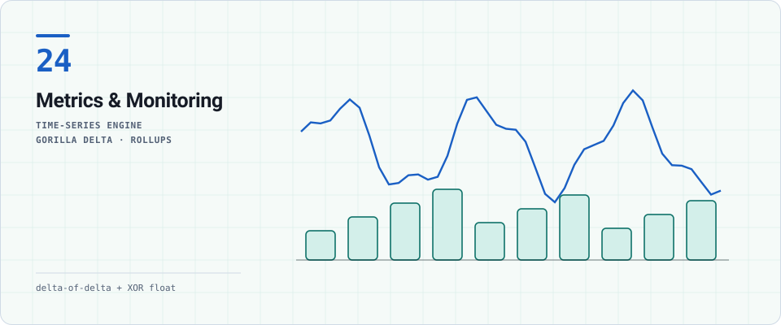
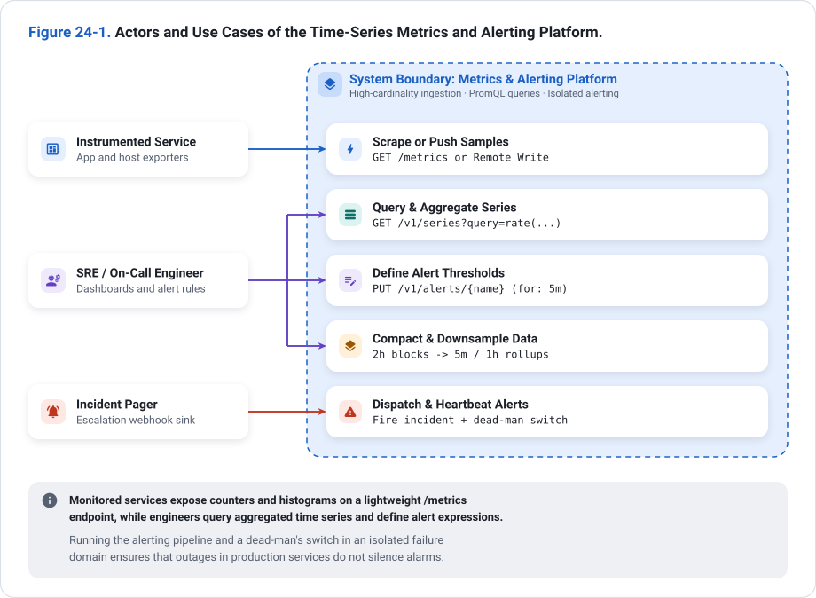
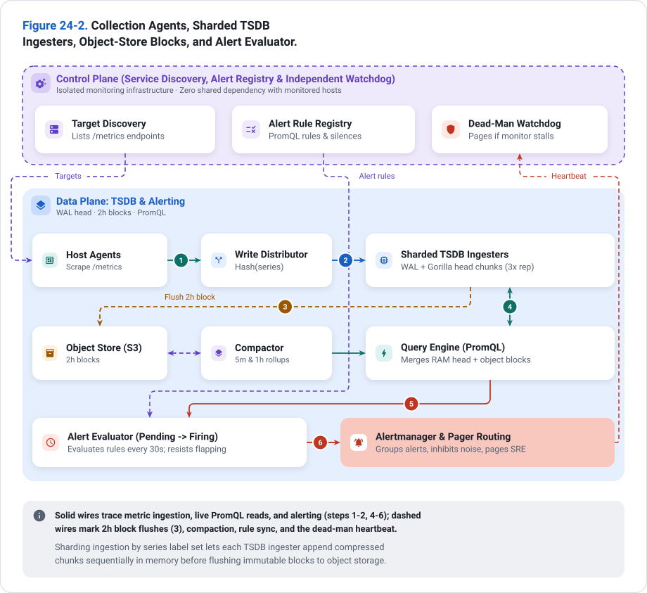
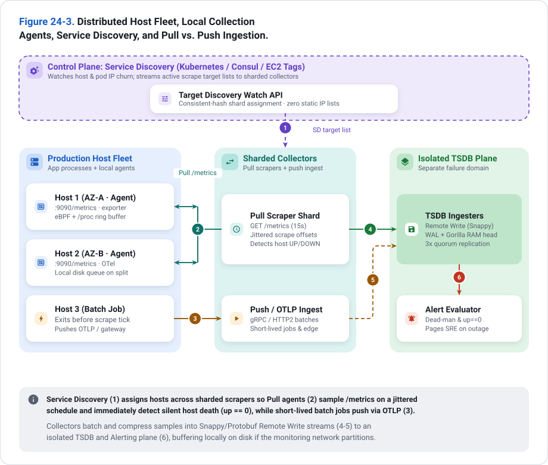
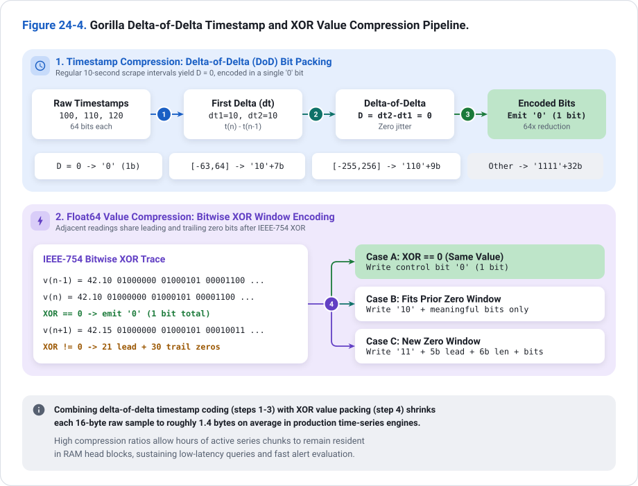

# Chapter 24: Metrics and Monitoring: System Design



A distributed metrics and monitoring platform continuously collects numeric telemetry across tens of thousands of services, compresses billions of daily data points into specialized time-series storage, serves interactive range queries during live incidents, and pages on-call engineers when user-facing service levels degrade. Monitoring exhibits an asymmetric workload profile: continuous, relentless append-only writes of tiny `(timestamp, float64)` samples paired with sparse ad-hoc reads that suddenly spike during outages across multi-month ranges. Above all, a monitoring system carries a strict failure-isolation mandate: because engineers depend on metrics precisely when production infrastructure breaks, the telemetry plane must run on independent compute, networking, and storage so a production outage cannot silence its own alarms. In this chapter, I design a horizontally sharded time-series database (TSDB) and alerting platform incorporating pull and push ingestion, Gorilla delta-of-delta and XOR compression, inverted label-index cardinality defenses, two-hour WAL-backed head blocks compacted to immutable object storage, spike-preserving rollups, and hysteresis-guarded multi-window alert evaluation.

<div class="covers">

In this chapter, we cover

- actors, use cases, verifiable functional requirements, high-availability write SLOs, explicit non-goals, and compression-adjusted capacity bounds
- Prometheus OpenMetrics scrape exposition, Remote Write ingestion, PromQL range-query APIs, alert rule definitions, and TSDB chunk/index schemas
- control-plane vs. data-plane separation across isolated target discovery, sharded TSDB ingesters, object-store compaction, query engines, and Dead-Man's Switch watchdogs
- pull vs. push ingestion trade-offs, mergeable histograms vs. non-aggregatable percentiles, Gorilla delta-of-delta timestamp and XOR float64 compression, and inverted label-index cardinality defense
- two-hour WAL head blocks flushed to immutable object-store TSDB blocks, multi-stat downsampling rollups (`min`, `max`, `sum`, `count`), and `Pending -> Firing` alert evaluation with hysteresis
- failure matrices, telemetry SLIs/SLOs, production architectures (Prometheus, VictoriaMetrics, Google Monarch, Grafana Mimir), and verification via [`code/metricsim`](https://github.com/arpanpathak/cracking-the-systems-programming-interview/tree/prep-v2/distributed-systems-from-the-ground-up/code/metricsim)

</div>

## 24.1 Requirements, Actors, and Capacity Bounds

Every telemetry data point belongs to a **time series** uniquely identified by a metric name and a sorted set of `key=value` labels (for example, `http_requests_total{service="payments",az="us-east-1a",status="500"}`). Three metric primitives cover nearly all operational signals: **counters** (monotonically increasing totals from which queries derive rates across intervals, surviving missed scrapes cleanly), **gauges** (instantaneous point-in-time readings such as queue depth or resident memory), and **histograms** (cumulative counts across duration buckets that can be summed across hosts and time windows to compute exact or relative-error-bounded tail percentiles like `p99`).

### Actors and Use Cases

Three external actor classes interact across the boundary of the metrics and alerting platform, as illustrated in Figure 24-1.

<figure class="diagram">

<figcaption><b>Figure 24-1</b> Actors, system boundary, and core use cases of the time-series metrics and alerting platform.</figcaption>
</figure>

| Actor | Operation | Concrete Scenario |
| :--- | :--- | :--- |
| **Instrumented Service** | Expose `/metrics` for pull scraping or transmit Remote Write batches (`POST /v1/series:batchWrite`) | Report request counters, latency histogram buckets, and memory gauges every 10 seconds across 100,000 service instances |
| **SRE / On-Call Engineer** | Execute range queries (`GET /v1/series?query=...`) and register alert expressions (`PUT /v1/alerts/{name}`) | Inspect 6-hour `p99` checkout latency across availability zones and configure a 5-minute burn-rate error alert |
| **Incident Pager** | Receive grouped firing alerts and periodic dead-man's switch heartbeats | Deduplicate cascading dependency alarms into one actionable page and trigger escalation if the monitoring pipeline stalls |

### Functional Requirements

| No. | Functional Requirement |
| :--- | :--- |
| 0 | The platform collects numeric time-series samples (counters, gauges, and cumulative histograms) from long-lived services via pull scraping and accepts pushed batches from ephemeral short-lived jobs. |
| 1 | Engineers can select and aggregate arbitrary subsets of time series by label matchers (`service="payments"`, `status=~"5.."`) over any historical time window. |
| 2 | The query engine computes fleet-wide latency percentiles (`p50`, `p95`, `p99`) by aggregating histogram bucket counts across instances and intervals. |
| 3 | Raw samples are retained at full 10-second resolution for 15 days and automatically downsampled into 5-minute and 1-hour multi-stat rollups (`min`, `max`, `sum`, `count`) retained for 2 years. |
| 4 | Engineers define PromQL-style alert rules specifying an expression, threshold, and sustained `for` duration; the evaluator suppresses transient flapping and fires absence alerts when critical series cease arriving. |
| 5 | Firing alerts route through grouping, inhibition, and deduplication pipelines before paging responders, guarded by an external Dead-Man's Switch watchdog. |

### Non-Functional Requirements and SLOs

| No. | Property | Target Specification | Architectural Consequence |
| :--- | :--- | :--- | :--- |
| 0 | **Ingestion Scale** | `10,000,000` active time series sampled every `10 s` (`1,000,000` samples/s sustained; `3,000,000` samples/s burst) | Horizontally sharded TSDB ingesters partitioned by `hash(series_labels)` with lock-free append-only in-memory head chunks |
| 1 | **Query Latency** | `p99 <= 1.0 s` for 6-hour incident dashboards; `p99 <= 3.0 s` for 1-year downsampled trend queries | Separate read/query tier from write ingesters; route long-range queries automatically to 5-minute or 1-hour rolled-up blocks |
| 2 | **Freshness** | Newly scraped samples become queryable and alert-evaluable within `<= 30 s` | Query Engine fans out to both active RAM head blocks on ingesters and immutable historical blocks in object storage |
| 3 | **Availability and Isolation** | `99.9%` write and alert availability (`<= 43.2` minutes/month) with **zero shared fate** against monitored production systems | Dedicated monitoring VPC, separate AWS/GCP account or failure zone, and independent pager egress path |
| 4 | **Tiered Durability** | Tolerates losing a few seconds of un-replicated live points on crash; zero loss of flushed historical blocks (`11 nines` durability) | Write-ahead log (WAL) + 2x or 3x ingester replication without synchronous cross-AZ consensus (`AP` writes); 2-hour blocks flushed to replicated object storage |
| 5 | **Cardinality Defense** | Hard per-tenant active-series caps (`<= 500,000` series/service) to prevent unbounded label OOM cascades | Ingress distributor rejects or relabels violating series while emitting a cardinality-breach meta-metric |

### Non-Goals and Explicit Scope Boundaries

To maintain sharp boundaries across the three pillars of observability, we exclude the following systems from the TSDB core:

- **Unstructured application log indexing:** Per-request JSON logs containing unbounded `user_id` or `order_id` fields belong in dedicated inverted-text or columnar log stores (such as Loki, Elasticsearch, or ClickHouse), never as TSDB labels.
- **Distributed request tracing:** Following an individual RPC tree across microservices (OpenTelemetry spans / Jaeger / Tempo) stores high-cardinality trace IDs outside numeric metric aggregation.
- **Continuous CPU/heap flame-graph profiling:** Stack-trace sampling uses specialized symbol-table profiles rather than scalar time series.

### Back-of-the-Envelope Capacity Bounds

Time-series storage capacity changes by an order of magnitude once Gorilla bit-level compression is applied:

| Resource Dimension | Derivation | Provisioned Bound |
| :--- | :--- | :--- |
| **Sustained Sample Ingestion** | `10,000,000` active series `/ 10 s` scrape interval | `1,000,000` samples/s (`86.4B` samples/day) |
| **Uncompressed Daily Storage** | `86.4B` samples `* 16 B` (`8 B` int64 timestamp + `8 B` float64 value) | `1.38 TB/day` (`~504 TB/year`) |
| **Gorilla-Compressed Daily Storage** | `86.4B` samples `* 1.5 to 2.0 B/sample` (1.37 B typical in Gorilla; 2.0 B byte-aligned) | `~130 to 173 GB/day` (`~8x to 11x` reduction) |
| **15-Day Raw Retention (Object Store)** | `173 GB/day * 15 days` | `~2.6 TB` immutable 2-hour TSDB blocks |
| **2-Year Hourly Rollup Storage** | `10M` series `* 17,520` hours `* 4` stats (`min, max, sum, count`) `* 2 B` | `~1.4 TB` compressed historical rollups |
| **Ingester Head-Block RAM (2-Hour Window)** | `10M` series `* 720` samples/2h `* 2 B` + `~1 KB`/series inverted label index overhead | `~14.4 GB` raw chunks + `~10 GB` label index (`~25 to 30 GB` per full replica; `~75 to 90 GB` at 3x replication across 40 ingesters) |

## 24.2 External API and Data Contracts

### Target Pull Exposition Format (OpenMetrics / Prometheus)

Monitored services expose an HTTP endpoint (`GET /metrics`) returning current counter totals, gauge values, and cumulative histogram bucket counts in plain text or protobuf:

```http
GET /metrics HTTP/1.1
Host: payments-14.internal
Accept: application/openmetrics-text; version=1.0.0
```

```http
HTTP/1.1 200 OK
Content-Type: text/plain; version=0.0.4

# TYPE http_requests_total counter
http_requests_total{service="payments",status="200"} 918234
http_requests_total{service="payments",status="500"} 417
# TYPE queue_depth gauge
queue_depth{service="payments"} 12
# TYPE http_request_duration_seconds histogram
http_request_duration_seconds_bucket{service="payments",le="0.05"} 880112
http_request_duration_seconds_bucket{service="payments",le="0.25"} 915540
http_request_duration_seconds_bucket{service="payments",le="+Inf"} 918651
http_request_duration_seconds_sum{service="payments"} 19842.6
http_request_duration_seconds_count{service="payments"} 918651
```

### PromQL Range Query Endpoint

```http
GET /v1/series?query=histogram_quantile(0.99,sum(rate(http_request_duration_seconds_bucket{service="payments"}[5m]))by(le))&from=2026-10-14T08:00:00Z&to=2026-10-14T09:00:00Z&step=60 HTTP/2
Host: metrics.internal
Authorization: Bearer sre_eyJhbGci...
```

```http
HTTP/2 200 OK
Content-Type: application/json

{
  "status": "success",
  "resolution_tier": "raw_10s",
  "step_sec": 60,
  "series": [
    {
      "labels": { "service": "payments", "quantile": "0.99" },
      "points": [
        [1760428800, 0.042],
        [1760428860, 0.048]
      ]
    }
  ]
}
```

### Alert Rule Configuration Endpoint

```http
PUT /v1/alerts/payments-high-error-rate HTTP/2
Host: metrics.internal
Authorization: Bearer sre_eyJhbGci...
Content-Type: application/json

{
  "expr": "sum(rate(http_requests_total{service=\"payments\",status=~\"5..\"}[5m])) / sum(rate(http_requests_total{service=\"payments\"}[5m])) > 0.01",
  "for_seconds": 300,
  "keep_firing_for_seconds": 120,
  "severity": "critical",
  "route": "payments-on-call",
  "annotations": {
    "summary": "Payments 5xx error ratio exceeded 1% for 5 continuous minutes"
  }
}
```

```http
HTTP/2 204 No Content
```

### On-Disk Immutable TSDB Block Layout

Every 2 hours, each ingester flushes its closed head window into a self-contained immutable directory uploaded to object storage:

```text
blocks/<ulid_2h_block>/
  meta.json        # min_time, max_time, num_samples, num_series, compaction_level
  index            # Symbol table + inverted posting lists (label=value -> sorted series_ids)
  chunks/000001    # Contiguous Gorilla-compressed 120-sample chunks per series_id
  tombstones       # Optional administrative deletion markers
```

## 24.3 High-Level Architecture: Control Plane vs. Data Plane

To protect alert delivery and telemetry durability during production incidents, we isolate the monitoring cluster on independent infrastructure and separate control-plane discovery and watchdog logic from the high-throughput ingestion and query data plane, as illustrated in Figure 24-2.

<figure class="diagram">

<figcaption><b>Figure 24-2</b> Control plane and data plane architecture of the isolated time-series metrics and alerting platform.</figcaption>
</figure>

### Control Plane Responsibilities

- **Target Discovery:** Reads service registries (Kubernetes API, Consul, cloud instance tags) to push live lists of `/metrics` scrape targets to regional Collection Agents without manual host files.
- **Alert Rule Registry:** Stores versioned PromQL alert definitions, multi-window SLO burn-rate rules, and temporary maintenance silences.
- **Dead-Man's Switch Watchdog:** A minimal external probe running in an independent region or cloud provider. The internal Alert Evaluator continuously fires an always-true synthetic alert (`vector(1)`) to the watchdog every 60 seconds; if the watchdog stops receiving that heartbeat for 3 consecutive minutes, it pages SRE through an independent escalation channel.

### Data Plane Responsibilities

| Component | State Held | Failure Impact and Mitigation |
| :--- | :--- | :--- |
| **Collection Agents (Scrapers)** | Target list + short local retry buffer | Consistent-hash sharded across target services; HA pairs scrape critical targets in parallel and deduplicate on ingestion |
| **Write Distributor** | Stateless consistent-hash router + per-tenant cardinality limiter | Routes every sample by `hash(metric_name + sorted_labels)` to `RF = 3` (or `RF = 2`) TSDB Ingesters; rejects runaway label cardinality at ingress |
| **Sharded TSDB Ingesters** | Active 2-hour Gorilla head chunks in RAM + local NVMe Write-Ahead Log (WAL) | Single ingester crash leaves zero query gaps because `RF = 3` peer ingesters hold identical samples; restart replays local WAL in `< 30 s` |
| **Object-Store Blocks and Compactor** | Immutable 2-hour, 24-hour, and downsampled (`5m`, `1h`) blocks in S3/GCS | Compactor merges overlapping 2-hour blocks from replicas into deduplicated, erasure-coded long-term Parquet/TSDB blocks |
| **PromQL Query Engine** | Stateless query planner + short-TTL sub-query result cache | Strictly isolated from write path with per-query memory (`2 GB`), max-series (`100k`), and timeout (`30 s`) guardrails so incident dashboard floods never stall ingestion |
| **Alert Evaluator and Alertmanager** | Active `Pending`/`Firing` alert state + silence/grouping table | Runs in redundant HA pair; Alertmanager groups related alerts (for example, 50 services failing behind 1 database) into a single incident notification |

## 24.4 Deep Dive: Pull vs. Push Ingestion, Gorilla Compression, and Cardinality Defense

### Pull vs. Push Ingestion Trade-Offs

| Dimension | Pull Model (HTTP Scrape) | Push Model (Remote Write / OTLP) |
| :--- | :--- | :--- |
| **Failure Detection** | Failed scrape immediately sets synthetic `up == 0` metric, distinguishing dead instances from idle ones | Silent service crash looks identical to zero traffic unless paired with external absence alerts |
| **Backpressure Control** | Collectors govern scrape cadence and can shed non-critical targets during overload | Services can DDoS the monitoring tier simultaneously during traffic storms or restarts |
| **Short-Lived Batch Jobs** | Cron or Lambda jobs finishing in 3 seconds exit before the 10-second scrape arrives | Jobs push final counters cleanly before process termination |
| **Network Topology** | Requires collector-to-service reachability across VPC/NAT boundaries | Services behind restrictive firewalls push outbound over TLS |

Production platforms combine both models cleanly: regional Collection Agents **pull** from long-lived services every 10 seconds to obtain free health checks (`up == 1`) and centrally paced load, while ephemeral batch jobs and edge clients **push** via protobuf Remote Write (`POST /v1/series:batchWrite`) into the Write Distributor.

### Gorilla Delta-of-Delta Timestamp and XOR Value Compression

Storing raw `(int64 timestamp, float64 value)` pairs consumes `16 bytes/sample`, requiring `1.38 TB/day` at `1M` samples/s. Because consecutive samples in a time series arrive at regular scrape intervals (`10 s`) and vary gradually, we apply the **Gorilla** bit-level streaming encoder inside every 2-hour chunk, as depicted in Figure 24-3.

<figure class="diagram">

<figcaption><b>Figure 24-3</b> Distributed host fleet, local collection agents, service discovery, and pull vs. push metric ingestion into an isolated TSDB plane.</figcaption>
</figure>

<figure class="diagram">

<figcaption><b>Figure 24-4</b> Gorilla delta-of-delta timestamp packing and IEEE-754 float64 bitwise XOR window compression.</figcaption>
</figure>

1. **Timestamp Delta-of-Delta (DoD) Packing:** For sample `n`, compute the first delta `dt_n = t_n - t_(n-1)` and the second-order difference `D = dt_n - dt_(n-1)`. On a regular 10-second scrape cadence (`t = 100, 110, 120`), `dt_1 = 10`, `dt_2 = 10`, and `D = 0`. Gorilla encodes `D` using variable-length bit prefixes:
   - `D == 0`: write single bit `'0'` (`1 bit` total, a 64x reduction over 64-bit timestamps).
   - `D in [-63, 64]`: write `'10'` followed by a 7-bit signed integer (`9 bits`).
   - `D in [-255, 256]`: write `'110'` followed by a 9-bit signed integer (`12 bits`).
   - `D in [-2047, 2048]`: write `'1110'` followed by a 12-bit signed integer (`16 bits`).
   - Otherwise: write `'1111'` followed by a 32-bit signed value (`36 bits`).
2. **Float64 Bitwise XOR Encoding:** IEEE-754 double-precision numbers for slowly varying gauges or rates share identical sign, exponent, and leading mantissa bits. Computing `xor = bits(v_n) ^ bits(v_(n-1))` produces long runs of leading and trailing zero bits:
   - If `xor == 0` (value unchanged): write single bit `'0'` (`1 bit` total).
   - If `xor != 0` and its non-zero meaningful bits fall within the previous sample's leading/trailing zero window: write `'10'` followed only by the meaningful bits.
   - Otherwise: write `'11'`, 5 bits encoding leading-zero count, 6 bits encoding meaningful-bit length, and the meaningful bits themselves.

Advance through the interactive step-by-step trace below to observe how encoding differences shrinks timestamps and values dramatically compared with raw 16-byte storage.

<figure class="steps" data-prefix="figures/steps-metrics-delta" data-count="5" data-version="e332f4cb">

<figcaption><b>Figure 24.1</b> The times and the values of a series, stored as changes from the point before. Use Next and Back to move through the 5 steps.</figcaption>
</figure>

Because decoding sample `k` requires scanning from the beginning of its compressed bit stream, samples are segmented into fixed **120-sample chunks** (20 minutes at 10-second intervals) inside 2-hour blocks, bounding random-access decode cost to microseconds.

### Inverted Label Index and Cardinality Explosion Defense

To answer label-filtered queries like `http_requests_total{service="payments", status="500"}` in milliseconds, every TSDB block maintains an **inverted index** mapping each `(label_key, label_value)` pair to a sorted posting list of integer `series_id`s. Query resolution intersects the posting lists for `service="payments"` and `status="500"`, yielding the exact matching series IDs before decoding their Gorilla chunks.

This inverted index creates the single most destructive operational failure mode in monitoring systems: **cardinality explosion**. Every unique combination of label values allocates a distinct `series_id`, inverted index entries, and an active RAM Gorilla head chunk (`~1 to 2 KB` per series). Adding a single unbounded label such as `user_id` (`1,000,000` values) or raw `url_path` to a metric with 100 hosts and 5 HTTP statuses multiplies `500` series into `500,000,000` series, exhausting ingester RAM within minutes. We enforce three defenses:

1. **Ingestion-Time Relabeling Rules:** Drop or normalize high-cardinality labels (replacing `/users/98123/profile` with route template `/users/:id/profile`) at the Collection Agent before samples enter the Write Distributor.
2. **Per-Tenant Active-Series Quotas:** The Write Distributor tracks active `series_id` counts per service/tenant and rejects new series creations above the configured quota (`429` + cardinality-limit alert) rather than letting one misconfigured deployment OOM the shared TSDB cluster.
3. **Observability Pillar Routing:** Enforce organizational lint rules keeping TSDB labels strictly bounded (`< 100` distinct values per label) while routing `user_id` and `request_id` diagnostics to structured logs and distributed traces.

## 24.5 Deep Dive: Block Compaction, Spike-Preserving Rollups, and Alert Hysteresis

### Two-Hour WAL Head Blocks and Immutable Object-Store Compaction

TSDB ingesters separate live mutable writes from immutable cold storage using an LSM-inspired lifecycle:

1. **In-Memory Head Block (`0 to 2 hours`):** Newly arriving samples append to both a sequential local NVMe Write-Ahead Log (for crash recovery) and per-series RAM Gorilla chunks. No disk random writes occur during steady-state ingestion.
2. **Immutable 2-Hour Flush:** At the end of every 2-hour window, the ingester seals the head block, builds its compact sorted inverted index, writes an immutable block to object storage (S3/GCS), and truncates the corresponding WAL segment.
3. **Background Compaction and Parquet/TSDB Tiering:** Stateless Compactor workers merge 2-hour blocks from multiple HA replicas (deduplicating identical samples) into larger 12-hour and 24-hour immutable blocks (or columnar Parquet files for analytical long-term retention), reducing object-store metadata lookups during multi-week queries.

### Why Averages Mislead and Spike-Preserving Rollups

Averaging response times hides tail latency that degrades user experience: if 99% of requests finish in `40 ms` and 1% stall at `2,000 ms`, the mean is a deceptively calm `60 ms`, yet a user page triggering 50 backend fan-out RPCs has a `1 - 0.99^50 = 39.5%` chance of hitting a 2-second stall. Moreover, precomputed per-host percentiles (`p99`) are mathematically **non-aggregatable**: the fleet `p99` across two servers cannot be derived from their individual `p99` values. Services must therefore emit mergeable **cumulative histogram buckets** (or relative-error **exponential / DDSketch histograms**) so the Query Engine sums counts across hosts before computing quantiles.

The exact same hazard affects long-term **downsampling rollups**. Rendering a 1-year graph on a 2,000-pixel monitor cannot scan 3.15 million raw 10-second points per series, so the Compactor downsamples blocks older than 15 days into 5-minute and 1-hour rollups. Reducing a 1-minute window containing 57 seconds at `40 ms` and 3 seconds at `900 ms` to a single arithmetic average (`83 ms`) erases the outage completely. Each rollup point therefore stores a 4-tuple of aggregates: **`min`, `max`, `sum`, and `count`**, preserving exact averages (`sum / count`) alongside peak spikes (`max`) and floors (`min`).

### Multi-Window Alert Evaluation with Hysteresis

Noisy alerting causes pager fatigue, eroding on-call responsiveness during genuine incidents. We enforce four architectural rules in the Alert Evaluator:

1. **Symptom-Based SLO Alerts:** Page on user-facing symptoms (error budget burn rate, `p99` checkout latency, failed payment ratio) rather than low-level machine causes (`CPU > 85%`) that may reflect healthy batch utilization.
2. **State Machine with `Pending -> Firing` Hysteresis:** When an alert expression evaluates true at `t = 0`, it transitions from `INACTIVE` to `PENDING` without paging. Only if the condition holds continuously across every 30-second evaluation for the configured `for_seconds` window (for example, `300 s`) does it transition to `FIRING` and dispatch to Alertmanager. Adding a `keep_firing_for_seconds` cooldown (hysteresis) prevents rapid flapping across a noisy threshold boundary.
3. **Absence / Missing-Data Guards:** A threshold rule `error_rate > 0.01` evaluates to an empty vector when a service crashes completely and stops emitting metrics, leaving the alert silent during total outage. Every critical service therefore pairs symptom alerts with an explicit absence rule (`absent(up{service="payments"}) == 1` for `2 minutes`).
4. **Grouping and Inhibition in Alertmanager:** Groups simultaneous alerts sharing `cluster` or `service` labels into one consolidated incident page, and inhibits downstream dependency alerts when an upstream root-cause alert (such as `DatabasePrimaryDown`) is already firing.

## 24.6 Failure Modes, SLIs, and Production Systems

### Failure and Recovery Matrix

| Failure Scenario | Blast Radius | Automated Recovery and Preserved Invariant |
| :--- | :--- | :--- |
| **Monitored Production Cluster Outage** | Zero impact on monitoring plane | Monitoring runs in isolated VPC/account with independent network egress; `up == 0` and absence alerts fire reliably |
| **Single TSDB Ingester Crash** | Zero data loss or query gap | Write Distributor writes to `RF = 3` ingesters; peers serve active 2-hour head blocks while crashed node replays local WAL on restart |
| **Runaway High-Cardinality Label Deploy** | Violating service's new series only | Write Distributor enforces per-tenant active-series cap, rejecting offending series while keeping shared cluster RAM stable |
| **Incident Dashboard Query Storm** | Query latency rises slightly | Separate query tier enforces per-query timeouts (`30 s`) and max-series caps; TSDB ingestion and alert evaluation remain completely unaffected |
| **Alert Evaluator or Alertmanager Freeze** | Alert evaluation stalls | Redundant HA evaluator continues running; if both stall, external Dead-Man's Switch watchdog detects missing heartbeat within 3 minutes and pages SRE |
| **Object-Store Transient Read Error** | Historical range queries (`> 2 h`) | Real-time alerting and recent 2-hour incident graphs serve directly from ingester RAM head blocks without object-store dependency |

### Operational SLIs and SLOs

Four meta-monitoring Service Level Indicators ("watching the watcher") track the telemetry platform's own health:

1. **Sample Ingestion Drop Rate:** Fraction of incoming scraped or pushed samples dropped due to overload or timeout (`SLO < 0.01%`).
2. **End-to-End Ingestion-to-Query Freshness (`p99`):** Elapsed seconds from sample timestamp to visibility in PromQL queries (`SLO <= 30 s`).
3. **Alert Evaluation Loop Duration and Missed Cycles:** Verifies every 30-second rule group finishes within its interval (`SLO: 0` skipped evaluation ticks per hour).
4. **Dead-Man's Switch Heartbeat Continuity:** End-to-end synthetic alert fired every 60 seconds through the full `Evaluator -> Alertmanager -> Pager` pipeline (`SLO: 99.99%` delivery continuity).

### How Production Systems Implement Metrics and Monitoring

| Production System | Core Architecture | Architectural Distinction |
| :--- | :--- | :--- |
| **Prometheus** | Pull-based collector + local embedded TSDB using Gorilla compression, 2-hour WAL head blocks, and PromQL | Established the OpenMetrics exposition standard, pull-based `up` health probing, and inverted label-index TSDB architecture |
| **VictoriaMetrics** | High-efficiency Go TSDB with merged LSM-style storage parts, zstd-layered delta/XOR encoding, and native high-cardinality index caching | Achieves sub-byte-per-sample compression (`~0.4 to 0.8 B/point`) and significantly lower RAM per active series than standard TSDB layouts |
| **Google Monarch** | Planet-scale globally distributed push-based in-memory TSDB structured in regional leaves, zone aggregators, and global root query mixers | Prioritizes strict regional failure isolation (zero global dependency for local alerting) and high-fan-in streaming aggregation |
| **Grafana Mimir / Thanos** | Horizontally sharded, multi-tenant Prometheus-compatible TSDB separating stateless distributors, replicated ingesters, object-store compactors, and query frontends | Extends Prometheus semantics to billions of active series with per-tenant cardinality limits, split-by-interval query caching, and unlimited S3/GCS block retention |

## 24.7 Simulation Verification

To verify delta-based time-series compression and the difference between average and maximum downsampling rollups on transient latency spikes, execute the `metricsim` crate in the repository's [`code/`](https://github.com/arpanpathak/cracking-the-systems-programming-interview/tree/prep-v2/distributed-systems-from-the-ground-up/code) workspace:

```console
$ cargo run --release -p metricsim
3600 points, 1 for every second of an hour
plain, 16 bytes for each point: 57600 bytes
each point as its change from the one before: 7223 bytes, 2.0 bytes for each point
minute 20, kept as its average: 83 ms
minute 20, kept as its largest value: 900 ms
```

The observed output validates two core TSDB mechanics over 3,600 one-second response-time samples:
- **Compression efficiency:** Storing raw 16-byte `(timestamp, value)` points consumes `57,600 bytes`, whereas byte-aligned delta encoding shrinks the hour to `7,223 bytes` (`2.0 bytes/point`, an `8x` reduction; bit-packed Gorilla XOR pushes this further to `~1.37 bytes/point`).
- **Spike preservation in rollups:** During minute `20` (57 seconds at `~40 ms` plus a 3-second spike at `900 ms`), an average-only rollup records `83 ms` and conceals the incident, whereas recording `max` preserves the `900 ms` spike alongside `min`, `sum`, and `count`.

<div class="simulation">

**Run the metrics compression and rollup simulation.** Execute `cargo run --release -p metricsim` in [`code/metricsim`](https://github.com/arpanpathak/cracking-the-systems-programming-interview/blob/prep-v2/distributed-systems-from-the-ground-up/code/metricsim/src/main.rs) to reproduce the `8x` delta compression reduction (`57,600` to `7,223` bytes) and verify how `max` rollups preserve the `900 ms` spike that an `83 ms` average hides.

</div>

### End-to-End Request Lifecycle and Hop-by-Hop Latency Budget

The metrics write and alert-evaluation path separates high-throughput sample ingestion from columnar block compaction and PromQL query fan-out.

| Hop | Component | Operation | P50 | P99 |
| :--- | :--- | :--- | :--- | :--- |
| 1 | Agent / Scraper | Scrape `/metrics` or batch `remote_write` Snappy-compressed protobuf payload | 2 ms | 10 ms |
| 2 | Ingestion Gateway (L7) | Tenant authentication, label cardinality guard, and consistent-hash series routing | 1 ms | 4 ms |
| 3 | TSDB Head Block & WAL | Append sample batch to local WAL and update in-memory XOR-compressed chunk | 0.8 ms | 5 ms |
| 4 | Compactor / Object Store | Flush immutable 2-hour TSDB blocks and inverted label indexes to durable object storage | 45 ms | 180 ms |
| 5 | Query & Alert Evaluator | Merge head-block and object-store chunks, evaluate `max`/`P99` rollups, apply alert hysteresis | 18 ms | 140 ms |

### Production Case Studies and Open-Source Comparisons

Prometheus stores active time series in an in-memory head block backed by a write-ahead log (WAL) and periodically compacts 2-hour immutable blocks indexed by an inverted posting list over metric labels. Meta Gorilla introduced delta-of-delta timestamp encoding paired with XOR floating-point value compression, shrinking typical 16-byte raw samples to roughly 1.37 bytes so weeks of operational telemetry fit in RAM. To scale beyond a single Prometheus node, Thanos, Grafana Mimir, and VictoriaMetrics offload compacted blocks to object storage and distribute PromQL query execution across stateless queriers, trading slight cross-node coordination overhead for multi-year retention and horizontal write scaling.

<div class="callout keyidea">
<span class="label">Key idea</span>
<p>Because scrape intervals are nearly regular and metric values change gradually, delta-of-delta timestamps and XOR value encoding achieve an order-of-magnitude storage reduction while preserving exact lossless fidelity for recent operational windows.</p>
</div>

<div class="callout experiment">
<span class="label">Experiment</span>
<p>Run <code>cargo run --release -p metricsim</code> and compare the compressed byte count against raw 16-byte samples alongside the <code>avg</code> versus <code>max</code> rollup outputs. Observe how an <code>83 ms</code> mean conceals a <code>900 ms</code> latency spike that a <code>max</code> rollup preserves intact.</p>
</div>

<div class="callout caution">
<span class="label">Common pitfall</span>
<p>Placing unbounded identifiers such as <code>user_id</code>, <code>request_id</code>, or raw URL paths into metric labels triggers a cardinality explosion that exhausts TSDB inverted-index RAM and stalls ingestion for unrelated services on the same shard.</p>
</div>

## 24.8 Terminology and References

### Engineering Glossary

| Term | Definition |
| :--- | :--- |
| **Cardinality Explosion** | Unbounded growth in active time series caused by placing high-cardinality identifiers (such as `user_id` or `request_id`) into metric labels, exhausting inverted-index RAM. |
| **Dead-Man's Switch** | An always-firing synthetic heartbeat alert verified by an independent external watchdog to detect silent stalls in the monitoring or paging pipeline. |
| **Delta-of-Delta (DoD) Compression** | Encoding regular time-series timestamps as the second-order difference `D = (t_n - t_(n-1)) - (t_(n-1) - t_(n-2))`, compressing jitter-free intervals to 1 bit. |
| **Downsampling (Rollup)** | Aggregating high-resolution historical points into coarser intervals (`5m`, `1h`) storing `min`, `max`, `sum`, and `count` to accelerate long-range queries without hiding spikes. |
| **Gorilla XOR Encoding** | Compressing adjacent IEEE-754 floating-point metric values by bitwise XORing consecutive readings and packing only the non-zero significant window. |
| **Hysteresis (`for:` / Cooldown)** | Requiring an alert condition to persist across consecutive evaluations before firing (and keeping it firing briefly after recovery) to eliminate noisy flapping. |
| **Mergeable Histogram** | Recording request durations into cumulative or exponential buckets whose counts can be summed across instances before computing accurate fleet percentiles. |

### References

- T. Pelkonen et al., "Gorilla: A Fast, Scalable, In-Memory Time Series Database", *Proceedings of the VLDB Endowment*, vol. 8, no. 12, 2015.
- C. Adams et al., "Monarch: Google's Planet-Scale In-Memory Time Series Database", *Proceedings of the VLDB Endowment*, vol. 13, no. 12, 2020.
- Prometheus Authors, "TSDB Storage Engine and Block Compaction Format", Prometheus Documentation.
- Grafana Labs, "Grafana Mimir Architecture: Horizontally Scalable Multi-Tenant TSDB", Mimir Documentation.
- B. Beyer, C. Jones, J. Petoff, and N. R. Murphy (eds.), *Site Reliability Engineering*, O'Reilly Media, 2016 (Chapter 6: "Monitoring Distributed Systems").
- J. Dean and L. A. Barroso, "The Tail at Scale", *Communications of the ACM*, vol. 56, no. 2, 2013.
- C. Masson, J. E. Rim, and H. K. Lee, "DDSketch: A Fast and Fully-Mergeable Quantile Sketch with Relative-Error Guarantees", *Proceedings of the VLDB Endowment*, vol. 12, no. 12, 2019.
