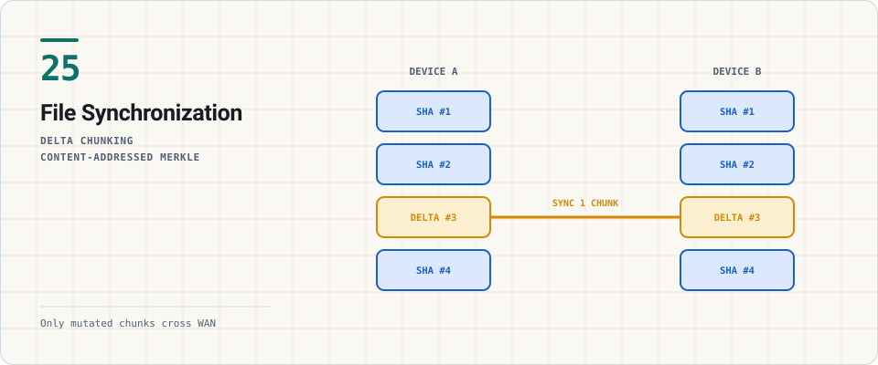
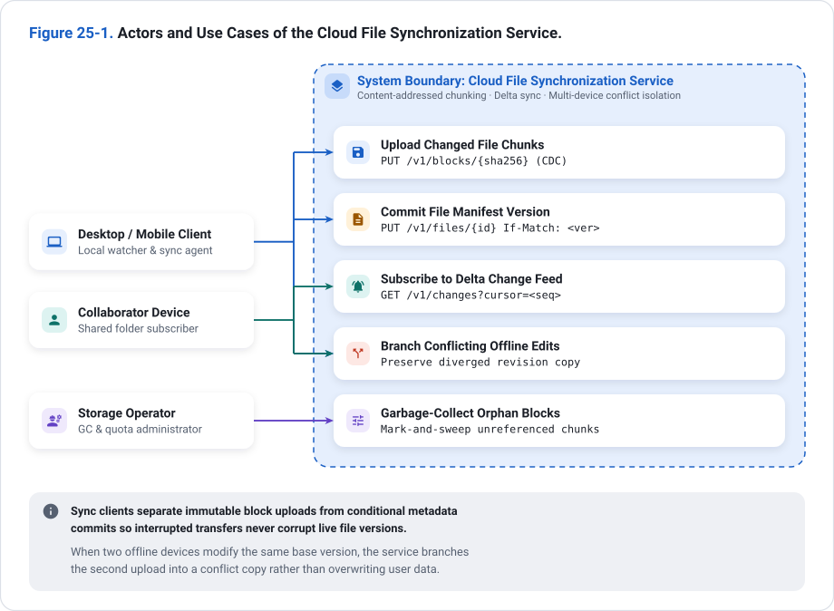
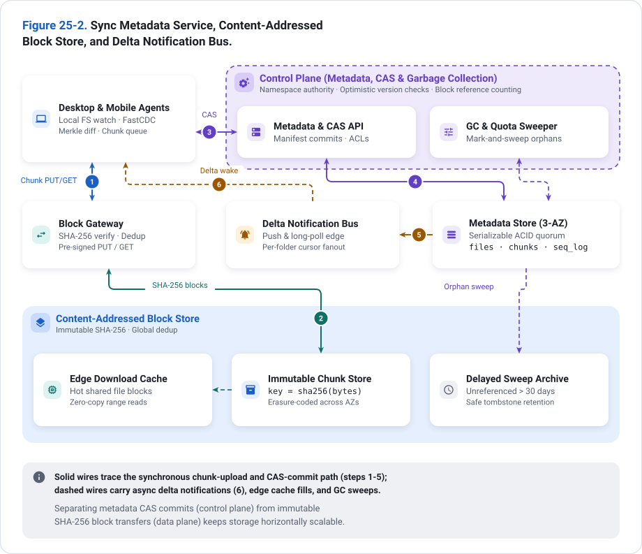
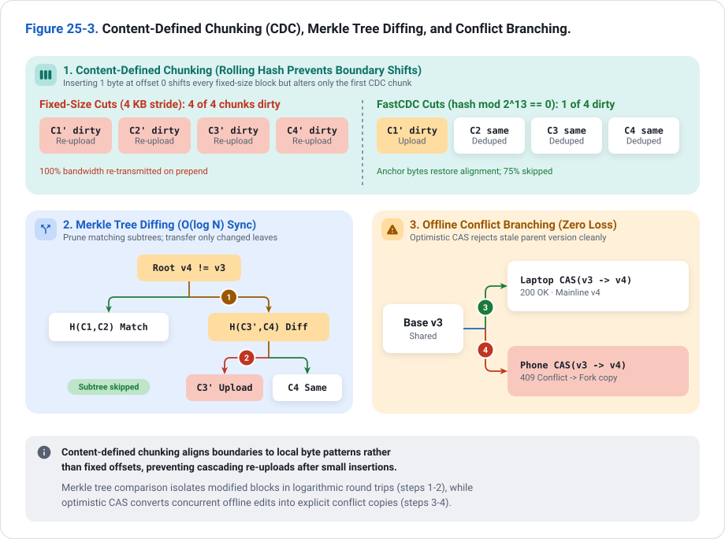

# Chapter 25: File Synchronization



A cloud file synchronization service maintains a coherent directory tree across laptops, desktops, and mobile devices even when endpoints disconnect for hours or weeks. In contrast to the single-leader replicated stores examined in Chapter 3, every client device acts as an autonomous write origin that modifies local files without consulting a central coordinator. Two offline devices can mutate the same document concurrently and reconnect days later; no leader election protocol can prevent those divergent writes while the devices remain partitioned. In this chapter, I design a synchronization architecture that transfers only mutated byte ranges across wide-area links, arbitrates concurrent revisions without data loss, and converges disconnected replicas through strongly consistent metadata paired with an immutable content-addressed block store.

<div class="covers">

In this chapter, we cover

- actors, use cases, functional and non-functional requirements, non-goals, and exabyte-scale capacity bounds
- content-addressed chunk APIs, conditional manifest commits (`If-Match`), monotonic change-cursor feeds, and relational metadata schemas
- control-plane and data-plane separation across the Metadata Service, Content-Addressed Block Store, Garbage Collector, and Delta Notification Bus
- FastCDC content-defined chunking, cross-version deduplication security boundaries, and Merkle directory tree diffing
- optimistic concurrency control, conflict-copy branching, tombstone lifecycle management, long-poll notification hints, and epoch-safe garbage collection
- failure recovery matrices, synchronization SLIs, real-world production architectures (Dropbox Magic Pocket, Google Drive, iCloud Drive), and simulation verification via [`code/syncsim`](https://github.com/arpanpathak/cracking-the-systems-programming-interview/tree/prep-v2/distributed-systems-from-the-ground-up/code/syncsim)

</div>

## 25.1 Requirements, Actors, and Capacity Bounds

Cloud file synchronization combines two contrasting storage workloads inside one product boundary. File payloads are large, opaque, and immutable once hashed, which suits horizontally scalable erasure-coded object storage. Directory hierarchies, access control lists, version numbers, and change cursors are compact, frequently mutated, and require strict transactional ordering to detect concurrent edits. We isolate these two concerns from the outset so high-throughput bulk transfers never saturate the transactional metadata tier.

### Actors and Use Cases

Three classes of actors interact across the synchronization service boundary (Figure 25-1).

<figure class="diagram">

<figcaption><b>Figure 25-1</b> Actors, system boundary, and core use cases of the cloud file synchronization service.</figcaption>
</figure>

| Actor | Operation | Concrete Scenario |
| :--- | :--- | :--- |
| **Desktop / Mobile Client** | Upload changed chunks (`PUT /v1/blocks/{sha256}`) and commit manifests (`PUT /v1/files/{id}`) | Local filesystem watcher detects a saved presentation, computes FastCDC chunks, uploads one changed block, and advances version `3` to version `4` |
| **Collaborator Device** | Subscribe to delta notifications and catch up (`GET /v1/changes?cursor=<seq>`) | A teammate's laptop wakes on a delta hint, fetches new manifest entries, downloads missing blocks, and atomically swaps the local file |
| **Offline Device** | Branch conflicting offline edits | A phone edits version `3` in airplane mode, reconnects after version `4` commits, receives `412 Precondition Failed`, and saves a conflict copy |
| **Storage Operator** | Garbage-collect orphan blocks and enforce quotas | Background sweeper reclaims unreferenced chunks whose 30-day version retention and tombstone grace periods have expired |

### Functional Requirements

| No. | Functional Requirement |
| :--- | :--- |
| 0 | Any file creation, modification, rename, or deletion on one authorized device propagates to all other devices subscribed to the same namespace. |
| 1 | A device that disconnects for days or weeks catches up on every missed namespace mutation upon reconnecting using a durable change cursor. |
| 2 | Only mutated chunks of a modified file cross the wide-area network; unchanged byte ranges are deduplicated against existing server blocks. |
| 3 | When two devices independently modify the same base file version, the service detects the conflict atomically and preserves both revisions without discarding data. |
| 4 | Users can inspect revision history and restore any prior version of a modified file within a 30-day retention window. |
| 5 | Users can recover deleted files from explicit tombstones within a 30-day retention window before underlying blocks become eligible for garbage collection. |

### Non-Functional Requirements and SLOs

| No. | Property | Target Specification | Architectural Consequence |
| :--- | :--- | :--- | :--- |
| 0 | **Durability** | Eleven nines (`99.999999999%`) annual chunk durability; zero loss of committed metadata versions | Erasure-coded multi-AZ chunk storage (`6+3` Reed-Solomon) paired with 3-AZ synchronous Raft/Paxos metadata replication |
| 1 | **Consistency** | Strict serializability for metadata commits (`If-Match` CAS); eventual convergence across offline devices | Metadata store rejects concurrent commits on stale versions via single-shard ACID transactions; edge devices reconcile asynchronously |
| 2 | **Propagation Latency** | `p99 <= 5 s` from manifest commit on origin device to delta notification delivery on connected peer devices | Persistent WebSocket or HTTP/2 long-poll notification tier decoupled from bulk block transfers |
| 3 | **Bandwidth Economy** | WAN bytes transferred scale with `O(changed bytes)` rather than `O(total file size)` even under prepended insertions | FastCDC content-defined chunking replaces fixed-offset slicing to localize boundary shifts |
| 4 | **Scale** | `100M` active users, `10B` files, `1 EB` logical content, `40M` concurrent online devices | Account-sharded metadata cluster, stateless notification edge fleet, and direct client-to-object-store pre-signed chunk I/O |

We explicitly combine two consistency models in Requirement 1. Client replicas are eventually consistent by physical necessity because an offline laptop cannot participate in synchronous quorum writes. The central metadata service is strongly consistent so every conditional version commit observes a single authoritative parent revision.

### Non-Goals and Out-of-Scope Boundaries

To keep the architectural boundary crisp, we exclude four capabilities from this design:

- **Real-time character-level collaborative editing:** Simultaneous sub-second co-editing of structured text requires Operational Transformation or Sequence CRDTs rather than opaque byte-chunk synchronization; we design that architecture in Chapter 26.
- **Distributed POSIX byte-range locks (`fcntl` / `flock`):** Acquiring advisory or mandatory file locks across wide-area networks stalls offline editors and degrades availability during transient partitions.
- **Cross-tenant zero-knowledge encryption with global deduplication:** End-to-end client encryption with per-user random keys produces distinct ciphertexts for identical plaintext blocks, preventing cross-user deduplication; we scope deduplication within a single tenant or shared namespace unless convergent encryption trade-offs are explicitly accepted.
- **Full-text content indexing and semantic search:** Extracting text from PDFs or office documents runs in an asynchronous downstream indexing pipeline consuming the same change log rather than on the critical sync path.

### Back-of-the-Envelope Capacity Bounds

File synchronization is constrained by **exabyte-scale block storage durability, 40 million concurrent notification sockets, and strongly consistent metadata write QPS**.

| Resource Dimension | Derivation | Provisioned Bound |
| :--- | :--- | :--- |
| **Concurrent Online Devices** | `100M users * 2 devices/user * 20% online` | `40M` open notification connections (`~400` edge pods at `100k` sockets/pod) |
| **Metadata Mutation Rate** | `100M users * 20 file ops/day / 86,400 s` (`3x` peak factor) | `~23,150` avg commits/s; `~70,000` peak commits/s |
| **Logical vs. Physical Block Storage** | `1 EB` logical content; `~30%` cross-version dedup savings -> `700 PB` unique; `6+3` Reed-Solomon (`1.5x`) | `~1.05 EB` raw disk capacity across multi-AZ block clusters |
| **Total Unique Chunks** | `700 PB / 4 MB` average chunk size | `~175B` unique chunks (`~250B` logical chunk references) |
| **Hot Metadata Footprint** | `10B files * 500 B` (path, ACL, version, `~12` to `25` SHA-256 pointers) | `~5 TB` active metadata (`~15 TB` with `3x` replication across `32` shards) |
| **Aggregate Block Bandwidth** | `23,150 commits/s * 1.5` avg mutated chunks * `1 MB` avg delta size | `~35 GB/s` sustained ingress; `~70 GB/s` sustained egress (2x fanout) |

## 25.2 External API and Data Contracts

We design the wire protocol around two invariants: **upload blocks before committing metadata**, and **guard every metadata commit with an optimistic version precondition**. Because blocks are addressed by their SHA-256 cryptographic digest, block uploads are inherently idempotent and retry-safe without extra server coordination.

### Chunk Existence and Direct Block Upload

Before transferring bytes, the sync client submits the ordered list of SHA-256 chunk hashes produced by its local FastCDC scanner and asks the control plane which blocks are absent in the target namespace.

```http
POST /v1/namespaces/ns_881/chunks:exists HTTP/2
Host: sync.example
Authorization: Bearer tok_client_laptop
Content-Type: application/json

{
  "digests": [
    "9f2c8b14e0a3...",
    "41aa77d0c91e...",
    "c07e5519f8b2..."
  ]
}
```

```http
HTTP/2 200 OK
Content-Type: application/json

{
  "missing": [
    {
      "digest": "c07e5519f8b2...",
      "upload_url": "https://blocks.sync.example/v1/blocks/c07e5519f8b2...?sig=hmac_v1_...",
      "expires_at": "2026-10-14T10:15:00Z"
    }
  ]
}
```

The client streams each missing payload directly to the Data Plane Block Gateway via the pre-signed URL. The gateway recomputes SHA-256 over the incoming byte stream, rejects corrupted payloads with `400 Bad Request` if the computed digest does not match the path parameter, persists the erasure-coded block, and returns `201 Created` (or `200 OK` if an identical concurrent upload already completed).

```http
PUT /v1/blocks/c07e5519f8b2...?sig=hmac_v1_... HTTP/2
Host: blocks.sync.example
Content-Type: application/octet-stream
Content-Length: 4194304

<4194304 raw bytes>
```

### Conditional Manifest Commit and Idempotent Retries

Once every missing chunk is durable, the client commits the updated file manifest to the Metadata Service using an HTTP `If-Match` precondition naming the parent version and a caller-generated `Idempotency-Key` protecting against dropped commit acknowledgements.

```http
PUT /v1/namespaces/ns_881/files/7 HTTP/2
Host: sync.example
Authorization: Bearer tok_client_laptop
If-Match: "3"
Idempotency-Key: laptop-op-99214
Content-Type: application/json

{
  "path": "/docs/architecture.pdf",
  "chunks": ["9f2c8b14e0a3...", "41aa77d0c91e...", "c07e5519f8b2..."],
  "size_bytes": 11842010,
  "mtime_ms": 1760436012000
}
```

```http
HTTP/2 200 OK
ETag: "4"
Content-Type: application/json

{
  "file_id": 7,
  "version": 4,
  "cursor_seq": 5121,
  "manifest_sha256": "e3b0c44298fc..."
}
```

If a second device submits a commit carrying `If-Match: "3"` after version `4` has committed, the Metadata Service checks `idempotency_key` first. If the key matches the committed revision `4`, the server replays `200 OK` so a retried laptop commit after a dropped socket never triggers a false conflict. If the key differs, the server rejects the stale commit with `412 Precondition Failed`:

```http
HTTP/2 412 Precondition Failed
Content-Type: application/problem+json

{
  "type": "/problems/version-conflict",
  "title": "File modified concurrently by another device",
  "status": 412,
  "current_version": 4,
  "current_etag": "\"4\"",
  "last_modified_by": "device_laptop_01"
}
```

### Cursor-Based Delta Change Feed

All peer devices, whether waking from a real-time notification hint or reconnecting after 30 days offline, fetch missed namespace transitions through one unified paginated endpoint:

```http
GET /v1/namespaces/ns_881/changes?cursor=5120&limit=500 HTTP/2
Host: sync.example
Authorization: Bearer tok_client_phone
```

```http
HTTP/2 200 OK
Content-Type: application/json

{
  "changes": [
    {
      "seq": 5121,
      "file_id": 7,
      "op": "UPSERT",
      "path": "/docs/architecture.pdf",
      "version": 4,
      "chunks": ["9f2c8b14e0a3...", "41aa77d0c91e...", "c07e5519f8b2..."]
    },
    {
      "seq": 5122,
      "file_id": 12,
      "op": "TOMBSTONE",
      "path": "/docs/draft.md",
      "version": 2
    }
  ],
  "next_cursor": 5122,
  "has_more": false
}
```

### Relational Metadata Schema

We shard the strongly consistent metadata store by `namespace_id` so every single-file commit, rename, and `change_log` sequence increment commits inside one local ACID transaction without distributed two-phase commit overhead.

```sql
CREATE TABLE files (
    namespace_id     BIGINT      NOT NULL,
    file_id          BIGINT      NOT NULL,
    parent_dir_id    BIGINT      NOT NULL,
    name             TEXT        NOT NULL,
    version          BIGINT      NOT NULL DEFAULT 1,
    state            TEXT        NOT NULL, -- 'ACTIVE' | 'TOMBSTONE'
    manifest_sha256  BYTEA       NOT NULL,
    last_idem_key    TEXT        NOT NULL,
    updated_at       TIMESTAMPTZ NOT NULL DEFAULT now(),
    deleted_at       TIMESTAMPTZ,
    PRIMARY KEY (namespace_id, file_id),
    UNIQUE (namespace_id, parent_dir_id, name) WHERE state = 'ACTIVE'
);

CREATE TABLE file_versions (
    namespace_id     BIGINT      NOT NULL,
    file_id          BIGINT      NOT NULL,
    version          BIGINT      NOT NULL,
    chunk_digests    BYTEA[]     NOT NULL,
    size_bytes       BIGINT      NOT NULL,
    author_device_id TEXT        NOT NULL,
    created_at       TIMESTAMPTZ NOT NULL DEFAULT now(),
    PRIMARY KEY (namespace_id, file_id, version)
);

CREATE TABLE change_log (
    namespace_id     BIGINT      NOT NULL,
    seq              BIGINT      NOT NULL,
    file_id          BIGINT      NOT NULL,
    op               TEXT        NOT NULL, -- 'UPSERT' | 'RENAME' | 'TOMBSTONE'
    version          BIGINT      NOT NULL,
    payload_json     JSONB       NOT NULL,
    created_at       TIMESTAMPTZ NOT NULL DEFAULT now(),
    PRIMARY KEY (namespace_id, seq)
);

CREATE TABLE namespace_blocks (
    namespace_id     BIGINT      NOT NULL,
    chunk_sha256     BYTEA       NOT NULL,
    byte_length      INT         NOT NULL,
    last_referenced  TIMESTAMPTZ NOT NULL DEFAULT now(),
    PRIMARY KEY (namespace_id, chunk_sha256)
);
```

Notice the partial unique index `UNIQUE (namespace_id, parent_dir_id, name) WHERE state = 'ACTIVE'`: multiple tombstoned files that previously occupied the same path can coexist safely in history while active filenames remain strictly unique within a directory.

## 25.3 High-Level Architecture: Control Plane vs. Data Plane

We partition the synchronization service into a lightweight **Control Plane** handling metadata consistency, ACL enforcement, delta notifications, and garbage collection, and a high-bandwidth **Data Plane** transferring immutable blocks directly between client agents and erasure-coded storage (Figure 25-2).

<figure class="diagram">

<figcaption><b>Figure 25-2</b> Separation of the control plane (metadata CAS, cursors, and notifications) from the high-throughput content-addressed data plane.</figcaption>
</figure>

### Component Responsibilities and Failure Domains

| Component | Plane | State Held | Failure Impact and Recovery |
| :--- | :--- | :--- | :--- |
| **Client Sync Agent** | Edge | Local directory tree, SQLite local index, last applied `cursor` | Crashes or prolonged offline periods recover cleanly by scanning local disk against SQLite state and resuming from `cursor` |
| **Metadata and CAS API** | Control | Stateless (auth, ACL check, manifest validation, pre-signed URL minting) | Load balancer routes around failed pods immediately; `Idempotency-Key` prevents duplicate commits on retry |
| **Metadata Store (3-AZ)** | Control | `files`, `file_versions`, `change_log`, `namespace_blocks` (sharded by `namespace_id`) | Synchronous 3-AZ Raft/PostgreSQL quorum elects a new primary in `1 to 3 s` with zero committed metadata loss |
| **Delta Notification Bus** | Control | In-memory map of `namespace_id -> subscribed WebSocket/long-poll sockets` | Pod crash drops connections; clients reconnect with exponential jitter and issue a catch-up `GET /changes?cursor=` call |
| **GC and Quota Sweeper** | Control | Sweep watermarks and unreferenced candidate queues | Idempotent batch jobs restart from last scanned shard; 30-day delayed sweep archive protects active uploads |
| **Block Gateway** | Data | Stateless streaming SHA-256 verifier and erasure-coding client | Failed chunk upload leaves no metadata pointer; client retries the exact same content-addressed `PUT` |
| **Content-Addressed Block Store** | Data | Immutable `4 MB` chunks keyed by SHA-256 across multi-AZ storage nodes | Erasure coding (`6+3` Reed-Solomon) survives simultaneous loss of up to `3` storage nodes or `1` full AZ |
| **Edge Download Cache** | Data | Hot shared blocks in NVMe/RAM LRU caches near POPs | Cache miss falls through to origin block store; content addressing eliminates cache invalidation complexity because chunks are immutable |

### End-to-End Change Propagation Walkthrough

1. **Local Debounce and Chunking:** The desktop agent receives filesystem notifications (`FSEvents` on macOS, `inotify` on Linux, `ReadDirectoryChangesW` on Windows). It waits for a `1 to 2 s` quiet window so partially written application saves are not uploaded prematurely, then slices the file with FastCDC and hashes each chunk with SHA-256.
2. **Missing-Chunk Discovery:** The agent sends `POST /v1/namespaces/{ns}/chunks:exists` to the Metadata API and receives pre-signed upload URLs for only the chunks absent from the namespace.
3. **Parallel Direct Data-Plane Upload:** The agent streams missing chunks concurrently over HTTP/2 to the Block Gateway, which verifies each SHA-256 digest and commits the erasure-coded stripes to the Content-Addressed Block Store.
4. **Atomic Control-Plane Commit:** The agent issues `PUT /v1/namespaces/{ns}/files/{id}` with `If-Match: "3"`. Inside one ACID transaction on the namespace shard, the Metadata Store verifies that every listed chunk exists in `namespace_blocks`, checks `version = 3`, increments to `version = 4`, inserts the `file_versions` row, and appends `seq = 5121` to `change_log`.
5. **Hint Fanout:** After the transaction commits (via transactional outbox or CDC tailing `change_log`), the Metadata tier publishes a lightweight invalidation hint `(ns_881, seq=5121)` to the Delta Notification Bus, which pushes a wake-up frame to every online peer device in `ns_881`.
6. **Peer Convergence:** Each waking device calls `GET /v1/namespaces/ns_881/changes?cursor=5120`, diffs the incoming chunk list against its local block cache, downloads only missing chunks from the Edge Cache or Block Gateway, reassembles the new file into a hidden staging path, calls `fsync`, and atomically `rename()`s it into place before advancing its persisted cursor.

## 25.4 Content-Defined Chunking, Deduplication, and Merkle Tree Diffing

The bandwidth efficiency of a file synchronization service rests on how a byte stream is partitioned into addressable chunks and how two directory trees locate their differences (Figure 25-3).

<figure class="diagram">

<figcaption><b>Figure 25-3</b> Content-defined chunking (FastCDC), Merkle tree subtree pruning, and optimistic conflict branching.</figcaption>
</figure>

### Defeating Fixed-Block Boundary Shifts with FastCDC

Dividing a file at fixed offsets (every `4 MB`, for example) handles in-place overwrites well but collapses whenever bytes are inserted or removed near the start of a file. Prepending a single byte shifts every subsequent offset by `+1`, altering the byte contents of every downstream fixed block and invalidating `100%` of the file's SHA-256 checksums. The client is forced to re-upload the entire file despite a one-byte edit.

**Content-Defined Chunking (CDC)** anchors cut points to local byte patterns instead of global file offsets. A sliding window advances byte by byte across the file while maintaining a rolling hash `H`. Whenever the low-order `k` bits of `H` equal zero (`(H & ((1 << k) - 1)) == 0`), the scanner terminates the current chunk. Because each boundary depends exclusively on the bytes immediately preceding it, inserting bytes at offset `0` alters only the first chunk; once the scanner reaches the original boundary bytes, the rolling hash hits the same cut condition and realigns every remaining chunk identically.

Classic CDC implementations used **Rabin fingerprinting** (polynomial division over `GF(2)`), which requires multiple arithmetic operations per byte and limits single-core throughput to roughly `100 to 200 MB/s`. Modern synchronization engines adopt **FastCDC** (Xia et al., USENIX ATC 2016), which introduces three production optimizations:

1. **Gear Rolling Hash:** Replaces Rabin polynomial modulo arithmetic with a 256-entry 64-bit random lookup table `G[byte]`: `fp = (fp << 1) + G[input[i]]`. Computing the rolling hash takes one shift, one table lookup, and one addition per byte, saturating `1 to 2 GB/s` per CPU core.
2. **Minimum and Maximum Size Clamping with Cut-Point Skipping:** To avoid pathological tiny chunks (inflating metadata) or giant chunks (hurting deduplication), we enforce `[MinSize, MaxSize]` bounds (for example, `1 MB` minimum, `4 MB` target average, `8 MB` maximum for large files; or `2 KB / 8 KB / 64 KB` for fine-grained backup tiers). FastCDC skips hash evaluation completely for the first `MinSize` bytes of every chunk, eliminating redundant CPU work.
3. **Normalized Chunking:** Pure geometric cut distributions produce high variance in chunk lengths. FastCDC uses a stricter bitmask (`MaskS`, one extra zero bit) between `MinSize` and `AvgSize` and a looser bitmask (`MaskL`, one fewer zero bit) between `AvgSize` and `MaxSize`, tightening chunk sizes closely around the target mean without losing boundary realignment.

### Deduplication Scope and Side-Channel Security

Content-addressed deduplication yields three storage and network wins: identical blocks inside a single file, unchanged blocks across 30 days of file versions, and identical files shared across a team namespace are stored once. However, **cross-tenant deduplication** introduces a well-known cryptographic oracle vulnerability. If an attacker guesses the SHA-256 hash of a sensitive corporate contract and probes `POST /v1/chunks:exists`, receiving `"missing": []` confirms that another tenant uploaded that exact document, and skipping the upload lets the attacker bind their own manifest to a block they never possessed.

We close this side channel by combining two controls:

- **Namespace-Scoped Existence Visibility:** The `namespace_blocks` table records chunk ownership per `namespace_id`. A client only skips uploading a chunk if `namespace_blocks` confirms that the chunk is already authorized within that namespace.
- **Proof-of-Ownership (PoW) for Cross-Namespace Physical Dedup:** Inside the Data Plane Block Store, physical deduplication across namespaces may still occur transparently *after* the client uploads the ciphertext or completes a random byte-range challenge proving possession of the full chunk payload.

### Merkle Directory Tree Diffing for Reconnection and Audits

While incremental edits rely on monotonic `change_log` cursors, two scenarios require full-tree comparison: **initial cold-start sync** onto a device that already holds a partial local copy (for example, after reinstalling the OS or migrating an archive), and **periodic consistency audits** verifying that a client did not drop a local filesystem event without notice.

Streaming metadata for `500,000` files on every reconnect wastes bandwidth and database IOPS. Instead, both the client SQLite index and the server namespace maintain a **Merkle Directory Tree**:

- Every file leaf node computes `H(file) = SHA256(name || version || manifest_sha256)`.
- Every directory internal node computes `H(dir) = SHA256(sorted_child_hashes)`.

During reconciliation, the client sends its root hash `H(root)` to the server. If the root hashes match, synchronization finishes in `O(1)` with a single round trip. If they differ, the client descends only the subdirectories whose hashes diverge, pruning intact subtrees in `O(K log N)` messages for `K` mutated files out of `N` total files.

## 25.5 Optimistic Concurrency, Conflict Branching, Tombstones, and Garbage Collection

Detecting concurrent edits accurately and managing the lifecycle of deleted files and unreferenced chunks account for the majority of subtle production defects in file synchronization engines.

### Optimistic Concurrency and Conflict-Copy Branching

Because disconnected clients edit independently, every manifest commit carries `If-Match: "<base_version>"`. The Metadata Store executes a single-row atomic conditional update:

```sql
UPDATE files
   SET version = version + 1,
       manifest_sha256 = $3,
       last_idem_key = $4,
       updated_at = now()
 WHERE namespace_id = $1
   AND file_id = $2
   AND version = $5
   AND state = 'ACTIVE';
```

If two devices commit simultaneously against version `3`, serializable isolation guarantees that exactly one update affects `1` row and advances the file to version `4`, while the second affects `0` rows and returns `412 Precondition Failed`. Advance through Interactive Trace 25.A to examine how an offline laptop and phone diverge from version `3` and how the server prevents silent overwrite.

<figure class="steps" data-prefix="figures/steps-sync-conflict" data-count="5" data-version="2e21dbd2">

<figcaption><b>Figure 25.2</b> A laptop and a phone change the same file while offline, and the second upload is recognised as a conflict. Use Next and Back to move through the 5 steps.</figcaption>
</figure>

Once the phone receives `412 Precondition Failed`, the system must apply a deterministic resolution policy:

- **Last-Write-Wins (LWW):** Overwriting version `4` with the phone's bytes hides the conflict from the user but destroys the laptop's edits without warning. LWW is unacceptable for general-purpose user files.
- **Conflict-Copy Branching (Default Policy):** The phone downloads version `4` into the original path (`notes.txt`), renames its own diverged local copy to a deterministic conflict path (`notes (Phone conflicted copy 2026-10-14).txt`), and commits that branch as a brand-new file (`version = 1`). Both devices converge to holding both files, zero bytes are lost, and the human author decides how to reconcile binary or document edits.
- **Content-Aware Auto-Merge:** Possible only for structured formats (plain text, source code, or collaborative rich text documents) where the service understands internal syntax, which is the exact domain of Chapter 26.

### Local Client Reconciliation: Tombstones, Renames, and OS Quirks

Dropbox's engineering postmortem on rewriting its desktop sync engine (*Nucleus*) highlighted that the hardest correctness invariants live inside the **three-tree local reconciliation loop** comparing: (1) the **Remote Server Tree**, (2) the **Last-Synced Baseline Tree**, and (3) the **Current Local Filesystem Tree**.

1. **Explicit Tombstones vs. Absence:** If a file is missing from the server's active directory listing, a client comparing only current state cannot distinguish "deleted on another device" from "newly created locally and not yet uploaded." Recording deletions as explicit `TOMBSTONE` entries in `change_log` (and comparing against the Last-Synced Baseline Tree) resolves the ambiguity deterministically.
2. **Metadata-Only Renames and Moves:** Moving a `10 GB` video between folders updates `(parent_dir_id, name)` inside `files` and emits a `RENAME` entry in `change_log` without touching the Block Store. Even if a client OS watcher reports a move as separate `UNLINK` and `CREATE` events, local FastCDC hashing and `namespace_blocks` lookup ensure zero payload bytes cross the network.
3. **Cross-Platform Path Collisions:** Linux filesystems are case-sensitive (`Report.pdf` and `report.pdf` coexist), whereas default macOS APFS and Windows NTFS volumes are case-insensitive. The control plane enforces case-insensitive uniqueness per directory (or automatically renames colliding sync targets with a `(Case Conflict)` suffix on case-insensitive clients) and strips reserved characters (`:`, `?`, `*`, trailing spaces on Windows).

### Notification Hints Paired with Durable Cursors

We never rely on WebSocket or long-poll notifications to carry authoritative file deltas. A transient edge proxy restart or mobile radio handoff can drop a push frame at any instant. Instead, the Delta Notification Bus delivers **ephemeral, loss-tolerant wake-up hints** (`namespace_id = ns_881 changed`). Upon receiving a hint (or upon reconnecting or hitting a low-frequency fallback heartbeat every `5 minutes`), the client polls `GET /v1/namespaces/{ns}/changes?cursor=<last_seq>`. Separating the unreliable signal from the durable cursor keeps the notification tier entirely stateless in memory while guaranteeing zero missed mutations.

### Epoch-Safe Garbage Collection for Unreferenced Chunks

Deleting a chunk immediately when a file is modified or removed would corrupt other files sharing that chunk via deduplication and violate the 30-day version-restore contract. Worse, unguarded online reference counting suffers from a classic distributed race: Client A uploads chunk `C` (refcount `0`), the GC sweeper scans `C` and deletes it before Client A submits its manifest commit `PUT /v1/files/7`, leaving a dangling manifest pointing to missing bytes.

We eliminate GC races with **Two-Phase Epoch Mark-and-Sweep plus Delayed Deletion**:

1. **Upload Lease Window:** Newly uploaded blocks receive an immutable creation timestamp `created_at` and are exempt from garbage collection for a mandatory upload grace period (for example, `24 hours`), bounding the maximum duration of an in-flight chunked upload.
2. **Offline Mark Phase:** A periodic MapReduce/Spark job scans a consistent snapshot of `file_versions` (including active files and versions/tombstones within the 30-day retention window) and emits the set of live `chunk_sha256` digests.
3. **Quarantine and Sweep Phase:** Chunks present in the Block Store with `created_at < snapshot_time - 24h` and absent from the live set are moved to a **Delayed Sweep Archive** (soft-deleted metadata flag) for `7` additional days before physical erasure-coded stripe reclamation. Any emergency recovery or audit anomaly can halt the physical sweep before irreversible disk deletion occurs.

## 25.6 Failure Modes, SLIs, and Production Systems

### Failure and Recovery Matrix

| Failure Scenario | Blast Radius | Automated Recovery and Preserved Invariant |
| :--- | :--- | :--- |
| **Client Disconnects Mid-Upload** | Single file upload | Already-uploaded chunks remain durable in the content-addressed Block Store; client resumes by querying `chunks:exists` and uploading only remaining blocks |
| **Dropped Response to Manifest Commit** | Single file commit | Client retries `PUT /v1/files/{id}` with identical `If-Match` and `Idempotency-Key`; server detects matching `last_idem_key` and returns `200 OK` without spawning a spurious conflict copy |
| **Two Offline Devices Edit Same File** | Single file | Second commit receives `412 Precondition Failed`; client downloads authoritative version and branches its local edit into a named conflict copy |
| **Notification Edge Pod Crash** | `~100k` online sockets | Clients reconnect with jittered backoff and immediately execute `GET /changes?cursor=` to recover any missed hints |
| **Metadata Shard Primary Failure** | Writes to `1/32` of namespaces for `1 to 3 s` | Synchronous 3-AZ Raft/PostgreSQL standby promotes with zero RPO; clients retry idempotently |
| **Local OS Watcher Overflow (`IN_Q_OVERFLOW`)** | Single client device | Sync agent triggers an automatic Merkle tree diff against local SQLite state and server root hash to detect missed filesystem edits |
| **GC Sweeper Races with Slow Upload** | Uncommitted chunk | `24 h` upload grace period plus `7 d` Delayed Sweep Archive quarantine prevents premature deletion of live or in-flight blocks |

### Synchronization SLIs and SLOs

Four domain-specific Service Level Indicators track synchronization health beyond standard HTTP status codes:

1. **End-to-End Sync Propagation Latency (`p95`, `p99`):** Measured via synthetic canary pairs modifying a `100 KB` file in Region A and recording when the peer agent in Region B finishes the atomic local `rename()`. SLO: `p99 <= 5 s`.
2. **Delta Deduplication Efficiency Ratio:** `1 - (bytes_uploaded / total_modified_file_bytes)` tracked per client version. A sudden drop exposes rolling-hash regressions or misaligned chunk parameters.
3. **Spurious Conflict Rate:** Percentage of manifest commits returning `412` where the client and server `manifest_sha256` values are identical (indicating broken retry idempotency or local clock/watcher bugs). Target: `< 0.001%`.
4. **Quiescent Tree Convergence Invariant:** Periodic Merkle-root comparison between simulated multi-device test fleets and server state; any persistent root mismatch after `30 s` of network quiescence triggers a release-blocking `SEV-1` failure.

### How Production Systems Implement File Synchronization

| Production System | Core Storage & Metadata Architecture | Architectural Distinction |
| :--- | :--- | :--- |
| **Dropbox** | **Magic Pocket** (exabyte erasure-coded block store), **Edgestore** (sharded MySQL metadata), **Nucleus** (Rust client sync engine) | Uses `4 MB` fixed blocks paired with rsync-style binary delta transfers for modified blocks; migrated its client engine to Rust to verify three-tree state machine invariants formally |
| **Google Drive** | **Colossus** distributed filesystem, **Spanner** globally consistent metadata, Drive Push Notification channels | Strongly consistent global metadata via TrueTime; unifies opaque binary sync with native Google Docs OT co-editing under one namespace ACL graph |
| **Apple iCloud Drive** | **CloudKit** metadata zones + multi-cloud chunked asset storage (`ChunkEngine`) | Uses content-defined chunking and client-side per-file encryption keys wrapped in user-specific keybags, trading cross-tenant deduplication for strong privacy |
| **Syncthing** | Decentralized peer-to-peer Block Exchange Protocol (BEP) over TLS/QUIC | Eliminates the central metadata server completely by exchanging vector clocks and per-folder block indexes directly between devices, branching conflicts identically via timestamped copies |

## 25.7 Simulation Verification

Running [`code/syncsim`](https://github.com/arpanpathak/cracking-the-systems-programming-interview/tree/prep-v2/distributed-systems-from-the-ground-up/code/syncsim) verifies both core invariants of this chapter: (1) FastCDC boundary stability under a single-byte prepend to a `65,536`-byte file compared against fixed `1,024`-byte slicing, and (2) atomic optimistic concurrency conflict detection when two offline devices commit against base version `3`.

```console
$ cargo run --release -p syncsim
a file of 65536 bytes, and the same file with 1 byte added at the start
cuts every 1024 bytes: 65 chunks, 65 to upload again
cuts that depend on the content: 62 chunks, 1 to upload again
the server holds version 3. the laptop and the phone both change it while offline
laptop uploads, based on version 3: accepted as version 4
phone uploads, based on version 3: conflict: the server is at version 4, written by the laptop
```

Inspect the observed ratio directly: prepending `1` byte invalidates `65 / 65` (`100%`) of fixed-offset chunks, whereas content-defined chunking isolates the mutation to `1 / 62` (`1.6%`) of chunks, reducing WAN upload bandwidth by `98.4%`. On the control plane, the laptop's conditional upload based on version `3` commits cleanly as version `4`, and the phone's subsequent upload carrying base version `3` is deterministically flagged as a conflict against version `4`.

<div class="simulation">

**Run the file synchronization simulation.** Execute `cargo run --release -p syncsim` in [`code/`](https://github.com/arpanpathak/cracking-the-systems-programming-interview/tree/prep-v2/distributed-systems-from-the-ground-up/code) to reproduce the fixed-block vs. content-defined chunking comparison (`65/65` vs. `1/62` dirty chunks) and the offline version-3 optimistic concurrency conflict trace.

</div>

### End-to-End Request Lifecycle and Hop-by-Hop Latency Budget

A file edit propagates through local content-defined chunking, delta-only blob upload, optimistic metadata commit, and push notification to peer devices.

| Hop | Component | Operation | P50 | P99 |
| :--- | :--- | :--- | :--- | :--- |
| 1 | Sync Client Daemon | Detect filesystem event, run rolling-hash CDC, compute SHA-256 chunk digests | 6 ms | 28 ms |
| 2 | Edge / L7 Load Balancer | Terminate HTTP/2 or QUIC connection and route to regional block-sync gateway | 8 ms | 30 ms |
| 3 | Block Service & Dedup Index | Check chunk-hash existence and upload only missing compressed encrypted chunks | 25 ms | 160 ms |
| 4 | Metadata Service (SQL) | Atomic CAS commit (`WHERE rev = expected_rev`) updating file manifest and Merkle root | 4 ms | 22 ms |
| 5 | Notification & Object Store | Persist erasure-coded chunks and fan out long-poll/WebSocket delta notices to peers | 12 ms | 65 ms |

### Production Case Studies and Open-Source Comparisons

Dropbox built Magic Pocket, a custom exabyte-scale immutable block store using erasure coding across geographically separated storage vaults, paired with client-side content-defined chunking (CDC) so inserting bytes at the start of a multi-gigabyte file uploads only the single modified chunk. Google Drive separates structured document models (stored as operational logs) from binary blob storage backed by Colossus, relying on centralized change feeds to drive incremental client synchronization. Classic `rsync` solves single-pair delta transfer using a rolling Adler-32 checksum and strong hash verification over a direct network stream, whereas cloud sync services generalize that principle into content-addressed immutable chunks shared across devices, revisions, and deduplicated user accounts.

<div class="callout keyidea">
<span class="label">Key idea</span>
<p>Content-defined chunking anchors block boundaries on data-dependent rolling-hash markers rather than fixed byte offsets. Inserting or deleting bytes shifts only the immediately affected chunk while leaving all subsequent chunk hashes identical for zero-cost deduplication.</p>
</div>

<div class="callout experiment">
<span class="label">Experiment</span>
<p>Execute <code>cargo run --release -p syncsim</code> and compare the dirty-chunk ratio after a single-byte prepend: fixed-size blocks invalidate <code>65/65</code> chunks whereas content-defined chunking invalidates <code>1/62</code>. Also trace how the offline version-3 write triggers a deterministic conflict branch instead of overwriting newer state.</p>
</div>

<div class="callout caution">
<span class="label">Common pitfall</span>
<p>Running asynchronous chunk garbage collection without a grace period or reference-count barrier can delete a newly uploaded chunk whose metadata manifest has not yet committed, causing permanent data loss on concurrent syncs.</p>
</div>

## 25.8 Terminology and References

### Engineering Glossary

| Term | Definition |
| :--- | :--- |
| **Content-Addressed Storage (CAS)** | Storage model in which every immutable block is addressed by the cryptographic hash (SHA-256) of its contents, enabling automatic deduplication and idempotent retries. |
| **Content-Defined Chunking (CDC)** | Slicing a byte stream at positions where a rolling hash over a sliding window matches a fixed bitmask, preventing insertions from shifting downstream chunk boundaries. |
| **FastCDC** | High-throughput CDC algorithm combining a table-driven Gear rolling hash, minimum-length cut skipping, and normalized dual-mask chunking. |
| **Merkle Directory Tree** | Hierarchical hash tree where file leaves hash their version and manifest digest and directories hash their sorted children, enabling `O(K log N)` full-tree diffing. |
| **Optimistic Concurrency (`If-Match`)** | Conditional metadata update that succeeds only when the server's current version matches the client's declared base version, turning concurrent writes into explicit conflicts. |
| **Conflict-Copy Branching** | Conflict resolution policy that preserves the winning revision under the original path and saves the rejected concurrent revision under a disambiguated sibling filename. |
| **Monotonic Change Cursor** | Per-namespace strictly increasing sequence number allowing online and long-offline clients to fetch every missed metadata transition via one paginated feed. |
| **Tombstone** | Explicit metadata record representing a file deletion so offline clients distinguish remote deletions from newly created local files and can restore deleted items during a retention window. |

### References

- A. Muthitacharoen, B. Chen, and D. Mazieres, "A Low-bandwidth Network File System", *ACM SOSP*, 2001.
- W. Xia, Y. Zhou, H. Jiang, D. Feng, Y. Hua, Y. Hu, Q. Liu, and Y. Zhang, "FastCDC: A Fast and Efficient Content-Defined Chunking Approach for Data Deduplication", *USENIX ATC*, 2016.
- A. Tridgell and P. Mackerras, "The rsync algorithm", Australian National University Technical Report TR-CS-96-05, 1996.
- N. Koorapati, "Streaming File Synchronization", Dropbox Tech Blog, 2014.
- Dropbox Engineering, "Inside the Magic Pocket", Dropbox Tech Blog, 2016.
- Dropbox Engineering, "Rewriting the Heart of Our Sync Engine (Nucleus)", Dropbox Tech Blog, 2020.
- R. C. Merkle, "A Digital Signature Based on a Conventional Encryption Function", *CRYPTO*, 1987.
