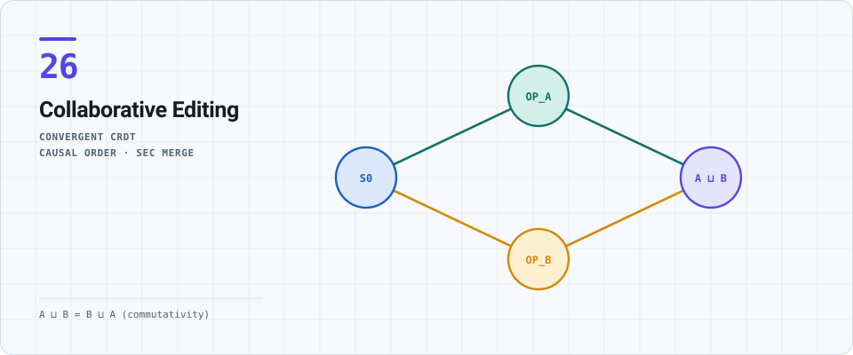
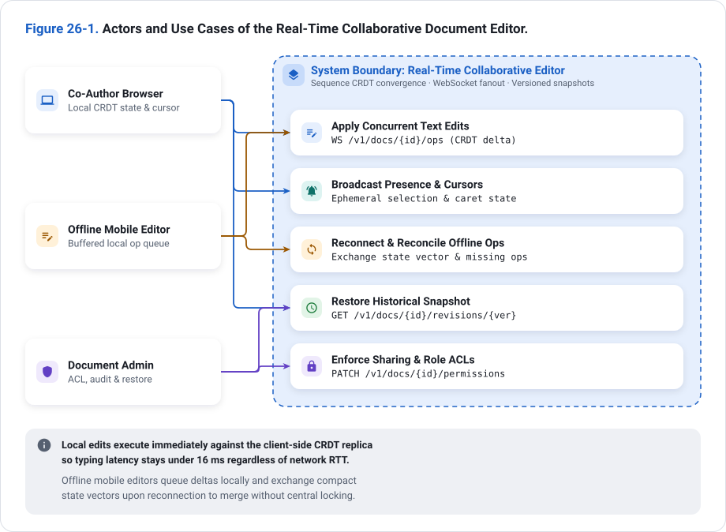
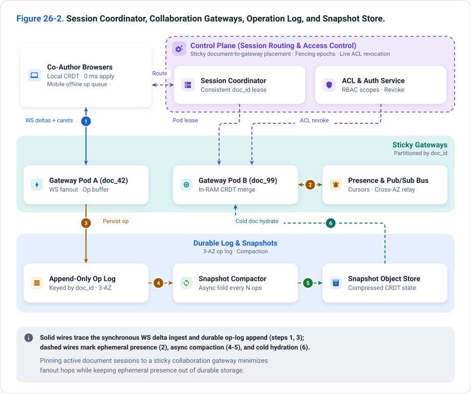
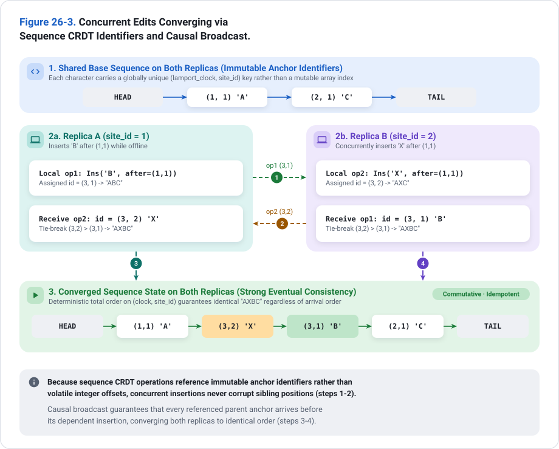

# Chapter 26: Collaborative Editing



A real-time collaborative document editor allows dozens of authors to modify the same text simultaneously, rendering each author's own keystrokes instantaneously while streaming remote edits and live cursor positions across all participants within a fraction of a second. In Chapter 25, we handled concurrent offline edits to opaque files by branching a conflict copy and deferring resolution to a human user. In a live co-editing session, concurrent edits occur dozens of times per minute whenever two authors type within one network round-trip time of each other. Presenting manual conflict copies on every keystroke is unworkable; the editor must merge concurrent operations automatically while preserving every participant's intent and guaranteeing that every replica converges to the exact same byte sequence. In this chapter, I design a collaborative editing architecture built around local-first execution, Operational Transformation and Sequence CRDTs, sticky document gateways, and snapshot-compacted operation logs.

<div class="covers">

In this chapter, we cover

- actors, use cases, functional and non-functional requirements, non-goals, and multi-million-session capacity bounds
- document hydration APIs, WebSocket operation and state-vector sync protocols, ACL enforcement, and append-only operation log schemas
- control-plane session coordination and fencing epochs separated from sticky collaboration gateways, presence buses, and snapshot compaction
- positional divergence, Jupiter server-serialized Operational Transformation, and causal Sequence CRDTs (RGA, YATA, and Fugue) versus fractional indexing
- tombstone retention, epoch-based garbage collection, server-compacted snapshots with operation log tails, ephemeral carets, and selective local undo
- failure recovery matrices, convergence SLIs, production architectures (Google Docs, Figma, Yjs, Automerge), and simulation verification via `code/editsim`

</div>

## 26.1 Requirements, Actors, and Capacity Bounds

Building a responsive collaborative editor creates an unavoidable distributed systems tension. Human perception detects typing lag above `16 to 50 ms`, which forbids waiting for a `50 to 200 ms` wide-area round trip to a central coordinator before painting a character on screen. Every client must therefore apply local edits immediately to its own in-memory replica and propagate deltas asynchronously. Once every client accepts uncoordinated writes, replicas apply the same set of operations in different arrival orders. The central engineering invariant is **Strong Eventual Consistency (SEC)**: any two replicas that have received the same set of operations must hold identical document state, regardless of delivery order or duplicate transmission.

### Actors and Use Cases

Three actor roles interact across the collaborative editing boundary (Figure 26-1).

<figure class="diagram">

<figcaption><b>Figure 26-1</b> Actors, system boundary, and core use cases of the real-time collaborative document editor.</figcaption>
</figure>

| Actor | Operation | Concrete Scenario |
| :--- | :--- | :--- |
| **Co-Author Browser** | Apply concurrent edits (`WS /v1/documents/{id}/operations`) and stream ephemeral presence | Two engineers edit separate paragraphs of a design doc while seeing each other's colored carets and selections move live |
| **Offline Mobile Editor** | Buffer local edits offline and reconcile on reconnect | A reviewer edits a document on a commuter train for 40 minutes, then exchanges a compact state vector on reconnect to merge missed remote ops |
| **Document Admin** | Enforce sharing ACLs (`PATCH /v1/documents/{id}/permissions`) and restore historical snapshots | An owner revokes write access from a former contractor mid-session and rolls a corrupted section back to revision `4400` |

### Functional Requirements

| No. | Functional Requirement |
| :--- | :--- |
| 0 | Up to `100` concurrent authors can edit the same document simultaneously without locking paragraphs or manually merging conflicts. |
| 1 | Each author's own keystrokes render locally in under `16 ms` without waiting for server acknowledgement. |
| 2 | Edits committed by one online author propagate and render on all other connected authors' screens within `200 ms`. |
| 3 | Once all operations are delivered, every participant's replica converges to an identical document state regardless of arrival order. |
| 4 | Connected authors observe live remote cursor positions, text selections, and active collaborator presence. |
| 5 | An author working offline can continue editing uninterrupted and automatically merge buffered local operations upon reconnection. |
| 6 | Authorized users can inspect immutable document revision history and restore any prior snapshot cleanly. |

### Non-Functional Requirements and SLOs

| No. | Property | Target Specification | Architectural Consequence |
| :--- | :--- | :--- | :--- |
| 0 | **Convergence** | Strong Eventual Consistency (SEC) across all replicas with zero permanent state divergence | Mathematical commutativity and idempotency via Sequence CRDTs (or server-serialized Jupiter OT) |
| 1 | **Durability** | Zero loss of any server-acknowledged operation under single-node or AZ failure | Append-only operation log replicated synchronously across `3` AZs before acknowledging to the sender |
| 2 | **Consistency** | Eventual between client replicas; linearizable for server log ordering, ACL revocations, and gateway ownership leases | Sticky document ownership fenced by monotonic lease epochs from a consensus-backed Session Coordinator |
| 3 | **Latency** | Local apply `< 16 ms` (`60 Hz` frame budget); remote fanout `p99 <= 200 ms`; cold document open `p99 <= 400 ms` | Sticky in-memory gateway pods eliminate cross-pod hops; periodic binary snapshots cap cold-open replay length |
| 4 | **Scale** | `10M` concurrently open documents, `20M` open WebSocket sessions, up to `100` co-authors per document | Partitioned WebSocket gateways + sticky `doc_id` routing + client-side `50 to 100 ms` micro-batching of keystrokes |

### Non-Goals and Out-of-Scope Boundaries

We exclude four concerns from the scope of this architecture:

- **Arbitrary opaque binary synchronization:** Large media files, archives, and disk images lack fine-grained merge semantics and belong to the content-addressed chunk sync pipeline in Chapter 25.
- **Serverless peer-to-peer WebRTC mesh topology:** Pure client-to-client synchronization without a server authority complicates corporate RBAC enforcement, instant permission revocation, and durable cloud backup.
- **Multi-document ACID transactions:** Atomic edits spanning multiple distinct documents simultaneously are excluded; each document is an independent concurrency and consistency domain.
- **Real-time audio and video calling:** Media streams use separate RTP/WebRTC SFU infrastructure outside the document operation pipeline.

### Back-of-the-Envelope Capacity Bounds

Collaborative editing is bounded by **in-memory working sets across sticky session servers, WebSocket fanout bandwidth, and sustained append throughput to the operation log**.

| Resource Dimension | Derivation | Provisioned Bound |
| :--- | :--- | :--- |
| **Concurrent WebSocket Sessions** | `10M` open docs `* 2` average connected authors | `20M` open sockets (`~200` edge/gateway pods at `100k` sockets/pod) |
| **Raw Keystroke Generation Rate** | `20M` authors `* 10%` actively typing `* 5` keystrokes/s | `10M` raw character edits/s at global peak |
| **Batched Wire Operation Rate** | Client batches keystrokes over `100 ms` windows (`~5` chars/batch) | `~2M` WebSocket operation frames/s across the fleet |
| **Operation Log Write Bandwidth** | `10M` raw ops/s `* 30 B` (compressed run-length batches reduce to `~60 B` per `5`-op frame) | `~120 to 300 MB/s` sustained append across `32` log shards (`~4 to 10 MB/s` per shard) |
| **In-Memory Working Set** | `10M` open docs `* 50 KB` average in-RAM CRDT/text + metadata | `500 GB` aggregate RAM (`~300` sticky gateway pods with `4 GB` doc heap each, keeping `< 50%` headroom) |
| **Daily Operation Storage** | `120 MB/s` avg `* 86,400 s` (assuming `40%` daily utilization factor) | `~4.1 TB/day` raw op log; compacted snapshots prune stale op tails after retention policy |

## 26.2 External API and Data Contracts

A client opens a document through an HTTP/2 hydration endpoint to fetch the latest compacted snapshot plus the operation tail, then upgrades to a persistent bidirectional WebSocket connection routed to the sticky gateway shard owning that `doc_id`.

### Document Hydration and History Endpoints

```http
GET /v1/documents/doc_8812 HTTP/2
Host: docs.example
Authorization: Bearer tok_author_ada
```

```http
HTTP/2 200 OK
Content-Type: application/json

{
  "doc_id": "doc_8812",
  "doc_epoch": 12,
  "snapshot_seq": 4400,
  "head_seq": 4410,
  "state_vector": { "site_1": 1902, "site_2": 2508 },
  "snapshot_b64": "AQIDBAUG...",
  "tail_ops_b64": ["CgsMDQ4P...", "ERITFBUW..."],
  "gateway_ws_url": "wss://gw-shard-07.docs.example/v1/docs/doc_8812/ops?epoch=12"
}
```

To inspect historical versions or audit authorship, clients query paginated revisions:

```http
GET /v1/documents/doc_8812/operations?after_seq=4400&limit=100 HTTP/2
Host: docs.example
Authorization: Bearer tok_author_ada
```

```http
PATCH /v1/documents/doc_8812/permissions HTTP/2
Host: docs.example
Authorization: Bearer tok_admin_ada
Content-Type: application/json

{
  "principal_id": "user_bob",
  "role": "VIEWER"
}
```

### Bidirectional WebSocket Sync Protocol

Once connected to `wss://gw-shard-07.docs.example/v1/docs/doc_8812/ops`, clients and the sticky gateway exchange framed binary (Protobuf or compact varint) messages represented below in JSON for clarity.

**1. Offline Reconnection Handshake (State-Vector Exchange):**

```json
{
  "type": "SYNC_STEP_1",
  "doc_id": "doc_8812",
  "doc_epoch": 12,
  "state_vector": { "site_1": 1902, "site_2": 2490 }
}
```

The gateway computes the exact set difference between its current state vector and the client's vector, streaming only missing operations in `SYNC_STEP_2`. If the client's `doc_epoch` predates a mandatory tombstone garbage-collection epoch (`client_epoch < server_min_epoch`), the gateway responds with `EPOCH_EXPIRED`, directing the client to download the latest compacted snapshot and rebase its unacked local edits cleanly.

**2. Operation Delta Submission and Idempotent Acknowledgement:**

```json
{
  "type": "OP_BATCH",
  "doc_id": "doc_8812",
  "client_op_id": "site_1:1903",
  "doc_epoch": 12,
  "ops": [
    { "kind": "INS", "id": [1903, 1], "origin_left": [1, 1], "origin_right": [2, 1], "text": "h" }
  ]
}
```

```json
{
  "type": "OP_ACK",
  "doc_id": "doc_8812",
  "client_op_id": "site_1:1903",
  "server_seq": 4412
}
```

Because every CRDT operation carries a globally unique `(lamport_clock, site_id)` identifier (`client_op_id`), retrying an `OP_BATCH` after a transient socket drop is strictly idempotent: both the gateway's in-memory CRDT state and the durable operation log ignore already-applied identifiers and replay the matching `OP_ACK`.

**3. Ephemeral Presence and Cursor Update:**

```json
{
  "type": "PRESENCE",
  "author_id": "user_ada",
  "anchor_id": [1903, 1],
  "head_id": [1903, 1],
  "color": "#2563eb"
}
```

Presence frames bypass the durable operation log entirely and are fanned out in memory to peer sockets with throttling (`<= 10 Hz` per client).

### Durable Storage Schema

We separate high-frequency sequential appends (`doc_operations`) from periodic compressed checkpoints (`doc_snapshots`) and access control rules (`doc_acls`).

```sql
CREATE TABLE documents (
    doc_id             TEXT        PRIMARY KEY,
    doc_epoch          BIGINT      NOT NULL DEFAULT 1,
    min_valid_epoch    BIGINT      NOT NULL DEFAULT 1,
    latest_snapshot_seq BIGINT     NOT NULL DEFAULT 0,
    head_seq           BIGINT      NOT NULL DEFAULT 0,
    updated_at         TIMESTAMPTZ NOT NULL DEFAULT now()
);

CREATE TABLE doc_operations (
    doc_id             TEXT        NOT NULL,
    server_seq         BIGINT      NOT NULL,
    client_op_id       TEXT        NOT NULL,
    author_id          TEXT        NOT NULL,
    payload_bytes      BYTEA       NOT NULL,
    created_at         TIMESTAMPTZ NOT NULL DEFAULT now(),
    PRIMARY KEY (doc_id, server_seq),
    UNIQUE (doc_id, client_op_id)
);

CREATE TABLE doc_snapshots (
    doc_id             TEXT        NOT NULL,
    snapshot_seq       BIGINT      NOT NULL,
    doc_epoch          BIGINT      NOT NULL,
    state_vector_json  JSONB       NOT NULL,
    object_store_uri   TEXT        NOT NULL,
    byte_size          INT         NOT NULL,
    created_at         TIMESTAMPTZ NOT NULL DEFAULT now(),
    PRIMARY KEY (doc_id, snapshot_seq)
);

CREATE TABLE doc_acls (
    doc_id             TEXT        NOT NULL,
    principal_id       TEXT        NOT NULL,
    role               TEXT        NOT NULL, -- 'OWNER' | 'EDITOR' | 'VIEWER'
    acl_version        BIGINT      NOT NULL DEFAULT 1,
    PRIMARY KEY (doc_id, principal_id)
);
```

## 26.3 High-Level Architecture: Control Plane vs. Data Plane

To keep remote edit fanout under `200 ms` while enforcing live access control and durable persistence, we divide the platform into a consensus-backed **Control Plane** managing ownership leases and permissions, and a sticky, memory-first **Data Plane** executing delta merges and fanout (Figure 26-2).

<figure class="diagram">

<figcaption><b>Figure 26-2</b> Sticky collaboration gateway architecture separating control-plane session leases and ACLs from hot data-plane delta fanout and durable log compaction.</figcaption>
</figure>

### Component Responsibilities and Failure Domains

| Component | Plane | State Held | Failure Impact and Recovery |
| :--- | :--- | :--- | :--- |
| **Local CRDT Client Engine** | Edge | Full document CRDT state, local undo stack, IndexedDB offline op queue | Browser crash or network drop preserves unsent edits in IndexedDB; reconnect triggers state-vector sync |
| **Session Coordinator** | Control | Consistent hash ring + consensus-backed `doc_id -> (gateway_pod, lease_epoch)` map | Replicated across 3 AZs (etcd/Consul/ZooKeeper); revokes expired gateway heartbeats within `5 s` and assigns a new fenced owner |
| **ACL and Auth Service** | Control | `doc_acls` table and permission invalidation topic | Live role downgrade (`EDITOR -> VIEWER`) pushes an immediate revocation event to the owning gateway pod to reject further write frames |
| **Sticky Collaboration Gateways** | Data | In-memory merged CRDT state and open WebSockets for assigned `doc_id`s | Pod crash drops sockets for its assigned documents; clients reconnect (`1 to 3 s`) to the newly elected owner pod hydrated from snapshot + op-log tail |
| **Presence and Pub/Sub Bus** | Data | Ephemeral caret, selection, and cross-AZ relay subscriptions (no disk persistence) | Pod loss drops transient cursor frames; clients re-emit presence automatically on the next heartbeat or pointer move |
| **Append-Only Operation Log** | Data | Durable `doc_operations` partitioned by `doc_id` across 3-AZ synchronous replicas | Primary log shard failover takes `1 to 3 s` with zero loss of acknowledged edits; lease fencing tokens block stale gateway writes |
| **Snapshot Compactor & Object Store** | Data | Periodic compressed CRDT snapshots (`doc_snapshots` + S3/GCS blobs) | Stateless background workers resume compaction from `latest_snapshot_seq`; failure only increases tail replay length temporarily |

### End-to-End Operation Path

1. **Zero-Latency Local Apply:** Author A types `h`. The client CRDT engine inserts the character locally in `< 1 ms`, renders the frame within the `16 ms` budget, buffers the delta in IndexedDB, and flushes an `OP_BATCH` over its open WebSocket to the sticky gateway owning `doc_8812`.
2. **ACL Check and Lease-Fenced Durability:** Gateway Pod A verifies Author A's live `EDITOR` role, merges the delta into its in-memory CRDT state, and appends the payload to the 3-AZ `doc_operations` log tagged with its active `lease_epoch` fencing token.
3. **Acknowledgement and Low-Latency Fanout:** Once the 3-AZ log confirms durability, Gateway Pod A returns `OP_ACK` to Author A and immediately broadcasts the delta over in-memory WebSockets to Author B and all other connected editors on the same shard.
4. **Asynchronous Compaction:** After `500` new operations (or `60 s` of active editing), the Snapshot Compactor folds the latest snapshot plus the op-log tail into a new binary checkpoint in object storage and advances `latest_snapshot_seq`.

## 26.4 Why Positional Edits Diverge: Operational Transformation vs. Sequence CRDTs

Representing a document edit by an integer array index (`insert('h', 1)` or `delete(3)`) works only inside a single-writer editor where no concurrent operation can shift indices while an edit is in flight. When two co-authors edit concurrently without coordination, integer indices go stale immediately. Advance through Interactive Trace 26.A to observe how concurrent positional edits by Ada and Bob against `"cat"` diverge permanently into `"chast"` and `"chats"`.

<figure class="steps" data-prefix="figures/steps-edit-positions" data-count="5" data-version="92325ab8">

<figcaption><b>Figure 26.1</b> Ada and Bob each insert a character into "cat" at the same moment, and applying the changes by position gives different results. Use Next and Back to move through the 5 steps.</figcaption>
</figure>

Two distinct algorithmic families resolve positional divergence: **Operational Transformation (OT)**, which keeps integer indices and rewrites incoming operations to compensate for concurrent shifts, and **Sequence CRDTs**, which replace mutable integer indices with immutable globally ordered identifiers.

### Operational Transformation and the Jupiter Architecture

In OT, a transformation function `T(op_a, op_b) -> op_a'` adjusts `op_a` so that applying `op_a'` *after* `op_b` produces the same document state as applying `op_b'` *after* `op_a`. In the `"cat"` trace, transforming Bob's `Ins('s', 3)` against Ada's concurrent `Ins('h', 1)` shifts Bob's target index right by `1` to `Ins('s', 4)`, yielding `"chats"` on both replicas.

Ensuring convergence across arbitrary peer-to-peer networks requires every transformation pair to satisfy two mathematical laws:

- **TP1 (Convergence Property 1):** Applying `op_a` followed by `T(op_b, op_a)` produces the exact same state as applying `op_b` followed by `T(op_a, op_b)`.
- **TP2 (Convergence Property 2):** Transforming a third operation `op_c` against `(op_a, T(op_b, op_a))` yields the exact same transformed operation as transforming `op_c` against `(op_b, T(op_a, op_b))`.

Designing rich-text OT functions that satisfy TP2 across arbitrary deletion ranges, formatting spans, and table mutations proved notoriously error-prone; formal model checkers later uncovered subtle divergence bugs in multiple published decentralized OT algorithms.

Production OT systems (beginning with Xerox PARC's **Jupiter** in 1995 and adopted by **Google Docs**) bypass TP2 entirely through an architectural constraint: **every operation routes through a single central server that fixes a linear total order**. Each client synchronizes exclusively with the server rather than directly with peers, maintaining at most one unacknowledged operation batch in flight while buffering subsequent keystrokes locally. Because transformations occur strictly along a 2-dimensional client-versus-server grid, only TP1 is required. The trade-off is structural: OT depends on the central server to serialize revisions and requires re-transforming every queued edit against the entire missed server log when an offline client reconnects.

### Sequence CRDTs: Immutable Identifiers and Causal Broadcast

**Conflict-Free Replicated Data Types (CRDTs)** eliminate transformation functions altogether by replacing volatile array offsets with immutable, globally unique character identifiers. Because an insertion references immutable identifiers rather than mutable integer positions, concurrent insertions commute natively: applying `op_1` then `op_2` yields the exact same sequence as applying `op_2` then `op_1`. Step through Interactive Trace 26.B to see how immutable character names remove position drift.

<figure class="steps" data-prefix="figures/steps-edit-names" data-count="4" data-version="9b47c6d9">

<figcaption><b>Figure 26.2</b> Every character has an identifier that fixes its place, so that insertions can be applied in any order. Use Next and Back to move through the 4 steps.</figcaption>
</figure>

While the intuition of assigning dense numeric keys between neighbors is clear, production Sequence CRDTs diverge sharply in how they construct identifiers. Comparing **fractional indexing** against **causal position identifiers** exposes two critical production pathologies:

1. **Fractional Indexing (Logoot / LSEQ / Treedoc):** Assigns each character a variable-length path drawn from a dense totally ordered space (for example, inserting between `10` and `20` picks `15`; inserting between `15` and `16` appends another digit level `15.5`). Two weaknesses limit fractional indexing in long-lived text documents:
   - *Unbounded Identifier Growth:* Repeated insertions at the same cursor (such as prepending lines at the top of a log) deepen path arrays linearly with edit count, inflating per-character metadata.
   - *Character Interleaving Anomaly:* As demonstrated by Kleppmann et al. (PaPoC 2019), if Ada types `"hello"` and Bob concurrently types `"world"` at the exact same position in a fractional-indexing CRDT, their independently chosen fractional keys can fall between each other, garbling the converged text into `"hweolrllod"`.
2. **Causal Position Identifiers (RGA, YATA, and Fugue):** Instead of dense numerical coordinates, modern Sequence CRDTs identify every character by a fixed-size Lamport pair `(lamport_clock, site_id)` and specify its position by referencing immutable **causal anchors**: the existing character immediately to its left (`origin_left`), and in YATA and Fugue, the character immediately to its right (`origin_right`) at the moment of insertion (Figure 26-3).

<figure class="diagram">

<figcaption><b>Figure 26-3</b> Concurrent insertions converging deterministically via causal anchor identifiers <code>(lamport_clock, site_id)</code> and causal broadcast.</figcaption>
</figure>

In **RGA** (Replicated Growable Array), concurrent siblings sharing the same `origin_left` are ordered in descending `(lamport_clock, site_id)` order. Because each author's sequential keystrokes chain off their own preceding character (`'e'` anchors after `'h'`, `'l'` after `'e'`), typing `"hello"` and `"world"` concurrently keeps each author's contiguous run intact (`"worldhello"` or `"helloworld"`). **YATA** (used in Yjs) adds `origin_right` to eliminate additional edge cases, and **Fugue** (Weidner and Kleppmann, 2023) extends the tree-based left/right origin rule to eliminate *backward* interleaving (when authors type right-to-left or insert at the start of a paragraph) as well as forward interleaving.

Causal Sequence CRDTs require **causal delivery**: an insertion referencing `origin_left = (1, 1)` cannot be integrated until `(1, 1)` exists locally. The client engine enforces this via per-site **state vectors** (`{ site_1: max_clock_1, site_2: max_clock_2 }`), buffering any out-of-order delta in a small pending queue until its causal predecessor arrives. Furthermore, to avoid storing `24 to 32 bytes` of metadata per 1-byte ASCII character, production engines (**Yjs** and **Automerge**) apply **run-length encoding**: a contiguous burst of 80 characters typed sequentially by one author is stored as a single struct with one starting `(clock, site_id)`, one `origin_left`, and a string length of `80`, splitting the block only if a later edit inserts or deletes inside the middle of the run.

### Comparing Central-Server OT and Causal Sequence CRDTs

| Architectural Dimension | Central-Server OT (Jupiter) | Causal Sequence CRDT (YATA / Fugue) |
| :--- | :--- | :--- |
| **Position Addressing** | Volatile integer offsets adjusted on arrival | Immutable causal anchors `(lamport_clock, site_id)` |
| **Convergence Mechanism** | Server total order + TP1 transformation pairs | Commutative, associative, idempotent merge rules |
| **Offline & Local-First Ergonomics** | Hard: long offline queues require expensive server-side re-transformation on reconnect | Native: offline edits merge cleanly in any order via compact state-vector sync |
| **Memory & Metadata Footprint** | Very low (`~1x` raw text size; no tombstones required in live state) | Moderate (`~1.5x to 3x` raw text with run-length encoding; grows with tombstones) |
| **Core Engineering Complexity** | Proving TP1 correctness across rich-text formatting, tables, and undo | Tombstone garbage collection, columnar binary compaction, and causal buffering |
| **Typical Production Fit** | Always-online web suites with complex rich-text schemas (Google Docs) | Offline-capable local-first apps, developer tools, and distributed workspaces (Yjs, Linear, Zed, Automerge) |

## 26.5 Tombstones, Garbage Collection Epochs, Presence, Undo, and Log Compaction

Operating a Sequence CRDT across millions of long-lived documents requires solving four lifecycle problems beyond initial convergence.

### Tombstones and Server-Coordinated GC Epochs

When Author A deletes character `(1, 1)` concurrently while offline Author B inserts `(5, 2)` with `origin_left = (1, 1)`, physically removing `(1, 1)` from Author A's memory would leave Author B's incoming operation referencing a nonexistent anchor and break convergence. A CRDT therefore marks deleted characters as **tombstones**: hidden from the visible text buffer, yet retained in the structural index (often stripped of their character payload so only `(id, length, deleted=true)` metadata remains).

Over months of heavy editing in a living engineering specification, tombstones can outnumber visible characters by `10x` to `50x`, inflating memory consumption and document load times. In a purely peer-to-peer system where an unknown offline device might reappear two years later, safe tombstone deletion is undecidable without global causal stability tracking. Because our architecture uses a **central sticky gateway and durable log**, we bound tombstone growth cleanly using **GC Epochs**:

1. During periodic snapshot compaction, the Snapshot Compactor identifies tombstones older than a configured retention horizon (for example, `30 days`) whose causal dependencies are fully closed across all non-deleted siblings.
2. The Compactor writes a new compacted snapshot stripping those expired tombstones, bumps `doc_epoch` (`12 -> 13`), and advances `min_valid_epoch` once all active gateways roll over.
3. Any mobile client reconnecting after `45 days` offline sends `doc_epoch = 11 < min_valid_epoch`. The gateway rejects direct delta merge with `EPOCH_EXPIRED`, transmits the fresh `epoch = 13` snapshot, and the client computes a deterministic diff of its unacknowledged offline edits against the fresh snapshot before submitting them as fresh `epoch = 13` operations.

### Snapshot Compaction and Operation Log Tail

Replaying `500,000` individual keystrokes every time a user opens a mature document violates the `400 ms` cold-open SLO. We combine an **immutable append-only operation log** (for zero-loss durability and complete revision history) with **periodic binary snapshots** stored in object storage:

- Every `500` appended operations (or after `60 s` of active mutations), the Snapshot Compactor hydrates the prior snapshot, applies the incremental tail, serializes the resulting CRDT state using columnar run-length delta encoding (where clocks, site IDs, lengths, and UTF-8 text sit in separate compressed byte streams), and writes the checkpoint to S3/GCS.
- Opening a document requires exactly one object-store fetch plus replaying at most `500` recent operations (`< 20 ms` CPU time), keeping cold-open latency constant regardless of total document age.

### Ephemeral Presence, Selective Local Undo, and Semantic Limits

Three user-facing mechanics require specialized treatment in multi-author sessions:

1. **Anchored Ephemeral Carets:** Caret and selection updates are transient and never written to disk; losing a cursor update matters for `50 ms` until the next pointer event arrives. Each remote caret binds to an immutable CRDT character identifier `(clock, site_id)` rather than a raw integer offset so concurrent insertions upstream never misplace another author's visible cursor.
2. **Selective Local Undo:** Reversing the globally most recent operation in a shared document would undo a teammate's typing unexpectedly. Each client therefore maintains a **per-author undo stack** recording only its own operations. Invoking Undo on a CRDT does not delete history; it emits a new compensating operation (marking the author's previously inserted range as tombstoned, or re-inserting previously deleted content at its original causal anchors) while preserving intervening edits made by peers.
3. **Convergence Is Syntactic, Not Semantic:** Mathematical convergence guarantees that every replica ends with identical bytes, not that the combined prose matches human intent. If Ada and Bob simultaneously fix the typo `"teh"` by deleting it and retyping `"the"`, both replicas converge cleanly to `"thethe"`. Collaborative editors rely on low-latency colored presence carets as a social coordination layer so co-authors naturally avoid editing the exact same word at the exact same instant.

## 26.6 Failure Modes, SLIs, and Production Systems

### Failure and Recovery Matrix

| Failure Scenario | Blast Radius | Automated Recovery and Preserved Invariant |
| :--- | :--- | :--- |
| **Sticky Gateway Pod Crash** | Active sessions on `~33k` documents for `1 to 3 s` | Session Coordinator expires the lease after heartbeat timeout, assigns a new pod with `lease_epoch + 1`, hydrates state from snapshot + op-log tail, and clients auto-reconnect with state-vector sync |
| **Split-Brain Gateway (GC Pause / Partition)** | Single document | Append-only `doc_operations` store enforces a monotonic `lease_epoch` fencing check on every write, rejecting stale writes from the paused zombie pod |
| **Client Disconnects for 24 Hours** | Single client device | Unsent keystrokes persist in local IndexedDB; on reconnect, `SYNC_STEP_1` exchanges state vectors and merges all missed server and client ops automatically |
| **Duplicate `OP_BATCH` Delivery** | Single operation batch | Unique `(doc_id, client_op_id)` constraint in `doc_operations` and CRDT idempotency discard the duplicate cleanly and replay `OP_ACK` |
| **Live ACL Revocation (`EDITOR -> VIEWER`)** | Single revoked user | ACL Service publishes immediate invalidation to the owning gateway pod, which terminates write privileges in RAM and drops subsequent `OP_BATCH` frames with `403` |
| **Unbounded Tombstone Accumulation** | Long-lived active document | Server-coordinated GC Epoch compaction strips aged tombstones during snapshot generation and forces stale-epoch clients to rebase cleanly |
| **Hot Document (`100` Active Co-Authors)** | Single sticky gateway shard | Gateway offloads presence fanout to dedicated pub/sub edge relays and enforces `100 ms` client micro-batching so fanout stays within per-core network budgets |

### Collaborative Editing SLIs and SLOs

1. **Local Input-to-Paint Latency:** `p99 <= 16 ms` measured via browser `PerformanceObserver` around local CRDT apply and DOM layout.
2. **Remote Edit Fanout Latency (`E2E`):** Measured from Author A's WebSocket send timestamp to Author B's remote render timestamp across regions; SLO: `p99 <= 200 ms`.
3. **Document Hydration Latency:** Time from `GET /v1/documents/{id}` to interactive editable state; SLO: `p99 <= 400 ms` (alerts if average uncompacted op-log tail exceeds `1,000` ops).
4. **Replica Convergence Integrity Check:** Gateways periodically broadcast a lightweight rolling state hash (Merkle/XOR checksum of visible text) alongside heartbeat frames; any client whose quiescent text hash disagrees with the gateway triggers an immediate telemetry alert and automated state-vector resync.

### How Production Systems Implement Collaborative Editing

| Production System | Core Concurrency Model | Architectural Distinction |
| :--- | :--- | :--- |
| **Google Docs** | Central-server **Jupiter OT** | Single revision authority per document with at most one unacked client batch in flight; supports deeply structured rich-text mutations (tables, comments, suggestions) with low memory overhead |
| **Figma** | Central-server sequencer + **LWW property registers** + fractional child ordering | Exploits the fact that a design canvas is a tree of objects with independent scalar properties rather than a flat character array; avoids full text-CRDT/OT complexity except inside text nodes |
| **Yjs (Used by Linear, JupyterLab, Proton)** | **YATA** Sequence CRDT with run-length `Item` structs and binary state vectors | Ultra-compact binary wire format (`lib0` varint encoding) supporting both offline local-first IndexedDB persistence and server-compacted synchronization |
| **Automerge** | **RGA**-derived JSON & text CRDT with columnar compressed storage | Stores full causal history in an immutable columnar binary format (`Automerge2`) achieving storage sizes close to gzipped plain text while supporting full branch/merge and time-travel |

## 26.7 Simulation Verification

Running `code/editsim` directly compares unadjusted positional edits against Operational Transformation and CRDT identifier ordering on the canonical `"cat"` concurrent-edit workload (`ada` inserts `h` at `1`; `bob` inserts `s` at `3`), followed by a concurrent same-position insertion tie-break test.

```console
$ cargo run --release -p editsim
both start from "cat". ada puts h at 1, bob puts s at 3
changes applied as they are:     ada sees "chast", bob sees "chats"
positions adjusted:              ada sees "chats", bob sees "chats"
a name for every character:      ada sees "chats", bob sees "chats"
both type between a and t:       ada sees "carnt", bob sees "carnt"
```

The simulation transcript confirms three exact properties: applying raw positional offsets without coordination causes permanent replica divergence (`"chast"` vs. `"chats"`); transforming concurrent indices (OT) and assigning immutable character identifiers (CRDT) both achieve exact convergence to `"chats"` regardless of delivery order; and deterministic `(clock, site_id)` tie-breaking resolves concurrent insertions at the exact same boundary identically (`"carnt"`) on every replica.

<div class="simulation">

**Run the collaborative editing simulation.** Execute `cargo run --release -p editsim` in `code/` to verify raw positional divergence (`chast` vs. `chats`), Operational Transformation convergence, Sequence CRDT commutativity, and deterministic tie-breaking (`carnt`).

</div>

### End-to-End Request Lifecycle and Hop-by-Hop Latency Budget

Collaborative editing hides network latency through optimistic local application while broadcasting compact operations over persistent WebSocket sessions.

| Hop | Component | Operation | P50 | P99 |
| :--- | :--- | :--- | :--- | :--- |
| 1 | Local Editor Client | Apply keystroke optimistically to local CRDT/OT state and render frame | 0.5 ms | 3 ms |
| 2 | Edge / WebSocket Gateway | Transmit framed binary delta over persistent TLS/WebSocket connection | 14 ms | 55 ms |
| 3 | Document Room Server | Validate session auth, transform (OT) or merge (CRDT), and assign sequence epoch | 0.8 ms | 4 ms |
| 4 | Durable Op-Log Store | Append operation batch to partitioned WAL and trigger periodic snapshot compaction | 3 ms | 16 ms |
| 5 | Peer Broadcast Fan-Out | Deliver delta and ephemeral cursor presence to all connected room collaborators | 15 ms | 65 ms |

### Production Case Studies and Open-Source Comparisons

Google Docs uses a centralized Operational Transformation (OT) server that serializes concurrent edits against a canonical revision history, keeping document memory compact at the cost of requiring a single authoritative ordering coordinator per active document. Figma adopts a multiplayer property-map CRDT combined with fractional indexing for ordered scene-graph layers, allowing clients to merge concurrent vector edits deterministically and reconnect cleanly after offline periods without complex transformation matrices. Open-source libraries such as Yjs (implementing YATA with doubly linked character blocks and run-length compression) and Automerge (using a columnar binary encoding of RGA/JSON CRDTs) bring decentralized, peer-to-peer convergence to browser and Rust applications while bounding tombstone overhead through periodic document compaction.

<div class="callout keyidea">
<span class="label">Key idea</span>
<p>Raw integer array indices diverge whenever concurrent insertions shift character offsets. Sequence CRDTs achieve strong eventual consistency without a central lock by assigning every character a globally unique, immutable identifier whose deterministic total order guarantees identical convergence across all replicas.</p>
</div>

<div class="callout experiment">
<span class="label">Experiment</span>
<p>Run <code>cargo run --release -p editsim</code> to observe two peers editing the same word concurrently: raw positional indices diverge into <code>chast</code> versus <code>chats</code>, whereas both Operational Transformation and the Sequence CRDT converge deterministically to the same final string.</p>
</div>

<div class="callout caution">
<span class="label">Common pitfall</span>
<p>Retaining deleted-character tombstones indefinitely causes document RAM and initial load latency to grow monotonically with total edit history rather than visible document length. Safe tombstone reclamation requires an epoch watermark confirming every active replica has observed the deletion.</p>
</div>

## 26.8 Terminology and References

### Engineering Glossary

| Term | Definition |
| :--- | :--- |
| **Strong Eventual Consistency (SEC)** | Convergence guarantee stating that any two replicas having received the same set of operations hold identical state, regardless of arrival order or duplicates. |
| **Operational Transformation (OT)** | Concurrency control technique that rewrites incoming positional operations against concurrent intervening edits before applying them. |
| **Jupiter Protocol** | Client-server OT architecture in which a central server fixes a single total revision order, eliminating the need for decentralized TP2 transformations. |
| **Sequence CRDT** | Conflict-free replicated list data structure whose insert and delete operations commute natively using immutable identifiers rather than mutable array indices. |
| **RGA / YATA / Fugue** | Causal Sequence CRDT algorithms anchoring each inserted element to immutable neighbor identifiers `(lamport_clock, site_id)` to prevent character interleaving. |
| **State Vector** | Compact map `{ site_id -> max_clock }` summarizing all causal operations observed by a replica, used to compute minimal delta diffs on reconnection. |
| **Tombstone** | Hidden deletion marker preserved in a CRDT structure so concurrent operations referencing the deleted element's identifier can still locate their anchor. |
| **GC Epoch** | Monotonic server-managed compaction generation allowing expired tombstones to be stripped safely while forcing ancient offline clients to rebase cleanly. |

### References

- C. A. Ellis and S. J. Gibbs, "Concurrency Control in Groupware Systems", *ACM SIGMOD*, 1989.
- D. A. Nichols, P. Curtis, M. Dixon, and J. Lamping, "High-Latency, Low-Bandwidth Windowing in the Jupiter Collaboration System", *ACM UIST*, 1995.
- M. Shapiro, N. Preguica, C. Baquero, and M. Zawirski, "Conflict-Free Replicated Data Types", *SSS*, 2011.
- H.-G. Roh, M. Jeon, J.-S. Kim, and J. Lee, "Replicated Abstract Data Types: Building Blocks for Collaborative Applications (RGA)", *JPDC*, 2011.
- P. Nicolaescu, K. Jahns, M. Derntl, and R. Klamma, "Near Real-Time Peer-to-Peer Shared Editing on Extensible Data Types (YATA / Yjs)", *ACM GROUP*, 2016.
- M. Kleppmann, V. B. F. Gomes, D. P. Mulligan, and A. R. Beresford, "Interleaving Anomalies in Collaborative Text Editors", *ACM PaPoC*, 2019.
- M. Weidner and M. Kleppmann, "The Art of the Fugue: Minimizing Interleaving in Collaborative Text Editing", *arXiv:2305.00583*, 2023.
- E. Wallace, "How Figma's Multiplayer Technology Works", Figma Engineering Blog, 2019.
