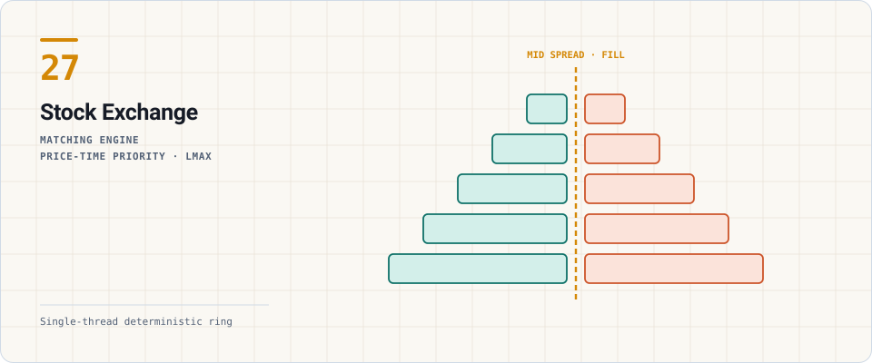
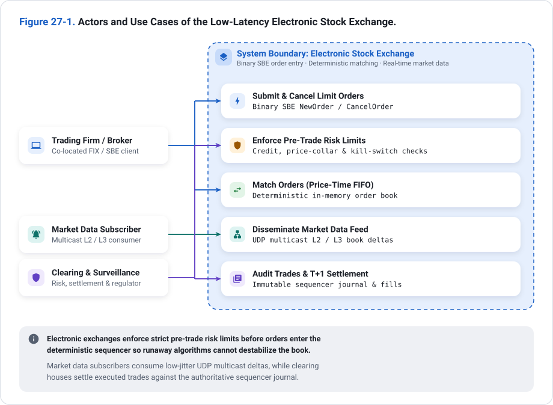
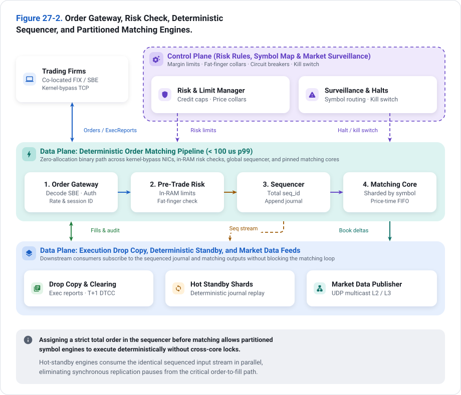
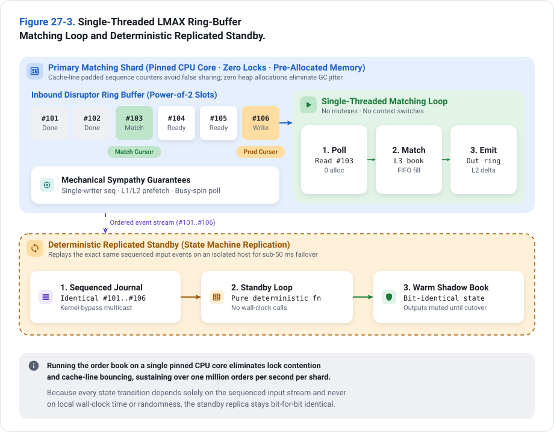

# Chapter 27: Stock Exchange



An electronic stock exchange matches buyers and sellers of financial instruments under strict legal rules governing fairness, auditability, and microsecond latency. Whenever an incoming buy limit price meets or exceeds the lowest resting sell price, the central **matching engine** executes a trade immediately and disseminates the resulting book update to every market participant simultaneously. Unlike web services that scale horizontally by distributing requests across stateless thread pools backed by relational databases, an electronic exchange achieves sub-100-microsecond tail latency through the opposite pattern: every symbol's limit order book runs inside a single deterministic thread pinned to an isolated CPU core, holding all state in pre-allocated memory with zero locks and zero database calls on the critical path. In this chapter, I design a low-latency stock exchange covering binary order entry, pre-trade risk enforcement, intrusive `O(1)` order book data structures, LMAX Disruptor ring buffers, and active-passive deterministic standby replication.

<div class="covers">

In this chapter, we cover

- actors, use cases, verifiable functional and non-functional requirements, non-goals, and trading-day capacity bounds
- binary SBE/OUCH order entry wire layouts, UDP multicast L3 market data frames, control-plane risk APIs, and order idempotency contracts
- control-plane surveillance and risk limits separated from the zero-allocation deterministic matching data plane and microsecond latency budgets
- price-time priority limit order book mechanics and intrusive doubly-linked-list data structures delivering `O(1)` cancellations with zero heap allocation
- single-threaded mechanical sympathy, cache-line-padded LMAX Disruptor ring buffers, pre-trade risk enforcement, and deterministic active-passive standby failover via replicated sequencer journals
- failure recovery matrices, exchange SLIs, production architectures (LMAX, Nasdaq, IEX, CME Globex), and simulation verification via `code/matchsim`

</div>

## 27.1 Requirements, Actors, and Capacity Bounds

Financial exchanges operate under three regulatory and physical constraints that dictate every downstream architectural choice. First, **price-time priority** is legally enforceable: among two resting orders at the same price, the order accepted earlier by the exchange must execute first without ambiguity. Second, **wire-to-wire determinism** is mandatory: regulators and surveillance teams must be able to replay the exchange's input log bit-for-bit after market close and reconstruct the exact book state and trade sequence at any microsecond. Third, algorithmic trading firms compete on single-digit microseconds, meaning tail-latency jitter from garbage collection, OS scheduling, mutex contention, or disk `fsync` directly degrades market quality.

### Actors and Use Cases

Three external actors interact across the electronic stock exchange boundary (Figure 27-1).

<figure class="diagram">

<figcaption><b>Figure 27-1</b> Actors, system boundary, and core use cases of the low-latency electronic stock exchange.</figcaption>
</figure>

| Actor | Operation | Concrete Scenario |
| :--- | :--- | :--- |
| **Trading Firm / Broker** | Submit, modify, and cancel orders over persistent binary FIX/SBE sessions | A co-located market maker submits `NewOrderSingle` (`BUY 50 ACME @ 1005`), cancels stale quotes in `< 50 us`, and receives `ExecutionReport` fills |
| **Market Data Subscriber** | Consume real-time L2/L3 order book deltas via UDP multicast | Institutional algorithms reconstruct the live order book locally from sequenced multicast packets and recover dropped frames via TCP replay |
| **Clearing and Surveillance** | Audit trades, enforce risk limits/kill switches, and settle cash/shares (`T+1`) | Exchange operators configure firm credit caps, halt a volatile symbol via circuit breaker, and forward drop-copy fills to clearing houses (DTCC) |

### Functional Requirements

| No. | Functional Requirement |
| :--- | :--- |
| 0 | Authorized firms can submit limit orders (`BUY` or `SELL` integer quantity at an integer tick price), market orders, and Immediate-or-Cancel (IOC) orders for any listed symbol. |
| 1 | Authorized firms can cancel or reduce any open resting order that has not yet been completely filled. |
| 2 | Incoming aggressive orders match against resting opposite-side orders strictly by price-time priority (best price first; earliest sequence number first at equal price). |
| 3 | Every trade executes at the price of the passive resting order in the book, with any unfilled remainder of a limit order resting in the book at its limit price. |
| 4 | Every incoming order passes pre-trade risk validation (credit cap, fat-finger price collar, rate limit, and firm kill-switch check) before mutating any order book. |
| 5 | Every order book addition, modification, cancellation, and trade execution publishes a sequenced L3 market data delta simultaneously to all subscribers. |
| 6 | Every executed trade streams asynchronously to drop-copy clearing pipelines and an immutable regulatory audit journal. |

### Non-Functional Requirements and SLOs

| No. | Property | Target Specification | Architectural Consequence |
| :--- | :--- | :--- | :--- |
| 0 | **Fairness** | Unambiguous global total order per matching partition independent of client or gateway wall clocks | Single authoritative sequencer assigns monotonic `seq_id` and `exchange_ts_ns`; equalized physical ingress fiber paths |
| 1 | **Determinism** | Bit-exact reproducible state machine across primary, standby, and post-close regulatory replay | Zero wall-clock reads inside matching loop, zero randomness, integer fixed-point ticks, single-threaded execution |
| 2 | **Latency** | Matching pipeline `p99 <= 100 us` wire-to-wire (`p99.99 <= 500 us`; gateway-to-gateway `< 1 ms`) | Kernel-bypass NICs (DPDK / Solarflare OpenOnload), SBE binary framing, pre-allocated ring buffers, isolated pinned cores |
| 3 | **Durability** | Zero loss of any sequenced input command or executed trade across single-host failure | Replicated append-only sequencer journal across `3` nodes in `2` availability zones prior to external fill acknowledgement |
| 4 | **Availability** | `99.99%` uptime during trading hours (`6.5 h/day`); automatic failover `< 50 ms` | Active-passive deterministic hot standby continuously replaying the live journal in lockstep |
| 5 | **Consistency** | Strict linearizability: exactly one authoritative order book exists per symbol at any instant | Symbol-sharded single-threaded matching cores with lease-fenced sequencer leadership |

### Non-Goals and Out-of-Scope Boundaries

Four surrounding financial systems sit outside this core matching architecture:

- **Post-trade T+1 netting, cash ledger, and bank settlement:** Multilateral clearing (DTCC/NSCC) and double-entry monetary accounting operate asynchronously downstream using the exact transactional ledger architecture designed in Chapter 19.
- **Retail brokerage web/mobile portals:** End-user authentication, order routing, and portfolio dashboards belong to broker-dealer front ends that aggregate retail orders before connecting to exchange gateways.
- **Multi-leg options and implied cross-symbol spreads:** Complex derivatives matching requires combinatorial cross-book solvers outside single-symbol price-time matching.
- **Dark-pool hidden midpoint pegs:** Non-displayed midpoint matching introduces distinct regulatory order-type rules omitted here to keep the displayed L3 limit book crystal clear.

### Back-of-the-Envelope Capacity Bounds

An electronic exchange is constrained by **single-core instruction cache efficiency, microsecond network/journal tail latency, and market-open burst absorption**, rather than raw disk capacity.

| Resource Dimension | Derivation | Provisioned Bound |
| :--- | :--- | :--- |
| **Daily Order & Cancel Volume** | `500M` messages across a `6.5 h` (`23,400 s`) trading session (`~92%` cancels/updates) | `~21,370` avg msgs/s |
| **Market-Open / Close Peak Burst** | `10x` to `25x` average burst during opening auction and macro announcements | `~215,000 to 500,000` peak msgs/s exchange-wide |
| **Single Matching Core Throughput** | Pre-allocated L3 book + LMAX ring buffer on `1` pinned core (zero locks, zero alloc) | `1M to 6M` ops/s per core (`10` symbol shards give huge headroom) |
| **Daily Sequencer Journal Size** | `500M` fixed binary records `* 64 B` per record | `32 GB/day` (`~8 TB/year` across `252` trading days) |
| **Total In-RAM Resting Order Pool** | `5,000` symbols `* 10,000` resting orders `* 64 B` per `OrderNode` | `~3.2 GB` RAM total (`~320 MB` per matching shard; fits largely in L3 cache) |
| **Market Data Multicast Bandwidth** | `500,000` peak L3 deltas/s `* 64 B` wire frame (plus UDP/IP headers) | `~55 MB/s` (`~440 Mbps`) easily carried on `10 GbE` / `25 GbE` multicast fabric |

## 27.2 External API and Data Contracts

HTTP/1.1 and JSON introduce millisecond-scale overhead from TLS framing, text parsing, dynamic string allocation, and garbage collection. Production exchanges therefore run **compact binary protocols** over persistent kernel-bypass TCP sessions on the hot order-entry path, while reserving standard REST/JSON strictly for the low-frequency control plane.

### Hot-Path Binary Wire Contracts (SBE / OUCH Style)

Every message uses **Simple Binary Encoding (SBE)** (standardized by the FIX Trading Community) or Nasdaq **OUCH** fixed-layout little-endian structs. Because every field occupies a fixed byte offset with zero optional heap allocations, the gateway decodes an incoming frame via a single bounds-checked pointer cast in under `100 nanoseconds`. Monetary prices are strictly signed 64-bit integer **ticks** (`price_ticks = 1005` represents `$10.05` at `$0.01` tick size), eliminating IEEE-754 floating-point comparison errors.

```c
// Fixed 64-byte SBE NewOrderSingle frame (Order Entry -> Gateway -> Sequencer)
struct __attribute__((packed)) SbeNewOrder {
    uint16_t block_length;    // Fixed payload size (56 bytes)
    uint16_t template_id;     // 1 = NewOrderSingle
    uint32_t firm_id;         // Authenticated trading firm identifier
    uint64_t cl_ord_id;       // Caller-supplied idempotency key (unique per firm/session)
    uint32_t symbol_id;       // Dense integer symbol index (e.g., 42 = ACME)
    uint8_t  side;            // 1 = BUY, 2 = SELL
    uint8_t  ord_type;        // 1 = LIMIT, 2 = MARKET
    uint8_t  tif;             // 0 = DAY, 3 = IOC, 4 = FOK
    uint8_t  reserved;
    int64_t  price_ticks;     // Integer minor units (1005 = 10.05)
    uint64_t quantity;        // Whole share count (> 0)
    uint64_t seq_id;          // Populated strictly by Sequencer (0 on wire ingress)
    uint64_t exchange_ts_ns;  // Populated strictly by Sequencer (monotonic epoch ns)
};

// Fixed 48-byte SBE CancelOrder frame
struct __attribute__((packed)) SbeCancelOrder {
    uint16_t block_length;    // 40 bytes
    uint16_t template_id;     // 2 = CancelOrder
    uint32_t firm_id;
    uint64_t cl_ord_id;       // Idempotency key of cancel request
    uint64_t orig_order_id;   // Exchange-assigned order_id to cancel
    uint32_t symbol_id;
    uint32_t reserved;
    uint64_t seq_id;          // Populated by Sequencer
    uint64_t exchange_ts_ns;  // Populated by Sequencer
};

// Fixed 64-byte UDP Multicast L3 Market Data Delta (ITCH / MoldUDP64 payload)
struct __attribute__((packed)) MarketDataL3Delta {
    uint64_t seq_id;          // Global partition sequence (detects UDP packet gaps)
    uint64_t exchange_ts_ns;
    uint32_t symbol_id;
    uint8_t  event_type;      // 1=ADD, 2=CANCEL, 3=MODIFY, 4=TRADE
    uint8_t  side;
    uint16_t reserved;
    uint64_t order_id;        // Resting order affected
    int64_t  price_ticks;     // Execution or resting price
    uint64_t qty_delta;       // Filled or cancelled quantity
    int64_t  best_bid_ticks;  // Snapshot of top-of-book post-event
    int64_t  best_ask_ticks;
};
```

### Order Idempotency and Session Recovery Contract

Every trading session maintains a monotonic client message sequence plus a per-session `cl_ord_id` idempotency key. If a firm's TCP session drops before it reads an `ExecutionReport`, the firm reconnects using the same `session_id` and queries `NextExpectedSeqNum` (standard FIX/OUCH session recovery). Resubmitting a previously sequenced `cl_ord_id` returns the cached `ExecutionReport` without re-entering the matching engine, preventing catastrophic duplicate fills.

### Control-Plane Risk and Surveillance API

Low-frequency administrative actions use authenticated REST/JSON over an isolated management network, translating into sequenced control commands injected into the matching pipeline so risk updates themselves remain deterministic on replay:

```http
PUT /v1/risk/firms/firm_22/limits HTTP/2
Host: ctrl.exchange.example
Authorization: Bearer tok_risk_ops
Content-Type: application/json

{
  "max_order_qty": 100000,
  "max_notional_ticks": 5000000000,
  "price_collar_bps": 500,
  "max_orders_per_sec": 10000
}
```

```http
POST /v1/risk/firms/firm_22:halt HTTP/2
Host: ctrl.exchange.example
Authorization: Bearer tok_risk_ops
Content-Type: application/json

{
  "reason": "runaway_algo_detected",
  "cancel_all_open_orders": true
}
```

## 27.3 High-Level Architecture: Control Plane vs. Data Plane

Electronic exchanges enforce a strict architectural boundary between the **Control Plane** (risk policy configuration, surveillance halts, symbol-to-shard mapping, and emergency kill switches) and the **Deterministic Data Plane** (kernel-bypass order ingress, pre-trade risk enforcement, total sequencing, in-memory matching, hot standby replication, and multicast dissemination), as illustrated in Figure 27-2.

<figure class="diagram">

<figcaption><b>Figure 27-2</b> Separation of control-plane risk and surveillance from the sub-100-microsecond deterministic matching data plane.</figcaption>
</figure>

Notice the deliberate omission of any dynamic L7 load balancer on the hot path. Every trading firm terminates onto a dedicated gateway port over a **physically equalized fiber cable** so no participant gains a structural hardware latency advantage before the sequencer. Every gateway forwards risk-cleared frames to the single authoritative **Sequencer** (or per-partition sequencer cluster), and each symbol belongs exclusively to one deterministic **Matching Core**.

### Component Responsibilities and Failure Domains

| Component | Plane | State Held | Failure Impact and Recovery |
| :--- | :--- | :--- | :--- |
| **Risk and Limit Manager** | Control | Authoritative firm credit caps, price collars, symbol status | Persisted in 3-AZ relational store; pushes incremental updates asynchronously to Risk Engines and Sequencer |
| **Surveillance and Halts** | Control | Real-time wash-trade detectors, volatility circuit breakers, kill-switch triggers | Injects sequenced `HaltSymbol` or `KillSwitch` commands into the journal so primary and standby halt identically |
| **Order Gateway (x16)** | Data | Kernel-bypass TCP sessions, FIX/SBE session seq maps, rate-limit token buckets | Gateway failure drops its connected firms' sessions; firms reconnect to backup gateways while resting orders remain intact (or auto-cancel if Cancel-on-Disconnect is enabled) |
| **Pre-Trade Risk Engine** | Data | In-RAM per-firm open notional exposure, position counters, collar tables | Co-located in-process with gateway (or dedicated pre-sequencer stage); rejects fat-finger or over-limit orders in `< 2 us` before sequencing |
| **Sequencer and Journal (3-node)** | Data | Monotonic `seq_id`, replicated append-only binary journal (Aeron Cluster / Raft) | Leader crash promotes hot standby sequencer from replicated journal quorum in `< 50 ms` with zero sequence regression |
| **Matching Core + Hot Standby (x10 pairs)** | Data | Full L3 limit order books for assigned symbol partition in pre-allocated RAM | Primary crash promotes deterministic Hot Standby holding the exact same book state in `< 50 ms` |
| **Market Data Publisher (A/B Feeds)** | Data | Ring buffer of recent sequenced L3 deltas for TCP gap recovery | Dual active-active A/B UDP multicast feeds carry identical sequenced packets; loss of Feed A causes zero packet loss for dual-homed subscribers |
| **Drop Copy and Clearing Tier** | Async | Durable execution queue feeding relational clearing ledgers (`T+1`) | Decoupled from matching core via sequencer journal subscription; downstream database slowdown never adds latency to trading |

### Microsecond Tail-Latency Budget

Meeting a `p99 <= 100 us` wire-to-wire budget requires accounting for every hardware boundary:

| Pipeline Stage | Typical (`p50`) | Tail (`p99`) | Engineering Mechanism |
| :--- | :--- | :--- | :--- |
| **NIC RX + Kernel Bypass** | `1.5 us` | `3 us` | Solarflare OpenOnload / DPDK user-space polling; zero OS syscall or `sk_buff` copy |
| **SBE Decode + Session Auth** | `0.5 us` | `1 us` | Zero-copy packed struct validation; pre-authenticated TCP session table |
| **In-RAM Pre-Trade Risk Check** | `1.0 us` | `2 us` | Flat array lookup by `firm_id`; integer arithmetic for notional and collar bounds |
| **Sequencer + Quorum Journal Replication** | `18.0 us` | `45 us` | RDMA / low-latency kernel-bypass multicast (Aeron Cluster) + NVMe/PMEM journal append |
| **Ring Buffer Handoff + L3 Book Match** | `1.5 us` | `4 us` | Lock-free Disruptor handoff (`~200 ns`) + cache-resident `O(1)` intrusive book match |
| **ExecReport + Multicast TX** | `2.5 us` | `5 us` | Batched NIC descriptor ring write; zero-copy SBE framing |
| **Total Wire-to-Wire Pipeline** | **`25 us`** | **`60 us`** | Leaves `40 us` safety margin under the `100 us` `p99` SLO |

## 27.4 Price-Time Priority Limit Order Book and Intrusive `O(1)` Data Structures

A limit order book for one symbol comprises two opposing priority queues: the **Bid side** (buy orders ranked highest price first) and the **Ask side** (sell orders ranked lowest price first). The gap between the **Best Bid** and the **Best Ask** is the **spread**. Whenever an incoming order's limit price crosses the spread (buy price `>=` best ask, or sell price `<=` best bid), the engine matches against the front of the best opposite price level repeatedly until either the incoming order fills completely or no crossing price levels remain. Every fill trades at the **passive resting order's price**, granting price improvement to aggressive orders. Advance through Interactive Trace 27.A to trace seven sequential orders arriving at an empty book and observe exact price-time priority matching.

<figure class="steps" data-prefix="figures/steps-match-book" data-count="4" data-version="c193a9ef">

<figcaption><b>Figure 27.1</b> 7 orders arrive at an empty book, and the book and the trades are shown after each of the last 3. Use Next and Back to move through the 4 steps.</figcaption>
</figure>

### Designing for `90%` Cancellations with Zero Heap Allocation

On real equities exchanges, over `90%` of submitted orders are cancelled or modified before ever executing as market makers continuously re-quote around changing prices. Using standard library containers such as `std::map<Price, std::deque<Order>>` or Rust `BTreeMap<i64, VecDeque<Order>>` suffers from two severe latency killers: cancelling an order in the middle of a `VecDeque` takes `O(K)` linear scan time at busy price levels, and allocating or freeing nodes dynamically triggers allocator lock contention or GC stop-the-world pauses.

Production matching engines combine four cache-resident structures to guarantee **`O(1)` insert at tail, `O(1)` fill at head, `O(1)` arbitrary cancel, and zero dynamic allocations**:

1. **Pre-Allocated Slab Arena (`OrderNode` Pool):** At startup before market open, the engine allocates one contiguous array of `N` `OrderNode` structs (each padded to `64 bytes` to occupy one CPU cache line) linked into an intrusive free list. Creating or releasing an order pops or pushes an index in `2` instructions with zero heap calls.
2. **Intrusive Doubly-Linked List per `PriceLevel`:** Each `OrderNode` directly embeds `prev_idx`, `next_idx`, and `level_ptr` fields. Every `PriceLevel` maintains `head_idx`, `tail_idx`, `order_count`, and `total_qty`. Appending a new resting order updates `tail_idx` in `O(1)`. Filling consumes from `head_idx` in `O(1)`. Cancelling any order anywhere inside a `5,000`-order queue splices `prev_idx` and `next_idx` directly in `O(1)` without scanning a single neighbor.
3. **Flat Open-Addressed `OrderMap` (`order_id -> node_idx`):** A pre-sized power-of-2 hash table (using Fibonacci hashing and linear probing, kept below `50%` load factor) maps `order_id` directly to its slab index in `O(1)` (`1` cache miss).
4. **Indexed Price-Level Directory (`best_bid` / `best_ask`):** For symbols trading within a bounded daily circuit-breaker band (`+/- 20%` around prior close), a **dense tick array** indexed by `(price_ticks - base_tick)` combined with a two-level hierarchical `uint64_t` bitset (`__builtin_ctzll` / `tzcnt` hardware instruction) locates the next non-empty price level after a level drains in `O(1)` (`~3` CPU cycles). For wide-range instruments, a compact cache-aligned B-Tree (branching factor `16` to `32`) keeps active top-of-book levels hot in L1/L2 cache while maintaining direct cached pointers to `best_bid_level` and `best_ask_level`.

**Cancel/Replace Priority Rule:** Reducing a resting order's quantity modifies `node.qty` and `level.total_qty` in place in `O(1)` while **preserving its time priority** in the doubly-linked list. Increasing quantity or changing price must unlink the node and re-insert it at the tail of its target price level (losing time priority) so participants cannot abuse small early orders to reserve front-of-queue slots.

## 27.5 Single-Threaded Determinism, LMAX Disruptor, Pre-Trade Risk, and Active-Passive Standby

The single most counterintuitive lesson of exchange architecture is that **one thread processing a single symbol partition beats a multi-threaded lock-protected book by an order of magnitude** while simultaneously guaranteeing regulatory determinism.

### Mechanical Sympathy and the LMAX Disruptor Ring Buffer

Executing one limit-order match against an L1/L2-cache-resident intrusive book takes roughly `200 to 800 nanoseconds`. Acquiring an uncontended mutex, invalidating dirty cache lines via MESI coherence traffic across processor cores, or suffering a single Linux scheduler context switch costs `1 to 15 microseconds`, exceeding the matching computation itself. Worse, OS thread scheduling introduces non-deterministic arrival ordering across locks, making exact replay impossible.

Popularized by LMAX Exchange (Thompson et al., 2011), modern matching engines pass sequenced messages from network/journal I/O threads into the pinned matching thread using a **lock-free Disruptor Ring Buffer** (Figure 27-3).

<figure class="diagram">

<figcaption><b>Figure 27-3</b> Single-threaded LMAX Disruptor ring-buffer matching loop paired with deterministic active-passive standby replication.</figcaption>
</figure>

Four **mechanical sympathy** techniques eliminate microsecond jitter on modern x86-64 hardware:

1. **Power-of-2 Pre-Allocated Ring Buffer:** Slots are allocated contiguously at startup (`capacity = 2^20`). Indexing slot `seq` uses bitwise masking (`seq & (capacity - 1)`), avoiding expensive integer modulo instructions and enabling hardware L1/L2 stride prefetching.
2. **Cache-Line Padding Against False Sharing:** A CPU transfers memory between cores in `64-byte` cache lines. If the producer cursor (`prod_seq`) and matching consumer cursor (`match_seq`) sit adjacent in memory, every write by the producer invalidates the consumer's cache line even though they touch different variables (**false sharing**). Padding each atomic cursor to occupy its own `64-byte` (or `128-byte` on Intel spatial-prefetcher architectures) cache line eliminates coherence ping-pong.
3. **Single-Writer Principle and Acquire/Release Barriers:** Each cursor has exactly one owning writer thread, allowing plain loads/stores paired with lightweight `release`/`acquire` memory fences (compiled to zero extra barrier instructions on x86-64 TSO) instead of costly `LOCK CMPXCHG` atomic read-modify-write loops.
4. **Core Pinning and Busy-Spin Polling:** The matching thread is pinned to an isolated physical core (`isolcpus`, `nohz_full`, `rcu_nocbs` kernel boot flags, IRQ affinity moved away) and busy-spins on `prod_seq.load(Acquire)` with a `PAUSE` instruction, removing sleep/wake kernel futex latency entirely.

### Pre-Trade Risk Controls and Determinism Discipline

Unchecked algorithmic bugs (such as Knight Capital's `$440M` 45-minute trading loss in 2012) can destabilize markets within milliseconds. We enforce risk checks in two explicit layers:

- **Pre-Sequencer Risk (Gateway / Risk Stage):** Checks session authentication, token-bucket message rate limits, static max order size, gross firm notional limits, and active firm kill-switch status. Rejecting invalid frames *before* the sequencer prevents flood traffic from polluting the journal or consuming matching CPU cycles.
- **In-Engine Deterministic Risk (Post-Sequencer):** Checks invariants that depend on live order book state, specifically **dynamic fat-finger price collars** (rejecting an aggressive buy priced `> 5%` above the current reference mid-price), **Self-Trade Prevention (STP)** (cancelling resting or incoming orders belonging to the same `firm_id` rather than executing an illegal wash trade), and **Limit-Up/Limit-Down (LULD)** volatility halts. Because these run inside the single-threaded state machine, primary and standby make bit-identical accept/reject decisions.

Defending strict determinism requires disciplined engineering rules across the matching binary: never call `clock_gettime()` inside the matching loop (consume `exchange_ts_ns` exclusively from the sequenced input frame), forbid randomized hash-map seeds (`std::collections::HashMap` SipHash randomization breaks iteration determinism), ban floating-point arithmetic, and compile with deterministic single-threaded execution.

### Deterministic Active-Passive Standby and Market Data Fanout

Holding the order book exclusively in RAM creates no durability risk because the **sequenced input journal is the sole source of truth** and the order book is a pure deterministic function of that log (`State = fold(InitialEmptyBook, Journal)`).

To avoid minutes of full-day replay during a mid-day hardware failure, every matching shard runs an isolated **Hot Standby** on a separate host in a second fault domain (Figure 27-3). Using a low-latency consensus log transport such as **Aeron Cluster** (Raft over UDP/IPC), the Sequencer replicates every incoming command to both the Primary and Standby journals simultaneously. The Hot Standby runs the exact same matching loop continuously, updating its own in-memory order book in lockstep (`~20 to 50 us` behind) while keeping its outbound network publisher muted. If the Primary misses heartbeats (or loses its Raft leadership lease), the Hot Standby unmutes its outbound publisher from `last_published_seq + 1` and takes over active trading in `< 50 ms` with zero inconsistent state and zero lost resting orders.

To disseminate market data fairly without allowing a slow TCP subscriber to stall the matching core, the matching engine writes L3 deltas into an outbound ring buffer consumed by separate **A/B Redundant UDP Multicast Publishers**. Every multicast packet reaches all co-located subscribers within nanoseconds of each other over equal-length switch fanout. Subscribers detect any dropped UDP datagram via gaps in `seq_id` and fetch missed packets asynchronously over an out-of-band TCP retransmission channel.

## 27.6 Failure Modes, SLIs, and Production Systems

### Failure and Recovery Matrix

| Failure Scenario | Blast Radius | Automated Recovery and Preserved Invariant |
| :--- | :--- | :--- |
| **Primary Matching Engine Host Crash** | Single symbol partition (`~500` symbols) for `< 50 ms` | Raft/Aeron Cluster lease expires; deterministic Hot Standby unmutes output from `last_published_seq + 1` with identical order book state |
| **Sequencer Primary Failure** | Order entry pause `< 50 ms` | Standby sequencer elected via Raft quorum resumes strictly from `max_committed_seq + 1`; zero sequence gaps or duplicates |
| **Order Gateway Host Crash** | Firms connected to that gateway (`1/16` of sessions) | Firms fail over to backup gateway; optional Cancel-on-Disconnect (CoD) injects deterministic cancel commands into sequencer for disconnected market makers |
| **Lost TCP `ExecutionReport` Reply** | Single trading firm session | Firm reconnects and reconciles via FIX/OUCH sequence recovery; duplicate `cl_ord_id` submission replays original fill without re-matching |
| **UDP Multicast Packet Drop** | Affected subscriber(s) on Feed A | Subscriber pulls packet simultaneously from redundant Feed B or requests gap replay `[seq_a..seq_b]` from TCP retransmission server |
| **Runaway Trading Algorithm / Fat-Finger Storm** | Single firm or symbol | Pre-trade rate limiter, fat-finger price collar, and operator Kill Switch (`POST /v1/risk/firms/{firm_id}:halt`) cancel all resting firm orders deterministically |
| **Software Defect Discovered Mid-Session** | Single symbol partition | Surveillance halts symbol, replays immutable sequencer journal through patched engine binary, and verifies exact fill audit trail for regulators |

### Exchange Observability: SLIs and SLOs

1. **Wire-to-Wire Order Latency Histogram (`p50`, `p99`, `p99.99`):** Measured via hardware PTP-synchronized NIC timestamps (optical tap at switch ingress and egress) without touching application CPU clocks. SLO: `p99 <= 100 us`, `p99.99 <= 500 us`.
2. **Primary-to-Standby Replay Lag:** Difference between primary committed `seq_id` and hot-standby applied `seq_id`. Alert threshold: `> 100` messages or `> 500 us`.
3. **Deterministic State Checksum Parity:** Every `10,000` sequenced events, both primary and hot standby compute a rolling CRC32/XXHash over their top-of-book and fill counters and emit it to an out-of-band monitor; any single bit of divergence triggers an immediate `SEV-1` halt investigation.
4. **Multicast Gap and Retransmission Rate:** Fraction of L3 market data packets requiring TCP gap recovery; rising rates expose switch microburst buffer exhaustion before participants notice staleness.

### How Production Systems Implement Electronic Exchanges

| Production System | Core Architecture | Architectural Distinction |
| :--- | :--- | :--- |
| **LMAX Exchange** | Single-threaded deterministic matching core + Disruptor ring buffer + replicated input journal | Pioneered mechanical sympathy on JVM/Linux, sustaining `6M+` orders/s on a single core with zero locks and sub-millisecond tail latency |
| **Nasdaq** | OUCH binary order entry, TotalView-ITCH / MoldUDP64 A/B UDP multicast, FPGA-accelerated ingress | Hardware FPGA pre-trade risk and binary framing push wire-to-wire matching latencies into the low tens of microseconds |
| **IEX (Investors Exchange)** | Deterministic matching engine preceded by a `38`-mile (`350 us`) coiled optical fiber **Speed Bump** | Uses physical signal propagation delay to neutralize cross-venue latency arbitrage while preserving deterministic internal order execution |
| **CME Globex** | iLink 3 (SBE binary) order entry + MDP 3.0 (SBE over UDP multicast) market data | Standardized FIX Simple Binary Encoding across global futures markets for zero-allocation decoding and deterministic hardware timestamping |

## 27.7 Simulation Verification

Running `code/matchsim` executes a deterministic price-time priority limit order book across seven incoming orders, exercising resting spread formation, FIFO partial fills at identical prices (`1005`), multi-level book sweeps, and passive price improvement (`order 7` selling with limit `995` fills at resting buy prices `1010` and `1000`).

```console
$ cargo run --release -p matchsim
order 1: sell 50 at 1010
order 2: sell 30 at 1005
order 3: sell 40 at 1005
order 4: buy 60 at 1000
order 5: buy 50 at 1005
    trade: 30 at 1005, order 5 with waiting order 2
    trade: 20 at 1005, order 5 with waiting order 3
order 6: buy 100 at 1010
    trade: 20 at 1005, order 6 with waiting order 3
    trade: 50 at 1010, order 6 with waiting order 1
order 7: sell 80 at 995
    trade: 30 at 1010, order 7 with waiting order 6
    trade: 50 at 1000, order 7 with waiting order 4
waiting to buy: 10 at 1000
waiting to sell: nothing
shares traded: 200
```

Verify every invariant directly from the transcript:
- **Price-Time FIFO Priority:** When `order 5` (`buy 50 @ 1005`) crosses the spread, it exhausts `order 2` (`30` shares) first before taking `20` shares from `order 3`, honoring arrival order at price `1005`.
- **Remainder Resting:** `order 6` (`buy 100 @ 1010`) clears the remaining `20` shares of `order 3` at `1005` and all `50` shares of `order 1` at `1010`, resting its unfilled `30` shares as the new best bid at `1010`.
- **Passive Price Improvement & Conservation:** `order 7` (`sell 80 @ 995`) trades `30` shares at `1010` and `50` shares at `1000` (resting buyers' prices), transferring `200` total shares and leaving exactly `10` shares of `order 4` resting at `1000`.

<div class="simulation">

**Run the deterministic matching engine simulation.** Execute `cargo run --release -p matchsim` in `code/` to verify price-time FIFO ordering, passive price execution, multi-level sweeps, and share conservation (`200` shares traded, `10` remaining at `1000`).

</div>

### End-to-End Request Lifecycle and Hop-by-Hop Latency Budget

An electronic exchange achieves single-digit-microsecond matching by pinning each stage to an isolated CPU core, bypassing the kernel network stack, and eliminating locks on the hot path.

| Hop | Component | Operation | P50 | P99 |
| :--- | :--- | :--- | :--- | :--- |
| 1 | Order Gateway (FIX/OUCH) | Kernel-bypass NIC poll, SBE/OUCH binary decode, session validation | 1.8 us | 6.5 us |
| 2 | Deterministic Sequencer | Assign monotonic global sequence ID and write to replicated Raft/Aeron journal | 3.5 us | 14 us |
| 3 | Pre-Trade Risk Engine | In-RAM fat-finger price collar, position limit, and firm kill-switch checks | 0.4 us | 1.2 us |
| 4 | Matching Engine Core | Single-threaded intrusive `O(1)` limit order book match and fill generation | 0.6 us | 2.5 us |
| 5 | Market Data Publisher | Multicast ITCH/MoldUDP64 tick broadcast and OUCH execution report egress | 1.5 us | 5.5 us |

### Production Case Studies and Open-Source Comparisons

The LMAX Disruptor demonstrated that a single thread consuming events from a cache-line-padded, preallocated ring buffer outperforms multi-threaded lock-based queues by orders of magnitude because it eliminates mutex contention, context switches, and garbage-collection pauses. NASDAQ separates binary order entry (OUCH) from UDP multicast market-data dissemination (TotalView-ITCH over MoldUDP64), enabling colocated participants to reconstruct the full limit order book deterministically from sequenced event streams. CME Globex relies on a deterministic sequencer feeding active and passive standby matching engines in lockstep; because every state transition depends strictly on the sequenced input log, failover to a hot standby completes in milliseconds with zero lost fills or order-book divergence.

<div class="callout keyidea">
<span class="label">Key idea</span>
<p>Single-threaded deterministic event processing over a preallocated ring buffer avoids locks, atomic contention, and cache-line bouncing on the critical matching path, while turning fault tolerance into exact state-machine replication of the sequenced input log.</p>
</div>

<div class="callout experiment">
<span class="label">Experiment</span>
<p>Execute <code>cargo run --release -p matchsim</code> and trace <code>order 5</code>, <code>order 6</code>, and <code>order 7</code>. Confirm that resting orders at the same price execute in strict FIFO arrival order, incoming crossing orders receive passive price improvement, and total traded plus resting shares conserve the exact submitted volume.</p>
</div>

<div class="callout caution">
<span class="label">Common pitfall</span>
<p>Using floating-point types (<code>f64</code>) for prices or wall-clock timestamps inside the matching core introduces rounding drift and nondeterminism between primary and standby replicas. Prices must use fixed-point integer ticks, and all time-dependent expirations must derive from sequencer-stamped logical timestamps.</p>
</div>

## 27.8 Terminology and References

### Engineering Glossary

| Term | Definition |
| :--- | :--- |
| **Limit Order Book (LOB)** | Dual priority structure holding resting buy orders (highest price first) and sell orders (lowest price first) for a single tradable symbol. |
| **Price-Time Priority (FIFO)** | Matching rule ranking orders strictly by best limit price first, and by earliest sequencer arrival number among orders at the same price. |
| **Sequencer** | Authoritative single ordering component assigning monotonic `seq_id` and `exchange_ts_ns` timestamps to every input command before journaling. |
| **LMAX Disruptor** | Pre-allocated, cache-line-padded, lock-free power-of-2 ring buffer enabling sub-microsecond single-writer handoff between threads with zero allocations. |
| **Mechanical Sympathy** | Designing data structures and concurrency boundaries to align with CPU cache lines, branch predictors, and memory fences rather than fighting hardware physics. |
| **Simple Binary Encoding (SBE)** | FIX-standardized fixed-offset binary wire protocol allowing zero-copy, zero-allocation encoding and decoding of financial messages. |
| **Pre-Trade Risk Check** | In-RAM validation of credit limits, order size caps, fat-finger price collars, and firm kill switches executed before an order mutates the book. |
| **Active-Passive Deterministic Standby** | Isolated replica consuming the exact same sequenced journal in lockstep to hold an identical order book ready for sub-50-ms failover. |

### References

- M. Fowler, "The LMAX Architecture", martinfowler.com, 2011.
- M. Thompson, D. Farley, M. Barker, P. Gee, and A. Stewart, "Disruptor: High Performance Alternative to Bounded Queues for Exchanging Data Between Concurrent Threads", LMAX Technical Paper, 2011.
- FIX Trading Community, *Simple Binary Encoding (SBE) Technical Specification* and *FIX 5.0 Session Layer*.
- Nasdaq, *OUCH Order Entry Protocol*, *TotalView-ITCH Market Data Specification*, and *MoldUDP64 Transport Specification*.
- IEX Exchange, "IEX Speed Bump Technical Overview", Investors Exchange Documentation.
- Real Logic / Adaptive, *Aeron Cluster: Fault-Tolerant Deterministic State Machine Replication Documentation*.
