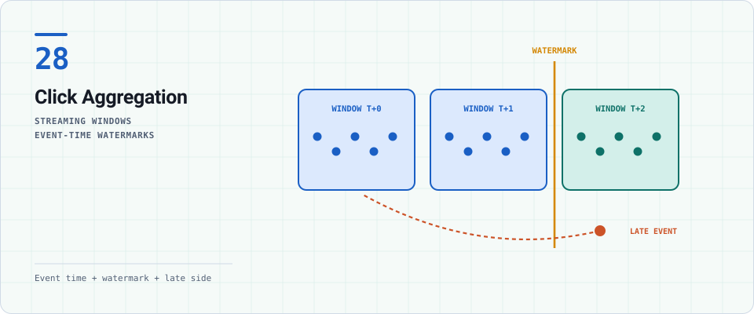
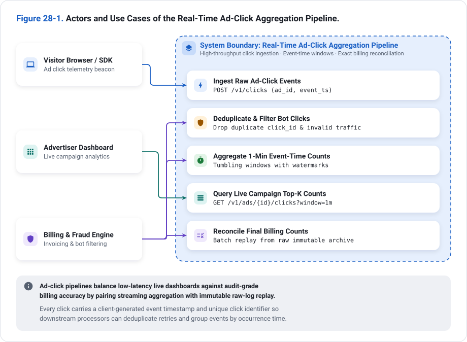
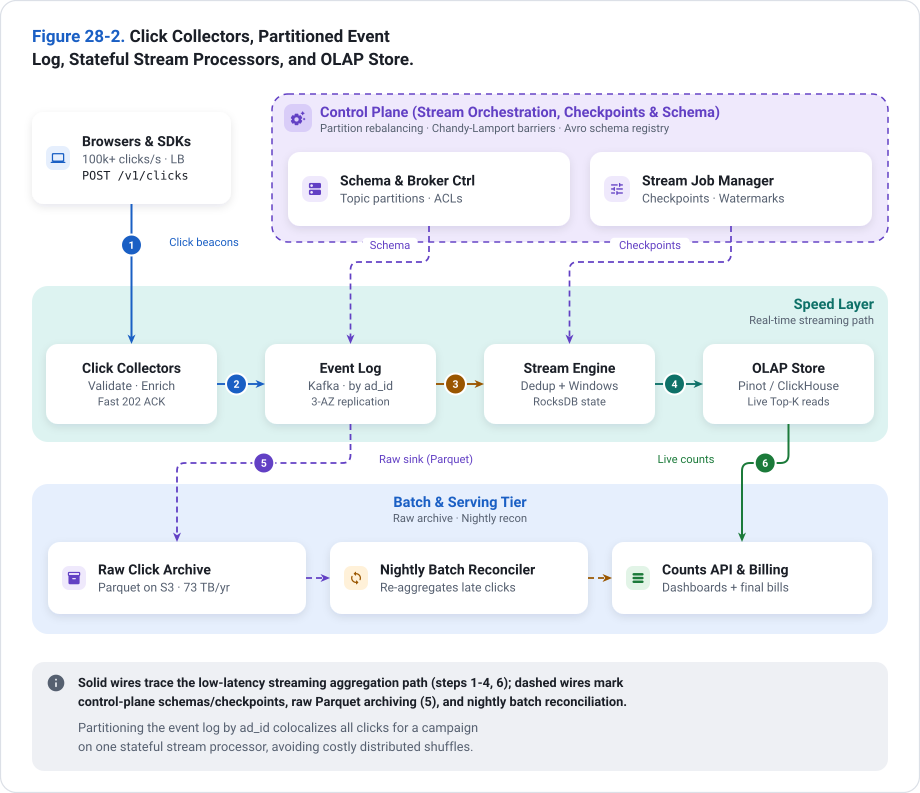
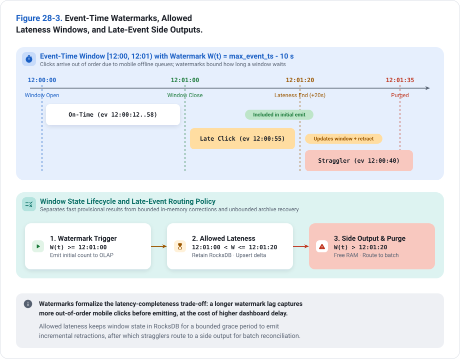

# Chapter 28: Click Aggregation



Online advertising platforms bill advertisers per valid click while simultaneously driving live campaign dashboards and real-time budget pacing. Counting clicks over a clean, ordered, finite file in an overnight batch job is elementary, yet running once per day leaves advertisers blind for 24 hours and allows exhausted budgets to overspend for hours. Real-time click streams invert every assumption of batch processing: mobile devices buffer clicks inside tunnels and flush them minutes or hours late, network packets arrive out of order, browsers retry unacknowledged beacons and create duplicates, and stream processors crash mid-window while holding partial aggregates in memory. Because advertisers pay real money per aggregated click, overcounting by `2%` triggers billing disputes and undercounting by `2%` forfeits revenue directly. In this chapter, I design a distributed real-time click aggregation pipeline combining stateless high-availability ingestion, event-time tumbling windows with heuristic watermarks, Chandy-Lamport asynchronous checkpointing, hot-ad two-stage pre-aggregation, and audit-grade batch reconciliation.

<div class="covers">

In this chapter, we cover

- actors, use cases, verifiable functional and non-functional requirements, non-goals, and billion-click capacity bounds
- high-availability click ingestion endpoints, live OLAP count/Top-K APIs, Avro event envelopes, and idempotent ReplacingMergeTree schemas
- control-plane stream orchestration and schema management separated from the speed-layer streaming path and immutable archive reconciliation path
- event-time versus processing-time semantics, client clock-skew clamping, heuristic watermarks with idle-partition handling, allowed lateness, and late-event side outputs
- Chandy-Lamport asynchronous barrier snapshots for effectively-once state recovery, hot-ad salting with two-stage pre-aggregation, HyperLogLog distinct counts, and click-fraud deduplication
- failure recovery matrices, streaming SLIs, production architectures (Apache Flink, Google MillWheel and Photon, Meta Scuba), and simulation verification via [`code/clicksim`](https://github.com/arpanpathak/cracking-the-systems-programming-interview/tree/prep-v2/distributed-systems-from-the-ground-up/code/clicksim)

</div>

## 28.1 Requirements, Actors, and Capacity Bounds

Click aggregation bridges two conflicting operational demands: **sub-minute freshness** for live advertiser dashboards and budget pacing, and **exact financial completeness** for end-of-month invoicing. No unbounded streaming system can guarantee both instantaneous emission and `100%` completeness simultaneously because an arbitrary offline device can always deliver an older click later. We resolve this fundamental tension explicitly by publishing two clearly labeled grades of results: fast **provisional** counts emitted from the real-time stream within seconds, and immutable **final** counts produced after reconciling stragglers from an immutable raw-event archive.

### Actors and Use Cases

Three external actors interact across the ad-click aggregation boundary (Figure 28-1).

<figure class="diagram">

<figcaption><b>Figure 28-1</b> Actors, system boundary, and core use cases of the real-time ad-click aggregation pipeline.</figcaption>
</figure>

| Actor | Operation | Concrete Scenario |
| :--- | :--- | :--- |
| **Visitor Browser / SDK** | Report raw ad-click telemetry (`POST /v1/clicks`) | Mobile SDK emits a signed click beacon carrying a client-generated `click_id` and `event_ts`, retrying automatically on transient network timeouts |
| **Advertiser Dashboard** | Query live 1-minute counts and Top-K campaigns (`GET /v1/ads/{id}/clicks`) | A marketing analyst tracks campaign clicks minute-by-minute within `30 s` of occurrence and watches real-time Top-K trending ads |
| **Billing and Fraud Engine** | Filter invalid bot traffic and compute final invoices | Fraud pipeline drops forged or high-velocity bot clicks; nightly reconciliation computes exact immutable daily totals for advertiser billing |

### Functional Requirements

| No. | Functional Requirement |
| :--- | :--- |
| 0 | Every click beacon submitted by an authorized browser or mobile SDK is accepted with minimal latency and persisted durably with both its client `event_ts` and collector `ingest_ts`. |
| 1 | The system aggregates valid clicks per advertisement into 1-minute **event-time** tumbling windows and exposes provisional counts within `30 s` of each window's close. |
| 2 | Clicks delayed in transit are attributed to the exact minute in which they occurred (`event_ts`), rather than the minute in which they reached the server (`ingest_ts`). |
| 3 | Duplicate click deliveries caused by client retries or at-least-once broker redelivery are deduplicated by `click_id` and counted at most once. |
| 4 | The system exposes live Top-K advertisement rankings over recent sliding or tumbling windows and explicitly labels every returned count as `PROVISIONAL` or `FINAL`. |
| 5 | Every raw click is retained immutably in long-term object storage so nightly reconciliation produces exact `FINAL` billing counts and historical bugs or fraud-rule updates can be reprocessed cleanly. |

### Non-Functional Requirements and SLOs

| No. | Property | Target Specification | Architectural Consequence |
| :--- | :--- | :--- | :--- |
| 0 | **Accuracy** | `FINAL` billing counts exact (`0%` drift from raw archive after fraud filter); `PROVISIONAL` counts within `1%` of `FINAL` | Event-time watermarking + allowed-lateness upserts paired with immutable raw Parquet archive reconciliation |
| 1 | **Freshness** | Provisional 1-minute window counts visible in OLAP within `30 s` (`p99`) of window end | Continuous stateful stream processing (Flink) with tuned watermark lag (`10 to 15 s`) and streaming OLAP ingestion |
| 2 | **Ingestion Availability** | `99.99%` availability for `POST /v1/clicks` (strictly prioritized over dashboard query availability) | Stateless edge collectors perform minimal validation and append directly to a 3-AZ Kafka log with zero synchronous dependency on downstream processors |
| 3 | **Durability** | Zero loss of any `202 Accepted` click across single broker or AZ failure | Kafka `acks=all` across `3` replicas (`min.insync.replicas=2`) plus continuous archival to erasure-coded object storage |
| 4 | **Consistency** | Eventual and revisable for `PROVISIONAL` counts; immutable and strongly consistent once marked `FINAL` | Idempotent keyed upserts in OLAP (`ReplacingMergeTree` / upsert primary key) with explicit finality flag |
| 5 | **Scale** | `1B` clicks/day (`~11.6k` avg/s), `100,000` peak clicks/s, `1M` active advertisements | Partitioned Kafka log, parallel stateful Flink subtasks with hot-ad salting, and distributed columnar OLAP |

Observe the deliberate availability asymmetry in Requirement 2: a dashboard outage lasting `60 seconds` is a temporary annoyance whose data remains intact, whereas a dropped `POST /v1/clicks` request destroys billable revenue permanently because the visitor will not click again. Decoupling stateless collectors behind a durable partitioned log isolates revenue-critical ingestion from downstream processing bugs or OLAP maintenance.

### Non-Goals and Out-of-Scope Boundaries

Four surrounding ad-tech systems sit outside this aggregation pipeline:

- **Real-time bidding (RTB) ad selection:** Serving auctions and ranking candidate ads within `< 50 ms` happens upstream before an impression or click token is minted.
- **Multi-day cross-device conversion attribution:** Joining clicks against offline store purchases or 30-day app installs runs on offline data warehouses rather than sub-minute window operators.
- **Advertiser payment settlement and ledger accounting:** Generating credit-card charges and double-entry merchant receivables belongs to the payment ledger architecture in Chapter 19.
- **Ad-hoc arbitrary BI SQL queries over raw logs:** Interactive multi-terabyte scans execute over the Parquet/Iceberg lakehouse outside the latency-sensitive live OLAP serving tier.

### Back-of-the-Envelope Capacity Bounds

Click aggregation is constrained by **peak ingestion spikes, stateful per-window deduplication memory in RocksDB, hot-key partition skew, and multi-year raw archive retention**.

| Resource Dimension | Derivation | Provisioned Bound |
| :--- | :--- | :--- |
| **Click Ingestion Rate** | `1B clicks/day / 86,400 s`; `~9x` peak burst during live broadcasts | `~11,575` avg clicks/s; `100,000` peak clicks/s |
| **Raw Click Archive Growth** | `1B clicks/day * 200 B` (enriched Avro/Parquet record) | `200 GB/day` (`~73 TB/year` uncompressed; `~20 TB/year` Zstd Parquet) |
| **Kafka Retention Footprint** | `200 GB/day * 7 days` replay buffer `* 3` replicas | `~4.2 TB` NVMe across `12` Kafka brokers (`64` partitions) |
| **Daily Aggregated OLAP Rows** | `1M ads * 1,440 min/day * 10%` active minutes | `144M` aggregate rows/day (`~4.6 GB/day` at `32 B`/row) |
| **Stateful Operator Dedup RAM / RocksDB** | `100,000 peak clicks/s * 90 s` active open+lateness window `* 16 B` (`click_id` + overhead) | `~144 MB` active dedup working set (`~6 MB` per task across `24` Flink subtasks; fits easily in RAM/RocksDB block cache) |
| **Hot-Ad Peak Single-Key Load** | Single championship broadcast ad receiving `25%` of peak traffic | `25,000` clicks/s on one `ad_id` -> requires `K=16` salting (`~1,560` clicks/s per subtask) |

## 28.2 External API and Data Contracts

Every click carries a client-generated unique `click_id` (UUIDv7/ULID), an HMAC-signed `impression_token` minted when the ad was served (preventing forged click floods), and the client occurrence timestamp `event_ts`.

### High-Availability Click Ingestion Endpoint

```http
POST /v1/clicks HTTP/2
Host: clicks.example
Content-Type: application/json

{
  "click_id": "0199f2a8-c110-7b2e-9a41-3f9c01e4b821",
  "ad_id": 7,
  "campaign_id": 402,
  "impression_token": "imp_v1.eyJhZCI6NywiaXAiOi...sig_8f2a",
  "event_ts": "2026-10-14T10:00:07.412Z"
}
```

```http
HTTP/2 202 Accepted
```

The collector returns `202 Accepted` immediately once Kafka acknowledges replication (`acks=all`), confirming durable receipt without waiting for window aggregation.

### Live Campaign Counts and Top-K Query API

```http
GET /v1/ads/7/clicks?from=2026-10-14T10:00:00Z&to=2026-10-14T10:03:00Z&window=1m HTTP/2
Host: clicks.example
Authorization: Bearer tok_advertiser_402
```

```http
HTTP/2 200 OK
Content-Type: application/json

{
  "ad_id": 7,
  "window_seconds": 60,
  "watermark_ts": "2026-10-14T10:02:18Z",
  "buckets": [
    { "window_start": "2026-10-14T10:00:00Z", "count": 412, "unique_users_est": 389, "status": "FINAL" },
    { "window_start": "2026-10-14T10:01:00Z", "count": 398, "unique_users_est": 374, "status": "PROVISIONAL" },
    { "window_start": "2026-10-14T10:02:00Z", "count": 87,  "unique_users_est": 84,  "status": "PROVISIONAL" }
  ]
}
```

```http
GET /v1/campaigns:top?window=1m&at=2026-10-14T10:01:00Z&limit=10 HTTP/2
Host: clicks.example
Authorization: Bearer tok_advertiser_402
```

Every bucket declares `status: "PROVISIONAL"` or `"FINAL"` alongside the current pipeline `watermark_ts`. Live dashboards plot both grades for low-latency visibility, whereas billing jobs filter strictly on `status = "FINAL"`.

### Event Log Envelope and Idempotent OLAP Schema

Inside Kafka, enriched click records follow a compact Avro/Protobuf schema registered in the Schema Registry:

```json
{
  "click_id": "0199f2a8-c110-7b2e-9a41-3f9c01e4b821",
  "ad_id": 7,
  "campaign_id": 402,
  "event_ts_ms": 1760436007412,
  "ingest_ts_ms": 1760436007890,
  "client_ip_hash": "a49f12c0e8b1...",
  "user_agent_hash": "7b22d10a91f4...",
  "is_valid_token": true
}
```

In the OLAP serving store (ClickHouse or Apache Pinot), window counts are stored as **idempotent keyed replacements**, never blind `UPDATE counts SET c = c + delta` increments. If a stream processor crashes after publishing a window count and replays the last checkpoint interval upon recovery, re-writing the exact computed total under the composite key `(ad_id, window_start, window_sec)` with a monotonic `revision` overwrites the row cleanly with zero double-counting:

```sql
CREATE TABLE ad_click_counts (
    ad_id            UInt64,
    campaign_id      UInt64,
    window_start     DateTime,
    window_sec       UInt16,
    click_count      UInt64,
    unique_users_est UInt64,
    status           Enum8('PROVISIONAL' = 1, 'FINAL' = 2),
    revision         UInt64,
    updated_at       DateTime64(3)
)
ENGINE = ReplacingMergeTree(revision)
PARTITION BY toYYYYMMDD(window_start)
ORDER BY (ad_id, window_sec, window_start);
```

## 28.3 High-Level Architecture: Control Plane vs. Data Plane

We structure the aggregation platform around a clear split between **Control Plane** orchestration (schema enforcement, topic partitioning, Chandy-Lamport checkpoint coordination, and watermark management) and a dual-path **Data Plane** combining a low-latency streaming speed layer with an immutable raw-archive reconciliation tier (Figure 28-2).

<figure class="diagram">

<figcaption><b>Figure 28-2</b> Control-plane orchestration separated from the real-time streaming aggregation path and immutable raw-archive batch reconciliation tier.</figcaption>
</figure>

### Component Responsibilities and Failure Domains

| Component | Plane | State Held | Failure Impact and Recovery |
| :--- | :--- | :--- | :--- |
| **Schema and Broker Control** | Control | Avro/Protobuf schema versions, Kafka partition assignments, topic ACLs | Stateless control APIs backed by consensus metadata; prevents schema-breaking collector deploys from poisoning stream jobs |
| **Stream Job Manager (Flink)** | Control | Task graph topology, checkpoint barrier coordinator, latest completed checkpoint metadata | Active-passive HA JobManager backed by ZooKeeper/Kubernetes leases; restarts failed tasks from last completed checkpoint in S3/GCS |
| **Click Collectors (x40)** | Data (Speed) | Stateless (HMAC token verification, clock-skew clamping, IP hashing, Kafka producer batching) | Edge L7 LB routes around failed collectors immediately; zero lost requests |
| **Kafka Event Log (x12)** | Data (Speed) | 7-day partitioned raw click log across 3 AZs (`64` partitions) | Broker failure promotes an in-sync replica in seconds with zero committed click loss (`min.insync.replicas=2`) |
| **Stateful Stream Engine (x24)** | Data (Speed) | Per-window counts, `click_id` dedup sets, HLL sketches, watermark trackers in local NVMe RocksDB | Task crash restores incremental RocksDB snapshot + Kafka offsets atomically from object storage; effectively-once counts preserved |
| **OLAP Serving Store (Pinot / ClickHouse)** | Data (Speed) | Partitioned columnar window counts (`ReplacingMergeTree` / upsert tables) | Replicated shards absorb single-node failure without query downtime; idempotent upserts survive stream replay cleanly |
| **Raw Click Archive & Nightly Batch** | Data (Batch) | Immutable Zstd Parquet files on S3/GCS (`73 TB/year`) + Spark/Flink batch reconciler | Stateless batch jobs re-read immutable Parquet partitions on failure to produce authoritative `FINAL` billing rows |

### End-to-End Click Path Walkthrough

1. **Stateless Edge Ingestion:** A visitor clicks an advertisement. The browser or mobile SDK posts `POST /v1/clicks` to a stateless Collector. The Collector verifies the HMAC `impression_token`, stamps `ingest_ts`, clamps implausible client `event_ts` values, appends the Avro record to Kafka keyed by `ad_id` (or salted `ad_id#salt` for hot campaigns), and returns `202 Accepted`.
2. **Parallel Archival:** An independent Kafka Connect / Sink consumer streams every raw partition continuously into immutable hourly Zstd Parquet files in S3/GCS, establishing the permanent replayable source of truth.
3. **Stateful Event-Time Processing:** Flink subtasks consume Kafka partitions, check `click_id` against local RocksDB dedup state, drop duplicates and high-velocity bot bursts, assign valid clicks to their 1-minute event-time tumbling window, and advance per-partition watermarks.
4. **Provisional Emission and Allowed Lateness:** When the global watermark passes a window's end boundary, the operator emits an idempotent `PROVISIONAL` count row to ClickHouse/Pinot. Late clicks arriving within the allowed-lateness grace period update RocksDB state and emit updated revisions; extreme stragglers route to a late-event side output.
5. **Final Billing Reconciliation:** After a configured reconciliation cutoff (for example, `T+2 hours` or nightly at `02:00 UTC`), the Batch Reconciler reads the complete raw Parquet partitions (or executes unified Kappa replay using identical Flink SQL/DataStream logic over historical storage), incorporates every late straggler and offline fraud classifier verdict, and upserts immutable `status = 'FINAL'` rows for invoicing.

## 28.4 Event-Time Semantics, Heuristic Watermarks, Windows, and Late-Event Handling

Every click event carries two distinct timestamps: **event time** (`event_ts`, when the visitor actually clicked on their device) and **processing time** (`ingest_ts` / processor wall clock, when the server received it). Aggregating by processing time answers the wrong business question ("how many beacons reached our servers during minute `10:01`") and corrupts reporting whenever a mobile carrier lags or a collector experiences a 5-minute pause, producing five empty minutes followed by an artificial `6x` spike that bills an expired campaign.

### Defending Against Malicious or Drifted Client Clocks

Relying blindly on raw device timestamps introduces its own hazard: a smartphone whose local clock is misconfigured to `1970` or `2031` would inject clicks into decades-old or far-future windows, inflating state or poisoning watermarks. Collectors enforce a **clock-skew hygiene contract** at ingestion:
- Compute `skew = client_send_ts - ingest_ts` whenever the SDK reports its local transmission time alongside `event_ts`, correcting systematic device clock offsets via `adjusted_event_ts = event_ts - skew`.
- Clamp future timestamps (`adjusted_event_ts > ingest_ts + 5 s`) down to `ingest_ts`, and flag or route clicks older than `7 days` directly to an audit dead-letter archive so a corrupt device cannot stall watermark math.

### Heuristic Watermarks and Idle-Partition Alignment

Dividing an infinite stream into finite **tumbling windows** (`[12:00, 12:01)`, `[12:01, 12:02)`), **sliding windows** (5-minute span sliding every 1 minute for live Top-K trends), or **session windows** (grouping bursts per user separated by an inactivity gap) requires deciding *when* a window has received enough out-of-order events to close.

A **heuristic watermark** `W(t)` expresses the stream engine's estimate of event-time completeness: `"the processor assumes no further non-late events with event_ts < W(t) will arrive."` Under a **bounded-out-of-orderness** generator with lag allowance `L` (for example, `L = 10 s`), each partition tracks:

```text
partition_watermark = max_event_ts_observed_in_partition - L
```

When a downstream operator reads from `P` parallel upstream partitions, its combined watermark must equal **`min(partition_watermark_1, ..., partition_watermark_P)`** so a fast partition does not prematurely close windows for a slightly lagging partition. A subtle production pitfall arises when one partition receives zero clicks for several minutes (for example, a quiet geographic shard at 03:00 local time): its `max_event_ts` freezes, pinning `min(...)` and halting *every* window across the entire cluster. Production Flink deployments eliminate this stall by configuring an **idle-source timeout** (`withIdleness(Duration.ofSeconds(15))`), temporarily excluding quiet partitions from the minimum calculation until traffic resumes.

Advance through Interactive Trace 28.A to observe out-of-order arrivals, duplicate suppression, watermark window closure, and a one-minute late straggler on a `10`-second tumbling window with `5`-second watermark lag.

<figure class="steps" data-prefix="figures/steps-click-watermark" data-count="6" data-version="6aec362f">

<figcaption><b>Figure 28.1</b> Clicks arrive late, out of order and twice, and a watermark decides when each window is finished. Use Next and Back to move through the 6 steps.</figcaption>
</figure>

### Allowed Lateness and Late-Event Side Outputs

Choosing the watermark lag `L` exposes an unavoidable latency-completeness trade-off: larger `L` captures more out-of-order mobile clicks before initial emission but delays dashboards by `L` seconds. Following the **Google Dataflow / Apache Beam** window lifecycle model, we decouple fast provisional emission from state retention using a three-stage policy (Figure 28-3).

<figure class="diagram">

<figcaption><b>Figure 28-3</b> Three-stage event-time window lifecycle separating fast watermark triggers, bounded allowed-lateness upserts, and late-event side outputs.</figcaption>
</figure>

1. **Watermark Trigger (`W(t) >= 12:01:00`):** As soon as `W(t)` crosses the window end (`12:01:00`), the operator emits the initial `PROVISIONAL` count (`revision = 1`) to ClickHouse/Pinot, keeping dashboard latency under `15 to 30 s`.
2. **Allowed Lateness Window (`12:01:00 < W(t) <= 12:01:20`):** Rather than purging RocksDB state immediately at `12:01:00`, the operator retains the window counter and `click_id` dedup set for a bounded grace period (for example, `+20 s` in Figure 28-3, or `+5 min` for mobile-heavy ad networks). Each late click arriving inside this grace window updates the state and emits a higher-revision idempotent upsert (`revision = 2, 3, ...`) that refines the live OLAP count cleanly.
3. **State Purge and Late-Event Side Output (`W(t) > 12:01:20`):** Once the watermark exceeds `window_end + allowed_lateness`, the operator purges both the window counter and its `click_id` dedup set from RocksDB so state memory stays strictly bounded (`~144 MB` total). Any extreme straggler arriving hours later routes cleanly into a dedicated **Late-Event Side Output** stream, alerting operators if late-event volume spikes and ensuring the nightly `FINAL` reconciliation job captures every billable click.

## 28.5 Chandy-Lamport Asynchronous Barrier Snapshots, Hot-Ad Salting, and Click-Fraud Deduplication

Three internal stream-processing mechanisms separate an academic prototype from a production billion-click billing pipeline: fault-tolerant checkpointing, skew elimination, and multi-tier deduplication.

### Exactly-Once Stateful Recovery via Asynchronous Barrier Snapshots

A stateful stream operator holds three tightly coupled pieces of state in memory and local NVMe RocksDB: its current Kafka partition offsets, open window partial counts, and seen `click_id` sets. If the processor persists Kafka offsets independently from its RocksDB state and crashes between the two writes, recovery either drops uncheckpointed clicks (underbilling) or replays already-counted clicks into stale counters (overbilling).

Apache Flink solves distributed stateful recovery without halting stream throughput using **Asynchronous Barrier Snapshots (ABS)** (Carbone et al., 2015), a streaming adaptation of the classical **Chandy-Lamport distributed snapshot algorithm** (1985):

1. **Barrier Injection:** Every `30 to 60 seconds`, the JobManager instructs every Kafka source subtask to record its current partition offset and inject an in-band **checkpoint barrier** (`barrier_id = k`) directly into the event stream alongside regular click records.
2. **Barrier Alignment:** When a downstream stateful operator receives `barrier_id = k` on input channel `A`, it pauses processing further records from channel `A` (buffering them briefly) while continuing to drain channel `B` until `barrier_id = k` arrives on *all* input channels. This alignment defines an exact consistent cut across the entire distributed dataflow graph: every event before `barrier_id = k` is reflected in state, and every event after `barrier_id = k` belongs to checkpoint `k + 1`. (Under heavy backpressure, Flink can switch to **unaligned checkpoints** that snapshot in-flight channel buffers immediately to keep checkpoint duration bounded.)
3. **Asynchronous Incremental RocksDB Upload:** Once aligned, the operator takes an instantaneous copy-on-write RocksDB checkpoint (hard-linking immutable local SSTable files in milliseconds), resumes processing clicks immediately, and uploads only newly generated SSTable deltas asynchronously to S3/GCS.
4. **End-to-End Effectively-Once Guarantee:** When all operators acknowledge `barrier_id = k`, the JobManager commits checkpoint `k` atomically. On crash, every subtask restores its exact RocksDB state and rewinds its Kafka consumer to the exact paired offsets from checkpoint `k`. Any window already emitted between checkpoint `k` and the crash is recomputed identically and written to ClickHouse/Pinot via **idempotent keyed upsert** (`ReplacingMergeTree`), achieving end-to-end effectively-once aggregation.

### Hot-Ad Salting, Two-Stage Pre-Aggregation, and HyperLogLog

Partitioning Kafka and Flink strictly by `hash(ad_id)` breaks down during major live events (a championship broadcast or flash sale), where one flagship advertisement can generate `25%` of total platform clicks (`25,000+` clicks/s). That single `ad_id` maps to one Flink subtask, saturating its CPU, blowing up backpressure, and freezing the global watermark while the other `23` subtasks sit largely idle.

Because addition is **associative and commutative**, we eliminate hot-ad skew with **Two-Stage Salted Pre-Aggregation**:

- **Stage 1 (Salted Local Pre-Aggregation):** For normal ads, events hash by `ad_id`. For hot ads (detected dynamically via a lightweight Count-Min Sketch or campaign tier flag), the upstream partitioner appends a deterministic or random salt `(ad_id, salt)` where `salt in 0..15` (`K = 16`). Sixteen parallel Stage-1 subtasks each process `~1,560` clicks/s and emit only **one compact partial sum per window** (`16` messages/minute total).
- **Stage 2 (Global Window Rollup):** A downstream operator strips the salt, re-keys strictly by `(ad_id, window_start)`, and sums the `16` partial aggregates into the exact global count in microseconds.

Note a critical mathematical caveat when computing **distinct clicking users** (`unique_users_est`): unlike total click sums, exact unique counts cannot be added across salted partitions because the same user may land in both `salt=3` and `salt=11`. Instead, each Stage-1 subtask populates a compact **HyperLogLog (HLL)** probabilistic sketch (`12 KB` per window for `< 1%` standard error), and Stage 2 merges the `16` HLL byte arrays associatively via element-wise `max(reg_a[i], reg_b[i])` to produce an accurate global distinct-user estimate in constant memory.

### Click-Fraud Filtering and Multi-Tier Deduplication

Ad-click pipelines are constant targets for automated click-fraud botnets attempting to drain competitors' daily budgets. We defend accuracy across three layers:

1. **Cryptographic Impression Tokens:** Every ad render mints a short-lived HMAC-signed `impression_token` encoding `(impression_id, ad_id, expiry_ts, publisher_id)`. Stateless collectors reject forged beacons lacking a valid signature or expired beyond `30 minutes` before they ever enter Kafka.
2. **Window-Bounded `click_id` Deduplication:** Stateful operators store seen `click_id` keys inside RocksDB scoped to each window and automatically purge them when the watermark passes `window_end + allowed_lateness`, preventing unbounded dedup-table memory growth. For multi-datacenter active-active billing pipelines (such as Google Photon), cross-DC deduplication writes processed `click_id` records to a Paxos-replicated global key-value store to guarantee at-most-once billing even during full datacenter failovers.
3. **Streaming Velocity and Offline Fraud Classification:** A lightweight Flink velocity filter flags abnormal click bursts (`> 20` clicks/minute from one `(client_ip_hash, user_agent_hash)` fingerprint) into a `suspected_fraud` side output so live budgets pause safely, while heavier graph-based bot detectors run offline before finalizing `FINAL` nightly billing invoices.

## 28.6 Failure Modes, SLIs, and Production Systems

### Failure and Recovery Matrix

| Failure Scenario | Blast Radius | Automated Recovery and Preserved Invariant |
| :--- | :--- | :--- |
| **Flink TaskManager Host Crash** | `1/24` of partitions pause `5 to 15 s` | JobManager restarts affected tasks from latest incremental RocksDB checkpoint + paired Kafka offsets; idempotent OLAP upserts yield zero double-counting |
| **Idle Kafka Partition Stalls Watermark** | Global provisional window emissions stall | Source idleness timeout (`15 s`) temporarily excludes quiet partitions from `min(partition_watermarks)`, resuming window closure immediately |
| **Mobile Device Offline for 2 Hours** | Single delayed click batch | Watermark already purged the window; late clicks route cleanly to the Late-Event Side Output and are folded into `FINAL` billing counts by the nightly reconciler |
| **Client Retry / Broker Redelivery Storm** | Duplicate click beacons | Window-scoped RocksDB `click_id` dedup set drops duplicates inside open/lateness windows; batch reconciler deduplicates globally by `click_id` |
| **Viral Broadcast Ad Overwhelms One Subtask** | Single hot `ad_id` partition | Two-stage salted pre-aggregation (`K=16`) spreads Stage-1 load evenly across subtasks while preserving exact Stage-2 totals |
| **Buggy Aggregation Code Deployed for 48 Hours** | Corrupted provisional/final counts | Engineers deploy patched logic and reprocess the immutable S3/GCS raw Parquet archive (or 7-day Kafka log), overwriting affected keys in OLAP via higher `revision` |
| **OLAP Serving Store Outage** | Live dashboards degraded | Stateless Collectors continue returning `202 Accepted` into Kafka uninterrupted; Flink checkpoints buffer safely and drain backlog once OLAP recovers |

### Streaming Observability: SLIs and SLOs

1. **Collector Ingestion Success Rate:** Percentage of valid `POST /v1/clicks` requests durably committed to Kafka with `202 Accepted`. SLO: `>= 99.99%` (`SEV-1` page if `< 99.95%` over `2 minutes`).
2. **End-to-End Provisional Freshness Lag:** `olap_emit_ts - window_end_ts` measured per minute across all partitions. SLO: `p99 <= 30 s`.
3. **Watermark Lag and Partition Skew:** `current_wall_clock - global_watermark` and `max(partition_wm) - min(partition_wm)`. Rising skew immediately exposes a stuck partition, hot ad key, or broken idle-source configuration.
4. **Provisional-to-Final Billing Drift:** Daily automated audit comparing `SUM(PROVISIONAL)` against `SUM(FINAL)` per campaign. SLO: `< 1.0%` drift; sudden drift spikes signal excessive mobile lateness, bot waves, or miscalibrated watermark lag `L`.
5. **Checkpoint Duration and Alignment Buffer Size:** Alert if asynchronous RocksDB snapshot completion approaches `50%` of the checkpoint interval (`> 30 s`), preventing cascading backpressure before recovery time degrades.

### How Production Systems Implement Click Aggregation

| Production System | Core Architecture | Architectural Distinction |
| :--- | :--- | :--- |
| **Apache Flink** | Distributed stateful dataflow with Chandy-Lamport Asynchronous Barrier Snapshots + incremental RocksDB state | Industry standard for unified event-time stream and batch processing (Kappa architecture) with native watermarks, allowed lateness, and side outputs |
| **Google MillWheel & Dataflow** | Per-key persistent state, low-watermark propagation, programmable Triggers + Accumulation modes | Formalized the Dataflow Model separating *what* is computed (transformations), *where* in event time (windows), *when* in processing time (watermarks/triggers), and *how* refinements relate (retract/accumulate) |
| **Google Photon** | Multi-datacenter active-active streaming click-impression join backed by Paxos-replicated `IdRegistry` | Guarantees at-most-once and eventually-exactly-once ad billing across entire datacenter outages without stalling live processing |
| **Meta Scuba / Apache Pinot / ClickHouse** | Real-time distributed columnar OLAP ingesting streaming upserts with sub-second Top-K aggregation | Decouples high-cardinality interactive advertiser dashboard queries from stateful stream aggregation workloads |

## 28.7 Simulation Verification

Running [`code/clicksim`](https://github.com/arpanpathak/cracking-the-systems-programming-interview/tree/prep-v2/distributed-systems-from-the-ground-up/code/clicksim) feeds an identical stream of out-of-order, duplicated, and late-arriving ad clicks through both a processing-time (arrival-time) counter and an event-time watermarked counter (`10 s` tumbling windows, `5 s` watermark lag allowance) and compares both against ground truth.

```console
$ cargo run --release -p clicksim
what happened:              0-10 s: 8, 10-20 s: 4, 20-30 s: 1
counted by arrival time:    0-10 s: 7, 10-20 s: 5, 20-30 s: 1, 60-70 s: 1
counted by event time:      0-10 s: 7, 10-20 s: 4
still open:                 20-30 s: 1
clicks received twice: 1, clicks too late for their window: 1
```

Inspect every metric confirmed by the simulation output:
- **Processing-Time Distortion:** Counting by arrival time misattributes delayed clicks across buckets (`10-20 s` inflated to `5` instead of `4`), fabricates a phantom `60-70 s: 1` bucket for a click that occurred in `0-10 s`, and only lands on `7` for `0-10 s` accidentally because a duplicate click partially cancels out two delayed arrivals.
- **Event-Time Watermark Accuracy:** Counting by event time with deduplication drops the `1` duplicate click cleanly, attributes the `7 s` delayed click correctly to `0-10 s`, produces exact `10-20 s: 4`, keeps `20-30 s: 1` open pending watermark advancement, and explicitly flags the `1` extreme straggler (`clicks too late for their window: 1`) so downstream late-event side outputs and nightly batch reconciliation restore the exact `0-10 s` total of `8`.

<div class="simulation">

**Run the streaming click aggregation simulation.** Execute `cargo run --release -p clicksim` in [`code/`](https://github.com/arpanpathak/cracking-the-systems-programming-interview/tree/prep-v2/distributed-systems-from-the-ground-up/code) to observe processing-time distortion versus event-time watermarked windows, duplicate suppression (`1` duplicate dropped), open-window buffering (`20-30 s: 1`), and late-straggler detection (`1` late click).

</div>

### End-to-End Request Lifecycle and Hop-by-Hop Latency Budget

An ad click flows from edge capture through partitioned durable logs, stateful event-time windowing, and columnar OLAP ingestion for sub-second advertiser queries.

| Hop | Component | Operation | P50 | P99 |
| :--- | :--- | :--- | :--- | :--- |
| 1 | Edge Collector (PoP) | Validate click signature, emit HTTP `302` redirect, enqueue event asynchronously | 4 ms | 18 ms |
| 2 | Ingestion Log (Kafka) | Append partitioned click batch (`acks=all`) keyed by salted `ad_id` | 6 ms | 28 ms |
| 3 | Stream Processor (Flink) | Deduplicate `click_id`, update local RocksDB event-time window, advance watermark | 12 ms | 65 ms |
| 4 | Checkpoint Coordinator | Chandy-Lamport asynchronous barrier alignment and incremental RocksDB snapshot to object store | 90 ms | 450 ms |
| 5 | Columnar OLAP Store | Upsert materialized 1-minute window aggregates and serve top-K dashboard queries | 35 ms | 180 ms |

### Production Case Studies and Open-Source Comparisons

Apache Flink pairs heuristic event-time watermarks with incremental RocksDB local state and Chandy-Lamport Asynchronous Barrier Snapshots (ABS), delivering exact windowing and exactly-once sink semantics across millions of events per second without pausing live ingestion. ClickHouse complements stateful stream aggregators with MergeTree columnar storage and vectorized SIMD execution, ingesting compacted per-minute rollups to answer interactive multi-dimensional advertiser queries in milliseconds. Meta Scuba takes an in-memory distributed columnar approach with aggressive time-based data expiration, trading long-term historical retention for sub-second ad-hoc drilldowns across high-cardinality operational and click-telemetry dimensions.

<div class="callout keyidea">
<span class="label">Key idea</span>
<p>Event-time windowing guided by monotonic heuristic watermarks decouples billing accuracy from network jitter and mobile offline delays. Pairing a bounded allowed-lateness grace period with a late-event side output keeps live dashboards fast while guaranteeing exact financial reconciliation.</p>
</div>

<div class="callout experiment">
<span class="label">Experiment</span>
<p>Run <code>cargo run --release -p clicksim</code> and compare the <code>counted by arrival time</code> row against <code>counted by event time</code>. Observe how arrival-time bucketing fabricates a phantom <code>60-70 s</code> bucket and distorts <code>10-20 s</code>, whereas event-time watermarking deduplicates the retry and isolates the single extreme straggler cleanly.</p>
</div>

<div class="callout caution">
<span class="label">Common pitfall</span>
<p>Keying a stateful stream aggregation directly by raw <code>ad_id</code> allows a single viral campaign to saturate one partition worker while sibling subtasks sit idle. Two-stage salted pre-aggregation spreads hot-key load across <code>K</code> parallel subtasks before folding compact partial sums.</p>
</div>

## 28.8 Terminology and References

### Engineering Glossary

| Term | Definition |
| :--- | :--- |
| **Event Time vs. Processing Time** | Event time is the instant an action occurred on the origin device; processing time is the wall-clock instant the server ingested or processed that event. |
| **Tumbling / Sliding / Session Window** | Finite event-time groupings: non-overlapping fixed intervals (tumbling), overlapping fixed-span intervals advancing by a shorter slide (sliding), and inactivity-delimited user bursts (session). |
| **Heuristic Watermark** | Monotonic progress timestamp `W(t)` estimating the event-time boundary before which the stream engine expects all non-late events to have arrived. |
| **Allowed Lateness & Side Output** | Bounded post-watermark grace period retaining window state for incremental updates, after which extreme stragglers route to a separate side-output stream for batch reconciliation. |
| **Asynchronous Barrier Snapshot (ABS)** | Flink's Chandy-Lamport adaptation that aligns in-band stream barriers across input channels and snapshots RocksDB state plus Kafka offsets asynchronously without pausing ingestion. |
| **Two-Stage Salted Pre-Aggregation** | Spreading a hot key across `K` salted subtasks in Stage 1 to compute partial window sums, then folding only `K` compact summaries in Stage 2 to eliminate skew. |
| **HyperLogLog (HLL)** | Probabilistic cardinality sketch estimating distinct counts within `< 1%` error using `~12 KB` of associatively mergeable memory per window. |
| **Lambda vs. Kappa Architecture** | Lambda pairs a real-time speed layer with a separate nightly batch layer; Kappa uses one unified streaming codebase capable of replaying an immutable historical log to recompute results. |

### References

- T. Akidau, R. Bradshaw, C. Chambers, S. Chernyak, R. J. Fernandez-Moctezuma, R. Lax, S. McVeety, D. Mills, F. Perry, E. Schmidt, and S. Whittle, "The Dataflow Model: A Practical Approach to Balancing Correctness, Latency, and Cost in Massive-Scale, Unbounded, Out-of-Order Data Processing", *PVLDB*, 2015.
- T. Akidau, A. Balikov, K. Bekiroglu, S. Chernyak, J. Haberman, R. Lax, S. McVeety, D. Mills, P. Nordstrom, and S. Whittle, "MillWheel: Fault-Tolerant Stream Processing at Internet Scale", *PVLDB*, 2013.
- R. Ananthanarayanan, V. Basker, S. Das, A. Gupta, H. Jiang, T. Qiu, A. Reznichenko, D. Ryabkov, M. Singh, and S. Venkataraman, "Photon: Fault-Tolerant and Scalable Joining of Continuous Data Streams", *ACM SIGMOD*, 2013.
- P. Carbone, G. Fora, S. Ewen, S. Haridi, and K. Tzoumas, "Lightweight Asynchronous Snapshots for Distributed Dataflows", *arXiv:1506.08603*, 2015.
- K. M. Chandy and L. Lamport, "Distributed Snapshots: Determining Global States of Distributed Systems", *ACM Transactions on Computer Systems (TOCS)*, 1985.
- J. Kreps, "Questioning the Lambda Architecture", O'Reilly Radar, 2014.
- P. Flajolet, E. Fusy, O. Gandouet, and F. Meunier, "HyperLogLog: The Analysis of a Near-Optimal Cardinality Estimation Algorithm", *AofA*, 2007.
- L. Abraham, J. Allen, O. Barykin, V. Borkar, B. Chopra, C. Gerea, D. Merl, J. Metzler, D. Reiss, S. Subramanian, J. L. Wiener, and O. Zed, "Scuba: Diving into Data at Facebook", *PVLDB*, 2013.
