# 1. Keeping a local copy of the cluster

This chapter depicts what happens under the hood when a Kubernetes controller learns that an
object in the cluster has changed. We will examine how the API server numbers every write, how a
client combines a list and a stream of changes into an exact copy of the cluster, what the client
does when that stream breaks, and how the copy is turned into work. We will build each of these
pieces as a small program in Go and in Rust, starting with the data structures and adding one
operation at a time, and we will finish by running the whole model through a burst of edits, a
dropped connection and a network partition.

## Objects and controllers

Kubernetes describes the state of a cluster as a collection of objects. A user who wants a
training job to run does not start the job's container directly; the user creates an object that
describes the job, and a program inside the cluster makes the description true. In this section we
define the object, the API server that stores it and the controller that acts on it, and then trace
a single job through its life.

<div class="definition">

**Definition 1.1** (Object). An *object* is a record that the API server stores under a kind and a
name. It consists of a *spec*, also referred to as the desired state, which describes the state that
the owner of the object requests, and a *status*, also referred to as the observed state, which
describes the state that has been achieved so far.

</div>

<div class="definition">

**Definition 1.2** (API server). The *API server* is the HTTP service through which every object is
created, read, updated and deleted. It stores the objects in etcd, a replicated key-value store, and
no other component of the cluster accesses etcd directly.

</div>

<div class="definition">

**Definition 1.3** (Controller). A *controller* is a process that drives the status of every object
of a given kind towards its spec. It repeatedly compares the 2 parts of each object, performs the
actions that remove any difference between them, and records the outcome in the status.

</div>

The 2 parts of an object have different writers. The owner of the object, a user or another
program, writes only the spec. The controller writes only the status. This division allows a
controller to distinguish, at any moment, the state that was requested from the state it has
achieved.

<div class="example">

**Example 1.1** (A GPU training job). Consider an object `job-a` of kind `GpuJob`. Immediately after
its creation it has `spec.gpus = 1` and `status.gpus = 0`. The controller observes that the 2 values
differ, starts a container with 1 GPU on a machine that has a free GPU, and writes
`status.gpus = 1`, after which spec and status agree and the controller takes no further action.
When the owner later writes `spec.gpus = 2`, the values differ again; the controller replaces the
container with one that has 2 GPUs and writes `status.gpus = 2`. When the owner deletes `job-a`, the
controller stops the container and releases both GPUs.

</div>

Listing 1.1 defines the object of our model. A Kubernetes object carries many more fields, among
them labels, owner references and a container specification. A GPU count in the spec and in the
status is sufficient for every mechanism in this chapter. The field `ResourceVersion` is defined in
the next section (Definition 1.4).

<div class="code-tabs">

<p class="listing"><b>Listing 1.1</b> An object, with its spec and its status. <a href="https://github.com/arpanpathak/cracking-the-systems-programming-interview/blob/prep-v2/gpu-accelerated-kubernetes/code/go/informer/server.go">Go</a> · <a href="https://github.com/arpanpathak/cracking-the-systems-programming-interview/blob/prep-v2/gpu-accelerated-kubernetes/code/rust/informer/src/server.rs">Rust</a></p>

```go
{{#include ../code/go/informer/server.go:types}}
```

```rust
{{#include ../code/rust/informer/src/server.rs:types}}
```

</div>

To do its work, a controller requires 2 things from the API server: the current state of every
object of its kind, and notification of each change to such an object shortly after the change
occurs.

## The cost of asking for everything

The simplest way for a controller to obtain both is to request every object of its kind every few
seconds and to compare the result with the state it has recorded. We can estimate the cost of this approach
for a large cluster. Suppose the cluster runs 50,000 pods and each pod is about 4 KB of JSON. A
single request for all pods then transfers 50,000 × 4 KB = 200 MB. If 12 controllers each repeat
the request every 5 seconds, the API server sends 12 × 200 MB ÷ 5 s = 480 MB every second. Between
2 requests, perhaps 3 pods have changed, so almost all of those bytes describe objects that the
controller already knew about. On our own lab fleet, 5 Jetson AGX Thors, 2 DGX Sparks and a Jetson
Orin NX Super, a few hundred pods fit in well under 1 MB and polling works, and so the
approach is tempting. Its cost grows with the size of the cluster, while the useful information it
returns grows only with the rate of change.

Kubernetes inherited the answer to this problem from its predecessors at Google. Borg kept the
state of a cluster in a central master, and Omega, described in 2013, let many schedulers share 1
copy of that state and settle clashing updates with version checks instead of locks. Kubernetes,
announced in 2014, kept the version checks and added a stream of changes, so that a client reads
the whole state once and then receives only the changes. The rest of this chapter builds that
mechanism one step at a time.

## Numbering every write

A stream of changes needs a way to name a point in the history of the store, so that a client whose
connection breaks can ask for every change after the last one it received. etcd provides such a
name. It keeps 1 counter, called the **revision**, for the whole store, and every create, update and
delete of any key takes the next value of that counter. etcd also keeps the older values of each key
under their old revisions until a clean-up removes them.

Fig. 1.1 shows 12 writes to 4 keys. The top row is the history in the order of the writes, coloured
by the key that each write changed. The rows below form etcd's key index, which lists for each key
the revisions that wrote it. For example, `job-a` was written at revisions 1, 4, 5, 9 and 11, and
`pod-1` at revisions 3 and 8.

<figure>
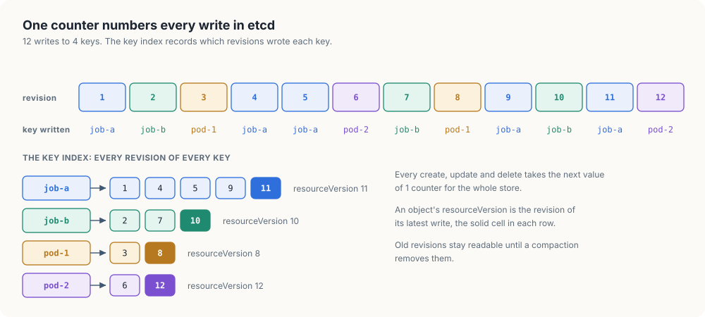
<figcaption><b>Figure 1.1</b> One counter numbers every write. An object's resource version is the revision of its latest write, the solid cell in each row.</figcaption>
</figure>

<div class="definition">

**Definition 1.4** (Resource version). The *resource version* of an object is the etcd revision of
the last write that changed the object. The resource version of a list of objects is the revision
of the whole store at the moment the list was read.[^opaque]

</div>

In Fig. 1.1 the resource version of `job-a` is therefore 11, and that of `pod-1` is 8. A client
that holds a list read at resource version *v* knows the state of the cluster exactly as it was
after revision *v*.

[^opaque]: Kubernetes asks clients to treat resource versions as opaque strings and to compare them only for equality. Our model uses plain integers so that we can print them, and nothing in the client depends on their order.

Each change that the API server reports to a client is an **event**. An event has a type, `ADDED`,
`MODIFIED` or `DELETED`, and it carries the whole object as it was after the change, or its last
state for a deletion. Since each event carries the whole object, and every field of it,
a client can apply an event without knowing anything about the object's earlier state. Listing 1.2
gives the event, together with the 3 errors that the server can return. We will meet `409 Conflict`
in the next section and `410 Gone` when we discuss lost history.

<div class="code-tabs">

<p class="listing"><b>Listing 1.2</b> Events, and the errors the server returns. <a href="https://github.com/arpanpathak/cracking-the-systems-programming-interview/blob/prep-v2/gpu-accelerated-kubernetes/code/go/informer/server.go">Go</a> · <a href="https://github.com/arpanpathak/cracking-the-systems-programming-interview/blob/prep-v2/gpu-accelerated-kubernetes/code/rust/informer/src/server.rs">Rust</a></p>

```go
{{#include ../code/go/informer/server.go:events}}
```

```rust
{{#include ../code/rust/informer/src/server.rs:events}}
```

</div>

## Two writers and one object

The resource version also solves a problem that has nothing to do with streams. A client updates
an object by sending the whole object back to the API server. Consider 2 clients that both read
`job-a` at resource version 7. Client A raises the job's GPU count and sends the job back. A moment
later, client B changes the job's container image and sends its copy back as well. Client B's copy
still holds the GPU count it read at version 7, so its write replaces client A's change with the
old value. Neither client receives an error, and the GPU change is simply gone. This failure is
called a **lost update**.

The API server prevents it by letting each write state the resource version it was based on.
Fig. 1.2 traces the same 2 clients under that rule. Both read version 7 at markers ➋ and ➍. At
marker ➎ client A sends its change with "read at version 7"; the object is still at version 7, so at
➏ the server accepts the write and stores it as version 8. At ➐ client B sends its change, also
with "read at version 7". The object is now at version 8, so at ➑ the server refuses the write
with `409 Conflict`. Client B then reads the job again, applies its image change to version 8, and
at ➓ the write succeeds as version 9, which holds both changes.

<figure>
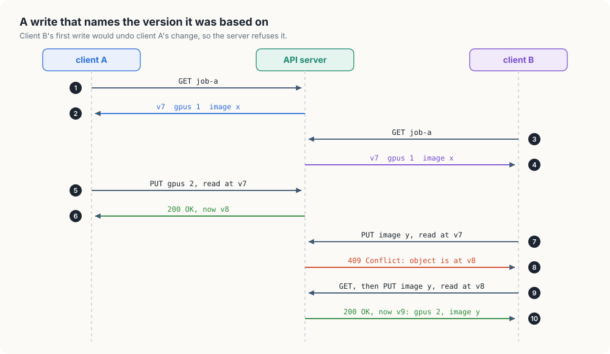
<figcaption><b>Figure 1.2</b> A write that names the version it read is accepted only if the object is still at that version.</figcaption>
</figure>

<div class="definition">

**Definition 1.5** (Conditional write). An update that carries a resource version *v* succeeds only
if the stored object still has resource version *v*. Otherwise the API server rejects the update
with the HTTP status `409 Conflict`, and the client must read the object again and reapply its
change.

</div>

This technique is called *optimistic concurrency control*, also known as compare-and-set. No client
holds a lock on the object while it computes its change. Each client proceeds on the assumption that
no other client will write the object in the meantime, and the server detects the cases in which
that assumption was false at the moment the write arrives. The cost of a false assumption is 1
additional read and 1 additional write, which is small when conflicts are rare, as they are for most
Kubernetes objects.

We now have enough to build the server's side of these rules. Fig. 1.3 shows the state that our
model API server keeps after 10 writes. There are 4 fields behind 1 lock. The **objects** map holds
the current version of each object. The **version** counter plays the role of etcd's revision. The
**history** holds recent events in order, and the **watches** are the open streams of changes,
which the next section introduces. A fifth field, **compacted**, records how much of the oldest
history has been discarded.

<figure>
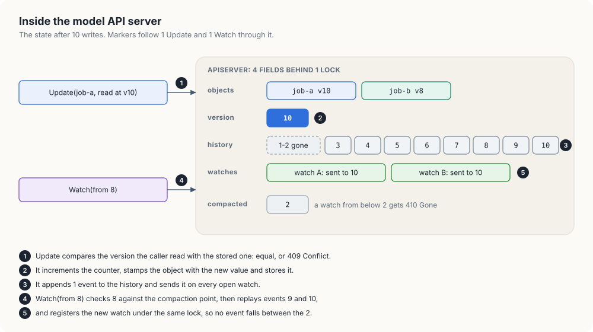
<figcaption><b>Figure 1.3</b> The model API server after 10 writes. Markers ➊ to ➌ follow an update, and ➍ and ➎ a new watch.</figcaption>
</figure>

Listing 1.3 declares these fields. The field `unreachable` has no counterpart in Kubernetes; our
demonstration sets it to make the server behave as if a network partition had cut it off.

<div class="code-tabs">

<p class="listing"><b>Listing 1.3</b> The state of the API server. <a href="https://github.com/arpanpathak/cracking-the-systems-programming-interview/blob/prep-v2/gpu-accelerated-kubernetes/code/go/informer/server.go">Go</a> · <a href="https://github.com/arpanpathak/cracking-the-systems-programming-interview/blob/prep-v2/gpu-accelerated-kubernetes/code/rust/informer/src/server.rs">Rust</a></p>

```go
{{#include ../code/go/informer/server.go:server}}
```

```rust
{{#include ../code/rust/informer/src/server.rs:server}}
```

</div>

The update path follows markers ➊ to ➌ in Fig. 1.3. The server first compares the version that the
caller read with the version it has stored, and returns `409 Conflict` if they differ. It then
increments the counter, stamps the object with the new value, stores it, and publishes 1 event to
the history and to every open watch. In our model a version of 0 means that the caller wants to
write unconditionally, which the demonstration uses to play a user editing a job, and an object
that does not exist yet counts as version 0.

<div class="code-tabs">

<p class="listing"><b>Listing 1.4</b> An update that checks the version it was based on. <a href="https://github.com/arpanpathak/cracking-the-systems-programming-interview/blob/prep-v2/gpu-accelerated-kubernetes/code/go/informer/server.go">Go</a> · <a href="https://github.com/arpanpathak/cracking-the-systems-programming-interview/blob/prep-v2/gpu-accelerated-kubernetes/code/rust/informer/src/server.rs">Rust</a></p>

```go
{{#include ../code/go/informer/server.go:update}}
```

```rust
{{#include ../code/rust/informer/src/server.rs:update}}
```

</div>

The check, the increment and the store all happen while the lock is held. If the lock were released
between the check and the store, 2 writers could both pass the check against version 7 before
either stored its result, and the lost update would return. Note that the lock is held only for the
time of a few map operations, so it does not limit the server's throughput in our model; the real
API server delegates the same check to etcd, which performs it as a single transaction.

## Listing and watching

With every write numbered, a client can construct an exact copy of the cluster with 2 kinds of
request. A **list** returns every object of a kind together with the resource version of the store
at the moment of the read. A **watch** is a long-lived request that names a resource version *v* and
returns, in order, 1 event for every change whose revision is greater than *v*. The 2 requests are
designed to be used together: the client lists, and then watches from the resource version that the
list returned.

The order of the 2 requests creates a subtle problem. They are separate requests, and other clients
continue to write between them. Fig. 1.4 shows a list read at version 10, an edit made at version 11,
and a watch opened when the store has already reached version 12. In the upper row the watch asks for
the changes after version 10, so the server replays versions 11 and 12 from its history and then
continues with new events. In the lower row the watch asks for the changes after version 12, the
version current when it opened, and the edits at versions 11 and 12 are never delivered. The client's
copy of the edited object then remains wrong until that object happens to change again.

<figure>
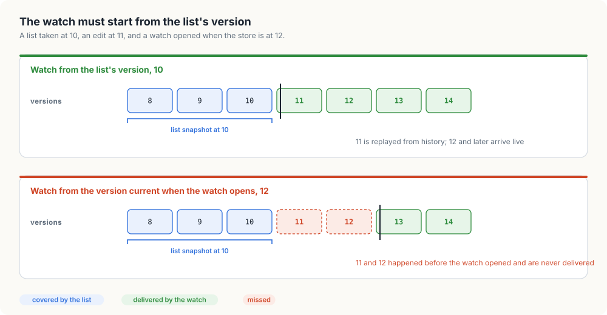
<figcaption><b>Figure 1.4</b> A watch must start from the list's version. Starting from the current version leaves a gap.</figcaption>
</figure>

<div class="invariant">

**Invariant 1.1** (No gap, no duplicate). If a client lists at version *v* and then watches from
*v*, its copy after applying the events up to version *u* equals the state of the store at version
*u*. The list covers every write up to *v*, and the watch delivers every write after *v* exactly once.

</div>

<div class="callout note">

**Following a chess game from another room.** Suppose we follow a chess game that is played in
another room, and a messenger carries news to us. First we ask for the position of the board, and
the messenger brings a drawing of the board as it stood after move 30. Then we ask to be told every
move from now on. Moves are numbered, and each report says only which piece moved where, so our
board is correct only if we apply every move, in order. If we ask for moves "after move 30", the
messenger also brings move 31, which was played while the drawing was on its way, and our board
stays correct. If we ask for moves "from now", and move 31 has already been played, we never hear
of it, and every later move is applied to a wrong board. The comparison breaks down in 1 place.
Every move of a game is written on the score sheet and can be read back at any time, while the API
server keeps only the last few minutes of changes; a client that asks for changes older than that
must ask for a new drawing, which is the subject of the next section. Mapped back to Kubernetes, the
drawing is the list, "after move 30" is the list's resource version, the reported moves are the
watch events, and asking for moves after 30 is opening the watch from the list's version.

</div>

Listing 1.5 gives both requests on the server side; markers ➍ and ➎ of Fig. 1.3 follow the
watch. `List` copies the objects and the counter while the lock is held, so the version it returns
describes exactly the objects it returns. `Watch` first rejects a version that the server can no
longer serve, then replays every stored event newer than the requested version into a new channel,
and finally registers that channel so that `publish`, which `Update` calls in Listing 1.4, delivers every later
event to it.
The replay and the registration happen under the same lock that `Update` holds, and therefore every
event reaches the new watch exactly once: either in the replay or on the channel, and in exactly 1 of the
2. This is Invariant 1.1 as the server enforces it.

<div class="code-tabs">

<p class="listing"><b>Listing 1.5</b> List, and watch from a version. <a href="https://github.com/arpanpathak/cracking-the-systems-programming-interview/blob/prep-v2/gpu-accelerated-kubernetes/code/go/informer/server.go">Go</a> · <a href="https://github.com/arpanpathak/cracking-the-systems-programming-interview/blob/prep-v2/gpu-accelerated-kubernetes/code/rust/informer/src/server.rs">Rust</a></p>

```go
{{#include ../code/go/informer/server.go:listwatch}}
```

```rust
{{#include ../code/rust/informer/src/server.rs:listwatch}}
```

</div>

A Go watch channel buffers 1,024 events. A client that stopped reading would eventually block
`publish` while it holds the lock and stall every writer; the real API server avoids this by closing
a watch that falls too far behind. The Rust channel is unbounded. The Kubernetes API server does not
send each watch to etcd: for each kind of object it keeps a **watch cache**, the current objects and
a window of recent events in memory, fed by a single etcd watch, and it serves most watches from it.
Since Kubernetes 1.31 it also serves consistent lists from that cache, after confirming that the
cache has caught up with the latest revision in etcd.

## Lost history and the 410 response

A watch can replay only the events that the server still holds. etcd keeps every revision of every
key until it is told to discard the old ones; this clean-up is called **compaction**, and
kube-apiserver requests one every 5 minutes by default. When a client asks to resume from a revision
older than the oldest one that remains, the API server answers with the HTTP status `410 Gone`. The
events the client needs no longer exist, and the only way back to an exact copy is a new list.

Watches also end for ordinary reasons. kube-apiserver closes every watch after a random timeout
between 30 and 60 minutes, so that thousands of clients do not reconnect at the same moment. A load
balancer may close a connection that has been idle for too long, and a network partition may leave
the server unreachable for some time. Fig. 1.5 shows the 3 endings and the action that each
requires. Let *v* be the resource version of the last event the client applied. Since the client's
copy is exact up to *v*, resuming the watch from *v* is correct after a closed stream and after an
outage. Only `410 Gone` requires a new list.

<figure>
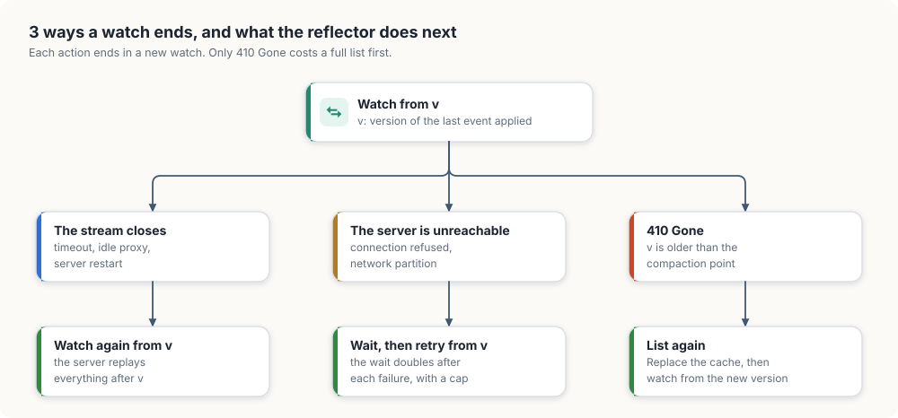
<figcaption><b>Figure 1.5</b> The 3 ways in which a watch ends, and the action each requires.</figcaption>
</figure>

A watch on a kind of object that rarely changes receives few events, so its *v* can fall behind the
next compaction even though nothing was missed. The API server avoids this needless list by sending
**bookmark** events, which carry a resource version and no object and advance a quiet watch's
position.

Our model reproduces each of these endings on request. Listing 1.6 adds 4 methods to the server.
`Compact` discards the history and records the version from which a watch may still resume.
`DropWatches` closes every open watch, as an idle timeout would. `Partition` closes every watch and
makes new ones fail until `Heal` is called. None of these methods has a counterpart in the
Kubernetes API; they exist so that the demonstration at the end of the chapter can cause each
failure at a chosen moment.

<div class="code-tabs">

<p class="listing"><b>Listing 1.6</b> Compaction, dropped watches and partitions. <a href="https://github.com/arpanpathak/cracking-the-systems-programming-interview/blob/prep-v2/gpu-accelerated-kubernetes/code/go/informer/server.go">Go</a> · <a href="https://github.com/arpanpathak/cracking-the-systems-programming-interview/blob/prep-v2/gpu-accelerated-kubernetes/code/rust/informer/src/server.rs">Rust</a></p>

```go
{{#include ../code/go/informer/server.go:faults}}
```

```rust
{{#include ../code/rust/informer/src/server.rs:faults}}
```

</div>

## A local copy of the objects

Once a client has listed and is watching, it can keep its own copy of every object in memory and
answer its own reads from that copy. This copy is called the **cache**. A read becomes a map lookup,
and the API server sends each change to the client's process once, however often the client reads.

The cache needs 2 operations. **Apply** records a single event: it stores the object carried by an
`ADDED` or `MODIFIED` event and removes the object named by a `DELETED` event. Listing 1.7 gives the
cache with `Get` and `Apply`. It uses a read-write lock, since every reconcile reads the cache and
only the reflector writes it.

<div class="code-tabs">

<p class="listing"><b>Listing 1.7</b> The cache, Get and Apply. <a href="https://github.com/arpanpathak/cracking-the-systems-programming-interview/blob/prep-v2/gpu-accelerated-kubernetes/code/go/informer/cache.go">Go</a> · <a href="https://github.com/arpanpathak/cracking-the-systems-programming-interview/blob/prep-v2/gpu-accelerated-kubernetes/code/rust/informer/src/cache.rs">Rust</a></p>

```go
{{#include ../code/go/informer/cache.go:cache}}
```

```rust
{{#include ../code/rust/informer/src/cache.rs:cache}}
```

</div>

The second operation, **Replace**, installs the result of a new list, and it has a duty that events
cannot perform. When a client lists again after `410 Gone`, some objects may have been deleted while
it was cut off, and their `DELETED` events were discarded by the compaction. No event will ever
report those deletions. The only evidence that they happened is that the objects are present in the
old cache and absent from the new list. Fig. 1.6 compares an old cache with a new list for 4 objects.
`job-a` moved from version 9 to version 11 and is reported as modified. `job-b` is in the old cache
and not in the list, so it is reported as deleted. `job-c` is new, and `job-d` is unchanged and is
not reported at all.

<figure>
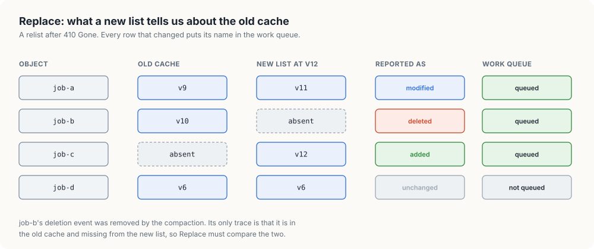
<figcaption><b>Figure 1.6</b> Replace finds changes by comparing the old cache with the new list. The deletion of <code>job-b</code> has no event left anywhere.</figcaption>
</figure>

<div class="algorithm">

**Algorithm 1.1** Replace(*cache*, *list*) returns the names that changed

1. *changed* ← an empty list
2. for each object *o* in *list*: if *cache* has no entry for *o*.name, or its version differs from *o*.version, append *o*.name to *changed*
3. for each name *n* in *cache* that is not in *list*: append *n* to *changed*
4. *cache* ← the objects of *list*, by name
5. return *changed*

</div>

Listing 1.8 implements Algorithm 1.1. An object that is new to the client has no cached version. Go
reads the missing map entry as version 0, and Rust compares against `None`, so both report the new
object as changed in step 2.

<div class="code-tabs">

<p class="listing"><b>Listing 1.8</b> Replace. <a href="https://github.com/arpanpathak/cracking-the-systems-programming-interview/blob/prep-v2/gpu-accelerated-kubernetes/code/go/informer/cache.go">Go</a> · <a href="https://github.com/arpanpathak/cracking-the-systems-programming-interview/blob/prep-v2/gpu-accelerated-kubernetes/code/rust/informer/src/cache.rs">Rust</a></p>

```go
{{#include ../code/go/informer/cache.go:replace}}
```

```rust
{{#include ../code/rust/informer/src/cache.rs:replace}}
```

</div>

## The reflector

The loop that keeps the cache equal to the server's state is called the **reflector**, since it
reflects the server's state into the memory of the client. It lists, installs the list with Replace,
watches from the list's version, and applies each event as it arrives. It also passes the name of
every changed object on to the part of the controller that does the work, through the work queue of
the next section. Algorithm 1.2 states the loop precisely.

<div class="algorithm">

**Algorithm 1.2** Reflector(*server*, *cache*, *queue*)

1. loop:
    1. (*objects*, *v*) ← *server*.List()
    2. add every name that Replace(*cache*, *objects*) returns to *queue*
    3. WatchFrom(*v*); when it returns, go back to step 1.1
2. WatchFrom(*v*):
    1. open a watch from *v*; if the server is unreachable, wait and repeat this step
    2. if the server answers `410 Gone`, return
    3. for each event *e*: Apply(*cache*, *e*), then add *e*.object.name to *queue*, then *v* ← *e*.version
    4. when the stream closes, go to step 2.1 with the same *v*

</div>

Step 2.3 fixes an order that is easy to get wrong: the cache is updated before the name is queued.
Fig. 1.7 shows the same event processed in both orders. In the left column the name is queued first,
at marker ➋. A worker takes it at ➌ and reads the cache at ➍, before the update arrives at ➎. The
worker sees the old spec of 1 GPU, concludes that there is nothing to do, and finishes. The name is
not queued again, and the edit to 2 GPUs remains unhandled until the job changes once more. In the
right column the cache is updated first, and the worker reads the new spec of 2 GPUs.

<figure>
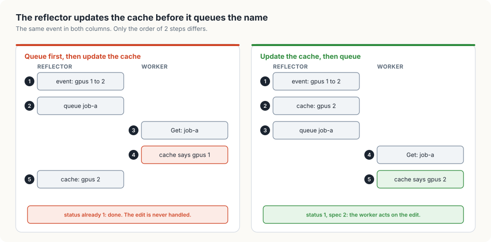
<figcaption><b>Figure 1.7</b> The same event in both columns. Only the order of 2 steps differs.</figcaption>
</figure>

<div class="invariant">

**Invariant 1.2** (Cache before queue). When a worker takes a name from the queue, the cache already
reflects every event that caused the name to be queued.

</div>

Listing 1.9 is step 1 of Algorithm 1.2, the outer loop. It lists, hands the names that Replace
reports to the queue, and then watches until the watch can no longer be resumed.

<div class="code-tabs">

<p class="listing"><b>Listing 1.9</b> The reflector and its outer loop. <a href="https://github.com/arpanpathak/cracking-the-systems-programming-interview/blob/prep-v2/gpu-accelerated-kubernetes/code/go/informer/reflector.go">Go</a> · <a href="https://github.com/arpanpathak/cracking-the-systems-programming-interview/blob/prep-v2/gpu-accelerated-kubernetes/code/rust/informer/src/reflector.rs">Rust</a></p>

```go
{{#include ../code/go/informer/reflector.go:run}}
```

```rust
{{#include ../code/rust/informer/src/reflector.rs:run}}
```

</div>

Listing 1.10 is step 2. The variable `version` always holds the version of the last event applied
to the cache, so a new watch opened from it resumes with nothing missing. The 3 endings of Fig. 1.5
appear as 3 branches. Our model retries an unreachable server every 10 milliseconds. client-go
instead doubles the wait after each consecutive failure, up to a limit, so that thousands of clients
do not overload a server that is recovering.

<div class="code-tabs">

<p class="listing"><b>Listing 1.10</b> Watching from a version, and the 3 endings. <a href="https://github.com/arpanpathak/cracking-the-systems-programming-interview/blob/prep-v2/gpu-accelerated-kubernetes/code/go/informer/reflector.go">Go</a> · <a href="https://github.com/arpanpathak/cracking-the-systems-programming-interview/blob/prep-v2/gpu-accelerated-kubernetes/code/rust/informer/src/reflector.rs">Rust</a></p>

```go
{{#include ../code/go/informer/reflector.go:watch}}
```

```rust
{{#include ../code/rust/informer/src/reflector.rs:watch}}
```

</div>

## The work queue

The reflector learns that an object has changed, and the controller must act on it. The direct
design would call the controller once for every event, and it fails in 2 ways. First, a user who
edits a job 5 times within 1 second produces 5 events, and a controller called 5 times starts work
for 4 specs that are replaced before the work finishes. Second, after a relist, Replace reports which
names changed, but the events that led to those changes no longer exist, so a controller that
depends on individual events cannot act on them.

The controller is therefore given only the *names* of the objects that changed, and it reads the
current state of each object from the cache when it reaches the name. The names pass through a
**work queue**, and the controller takes them in 1 or more **workers**, each of which handles 1
name at a time. 5 edits put the same name into the queue 5 times, and if the queue ignores a name it
already holds, the 5 edits collapse into a single piece of work on the latest spec.

Ignoring duplicates is not enough on its own. An edit that arrives while worker 1 is handling `job-a`
would make the name ready again, worker 2 would take it, and 2 workers would act on the same object
at the same time. For a status write, one of the 2 fails with `409 Conflict` and its work is wasted.
For an action outside Kubernetes, such as starting a container, both succeed, and the job ends up
with 2 containers. The work queue of client-go prevents this with 2 sets in addition to the list of
ready names. The **dirty** set holds every name that needs handling. The **processing** set holds
every name that a worker has taken and not yet returned. Fig. 1.8 follows 1 name through a sequence
of calls.

<figure>
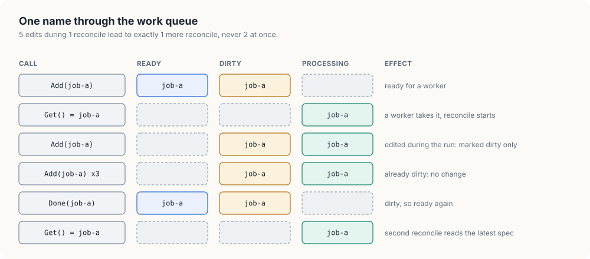
<figcaption><b>Figure 1.8</b> The state of the queue after each call. A name is never ready while a worker holds it.</figcaption>
</figure>

<div class="invariant">

**Invariant 1.3** (One worker per name). A name is in the processing set for at most 1 worker, and
it appears in the ready list at most once.

</div>

Listing 1.11 declares the queue's state: the ready list and the 2 sets, guarded by 1 lock, together
with a condition variable on which idle workers wait.

<div class="code-tabs">

<p class="listing"><b>Listing 1.11</b> The state of the work queue. <a href="https://github.com/arpanpathak/cracking-the-systems-programming-interview/blob/prep-v2/gpu-accelerated-kubernetes/code/go/informer/queue.go">Go</a> · <a href="https://github.com/arpanpathak/cracking-the-systems-programming-interview/blob/prep-v2/gpu-accelerated-kubernetes/code/rust/informer/src/queue.rs">Rust</a></p>

```go
{{#include ../code/go/informer/queue.go:state}}
```

```rust
{{#include ../code/rust/informer/src/queue.rs:state}}
```

</div>

`Add` places a name in the dirty set, and in the ready list only if no worker holds it. In the third
row of Fig. 1.8 the name is held by a worker, so `Add` marks it dirty and leaves the ready list
empty.

<div class="code-tabs">

<p class="listing"><b>Listing 1.12</b> Add. <a href="https://github.com/arpanpathak/cracking-the-systems-programming-interview/blob/prep-v2/gpu-accelerated-kubernetes/code/go/informer/queue.go">Go</a> · <a href="https://github.com/arpanpathak/cracking-the-systems-programming-interview/blob/prep-v2/gpu-accelerated-kubernetes/code/rust/informer/src/queue.rs">Rust</a></p>

```go
{{#include ../code/go/informer/queue.go:add}}
```

```rust
{{#include ../code/rust/informer/src/queue.rs:add}}
```

</div>

`Get` moves the first ready name from the dirty set to the processing set and returns it. `Done`
removes the name from the processing set and makes it ready again if it was marked dirty in the
meantime, which is the fifth row of Fig. 1.8. A worker that calls `Get` on an empty queue must wait
without holding the lock, since `Add` could otherwise never acquire it. Both versions use a
**condition variable** (`sync.Cond` in Go, `std::sync::Condvar` in Rust), whose wait operation
releases the lock and suspends the worker in a single step. The wait is placed inside a loop that
examines the ready list again after waking, since another worker may have taken the name first.

<div class="code-tabs">

<p class="listing"><b>Listing 1.13</b> Get and Done. <a href="https://github.com/arpanpathak/cracking-the-systems-programming-interview/blob/prep-v2/gpu-accelerated-kubernetes/code/go/informer/queue.go">Go</a> · <a href="https://github.com/arpanpathak/cracking-the-systems-programming-interview/blob/prep-v2/gpu-accelerated-kubernetes/code/rust/informer/src/queue.rs">Rust</a></p>

```go
{{#include ../code/go/informer/queue.go:getdone}}
```

```rust
{{#include ../code/rust/informer/src/queue.rs:getdone}}
```

</div>

Animation 1.1 plays the same calls for the burst of 5 edits from the run at the end of this chapter.
Its last part removes the processing set and shows a second worker taking the name while the first
is still at work.

<figure class="anim">
<video class="motion" src="figures/work-queue.mp4" autoplay loop muted playsinline preload="metadata" aria-label="Three boxes, ready, dirty and processing, above a worker. Add puts job-a in ready and dirty. Get moves it to processing and the worker starts a reconcile. Four more Add calls during the reconcile mark the name dirty and leave ready empty. Done moves the name back to ready, and a second reconcile reads a spec of 6 GPUs. In the last part the processing set is removed: an Add during the reconcile makes the name ready, and a second worker takes it while the first is still working." data-chapters="[[0.0, &quot;Add&quot;], [7.86, &quot;Get&quot;], [18.06, &quot;Add while held&quot;], [33.66, &quot;Done&quot;], [46.86, &quot;no processing set&quot;]]">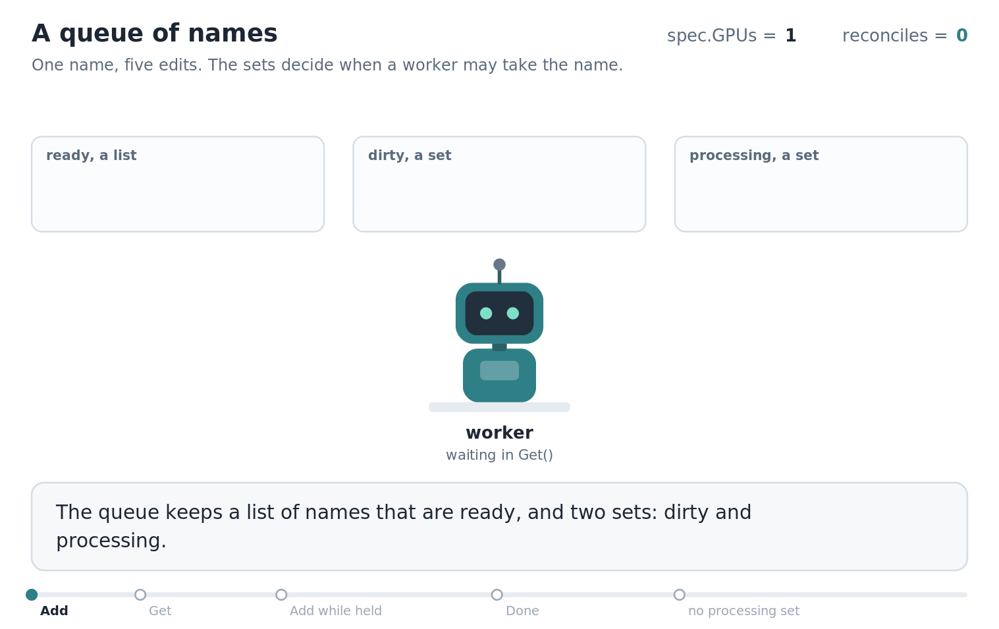</video>
<figcaption><b>Animation 1.1</b> One name through the work queue. 5 edits lead to 2 runs, and the 2 never overlap.</figcaption>
</figure>

## Reconciling

The function that a worker runs for each name is called **reconcile**. It reads the current state of
the object from the cache, compares the spec with the state of the world, acts to remove any
difference, and records the result in the status. It does not know why it was called: a name queued
once and a name queued 10 times lead to the same action, and so do a change reported by an event and
a change discovered by a relist. Engineers call this style **level-triggered**, after the circuits
that respond to the present level of a signal. An **edge-triggered** circuit responds instead to each
change of the signal, and a controller built in that style performs 1 action per event.

Fig. 1.9 runs both styles against the same burst of 5 edits. The edge-triggered controller acts 5
times, and 4 of those actions are for specs that had already been replaced. The level-triggered
controller acts twice, each time on the state held by the cache. If an event is lost to a
compaction, the edge-triggered controller never acts on it, while the level-triggered controller
finds the change the next time it reads the object.

<figure>
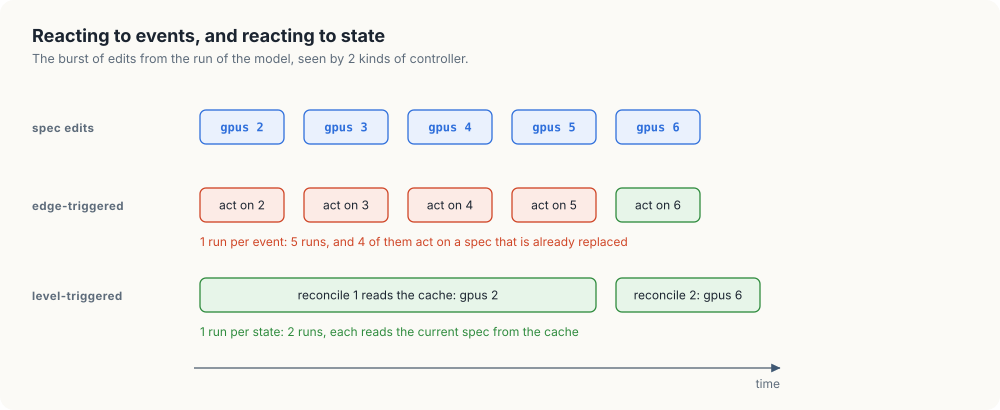
<figcaption><b>Figure 1.9</b> An edge-triggered controller performs 1 action per event; a level-triggered controller performs 1 action per state it reads.</figcaption>
</figure>

Fig. 1.10 gives 1 reconcile as a decision flow. One step needs care. The cache trails the server by
the time an event takes to arrive, and the work at marker ➍ takes time as well. If the owner changes
the spec during that time and the controller writes its copy of the object back unconditionally, it
stores the old spec together with a status computed for it, and the owner's change is lost.
Reconcile therefore writes the status with the resource version it read, at marker ➎, which is a
conditional write in the sense of Definition 1.5. If the object has changed, the write fails with
`409 Conflict`, the name returns to the queue, and the next reconcile reads the newer object.

<figure>
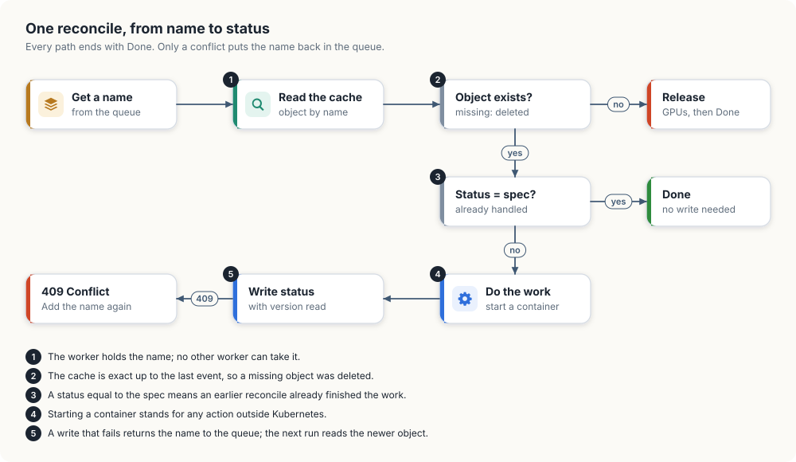
<figcaption><b>Figure 1.10</b> One reconcile. Every path ends with Done, and only a conflict returns the name to the queue.</figcaption>
</figure>

Listing 1.12 implements Fig. 1.10. In our model, a sleep of 20 milliseconds stands for the work at
marker ➍. A missing object at marker ➋ was deleted; a real controller would release whatever it
had created for the object, and our model writes a log line.

<div class="code-tabs">

<p class="listing"><b>Listing 1.14</b> Reconciling 1 name. <a href="https://github.com/arpanpathak/cracking-the-systems-programming-interview/blob/prep-v2/gpu-accelerated-kubernetes/code/go/informer/controller.go">Go</a> · <a href="https://github.com/arpanpathak/cracking-the-systems-programming-interview/blob/prep-v2/gpu-accelerated-kubernetes/code/rust/informer/src/controller.rs">Rust</a></p>

```go
{{#include ../code/go/informer/controller.go:reconcile}}
```

```rust
{{#include ../code/rust/informer/src/controller.rs:reconcile}}
```

</div>

Listing 1.13 is the worker loop around it. The worker takes a name, reconciles it and returns it with
`Done`. If the reconcile failed, the worker adds the name again, so that the next attempt starts from
whatever the cache holds by then.

<div class="code-tabs">

<p class="listing"><b>Listing 1.15</b> The controller and its worker loop. <a href="https://github.com/arpanpathak/cracking-the-systems-programming-interview/blob/prep-v2/gpu-accelerated-kubernetes/code/go/informer/controller.go">Go</a> · <a href="https://github.com/arpanpathak/cracking-the-systems-programming-interview/blob/prep-v2/gpu-accelerated-kubernetes/code/rust/informer/src/controller.rs">Rust</a></p>

```go
{{#include ../code/go/informer/controller.go:run}}
```

```rust
{{#include ../code/rust/informer/src/controller.rs:run}}
```

</div>

## Running the model

Fig. 1.11 assembles the parts built in this chapter. The API server numbers every write; within the
controller's process, the reflector applies each event to the cache and then queues the object's
name; a worker takes the name, reads the cache and writes the status back with the version it read.

<figure>
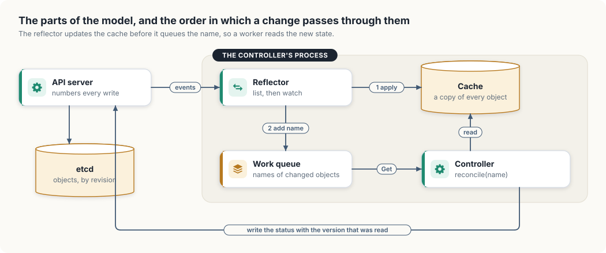
<figcaption><b>Figure 1.11</b> The path of 1 change through the controller's process.</figcaption>
</figure>

The demonstration in Listing 1.14 creates 2 jobs, starts the reflector and 1 worker, and then causes
each situation discussed in this chapter: a burst of 5 edits during a reconcile, a dropped watch, and
a partition during which a job is deleted and the history is compacted. Go runs the reflector and the
worker as goroutines. Rust runs them on threads that share the server, the cache and the queue
through `Arc`. Both versions write a log line to standard error with the number of milliseconds since
the start.

<div class="code-tabs">

<p class="listing"><b>Listing 1.16</b> The demonstration. <a href="https://github.com/arpanpathak/cracking-the-systems-programming-interview/blob/prep-v2/gpu-accelerated-kubernetes/code/go/informer/main.go">Go</a> · <a href="https://github.com/arpanpathak/cracking-the-systems-programming-interview/blob/prep-v2/gpu-accelerated-kubernetes/code/rust/informer/src/main.rs">Rust</a></p>

```go
{{#include ../code/go/informer/main.go:main}}
```

```rust
{{#include ../code/rust/informer/src/main.rs:main}}
```

</div>

The Go version prints:

```console
$ go run ./informer
{{#include ../code/output/go-informer.txt}}
```

The Rust version prints the same sequence. Its timings differ by 1 or 2 milliseconds, and its field
names follow Rust's naming conventions:

```console
$ cargo run -p informer
{{#include ../code/output/rust-informer.txt}}
```

Table 1.1 relates each line of the Go log to the mechanism that produced it.

| Time | Log | Explanation |
|---|---|---|
| 0 ms | list at version 2 | The reflector lists (Algorithm 1.2, step 1.1). Replace reports both jobs, and both names are queued. |
| 20 to 40 ms | 1 reconcile per job | Each status write is itself an event and queues the name again. The next reconcile finds the status equal to the spec and returns without a log line. |
| 101 ms | 5 edits | The worker took `job-a` after the first edit and read a spec of 2 at version 5. The other 4 edits arrived while it held the name, so the queue only marked the name dirty (Fig. 1.8). |
| 121 ms | `409 Conflict` at version 5 | The object had reached version 9, so the conditional write failed and the name returned to the queue. |
| 141 ms | status 6 | The second reconcile read version 9 and wrote status 6 at version 10. Specs 3, 4 and 5 were never acted on (Fig. 1.9). |
| 257 ms | watch closed, resuming from 10 | The stream closed. The cache was exact up to version 10, so the reflector watched again from 10 without a list. |
| 307 to 338 ms | `410 Gone`, list at version 11 | During the partition `job-b` was deleted at version 11 and the history was compacted to 11, so a watch from 10 could not be served. |
| 338 ms | `job-b`: deleted | Replace found `job-b` in the old cache and absent from the list (Fig. 1.6). Its `DELETED` event no longer existed anywhere. |

Animation 1.2 replays the run from the list at version 2 to the list at version 11, with the
server's objects on the left and the cache on the right.

<figure class="anim">
<video class="motion" src="figures/list-watch.mp4" autoplay loop muted playsinline preload="metadata" aria-label="The API server on the left with job-a, job-b and its recent events; the reflector's cache on the right. The reflector lists at version 2 and opens a watch. Events 3 to 10 arrive and the cache follows. The watch is closed and reopened from 10 with no list. During a partition job-b is deleted at version 11 and the history is compacted, while the cache still holds job-b. After the partition the server answers a watch from 10 with 410 Gone, the reflector lists at version 11, and job-b, present in the old cache and missing from the list, is removed." data-chapters="[[0.0, &quot;list&quot;], [10.01, &quot;watch&quot;], [34.28, &quot;drop&quot;], [43.69, &quot;partition&quot;], [60.08, &quot;410 Gone&quot;]]"></video>
<figcaption><b>Animation 1.2</b> The run of the model: a list, a watch, a dropped watch that resumes, and a partition that ends in <code>410 Gone</code> and a second list.</figcaption>
</figure>

## The same design in client-go

Real Go controllers use client-go, either directly or through controller-runtime, which is built on
it. Every part of our model has a counterpart in client-go, as Table 1.2 shows.

| Our model | client-go |
|---|---|
| `APIServer.List`, `Watch` | `ListerWatcher`, backed by HTTP list and watch requests |
| `Reflector` | `cache.Reflector` |
| `Cache` | `cache.Indexer`, a thread-safe store with secondary indexes, such as all pods on 1 node |
| reflector and cache together | `cache.SharedIndexInformer`, commonly called an **informer** |
| `WorkQueue` | `workqueue`, with the same dirty and processing sets |
| `reconcile` | the `Reconcile` method of a controller |

client-go adds several mechanisms that our model omits. Each of them addresses a problem that we have
already met.

**Shared informers.** When 3 controllers in 1 process all watch pods, they share 1 pod watch and 1
cache through a `SharedInformerFactory`, and each registers its own handler and keeps its own work
queue, as Fig. 1.12 shows. The API server then serves 1 watch per process instead of 1 per
controller. Because every controller reads the same objects, client-go hands out pointers into the
shared store. A controller that modifies an object it has read must therefore call the generated
`DeepCopy` method and modify the copy, since otherwise it changes the object that every other
controller in the process reads.

<figure>
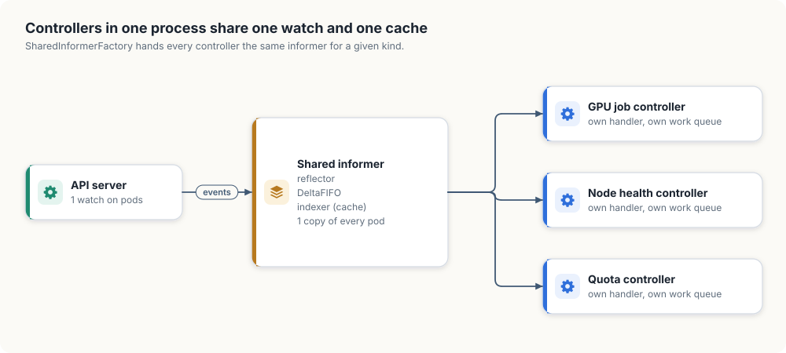
<figcaption><b>Figure 1.12</b> 1 watch and 1 cache per kind and per process, shared by every controller in the process.</figcaption>
</figure>

**DeltaFIFO.** Between the reflector and the cache, client-go keeps a queue of pending changes for
each object, so that the code which updates the cache and notifies the handlers processes 1 object
at a time together with all of its changes. When a relist shows that an object has disappeared, the
deletion it reports is wrapped in `DeletedFinalStateUnknown`. The wrapper warns the handlers that
the object they receive is the last state the cache saw, which may be older than the state of the
object when it was deleted.

**Rate-limited retries.** Our model retries a failed name immediately. The default rate limiter of
client-go waits 5 ms after the first failure of a name and doubles the wait after each further
failure, up to 1,000 s, and in addition allows at most 10 retries per second, with bursts of up to
100, across all names. Without such a limit, a controller whose writes always fail would send the
API server a request for every attempt, as quickly as it could.

**Resync.** An informer can be configured to queue every name in its cache again at a fixed
interval, from memory and without a request to the server. This serves controllers that manage
resources outside Kubernetes, such as a cloud load balancer, whose drift no Kubernetes event
reports.

**Smaller caches.** A cache holds every object of its kind, so 50,000 pods of 4 KB each occupy
200 MB in every process that watches pods. Controllers that need only names and labels use a
metadata-only informer, and any informer can be given a transform function that removes unneeded
fields before an object enters the cache.

**Reading one's own writes.** A controller's own writes reach its cache in the same way as everyone
else's, as events. Until the event arrives, the cache shows the state before the write. If a
reconcile creates a pod for a job, and a second event for the job arrives before the pod's creation
event, the next reconcile finds no pod in the cache and creates a second one. The ReplicaSet
controller guards against this with **expectations**: after creating 3 pods, it waits until the
cache has shown 3 creation events, or a timeout has passed, before it examines that ReplicaSet
again. A second guard uses 2 numbers that every object carries. The API server increments
`metadata.generation` whenever the spec changes, and the controller copies the generation it acted
on into `status.observedGeneration`. When the 2 numbers differ, the controller and any user reading
the object can see that the latest spec has not yet been handled.

An informer is not the right tool for every read. A cache is always slightly behind the server, so
a decision that must see the latest state, such as granting the last free GPU of a quota, requires a
direct read or a conditional write at the moment of the decision. A controller that is concerned
with a handful of objects among millions pays for a cache of all of them unless it narrows its watch
with a label or field selector.

## Summary

This chapter built the machinery through which a controller observes a cluster. The API server
numbers every write with the etcd revision, and the resource version of an object is the revision of
its latest write. A write that carries the version it read is rejected with `409 Conflict` if the
object has changed since, so that 2 writers cannot silently undo each other. A client lists and then
watches from the list's version, which gives it every change exactly once (Invariant 1.1). After a
closed stream or an outage it resumes from the last version applied, and only `410 Gone` forces a
new list, after which Replace finds the deletions whose events were compacted away. The reflector
updates the cache before it queues a name (Invariant 1.2), and the work queue's dirty and processing
sets merge bursts of edits and keep each name with 1 worker (Invariant 1.3). Finally, reconcile acts
on the current state of each object, so lost or repeated events do not affect its result.

The next part of this chapter, *A GPU job controller on a real cluster*, runs the same design against
a real cluster, with client-go in Go and kube-rs in Rust.

## Exercises

1. In Fig. 1.1, a client lists at revision 8 and then watches from 8. Which revisions does it receive as events, and what is its cached resource version for `job-b` afterwards?
2. In Fig. 1.3, a client calls `Watch` with version 1. What does the server answer, and what must the client do next?
3. Exchange the 2 steps of Algorithm 1.2, step 2.3, in the Go model, and insert a sleep of 30 milliseconds between them. Run the demonstration and identify the edit that is never reconciled.
4. Remove the processing set from the work queue and run the demonstration with 2 workers. How many reconciles of `job-a` overlap during the burst?
5. With the default rate limiter of client-go, after how many consecutive failures does 1 name wait longer than 1 minute between attempts?
6. A relist finds an object with the same name, a different resource version and a different UID. What happened on the server, and what should a controller that owns a container for that object do?

## The complete program

The model consists of 6 source files in each language. They are printed here in full, in the order
in which the chapter built them, with the Go and Rust versions of each file as tabs.

<div class="code-tabs">

<p class="listing"><b>Listing 1.17</b> The API server, complete. <a href="https://github.com/arpanpathak/cracking-the-systems-programming-interview/blob/prep-v2/gpu-accelerated-kubernetes/code/go/informer/server.go">Go</a> · <a href="https://github.com/arpanpathak/cracking-the-systems-programming-interview/blob/prep-v2/gpu-accelerated-kubernetes/code/rust/informer/src/server.rs">Rust</a></p>

```go
{{#include ../code/go/informer/server.go}}
```

```rust
{{#include ../code/rust/informer/src/server.rs}}
```

</div>

<div class="code-tabs">

<p class="listing"><b>Listing 1.18</b> The cache, complete. <a href="https://github.com/arpanpathak/cracking-the-systems-programming-interview/blob/prep-v2/gpu-accelerated-kubernetes/code/go/informer/cache.go">Go</a> · <a href="https://github.com/arpanpathak/cracking-the-systems-programming-interview/blob/prep-v2/gpu-accelerated-kubernetes/code/rust/informer/src/cache.rs">Rust</a></p>

```go
{{#include ../code/go/informer/cache.go}}
```

```rust
{{#include ../code/rust/informer/src/cache.rs}}
```

</div>

<div class="code-tabs">

<p class="listing"><b>Listing 1.19</b> The reflector, complete. <a href="https://github.com/arpanpathak/cracking-the-systems-programming-interview/blob/prep-v2/gpu-accelerated-kubernetes/code/go/informer/reflector.go">Go</a> · <a href="https://github.com/arpanpathak/cracking-the-systems-programming-interview/blob/prep-v2/gpu-accelerated-kubernetes/code/rust/informer/src/reflector.rs">Rust</a></p>

```go
{{#include ../code/go/informer/reflector.go}}
```

```rust
{{#include ../code/rust/informer/src/reflector.rs}}
```

</div>

<div class="code-tabs">

<p class="listing"><b>Listing 1.20</b> The work queue, complete. <a href="https://github.com/arpanpathak/cracking-the-systems-programming-interview/blob/prep-v2/gpu-accelerated-kubernetes/code/go/informer/queue.go">Go</a> · <a href="https://github.com/arpanpathak/cracking-the-systems-programming-interview/blob/prep-v2/gpu-accelerated-kubernetes/code/rust/informer/src/queue.rs">Rust</a></p>

```go
{{#include ../code/go/informer/queue.go}}
```

```rust
{{#include ../code/rust/informer/src/queue.rs}}
```

</div>

<div class="code-tabs">

<p class="listing"><b>Listing 1.21</b> The controller, complete. <a href="https://github.com/arpanpathak/cracking-the-systems-programming-interview/blob/prep-v2/gpu-accelerated-kubernetes/code/go/informer/controller.go">Go</a> · <a href="https://github.com/arpanpathak/cracking-the-systems-programming-interview/blob/prep-v2/gpu-accelerated-kubernetes/code/rust/informer/src/controller.rs">Rust</a></p>

```go
{{#include ../code/go/informer/controller.go}}
```

```rust
{{#include ../code/rust/informer/src/controller.rs}}
```

</div>

<div class="code-tabs">

<p class="listing"><b>Listing 1.22</b> The demonstration, complete. <a href="https://github.com/arpanpathak/cracking-the-systems-programming-interview/blob/prep-v2/gpu-accelerated-kubernetes/code/go/informer/main.go">Go</a> · <a href="https://github.com/arpanpathak/cracking-the-systems-programming-interview/blob/prep-v2/gpu-accelerated-kubernetes/code/rust/informer/src/main.rs">Rust</a></p>

```go
{{#include ../code/go/informer/main.go}}
```

```rust
{{#include ../code/rust/informer/src/main.rs}}
```

</div>

## References

1. Kubernetes documentation, "API Concepts": efficient detection of changes, resource versions, watch bookmarks. <https://kubernetes.io/docs/reference/using-api/api-concepts/>
2. Kubernetes API conventions, "Concurrency Control and Consistency". <https://github.com/kubernetes/community/blob/master/contributors/devel/sig-architecture/api-conventions.md>
3. etcd documentation, "Data model": revisions, the key index, and compaction. <https://etcd.io/docs/latest/learning/data_model/>
4. KEP-2340, "Consistent Reads from Cache", beta in Kubernetes 1.31. <https://github.com/kubernetes/enhancements/issues/2340>
5. client-go source: `tools/cache/reflector.go`, `tools/cache/delta_fifo.go`, `util/workqueue/queue.go`, `util/workqueue/default_rate_limiters.go`. <https://github.com/kubernetes/client-go>
6. M. Schwarzkopf, A. Konwinski, M. Abd-El-Malek and J. Wilkes, "Omega: flexible, scalable schedulers for large compute clusters", EuroSys 2013.
7. B. Burns, B. Grant, D. Oppenheimer, E. Brewer and J. Wilkes, "Borg, Omega, and Kubernetes", *ACM Queue* 14(1), 2016.
8. M. Hausenblas and S. Schimanski, *Programming Kubernetes*, O'Reilly, 2019, chapter 3.
