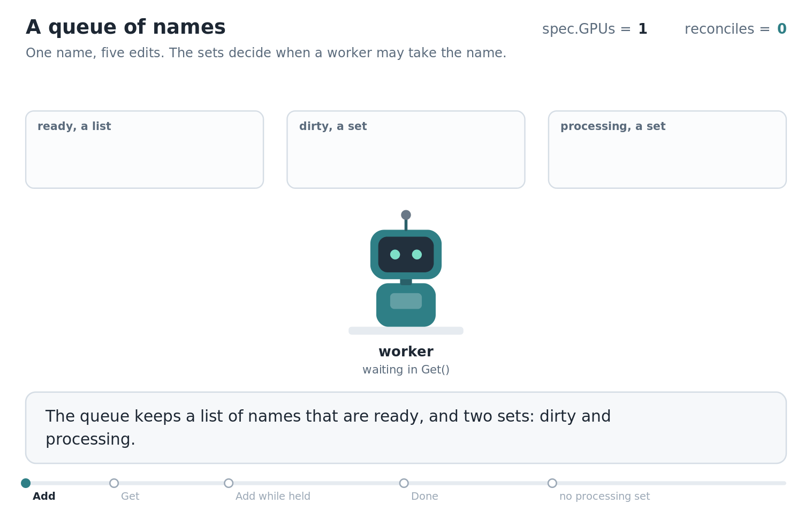
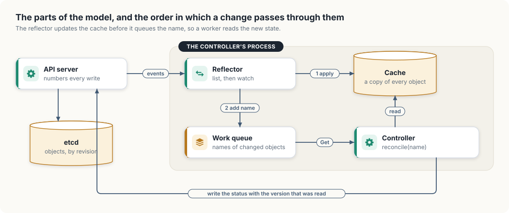

# 1. Keeping a local copy of the cluster

A program that runs GPU training jobs on Kubernetes has three duties. When a user creates
a job that needs one GPU, the program starts the job's container on a machine with a free
GPU and records that the job is running. When the user changes the job to ask for two
GPUs, the program replaces the container. When the user deletes the job, the program stops
the container and frees the GPU.

Kubernetes calls a program of this kind a *controller*. Most of a controller's difficulty
lies in learning what is happening in the cluster: which objects exist, and which of them
changed. This chapter builds the machinery that answers those questions as a small model
with five parts: an API server, a cache, a loop that keeps the cache current, a work queue,
and the controller. The model is then run through a burst of edits, a dropped connection,
and a network partition, and each part is matched to its counterpart in client-go, the
library that production Go controllers use.

The model exists in Go and in Rust, with the same parts and the same behaviour, and uses
only each language's standard library. The Go files are in `code/go/informer` and run with
`go run ./informer` from `code/go`. The Rust files are in `code/rust/informer` and run with
`cargo run -p informer` from `code/rust`.

<div class="covers">

This chapter covers

- objects, and the API server that stores them
- resource versions, and the `409 Conflict` that protects a write
- listing and watching, and the `410 Gone` that forces a second list
- a cache, a reflector, a work queue, and a controller, each in Go and in Rust
- one run through a burst of edits, a dropped watch, and a partition
- the parts of client-go that match the model

</div>

## Objects, specs, and statuses

Kubernetes describes a cluster as a collection of *objects*. An object is a named record
with two main parts. The *spec* holds what a user asked for, such as "run this image with
one GPU". The *status* holds what has happened so far, such as "running on one GPU". Each
training job is one object.

All objects sit behind one HTTP service, the *API server*. Every read and write of every
object passes through it, and it stores the objects in etcd, a replicated key-value
database. Users, command-line tools, and controllers are all clients of the API server.

A controller compares each object's spec with the state of the world, acts on any
difference, and records the result in the status. For that it needs two things from the
API server: an accurate view of every object of its kind, and notice of each change within
a fraction of a second.

## Numbering every write

The simplest way to stay informed is to ask the API server for every object every few
seconds. That works for a handful of objects and fails as the cluster grows. A cluster with
50,000 pods stores a few kilobytes of JSON per pod, so one request for all of them
transfers about 200 megabytes. A dozen controllers polling every five seconds would make
the API server send almost half a gigabyte per second, while only a handful of pods changed
between polls.

The efficient alternative is for the server to report each change as it happens. That
requires a way to resume after a broken connection. Networks fail, servers restart, and
proxies close connections they consider idle, and a client that reconnects must be able to
ask for everything it missed. It needs a name for the point where it stopped.

The API server provides that name by numbering its writes. It keeps one counter for the
whole store. Each time any object is created, updated, or deleted, the counter is
incremented and the new value is stamped on the object that changed. Kubernetes calls this
number the object's *resource version*. The numbers come from etcd, which assigns every
write a *revision* from a single counter for the whole database.

The same number solves a second problem, lost updates. Two clients read a job at version 7.
The first changes the GPU count and writes the job back. The second changes the image and
writes a moment later, based on what it read at version 7. With no check, the second write
replaces the whole object and silently undoes the first change. With resource versions,
the second client sends "I read this at version 7" with its write. The object is now at
version 8, so the server refuses the write with the HTTP status `409 Conflict`, and the
client reads the job again and reapplies its change to the new version.

## Listing, then watching

Numbered writes let a client build an exact view of the cluster in two steps.

The first step is a *list*: a request for every object, whose response carries the objects
and the resource version at which the server took the snapshot. The second is a *watch*: a
request that stays open and asks for every change after a given version, delivered as one
*event* per change. The client passes the version it received from the list.

That version closes a gap. The list and the watch are separate requests, and other clients
keep writing between them. In the timeline below, the list is taken at version 10, a user
edits a job at version 11, and the watch opens when the store is at version 12:

```text
version:   10          11             12
           list        job-a edited   watch opened
           snapshot                   from version 10
                                      -> the server replays event 11,
                                         then sends new events as they occur
```

Because the watch asks for everything after version 10, the server first replays event 11
from its record of recent changes and then streams new events. The client's view is the
snapshot at version 10 plus every later change, with nothing missing and nothing applied
twice. A watch opened at the current version, 12, would have skipped the edit at version 11,
and the client would hold a stale copy of `job-a` until the job changed again.

## When the history runs out

The server can replay only the changes it still has. etcd keeps every revision of every key
until it is told to discard old ones, an operation called *compaction*, and without it the
database would grow without bound. The Kubernetes API server asks etcd to compact every
five minutes by default. After a compaction, a watch that asks to resume from an older
version cannot be served, because the events it needs are gone. The API server answers with
the HTTP status `410 Gone`, and the client can recover an exact view only by listing again
and watching from the new list's version.

Watches also end for ordinary reasons. The API server closes each watch after a timeout
chosen at random between 30 and 60 minutes, so that thousands of clients do not reconnect
at the same moment. A load balancer may close a connection that has been quiet for too
long. The network may fail for a while, so that new connections fail too.

Each ending needs its own response. A watch that closed is reopened from the last version
received. A server that cannot be reached is retried after a wait. A `410 Gone` requires a
new list.

## Building the server

The model's server keeps the objects in memory, numbers every write, records recent
events, and answers lists and watches. Three extra methods, `DropWatches`, `Partition`, and
`Heal`, let the demonstration at the end of the chapter cause each of the failures above on
demand.

<div class="lld">

Low-level design: the model

| Part | Holds | Rule it keeps |
|---|---|---|
| `Object` | a name, a spec, a status, a version | the version is the number of the write that last changed it |
| `APIServer` | the objects, the write counter, recent events, the open watches | every write increments the counter and publishes one event |
| `Cache` | a copy of every object | exact up to the last event applied |
| `Reflector` | the server, the cache, the queue | updates the cache before it queues a name |
| `WorkQueue` | the ready names, and the sets `dirty` and `processing` | a name is with at most one worker at a time |
| `Controller` | the server, the cache, the queue | acts only on the object's current state |

Each part is one source file in each language, and the sections below build them in this
order.

</div>

The server's data comes first: the object, the event that reports a change to it, and the
two errors a client must tell apart.

<p class="listing"><b>Listing 1.1</b> Objects, events, and the two errors, in Go. <a href="https://github.com/arpanpathak/cracking-the-systems-programming-interview/blob/prep-v2/gpu-accelerated-kubernetes/code/go/informer/server.go">code/go/informer/server.go</a></p>

```go
{{#include ../code/go/informer/server.go:objects}}
```


<p class="listing"><b>Listing 1.2</b> Objects, events, and the two errors, in Rust. <a href="https://github.com/arpanpathak/cracking-the-systems-programming-interview/blob/prep-v2/gpu-accelerated-kubernetes/code/rust/informer/src/server.rs">code/rust/informer/src/server.rs</a></p>

```rust
{{#include ../code/rust/informer/src/server.rs:objects}}
```


The model reduces a job to a GPU count in its spec and in its status.

The server is a lock around four things: the objects, the counter, the events it still
holds, and the open watches.

<p class="listing"><b>Listing 1.3</b> The server's state, in Go. <a href="https://github.com/arpanpathak/cracking-the-systems-programming-interview/blob/prep-v2/gpu-accelerated-kubernetes/code/go/informer/server.go">code/go/informer/server.go</a></p>

```go
{{#include ../code/go/informer/server.go:server}}
```


<p class="listing"><b>Listing 1.4</b> The server's state, in Rust. <a href="https://github.com/arpanpathak/cracking-the-systems-programming-interview/blob/prep-v2/gpu-accelerated-kubernetes/code/rust/informer/src/server.rs">code/rust/informer/src/server.rs</a></p>

```rust
{{#include ../code/rust/informer/src/server.rs:server}}
```


Two methods change objects, and both end by publishing an event.

<p class="listing"><b>Listing 1.5</b> Writing: update, delete, and publish, in Go. <a href="https://github.com/arpanpathak/cracking-the-systems-programming-interview/blob/prep-v2/gpu-accelerated-kubernetes/code/go/informer/server.go">code/go/informer/server.go</a></p>

```go
{{#include ../code/go/informer/server.go:writes}}
```


<p class="listing"><b>Listing 1.6</b> Writing: update, delete, and publish, in Rust. <a href="https://github.com/arpanpathak/cracking-the-systems-programming-interview/blob/prep-v2/gpu-accelerated-kubernetes/code/rust/informer/src/server.rs">code/rust/informer/src/server.rs</a></p>

```rust
{{#include ../code/rust/informer/src/server.rs:writes}}
```


`Update` implements both uses of the resource version. A zero version skips the check; the
demonstration uses it to play a user editing a job. Any other version must equal the stored
one, and a missing object counts as version 0. Each successful write increments the counter
and publishes one event. A deletion publishes the object's final state under a new version.

Two methods read: one returns the snapshot and the other the stream of changes after it.

<p class="listing"><b>Listing 1.7</b> Reading: list and watch, in Go. <a href="https://github.com/arpanpathak/cracking-the-systems-programming-interview/blob/prep-v2/gpu-accelerated-kubernetes/code/go/informer/server.go">code/go/informer/server.go</a></p>

```go
{{#include ../code/go/informer/server.go:listwatch}}
```


<p class="listing"><b>Listing 1.8</b> Reading: list and watch, in Rust. <a href="https://github.com/arpanpathak/cracking-the-systems-programming-interview/blob/prep-v2/gpu-accelerated-kubernetes/code/rust/informer/src/server.rs">code/rust/informer/src/server.rs</a></p>

```rust
{{#include ../code/rust/informer/src/server.rs:listwatch}}
```


`publish` runs with the server lock held, and `Watch` holds the same lock while it replays
the history and registers the new watch. An event is therefore either part of the replayed
history or delivered after registration, so no watch misses an event or receives one twice.

A Go watch buffers 1,024 events. A client that stops reading would eventually block
`publish` while it holds the lock and stall every writer, and the real API server
closes such a watch for that reason. The Rust channel is unbounded. The Go server ends a watch by closing
its channel, and the Rust server by dropping the sender, which ends the receiver's loop.

The last four methods produce the failures described earlier.

<p class="listing"><b>Listing 1.9</b> Compaction, dropped watches, and partitions, in Go. <a href="https://github.com/arpanpathak/cracking-the-systems-programming-interview/blob/prep-v2/gpu-accelerated-kubernetes/code/go/informer/server.go">code/go/informer/server.go</a></p>

```go
{{#include ../code/go/informer/server.go:faults}}
```


<p class="listing"><b>Listing 1.10</b> Compaction, dropped watches, and partitions, in Rust. <a href="https://github.com/arpanpathak/cracking-the-systems-programming-interview/blob/prep-v2/gpu-accelerated-kubernetes/code/rust/informer/src/server.rs">code/rust/informer/src/server.rs</a></p>

```rust
{{#include ../code/rust/informer/src/server.rs:faults}}
```


`Watch` fails with the gone error when the requested version is older than `compacted`.

## A local copy of the objects

A client that has listed and is watching can keep its own copy of every object in memory,
exact up to the last event received. Reading an object becomes a map lookup in place of a
network request, and the server sends each change to the client once. This copy is the
*cache*.

The cache is a map behind a lock, with a method that applies one event.

<p class="listing"><b>Listing 1.11</b> The cache, a lookup, and applying one event, in Go. <a href="https://github.com/arpanpathak/cracking-the-systems-programming-interview/blob/prep-v2/gpu-accelerated-kubernetes/code/go/informer/cache.go">code/go/informer/cache.go</a></p>

```go
{{#include ../code/go/informer/cache.go:cache}}
```


<p class="listing"><b>Listing 1.12</b> The cache, a lookup, and applying one event, in Rust. <a href="https://github.com/arpanpathak/cracking-the-systems-programming-interview/blob/prep-v2/gpu-accelerated-kubernetes/code/rust/informer/src/cache.rs">code/rust/informer/src/cache.rs</a></p>

```rust
{{#include ../code/rust/informer/src/cache.rs:cache}}
```


Both caches use a read-write lock, because every reconcile reads the cache and only
incoming events write to it. An addition or a modification stores the object, and a
deletion removes it.

A second method installs a complete list.

<p class="listing"><b>Listing 1.13</b> Replacing the cache with a fresh list, in Go. <a href="https://github.com/arpanpathak/cracking-the-systems-programming-interview/blob/prep-v2/gpu-accelerated-kubernetes/code/go/informer/cache.go">code/go/informer/cache.go</a></p>

```go
{{#include ../code/go/informer/cache.go:replace}}
```


<p class="listing"><b>Listing 1.14</b> Replacing the cache with a fresh list, in Rust. <a href="https://github.com/arpanpathak/cracking-the-systems-programming-interview/blob/prep-v2/gpu-accelerated-kubernetes/code/rust/informer/src/cache.rs">code/rust/informer/src/cache.rs</a></p>

```rust
{{#include ../code/rust/informer/src/cache.rs:replace}}
```


`Replace` has a duty that events cannot perform. After a `410 Gone`, some objects may have
been deleted while the client was disconnected, and the compaction discarded their deletion
events. No one will send those events again. The only evidence of the deletions is that the
objects are present in the old cache and absent from the new list. `Replace` therefore builds
the new contents from the list, reports each object whose version differs from the cached
one, and then reports each name that was cached and is missing from the list. An object new
to the client has no cached version, which Go reads as version 0 and Rust as `None`, so new
objects are reported as changed as well.

## The reflector

A loop keeps the cache in step with the server. It lists, installs the result with
`Replace`, and queues the names that `Replace` reported so that the controller examines
them. It then watches from the list's version and applies each event as it arrives. When the
history it needs is gone, it lists again. This loop is the *reflector*.

The outer loop lists, installs the list, and hands over to the watch.

<p class="listing"><b>Listing 1.15</b> The reflector and its list step, in Go. <a href="https://github.com/arpanpathak/cracking-the-systems-programming-interview/blob/prep-v2/gpu-accelerated-kubernetes/code/go/informer/reflector.go">code/go/informer/reflector.go</a></p>

```go
{{#include ../code/go/informer/reflector.go:run}}
```


<p class="listing"><b>Listing 1.16</b> The reflector and its list step, in Rust. <a href="https://github.com/arpanpathak/cracking-the-systems-programming-interview/blob/prep-v2/gpu-accelerated-kubernetes/code/rust/informer/src/reflector.rs">code/rust/informer/src/reflector.rs</a></p>

```rust
{{#include ../code/rust/informer/src/reflector.rs:run}}
```


The inner loop watches and handles each way a watch can end.

<p class="listing"><b>Listing 1.17</b> Watching from a version, in Go. <a href="https://github.com/arpanpathak/cracking-the-systems-programming-interview/blob/prep-v2/gpu-accelerated-kubernetes/code/go/informer/reflector.go">code/go/informer/reflector.go</a></p>

```go
{{#include ../code/go/informer/reflector.go:watch}}
```


<p class="listing"><b>Listing 1.18</b> Watching from a version, in Rust. <a href="https://github.com/arpanpathak/cracking-the-systems-programming-interview/blob/prep-v2/gpu-accelerated-kubernetes/code/rust/informer/src/reflector.rs">code/rust/informer/src/reflector.rs</a></p>

```rust
{{#include ../code/rust/informer/src/reflector.rs:watch}}
```


The inner loop keeps one variable, `version`, holding the version of the last event applied
to the cache. The cache is complete up to `version`, so a watch reopened from it resumes
exactly where the previous one stopped. The three endings are handled as follows:

- When the server drops the connection and the watch channel closes, the reflector logs the
  version and opens a new watch from it. The server replays whatever happened during the
  reconnection.
- When `Watch` fails because the server is unreachable, the reflector waits 10 milliseconds
  and retries with the same version. client-go lengthens the wait after each consecutive
  failure, so that thousands of clients do not overload a server that is recovering.
- When `Watch` fails with the gone error, the version is older than the compaction point
  and no watch can continue from it. The inner loop returns, and `Run` starts over with a
  new list.

Inside the event loop, the cache is updated before the name is queued. The reverse order
loses changes. A worker could take the name at once, read the cache before the update
landed, find the old state, conclude that nothing needed doing, and finish. The name would
not be queued again, and the change would remain unhandled until the object next changed.

client-go uses the same name, *reflector*, for this loop, because it reflects the server's
state into local memory. A reflector, its cache, and the code that notifies other parts of
the program about changes together make up what client-go calls an *informer*.

## A queue of names

The direct way to tell the controller about changes is for the reflector to call it once per
event. Two problems rule that out.

The first is bursts. A user who edits a job five times in one second produces five events,
and a controller called five times would start work on four specs that were already out of
date. The second is lost events. After a relist, `Replace` reports which names changed, and
the individual events behind those changes no longer exist. A controller that depends on
seeing every event would miss each change whose history was compacted.

The reflector therefore passes the controller only the *names* of changed objects, and the
controller reads each object's current state from the cache when it reaches the name. If the
queue ignores a name it already holds, five edits produce one reconcile, and that reconcile
acts on the latest spec. The controller takes names from the queue in one or more
*workers*, each handling one name at a time. The model runs a single worker.

The queue's state is a list and two sets behind one lock.

<p class="listing"><b>Listing 1.19</b> The queue's state, in Go. <a href="https://github.com/arpanpathak/cracking-the-systems-programming-interview/blob/prep-v2/gpu-accelerated-kubernetes/code/go/informer/queue.go">code/go/informer/queue.go</a></p>

```go
{{#include ../code/go/informer/queue.go:state}}
```


<p class="listing"><b>Listing 1.20</b> The queue's state, in Rust. <a href="https://github.com/arpanpathak/cracking-the-systems-programming-interview/blob/prep-v2/gpu-accelerated-kubernetes/code/rust/informer/src/queue.rs">code/rust/informer/src/queue.rs</a></p>

```rust
{{#include ../code/rust/informer/src/queue.rs:state}}
```


The list holds the names ready for a worker. The set `dirty` holds every name that needs
processing, and the set `processing` holds every name a worker has taken and not yet
returned.

Three operations act on that state.

<p class="listing"><b>Listing 1.21</b> Add, Get, and Done, in Go. <a href="https://github.com/arpanpathak/cracking-the-systems-programming-interview/blob/prep-v2/gpu-accelerated-kubernetes/code/go/informer/queue.go">code/go/informer/queue.go</a></p>

```go
{{#include ../code/go/informer/queue.go:ops}}
```


<p class="listing"><b>Listing 1.22</b> Add, Get, and Done, in Rust. <a href="https://github.com/arpanpathak/cracking-the-systems-programming-interview/blob/prep-v2/gpu-accelerated-kubernetes/code/rust/informer/src/queue.rs">code/rust/informer/src/queue.rs</a></p>

```rust
{{#include ../code/rust/informer/src/queue.rs:ops}}
```


The `processing` set exists because an object can change while a worker is reconciling it.
Without the set, the new event would put the name back on the ready list, a second worker
would take it, and two workers would act on one object at once. If both write a status with
a version check, one fails with a conflict and its work is wasted. If both act outside
Kubernetes, for example by starting a container, both succeed and the job ends up with two
containers. The queue prevents this by holding the name back. When `Add` receives a name
that a worker holds, it marks the name dirty and leaves it off the ready list. When the
worker calls `Done`, the queue sees the mark and makes the name ready again, and the next
reconcile reads the object as it stands after the change. The table follows one name
through that sequence:

```text
call             ready      dirty      processing   effect
---------------  ---------  ---------  -----------  --------------------------------
Add(job-a)       [job-a]    {job-a}    {}           ready for a worker
Get() -> job-a   []         {}         {job-a}      a worker takes it
Add(job-a)       []         {job-a}    {job-a}      edited during the run: marked
Add(job-a)       []         {job-a}    {job-a}      already marked: no change
Done(job-a)      [job-a]    {job-a}    {}           marked, so ready again
```

Animation 1.1 plays the sequence with the burst of five edits from the run at the end of the
chapter. Its last part repeats the calls on a queue with no `processing` set, which hands the
name to a second worker.

<figure class="anim">
<video class="motion" src="figures/work-queue.mp4" autoplay loop muted playsinline preload="metadata" aria-label="Three boxes, ready, dirty and processing, above a worker. Add puts job-a in ready and dirty. Get moves it to processing and the worker starts a reconcile. Four more Add calls during the reconcile mark the name dirty and leave ready empty. Done moves the name back to ready, and a second reconcile reads a spec of 6 GPUs. In the last part the processing set is removed: an Add during the reconcile makes the name ready, and a second worker takes it while the first is still working." data-chapters="[[0.0, &quot;Add&quot;], [7.86, &quot;Get&quot;], [18.06, &quot;Add while held&quot;], [33.66, &quot;Done&quot;], [46.86, &quot;no processing set&quot;]]"></video>
<figcaption><b>Animation 1.1</b> One name through the work queue. Five edits lead to two reconciles, and the two never overlap.</figcaption>
</figure>

A worker that calls `Get` on an empty queue must sleep until a name arrives, and it must
release the lock while it sleeps so that `Add` can acquire it. Both versions use a
*condition variable* for this, `sync.Cond` in Go and `std::sync::Condvar` in Rust. Waiting
on a condition variable releases the lock and suspends the worker in one atomic step. `Add`
and `Done` signal the variable whenever they make a name ready. The wait sits inside a loop
that checks the list again on waking, because with several workers another one may have
taken the name first.

## Reconciling

The controller takes a name from the queue, reads the object from the cache, and makes the
world match it. Kubernetes calls this *reconciling*: bringing what exists into agreement with
what the user asked for.

The work happens in one function.

<p class="listing"><b>Listing 1.23</b> Reconciling one name, in Go. <a href="https://github.com/arpanpathak/cracking-the-systems-programming-interview/blob/prep-v2/gpu-accelerated-kubernetes/code/go/informer/controller.go">code/go/informer/controller.go</a></p>

```go
{{#include ../code/go/informer/controller.go:reconcile}}
```


<p class="listing"><b>Listing 1.24</b> Reconciling one name, in Rust. <a href="https://github.com/arpanpathak/cracking-the-systems-programming-interview/blob/prep-v2/gpu-accelerated-kubernetes/code/rust/informer/src/controller.rs">code/rust/informer/src/controller.rs</a></p>

```rust
{{#include ../code/rust/informer/src/controller.rs:reconcile}}
```


A name missing from the cache belongs to a deleted object, and a real controller would now
release whatever it had set up for it; the model logs a message. A status that already
matches the spec needs no work. Otherwise the controller does its work, which the model
represents with a 20-millisecond sleep, sets the status, and writes the object back.

`reconcile` reads only the object's current state and has no knowledge of why it was called.
A name queued once and a name queued ten times lead to the same action, as do a change
reported by an event and a change discovered by a relist. This style is called
*level-triggered*, after digital circuits that respond to the present level of a signal.
An *edge-triggered* circuit responds to each transition of the signal, and a controller that
reacted to individual events would be edge-triggered in the same sense: it would waste work
during bursts and miss the changes whose events a compaction discarded.

The worker loop feeds names to `reconcile`.

<p class="listing"><b>Listing 1.25</b> The controller and its worker loop, in Go. <a href="https://github.com/arpanpathak/cracking-the-systems-programming-interview/blob/prep-v2/gpu-accelerated-kubernetes/code/go/informer/controller.go">code/go/informer/controller.go</a></p>

```go
{{#include ../code/go/informer/controller.go:run}}
```


<p class="listing"><b>Listing 1.26</b> The controller and its worker loop, in Rust. <a href="https://github.com/arpanpathak/cracking-the-systems-programming-interview/blob/prep-v2/gpu-accelerated-kubernetes/code/rust/informer/src/controller.rs">code/rust/informer/src/controller.rs</a></p>

```rust
{{#include ../code/rust/informer/src/controller.rs:run}}
```


A name whose reconcile failed is added again after `Done`, so the next attempt starts from
whatever the cache holds by then.

## Writing back to the server

The cache trails the server by the time an event takes to arrive. During the 20
milliseconds that `reconcile` spends working, a user may change the spec. An unconditional
write would then store the old spec together with a status computed for it, and the user's
edit would be lost.

The resource version check covers this case. `reconcile` writes the object with the version
it read. If the object changed in the meantime, the server refuses the write with a
conflict, `Run` queues the name again, and the next reconcile reads the newer object from the
cache. The technique is called *optimistic concurrency*: the controller takes no lock on the
object and relies on the server to detect, at write time, that someone else changed it.

## Running the model

Figure 1.1 shows the five parts together and numbers the two steps the reflector takes for
each event.

<figure>

<figcaption><b>Figure 1.1</b> The path of one change: an event from the API server, the cache, the work queue, a reconcile, and a conditional write back to the server.</figcaption>
</figure>

`main` creates two jobs, starts the reflector and the controller, and then drives the system
through each situation in this chapter: a burst of edits that arrives during a reconcile, a
dropped watch, and a partition during which a job is deleted and the history is compacted.
The Go version runs the reflector and the controller as goroutines. The Rust version runs
them on threads, each holding an `Arc` handle to the shared server, cache, and queue. Both
log to standard error with the milliseconds since the program started, Rust through a small
`log!` macro and Go through a `logf` function.

<p class="listing"><b>Listing 1.27</b> The demonstration, in Go. <a href="https://github.com/arpanpathak/cracking-the-systems-programming-interview/blob/prep-v2/gpu-accelerated-kubernetes/code/go/informer/main.go">code/go/informer/main.go</a></p>

```go
{{#include ../code/go/informer/main.go:main}}
```


<p class="listing"><b>Listing 1.28</b> The demonstration, in Rust. <a href="https://github.com/arpanpathak/cracking-the-systems-programming-interview/blob/prep-v2/gpu-accelerated-kubernetes/code/rust/informer/src/main.rs">code/rust/informer/src/main.rs</a></p>

```rust
{{#include ../code/rust/informer/src/main.rs:main}}
```


The Go version prints:

```console
$ go run ./informer
{{#include ../code/output/go-informer.txt}}
```

The Rust version prints the same sequence of events. Its timings differ by a millisecond or
two, and its field names follow Rust's naming conventions:

```console
$ cargo run -p informer
{{#include ../code/output/rust-informer.txt}}
```

The first three lines are the initial list and one reconcile for each job. Each status write
is itself a change, so the reflector receives an event for it and queues the name again. The
reconcile that follows finds the status equal to the spec and returns without logging, so
each job appears once.

The burst of five edits produced two reconciles of `job-a`. The controller took the name
after the first edit, read a spec of 2 GPUs at version 5, and began its 20 milliseconds of
work. The other four edits arrived during that time and moved the object to version 9, and
because the controller held the name, the queue marked it dirty. The controller's status
write with version 5 failed with a conflict. `Done` made the name ready again, the next
reconcile read a spec of 6 GPUs at version 9, and it wrote a status of 6 at version 10. The
specs of 3, 4, and 5 GPUs were replaced before the controller read them, so it did no work
for them.

When the watch was dropped, the reflector reopened it from version 10, the version of the
last event it had applied, and no list was needed. During the partition, `job-b` was
deleted at version 11 and the history was compacted, which moved the compaction point to 11.
When the partition ended, the reflector asked to resume from version 10, the server
answered `410 Gone`, and the reflector listed again. The new list held only `job-a`,
`Replace` reported `job-b` as missing, and the controller found no `job-b` in the cache and
released its GPUs. The deletion was detected by comparing the list with the cache, because
the compaction had discarded the deletion event.

Animation 1.2 replays the log from the list at version 2 to the list at version 11, with the
server's objects on the left and the cache on the right.

<figure class="anim">
<video class="motion" src="figures/list-watch.mp4" autoplay loop muted playsinline preload="metadata" aria-label="The API server on the left with job-a, job-b and its recent events; the reflector's cache on the right. The reflector lists at version 2 and opens a watch. Events 3 to 10 arrive and the cache follows. The watch is closed and reopened from 10 with no list. During a partition job-b is deleted at version 11 and the history is compacted, while the cache still holds job-b. After the partition the server answers a watch from 10 with 410 Gone, the reflector lists at version 11, and job-b, present in the old cache and missing from the list, is removed." data-chapters="[[0.0, &quot;list&quot;], [10.01, &quot;watch&quot;], [34.28, &quot;drop&quot;], [43.69, &quot;partition&quot;], [60.08, &quot;410 Gone&quot;]]"></video>
<figcaption><b>Animation 1.2</b> The run of the model: a list, a watch, a dropped watch that resumes, and a partition that ends in <code>410 Gone</code> and a second list.</figcaption>
</figure>

## The same design in client-go

Production Go controllers use client-go, directly or through controller-runtime, a
higher-level library built on it. Each part of the model has a counterpart there:

```text
model                     client-go
------------------------  ---------------------------------------------------------
APIServer.List, Watch     ListerWatcher, backed by HTTP list and watch requests
Reflector                 Reflector
Cache                     Indexer: a thread-safe store with secondary indexes,
                          for example all pods on one node
Reflector and Cache       SharedIndexInformer
WorkQueue                 workqueue, with the same dirty and processing sets
Controller.reconcile      the Reconcile method of a controller
```

client-go adds several mechanisms that the model leaves out, and each addresses a problem
described in this chapter.

Between the reflector and the cache, client-go places a queue called the *DeltaFIFO*. It
collects each object's changes in arrival order, and the code that updates the cache and
notifies controllers takes one object at a time with all of its pending changes. When a
relist shows that an object has disappeared, the DeltaFIFO emits a deletion whose object is
wrapped in a `DeletedFinalStateUnknown` marker. The marker tells event handlers that the
object they receive is the last state the cache saw, which may be older than the state the
object had when it was deleted.

The API server can send *bookmark* events, which carry a resource version and no object.
They keep quiet watches resumable. A watch on a kind of object that rarely changes can go a
long time without events, so the version it would resume from grows old, and after the next
compaction a reconnect from that version fails with `410 Gone` and forces a full relist.
Bookmarks advance the watch's position while nothing changes, so a reconnect usually
succeeds.

An informer can be given a *resync period*. At each period it queues the name of every
object in its cache again, from memory, without a request to the server. Resync is meant for
controllers that manage something outside Kubernetes, such as a cloud load balancer. A
manual change to that load balancer produces no Kubernetes event, and a periodic resync
gives the controller a regular chance to detect and correct the drift.

The work queue waits before retrying a name whose reconcile failed. The default wait starts
at 5 milliseconds and doubles after each failure, up to 1,000 seconds, and the queue also
limits the overall rate at which it hands out names. The model retries at once. A real
controller that retried immediately while its writes kept failing, for example because of a
bug in how it builds the object, would flood the API server with requests.

Informers are shared within a process. When ten controllers in one program watch pods, they
share one pod watch and one cache through a `SharedInformerFactory`, and each registers its
own event handlers and work queue. The API server then serves one watch per process.

## Sharing a cache safely

The model's cache returns copies, so a caller can modify what it receives without affecting
anyone else. client-go's cache returns pointers into the shared store, which avoids copying
each object on every read. The consequence is that a client-go controller that modifies a
field of a cached object modifies the object every other controller in the process reads,
while the server still holds the original. The other controllers then see a state that
exists nowhere else. The rule is to call the object's generated `DeepCopy` method, which
copies every nested slice and map, and to modify the copy.

## Reading your own writes

A controller's own writes reach its cache by the same route as everyone else's: the server
stores the write and emits an event, and the reflector applies it. Until that event
arrives, the cache shows the state from before the write. If a reconcile creates a pod for a
job and a second event for the same job arrives before the pod's creation event, the next
reconcile finds no pod in the cache and creates a second one.

Kubernetes controllers use two techniques against this. The ReplicaSet controller, which
keeps a requested number of identical pods running, records *expectations*. After creating
three pods, it notes that it expects three creation events, and it leaves that ReplicaSet
alone until the cache has shown them or a timeout has passed. The second technique uses two
fields that every object carries. The API server increments `metadata.generation` each time
the spec changes, and a controller copies the generation it acted on into
`status.observedGeneration`. When the two are equal, the status describes the current spec.
When they differ, the controller and any user reading the object can see that the latest
change to the spec has not yet been handled.

## The complete program

The model is six source files in each language, printed in the order the chapter built them.

<p class="listing"><b>Listing 1.29</b> The API server, complete, in Go. <a href="https://github.com/arpanpathak/cracking-the-systems-programming-interview/blob/prep-v2/gpu-accelerated-kubernetes/code/go/informer/server.go">code/go/informer/server.go</a></p>

```go
{{#include ../code/go/informer/server.go}}
```


<p class="listing"><b>Listing 1.30</b> The API server, complete, in Rust. <a href="https://github.com/arpanpathak/cracking-the-systems-programming-interview/blob/prep-v2/gpu-accelerated-kubernetes/code/rust/informer/src/server.rs">code/rust/informer/src/server.rs</a></p>

```rust
{{#include ../code/rust/informer/src/server.rs}}
```


<p class="listing"><b>Listing 1.31</b> The cache, complete, in Go. <a href="https://github.com/arpanpathak/cracking-the-systems-programming-interview/blob/prep-v2/gpu-accelerated-kubernetes/code/go/informer/cache.go">code/go/informer/cache.go</a></p>

```go
{{#include ../code/go/informer/cache.go}}
```


<p class="listing"><b>Listing 1.32</b> The cache, complete, in Rust. <a href="https://github.com/arpanpathak/cracking-the-systems-programming-interview/blob/prep-v2/gpu-accelerated-kubernetes/code/rust/informer/src/cache.rs">code/rust/informer/src/cache.rs</a></p>

```rust
{{#include ../code/rust/informer/src/cache.rs}}
```


<p class="listing"><b>Listing 1.33</b> The reflector, complete, in Go. <a href="https://github.com/arpanpathak/cracking-the-systems-programming-interview/blob/prep-v2/gpu-accelerated-kubernetes/code/go/informer/reflector.go">code/go/informer/reflector.go</a></p>

```go
{{#include ../code/go/informer/reflector.go}}
```


<p class="listing"><b>Listing 1.34</b> The reflector, complete, in Rust. <a href="https://github.com/arpanpathak/cracking-the-systems-programming-interview/blob/prep-v2/gpu-accelerated-kubernetes/code/rust/informer/src/reflector.rs">code/rust/informer/src/reflector.rs</a></p>

```rust
{{#include ../code/rust/informer/src/reflector.rs}}
```


<p class="listing"><b>Listing 1.35</b> The work queue, complete, in Go. <a href="https://github.com/arpanpathak/cracking-the-systems-programming-interview/blob/prep-v2/gpu-accelerated-kubernetes/code/go/informer/queue.go">code/go/informer/queue.go</a></p>

```go
{{#include ../code/go/informer/queue.go}}
```


<p class="listing"><b>Listing 1.36</b> The work queue, complete, in Rust. <a href="https://github.com/arpanpathak/cracking-the-systems-programming-interview/blob/prep-v2/gpu-accelerated-kubernetes/code/rust/informer/src/queue.rs">code/rust/informer/src/queue.rs</a></p>

```rust
{{#include ../code/rust/informer/src/queue.rs}}
```


<p class="listing"><b>Listing 1.37</b> The controller, complete, in Go. <a href="https://github.com/arpanpathak/cracking-the-systems-programming-interview/blob/prep-v2/gpu-accelerated-kubernetes/code/go/informer/controller.go">code/go/informer/controller.go</a></p>

```go
{{#include ../code/go/informer/controller.go}}
```


<p class="listing"><b>Listing 1.38</b> The controller, complete, in Rust. <a href="https://github.com/arpanpathak/cracking-the-systems-programming-interview/blob/prep-v2/gpu-accelerated-kubernetes/code/rust/informer/src/controller.rs">code/rust/informer/src/controller.rs</a></p>

```rust
{{#include ../code/rust/informer/src/controller.rs}}
```


<p class="listing"><b>Listing 1.39</b> The demonstration, complete, in Go. <a href="https://github.com/arpanpathak/cracking-the-systems-programming-interview/blob/prep-v2/gpu-accelerated-kubernetes/code/go/informer/main.go">code/go/informer/main.go</a></p>

```go
{{#include ../code/go/informer/main.go}}
```


<p class="listing"><b>Listing 1.40</b> The demonstration, complete, in Rust. <a href="https://github.com/arpanpathak/cracking-the-systems-programming-interview/blob/prep-v2/gpu-accelerated-kubernetes/code/rust/informer/src/main.rs">code/rust/informer/src/main.rs</a></p>

```rust
{{#include ../code/rust/informer/src/main.rs}}
```
