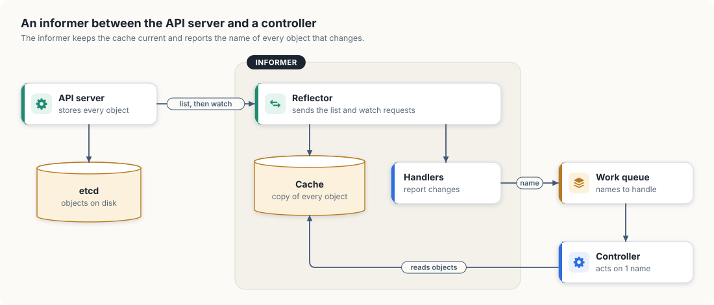

# 1. Keeping a local copy of the cluster

This chapter depicts what happens under the hood when a Kubernetes controller learns that an
object in the cluster has changed. The component that does this work is called an **informer**. We
will first describe what an informer gives a controller. We will then build one in Go and in Rust,
one part at a time, and finally compare our version with the informer in client-go, the library
that real Go controllers use.

## What an informer does

An informer keeps a copy of every object of one kind, for example every `GpuJob`, in the
controller's memory, and keeps that copy up to date. Each time an object is created, changed or
deleted, the informer updates its copy and then passes the object's name to the controller. The
controller does not ask the API server for objects. It reads them from the informer's copy.

Fig. 1.1 shows an informer between the API server and a controller. The informer sends 2 requests
to the API server. The first, a **list**, returns all objects of the kind. The second, a **watch**,
stays open and returns each later change as it happens. The informer stores the result of the list
in its cache, applies every change from the watch to the same cache, and passes the name of each
changed object to the controller's work queue.

<figure>

<figcaption><b>Figure 1.1</b> An informer keeps a cache of one kind of object and reports the name of every object that changes.</figcaption>
</figure>

An informer has 3 parts, and the rest of this chapter builds them in this order:

- the **reflector**, which sends the list and watch requests and keeps the cache current;
- the **cache**, which holds the copy of the objects;
- the **event handlers**, which pass the names of changed objects to the controller.

Before we build them, we need the objects themselves, and a way for a client to tell the API server
which changes it has already seen.

## Objects, specs and statuses

Kubernetes stores the state of a cluster as **objects**. An object is a named record with 2 main
parts. The **spec** is the state that the owner of the object requests. The **status** is the state
that has been reached so far. The owner writes the spec, and a controller writes the status. A
**controller** is a program that compares the 2 for every object of one kind and acts until they
agree.

Our example is a training job. A job named `job-a` is created with a spec of 1 GPU and a status of 0
GPUs. Its controller starts a container with 1 GPU and then writes a status of 1 GPU. If the owner
later changes the spec to 2 GPUs, the controller replaces the container and writes a status of 2.
If the owner deletes the job, the controller stops the container and frees the GPUs.

All objects are kept by 1 HTTP service, the **API server**, which stores them in etcd, a replicated
key-value store. Every client, including `kubectl` and every controller, reads and writes objects
through the API server. Listing 1.1 gives the object in our model. A real object has many more
fields; a GPU count in the spec and in the status is enough for this chapter.

<div class="code-tabs">

<p class="listing"><b>Listing 1.1</b> An object, with its spec and its status. <a href="https://github.com/arpanpathak/cracking-the-systems-programming-interview/blob/prep-v2/gpu-accelerated-kubernetes/code/go/informer/server.go">Go</a> · <a href="https://github.com/arpanpathak/cracking-the-systems-programming-interview/blob/prep-v2/gpu-accelerated-kubernetes/code/rust/informer/src/server.rs">Rust</a></p>

```go
{{#include ../code/go/informer/server.go:types}}
```

```rust
{{#include ../code/rust/informer/src/server.rs:types}}
```

</div>

## Why not ask the API server every time

A controller could do without an informer. It could ask the API server for every job every few
seconds and compare the answer with what it is running. On a small cluster this works. On a large
one it does not. A cluster with 50,000 pods, at about 4 KB of JSON per pod, returns 200 MB for each
such request. If 12 controllers each ask every 5 seconds, the API server sends 480 MB per second,
although only a few pods change between 2 requests.

An informer reads all objects once and then receives only the changes. To do that safely, it needs a
way to say which changes it has already seen. That is the purpose of the resource version.

## Numbering every write

etcd keeps 1 counter for the whole store, called the **revision**. Every create, update and delete
of any key takes the next value of the counter. Fig. 1.2 shows 12 writes to 4 keys. The top row is
the writes in order. The rows below show, for each key, the revisions that wrote it.

<figure>

<figcaption><b>Figure 1.2</b> One counter numbers every write. Each object's resource version is the revision of its latest write.</figcaption>
</figure>

Kubernetes reports this number to clients as the **resource version**. The resource version of an
object is the revision of the last write that changed it. In Fig. 1.2, `job-a` has resource version
11 and `pod-1` has resource version 8. A list also has a resource version: the revision of the
store when the list was read.[^opaque]

[^opaque]: Kubernetes asks clients to treat resource versions as opaque strings and to compare them only for equality. Our model uses integers so that we can print them.

Each change that a watch reports is an **event**. An event has a type, `ADDED`, `MODIFIED` or
`DELETED`, and it carries the whole object after the change. Listing 1.2 gives the event and the 3
errors that our server can return.

<div class="code-tabs">

<p class="listing"><b>Listing 1.2</b> Events, and the errors the server returns. <a href="https://github.com/arpanpathak/cracking-the-systems-programming-interview/blob/prep-v2/gpu-accelerated-kubernetes/code/go/informer/server.go">Go</a> · <a href="https://github.com/arpanpathak/cracking-the-systems-programming-interview/blob/prep-v2/gpu-accelerated-kubernetes/code/rust/informer/src/server.rs">Rust</a></p>

```go
{{#include ../code/go/informer/server.go:events}}
```

```rust
{{#include ../code/rust/informer/src/server.rs:events}}
```

</div>

## Writing with a version

The resource version also protects writes. Suppose 2 clients read `job-a` at version 7. Client A
changes the GPU count and writes the job back. Client B then changes the image and writes back its
own copy, which still has the old GPU count. Without a check, client B's write would undo client A's
change.

To prevent this, a write can carry the version it was based on. The API server accepts the write
only if the object still has that version, and otherwise answers `409 Conflict`. Fig. 1.3 shows the
2 clients with this rule. Client A's write (step 5) is accepted and the job becomes version 8. Client
B's write (step 7) still says version 7, so it is refused (step 8). Client B reads version 8,
applies its change again, and its second write succeeds as version 9.

<figure>

<figcaption><b>Figure 1.3</b> A write that names the version it read is accepted only if the object is still at that version.</figcaption>
</figure>

This is called **optimistic concurrency**. No client locks the object. A client that loses the race
reads the object again and repeats its change.

Our model server needs a few fields to support writes, lists and watches. Fig. 1.4 shows them after
10 writes: the objects, the version counter, a history of recent events, and the open watches. A
fifth field, `compacted`, records how much of the history has been thrown away.

<figure>

<figcaption><b>Figure 1.4</b> The model API server after 10 writes.</figcaption>
</figure>

Listing 1.3 declares these fields. The field `unreachable` is only for our demonstration: it lets
the server act as if a network partition had cut it off.

<div class="code-tabs">

<p class="listing"><b>Listing 1.3</b> The state of the API server. <a href="https://github.com/arpanpathak/cracking-the-systems-programming-interview/blob/prep-v2/gpu-accelerated-kubernetes/code/go/informer/server.go">Go</a> · <a href="https://github.com/arpanpathak/cracking-the-systems-programming-interview/blob/prep-v2/gpu-accelerated-kubernetes/code/rust/informer/src/server.rs">Rust</a></p>

```go
{{#include ../code/go/informer/server.go:server}}
```

```rust
{{#include ../code/rust/informer/src/server.rs:server}}
```

</div>

Listing 1.4 is the write. It checks the version, takes the next number from the counter, stores the
object, and publishes 1 event. A version of 0 means "write without a check", which the demonstration
uses to play a user editing a job. All of this happens under 1 lock, so 2 writers can never pass the
check at the same time.

<div class="code-tabs">

<p class="listing"><b>Listing 1.4</b> A write that checks the version it was based on. <a href="https://github.com/arpanpathak/cracking-the-systems-programming-interview/blob/prep-v2/gpu-accelerated-kubernetes/code/go/informer/server.go">Go</a> · <a href="https://github.com/arpanpathak/cracking-the-systems-programming-interview/blob/prep-v2/gpu-accelerated-kubernetes/code/rust/informer/src/server.rs">Rust</a></p>

```go
{{#include ../code/go/informer/server.go:update}}
```

```rust
{{#include ../code/rust/informer/src/server.rs:update}}
```

</div>

## The list and the watch

The reflector builds its copy with a list followed by a watch. The list returns all objects and a
resource version. The watch then asks for every change after that version.

The watch must start from the list's version. The 2 requests are separate, and other clients may
write between them. Fig. 1.5 shows a list read at version 10, an edit at version 11, and a watch
that opens when the store is already at version 12. If the watch asks for changes after 10, the
server replays 11 and 12 and nothing is lost. If it asks for changes after 12, the edit at 11 is
never delivered, and the copy of that object stays wrong.

<figure>

<figcaption><b>Figure 1.5</b> A watch must start from the list's version. Starting from the current version leaves a gap.</figcaption>
</figure>

Listing 1.5 gives both requests. `Watch` replays the stored events newer than the requested version
and then registers the new watch, both under the server's lock. Every event therefore reaches the
new watch exactly once.

<div class="code-tabs">

<p class="listing"><b>Listing 1.5</b> List, and watch from a version. <a href="https://github.com/arpanpathak/cracking-the-systems-programming-interview/blob/prep-v2/gpu-accelerated-kubernetes/code/go/informer/server.go">Go</a> · <a href="https://github.com/arpanpathak/cracking-the-systems-programming-interview/blob/prep-v2/gpu-accelerated-kubernetes/code/rust/informer/src/server.rs">Rust</a></p>

```go
{{#include ../code/go/informer/server.go:listwatch}}
```

```rust
{{#include ../code/rust/informer/src/server.rs:listwatch}}
```

</div>

## When a watch ends

A watch can replay only the events the server still keeps. etcd throws away old revisions from time
to time; this is called **compaction**, and kube-apiserver requests it every 5 minutes by default. If
a client asks to resume from a version that has been thrown away, the server answers `410 Gone`, and
the client must list again.

A watch can also end for ordinary reasons. The API server closes every watch after 30 to 60
minutes. A load balancer may close an idle connection. The network may fail for a while. Fig. 1.6
shows what the reflector does in each case. Here *v* is the version of the last event it applied.
After a closed stream or a network failure, it watches again from *v*. Only after `410 Gone` does
it list again.

<figure>

<figcaption><b>Figure 1.6</b> The 3 ways a watch ends. Only <code>410 Gone</code> requires a new list.</figcaption>
</figure>

A watch on objects that rarely change receives few events, so its *v* can fall behind the next
compaction even though nothing was missed. The API server prevents this by sending **bookmark**
events, which carry only a resource version.

Our server can cause each of these endings on request, so that the demonstration can show them.
Listing 1.6 gives the 4 methods: `Compact`, `DropWatches`, `Partition` and `Heal`.

<div class="code-tabs">

<p class="listing"><b>Listing 1.6</b> Compaction, dropped watches and partitions. <a href="https://github.com/arpanpathak/cracking-the-systems-programming-interview/blob/prep-v2/gpu-accelerated-kubernetes/code/go/informer/server.go">Go</a> · <a href="https://github.com/arpanpathak/cracking-the-systems-programming-interview/blob/prep-v2/gpu-accelerated-kubernetes/code/rust/informer/src/server.rs">Rust</a></p>

```go
{{#include ../code/go/informer/server.go:faults}}
```

```rust
{{#include ../code/rust/informer/src/server.rs:faults}}
```

</div>

## The cache

The cache is a map from object name to object. Reading an object is a lookup in this map. Listing
1.7 gives the cache with 2 operations. `Get` returns 1 object. `Apply` records 1 event: it stores
the object for `ADDED` and `MODIFIED`, and removes it for `DELETED`.

<div class="code-tabs">

<p class="listing"><b>Listing 1.7</b> The cache, Get and Apply. <a href="https://github.com/arpanpathak/cracking-the-systems-programming-interview/blob/prep-v2/gpu-accelerated-kubernetes/code/go/informer/cache.go">Go</a> · <a href="https://github.com/arpanpathak/cracking-the-systems-programming-interview/blob/prep-v2/gpu-accelerated-kubernetes/code/rust/informer/src/cache.rs">Rust</a></p>

```go
{{#include ../code/go/informer/cache.go:cache}}
```

```rust
{{#include ../code/rust/informer/src/cache.rs:cache}}
```

</div>

The cache needs a third operation for a new list. After `410 Gone`, some objects may have been
deleted while the reflector was cut off, and their `DELETED` events were thrown away. No event will
report them. The only sign is that they are in the old cache and missing from the new list.
`Replace` therefore compares the 2. Fig. 1.7 shows 4 cases: a changed object, a deleted object, a
new object and an unchanged object. `Replace` returns the names of the first 3.

<figure>

<figcaption><b>Figure 1.7</b> Replace compares the old cache with the new list. <code>job-b</code> is reported deleted although no event says so.</figcaption>
</figure>

<div class="code-tabs">

<p class="listing"><b>Listing 1.8</b> Replace. <a href="https://github.com/arpanpathak/cracking-the-systems-programming-interview/blob/prep-v2/gpu-accelerated-kubernetes/code/go/informer/cache.go">Go</a> · <a href="https://github.com/arpanpathak/cracking-the-systems-programming-interview/blob/prep-v2/gpu-accelerated-kubernetes/code/rust/informer/src/cache.rs">Rust</a></p>

```go
{{#include ../code/go/informer/cache.go:replace}}
```

```rust
{{#include ../code/rust/informer/src/cache.rs:replace}}
```

</div>

## The reflector

The reflector is the loop that keeps the cache current. It lists, installs the list with `Replace`,
and watches from the list's version. For each event it updates the cache and then reports the
object's name. When the watch ends with `410 Gone`, it starts again with a new list.

The order of the last 2 steps matters. The cache must be updated before the name is reported. Fig.
1.8 shows why. On the left, the name is reported first. A worker takes the name and reads the cache
before the update has arrived. It sees the old spec, finds nothing to do, and the change is never
handled. On the right, the cache is updated first, and the worker sees the new spec.

<figure>

<figcaption><b>Figure 1.8</b> The same event handled in 2 orders. Only the second order is correct.</figcaption>
</figure>

Listing 1.8 is the outer loop: list, install, watch.

<div class="code-tabs">

<p class="listing"><b>Listing 1.9</b> The reflector and its outer loop. <a href="https://github.com/arpanpathak/cracking-the-systems-programming-interview/blob/prep-v2/gpu-accelerated-kubernetes/code/go/informer/reflector.go">Go</a> · <a href="https://github.com/arpanpathak/cracking-the-systems-programming-interview/blob/prep-v2/gpu-accelerated-kubernetes/code/rust/informer/src/reflector.rs">Rust</a></p>

```go
{{#include ../code/go/informer/reflector.go:run}}
```

```rust
{{#include ../code/rust/informer/src/reflector.rs:run}}
```

</div>

Listing 1.9 is the watch loop. It keeps `version` equal to the version of the last event applied,
so a new watch from `version` continues exactly where the old one stopped. The 3 branches match the
3 endings of Fig. 1.6. In our model the reflector waits 10 milliseconds before retrying an
unreachable server. client-go doubles the wait after each failure.

<div class="code-tabs">

<p class="listing"><b>Listing 1.10</b> Watching from a version. <a href="https://github.com/arpanpathak/cracking-the-systems-programming-interview/blob/prep-v2/gpu-accelerated-kubernetes/code/go/informer/reflector.go">Go</a> · <a href="https://github.com/arpanpathak/cracking-the-systems-programming-interview/blob/prep-v2/gpu-accelerated-kubernetes/code/rust/informer/src/reflector.rs">Rust</a></p>

```go
{{#include ../code/go/informer/reflector.go:watch}}
```

```rust
{{#include ../code/rust/informer/src/reflector.rs:watch}}
```

</div>

## The event handlers and the work queue

When the cache changes, the controller must hear about it. In client-go this is the job of the
**event handlers**: functions that the informer calls after each change. A typical handler does 1
thing: it adds the object's name to a work queue. In our model the reflector does this directly,
with 1 call to `queue.Add` after each update of the cache.

The queue holds names, and the controller reads each object from the cache when it takes the name.
This has 2 advantages. If a user edits a job 5 times in 1 second, the name is added 5 times, but the
queue keeps it only once, so the controller does the work once, for the latest spec. And after a new
list, `Replace` reports names without events, which the queue accepts in the same way.

The queue must also stop 2 workers from handling the same object at the same time. For this it keeps
2 sets beside the list of ready names. The **dirty** set holds every name that needs handling. The
**processing** set holds every name a worker is handling now. A name that is added while a worker
holds it goes into the dirty set only. It becomes ready again when the worker calls `Done`. Fig. 1.9
follows 1 name through these calls.

<figure>

<figcaption><b>Figure 1.9</b> The queue after each call. A name is never ready while a worker holds it.</figcaption>
</figure>

Listing 1.10 declares the queue: the ready list and the 2 sets under 1 lock, and a condition
variable on which idle workers wait.

<div class="code-tabs">

<p class="listing"><b>Listing 1.11</b> The state of the work queue. <a href="https://github.com/arpanpathak/cracking-the-systems-programming-interview/blob/prep-v2/gpu-accelerated-kubernetes/code/go/informer/queue.go">Go</a> · <a href="https://github.com/arpanpathak/cracking-the-systems-programming-interview/blob/prep-v2/gpu-accelerated-kubernetes/code/rust/informer/src/queue.rs">Rust</a></p>

```go
{{#include ../code/go/informer/queue.go:state}}
```

```rust
{{#include ../code/rust/informer/src/queue.rs:state}}
```

</div>

Listing 1.11 is `Add`. It ignores a name that is already dirty, marks a new name dirty, and makes it
ready only if no worker holds it.

<div class="code-tabs">

<p class="listing"><b>Listing 1.12</b> Add. <a href="https://github.com/arpanpathak/cracking-the-systems-programming-interview/blob/prep-v2/gpu-accelerated-kubernetes/code/go/informer/queue.go">Go</a> · <a href="https://github.com/arpanpathak/cracking-the-systems-programming-interview/blob/prep-v2/gpu-accelerated-kubernetes/code/rust/informer/src/queue.rs">Rust</a></p>

```go
{{#include ../code/go/informer/queue.go:add}}
```

```rust
{{#include ../code/rust/informer/src/queue.rs:add}}
```

</div>

Listing 1.12 gives `Get` and `Done`. `Get` waits until a name is ready, then moves it from the dirty
set to the processing set. `Done` removes the name from the processing set and makes it ready again
if it was added in the meantime. A waiting worker must not hold the lock, or `Add` could never run,
so both versions wait on a **condition variable** (`sync.Cond` in Go, `std::sync::Condvar` in Rust),
which releases the lock while the worker sleeps.

<div class="code-tabs">

<p class="listing"><b>Listing 1.13</b> Get and Done. <a href="https://github.com/arpanpathak/cracking-the-systems-programming-interview/blob/prep-v2/gpu-accelerated-kubernetes/code/go/informer/queue.go">Go</a> · <a href="https://github.com/arpanpathak/cracking-the-systems-programming-interview/blob/prep-v2/gpu-accelerated-kubernetes/code/rust/informer/src/queue.rs">Rust</a></p>

```go
{{#include ../code/go/informer/queue.go:getdone}}
```

```rust
{{#include ../code/rust/informer/src/queue.rs:getdone}}
```

</div>

Animation 1.1 shows the same calls for a burst of 5 edits. Its last part removes the processing set
and shows a second worker taking the name while the first is still working.

<figure class="anim">
<video class="motion" src="figures/work-queue.mp4" autoplay loop muted playsinline preload="metadata" aria-label="Three boxes, ready, dirty and processing, above a worker. Add puts job-a in ready and dirty. Get moves it to processing and the worker starts a reconcile. Four more Add calls during the reconcile mark the name dirty and leave ready empty. Done moves the name back to ready, and a second reconcile reads a spec of 6 GPUs. In the last part the processing set is removed: an Add during the reconcile makes the name ready, and a second worker takes it while the first is still working." data-chapters="[[0.0, &quot;Add&quot;], [7.86, &quot;Get&quot;], [18.06, &quot;Add while held&quot;], [33.66, &quot;Done&quot;], [46.86, &quot;no processing set&quot;]]"></video>
<figcaption><b>Animation 1.1</b> One name through the work queue. 5 edits lead to 2 runs, and the 2 never overlap.</figcaption>
</figure>

## The controller

The controller takes names from the queue and handles each one with a function called
**reconcile**. Reconcile reads the object from the cache, compares the spec with the status, does
the work, and writes the new status. Fig. 1.10 shows the steps.

<figure>

<figcaption><b>Figure 1.10</b> One reconcile. Only a conflict puts the name back in the queue.</figcaption>
</figure>

Reconcile looks only at the object's current state. It does not need to know which events
happened, or how many. This style is called **level-triggered**. A controller that acted once per
event would be **edge-triggered**. Fig. 1.11 compares the 2 for the burst of 5 edits. The
edge-triggered controller acts 5 times, 4 of them on specs that were already replaced. The
level-triggered controller acts twice. It also does not depend on any single event, so an event
thrown away by compaction does not matter to it.

<figure>

<figcaption><b>Figure 1.11</b> Acting once per event, and acting on the current state.</figcaption>
</figure>

Reconcile writes the status with the version it read, as in Fig. 1.3. The cache can be slightly
behind the server, and the user may change the spec while the controller works. In that case the
write fails with `409 Conflict`, the name goes back into the queue, and the next reconcile reads the
newer object. Listing 1.13 gives reconcile; a sleep of 20 milliseconds stands for the real work.

<div class="code-tabs">

<p class="listing"><b>Listing 1.14</b> Reconciling 1 name. <a href="https://github.com/arpanpathak/cracking-the-systems-programming-interview/blob/prep-v2/gpu-accelerated-kubernetes/code/go/informer/controller.go">Go</a> · <a href="https://github.com/arpanpathak/cracking-the-systems-programming-interview/blob/prep-v2/gpu-accelerated-kubernetes/code/rust/informer/src/controller.rs">Rust</a></p>

```go
{{#include ../code/go/informer/controller.go:reconcile}}
```

```rust
{{#include ../code/rust/informer/src/controller.rs:reconcile}}
```

</div>

Listing 1.14 is the worker loop: take a name, reconcile it, call `Done`, and add the name again if
the reconcile failed.

<div class="code-tabs">

<p class="listing"><b>Listing 1.15</b> The controller and its worker loop. <a href="https://github.com/arpanpathak/cracking-the-systems-programming-interview/blob/prep-v2/gpu-accelerated-kubernetes/code/go/informer/controller.go">Go</a> · <a href="https://github.com/arpanpathak/cracking-the-systems-programming-interview/blob/prep-v2/gpu-accelerated-kubernetes/code/rust/informer/src/controller.rs">Rust</a></p>

```go
{{#include ../code/go/informer/controller.go:run}}
```

```rust
{{#include ../code/rust/informer/src/controller.rs:run}}
```

</div>

## Running the model

Fig. 1.12 puts the parts together, and Listing 1.15 runs them. The demonstration creates 2 jobs,
starts the reflector and 1 worker, and then causes 3 events: a burst of 5 edits, a dropped watch,
and a network partition during which a job is deleted and the history is compacted.

<figure>

<figcaption><b>Figure 1.12</b> The path of 1 change through the informer and the controller.</figcaption>
</figure>

<div class="code-tabs">

<p class="listing"><b>Listing 1.16</b> The demonstration. <a href="https://github.com/arpanpathak/cracking-the-systems-programming-interview/blob/prep-v2/gpu-accelerated-kubernetes/code/go/informer/main.go">Go</a> · <a href="https://github.com/arpanpathak/cracking-the-systems-programming-interview/blob/prep-v2/gpu-accelerated-kubernetes/code/rust/informer/src/main.rs">Rust</a></p>

```go
{{#include ../code/go/informer/main.go:main}}
```

```rust
{{#include ../code/rust/informer/src/main.rs:main}}
```

</div>

The Go version prints:

```console
$ go run ./informer
{{#include ../code/output/go-informer.txt}}
```

The Rust version prints the same lines, with timings that differ by 1 or 2 milliseconds:

```console
$ cargo run -p informer
{{#include ../code/output/rust-informer.txt}}
```

Table 1.1 explains each line of the Go output.

| Time | Output | What happened |
|---|---|---|
| 0 ms | list at version 2 | The reflector lists. Both jobs are new, so both names are queued. |
| 20 to 40 ms | 1 reconcile per job | The controller writes each status. |
| 101 ms | 5 edits | The worker takes `job-a` after the first edit and reads a spec of 2. The other 4 edits arrive while it works, so the queue only marks the name dirty. |
| 121 ms | `409 Conflict` | The worker writes with version 5, but the job is now at version 9. The name goes back into the queue. |
| 141 ms | status 6 | The second reconcile reads the latest spec, 6 GPUs. Specs 3, 4 and 5 were never handled, and did not need to be. |
| 257 ms | resuming from version 10 | The watch closed. The reflector watches again from 10, without a list. |
| 338 ms | `410 Gone`, list at version 11 | During the partition `job-b` was deleted and the history compacted, so the watch cannot resume. The reflector lists again. |
| 338 ms | `job-b`: deleted | `Replace` finds `job-b` in the old cache but not in the new list, and the controller releases its GPUs. |

Animation 1.2 replays the same run, with the server on the left and the cache on the right.

<figure class="anim">
<video class="motion" src="figures/list-watch.mp4" autoplay loop muted playsinline preload="metadata" aria-label="The API server on the left with job-a, job-b and its recent events; the reflector's cache on the right. The reflector lists at version 2 and opens a watch. Events 3 to 10 arrive and the cache follows. The watch is closed and reopened from 10 with no list. During a partition job-b is deleted at version 11 and the history is compacted, while the cache still holds job-b. After the partition the server answers a watch from 10 with 410 Gone, the reflector lists at version 11, and job-b, present in the old cache and missing from the list, is removed." data-chapters="[[0.0, &quot;list&quot;], [10.01, &quot;watch&quot;], [34.28, &quot;drop&quot;], [43.69, &quot;partition&quot;], [60.08, &quot;410 Gone&quot;]]"></video>
<figcaption><b>Animation 1.2</b> The run of the model: a list, a watch, a dropped watch that resumes, and a partition that ends in <code>410 Gone</code> and a second list.</figcaption>
</figure>

## The informer in client-go

Real Go controllers use the informer in client-go, directly or through controller-runtime. Table 1.2
matches its parts to our model.

| Our model | client-go |
|---|---|
| `APIServer.List`, `Watch` | `ListerWatcher` |
| `Reflector` | `cache.Reflector` |
| `Cache` | `cache.Indexer`, a cache with extra indexes, such as all pods on 1 node |
| reflector, cache and handlers together | `cache.SharedIndexInformer`, the informer |
| the call to `queue.Add` | an event handler registered with `AddEventHandler` |
| `WorkQueue` | `workqueue`, with the same dirty and processing sets |
| `reconcile` | the controller's `Reconcile` method |

client-go adds a few things that our model leaves out.

**Shared informers.** If 3 controllers in 1 process all need pods, they share 1 informer, and so 1
watch and 1 cache. Each controller registers its own handler and has its own work queue. Fig. 1.13
shows this. Because the cache is shared, a controller must copy an object with `DeepCopy` before
changing it.

<figure>

<figcaption><b>Figure 1.13</b> 3 controllers in 1 process share 1 informer.</figcaption>
</figure>

**DeltaFIFO.** Between the reflector and the cache, client-go keeps a queue of the pending changes
of each object. When a new list shows that an object is gone, the deletion it reports carries a
marker, `DeletedFinalStateUnknown`, because the last state of the object is not known.

**Retry limits.** Our model retries a failed name at once. client-go waits 5 ms after the first
failure, doubles the wait after each further failure up to 1,000 s, and allows at most 10 retries
per second across all names.

**Resync.** An informer can queue every name in its cache again at a fixed interval. This helps
controllers that manage things outside Kubernetes, whose changes no event reports.

**Memory.** A cache holds every object of its kind: 50,000 pods at 4 KB each take 200 MB. A
controller that needs only names and labels can use a metadata-only informer, which stores much less.

**Its own writes.** A controller's own writes reach its cache only when their events arrive. Until
then, the cache shows the old state, and a reconcile could create the same pod twice. The
ReplicaSet controller avoids this by recording how many creation events it expects and waiting for
them. Many controllers also copy `metadata.generation`, which the API server increases on every
spec change, into `status.observedGeneration`, so that anyone can see whether the latest spec has
been handled.

## Summary

An informer gives a controller a copy of all objects of one kind and reports every change. Its
reflector lists, then watches from the list's version, so that no change is missed. When a watch
ends it resumes from the last version applied, and it lists again only after `410 Gone`, using
`Replace` to find deletions that no event reported. The reflector updates the cache before it
reports a name. The work queue merges repeated names and gives each name to 1 worker at a time.
The controller reads the current state from the cache and writes with the version it read.

The next part of this chapter, *A GPU job controller on a real cluster*, uses client-go's informer
in Go and kube-rs in Rust against a real cluster.

## Exercises

1. In Fig. 1.2, a client lists at revision 8 and then watches from 8. Which revisions does it receive as events?
2. In Fig. 1.4, a client calls `Watch` with version 1. What does the server answer, and what must the client do?
3. Change the Go reflector so that it adds the name to the queue before it updates the cache, and add a sleep of 30 milliseconds between the 2 steps. Run the demonstration and find the edit that is never handled.
4. Remove the processing set from the queue and run the demonstration with 2 workers. What happens during the burst of edits?
5. With client-go's retry limits, after how many failures in a row does 1 name wait more than 1 minute?

## The complete program

The model has 6 source files in each language. Each is printed here in full, with the Go and Rust
versions as tabs.

<div class="code-tabs">

<p class="listing"><b>Listing 1.17</b> The API server, complete. <a href="https://github.com/arpanpathak/cracking-the-systems-programming-interview/blob/prep-v2/gpu-accelerated-kubernetes/code/go/informer/server.go">Go</a> · <a href="https://github.com/arpanpathak/cracking-the-systems-programming-interview/blob/prep-v2/gpu-accelerated-kubernetes/code/rust/informer/src/server.rs">Rust</a></p>

```go
{{#include ../code/go/informer/server.go}}
```

```rust
{{#include ../code/rust/informer/src/server.rs}}
```

</div>

<div class="code-tabs">

<p class="listing"><b>Listing 1.18</b> The cache, complete. <a href="https://github.com/arpanpathak/cracking-the-systems-programming-interview/blob/prep-v2/gpu-accelerated-kubernetes/code/go/informer/cache.go">Go</a> · <a href="https://github.com/arpanpathak/cracking-the-systems-programming-interview/blob/prep-v2/gpu-accelerated-kubernetes/code/rust/informer/src/cache.rs">Rust</a></p>

```go
{{#include ../code/go/informer/cache.go}}
```

```rust
{{#include ../code/rust/informer/src/cache.rs}}
```

</div>

<div class="code-tabs">

<p class="listing"><b>Listing 1.19</b> The reflector, complete. <a href="https://github.com/arpanpathak/cracking-the-systems-programming-interview/blob/prep-v2/gpu-accelerated-kubernetes/code/go/informer/reflector.go">Go</a> · <a href="https://github.com/arpanpathak/cracking-the-systems-programming-interview/blob/prep-v2/gpu-accelerated-kubernetes/code/rust/informer/src/reflector.rs">Rust</a></p>

```go
{{#include ../code/go/informer/reflector.go}}
```

```rust
{{#include ../code/rust/informer/src/reflector.rs}}
```

</div>

<div class="code-tabs">

<p class="listing"><b>Listing 1.20</b> The work queue, complete. <a href="https://github.com/arpanpathak/cracking-the-systems-programming-interview/blob/prep-v2/gpu-accelerated-kubernetes/code/go/informer/queue.go">Go</a> · <a href="https://github.com/arpanpathak/cracking-the-systems-programming-interview/blob/prep-v2/gpu-accelerated-kubernetes/code/rust/informer/src/queue.rs">Rust</a></p>

```go
{{#include ../code/go/informer/queue.go}}
```

```rust
{{#include ../code/rust/informer/src/queue.rs}}
```

</div>

<div class="code-tabs">

<p class="listing"><b>Listing 1.21</b> The controller, complete. <a href="https://github.com/arpanpathak/cracking-the-systems-programming-interview/blob/prep-v2/gpu-accelerated-kubernetes/code/go/informer/controller.go">Go</a> · <a href="https://github.com/arpanpathak/cracking-the-systems-programming-interview/blob/prep-v2/gpu-accelerated-kubernetes/code/rust/informer/src/controller.rs">Rust</a></p>

```go
{{#include ../code/go/informer/controller.go}}
```

```rust
{{#include ../code/rust/informer/src/controller.rs}}
```

</div>

<div class="code-tabs">

<p class="listing"><b>Listing 1.22</b> The demonstration, complete. <a href="https://github.com/arpanpathak/cracking-the-systems-programming-interview/blob/prep-v2/gpu-accelerated-kubernetes/code/go/informer/main.go">Go</a> · <a href="https://github.com/arpanpathak/cracking-the-systems-programming-interview/blob/prep-v2/gpu-accelerated-kubernetes/code/rust/informer/src/main.rs">Rust</a></p>

```go
{{#include ../code/go/informer/main.go}}
```

```rust
{{#include ../code/rust/informer/src/main.rs}}
```

</div>

## References

1. Kubernetes documentation, "API Concepts": resource versions, watches and bookmarks. <https://kubernetes.io/docs/reference/using-api/api-concepts/>
2. Kubernetes API conventions, "Concurrency Control and Consistency". <https://github.com/kubernetes/community/blob/master/contributors/devel/sig-architecture/api-conventions.md>
3. etcd documentation, "Data model": revisions and compaction. <https://etcd.io/docs/latest/learning/data_model/>
4. client-go source: `tools/cache/shared_informer.go`, `tools/cache/reflector.go`, `tools/cache/delta_fifo.go`, `util/workqueue/queue.go`, `util/workqueue/default_rate_limiters.go`. <https://github.com/kubernetes/client-go>
5. M. Hausenblas and S. Schimanski, *Programming Kubernetes*, O'Reilly, 2019, chapter 3.
