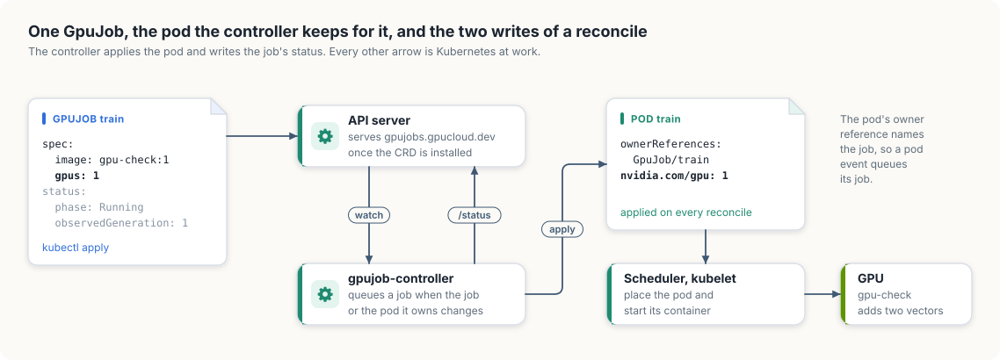

# 1.1 A GPU job controller on a real cluster

Chapter 1 built a server, a cache, a reflector, a work queue, and a controller inside one
process. This section moves the same machinery to a real Kubernetes cluster. It defines a
new kind of object, the GPU job, in the API server, watches those objects arrive, and writes
a controller that runs each job as a pod with a GPU. A CUDA program then runs inside a pod
the controller created. The section ends with two clients writing the same object, so that
the API server's version check can be seen refusing the second write.

The machinery comes from each language's standard Kubernetes library, which provides the
parts chapter 1 built by hand:

- In Go, *controller-runtime*. It is built on client-go, the library whose parts were listed
  at the end of chapter 1, and it is the library that Kubebuilder, the usual tool for
  starting a Go controller project, generates code for.
- In Rust, *kube-rs*, published as the `kube` crate.

Each part of these libraries is introduced where it is first used and related to its
counterpart in the model.

The cluster was created with kind, which runs each Kubernetes node as a Docker container,
and is reached with kubectl, the Kubernetes command-line client:

```console
$ kind get clusters
gpu-lab
$ kubectl get nodes
NAME                    STATUS   ROLES           AGE   VERSION
gpu-lab-control-plane   Ready    control-plane   22s   v1.37.0
```

Pods in this cluster can use a GPU. Appendix A describes the setup.

<div class="covers">

This chapter covers

- a CustomResourceDefinition for a new kind, `GpuJob`, and its status subresource
- watching `GpuJob` objects with controller-runtime and with kube-rs
- a controller that keeps one pod for each job, written with server-side apply
- a CUDA program running on the GPU in a pod the controller created
- two clients writing one object, and the `409 Conflict` from a real API server

</div>

## The projects

The Go code lives in the module in `code/go`, beside the model from chapter 1:

<p class="listing"><b>Listing 1.41</b> The Go module. <a href="https://github.com/arpanpathak/cracking-the-systems-programming-interview/blob/prep-v2/gpu-accelerated-kubernetes/code/go/go.mod">code/go/go.mod</a></p>

```text
{{#include ../code/go/go.mod:1:10}}
```


The module depends on four others. `k8s.io/api` holds the Go types of the built-in
Kubernetes objects, such as `Pod`. `k8s.io/apimachinery` holds what all objects share:
metadata, resource quantities such as "2 CPUs", and the errors the API server returns.
`k8s.io/client-go` is the client library, and `sigs.k8s.io/controller-runtime` is the
controller framework built on it. The versions match the cluster's Kubernetes 1.37.

The Rust code is the `gpujob` package in the Cargo workspace in `code/rust`, beside the
model's `informer` package:

<p class="listing"><b>Listing 1.42</b> The Cargo workspace. <a href="https://github.com/arpanpathak/cracking-the-systems-programming-interview/blob/prep-v2/gpu-accelerated-kubernetes/code/rust/Cargo.toml">code/rust/Cargo.toml</a></p>

```toml
{{#include ../code/rust/Cargo.toml}}
```


<p class="listing"><b>Listing 1.43</b> The `gpujob` package. <a href="https://github.com/arpanpathak/cracking-the-systems-programming-interview/blob/prep-v2/gpu-accelerated-kubernetes/code/rust/gpujob/Cargo.toml">code/rust/gpujob/Cargo.toml</a></p>

```toml
{{#include ../code/rust/gpujob/Cargo.toml}}
```


`kube` is the client. Its `runtime` feature supplies the controller machinery and its
`derive` feature generates custom object types. `k8s-openapi` provides the Rust types of the
built-in objects, and its `v1_36` feature selects the newest Kubernetes version it supports.
`schemars` generates JSON schemas, `serde` and `serde_json` convert objects to and from
JSON, `tokio` runs the asynchronous code, `futures` provides stream operations, `thiserror`
derives the error type, and `tracing` writes the controller's log. `default-run` makes a
plain `cargo run -p gpujob` start the controller.

## Teaching the API server a new kind of object

The jobs in chapter 1 were records with a GPU count. A real cluster has no such kind. It
knows pods, services, deployments, and the other built-in kinds, and new kinds are added
with a *CustomResourceDefinition* (CRD), which gives the kind's API group and version, its
name, and the schema of its fields. Once the CRD is installed, the API server stores,
validates, lists, and watches objects of the new kind exactly as it does the built-in
ones. Everything in chapter 1 then applies to the jobs: they have resource versions,
clients can list and watch them, and writes can be conditional.

The kind is `GpuJob`, in the API group `gpucloud.dev`, version `v1`. Its spec holds a
container image, an optional command, and a GPU count. Its status holds a phase, a message,
and the generation it describes. In both languages the kind is written as ordinary types,
and a tool generates the CRD from them.

### In Go

A Go API package usually has two files. The first names the group and version and
registers the types in a *scheme*, a table that maps Go types to the API kinds they
represent. A client uses the scheme to decode JSON with `"kind": "GpuJob"` into a `GpuJob`
value and to choose the URL for sending one to the server.

<p class="listing"><b>Listing 1.44</b> The group, the version, and the scheme. <a href="https://github.com/arpanpathak/cracking-the-systems-programming-interview/blob/prep-v2/gpu-accelerated-kubernetes/code/go/gpujob/api/v1/groupversion.go">code/go/gpujob/api/v1/groupversion.go</a></p>

```go
{{#include ../code/go/gpujob/api/v1/groupversion.go}}
```


The second file defines the types in three parts: the spec, the status, and the object that
holds both.

<p class="listing"><b>Listing 1.45</b> The spec and the phases a job passes through. <a href="https://github.com/arpanpathak/cracking-the-systems-programming-interview/blob/prep-v2/gpu-accelerated-kubernetes/code/go/gpujob/api/v1/types.go">code/go/gpujob/api/v1/types.go</a></p>

```go
{{#include ../code/go/gpujob/api/v1/types.go:spec}}
```


<p class="listing"><b>Listing 1.46</b> The status. <a href="https://github.com/arpanpathak/cracking-the-systems-programming-interview/blob/prep-v2/gpu-accelerated-kubernetes/code/go/gpujob/api/v1/types.go">code/go/gpujob/api/v1/types.go</a></p>

```go
{{#include ../code/go/gpujob/api/v1/types.go:status}}
```


<p class="listing"><b>Listing 1.47</b> The object, the list, and their registration. <a href="https://github.com/arpanpathak/cracking-the-systems-programming-interview/blob/prep-v2/gpu-accelerated-kubernetes/code/go/gpujob/api/v1/types.go">code/go/gpujob/api/v1/types.go</a></p>

```go
{{#include ../code/go/gpujob/api/v1/types.go:object}}
```


The comments that begin with `+kubebuilder:` are *markers*, instructions for
controller-gen, a code generator from the Kubebuilder project that reads the source and
writes the CRD. The package uses these:

- `object:root=true` marks `GpuJob` and `GpuJobList` as complete API objects, as opposed to
  structs that appear only inside other objects.
- `subresource:status` enables the *status subresource*, described below.
- `resource:shortName=gj` allows `kubectl get gj` as a short form of `kubectl get gpujobs`.
- The two `printcolumn` markers add the GPU count and the phase to the table that
  `kubectl get` prints.
- The `validation` markers become rules in the schema. The API server enforces them, so a
  job with a negative GPU count or an unknown phase is rejected before any controller sees
  it.

controller-gen also copies the ordinary comments on types and fields into the CRD as field
descriptions, which `kubectl explain gpujob.spec` shows to users.

<p class="listing"><b>Listing 1.48</b> Working out a status from a pod. <a href="https://github.com/arpanpathak/cracking-the-systems-programming-interview/blob/prep-v2/gpu-accelerated-kubernetes/code/go/gpujob/api/v1/types.go">code/go/gpujob/api/v1/types.go</a></p>

```go
{{#include ../code/go/gpujob/api/v1/types.go:frompod}}
```


A job's status is derived from its pod. The pod's phase maps directly onto `Phase`, and one
further piece of information is carried over. When the scheduler cannot find a machine for
a pod, it sets the pod's `PodScheduled` condition to `False` and writes the reason in the
condition's message. `StatusFromPod` copies that message into the job's status, so that
`kubectl get gpujob` shows why a job is still waiting.

The `go:generate` line in `groupversion.go` runs controller-gen, which writes two files. The
first, `zz_generated.deepcopy.go`, holds a `DeepCopy` method for each type. Every Kubernetes
API type needs these, because the shared caches described at the end of chapter 1 return
pointers and a controller must copy an object before modifying it. The second file is the
CRD itself, in `gpujob/config/crd`. Both are checked into the repository, and the generator
needs to run again only after a change to the types:

```console
$ go install sigs.k8s.io/controller-tools/cmd/controller-gen@v0.22.0
$ go generate ./gpujob/api/...
$ kubectl apply -f gpujob/config/crd/
customresourcedefinition.apiextensions.k8s.io/gpujobs.gpucloud.dev configured
```

### In Rust

kube-rs builds the CRD at compile time from derive macros on the types, so there is no
separate generator:

<p class="listing"><b>Listing 1.49</b> The spec, with the attributes that describe the kind. <a href="https://github.com/arpanpathak/cracking-the-systems-programming-interview/blob/prep-v2/gpu-accelerated-kubernetes/code/rust/gpujob/src/lib.rs">code/rust/gpujob/src/lib.rs</a></p>

```rust
{{#include ../code/rust/gpujob/src/lib.rs:spec}}
```


<p class="listing"><b>Listing 1.50</b> The status and the phases. <a href="https://github.com/arpanpathak/cracking-the-systems-programming-interview/blob/prep-v2/gpu-accelerated-kubernetes/code/rust/gpujob/src/lib.rs">code/rust/gpujob/src/lib.rs</a></p>

```rust
{{#include ../code/rust/gpujob/src/lib.rs:status}}
```


<p class="listing"><b>Listing 1.51</b> Working out a status from a pod. <a href="https://github.com/arpanpathak/cracking-the-systems-programming-interview/blob/prep-v2/gpu-accelerated-kubernetes/code/rust/gpujob/src/lib.rs">code/rust/gpujob/src/lib.rs</a></p>

```rust
{{#include ../code/rust/gpujob/src/lib.rs:frompod}}
```


The `CustomResource` derive generates a `GpuJob` type that holds the spec together with the
object's metadata and an optional status, the same shape as the hand-written Go struct. The
`#[kube(...)]` attribute plays the part of the Go markers. `group` and `version` place the
kind at `gpucloud.dev/v1`. `namespaced` makes each job belong to a *namespace*, a named
partition of the cluster's objects, so that two teams can each have a job called `train`.
`status` enables the status subresource, and `shortname` and `printcolumn` match their Go
counterparts. The `///` comments become field descriptions, and the `Phase` enum becomes a
string field whose allowed values are the variant names.

The schema kube-rs generates for a `u32` has the format `uint32`, which the API server does
not recognise; it prints a warning each time the CRD is applied. The attribute
`#[schemars(with = "i32", range(min = 0))]` publishes the field as a non-negative 32-bit
integer, the same schema that the Go `int32` field with its `Minimum=0` marker produces,
while the Rust field stays unsigned.

A short program prints the CRD, and its output is piped into kubectl:

<p class="listing"><b>Listing 1.52</b> Printing the CRD. <a href="https://github.com/arpanpathak/cracking-the-systems-programming-interview/blob/prep-v2/gpu-accelerated-kubernetes/code/rust/gpujob/src/bin/crdgen.rs">code/rust/gpujob/src/bin/crdgen.rs</a></p>

```rust
{{#include ../code/rust/gpujob/src/bin/crdgen.rs}}
```


```console
$ cargo run -p gpujob --bin crdgen | kubectl apply -f -
customresourcedefinition.apiextensions.k8s.io/gpujobs.gpucloud.dev created
```

The Go and Rust definitions describe the same kind with the same fields. Either can be
installed, and either controller can then serve the jobs.

### The status subresource

A job has two writers: the user, who edits the spec, and the controller, which writes the
status. Without the status subresource both write the whole object, and the second writer
can overwrite the other's part with an older copy. The subresource gives the status its own
endpoint, `/status`. The API server accepts only status fields from writes to `/status` and
only spec fields from writes to the main endpoint, so the two writers cannot overwrite each
other.

The subresource has a second effect: the API server increments `metadata.generation` only
when the spec changes. That gives the status field `observedGeneration` its meaning. The
controller copies into it the generation it acted on, and comparing the two numbers shows
whether the latest spec change has been handled.

## Watching the jobs

The reflector of chapter 1 listed, watched from the list's version, and listed again when the
history ran out. Both libraries provide that loop. A small program in each language prints
every event the loop delivers.

In Go, the loop is packaged inside an *informer*, as in client-go, and controller-runtime's
`cache` package creates one informer per kind. Changes are delivered to an *event
handler*, a set of three functions that the informer calls when it adds, updates, or
deletes an object in its cache. These handlers print what they receive:

<p class="listing"><b>Listing 1.53</b> Describing an object for the log. <a href="https://github.com/arpanpathak/cracking-the-systems-programming-interview/blob/prep-v2/gpu-accelerated-kubernetes/code/go/gpujob/cmd/watch-jobs/main.go">code/go/gpujob/cmd/watch-jobs/main.go</a></p>

```go
{{#include ../code/go/gpujob/cmd/watch-jobs/main.go:describe}}
```


<p class="listing"><b>Listing 1.54</b> Starting the informer and registering the handlers. <a href="https://github.com/arpanpathak/cracking-the-systems-programming-interview/blob/prep-v2/gpu-accelerated-kubernetes/code/go/gpujob/cmd/watch-jobs/main.go">code/go/gpujob/cmd/watch-jobs/main.go</a></p>

```go
{{#include ../code/go/gpujob/cmd/watch-jobs/main.go:run}}
```


The add handler receives a flag, `isInInitialList`, that is true for objects from the first
list, which separates objects that already existed from those created later. The handler's
registration has a `HasSynced` method that becomes true once the handler has seen the whole
initial list, and `WaitForCacheSync` waits for it before the program prints "list complete".
The delete handler may receive a `DeletedFinalStateUnknown` value in place of a job; this is
the chapter 1 marker for a deletion found by relisting, and `describe` unwraps it.

kube-rs exposes the loop as a *stream*, a sequence of values that arrive over time and are
read one at a time with `await`; it is the asynchronous counterpart of an iterator. The
function `watcher` returns a stream of `Event` values for one kind of object:

<p class="listing"><b>Listing 1.55</b> Printing every event, in Rust. <a href="https://github.com/arpanpathak/cracking-the-systems-programming-interview/blob/prep-v2/gpu-accelerated-kubernetes/code/rust/gpujob/src/bin/watch_jobs.rs">code/rust/gpujob/src/bin/watch_jobs.rs</a></p>

```rust
{{#include ../code/rust/gpujob/src/bin/watch_jobs.rs}}
```


The `Event` enum spells out the list-then-watch sequence from chapter 1. `Init`, one
`InitApply` for each object that existed at the time of the list, and `InitDone` together
make up a list. Each later event is an `Apply` for an object that was created or changed, or
a `Delete`. When the watch has to start over, for example after `410 Gone`, the stream begins
a new `Init` sequence on its own. A consumer that rebuilds its state at every `Init` gets the
same result as the `Replace` method of the chapter 1 cache. kube-rs provides that consumer
and calls it a *reflector*: it applies the events to a store that the rest of the program
can read.

Both programs were started before any jobs existed and left running for the rest of this
section. The Go program printed:

```console
$ go run ./gpujob/cmd/watch-jobs
list started
list complete, watching
  changed  smoke-test gpus=0 v41900
  changed  train gpus=1 v41901
  changed  smoke-test gpus=0 v41904
  changed  train gpus=1 v41909
  changed  smoke-test gpus=0 v41920
  changed  train gpus=1 v41923
  changed  train gpus=1 v41931
  changed  smoke-test gpus=0 v41960
  changed  train gpus=2 v41972
  changed  train gpus=2 v41977
  changed  train gpus=2 v41979
  deleted  smoke-test gpus=0 v41992
```

The Rust program printed:

```console
$ cargo run -p gpujob --bin watch_jobs
list started
list complete, watching
  changed  smoke-test gpus=0 v656
  changed  train gpus=1 v657
  changed  train gpus=1 v661
  changed  smoke-test gpus=0 v662
  changed  train gpus=1 v676
  changed  smoke-test gpus=0 v684
  changed  train gpus=1 v688
  changed  smoke-test gpus=0 v722
  changed  train gpus=2 v731
  changed  train gpus=2 v737
  changed  train gpus=2 v739
  deleted  smoke-test gpus=0 v752
```

Started again later, with `train` still in the cluster, each program listed the job before
watching. In Go:

```console
$ go run ./gpujob/cmd/watch-jobs
list started
  listed   train gpus=2 v41979
list complete, watching
```

In Rust:

```console
$ cargo run -p gpujob --bin watch_jobs
list started
  listed   train gpus=2 v739
list complete, watching
```

The resource versions are etcd revision numbers. etcd counts every write in the cluster,
including those of Kubernetes' own components, so the numbers of one job jump by more than
one between its changes. The Go run happened later in the cluster's life and has larger
numbers. Most of the `changed` lines are the controller writing a new status, which changes
the object while its spec stays the same.

## The controller

The controller runs each `GpuJob` as a pod and reports the pod's progress in the job's
status. The Go and Rust versions follow the same plan and are shown side by side, one part
at a time. The complete programs are printed at the end of the section.

<div class="lld">

Low-level design: the `GpuJob` controller

| Part | Does | Rule it keeps |
|---|---|---|
| the desired pod | builds the pod a job should have: one container, the job's image, and a limit of `nvidia.com/gpu` | the pod's name is the job's name, and its owner reference names the job |
| reconcile | replaces a pod whose GPU count is wrong, applies the desired pod, and writes the job's status | writes the status only when it differs from the stored one |
| the start-up code | watches `GpuJob` objects and the pods they own, and runs reconcile for each job that changes | one worker handles a given job at a time |

</div>

### The pod for a job

<p class="listing"><b>Listing 1.56</b> The pod a job should have, in Go. <a href="https://github.com/arpanpathak/cracking-the-systems-programming-interview/blob/prep-v2/gpu-accelerated-kubernetes/code/go/gpujob/cmd/controller/main.go">code/go/gpujob/cmd/controller/main.go</a></p>

```go
{{#include ../code/go/gpujob/cmd/controller/main.go:pod}}
```


<p class="listing"><b>Listing 1.57</b> The pod a job should have, in Rust. <a href="https://github.com/arpanpathak/cracking-the-systems-programming-interview/blob/prep-v2/gpu-accelerated-kubernetes/code/rust/gpujob/src/bin/controller.rs">code/rust/gpujob/src/bin/controller.rs</a></p>

```rust
{{#include ../code/rust/gpujob/src/bin/controller.rs:pod}}
```


The pod requests its GPU by putting `nvidia.com/gpu` in its resource limits, in the same way
it would request CPU or memory. Kubernetes calls such a resource an *extended resource*: a
name Kubernetes itself does not interpret, whose quantity a machine advertises as a whole
number and the scheduler counts like any other resource. The NVIDIA device plugin, a small
program on each GPU machine, advertises `nvidia.com/gpu` by counting the machine's GPUs and
reporting them to Kubernetes; Appendix A shows it running. Extended resources are requested
in whole units through `limits`. One unit of `nvidia.com/gpu` is one whole physical GPU by
default, and chapter 2 examines what that unit contains and how a GPU can be divided.

The pod also carries an *owner reference*, a note in its metadata stating that the pod
belongs to the job. The note has two uses. When the job is deleted, the garbage collector, a
controller built into every cluster, deletes the pod as well, so the controller has no
clean-up to do for deleted jobs. Because the note has its `controller` flag set, both
libraries can map any event about the pod to the job that owns it, and that mapping is how
the controller hears about its pods.

The Go version builds an *apply configuration*, a client-go type in which every field is
optional and set through `With` methods. The result contains exactly the fields the
controller manages, which is what the server-side apply write below requires. The Rust
version builds an ordinary `Pod` value with every other field at its default, and serde
omits the empty fields when it serializes the pod, with the same effect.

Reading the GPU count back from an existing pod can fail at any level of nesting. The Go
function returns the count with a flag that says whether the pod had a GPU limit. The Rust
function returns an `Option<u32>`, and each `?` returns `None` at the first missing field.

### Reconciling a job

<p class="listing"><b>Listing 1.58</b> Reconciling one job, in Go. <a href="https://github.com/arpanpathak/cracking-the-systems-programming-interview/blob/prep-v2/gpu-accelerated-kubernetes/code/go/gpujob/cmd/controller/main.go">code/go/gpujob/cmd/controller/main.go</a></p>

```go
{{#include ../code/go/gpujob/cmd/controller/main.go:reconcile}}
```


<p class="listing"><b>Listing 1.59</b> Reconciling one job, in Rust. <a href="https://github.com/arpanpathak/cracking-the-systems-programming-interview/blob/prep-v2/gpu-accelerated-kubernetes/code/rust/gpujob/src/bin/controller.rs">code/rust/gpujob/src/bin/controller.rs</a></p>

```rust
{{#include ../code/rust/gpujob/src/bin/controller.rs:reconcile}}
```


The reconcile function brings the cluster into line with one job in three steps.

The first step handles a change that cannot be made in place. Kubernetes fixes a pod's
resources at creation, so a change to the job's GPU count cannot be applied to the existing
pod. The controller deletes the pod and asks to be called again in two seconds, by which
time the pod should be gone: `ctrl.Result{RequeueAfter: 2 * time.Second}` in Go and
`Action::requeue` in Rust. The Rust condition uses a *let chain*, `if let ... && ...`,
available since the 2024 edition, to find the pod and compare its GPU count in one
expression.

The second step creates or updates the pod in one call, with *server-side apply*. The
controller sends the pod it wants, and the API server merges it into the stored object. The
server also records which fields each writer set; a writer in this sense is a *field
manager*, and the controller identifies itself as `gpujob-controller`. Applying the same
object twice changes nothing, so a level-triggered controller can apply on every reconcile
without first checking whether the pod exists. The controller also forces ownership, with
`client.ForceOwnership` in Go and `force()` in Rust. If another writer has set a field that
the controller also sets, the controller takes the field over, which suits a controller that
is the sole authority over its pods.

The third step computes the job's status and writes it through the status subresource, and
only when it differs from the stored status. The comparison prevents a loop. Every write
produces a watch event, every event causes a reconcile, and a controller that wrote on every
reconcile would trigger itself indefinitely. The Go version writes the status with a *merge
patch*, which sends only the fields that differ from a copy of the job saved before the
change. The Rust version applies the status with server-side apply, as it does the pod.

The two versions read the pod from different places. controller-runtime's client reads from
the informer caches that the manager keeps, so the Go `Get` of the pod is a memory lookup,
like the cache reads in chapter 1. A pod created a moment ago is not yet in the cache. The Go
version then computes the status from an empty pod, which yields Pending, and the pod's
creation event soon triggers another reconcile that reports the real state. kube-rs's `Api`
talks to the API server directly, so the Rust `get_opt` is a real GET request. That is
adequate for one small controller. A Rust controller that manages thousands of pods would
keep a reflector store of pods in its `Context` and read them from memory, as the Go version
does.

When a reconcile fails, the Go version returns the error, and controller-runtime requeues the
job with the growing delay described at the end of chapter 1. The Rust version returns the
error to kube-rs, which calls `error_policy` to decide what to do; this one logs the error
and retries in five seconds.

### Starting the controller

<p class="listing"><b>Listing 1.60</b> Starting the controller, in Go. <a href="https://github.com/arpanpathak/cracking-the-systems-programming-interview/blob/prep-v2/gpu-accelerated-kubernetes/code/go/gpujob/cmd/controller/main.go">code/go/gpujob/cmd/controller/main.go</a></p>

```go
{{#include ../code/go/gpujob/cmd/controller/main.go:main}}
```


<p class="listing"><b>Listing 1.61</b> Starting the controller, in Rust. <a href="https://github.com/arpanpathak/cracking-the-systems-programming-interview/blob/prep-v2/gpu-accelerated-kubernetes/code/rust/gpujob/src/bin/controller.rs">code/rust/gpujob/src/bin/controller.rs</a></p>

```rust
{{#include ../code/rust/gpujob/src/bin/controller.rs:main}}
```


In Go, the resources a controller process shares live in a *manager*: the connection to the
cluster, the scheme, the informer caches, and the client that reads from them.
`ctrl.NewControllerManagedBy(mgr)` builds the controller inside the manager, and each call in
the chain connects one piece. `For(&GpuJob{})` watches jobs and queues the name of each job
that changes. `Owns(&corev1.Pod{})` watches pods and, through the owner reference, queues the
name of each pod's owning job. `Complete` registers the reconciler. `mgr.Start` starts the
caches, waits for their first lists, and runs the workers until the process receives a
signal such as Ctrl-C. The metrics endpoint that a manager starts by default is switched off,
since nothing here reads it.

In Rust, `Controller::new` starts a watcher and a store for `GpuJob` objects, and `owns` adds
a second watcher, for pods, that queues each pod's owning job in the same way. `run` starts
the work queue and the workers and returns a stream with one item per finished reconcile,
and `for_each` reads that stream until the program stops. `shutdown_on_signal` ends the
stream on Ctrl-C.

The work queue in both libraries has the semantics of the one in chapter 1: a job appears in
it at most once, and a job that one worker is reconciling is withheld from the others until
that worker finishes.

## Running it

Figure 1.2 shows what one reconcile writes for a job named `train` and what Kubernetes does
with the pod.

<figure>

<figcaption><b>Figure 1.2</b> One <code>GpuJob</code>, the pod the controller keeps for it, and the two writes of a reconcile: the pod, and the job's status.</figcaption>
</figure>

The controller is tested with two jobs. `smoke-test` asks for no GPUs and runs a short shell
command, which checks the basic machinery. `train` asks for one GPU and runs `gpu-check`, a
small CUDA program from Appendix A that adds two vectors on the GPU and prints which device
it used.

<p class="listing"><b>Listing 1.62</b> The two jobs. <a href="https://github.com/arpanpathak/cracking-the-systems-programming-interview/blob/prep-v2/gpu-accelerated-kubernetes/code/manifests/gpujobs.yaml">code/manifests/gpujobs.yaml</a></p>

```yaml
{{#include ../code/manifests/gpujobs.yaml}}
```


The Go controller runs from `code/go`:

```console
$ go run ./gpujob/cmd/controller
$ kubectl apply -f ../manifests/gpujobs.yaml
$ kubectl get gpujobs
NAME         GPUS   PHASE
smoke-test   0      Succeeded
train        1      Succeeded
$ kubectl logs train
device: Orin, compute 8.7, 8 SMs
kernel: no error, out[0] = 3.0, out[n-1] = 3.0
```

The log of `train` shows the CUDA kernel running on the cluster's GPU, inside the pod the
controller created. After its start-up messages, the Go controller logged the following
lines, with the date and time zone trimmed from the timestamps:

```console
15:12:37  INFO  controller  status changed  {"name": "smoke-test", "phase": "Pending", "message": ""}
15:12:37  INFO  controller  status changed  {"name": "train", "phase": "Pending", "message": ""}
15:12:38  INFO  controller  status changed  {"name": "smoke-test", "phase": "Running", "message": ""}
15:12:38  INFO  controller  status changed  {"name": "train", "phase": "Running", "message": ""}
15:12:40  INFO  controller  status changed  {"name": "train", "phase": "Succeeded", "message": ""}
15:13:00  INFO  controller  status changed  {"name": "smoke-test", "phase": "Succeeded", "message": ""}
```

The Rust controller runs from `code/rust`, and the same steps give the same result:

```console
$ cargo run -p gpujob
$ kubectl apply -f ../manifests/gpujobs.yaml
$ kubectl get gpujobs
NAME         GPUS   PHASE
smoke-test   0      Succeeded
train        1      Succeeded
```

```console
14:01:15.949  INFO status changed name=train phase=Pending
14:01:15.954  INFO status changed name=smoke-test phase=Pending
14:01:15.985  INFO status changed name=smoke-test phase=Pending
14:01:17.124  INFO status changed name=train phase=Running
14:01:18.504  INFO status changed name=smoke-test phase=Running
14:01:18.959  INFO status changed name=train phase=Succeeded
14:01:39.957  INFO status changed name=smoke-test phase=Succeeded
```

In both runs, each job moved from Pending to Running to Succeeded with its pod, and every
step reached the controller through the pod watch that `Owns` or `owns` set up. `train`
finished about two seconds after its pod was created, and `smoke-test` after its
twenty-second sleep.

In the Rust log, `smoke-test` reported Pending twice, 31 milliseconds apart. The first
reconcile wrote the status. The pod's creation then triggered a second reconcile before the
status write had returned through the watch, so the cached job still had no status, the
comparison found a difference, and the controller wrote the same status again. This is the
read-your-own-writes gap from the end of chapter 1. Here it costs one redundant write, which
server-side apply turns into a no-op.

## Two writers, one object

The controllers send no resource version with their writes, because server-side apply does
not need one. Many clients do send one. A client that reads an object, modifies it, and sends
the whole object back with an update includes the version it read, and the API server
applies the same check as `Update` in chapter 1. The program below has two clients read the
`train` job and then both write it back.

In Go:

<p class="listing"><b>Listing 1.63</b> Two clients and one refused write, in Go. <a href="https://github.com/arpanpathak/cracking-the-systems-programming-interview/blob/prep-v2/gpu-accelerated-kubernetes/code/go/gpujob/cmd/conflict/main.go">code/go/gpujob/cmd/conflict/main.go</a></p>

```go
{{#include ../code/go/gpujob/cmd/conflict/main.go:run}}
```


In Rust:

<p class="listing"><b>Listing 1.64</b> Two clients and one refused write, in Rust. <a href="https://github.com/arpanpathak/cracking-the-systems-programming-interview/blob/prep-v2/gpu-accelerated-kubernetes/code/rust/gpujob/src/bin/conflict.rs">code/rust/gpujob/src/bin/conflict.rs</a></p>

```rust
{{#include ../code/rust/gpujob/src/bin/conflict.rs}}
```


The Go version identifies the conflict with `errors.As`, which extracts the API server's
status from the returned error, and compares its code with `http.StatusConflict`. The Rust
version matches the error against a pattern with the guard `if status.code == 409`, and every
other outcome falls through to the second arm.

```console
$ go run ./gpujob/cmd/conflict
both clients read train at v41931
first write stored, now v41972
second write refused: 409 Operation cannot be fulfilled on gpujobs.gpucloud.dev "train":
the object has been modified; please apply your changes to the latest version and try again
```

```console
$ cargo run -p gpujob --bin conflict
both clients read train at v688
first write stored, now v731
second write refused: 409 Operation cannot be fulfilled on gpujobs.gpucloud.dev "train":
the object has been modified; please apply your changes to the latest version and try again
```

The first write raised `train` to two GPUs, and the controllers reacted. The Go controller
logged:

```console
15:13:07  INFO  controller  GPU count changed, replacing pod  {"name": "train"}
15:13:07  INFO  controller  status changed  {"name": "train", "phase": "Pending", "message": ""}
15:13:07  INFO  controller  status changed  {"name": "train", "phase": "Pending", "message":
          "0/1 nodes are available: 1 Insufficient nvidia.com/gpu. preemption: 0/1 nodes are
          available: 1 Preemption is not helpful for scheduling."}
```

The Rust controller logged:

```console
14:01:46.101  INFO GPU count changed, replacing pod name=train
14:01:46.137  INFO status changed name=train phase=Pending
14:01:46.170  INFO status changed name=train phase=Pending 0/1 nodes are available:
                   1 Insufficient nvidia.com/gpu. preemption: 0/1 nodes are available:
                   1 Preemption is not helpful for scheduling.
```

Each controller deleted the old pod, because a pod's resources cannot change, and the
deletion event triggered the reconcile that created the replacement. The replacement asks
for two GPUs on a machine with one, so the scheduler cannot place it. The job's status
carries the message copied from the pod's `PodScheduled` condition, so `kubectl get gpujobs`
shows the job as Pending with the reason, until its request is lowered or a machine with two
free GPUs joins the cluster.

## The complete programs

<p class="listing"><b>Listing 1.65</b> The API types, complete, in Go. <a href="https://github.com/arpanpathak/cracking-the-systems-programming-interview/blob/prep-v2/gpu-accelerated-kubernetes/code/go/gpujob/api/v1/types.go">code/go/gpujob/api/v1/types.go</a></p>

```go
{{#include ../code/go/gpujob/api/v1/types.go}}
```


<p class="listing"><b>Listing 1.66</b> The API types, complete, in Rust. <a href="https://github.com/arpanpathak/cracking-the-systems-programming-interview/blob/prep-v2/gpu-accelerated-kubernetes/code/rust/gpujob/src/lib.rs">code/rust/gpujob/src/lib.rs</a></p>

```rust
{{#include ../code/rust/gpujob/src/lib.rs}}
```


<p class="listing"><b>Listing 1.67</b> The event printer, complete, in Go. <a href="https://github.com/arpanpathak/cracking-the-systems-programming-interview/blob/prep-v2/gpu-accelerated-kubernetes/code/go/gpujob/cmd/watch-jobs/main.go">code/go/gpujob/cmd/watch-jobs/main.go</a></p>

```go
{{#include ../code/go/gpujob/cmd/watch-jobs/main.go}}
```


<p class="listing"><b>Listing 1.68</b> The controller, complete, in Go. <a href="https://github.com/arpanpathak/cracking-the-systems-programming-interview/blob/prep-v2/gpu-accelerated-kubernetes/code/go/gpujob/cmd/controller/main.go">code/go/gpujob/cmd/controller/main.go</a></p>

```go
{{#include ../code/go/gpujob/cmd/controller/main.go}}
```


<p class="listing"><b>Listing 1.69</b> The controller, complete, in Rust. <a href="https://github.com/arpanpathak/cracking-the-systems-programming-interview/blob/prep-v2/gpu-accelerated-kubernetes/code/rust/gpujob/src/bin/controller.rs">code/rust/gpujob/src/bin/controller.rs</a></p>

```rust
{{#include ../code/rust/gpujob/src/bin/controller.rs}}
```


<p class="listing"><b>Listing 1.70</b> The two-client program, complete, in Go. <a href="https://github.com/arpanpathak/cracking-the-systems-programming-interview/blob/prep-v2/gpu-accelerated-kubernetes/code/go/gpujob/cmd/conflict/main.go">code/go/gpujob/cmd/conflict/main.go</a></p>

```go
{{#include ../code/go/gpujob/cmd/conflict/main.go}}
```
