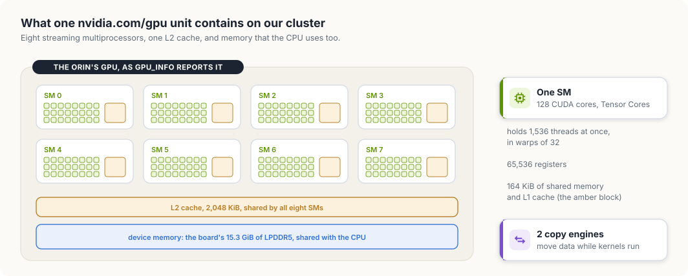
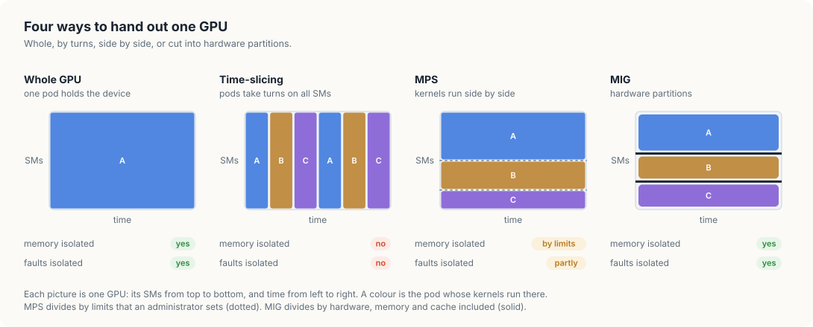

# 2. What one GPU means

The pods in chapter 1 asked for `nvidia.com/gpu: 1` as if a GPU were a single, indivisible
thing. This chapter opens that unit. It describes what a GPU is made of, measures the GPU in
the cluster, and shows what Kubernetes gives a pod when it grants one unit. It then covers
the ways a GPU can be shared or divided: time-slicing, the Multi-Process Service,
Multi-Instance GPU, virtual GPUs, and Dynamic Resource Allocation. Time-slicing is tried on
the cluster and its effect measured.

<div class="covers">

This chapter covers

- streaming multiprocessors, warps, and the levels of GPU memory
- the properties of the GPU in the cluster, read with a CUDA program
- what a pod receives with one `nvidia.com/gpu` unit
- time-slicing, measured with three pods on one GPU
- MPS, MIG, vGPU, and Dynamic Resource Allocation
- which method suits which kind of workload

</div>

## The programs in this chapter

The chapter uses four programs: two run on the GPU and two inspect the cluster.

`gpu_info` and `gpu_load` are CUDA programs in `code/gpu-sharing`. They are compiled on the
host with `nvcc`, the CUDA compiler, for the compute capability of the cluster's GPU, with the
CUDA runtime library linked into each binary. Each binary then needs only the driver library,
`libcuda`, at run time, and that library is one of the files the NVIDIA container runtime
mounts into a GPU container (Appendix A). Both binaries go into one image,
`gpu-sharing:1`, and run in pods that request `nvidia.com/gpu`. When such a pod
starts, the device plugin tells the kubelet to set `NVIDIA_VISIBLE_DEVICES` in the
container, the NVIDIA runtime adds the GPU's device files and `libcuda`, and the CUDA
calls in the programs reach the GPU through them.

- `gpu_info` asks the CUDA runtime for the properties of the GPU it sees and prints them,
  one per line. It shows what one `nvidia.com/gpu` unit contains.
- `gpu_load` launches a compute-heavy kernel ten times, waits for all ten to finish, and
  prints the elapsed time. Several copies running at once show how much GPU time each one
  receives.

`gpuusage` is written in Go (`code/go/gpuusage`) and in Rust (`code/rust/gpuusage`). It is
an ordinary Kubernetes client that runs on a workstation. It lists every node and every
pod through the API server, adds up the `nvidia.com/gpu` units that running pods hold on
each node, and prints them next to the node's capacity. It shows the scheduler's view of
the GPU: how many units exist and who holds them. It runs in a second terminal, from
`code/go` with `go run ./gpuusage` or from `code/rust` with `cargo run -p gpuusage`, while
the pods from `code/gpu-sharing` run.

## What a GPU is made of

A GPU is a large number of simple processors grouped into *streaming multiprocessors*
(SMs). Each SM contains arithmetic units (the CUDA cores for ordinary floating-point and
integer work, and Tensor Cores for matrix multiplication), a large register file,
schedulers, and a block of fast on-chip memory that is used as shared memory and L1
cache. A CUDA program launches a *kernel*, a function that runs on the GPU, as a grid of
thread blocks. The GPU assigns each block to an SM, and the SM runs its threads in groups
of 32, called *warps*. An SM keeps many warps resident at once and switches between them
whenever one waits for memory, which is how a GPU hides memory latency: by having other
work ready, where a CPU would rely on large caches.

Memory is arranged in levels, from fastest and smallest to slowest and largest:

- registers, private to each thread;
- shared memory and L1 cache, one block per SM;
- the L2 cache, shared by all SMs;
- device memory: HBM on data center GPUs, GDDR on graphics cards, and, on integrated
  GPUs such as the Jetson's, the same LPDDR memory that the CPU uses.

Next to the SMs sit fixed-function engines. *Copy engines* move data between host memory
and device memory while kernels run, so transfers and computation can overlap. Video
decoders and encoders (NVDEC and NVENC) and JPEG decoders handle media without using the
SMs.

A *discrete* GPU is a separate card with its own memory, attached over PCIe or a
dedicated interconnect; a program copies data into that memory before a kernel can use
it. An *integrated* GPU sits on the same chip as the CPU and shares the system's memory
with it.

## Measuring the GPU

The CUDA runtime reports most of these properties through `cudaGetDeviceProperties`.
This program prints them, along with the current free and total device memory:

<p class="listing"><b>Listing 2.1</b> Reading the GPU's properties. <a href="https://github.com/arpanpathak/cracking-the-systems-programming-interview/blob/prep-v2/gpu-accelerated-kubernetes/code/gpu-sharing/gpu_info.cu">code/gpu-sharing/gpu_info.cu</a></p>

```cpp
{{#include ../code/gpu-sharing/gpu_info.cu}}
```


The image for this chapter holds `gpu_info` and a second program, `gpu_load`, used
later:

<p class="listing"><b>Listing 2.2</b> The image that holds both CUDA programs. <a href="https://github.com/arpanpathak/cracking-the-systems-programming-interview/blob/prep-v2/gpu-accelerated-kubernetes/code/gpu-sharing/Dockerfile">code/gpu-sharing/Dockerfile</a></p>

```dockerfile
{{#include ../code/gpu-sharing/Dockerfile}}
```


```console
$ cd code/gpu-sharing
$ /usr/local/cuda/bin/nvcc -O2 -arch=sm_87 -cudart static -o gpu_info gpu_info.cu
$ /usr/local/cuda/bin/nvcc -O2 -arch=sm_87 -cudart static -o gpu_load gpu_load.cu
$ docker build -t gpu-sharing:1 .
$ kind load docker-image gpu-sharing:1 --name gpu-lab
```

`gpu_info` runs in a pod that asks for one GPU:

<p class="listing"><b>Listing 2.3</b> A pod that runs `gpu_info` with one GPU. <a href="https://github.com/arpanpathak/cracking-the-systems-programming-interview/blob/prep-v2/gpu-accelerated-kubernetes/code/gpu-sharing/gpu-info-pod.yaml">code/gpu-sharing/gpu-info-pod.yaml</a></p>

```yaml
{{#include ../code/gpu-sharing/gpu-info-pod.yaml}}
```


```console
$ kubectl apply -f gpu-info-pod.yaml
$ kubectl logs gpu-info
device                      Orin
compute capability          8.7
integrated with the CPU     yes
streaming multiprocessors   8
max resident threads/SM     1536
registers per SM            65536
shared memory per SM        164 KiB
L2 cache                    2048 KiB
device memory (total)       15.3 GiB
device memory (free now)    1.8 GiB
copy engines                2
concurrent kernels          yes
managed memory              yes
```

The cluster's GPU has 8 SMs. An Ampere SM of this generation has 128 CUDA cores,
which gives the 1,024 cores in NVIDIA's specification for the Orin NX, and each SM can
hold 1,536 threads at once, 12,288 for the whole GPU. All SMs share a 2 MiB L2 cache, and
two copy engines move data. For comparison, a data center H100 SXM5 has 132 SMs and
80 GB of HBM3 memory.

Figure 2.1 draws those numbers as one picture.

<figure>

<figcaption><b>Figure 2.1</b> The GPU in our cluster, drawn from the output of <code>gpu_info</code>. One <code>nvidia.com/gpu</code> unit is all of it.</figcaption>
</figure>

The memory lines show what "integrated" means in practice. The GPU's device memory is
the board's 15.3 GiB of LPDDR5, the same memory the operating system and every CPU
program use. Only 1.8 GiB was free when the pod ran, because other programs on the board
were using the rest. On a discrete GPU, device memory belongs to the GPU alone; on an
integrated GPU, the amount available to a kernel depends on everything else running on
the machine.

## The same measurement on a Thor

A Jetson AGX Thor developer kit on the same network runs Jetson Linux R39.2.1 with
CUDA 13.2 and has no Kubernetes, so `gpu_info` was compiled on the board and run directly:

```console
$ /usr/local/cuda/bin/nvcc -O2 -cudart static -o gpu_info gpu_info.cu
$ ./gpu_info
device                      NVIDIA Thor
compute capability          11.0
integrated with the CPU     yes
streaming multiprocessors   20
max resident threads/SM     1536
registers per SM            65536
shared memory per SM        228 KiB
L2 cache                    32768 KiB
device memory (total)       122.8 GiB
device memory (free now)    44.8 GiB
copy engines                2
concurrent kernels          yes
managed memory              yes
```

The same source file gives different answers on the two boards:

| | Jetson Orin NX | Jetson AGX Thor |
|---|---|---|
| compute capability | 8.7 | 11.0 |
| streaming multiprocessors | 8 | 20 |
| shared memory per SM | 164 KiB | 228 KiB |
| L2 cache | 2,048 KiB | 32,768 KiB |
| device memory | 15.3 GiB | 122.8 GiB |

Twenty SMs with 128 CUDA cores each give the 2,560 cores in NVIDIA's specification for
the Thor. The L2 cache is sixteen times as large, and the device memory is eight times
as large. It is again the board's own memory: 44.8 GiB were free when the program ran,
because two other programs on the Thor, a model server among them, held 24 GiB and 39 GiB
at the time.

Both boards would advertise the same thing to a Kubernetes scheduler: `nvidia.com/gpu: 1`.
A job that needs 60 GiB of device memory fits on one of them, and the count alone does
not say which. Chapter 5 returns to this with node labels.

## What one unit gives a pod

By default, the device plugin advertises one `nvidia.com/gpu` unit for each physical
GPU, and a pod that is granted a unit receives the whole device: every SM, all of its
memory, and all of its engines. Kubernetes counts extended resources as integers. A pod
cannot ask for half a GPU, and the node never hands out more units than it advertises.

`gpuusage` shows the same accounting that the scheduler does. It sums the GPU limits of
every pod that is bound to a node and has not finished, and compares the sum with the
node's allocatable units. The Go version uses client-go's typed clientset and the Rust version uses kube-rs.

<div class="lld">

Low-level design: `gpuusage`

| Part | Does | Rule it keeps |
|---|---|---|
| counting one pod | adds up the `nvidia.com/gpu` limits of the pod's containers | a pod counts from the moment it is bound to a node until it succeeds or fails |
| the report | lists nodes and pods with one request each, groups the pods that hold GPUs by node, and prints one row per node | in use plus free equals allocatable |

</div>

The first part decides what one pod holds.

<p class="listing"><b>Listing 2.4</b> What one pod holds, in Go. <a href="https://github.com/arpanpathak/cracking-the-systems-programming-interview/blob/prep-v2/gpu-accelerated-kubernetes/code/go/gpuusage/main.go">code/go/gpuusage/main.go</a></p>

```go
{{#include ../code/go/gpuusage/main.go:count}}
```


<p class="listing"><b>Listing 2.5</b> What one pod holds, in Rust. <a href="https://github.com/arpanpathak/cracking-the-systems-programming-interview/blob/prep-v2/gpu-accelerated-kubernetes/code/rust/gpuusage/src/main.rs">code/rust/gpuusage/src/main.rs</a></p>

```rust
{{#include ../code/rust/gpuusage/src/main.rs:count}}
```


The second part asks the API server and prints the table.

<p class="listing"><b>Listing 2.6</b> Listing, grouping, and printing, in Go. <a href="https://github.com/arpanpathak/cracking-the-systems-programming-interview/blob/prep-v2/gpu-accelerated-kubernetes/code/go/gpuusage/main.go">code/go/gpuusage/main.go</a></p>

```go
{{#include ../code/go/gpuusage/main.go:report}}
```


<p class="listing"><b>Listing 2.7</b> Listing, grouping, and printing, in Rust. <a href="https://github.com/arpanpathak/cracking-the-systems-programming-interview/blob/prep-v2/gpu-accelerated-kubernetes/code/rust/gpuusage/src/main.rs">code/rust/gpuusage/src/main.rs</a></p>

```rust
{{#include ../code/rust/gpuusage/src/main.rs:report}}
```


Both programs list the nodes and the pods with one request each, keep the pods that hold
GPU units, and group them by node. A pod counts from the moment the scheduler binds it to
a node until it succeeds or fails; a finished pod has released its units even though the
object still exists. With no GPU pods running, both print the same report:

```console
$ go run ./gpuusage
NODE                   CAPACITY  ALLOCATABLE  IN USE  FREE
gpu-lab-control-plane  1         1            0       1
$ cargo run -p gpuusage
NODE                   CAPACITY  ALLOCATABLE  IN USE  FREE
gpu-lab-control-plane  1         1            0       1
```

Whole-GPU allocation gives each pod exclusive use of its GPU, and it is coarse. An
inference service that keeps 5 percent of the SMs busy still holds the entire GPU, and
the other 95 percent sits idle while other pods wait. The rest of this chapter covers the
ways to share or divide a GPU, each with a different trade-off between isolation and
flexibility.

## Sharing by taking turns: time-slicing

Without further configuration, a GPU runs work from one process's CUDA context at a time.
When several processes use the same GPU, the driver switches between their contexts,
giving each a slice of time on all the SMs. *Time-slicing* in Kubernetes uses exactly
this: the device plugin advertises each GPU as several units, called replicas, and every
pod that receives a replica of the same GPU gets the same device.

NVIDIA's GPU Operator documentation is direct about the cost: "Unlike Multi-Instance GPU
(MIG), there is no memory or fault-isolation between replicas." Every pod sees all of
the GPU's memory, one pod can allocate so much that the others fail, and, in the words of
the device plugin's README, workloads run "in the same fault-domain as of all the others
(meaning if one workload crashes, they all do)".

`gpu_load` measures the effect. It launches a kernel ten times, each launch keeping
1,024 blocks of 256 threads busy with 200,000 multiply-adds per thread, and prints how
long the work took:

<p class="listing"><b>Listing 2.8</b> The sizes, and the kernel that keeps one thread busy. <a href="https://github.com/arpanpathak/cracking-the-systems-programming-interview/blob/prep-v2/gpu-accelerated-kubernetes/code/gpu-sharing/gpu_load.cu">code/gpu-sharing/gpu_load.cu</a></p>

```cpp
{{#include ../code/gpu-sharing/gpu_load.cu:kernel}}
```


<p class="listing"><b>Listing 2.9</b> Launching the kernel ten times and timing it. <a href="https://github.com/arpanpathak/cracking-the-systems-programming-interview/blob/prep-v2/gpu-accelerated-kubernetes/code/gpu-sharing/gpu_load.cu">code/gpu-sharing/gpu_load.cu</a></p>

```cpp
{{#include ../code/gpu-sharing/gpu_load.cu:main}}
```


A Job runs four copies of it at once, each asking for one `nvidia.com/gpu`:

<p class="listing"><b>Listing 2.10</b> A Job that runs four copies of `gpu_load`. <a href="https://github.com/arpanpathak/cracking-the-systems-programming-interview/blob/prep-v2/gpu-accelerated-kubernetes/code/gpu-sharing/gpu-load-job.yaml">code/gpu-sharing/gpu-load-job.yaml</a></p>

```yaml
{{#include ../code/gpu-sharing/gpu-load-job.yaml}}
```


With the device plugin as configured in Appendix A, the node advertises one unit. Three
of the four pods wait in Pending while the first runs:

```console
$ kubectl apply -f gpu-load-job.yaml
$ kubectl get pods -l job-name=gpu-load
gpu-load-5wf4d Completed
gpu-load-mbw4m Pending
gpu-load-w46sf Pending
gpu-load-w9h7x ContainerCreating
$ go run ./gpuusage
NODE                   CAPACITY  ALLOCATABLE  IN USE  FREE
gpu-lab-control-plane  1         1            1       0
  default/gpu-load-w9h7x holds 1 on gpu-lab-control-plane
```

`gpuusage` shows the reason: the node's one unit is held by the running pod, so the
scheduler has nowhere to place the others. Each pod prints its start time and its result.
They ran one after another, about three seconds apart, and each needed about 620
milliseconds of GPU time:

```console
23:29:59.987 gpu-load-5wf4d: no error, 612 ms
23:30:03.466 gpu-load-w9h7x: no error, 622 ms
23:30:06.487 gpu-load-w46sf: no error, 616 ms
23:30:09.495 gpu-load-mbw4m: no error, 634 ms
```

Time-slicing is switched on through the device plugin's configuration file. This
ConfigMap advertises each GPU as four replicas:

<p class="listing"><b>Listing 2.11</b> The time-slicing configuration. <a href="https://github.com/arpanpathak/cracking-the-systems-programming-interview/blob/prep-v2/gpu-accelerated-kubernetes/code/gpu-sharing/time-slicing-config.yaml">code/gpu-sharing/time-slicing-config.yaml</a></p>

```yaml
{{#include ../code/gpu-sharing/time-slicing-config.yaml}}
```


The plugin reads the file named by its `CONFIG_FILE` setting. This manifest is the
plugin from Appendix A with the ConfigMap mounted and `CONFIG_FILE` set:

<p class="listing"><b>Listing 2.12</b> The device plugin, reading that configuration. <a href="https://github.com/arpanpathak/cracking-the-systems-programming-interview/blob/prep-v2/gpu-accelerated-kubernetes/code/gpu-sharing/device-plugin-time-sliced.yaml">code/gpu-sharing/device-plugin-time-sliced.yaml</a></p>

```yaml
{{#include ../code/gpu-sharing/device-plugin-time-sliced.yaml}}
```


```console
$ kubectl apply -f time-slicing-config.yaml -f device-plugin-time-sliced.yaml
$ kubectl get node -o jsonpath='{.items[0].status.allocatable.nvidia\.com/gpu}'; echo
4
```

The same GPU now counts as four units. Running the same Job again, all four pods start
at once:

```console
$ kubectl delete job gpu-load
$ kubectl apply -f gpu-load-job.yaml
$ kubectl get pods -l job-name=gpu-load
gpu-load-dk7h8 Running
gpu-load-grrkx Running
gpu-load-s4lb2 Running
gpu-load-t28sd Running
$ cargo run -p gpuusage
NODE                   CAPACITY  ALLOCATABLE  IN USE  FREE
gpu-lab-control-plane  4         4            4       0
  default/gpu-load-dk7h8 holds 1 on gpu-lab-control-plane
  default/gpu-load-grrkx holds 1 on gpu-lab-control-plane
  default/gpu-load-s4lb2 holds 1 on gpu-lab-control-plane
  default/gpu-load-t28sd holds 1 on gpu-lab-control-plane
```

```console
23:30:25.915 gpu-load-dk7h8: no error, 2198 ms
23:30:25.996 gpu-load-s4lb2: no error, 2231 ms
23:30:26.048 gpu-load-grrkx: no error, 2249 ms
23:30:26.052 gpu-load-t28sd: no error, 2260 ms
```

Each pod now took about 2,230 milliseconds for the same work, roughly 3.6 times as long
as it took alone. The four pods took turns on the same 8 SMs. Time-slicing added no
compute. It changed how many pods can hold the GPU at once and how long each one waits.
Together, the four runs occupied the GPU for about 2.3 seconds, close to the
4 × 620 = 2,480 milliseconds they needed one after another.

The Thor shows the same behaviour with different numbers. There `gpu_load` ran directly
on the host, first alone and then as three processes started together:

```console
$ ./gpu_load thor-alone
thor-alone: no error, 160 ms
$ ./gpu_load copy-1 & ./gpu_load copy-2 & ./gpu_load copy-3 & wait
copy-3: no error, 467 ms
copy-2: no error, 477 ms
copy-1: no error, 479 ms
```

Alone, the work that takes the Orin NX about 620 milliseconds takes the Thor 160. Three
runs gave 190, 160, and 159 milliseconds, the first including the start-up of the CUDA
context. With three processes on the GPU at once, each took about 475 milliseconds,
which is three times 160. No device plugin was involved here. The driver switched between
the three processes' CUDA contexts by itself. Time-slicing in Kubernetes relies on that
switching and adds the extra units that the scheduler counts.

The scheduler now believes the node has four GPUs. A pod that asks for two replicas gets
two units of the same GPU and no more of its time; the plugin's `failRequestsGreaterThanOne`
option rejects such requests to make that explicit. Applying the original plugin manifest
again switches time-slicing off:

```console
$ kubectl apply -f ../jetson-gpu/device-plugin.yaml
$ go run ./gpuusage
NODE                   CAPACITY  ALLOCATABLE  IN USE  FREE
gpu-lab-control-plane  1         1            0       1
```

## Running kernels side by side: MPS

Time-slicing runs one process's kernels at a time. NVIDIA's MPS documentation states the
underlying rule: without MPS, work "from work queues belonging to different CUDA
contexts cannot execute concurrently". A process whose kernels fill only a few SMs leaves
the rest idle during its slice.

The *Multi-Process Service* (MPS) removes that restriction. An MPS server becomes "the
clients' shared connection to the GPU and owner of the GPU scheduling resources", and
kernels from different processes then run on the GPU at the same time. MPS also lets an
administrator limit each client: `CUDA_MPS_ACTIVE_THREAD_PERCENTAGE` caps the share of the
GPU's threads a client may use, and `CUDA_MPS_PINNED_DEVICE_MEM_LIMIT` caps the memory it
may allocate. Each client has its own GPU address space, but error containment is
limited: a fatal fault is reported to all clients on the affected GPU, "without
indicating which client generated the error".

The device plugin can hand out MPS shares in the same way as time-slicing replicas, each
with an equal fraction of the GPU's memory and compute. Its README marks this support as
experimental and limits it to whole GPUs without MIG. MPS runs on Tegra devices such as
the Orin with restrictions, so this chapter does not use it.

## Dividing the hardware: Multi-Instance GPU

Time-slicing and MPS share one GPU in software. *Multi-Instance GPU* (MIG) divides it in
hardware. According to NVIDIA's MIG user guide, a GPU can be "securely partitioned into
up to seven separate GPU Instances", and within each instance "the on-chip crossbar
ports, L2 cache banks, memory controllers, and DRAM address busses are all assigned
uniquely to an individual instance". SMs, copy engines, and decoders are divided as
well. An instance therefore keeps its cache and memory bandwidth "even if other tasks
are thrashing their own caches or saturating their DRAM interfaces", and a fault in one
instance does not affect the others.

Instances come in fixed sizes, called profiles. A profile name gives the number of
compute slices and the memory. The profiles of an H100 with 80 GB, from the MIG user
guide:

```text
profile      memory   SMs    copy engines   instances per GPU
-----------  -------  -----  -------------  -----------------
1g.10gb      1/8      1/7    1              7
1g.20gb      1/4      1/7    1              4
2g.20gb      2/8      2/7    2              3
3g.40gb      4/8      3/7    3              2
4g.40gb      4/8      4/7    4              1
7g.80gb      full     7/7    8              1
```

The device plugin exposes MIG instances according to its `MIG_STRATEGY` setting: with
the `single` strategy every instance is advertised as `nvidia.com/gpu`, and with the
`mixed` strategy each profile gets its own resource name, such as `nvidia.com/mig-1g.10gb`.
A pod then asks for a slice of known size and gets guaranteed memory and bandwidth.

MIG requires a supporting GPU: the A100, H100, H200, and B200 families support seven
instances, and smaller models support fewer. The cluster's Orin does not support
MIG.

## Virtual GPUs for virtual machines: vGPU

Everything so far shares a GPU between containers on the same operating system. NVIDIA's
vGPU software shares a GPU between virtual machines: it "enables multiple virtual
machines (VMs) to have simultaneous, direct access to a single physical GPU". A vGPU is
either time-sliced, in which case the GPU "performs the work for each VM serially" under a
scheduler that can give each VM a fixed or equal share, or backed by a MIG instance, in
which case VMs run in parallel with MIG's isolation. Clusters that run virtual machines
on Kubernetes can use vGPUs to give each VM its own GPU device.

## Asking for GPUs by their properties: Dynamic Resource Allocation

The device plugin model reduces every GPU to an integer count of an opaque name. A pod
cannot ask for "a GPU with at least 40 GB of memory", and two containers cannot
explicitly share one GPU. *Dynamic Resource Allocation* (DRA), generally available since
Kubernetes 1.34, replaces the count with structured requests:

- a driver publishes the devices on each node, with their attributes such as model and
  memory size, as *ResourceSlice* objects;
- a *DeviceClass* groups devices of one kind, for example all NVIDIA GPUs;
- a pod refers to a *ResourceClaim*, which requests devices from a class and can filter
  them with expressions over their attributes; several pods can refer to the same claim
  to share its devices.

The scheduler then allocates concrete devices that satisfy each claim. The cluster
already serves these APIs:

```console
$ kubectl api-resources --api-group=resource.k8s.io
NAME                     SHORTNAMES   APIVERSION           NAMESPACED   KIND
deviceclasses                         resource.k8s.io/v1   false        DeviceClass
devicetaintrules                      resource.k8s.io/v1   false        DeviceTaintRule
resourceclaims                        resource.k8s.io/v1   true         ResourceClaim
resourceclaimtemplates                resource.k8s.io/v1   true         ResourceClaimTemplate
resourceslices                        resource.k8s.io/v1   false        ResourceSlice
```

A driver has to publish the devices, and NVIDIA's DRA driver describes its GPU support
as not yet official: "While some GPU allocation features can be tried out, they are not
yet officially supported." The cluster therefore stays with the device plugin.

## Choosing a method


Figure 2.2 draws the four ways of handing out a GPU to containers as pictures of one GPU over
time, and the table after it adds vGPU.

<figure>

<figcaption><b>Figure 2.2</b> One GPU handed out whole, by turns, side by side, and in hardware partitions.</figcaption>
</figure>

```text
method          what a pod gets                 memory isolated   faults isolated
--------------  ------------------------------  ----------------  ---------------
whole GPU       the entire device               yes               yes
time-slicing    turns on the entire device      no                no
MPS             a share of threads and memory   by limits         partly
MIG             a hardware partition            yes               yes
vGPU            a device inside a VM            yes               yes
```

Whole GPUs suit training jobs that keep a GPU busy. Time-slicing suits development and
light, trusted workloads that tolerate each other. MPS suits many small inference
processes that each use part of the SMs. MIG suits multi-tenant clusters that need
guaranteed memory and bandwidth for each tenant. vGPU suits workloads that must run in
virtual machines.

## The complete programs

<p class="listing"><b>Listing 2.13</b> `gpu_load`, complete. <a href="https://github.com/arpanpathak/cracking-the-systems-programming-interview/blob/prep-v2/gpu-accelerated-kubernetes/code/gpu-sharing/gpu_load.cu">code/gpu-sharing/gpu_load.cu</a></p>

```cpp
{{#include ../code/gpu-sharing/gpu_load.cu}}
```


<p class="listing"><b>Listing 2.14</b> `gpuusage`, complete, in Go. <a href="https://github.com/arpanpathak/cracking-the-systems-programming-interview/blob/prep-v2/gpu-accelerated-kubernetes/code/go/gpuusage/main.go">code/go/gpuusage/main.go</a></p>

```go
{{#include ../code/go/gpuusage/main.go}}
```


<p class="listing"><b>Listing 2.15</b> `gpuusage`, complete, in Rust. <a href="https://github.com/arpanpathak/cracking-the-systems-programming-interview/blob/prep-v2/gpu-accelerated-kubernetes/code/rust/gpuusage/src/main.rs">code/rust/gpuusage/src/main.rs</a></p>

```rust
{{#include ../code/rust/gpuusage/src/main.rs}}
```


## References

- NVIDIA Multi-Instance GPU user guide:
  <https://docs.nvidia.com/datacenter/tesla/mig-user-guide/index.html>
- NVIDIA GPU Operator, time-slicing GPUs in Kubernetes:
  <https://docs.nvidia.com/datacenter/cloud-native/gpu-operator/latest/gpu-sharing.html>
- NVIDIA device plugin for Kubernetes, "Shared Access to GPUs":
  <https://github.com/NVIDIA/k8s-device-plugin>
- NVIDIA Multi-Process Service documentation: <https://docs.nvidia.com/deploy/mps/index.html>
- NVIDIA vGPU software user guide:
  <https://docs.nvidia.com/vgpu/latest/grid-vgpu-user-guide/index.html>
- Kubernetes, Dynamic Resource Allocation:
  <https://kubernetes.io/docs/concepts/resource-management/dynamic-resource-allocation/>
- Kubernetes v1.34: DRA has graduated to GA:
  <https://kubernetes.io/blog/2025/09/01/kubernetes-v1-34-dra-updates/>
- DRA Driver for NVIDIA GPUs: <https://github.com/NVIDIA/k8s-dra-driver-gpu>
- NVIDIA Jetson Orin technical specifications:
  <https://www.nvidia.com/en-us/autonomous-machines/embedded-systems/jetson-orin/>
