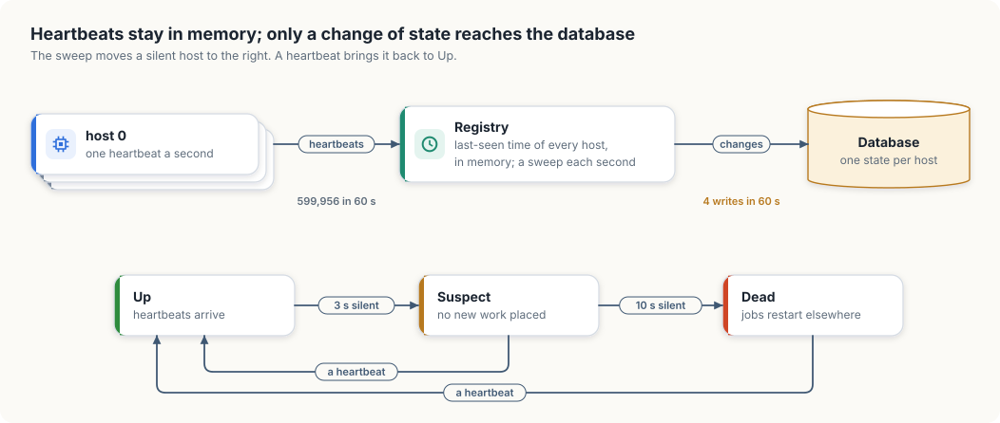
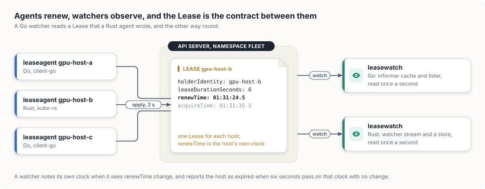

# 3. Knowing which machines are alive

A training job can run on a machine for hours or days. If that machine loses power, or its
network cable is pulled, the job stops, and nothing on the machine can report the failure.
The control plane has to notice on its own, so that it can restart the job somewhere else.

In this chapter, we will learn how a control plane decides which machines are alive. We
will first build intuition by reasoning about heartbeats and timeouts, and quickly
prototype a liveness registry and a failure detector from scratch. Then we will use the
Lease objects that Kubernetes itself uses to track its nodes: we will write an agent that
renews a Lease for a host and a watcher that notices when the renewals stop, and run both
on our cluster.

As before, every program is written in Go and in Rust. The two models, `heartbeats` and
`phi`, use only the standard library. The two Kubernetes programs, `leaseagent` and
`leasewatch`, use client-go and kube-rs. The Go programs are in `code/go`, and we run them
with `go run ./<name>`; the Rust programs are packages in the workspace in `code/rust`, and
we run them with `cargo run -p <name>`.

<div class="covers">

This chapter covers

- heartbeats, timeouts, and the three causes of silence
- a registry that handles 600,000 heartbeats with four database writes
- the phi accrual detector, which sets a timeout from each host's own history
- Lease objects, and how Kubernetes uses them to track its nodes
- a lease agent and a lease watcher, each in Go and in Rust, on a real cluster
- measuring silence on one clock

</div>

## Heartbeats and timeouts

A machine that has crashed cannot announce that it has crashed. The only evidence the
control plane gets is silence. So each machine runs a small agent that sends a message, a
*heartbeat*, at a fixed interval, and the control plane treats a long enough silence as a
failure.

The difficulty is that silence has more than one cause. The machine may be dead, or it may
be alive but overloaded, or the network between it and the control plane may be broken
while the machine keeps running its job. From the control plane's side, the three look the
same. Every failure detector therefore makes a bet on how long a silence has to last before
it is more likely to mean death than delay, and the bet has a cost in both directions. A
short timeout declares healthy machines dead, and their jobs are restarted for nothing,
sometimes while the original copy is still running. A long timeout leaves the jobs of truly
dead machines stopped for longer.

## Keeping heartbeats out of the database

The control plane has to remember the last heartbeat of every machine. The obvious place
for that is its database, and the obvious design writes every heartbeat there. A fleet of
10,000 hosts sending one heartbeat a second would then make 10,000 writes a second. In a
replicated store such as etcd, every write is sent to a majority of the replicas and
flushed to disk before it is acknowledged, and a steady stream of 10,000 writes a second
would leave little capacity for the writes that matter, such as creating jobs.

Most heartbeats carry no news: they say that a host that was alive is still alive. The
registry can keep the time of each host's last heartbeat in memory and write to the
database only when a host changes state. Our model uses three states. A host is *Up* while
heartbeats arrive. It becomes *Suspect* after 3 seconds of silence, which lets the control
plane stop placing new work on it without yet giving up on the work it has. It becomes
*Dead* after 10 seconds, at which point its jobs would be restarted elsewhere.

The model simulates 10,000 hosts for 60 seconds, without real time passing. Host 42
crashes at second 20, and host 7 misses four heartbeats, from second 30 to second 33.

<div class="lld">

Low-level design: `heartbeats`

| Type | Holds | Rule it keeps |
|---|---|---|
| `State` | Up, Suspect, or Dead | decided by the length of a host's silence |
| `entry` | a host's last-seen second and its state | lives in memory only |
| `Transition` | the second, the host, and the state it entered | one per durable write |
| `Registry` | an entry per host, a count of heartbeats, the list of writes | a write happens only when a state changes |

| Operation | Does |
|---|---|
| `Heartbeat(now, host)` | updates the last-seen second; writes only if the host was not Up |
| `Sweep(now)` | recomputes every host's state from its silence; writes the ones that changed |

</div>

The types come first. A host's record is two fields, and a `Transition` is the only thing
the registry writes to the database.

<p class="listing"><b>Listing 3.1</b> The states, the thresholds, and the registry's records, in Go. <a href="https://github.com/arpanpathak/cracking-the-systems-programming-interview/blob/prep-v2/gpu-accelerated-kubernetes/code/go/heartbeats/main.go">code/go/heartbeats/main.go</a></p>

```go
{{#include ../code/go/heartbeats/main.go:types}}
```

<p class="listing"><b>Listing 3.2</b> The states, the thresholds, and the registry's records, in Rust. <a href="https://github.com/arpanpathak/cracking-the-systems-programming-interview/blob/prep-v2/gpu-accelerated-kubernetes/code/rust/heartbeats/src/main.rs">code/rust/heartbeats/src/main.rs</a></p>

```rust
{{#include ../code/rust/heartbeats/src/main.rs:types}}
```


The registry has one operation for an arriving heartbeat and one for the sweep, and a small
function that turns a length of silence into a state.

<p class="listing"><b>Listing 3.3</b> A heartbeat, the sweep, and the rule from silence to state, in Go. <a href="https://github.com/arpanpathak/cracking-the-systems-programming-interview/blob/prep-v2/gpu-accelerated-kubernetes/code/go/heartbeats/main.go">code/go/heartbeats/main.go</a></p>

```go
{{#include ../code/go/heartbeats/main.go:registry}}
```

<p class="listing"><b>Listing 3.4</b> A heartbeat, the sweep, and the rule from silence to state, in Rust. <a href="https://github.com/arpanpathak/cracking-the-systems-programming-interview/blob/prep-v2/gpu-accelerated-kubernetes/code/rust/heartbeats/src/main.rs">code/rust/heartbeats/src/main.rs</a></p>

```rust
{{#include ../code/rust/heartbeats/src/main.rs:registry}}
```


The run feeds the registry one heartbeat from every host each second, except from the two
hosts that the scenario silences.

<p class="listing"><b>Listing 3.5</b> The simulated fleet and the main loop, in Go. <a href="https://github.com/arpanpathak/cracking-the-systems-programming-interview/blob/prep-v2/gpu-accelerated-kubernetes/code/go/heartbeats/main.go">code/go/heartbeats/main.go</a></p>

```go
{{#include ../code/go/heartbeats/main.go:main}}
```

<p class="listing"><b>Listing 3.6</b> The simulated fleet and the main loop, in Rust. <a href="https://github.com/arpanpathak/cracking-the-systems-programming-interview/blob/prep-v2/gpu-accelerated-kubernetes/code/rust/heartbeats/src/main.rs">code/rust/heartbeats/src/main.rs</a></p>

```rust
{{#include ../code/rust/heartbeats/src/main.rs:main}}
```


`Heartbeat` updates the host's last-seen time in memory and writes to the database only
when the host was not Up. `Sweep` runs once a second, computes each host's state from the
length of its silence, and writes only the hosts whose state changed. A heartbeat from a
Suspect or Dead host brings it back at once; the sweep is what moves hosts the other way.

Both versions print the same result:

```console
$ go run ./heartbeats
heartbeats handled in memory: 599956
durable writes:               4
  second 22  host 42 -> Suspect
  second 29  host 42 -> Dead
  second 32  host  7 -> Suspect
  second 34  host  7 -> Up
```

The registry handled almost 600,000 heartbeats and made four writes. Host 42 sent its last
heartbeat at second 19; it became Suspect at second 22 and Dead at second 29. Host 7 became
Suspect at second 32, three seconds after its last heartbeat at second 29, and came back Up
with its heartbeat at second 34, before it reached the Dead threshold.

Figure 3.1 shows the two paths, and the three states with the silences that separate them.

<figure>

<figcaption><b>Figure 3.1</b> Every heartbeat updates memory. The database receives a write when a host changes state.</figcaption>
</figure>

Keeping the state in memory has one consequence. When the registry itself restarts, it
has lost every host's last-seen time. Our model starts by marking every host Up with a
last-seen time of 0, which gives each host a full timeout to report in before anything is
declared dead. A real registry has to do the same after a restart, or it would declare
the whole fleet dead at once.

## Choosing the timeout: the phi accrual detector

A fixed timeout treats every host alike. Hosts are not alike: one on a quiet network sends
heartbeats exactly a second apart, and another on a congested link sends them anywhere from
half a second to two and a half seconds apart. Two seconds of silence is alarming for the
first host and ordinary for the second.

The *phi accrual failure detector*, described by Hayashibara, Défago, Yared, and Katayama
in 2004 and used today in Apache Cassandra and Akka, makes the timeout depend on each
host's history. It keeps the most recent gaps between a host's heartbeats, treats them as
samples of a normal distribution, and computes the probability that a heartbeat would still
arrive after the current silence. It reports that probability as *phi*, minus its base-10
logarithm, so that each unit of phi is a factor of ten: phi 1 means a 10 percent chance
that the host is fine, phi 2 means 1 percent, phi 3 means 0.1 percent. The control plane
picks a phi threshold instead of a timeout, and each host's effective timeout follows from
its own behaviour.

<div class="lld">

Low-level design: `phi`

| Type | Holds | Rule it keeps |
|---|---|---|
| `Detector` | the most recent gaps between one host's heartbeats, and the time of the last one | keeps at most a fixed number of gaps, the newest |

| Operation | Does |
|---|---|
| `Heartbeat(now)` | records the gap since the previous heartbeat |
| `Phi(now)` | how unlikely the current silence is, given the recorded gaps |

</div>

A detector belongs to one host. It remembers a window of gaps and the time of the latest
heartbeat.

<p class="listing"><b>Listing 3.7</b> The detector and the recording of a heartbeat, in Go. <a href="https://github.com/arpanpathak/cracking-the-systems-programming-interview/blob/prep-v2/gpu-accelerated-kubernetes/code/go/phi/main.go">code/go/phi/main.go</a></p>

```go
{{#include ../code/go/phi/main.go:detector}}
```

<p class="listing"><b>Listing 3.8</b> The detector and the recording of a heartbeat, in Rust. <a href="https://github.com/arpanpathak/cracking-the-systems-programming-interview/blob/prep-v2/gpu-accelerated-kubernetes/code/rust/phi/src/main.rs">code/rust/phi/src/main.rs</a></p>

```rust
{{#include ../code/rust/phi/src/main.rs:detector}}
```


`Phi` turns the window into a number.

<p class="listing"><b>Listing 3.9</b> Computing phi from the recorded gaps, in Go. <a href="https://github.com/arpanpathak/cracking-the-systems-programming-interview/blob/prep-v2/gpu-accelerated-kubernetes/code/go/phi/main.go">code/go/phi/main.go</a></p>

```go
{{#include ../code/go/phi/main.go:phi}}
```

<p class="listing"><b>Listing 3.10</b> Computing phi from the recorded gaps, in Rust. <a href="https://github.com/arpanpathak/cracking-the-systems-programming-interview/blob/prep-v2/gpu-accelerated-kubernetes/code/rust/phi/src/main.rs">code/rust/phi/src/main.rs</a></p>

```rust
{{#include ../code/rust/phi/src/main.rs:phi}}
```


The run trains one detector on a steady host and one on a jittery host, then asks each for
phi after silences of increasing length.

<p class="listing"><b>Listing 3.11</b> Two hosts and the table of results, in Go. <a href="https://github.com/arpanpathak/cracking-the-systems-programming-interview/blob/prep-v2/gpu-accelerated-kubernetes/code/go/phi/main.go">code/go/phi/main.go</a></p>

```go
{{#include ../code/go/phi/main.go:main}}
```

<p class="listing"><b>Listing 3.12</b> Two hosts and the table of results, in Rust. <a href="https://github.com/arpanpathak/cracking-the-systems-programming-interview/blob/prep-v2/gpu-accelerated-kubernetes/code/rust/phi/src/main.rs">code/rust/phi/src/main.rs</a></p>

```rust
{{#include ../code/rust/phi/src/main.rs:main}}
```


`Phi` computes the mean and standard deviation of the remembered gaps and measures how many
standard deviations the current silence lies beyond the mean. The logistic expression is a
standard approximation of the normal distribution's tail, the same one Akka uses, and it
avoids computing the error function. The standard deviation has a floor of 0.2 seconds.
Without it, a host whose heartbeats were perfectly regular would have a standard deviation
near zero, and the smallest delay would push phi towards infinity.

Both versions print the same table:

```console
$ go run ./phi
steady host, silent for:
  1.0s  phi =   0.30   2s timeout says alive
  1.5s  phi =   2.22   2s timeout says alive
  2.0s  phi =   7.30   2s timeout says alive
  2.5s  phi =  18.13   2s timeout says dead
  3.0s  phi =  37.58   2s timeout says dead
  4.0s  phi = 113.84   2s timeout says dead
jittery host, silent for:
  1.0s  phi =   0.21   2s timeout says alive
  1.5s  phi =   0.47   2s timeout says alive
  2.0s  phi =   0.88   2s timeout says alive
  2.5s  phi =   1.47   2s timeout says dead
  3.0s  phi =   2.25   2s timeout says dead
  4.0s  phi =   4.58   2s timeout says dead
```

For the steady host, two seconds of silence already gives phi 7.3: a heartbeat that late is
roughly a one-in-twenty-million event, and the host is almost certainly gone, while the
2-second timeout still calls it alive. For the jittery host, two and a half seconds gives
phi 1.47, about a 3 percent chance that the host is fine, and the timeout has already
declared it dead. With a threshold of 3, the detector would give up on the steady host
after about 1.6 seconds and on the jittery host only after about 3.4 seconds.

## Leases: how Kubernetes tracks its nodes

Kubernetes applies the same ideas to its own nodes. Every node has a *Lease*, a small
object in the `coordination.k8s.io` API group, in the namespace `kube-node-lease`. The
kubelet renews its node's Lease every 10 seconds by writing the current time into the
Lease's `renewTime` field. Our cluster has one node and one node Lease:

```console
$ kubectl get lease -n kube-node-lease
NAME                    HOLDER                  AGE
gpu-lab-control-plane   gpu-lab-control-plane   4d11h
$ kubectl get lease -n kube-node-lease gpu-lab-control-plane -o yaml
...
spec:
  holderIdentity: gpu-lab-control-plane
  leaseDurationSeconds: 40
  renewTime: "2026-10-01T01:31:36.294522Z"
```

A Lease has five main fields. `holderIdentity` names whoever holds it, here the node
itself. `leaseDurationSeconds` says how long the Lease stays valid after its last renewal.
`renewTime` is the time of the last renewal, `acquireTime` the time the holder first took
the Lease, and `leaseTransitions` counts how often the Lease has changed hands. Kubernetes
also uses Leases for leader election, so that only one copy of the controller manager or
the scheduler is active at a time, and for each API server to publish its identity.

The kubelet used to send its heartbeats by updating the Node object's status, which holds
the node's capacity, conditions, images, and addresses. The Kubernetes documentation
explains the change: "a Lease is a lightweight resource. Using Leases for heartbeats reduces
the performance impact of these updates". The kubelet still updates the Node's status, but
only when something changes or every five minutes.

On the other side, the *node lifecycle controller*, part of the controller manager, checks
every node every 5 seconds. If it has seen no renewal for longer than its grace period,
50 seconds by default, it sets the node's `Ready` condition to `Unknown`. By default, the
pods on that node are evicted 5 minutes later, so that their controllers can recreate them
elsewhere. The long wait before eviction reflects the cost of a wrong guess: a node that
only lost contact with the control plane may still be running its pods.

## A lease agent

We will give each simulated GPU host a Lease of its own, in a namespace called `fleet`:

<p class="listing"><b>Listing 3.13</b> The namespace for the fleet's Leases. <a href="https://github.com/arpanpathak/cracking-the-systems-programming-interview/blob/prep-v2/gpu-accelerated-kubernetes/code/manifests/fleet-namespace.yaml">code/manifests/fleet-namespace.yaml</a></p>

```yaml
{{#include ../code/manifests/fleet-namespace.yaml}}
```


The agent plays the part of the kubelet. It writes the Lease named after its host every two
seconds, with a lease duration of six seconds, so a host has to miss three renewals in a
row before its Lease expires.

<div class="lld">

Low-level design: `leaseagent`

| Setting | Value | Reason |
|---|---|---|
| namespace | `fleet` | one namespace for every host's Lease |
| renewal interval | 2 seconds | a third of the lease duration |
| lease duration | 6 seconds | a host has to miss three renewals to expire |
| field manager | `leaseagent` | the name under which server-side apply records the agent's fields |

| Step of the loop | Does |
|---|---|
| build the Lease | holder, duration, the time first acquired, and the current time as `renewTime` |
| apply it | one request that creates the Lease or updates it |
| wait | for the next tick, or for the signal that ends the program |

</div>

The settings are constants.

<p class="listing"><b>Listing 3.14</b> The agent's settings, in Go. <a href="https://github.com/arpanpathak/cracking-the-systems-programming-interview/blob/prep-v2/gpu-accelerated-kubernetes/code/go/leaseagent/main.go">code/go/leaseagent/main.go</a></p>

```go
{{#include ../code/go/leaseagent/main.go:settings}}
```


<p class="listing"><b>Listing 3.15</b> The agent's settings, in Rust. <a href="https://github.com/arpanpathak/cracking-the-systems-programming-interview/blob/prep-v2/gpu-accelerated-kubernetes/code/rust/leaseagent/src/main.rs">code/rust/leaseagent/src/main.rs</a></p>

```rust
{{#include ../code/rust/leaseagent/src/main.rs:settings}}
```


The Go version builds the Lease inside its loop with client-go's apply configuration
types. The Rust version builds it in a function of its own.

<p class="listing"><b>Listing 3.16</b> The renewal loop, in Go. <a href="https://github.com/arpanpathak/cracking-the-systems-programming-interview/blob/prep-v2/gpu-accelerated-kubernetes/code/go/leaseagent/main.go">code/go/leaseagent/main.go</a></p>

```go
{{#include ../code/go/leaseagent/main.go:renew}}
```


<p class="listing"><b>Listing 3.17</b> Building the Lease, in Rust. <a href="https://github.com/arpanpathak/cracking-the-systems-programming-interview/blob/prep-v2/gpu-accelerated-kubernetes/code/rust/leaseagent/src/main.rs">code/rust/leaseagent/src/main.rs</a></p>

```rust
{{#include ../code/rust/leaseagent/src/main.rs:lease}}
```


<p class="listing"><b>Listing 3.18</b> The renewal loop, in Rust. <a href="https://github.com/arpanpathak/cracking-the-systems-programming-interview/blob/prep-v2/gpu-accelerated-kubernetes/code/rust/leaseagent/src/main.rs">code/rust/leaseagent/src/main.rs</a></p>

```rust
{{#include ../code/rust/leaseagent/src/main.rs:renew}}
```


Both agents write with server-side apply, which we met in section 1.1: each renewal sends
the whole Lease, and the API server creates it on the first renewal and updates it on the
others. A failed renewal, for example while the API server restarts, is logged and retried
at the next tick; the Lease simply ages until a renewal succeeds. The renewal time is
written in UTC, as every Kubernetes timestamp is, and it comes from the host's own clock.

## A lease watcher

The watcher plays the part of the node lifecycle controller. It has to decide when a Lease
has expired, and the obvious rule, "expired when `renewTime` plus the lease duration is in
the past", has a flaw: `renewTime` was written with the host's clock and is compared with
the watcher's clock. If the two clocks disagree by a few seconds, healthy hosts look
expired, or dead hosts look alive for longer than they should.

The node lifecycle controller avoids this by never comparing the two clocks. A comment in
its source explains that it records its own time of observation "to avoid the problem with
time skew across the cluster": whenever it sees a Lease's `renewTime` change, it notes its
own current time, and it declares the node unhealthy when its own clock shows that the
grace period has passed since that note. The value of `renewTime` matters only in that it
changed. Our watcher works the same way.

<div class="lld">

Low-level design: `leasewatch`

| Type | Holds | Rule it keeps |
|---|---|---|
| `observation` | the latest `renewTime` seen, the watcher's own time when it first saw that value, and whether the host has been reported as expired | the watcher's time is compared only with the watcher's time |

| Operation | Does |
|---|---|
| `run` | keeps a local cache of the Leases up to date and checks every cached Lease once a second |
| `check(seen, lease, now)` | records a first sighting, a changed `renewTime`, or an expiry |

</div>

An observation is three fields, and the second is the one that matters: the local time at
which the watcher first saw the current `renewTime`.

<p class="listing"><b>Listing 3.19</b> What the watcher remembers about one Lease, in Go. <a href="https://github.com/arpanpathak/cracking-the-systems-programming-interview/blob/prep-v2/gpu-accelerated-kubernetes/code/go/leasewatch/main.go">code/go/leasewatch/main.go</a></p>

```go
{{#include ../code/go/leasewatch/main.go:observation}}
```

<p class="listing"><b>Listing 3.20</b> What the watcher remembers about one Lease, in Rust. <a href="https://github.com/arpanpathak/cracking-the-systems-programming-interview/blob/prep-v2/gpu-accelerated-kubernetes/code/rust/leasewatch/src/main.rs">code/rust/leasewatch/src/main.rs</a></p>

```rust
{{#include ../code/rust/leasewatch/src/main.rs:observation}}
```


`check` holds the rule from the node lifecycle controller.

<p class="listing"><b>Listing 3.21</b> Checking one Lease against the watcher's own clock, in Go. <a href="https://github.com/arpanpathak/cracking-the-systems-programming-interview/blob/prep-v2/gpu-accelerated-kubernetes/code/go/leasewatch/main.go">code/go/leasewatch/main.go</a></p>

```go
{{#include ../code/go/leasewatch/main.go:check}}
```

<p class="listing"><b>Listing 3.22</b> Checking one Lease against the watcher's own clock, in Rust. <a href="https://github.com/arpanpathak/cracking-the-systems-programming-interview/blob/prep-v2/gpu-accelerated-kubernetes/code/rust/leasewatch/src/main.rs">code/rust/leasewatch/src/main.rs</a></p>

```rust
{{#include ../code/rust/leasewatch/src/main.rs:check}}
```


The rest of the program keeps a cache of Leases and calls `check` for each of them once a
second.

<p class="listing"><b>Listing 3.23</b> The cache of Leases and the once-a-second loop, in Go. <a href="https://github.com/arpanpathak/cracking-the-systems-programming-interview/blob/prep-v2/gpu-accelerated-kubernetes/code/go/leasewatch/main.go">code/go/leasewatch/main.go</a></p>

```go
{{#include ../code/go/leasewatch/main.go:run}}
```

<p class="listing"><b>Listing 3.24</b> The cache of Leases and the once-a-second loop, in Rust. <a href="https://github.com/arpanpathak/cracking-the-systems-programming-interview/blob/prep-v2/gpu-accelerated-kubernetes/code/rust/leasewatch/src/main.rs">code/rust/leasewatch/src/main.rs</a></p>

```rust
{{#include ../code/rust/leasewatch/src/main.rs:run}}
```


Neither version sends a request per check. The Go version starts an informer for Leases in
the `fleet` namespace from client-go's shared informer factory and reads its cache through a
lister. The Rust version runs a `watcher` stream into a reflector store in a background task,
with `default_backoff` so that the stream reconnects after errors, and reads the store's
contents. Both are the list-and-watch machinery from chapter 1, and both read the cache once
a second.

`check` keeps one observation per Lease and moves through three cases. A Lease seen for the
first time is recorded with the current local time. A Lease whose `renewTime` has changed
gets a new local observation time, and if the host had been reported as expired, the
watcher reports that it is renewing again. A Lease whose `renewTime` has not changed for
longer than its duration, measured on the watcher's clock, is reported as expired, once.
The Rust version measures with `Instant`, a monotonic clock that is unaffected if the
system's wall clock is adjusted.

## Running it

We create the namespace, start three agents, two in Go and one in Rust, and then start both
watchers. Each command runs in its own terminal:

```console
$ kubectl apply -f code/manifests/fleet-namespace.yaml
$ go run ./leaseagent gpu-host-a          # in code/go
$ cargo run -p leaseagent -- gpu-host-b   # in code/rust
$ go run ./leaseagent gpu-host-c          # in code/go
$ go run ./leasewatch                     # in code/go
$ cargo run -p leasewatch                 # in code/rust
```

Figure 3.2 shows the five programs and the Lease objects between them.

<figure>

<figcaption><b>Figure 3.2</b> Three agents renew, two watchers observe, and every program reads and writes the same <code>Lease</code> objects.</figcaption>
</figure>

The Leases appear in the cluster like any other object:

```console
$ kubectl get lease -n fleet
NAME         HOLDER       AGE
gpu-host-a   gpu-host-a   29s
gpu-host-b   gpu-host-b   29s
gpu-host-c   gpu-host-c   29s
$ kubectl get lease -n fleet gpu-host-a -o yaml
...
spec:
  acquireTime: "2026-10-01T01:31:16.509475Z"
  holderIdentity: gpu-host-a
  leaseDurationSeconds: 6
  renewTime: "2026-10-01T01:31:44.511013Z"
```

At 18:31:25 we kill the agent for `gpu-host-b` with `kill -9`, which stops it without
giving it a chance to clean up, as a power failure would. Fourteen seconds later, at
18:31:39, we start it again. The agent's own log shows the gap:

```console
18:31:16 gpu-host-b renewed
18:31:18 gpu-host-b renewed
18:31:20 gpu-host-b renewed
18:31:22 gpu-host-b renewed
18:31:24 gpu-host-b renewed
18:31:39 gpu-host-b renewed
18:31:41 gpu-host-b renewed
18:31:43 gpu-host-b renewed
18:31:45 gpu-host-b renewed
```

The Go watcher printed:

```console
18:31:19 gpu-host-c seen, lease duration 6s
18:31:19 gpu-host-a seen, lease duration 6s
18:31:19 gpu-host-b seen, lease duration 6s
18:31:31 gpu-host-b expired: no renewal seen for 7s
18:31:39 gpu-host-b renewing again
```

And the Rust watcher printed:

```console
18:31:19 gpu-host-c seen, lease duration 6s
18:31:19 gpu-host-a seen, lease duration 6s
18:31:19 gpu-host-b seen, lease duration 6s
18:31:30 gpu-host-b expired: no renewal seen for 6s
18:31:40 gpu-host-b renewing again
```

The last renewal of `gpu-host-b` happened at 18:31:24. Each watcher sees a renewal only at
its next once-a-second check, so its observation time is up to a second later than the
renewal itself, and it reports the expiry at the first check that falls more than six
seconds after that observation. The two watchers check at slightly different moments, so
one reported the expiry at 18:31:30 and the other at 18:31:31. The same one-second
granularity explains the second difference: the restarted agent renewed at once, at
18:31:39, and the two watchers noticed at 18:31:39 and 18:31:40.

Animation 3.1 replays the run for `gpu-host-b` as the Go watcher saw it. Its last part gives
the host a clock that runs eight seconds behind and a watcher that subtracts `renewTime` from
its own clock.

<figure class="anim">
<video class="motion" src="figures/lease-expiry.mp4" autoplay loop muted playsinline preload="metadata" aria-label="The lease agent for gpu-host-b on the left, its Lease in the middle, and the watcher on the right with a count of seconds since renewTime last changed. The agent renews every two seconds and the count returns to zero each time. At 18:31:25 the agent is killed, the count rises past six, and at 18:31:31 the watcher reports the host as expired. At 18:31:39 the agent starts again and the watcher reports it as renewing. In the last part the host's clock runs eight seconds behind, and a watcher that subtracts renewTime from its own clock reports a healthy host as expired." data-chapters="[[0.0, &quot;renewals&quot;], [10.26, &quot;kill -9&quot;], [21.06, &quot;expired&quot;], [27.24, &quot;back&quot;], [31.45, &quot;comparing clocks&quot;]]"></video>
<figcaption><b>Animation 3.1</b> A Lease that stops being renewed, measured on the watcher's clock, and the wrong answer that comparing two clocks gives.</figcaption>
</figure>

Throughout, the Go watchers read a Lease written by the Rust agent and the Rust watcher read
Leases written by the Go agents. The Lease in the API server is the contract between them,
and neither side needs to know what language the other is written in.

Declaring a host dead is where a control plane's harder decisions begin. The host's jobs
should run again elsewhere, but a host that only lost its network connection may still be
running them, and a GPU job that writes checkpoints or holds a reservation must not run
twice at once. Kubernetes answers part of this with the 5-minute delay before eviction. A
control plane for GPU jobs needs a firmer answer as well.

## The complete programs

<p class="listing"><b>Listing 3.25</b> The complete program in Go. <a href="https://github.com/arpanpathak/cracking-the-systems-programming-interview/blob/prep-v2/gpu-accelerated-kubernetes/code/go/heartbeats/main.go">code/go/heartbeats/main.go</a></p>

```go
{{#include ../code/go/heartbeats/main.go}}
```

<p class="listing"><b>Listing 3.26</b> The complete program in Rust. <a href="https://github.com/arpanpathak/cracking-the-systems-programming-interview/blob/prep-v2/gpu-accelerated-kubernetes/code/rust/heartbeats/src/main.rs">code/rust/heartbeats/src/main.rs</a></p>

```rust
{{#include ../code/rust/heartbeats/src/main.rs}}
```


<p class="listing"><b>Listing 3.27</b> The complete program in Go. <a href="https://github.com/arpanpathak/cracking-the-systems-programming-interview/blob/prep-v2/gpu-accelerated-kubernetes/code/go/phi/main.go">code/go/phi/main.go</a></p>

```go
{{#include ../code/go/phi/main.go}}
```

<p class="listing"><b>Listing 3.28</b> The complete program in Rust. <a href="https://github.com/arpanpathak/cracking-the-systems-programming-interview/blob/prep-v2/gpu-accelerated-kubernetes/code/rust/phi/src/main.rs">code/rust/phi/src/main.rs</a></p>

```rust
{{#include ../code/rust/phi/src/main.rs}}
```


<p class="listing"><b>Listing 3.29</b> The complete program in Go. <a href="https://github.com/arpanpathak/cracking-the-systems-programming-interview/blob/prep-v2/gpu-accelerated-kubernetes/code/go/leaseagent/main.go">code/go/leaseagent/main.go</a></p>

```go
{{#include ../code/go/leaseagent/main.go}}
```

<p class="listing"><b>Listing 3.30</b> The complete program in Rust. <a href="https://github.com/arpanpathak/cracking-the-systems-programming-interview/blob/prep-v2/gpu-accelerated-kubernetes/code/rust/leaseagent/src/main.rs">code/rust/leaseagent/src/main.rs</a></p>

```rust
{{#include ../code/rust/leaseagent/src/main.rs}}
```


<p class="listing"><b>Listing 3.31</b> The complete program in Go. <a href="https://github.com/arpanpathak/cracking-the-systems-programming-interview/blob/prep-v2/gpu-accelerated-kubernetes/code/go/leasewatch/main.go">code/go/leasewatch/main.go</a></p>

```go
{{#include ../code/go/leasewatch/main.go}}
```

<p class="listing"><b>Listing 3.32</b> The complete program in Rust. <a href="https://github.com/arpanpathak/cracking-the-systems-programming-interview/blob/prep-v2/gpu-accelerated-kubernetes/code/rust/leasewatch/src/main.rs">code/rust/leasewatch/src/main.rs</a></p>

```rust
{{#include ../code/rust/leasewatch/src/main.rs}}
```


<div class="summary">

## Summary

- A crashed machine sends nothing, so a control plane infers failure from silence, and
  every timeout is a bet between false alarms and slow detection.
- A registry that keeps last-seen times in memory and writes only changes of state
  handled 599,956 heartbeats with four durable writes.
- The phi accrual detector derives each host's timeout from the gaps between its own
  heartbeats.
- Kubernetes tracks its nodes with Lease objects that the kubelet renews every ten
  seconds.
- A watcher measures the time since it last saw `renewTime` change on its own clock, so
  a difference between two machines' clocks cannot make a healthy host look expired.

</div>

## References

- Kubernetes, Leases:
  <https://kubernetes.io/docs/concepts/architecture/leases/>
- Kubernetes, Node status and heartbeats:
  <https://kubernetes.io/docs/reference/node/node-status/#heartbeats>
- Kubernetes, Nodes and the node controller:
  <https://kubernetes.io/docs/concepts/architecture/nodes/>
- Kubernetes source, node lifecycle controller:
  <https://github.com/kubernetes/kubernetes/blob/master/pkg/controller/nodelifecycle/node_lifecycle_controller.go>
- N. Hayashibara, X. Défago, R. Yared, T. Katayama, "The φ Accrual Failure Detector",
  23rd IEEE International Symposium on Reliable Distributed Systems (SRDS), 2004.
