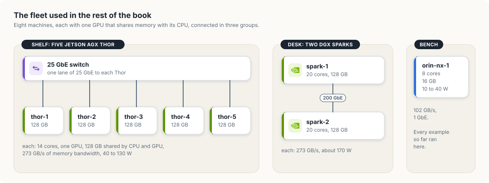
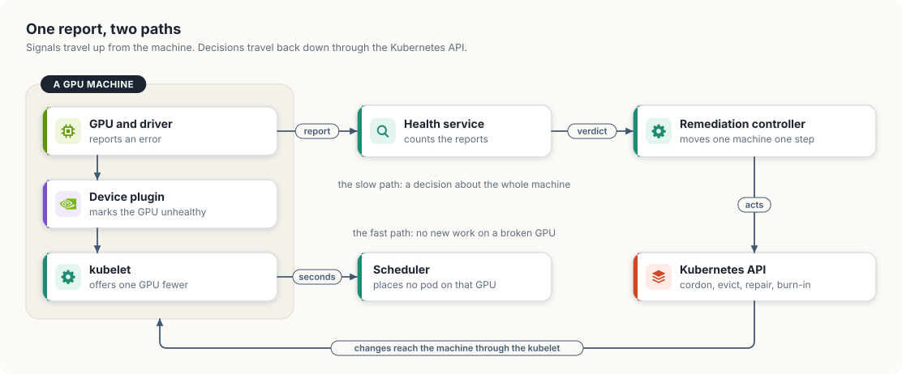
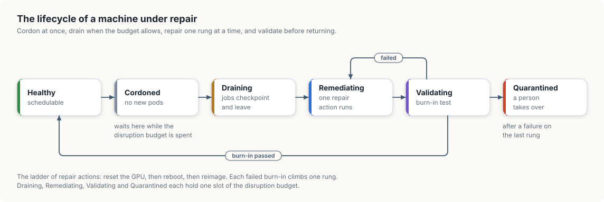
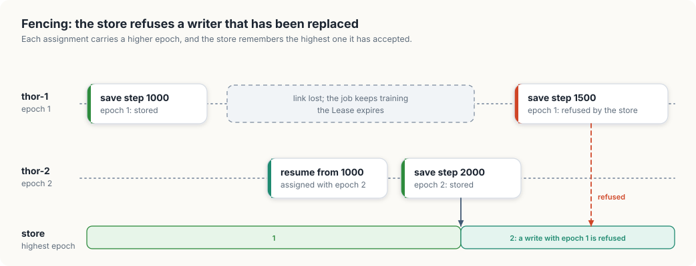

# 4. A control plane for a fleet of hosts

In chapter 3, we learned how a control plane notices that a machine has gone silent. A
silent machine is the simple case. More often a machine keeps sending heartbeats while
something on it is going wrong: a GPU reports a memory error, a job crashes with a GPU
fault, or a network link drops for a second and returns. In this chapter, we will build
the part of a control plane that reads those reports and decides what to do with the
machine.

We will work with a fleet of real machines, small enough to keep in our heads: five
Jetson AGX Thor developer kits on one switch, two DGX Sparks joined by a cable, and the
Jetson Orin NX that has run every example so far. We will first reason about what each
kind of report tells us, then draw the design, then write it as two programs in Go and in
Rust. `fleethealth` decides which reports blame a machine and walks a blamed machine
through its repair. `fencing` deals with the question chapter 3 ended on: what stops a job
from running twice when a machine that was declared dead turns out to be alive.

<div class="covers">

This chapter covers

- the fleet used in the rest of the book, with the numbers that matter for scheduling
- the two paths a failure report takes: one on the machine, one through the control plane
- telling a faulty job from a faulty machine, and both from a faulty switch
- the repair lifecycle: cordon, drain, repair, validate, return, or quarantine
- a disruption budget, which limits how much of the fleet a repair system may take away
- epochs and fencing, which keep a job that runs twice from damaging its checkpoints

</div>

## The fleet

Figure 4.1 shows the eight machines. Each has one GPU that shares memory with the CPU, as
we saw for the Orin in chapter 2, so a machine's memory is also the limit on what its GPU
can hold.

<figure>

<figcaption><b>Figure 4.1</b> The fleet: five Thors on a 25 GbE switch, two Sparks on a 200 GbE cable, and one Orin NX.</figcaption>
</figure>


| Machine | CPU cores | Memory, shared with the GPU | Memory bandwidth | Fast link | Power |
|---|---|---|---|---|---|
| Jetson Orin NX 16GB (Super) | 8 | 16 GB | 102 GB/s | 1 GbE | 10 to 40 W |
| Jetson AGX Thor | 14 | 128 GB | 273 GB/s | four lanes of 25 GbE | 40 to 130 W |
| DGX Spark | 20 | 128 GB | 273 GB/s | up to 200 GbE | about 170 W |

Three facts about this fleet shape the chapter. The machines are few, so losing two of
them removes a quarter of the capacity. They are connected in groups: the five Thors
reach each other through one switch, and the two Sparks through one cable, so one failed
switch looks like five failed machines. And every machine runs long jobs whose progress
lives in the GPU's memory until it is saved, so taking a machine away without warning
destroys work.

<div class="callout">

**What we measured and what we modelled.** The cluster in this book runs on the Orin NX,
and the CUDA programs of chapter 2 ran on the Orin NX and on one Thor. The fleet of five
Thors and two Sparks is the one the programs of this chapter and the next ones model.
Its core counts, memory sizes, link speeds, and power figures are the manufacturer's,
and where a number in the book comes from a run on our own hardware, the text shows the
command and its output.

</div>

A fleet of ten thousand machines has the same three properties with larger numbers. The
design that follows is the one such fleets use, and our eight machines are enough to
exercise every part of it.

## What a failure report tells us

Each machine produces several kinds of report about its GPU and its network link.

The GPU driver writes a message to the kernel log when the GPU reports an error. On
discrete and data center GPUs, the NVIDIA driver numbers these messages, and the number
is called an *Xid*. NVIDIA publishes a catalog that gives the usual cause of each one.
The table lists the Xids our model has a class for:

| Xid | What the driver reports | Usual cause | Class in our model |
|---|---|---|---|
| 13, 31, 43 | an engine exception, a memory page fault, a channel that stopped | the program that was running | application fault |
| 48, 95 | a double-bit or uncontained memory error | the GPU's memory | uncorrectable ECC |
| 79 | the GPU has fallen off the bus | the GPU, its power, or its slot | GPU off the bus |

Of our two boards, the Thor runs this driver, version 595.78, and reports its errors as
Xids. Its kernel log held none when we looked. The Orin NX runs the older `nvgpu` driver,
which writes its errors to the kernel log without Xid numbers. The model reduces every
report to a class, so it does not depend on the format.

ECC stands for error-correcting code: GPU memory stores a few extra bits with each word,
enough to repair one flipped bit and to detect two. An *uncorrectable* error is one the
extra bits detected and could not repair.

The network interface reports each time its link goes down and comes back. We call one
such event a *link flap*.

The same report can have three different causes, and the right response differs for each:

- A job with a bug in its GPU code produces an application fault on every machine it runs
  on. Taking those machines out of service repairs nothing and removes capacity.
- A machine with a failing GPU produces faults for every job placed on it. The machine has
  to leave the pool before the scheduler places another job there.
- A switch that restarts makes every machine attached to it report a link flap within a
  few seconds. The machines are healthy, and draining them would turn a short network
  interruption into a loss of five machines' worth of running jobs.

One report cannot distinguish these cases. Several reports can, by counting along two
directions. A fault that follows one job across three machines blames the job. Faults from
three different jobs on one machine blame the machine. Flaps from three machines on one
link, close together in time, blame the link. A report of a memory error or of a GPU off
the bus needs no counting, because no program can cause one.

## Two paths for one report

A report has to reach two places, at two speeds. Figure 4.2 shows both.

<figure>

<figcaption><b>Figure 4.2</b> The fast path stops new work on a broken GPU. The slow path decides what happens to the whole machine.</figcaption>
</figure>


The fast path stays on the machine. The device plugin, which we met in the introduction,
reports the health of each GPU to the kubelet along with the count. When a GPU fails, the
plugin marks it unhealthy, the kubelet lowers the number of GPUs the node offers, and the
scheduler stops placing pods that ask for that GPU. This takes seconds and needs no
decision from anyone. It stops new work only: a pod that already holds the GPU keeps
running.

The slow path leaves the machine. Every report goes to a *health service*, which holds
the counts from the previous section and turns them into a verdict for a machine: leave
it alone, or repair it. A *remediation controller* acts on the verdict. It is a
controller in the sense of chapter 1: it holds a desired state for each machine and moves
the machine towards it one step at a time, through the Kubernetes API. In a production
cluster the reports travel through a metrics pipeline, and the verdict is written to a
custom resource that the controller watches. Our model keeps both halves in one process
so that we can see every decision in one log.

The two halves stay separate in the design for a practical reason. The rules that produce
verdicts change often, as new failure patterns appear. The controller that drains and
reboots machines changes rarely and is dangerous when it is wrong. Keeping them apart
lets us change a rule, or run a new rule in a mode that only logs its verdicts, without
touching the code that can take machines away.

## The repair lifecycle

A machine with a verdict against it goes through six states. Figure 4.3 shows them.

<figure>

<figcaption><b>Figure 4.3</b> The lifecycle of a machine under repair, with the ladder of repair actions.</figcaption>
</figure>


*Cordoned* means the scheduler places no new pods on the machine. In Kubernetes this is
one field, `spec.unschedulable`, on the Node object, and `kubectl cordon` sets it.
Cordoning is cheap and fully reversible, so the controller does it at once.

*Draining* removes the pods that are already there. A training job loses everything
since its last checkpoint when its pod is deleted, so the controller first tells the job
to write a checkpoint and gives it time to do so. Kubernetes has a request made for this
purpose, the *Eviction API*. An eviction asks for a pod to be removed and can be refused:
a *PodDisruptionBudget* is an object in which a workload's owner states how many of its
pods may be down at once, and the API server refuses an eviction that would exceed it.
`kubectl drain` cordons a node and then evicts each of its pods in this way.

*Remediating* runs one repair action. The actions form a ladder from the cheapest to the
most thorough: reset the GPU, reboot the machine, and write a fresh operating system
image to it. The controller starts at the bottom and climbs one rung at a time.

*Validating* runs a *burn-in test*: a short GPU workload with a known answer. A machine
that boots and joins the cluster has shown only that its operating system starts. The
burn-in shows that its GPU computes correctly under load, which is the property that
failed. A machine that passes returns to Healthy. A machine that fails goes back for the
next rung, and a machine that fails after the last rung is *Quarantined*: it stays out of
the pool, and a ticket asks a person to look at the hardware.

### A limit on the repair system itself

A controller that can drain machines can also drain all of them. If a faulty rule
condemned every machine in the fleet, a controller that obeyed would cause a larger
outage than any hardware failure. So the controller carries a *disruption budget*: the
largest number of machines that may be out of service at once. A machine whose verdict
arrives when the budget is spent stays Cordoned, which costs nothing that is running, and
waits for a slot. A budget that stays spent is itself a signal worth a page to a person,
because it means failures are arriving faster than repairs finish.

Our fleet's budget is two machines. A quarantined machine keeps its slot until someone
repairs or removes it, since it is still missing from the fleet.

<div class="lld">

Low-level design: `fleethealth`

| Type | Holds | Rule it keeps |
|---|---|---|
| `Node` | name, model, and the link it hangs on | fixed for the run |
| `Signal` | second, node, job, and class | one per report |
| `State` | Healthy, Cordoned, Draining, Remediating, Validating, Quarantined | ordered, so "out of service" is every state from Draining on |
| `record` | one node's state, the second it entered it, its rung on the ladder, the jobs that faulted on it | only `move` changes the state |
| `Plane` | every record, the nodes each job faulted on, what has been blamed | at most `budget` records are out of service |

| Operation | Does |
|---|---|
| `Observe(signal)` | counts the signal and, when a count reaches its threshold, blames a job, a machine, or a link |
| `Step(now)` | advances every machine by one second through the lifecycle |

</div>

## Building `fleethealth`

The program is a simulation with a clock that counts seconds. Each second it feeds the
signals that arrive at that second to `Observe`, then calls `Step`. No real time passes,
so a run takes a few milliseconds and prints the same log every time.

### The fleet and its signals

A machine is a name, a model, and the name of the switch or cable it shares with its
neighbours. The link name is what lets the program see that five reports came from one
place.

<p class="listing"><b>Listing 4.1</b> The machines, in Go. <a href="https://github.com/arpanpathak/cracking-the-systems-programming-interview/blob/prep-v2/gpu-accelerated-kubernetes/code/go/fleethealth/main.go">code/go/fleethealth/main.go</a></p>

```go
{{#include ../code/go/fleethealth/main.go:fleet}}
```

<p class="listing"><b>Listing 4.2</b> The machines, in Rust. <a href="https://github.com/arpanpathak/cracking-the-systems-programming-interview/blob/prep-v2/gpu-accelerated-kubernetes/code/rust/fleethealth/src/main.rs">code/rust/fleethealth/src/main.rs</a></p>

```rust
{{#include ../code/rust/fleethealth/src/main.rs:fleet}}
```


A signal carries the second it arrived, the machine, the job that was using the GPU, and
its class. Hardware signals and link flaps have no job.

<p class="listing"><b>Listing 4.3</b> Signals and their classes, in Go. <a href="https://github.com/arpanpathak/cracking-the-systems-programming-interview/blob/prep-v2/gpu-accelerated-kubernetes/code/go/fleethealth/main.go">code/go/fleethealth/main.go</a></p>

```go
{{#include ../code/go/fleethealth/main.go:signal}}
```

<p class="listing"><b>Listing 4.4</b> Signals and their classes, in Rust. <a href="https://github.com/arpanpathak/cracking-the-systems-programming-interview/blob/prep-v2/gpu-accelerated-kubernetes/code/rust/fleethealth/src/main.rs">code/rust/fleethealth/src/main.rs</a></p>

```rust
{{#include ../code/rust/fleethealth/src/main.rs:signal}}
```


### The states and the ladder

The states are declared in the order a failing machine passes through them, and both
languages can compare them. That ordering does real work later: "every state from
Draining on" becomes one comparison.

<p class="listing"><b>Listing 4.5</b> The lifecycle states and the repair ladder, in Go. <a href="https://github.com/arpanpathak/cracking-the-systems-programming-interview/blob/prep-v2/gpu-accelerated-kubernetes/code/go/fleethealth/main.go">code/go/fleethealth/main.go</a></p>

```go
{{#include ../code/go/fleethealth/main.go:state}}
```

<p class="listing"><b>Listing 4.6</b> The lifecycle states and the repair ladder, in Rust. <a href="https://github.com/arpanpathak/cracking-the-systems-programming-interview/blob/prep-v2/gpu-accelerated-kubernetes/code/rust/fleethealth/src/main.rs">code/rust/fleethealth/src/main.rs</a></p>

```rust
{{#include ../code/rust/fleethealth/src/main.rs:state}}
```


### Deciding what a signal blames

`Observe` holds the counting rules. A hardware signal condemns its machine at once. An
application fault is recorded twice, under the machine and under the job, and then both
counts are checked. Three machines for one job blames the job, and the program prints
that verdict once and leaves every machine in service. Three jobs on one machine condemns
the machine. A link flap is stamped on its machine, and the program counts the machines
on the same link whose latest flap lies within five seconds.

<p class="listing"><b>Listing 4.7</b> Triage: which of a job, a machine, or a link a signal blames, in Go. <a href="https://github.com/arpanpathak/cracking-the-systems-programming-interview/blob/prep-v2/gpu-accelerated-kubernetes/code/go/fleethealth/main.go">code/go/fleethealth/main.go</a></p>

```go
{{#include ../code/go/fleethealth/main.go:triage}}
```

<p class="listing"><b>Listing 4.8</b> Triage: which of a job, a machine, or a link a signal blames, in Rust. <a href="https://github.com/arpanpathak/cracking-the-systems-programming-interview/blob/prep-v2/gpu-accelerated-kubernetes/code/rust/fleethealth/src/main.rs">code/rust/fleethealth/src/main.rs</a></p>

```rust
{{#include ../code/rust/fleethealth/src/main.rs:triage}}
```


The Go version keeps each set as a map from a name to `true`. The Rust version uses
`BTreeSet`, whose `insert` returns whether the value was new, so "blame this once" is the
single expression `self.blamed.insert(s.job)`.

### The budget

The budget check is a count of the machines in the four states that take a machine away
from the fleet. Cordoned is left out on purpose: a cordoned machine still runs its jobs.

<p class="listing"><b>Listing 4.9</b> Counting the machines that are out of service, in Go. <a href="https://github.com/arpanpathak/cracking-the-systems-programming-interview/blob/prep-v2/gpu-accelerated-kubernetes/code/go/fleethealth/main.go">code/go/fleethealth/main.go</a></p>

```go
{{#include ../code/go/fleethealth/main.go:budget}}
```

<p class="listing"><b>Listing 4.10</b> Counting the machines that are out of service, in Rust. <a href="https://github.com/arpanpathak/cracking-the-systems-programming-interview/blob/prep-v2/gpu-accelerated-kubernetes/code/rust/fleethealth/src/main.rs">code/rust/fleethealth/src/main.rs</a></p>

```rust
{{#include ../code/rust/fleethealth/src/main.rs:budget}}
```


### One second of the lifecycle

`Step` visits every machine and asks how long it has been in its state. A Cordoned
machine starts to drain as soon as the budget has room, and reports once that it is
blocked when the budget has none. Each of the other states lasts a fixed number of
seconds in the model: four for a job to write its checkpoint and leave, three for a
repair action, three for the burn-in. The result of a burn-in comes from a table the run
supplies, which says how many tests each machine fails before one passes.

<p class="listing"><b>Listing 4.11</b> Advancing every machine by one second, in Go. <a href="https://github.com/arpanpathak/cracking-the-systems-programming-interview/blob/prep-v2/gpu-accelerated-kubernetes/code/go/fleethealth/main.go">code/go/fleethealth/main.go</a></p>

```go
{{#include ../code/go/fleethealth/main.go:step}}
```

<p class="listing"><b>Listing 4.12</b> Advancing every machine by one second, in Rust. <a href="https://github.com/arpanpathak/cracking-the-systems-programming-interview/blob/prep-v2/gpu-accelerated-kubernetes/code/rust/fleethealth/src/main.rs">code/rust/fleethealth/src/main.rs</a></p>

```rust
{{#include ../code/rust/fleethealth/src/main.rs:step}}
```


`Step` reads the current state and acts on it, with no memory of which signal started the
repair. This is the level-triggered style of chapter 1 applied to machines. If the
process stopped and started again with the same records, the next call to `Step` would
continue every repair from where it was.

### The run

The script holds eleven signals that exercise each rule: one job faulting on three Thors,
a memory error on a Spark, a Thor whose GPU stops answering, a restart of the 25 GbE
switch, and two machines failing in the same second.

<p class="listing"><b>Listing 4.13</b> The scripted signals and the main loop, in Go. <a href="https://github.com/arpanpathak/cracking-the-systems-programming-interview/blob/prep-v2/gpu-accelerated-kubernetes/code/go/fleethealth/main.go">code/go/fleethealth/main.go</a></p>

```go
{{#include ../code/go/fleethealth/main.go:main}}
```

<p class="listing"><b>Listing 4.14</b> The scripted signals and the main loop, in Rust. <a href="https://github.com/arpanpathak/cracking-the-systems-programming-interview/blob/prep-v2/gpu-accelerated-kubernetes/code/rust/fleethealth/src/main.rs">code/rust/fleethealth/src/main.rs</a></p>

```rust
{{#include ../code/rust/fleethealth/src/main.rs:main}}
```


Both versions print the same log:

```console
$ go run ./fleethealth
{{#include ../code/output/fleethealth.txt}}
```


The log has five episodes.

At second 14 the job `finetune-7b` has faulted on `thor-1`, `thor-2`, and `thor-3`. The
verdict names the job, and all three Thors stay Healthy.

At second 20 `spark-1` reports an uncorrectable memory error. It is cordoned and, with
the whole budget free, starts to drain in the same second. Four seconds later its jobs
have left, the GPU is reset, the burn-in passes, and at second 30 the Spark is back in
service. The whole repair took ten seconds and no person was involved.

At second 40 the GPU of `thor-4` falls off the bus. The reset, the reboot, and the
reimage each end in a failed burn-in, and at second 62 the Thor is quarantined with a
ticket. It holds one of the two budget slots from then on.

At seconds 60 to 62 four Thors report link flaps. The third report, at second 61, brings
the count for `switch-25g` to three within the window, and the verdict names the switch.
No Thor is cordoned.

At second 80 `spark-2` and `orin-nx-1` fail together. `spark-2` comes first in the fleet
and takes the last budget slot. `orin-nx-1` is cordoned and reports that it is blocked.
It waits ten seconds, until `spark-2` passes its burn-in at second 90 and frees the slot,
and then goes through the same repair. At no point are more than two of the eight
machines out of service.

Animation 4.1 replays the log from second 20 as a board with one column for each state.

<figure class="anim">
<video class="motion" src="figures/fleet-repair.mp4" autoplay loop muted playsinline preload="metadata" aria-label="A board with six columns, Healthy, Cordoned, Draining, Remediating, Validating and Quarantined, and one chip for each of the eight machines. spark-1 moves through the columns and returns to Healthy at second 30. thor-4 moves to Remediating and Validating three times, for a reset, a reboot and a reimage, and ends in Quarantined at second 62. At second 80 spark-2 and orin-nx-1 are cordoned together; spark-2 drains while orin-nx-1 is blocked with two machines out of service, and orin-nx-1 starts to drain at second 90 when spark-2 returns to Healthy." data-chapters="[[0.0, &quot;one repair&quot;], [20.46, &quot;the ladder&quot;], [39.18, &quot;the budget&quot;]]"></video>
<figcaption><b>Animation 4.1</b> The run of <code>fleethealth</code> as a board. A chip in one of the last four columns holds a slot of the disruption budget.</figcaption>
</figure>


<div class="callout">

**On a real cluster.** Each transition in this log corresponds to one or two requests to
the API server. Cordoning patches `spec.unschedulable` on the Node. Draining creates an
Eviction for each pod. The repair actions run as privileged pods on the machine or as
calls to its management interface, and the burn-in is a Job that requests the node's GPU
and whose success the controller waits for. A controller built with controller-runtime
or kube-rs, as in section 1.1, would store the state, the rung, and the attempt count in
the status of a custom resource, one per node, so that a restarted controller reads its
own progress back from the API server.

</div>

## A job that runs twice

The lifecycle above covers a machine that still answers. Chapter 3 left us with the
harder case: a machine whose Lease has expired. The control plane cannot drain it,
because it cannot reach it, and it cannot tell a machine that has lost power from one
that has lost only its network link. If it waits, the job on a truly dead machine stays
stopped. If it starts the job elsewhere, the job on a machine that was only cut off is
now running twice.

Two copies of a training job are harmless while they only compute. They become harmful
at the moment they write. Both save checkpoints to the same place, and the copy on the
cut-off machine started from an older state. When its link returns, its next checkpoint
replaces a newer one from the second copy, and the job's saved progress moves backwards.

The control plane cannot prevent the second copy from existing, so the protection has to
sit at the place where the writes land. The mechanism has two parts:

- Every time the control plane assigns the job to a machine, it increments a counter and
  gives the new value to that machine. The value is called an *epoch*. A later
  assignment always has a higher epoch than an earlier one.
- Every write to the checkpoint store carries the writer's epoch. The store remembers the
  highest epoch it has accepted and refuses a write with a lower one.

The second part is called *fencing*, and the epoch in this role is a *fencing token*.
Once the new copy has written, the old copy is fenced off: each of its writes is refused,
and the refusal tells it that it has been replaced, so it can stop.

<figure>

<figcaption><b>Figure 4.4</b> Two copies of one job. The store has accepted epoch 2, so the write that carries epoch 1 is refused.</figcaption>
</figure>


<div class="lld">

Low-level design: `fencing`

| Type | Holds | Rule it keeps |
|---|---|---|
| `ControlPlane` | the last epoch it handed out | each assignment gets a higher epoch than the one before |
| `Checkpoint` | training step, epoch, writer | the epoch is the one the writer was assigned |
| `Store` | the latest checkpoint | with fencing on, the stored epoch only rises |

</div>

The store is a single checkpoint and one comparison.

<p class="listing"><b>Listing 4.15</b> The checkpoint store and its epoch check, in Go. <a href="https://github.com/arpanpathak/cracking-the-systems-programming-interview/blob/prep-v2/gpu-accelerated-kubernetes/code/go/fencing/main.go">code/go/fencing/main.go</a></p>

```go
{{#include ../code/go/fencing/main.go:store}}
```

<p class="listing"><b>Listing 4.16</b> The checkpoint store and its epoch check, in Rust. <a href="https://github.com/arpanpathak/cracking-the-systems-programming-interview/blob/prep-v2/gpu-accelerated-kubernetes/code/rust/fencing/src/main.rs">code/rust/fencing/src/main.rs</a></p>

```rust
{{#include ../code/rust/fencing/src/main.rs:store}}
```


The control plane is a counter.

<p class="listing"><b>Listing 4.17</b> Handing out epochs, in Go. <a href="https://github.com/arpanpathak/cracking-the-systems-programming-interview/blob/prep-v2/gpu-accelerated-kubernetes/code/go/fencing/main.go">code/go/fencing/main.go</a></p>

```go
{{#include ../code/go/fencing/main.go:assign}}
```

<p class="listing"><b>Listing 4.18</b> Handing out epochs, in Rust. <a href="https://github.com/arpanpathak/cracking-the-systems-programming-interview/blob/prep-v2/gpu-accelerated-kubernetes/code/rust/fencing/src/main.rs">code/rust/fencing/src/main.rs</a></p>

```rust
{{#include ../code/rust/fencing/src/main.rs:assign}}
```


The run plays the same sequence against both kinds of store.

<p class="listing"><b>Listing 4.19</b> The sequence of writes, in Go. <a href="https://github.com/arpanpathak/cracking-the-systems-programming-interview/blob/prep-v2/gpu-accelerated-kubernetes/code/go/fencing/main.go">code/go/fencing/main.go</a></p>

```go
{{#include ../code/go/fencing/main.go:run}}
```

<p class="listing"><b>Listing 4.20</b> The sequence of writes, in Rust. <a href="https://github.com/arpanpathak/cracking-the-systems-programming-interview/blob/prep-v2/gpu-accelerated-kubernetes/code/rust/fencing/src/main.rs">code/rust/fencing/src/main.rs</a></p>

```rust
{{#include ../code/rust/fencing/src/main.rs:run}}
```


```console
$ go run ./fencing
{{#include ../code/output/fencing.txt}}
```


In the first run, `thor-1`'s write of step 1500 lands after `thor-2`'s write of step
2000, and a restart would resume from step 1500: five hundred steps of training are gone,
and the stored checkpoint comes from the copy that should have stopped. In the second
run the store refuses that write, and a restart resumes from step 2000.

Kubernetes gives us the pieces for both parts. A Lease's `leaseTransitions` field counts
how often the Lease has changed hands, and it rises by one with each new holder, so it
can serve as the epoch. The check has to be made by whatever stores the checkpoints: an
object store that supports conditional writes, a database row with a version column, or a
file server that rejects clients holding an old token. The resource version check from
chapter 1 is the same idea applied to Kubernetes objects.

## The complete programs

<p class="listing"><b>Listing 4.21</b> The complete program in Go. <a href="https://github.com/arpanpathak/cracking-the-systems-programming-interview/blob/prep-v2/gpu-accelerated-kubernetes/code/go/fleethealth/main.go">code/go/fleethealth/main.go</a></p>

```go
{{#include ../code/go/fleethealth/main.go}}
```

<p class="listing"><b>Listing 4.22</b> The complete program in Rust. <a href="https://github.com/arpanpathak/cracking-the-systems-programming-interview/blob/prep-v2/gpu-accelerated-kubernetes/code/rust/fleethealth/src/main.rs">code/rust/fleethealth/src/main.rs</a></p>

```rust
{{#include ../code/rust/fleethealth/src/main.rs}}
```


<p class="listing"><b>Listing 4.23</b> The complete program in Go. <a href="https://github.com/arpanpathak/cracking-the-systems-programming-interview/blob/prep-v2/gpu-accelerated-kubernetes/code/go/fencing/main.go">code/go/fencing/main.go</a></p>

```go
{{#include ../code/go/fencing/main.go}}
```

<p class="listing"><b>Listing 4.24</b> The complete program in Rust. <a href="https://github.com/arpanpathak/cracking-the-systems-programming-interview/blob/prep-v2/gpu-accelerated-kubernetes/code/rust/fencing/src/main.rs">code/rust/fencing/src/main.rs</a></p>

```rust
{{#include ../code/rust/fencing/src/main.rs}}
```


<div class="summary">

## Summary

- A failure report can come from a faulty job, a faulty machine, or a faulty link. Counting
  reports per job, per machine, and per link separates the three.
- The device plugin stops new work on a broken GPU within seconds. A health service and a
  remediation controller decide, more slowly, what happens to the machine.
- A machine under repair is cordoned, drained with time for its jobs to checkpoint,
  repaired one rung at a time, and validated with a burn-in before it returns.
- A disruption budget limits the number of machines the repair system may take out of
  service at once.
- An epoch that rises with each assignment, checked by the checkpoint store, keeps a
  replaced copy of a job from overwriting newer progress.

</div>

## References

- NVIDIA, Xid errors:
  <https://docs.nvidia.com/deploy/xid-errors/>
- NVIDIA, DGX Spark hardware overview:
  <https://docs.nvidia.com/dgx/dgx-spark/hardware.html>
- NVIDIA, Jetson modules technical specifications:
  <https://developer.nvidia.com/embedded/jetson-modules>
- Kubernetes, Safely drain a node:
  <https://kubernetes.io/docs/tasks/administer-cluster/safely-drain-node/>
- Kubernetes, API-initiated eviction:
  <https://kubernetes.io/docs/concepts/scheduling-eviction/api-eviction/>
- Kubernetes, Device plugins:
  <https://kubernetes.io/docs/concepts/extend-kubernetes/compute-storage-net/device-plugins/>
- M. Kleppmann, "How to do distributed locking", 2016:
  <https://martin.kleppmann.com/2016/02/08/how-to-do-distributed-locking.html>
