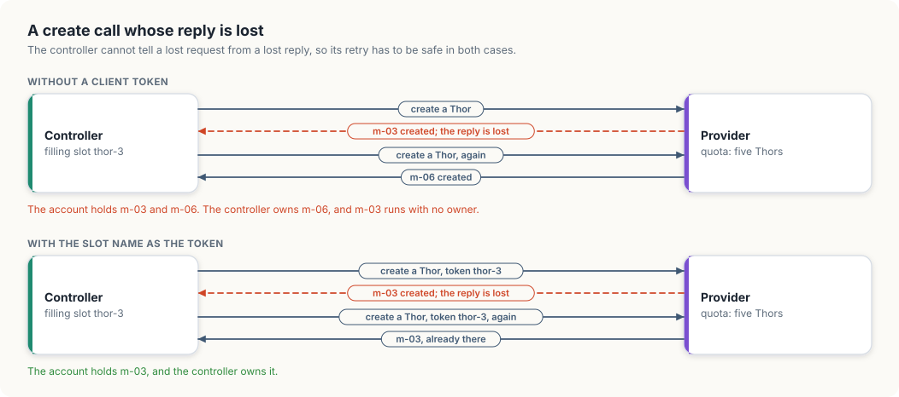
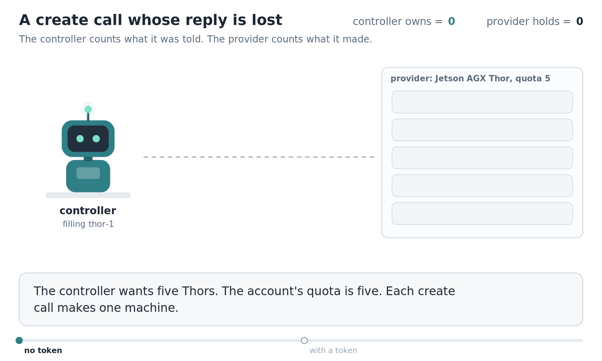

# 5. Kubernetes in a new cloud account

So far our cluster has existed before each chapter began. In this chapter, we will look
at where a cluster comes from. We start with an account at a provider of machines, which
holds nothing, and end with a set of machines that the API server knows as nodes and the
scheduler can place GPU pods on.

Two separate things have to happen. Something has to ask the provider for machines and
keep asking until the right number exist, and each machine, once it boots, has to prove
to the cluster that it is allowed to join. We will take the second first, because we can
watch it on the cluster we already have. Then we will write `provisioner`, in Go and in
Rust, a model of the controller that asks for machines, and use it to study the one
failure that makes this job harder than it looks: a request that succeeds while its reply
is lost.

<div class="covers">

This chapter covers

- what an empty account offers: a create call, a quota, and nothing else
- how a machine joins a cluster: a bootstrap token, a signed certificate, a Node object
- the labels and capacity a node reports, read from our own cluster
- a controller that fills pools of machines, and what a lost reply does to it
- client tokens, which make a create call safe to send twice
- how Cluster API expresses the same design as Kubernetes objects

</div>

## What the account gives us

A provider of machines, whether a public cloud or the team that racks hardware in a
company's own data center, offers the same small interface. We can ask for a machine of
a given model, list the machines we have, and give one back. The account also has a
*quota* for each model: the largest number of machines of that model it may hold at
once.

Our fleet from chapter 4 fits this picture exactly, and its quotas are physical. There
are five Jetson AGX Thors on the shelf and two DGX Sparks on the desk. A request for a
sixth Thor fails for the same reason a request for a sixth GPU instance fails in a cloud
account whose quota is five: the provider has no more to give us.

A new machine is a computer with an operating system and a network address. It knows
nothing about our cluster, and our cluster knows nothing about it.

## How a machine becomes a node

A machine becomes a node when the kubelet on it registers with the API server. From
chapter 1 we know that every request to the API server is an HTTP request, and the API
server requires each one to identify its sender. A kubelet identifies itself with a
*client certificate*: a file that states a name, here the node's name, and carries a
signature from the cluster's *certificate authority* (CA), a key pair the cluster
created for itself when it was first set up. The API server trusts any certificate that
its CA signed.

A new machine has no such certificate, and it cannot be handed the CA's private key,
since any holder of that key can impersonate every node in the cluster. The machine is
given something much weaker instead, and trades it for a certificate. Figure 5.1 shows
the exchange.

<figure>

<figcaption><b>Figure 5.1</b> Joining a cluster: a short-lived token is traded for a certificate that names one node.</figcaption>
</figure>


The weaker thing is a *bootstrap token*: a short string that the API server accepts for
a limited time and for one purpose. Our kind cluster was created with kubeadm, the
standard tool for setting up a cluster, and kubeadm can print the command a new machine
would run to join. We have cut the two secret values from the output:

```console
$ docker exec gpu-lab-control-plane kubeadm token create --ttl 10m --print-join-command
kubeadm join gpu-lab-control-plane:6443 --token <token> --discovery-token-ca-cert-hash sha256:<hash>
```

The command carries three facts, and each one answers a question the new machine has.

- `gpu-lab-control-plane:6443` is where the API server listens.
- The token is what the machine will show to prove it was invited. We asked for it to
  expire after ten minutes.
- The hash is a fingerprint of the cluster's CA public key. The machine uses it in the
  other direction: before it sends the token anywhere, it checks that the server it
  reached presents a certificate signed by the CA with this fingerprint. A machine
  without the hash could be tricked into sending its token to an impostor.

With the token accepted, the kubelet generates a key pair of its own and submits a
*CertificateSigningRequest*, a Kubernetes object that says "please sign a certificate
that names me `system:node:thor-3`". The token is permitted to do only this. A
controller in the control plane checks that the request comes from a bootstrap token and
asks for a node identity, approves it, and signs it with the CA. The kubelet downloads
the certificate and from then on uses it for every request. The private key was
generated on the machine and has stayed there.

With its certificate, the kubelet creates the two objects we already know: a Node
object, and the Lease from chapter 3 that it will renew every ten seconds.

### What a node reports about itself

The Node object is where the kubelet tells the scheduler what the machine has. Here is
the capacity our Orin NX reports, with the huge-page lines removed:

```console
$ kubectl get node gpu-lab-control-plane -o jsonpath='{.status.capacity}'
{"cpu":"8","ephemeral-storage":"1966327652352","memory":"16031232Ki","nvidia.com/gpu":"1","pods":"110"}
```

Eight CPU cores, 16,031,232 KiB of memory, which is the board's 15.3 GiB, and one
`nvidia.com/gpu`, reported by the device plugin from Appendix A. The scheduler subtracts
what running pods have requested from these numbers to find out what is free.

The Node object also carries *labels*: pairs of a key and a value that describe the
machine.

```console
$ kubectl get node gpu-lab-control-plane -o jsonpath='{.metadata.labels}'
{"beta.kubernetes.io/arch":"arm64","beta.kubernetes.io/os":"linux","kubernetes.io/arch":"arm64",
"kubernetes.io/hostname":"gpu-lab-control-plane","kubernetes.io/os":"linux",
"node-role.kubernetes.io/control-plane":""}
```

The kubelet sets the architecture, the operating system, and the host name by itself.
Nothing here says which GPU the machine has. A count of `nvidia.com/gpu: 1` is the same
on an Orin NX with 16 GB and on a Thor with 128 GB, and a job that needs 60 GB of GPU
memory fits on only one of them. On clusters that the GPU Operator supports, a component
called GPU Feature Discovery adds labels such as `nvidia.com/gpu.product` and
`nvidia.com/gpu.memory` to each node. On our fleet we would set a label by hand as each
machine joins:

```console
$ kubectl label node thor-3 gpucloud.dev/model=jetson-agx-thor
```

A pod then restricts itself to machines with that label through the `nodeSelector` field
of its spec, and the scheduler considers only nodes whose labels match. Chapter 8 uses
labels of this kind to place jobs.

## Asking for machines

Now for the first half: getting the machines to exist. We describe what we want as
*pools*. A pool is a model and a count: five Thors, two Sparks. The controller's job is
to make the account hold exactly that.

This is reconciliation again, with the provider's interface in place of the API server.
The controller compares the wanted count with the machines it has and creates the
difference. The difficulty lies in a property of the create call that the calls in
chapter 1 did not have. Creating a machine changes the world outside the cluster, costs
money while the machine runs, and counts against a quota.

Consider what the controller knows after a create call. There are three outcomes:

1. A reply arrives with the new machine's identifier. The machine exists.
2. A reply arrives with an error such as "quota exceeded". No machine was created.
3. No reply arrives before the controller's timeout.

The third outcome is the awkward one, because it covers two different situations that
look identical from the controller's side. The request may have been lost on the way, in
which case nothing was created. Or the provider may have created the machine and the
reply was lost on the way back. Figure 5.2 follows the second situation.

<figure>

<figcaption><b>Figure 5.2</b> A create call whose reply is lost, retried without a token and with one.</figcaption>
</figure>


If the controller assumes nothing was created and sends another create, it may end up
with two machines where it wanted one. It owns the second and has no record of the
first, which runs, costs money, and uses up quota until someone finds it. If the
controller assumes the machine was created, it has no identifier to manage it by.

### A token that names the request

The remedy is to let the controller name each request. The controller attaches a
*client token* to the call: a string it chose, which identifies this particular
machine-to-be. The provider stores the token with the machine it creates. When a second
call arrives with a token it has already seen, the provider creates nothing and returns
the existing machine.

A call with this property is called *idempotent*: sending it twice has the same effect
as sending it once. With an idempotent create, the controller needs no way to tell the
two timeout situations apart. It sends the same call again, and the answer is the same
machine either way.

The token has to be the same on the retry, so it cannot be random. Our controller
derives it from the pool's name and the slot it is filling: the third Thor's token is
`thor-3`, on every attempt. Real providers work the same way. The call that creates a
virtual machine in Amazon EC2 takes a `ClientToken` parameter for exactly this purpose.

<div class="lld">

Low-level design: `provisioner`

| Type | Holds | Rule it keeps |
|---|---|---|
| `Machine` | identifier, model, the token it was created with | fixed once created |
| `Provider` | the quota per model, every machine, a call counter | a model's machines stay within its quota; one machine per token |
| `Pool` | a name, a model, the wanted count | fixed for the run |
| `Controller` | the provider, and the machines it owns per pool | it owns a machine only after a successful reply |

| Operation | Does |
|---|---|
| `Provider.Create(model, token)` | returns the machine with this token if one exists; otherwise checks the quota and creates one |
| `Controller.Reconcile(pool)` | fills the pool's empty slots in order and stops at the first failed call |

</div>

## Building `provisioner`

### The provider

The provider is the account. `Create` does three things in order. It looks for a
machine that already carries the caller's token and, if it finds one, returns it. It
checks the quota. Then it creates the machine, and only after that does the run get the
chance to lose the reply. That ordering is what makes the lost reply dangerous: the
machine is in the list before the caller learns anything.

<p class="listing"><b>Listing 5.1</b> The provider and its create call, in Go. <a href="https://github.com/arpanpathak/cracking-the-systems-programming-interview/blob/prep-v2/gpu-accelerated-kubernetes/code/go/provisioner/main.go">code/go/provisioner/main.go</a></p>

```go
{{#include ../code/go/provisioner/main.go:provider}}
```

<p class="listing"><b>Listing 5.2</b> The provider and its create call, in Rust. <a href="https://github.com/arpanpathak/cracking-the-systems-programming-interview/blob/prep-v2/gpu-accelerated-kubernetes/code/rust/provisioner/src/main.rs">code/rust/provisioner/src/main.rs</a></p>

```rust
{{#include ../code/rust/provisioner/src/main.rs:provider}}
```


The Rust version represents a missing token as `None`, and the lookup is an
`if let ... && let ...` chain, the same construct we used in section 1.1: the first
`let` unwraps the caller's token, and the second searches for a machine that carries it.

### The controller

`Reconcile` works on one pool. It names the next empty slot, builds the token from that
name when tokens are switched on, and calls the provider. A failed call ends the pass
for this pool, and the controller records nothing for it. The next pass starts from the
same slot.

<p class="listing"><b>Listing 5.3</b> The pool and the controller's reconcile, in Go. <a href="https://github.com/arpanpathak/cracking-the-systems-programming-interview/blob/prep-v2/gpu-accelerated-kubernetes/code/go/provisioner/main.go">code/go/provisioner/main.go</a></p>

```go
{{#include ../code/go/provisioner/main.go:controller}}
```

<p class="listing"><b>Listing 5.4</b> The pool and the controller's reconcile, in Rust. <a href="https://github.com/arpanpathak/cracking-the-systems-programming-interview/blob/prep-v2/gpu-accelerated-kubernetes/code/rust/provisioner/src/main.rs">code/rust/provisioner/src/main.rs</a></p>

```rust
{{#include ../code/rust/provisioner/src/main.rs:controller}}
```


The controller counts only what it has been told. `owned` grows by one machine for each
successful reply, and `Reconcile` reads the pool's size from it. This is where a lost
reply does its damage in the first run, as the output will show.

### The run

The run asks for five Thors and two Sparks, with quotas of exactly five and two, and
loses the reply to the third create call. It allows three passes and then prints what
the controller owns beside what the provider holds.

<p class="listing"><b>Listing 5.5</b> The pools, the three passes, and the final comparison, in Go. <a href="https://github.com/arpanpathak/cracking-the-systems-programming-interview/blob/prep-v2/gpu-accelerated-kubernetes/code/go/provisioner/main.go">code/go/provisioner/main.go</a></p>

```go
{{#include ../code/go/provisioner/main.go:run}}
```

<p class="listing"><b>Listing 5.6</b> The pools, the three passes, and the final comparison, in Rust. <a href="https://github.com/arpanpathak/cracking-the-systems-programming-interview/blob/prep-v2/gpu-accelerated-kubernetes/code/rust/provisioner/src/main.rs">code/rust/provisioner/src/main.rs</a></p>

```rust
{{#include ../code/rust/provisioner/src/main.rs:run}}
```


```console
$ go run ./provisioner
{{#include ../code/output/provisioner.txt}}
```


Both runs begin the same way. The third call creates machine `m-03` and its reply is
lost, so the controller reports a timeout for `thor-3` and moves on to the Sparks.

In the first run, pass 2 sends a fresh create for `thor-3`. The provider has no way to
connect it with the earlier call and creates `m-06`. The controller fills `thor-4` with
`m-07`, and then the create for `thor-5` fails: the account now holds five Thors, which
is the whole quota. Pass 3 fails in the same way, and so would every later pass. The
controller owns four Thors and has no way to get a fifth, while `m-03` runs with no owner.
The pool is one machine short and the account is full.

In the second run, pass 2 sends the create for `thor-3` again with the token `thor-3`.
The provider finds `m-03` under that token and returns it. The controller then creates
`thor-4` and `thor-5`, and every pool is full after two passes, with nothing left over.

Animation 5.1 replays both runs for the pool of Thors.

<figure class="anim">
<video class="motion" src="figures/lost-reply-run.mp4" autoplay loop muted playsinline preload="metadata" aria-label="A controller on the left sends create calls to a provider on the right, whose list has room for five Thors. Without a token, the reply to the third call is lost after machine m-03 is made; the retry makes m-06, m-03 is marked as having no owner, and the call for the fifth slot is refused with quota exceeded while the controller owns four. With the slot name sent as a token, the reply is lost again, the retry returns m-03, and the run ends with five machines made and five owned." data-chapters="[[0.0, &quot;no token&quot;], [26.58, &quot;with a token&quot;]]"></video>
<figcaption><b>Animation 5.1</b> The lost reply, retried without a client token and with one.</figcaption>
</figure>


<div class="callout">

**Finding machines that have no owner.** Tokens prevent duplicates from retries. A
controller can also lose track of a machine by crashing after the create call and before
it records the result. For that reason production provisioners also *tag* each machine
with the name of its pool at creation and periodically list the account by tag. A
machine that carries the tag and appears in no record is adopted or deleted. The model's
last loop does this comparison once, at the end of the run.

</div>

## The same design as Kubernetes objects

*Cluster API* is the Kubernetes project that manages clusters with Kubernetes objects. It
runs in one cluster, called the management cluster, and creates others. Its objects map
onto our model directly:

| Our model | Cluster API |
|---|---|
| `Pool`: a model and a wanted count | `MachineDeployment`, with a replica count and a machine template |
| one slot of a pool | `Machine` |
| `Machine.ID` | `spec.providerID` on the Machine |
| `Provider` | an infrastructure provider, one per cloud or kind of hardware |
| the join step from the start of this chapter | a bootstrap provider, which generates the join configuration for each machine |

A Machine object is created first and the provider's machine second, so the object's own
name can serve as the client token, and a controller that restarts finds every slot it
was working on by listing Machine objects. The record of ownership lives in the API
server, where the resource versions of chapter 1 protect it, and the provider's account
is reconciled towards it.

## The complete program

<p class="listing"><b>Listing 5.7</b> The complete program in Go. <a href="https://github.com/arpanpathak/cracking-the-systems-programming-interview/blob/prep-v2/gpu-accelerated-kubernetes/code/go/provisioner/main.go">code/go/provisioner/main.go</a></p>

```go
{{#include ../code/go/provisioner/main.go}}
```

<p class="listing"><b>Listing 5.8</b> The complete program in Rust. <a href="https://github.com/arpanpathak/cracking-the-systems-programming-interview/blob/prep-v2/gpu-accelerated-kubernetes/code/rust/provisioner/src/main.rs">code/rust/provisioner/src/main.rs</a></p>

```rust
{{#include ../code/rust/provisioner/src/main.rs}}
```


<div class="summary">

## Summary

- An account offers a create call, a list call, and a quota for each model of machine.
- A new machine joins with a bootstrap token and the hash of the cluster's CA key. It
  trades the token for a certificate that names one node, then creates its Node object
  and its Lease.
- A node reports capacity and labels. The GPU count alone does not distinguish a 16 GB
  Orin NX from a 128 GB Thor, so GPU machines also carry labels that name the model.
- A create call with no reply may or may not have created a machine. Retrying a plain
  create can leave a machine with no owner and a pool that can no longer be filled.
- A client token derived from the slot's name makes the create call idempotent, and the
  retry returns the machine the first attempt made.

</div>

## References

- Kubernetes, TLS bootstrapping:
  <https://kubernetes.io/docs/reference/access-authn-authz/kubelet-tls-bootstrapping/>
- Kubernetes, Authenticating with bootstrap tokens:
  <https://kubernetes.io/docs/reference/access-authn-authz/bootstrap-tokens/>
- Kubernetes, kubeadm join:
  <https://kubernetes.io/docs/reference/setup-tools/kubeadm/kubeadm-join/>
- Amazon EC2, Ensuring idempotency in API requests:
  <https://docs.aws.amazon.com/ec2/latest/devguide/ec2-api-idempotency.html>
- The Cluster API Book:
  <https://cluster-api.sigs.k8s.io/>
- NVIDIA, GPU Feature Discovery:
  <https://github.com/NVIDIA/k8s-device-plugin/blob/main/docs/gpu-feature-discovery/README.md>
