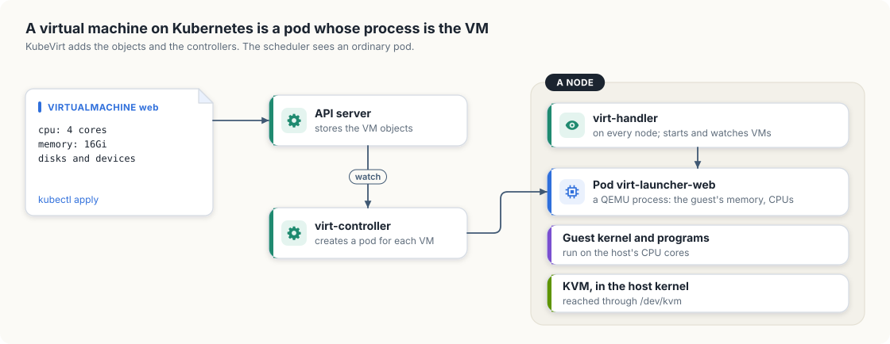
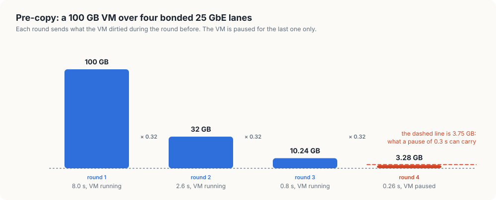
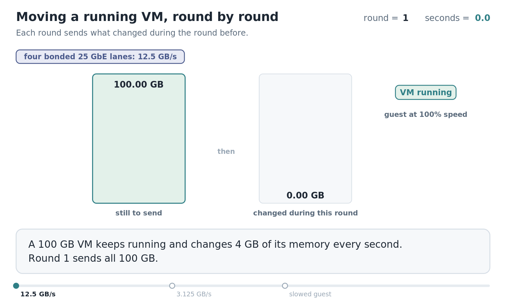

# 6. Virtual machines on Kubernetes

Every workload so far has run in a container. A container shares the host's kernel, and
some users of a GPU cluster need a kernel of their own: a customer who must run a
particular operating system, a tenant who is not trusted to share a kernel with others,
or a team with an appliance that ships as a disk image. For them the unit of work is a
*virtual machine* (VM), a complete computer simulated in software, with its own kernel,
on a real one.

This chapter covers how a VM runs on a Kubernetes cluster and two consequences for GPU
work: how the VM is given a GPU, and how it is moved off a machine that needs repair. The
second leads to *live migration*, moving a running VM to another host without stopping
it. `migration`, a model of the algorithm in Go and in Rust, runs with the memory sizes and
link speeds of the fleet to show when a migration can finish.

<div class="covers">

This chapter covers

- what a virtual machine is on Linux: a process, with help from the kernel
- KubeVirt, which runs each VM inside a pod
- two ways to give a VM a GPU, and what each costs
- live migration by pre-copy: rounds, dirty memory, and the final pause
- when a migration converges, worked out for the links between the fleet's machines
- why a VM that holds a GPU directly has to be stopped to be moved

</div>

## A virtual machine is a process

On Linux, a VM is an ordinary process on the host. The program is usually QEMU. It
allocates a large block of its own memory and presents it to the guest as the guest's
physical memory, and it creates one thread for each of the guest's CPUs.

Those threads run the guest's code directly on the host's CPU cores, at close to full
speed, through a kernel feature called *KVM* (Kernel-based Virtual Machine). KVM uses
the CPU's virtualization support to run guest code in a restricted mode, and returns
control to QEMU whenever the guest does something that needs the host's help, such as
talking to a disk or a network card. A program asks for this by opening the device file
`/dev/kvm`.

The Orin NX that runs the cluster has it:

```console
$ ls -l /dev/kvm
crw-rw----+ 1 root kvm 10, 232 Nov 21  2023 /dev/kvm
$ zcat /proc/config.gz | grep -E '^CONFIG_(KVM|VFIO)='
CONFIG_KVM=y
CONFIG_VFIO=y
```

Since a VM is a process, it can run in a container, and therefore in a pod. Running VMs on
Kubernetes rests on that fact.

## KubeVirt: a VM inside a pod

*KubeVirt* is the project that adds virtual machines to Kubernetes. It follows the
pattern of section 1.1: it teaches the API server new kinds of object with
CustomResourceDefinitions and runs controllers that reconcile them. Figure 6.1 shows the
parts.

<figure>

<figcaption><b>Figure 6.1</b> A KubeVirt virtual machine: a custom resource, a controller, and a pod whose process is the VM.</figcaption>
</figure>


A user creates a *VirtualMachine* object, whose spec describes the VM: its CPUs, its
memory, its disks, and its devices. A controller, `virt-controller`, creates a pod for
it, named `virt-launcher` followed by the VM's name. The pod's resource requests match
the VM's size, so the scheduler places it as it places any pod, and the machinery of the
earlier chapters applies: the pod is counted against the node's capacity, it shows
up in `gpuusage` from chapter 2 if it holds a GPU, and it is evicted when chapter 4's
controller drains the node.

On each node runs `virt-handler`, an agent that plays the kubelet's part for VMs. When a
launcher pod starts on its node, it has the launcher start a QEMU process inside the
pod's container. The guest's memory is that process's memory, so it counts against the
pod's memory limit.

The running VM is represented by a second object, the *VirtualMachineInstance*, whose
status reports the node it is on and the phase it is in. The VirtualMachine object
outlives it, in the way a `GpuJob` outlived its pod: stopping a VM deletes the instance
and keeps the VirtualMachine.

## Giving a VM a GPU

A container reaches a GPU through the host's driver, as Appendix A showed. A VM has its
own kernel and so needs its own driver, which has to talk to a GPU device. There are two
ways to give it one.

*Passthrough* hands a whole physical GPU to one VM. The host detaches the GPU from its
own driver and attaches it to a stub driver, *VFIO*, whose job is to let a process map
the device's registers and receive its interrupts. QEMU presents the device to the
guest, and the guest's NVIDIA driver then operates the real GPU directly. The guest gets
the full performance of the card. The host can no longer use it, and can no longer see
what it is doing.

A *vGPU*, introduced in chapter 2, divides one physical GPU among several VMs. The
host keeps its own driver, which creates several virtual devices and schedules their
work on the real GPU. Each VM is given one virtual device.

| | Passthrough | vGPU |
|---|---|---|
| What the VM holds | one whole physical GPU | a share of a GPU |
| Driver on the host | a stub; the host does not use the GPU | the vendor's host driver, which schedules the VMs |
| VMs per GPU | one | several |
| Host can read the device's state | no | yes |

In KubeVirt, the VM's spec names the device it wants in a `gpus` list, by the same kind
of resource name a pod uses, and a device plugin on the node advertises the GPUs that
have been set aside for VMs. The scheduler counts them as it counts
`nvidia.com/gpu`.

The last row of the table determines whether a VM with a GPU can be live-migrated, which
the end of the chapter returns to.

<div class="callout">

**On the fleet's machines.** Passthrough with VFIO works on a device that sits on a PCI
bus, and the two boards differ here. The Orin NX's GPU is part of the system-on-chip and has no
bus address. Its driver is `nvgpu`, and `nvidia-smi` shows nothing where the address
would be:

```console
$ nvidia-smi | sed -n 9,10p        # on the Orin NX
|   0  Orin (nvgpu)                  N/A  | N/A              N/A |                  N/A |
| N/A   N/A  N/A               N/A /  N/A | Not Supported        |     N/A          N/A |
```

There is no device to detach, so a GPU workload on the Orin runs in a container. The
Thor's GPU also shares the board's memory with the CPU, yet it appears on the PCI bus
and runs the same `nvidia` driver as a discrete card:

```console
$ lspci -nnk -s 01:00.0            # on the Thor
0000:01:00.0 3D controller [0302]: NVIDIA Corporation Device [10de:2b00] (rev a1)
	Kernel driver in use: nvidia
	Kernel modules: nouveau, nvgpu, nvidia_drm, nvidia
```

The Thor also has `/dev/kvm`. Passing its GPU to a virtual machine has not been tried; with
one GPU on the board, doing so would leave the host with none. The rest of the chapter uses
the fleet's memory sizes and link speeds.

</div>

## Moving a running VM

Chapter 4's controller drains a machine before repairing it. For a container, draining
means stopping the process and starting a new one elsewhere. A VM often runs software
that expects to stay up for months, and its users did not write it to be restarted. For
a VM the goal is to move it to another host while it runs.

A VM's state is its memory, the registers of its CPUs, and the state of its devices.
The registers and most device state amount to a few kilobytes, and the memory dominates. A VM sized for a Thor may hold 100 GB, and at the 3.125 GB per second that one
25 GbE lane carries, copying it takes 32 seconds. If the VM were paused for that long,
its network connections would time out and its users would see an outage.

The copy therefore happens while the VM runs, which creates a second problem: the VM keeps
writing to its memory during the copy, and the pages it writes after they were sent are
stale on the other side. Memory that has been written since it was last sent is called
*dirty*.

### Pre-copy, round by round

The standard algorithm, *pre-copy*, turns this into a loop.

1. Mark all of the VM's memory as dirty.
2. Send every dirty page to the target host, and clear the mark on each page as it is
   sent. The VM keeps running, and the hypervisor marks each page it writes.
3. When the round ends, some pages are dirty again. If they are few enough to send
   within the acceptable pause, go to step 4. Otherwise go back to step 2.
4. Pause the VM, send the remaining dirty pages and the CPU and device state, and resume
   the VM on the target.

Each round sends less than the one before, provided the VM dirties memory more slowly
than the link carries it. In a worked case, a 100 GB VM dirties 4 GB each second, and the link carries 12.5 GB each second, which is four bonded 25 GbE lanes.

- Round 1 sends 100 GB. That takes 100 / 12.5 = 8 seconds, during which the VM dirties
  4 × 8 = 32 GB.
- Round 2 sends 32 GB in 2.56 seconds, during which the VM dirties 10.24 GB.
- Round 3 sends 10.24 GB in 0.82 seconds, during which the VM dirties 3.28 GB.
- 3.28 GB takes 0.26 seconds to send. With an allowed pause of 0.3 seconds, the VM is
  paused now and the last 3.28 GB are sent.

Each round is smaller than the last by the same factor: the dirty rate divided by the
link rate, here 4 / 12.5 = 0.32. Figure 6.2 shows the rounds as bars.

<figure>

<figcaption><b>Figure 6.2</b> Pre-copy over four bonded 25 GbE lanes. Each round sends what the VM dirtied during the round before.</figcaption>
</figure>


That factor decides convergence:

- When the VM dirties memory more slowly than the link carries it, the factor is below
  one, the rounds shrink, and the migration finishes.
- When the VM dirties memory as fast as the link carries it, or faster, the factor is
  one or more. Every round ends with as much dirty memory as it started with, and the
  migration does not reach step 4.

A hypervisor has two remedies for the second case. It can slow the guest down, by giving
its CPU threads less time to run, which lowers the rate at which they dirty memory.
QEMU calls this *auto-converge*. Or it can switch to *post-copy*: pause the VM at once,
move only the CPU and device state, resume it on the target, and fetch each page from
the source at the moment the guest first touches it. Post-copy always finishes, at the
price that a network failure during the migration leaves the VM's memory split between
two hosts with no complete copy on either.

<div class="lld">

Low-level design: `migration`

| Type | Holds |
|---|---|
| `VM` | a name, the memory size in GB, the rate at which memory is dirtied in GB per second |
| `Link` | a name, and what it carries in GB per second |

| Operation | Does |
|---|---|
| `Migrate(vm, link, throttle)` | runs rounds until the remainder fits in the pause, and prints each round |

| Rule | Value |
|---|---|
| the longest pause | 0.3 seconds, so the last round may send at most 0.3 × the link rate |
| a round makes no progress | when the memory dirtied during it is at least the memory it sent |
| throttling | each round with no progress slows the guest by a further 20 percent, up to 80 percent |

</div>

## Building `migration`

### The VM and the link

The model needs three numbers: the VM's memory, the rate at which the VM dirties it, and
the rate of the link. Link speeds are quoted in gigabits per second and memory in
gigabytes, so each link is entered in gigabytes per second: 25 GbE is 25 / 8 = 3.125.

<p class="listing"><b>Listing 6.1</b> The VM, the link, and the limits, in Go. <a href="https://github.com/arpanpathak/cracking-the-systems-programming-interview/blob/prep-v2/gpu-accelerated-kubernetes/code/go/migration/main.go">code/go/migration/main.go</a></p>

```go
{{#include ../code/go/migration/main.go:types}}
```

<p class="listing"><b>Listing 6.2</b> The VM, the link, and the limits, in Rust. <a href="https://github.com/arpanpathak/cracking-the-systems-programming-interview/blob/prep-v2/gpu-accelerated-kubernetes/code/rust/migration/src/main.rs">code/rust/migration/src/main.rs</a></p>

```rust
{{#include ../code/rust/migration/src/main.rs:types}}
```


### One migration

`Migrate` keeps one quantity between rounds: `remaining`, the memory still to be sent.
It starts as the whole memory. Each pass of the loop first asks whether `remaining` can
be sent within the pause, and if so pauses the VM and finishes. Otherwise it computes
how long the round takes and how much memory the guest dirties in that time. The dirtied
amount is capped at the VM's size, since a page that is written twice is still one
dirty page.

<p class="listing"><b>Listing 6.3</b> The pre-copy loop, in Go. <a href="https://github.com/arpanpathak/cracking-the-systems-programming-interview/blob/prep-v2/gpu-accelerated-kubernetes/code/go/migration/main.go">code/go/migration/main.go</a></p>

```go
{{#include ../code/go/migration/main.go:migrate}}
```

<p class="listing"><b>Listing 6.4</b> The pre-copy loop, in Rust. <a href="https://github.com/arpanpathak/cracking-the-systems-programming-interview/blob/prep-v2/gpu-accelerated-kubernetes/code/rust/migration/src/main.rs">code/rust/migration/src/main.rs</a></p>

```rust
{{#include ../code/rust/migration/src/main.rs:migrate}}
```


A round that dirties at least as much as it sent has made no progress. Without
throttling the function reports that the migration does not converge. With throttling
it slows the guest by another 20 percent and tries again.

### The run

The run uses two VMs and the fleet's four links: the Orin NX's 1 GbE, one of a
Thor's 25 GbE lanes, all four lanes bonded together, and the 200 GbE cable between the
two Sparks.

<p class="listing"><b>Listing 6.5</b> The VMs, the links, and the six migrations, in Go. <a href="https://github.com/arpanpathak/cracking-the-systems-programming-interview/blob/prep-v2/gpu-accelerated-kubernetes/code/go/migration/main.go">code/go/migration/main.go</a></p>

```go
{{#include ../code/go/migration/main.go:main}}
```

<p class="listing"><b>Listing 6.6</b> The VMs, the links, and the six migrations, in Rust. <a href="https://github.com/arpanpathak/cracking-the-systems-programming-interview/blob/prep-v2/gpu-accelerated-kubernetes/code/rust/migration/src/main.rs">code/rust/migration/src/main.rs</a></p>

```rust
{{#include ../code/rust/migration/src/main.rs:main}}
```


```console
$ go run ./migration
{{#include ../code/output/migration.txt}}
```


The inference VM dirties 0.2 GB per second. The Orin NX's 1 GbE link carries 0.125 GB
per second, which is less, so after 128 seconds of copying all 16 GB are dirty again.
Over one 25 GbE lane the same VM moves in 5.5 seconds with a pause of 21 milliseconds. The
VM is the same in both runs, and the link decides the outcome.

The training VM dirties 4 GB per second, which is more than one 25 GbE lane carries, so
that migration does not converge either. With throttling, the first two rounds make no
progress and the guest is slowed twice, to 60 percent of full speed. At that speed it
dirties 2.4 GB per second, the factor becomes 2.4 / 3.125 = 0.768, and the rounds
shrink, slowly: the migration takes 21 rounds and 201 seconds, and the training job
runs at reduced speed for most of that time.

Over the four bonded lanes the factor is 0.32 and the migration takes 11.6 seconds.
Over the Sparks' cable it is 0.16 and the migration takes 4.7 seconds, with a pause of
102 milliseconds against 262.

Animation 6.1 plays three of these migrations for the training VM, with the memory still
to send beside the memory that changes during the round.

<figure class="anim">
<video class="motion" src="figures/pre-copy-rounds.mp4" autoplay loop muted playsinline preload="metadata" aria-label="Two bars: the memory still to send, which drains during a round, and the memory changed during that round, which grows. Over four bonded lanes the rounds send 100, 32, 10.24 and 3.28 GB, and the VM is paused for the last one and moves in 11.6 seconds. Over one lane, the first round ends with 100 GB changed again and the migration does not converge. With the guest slowed to 60 percent the rounds shrink by 0.768 each, and the VM moves after 21 rounds and 201 seconds." data-chapters="[[0.0, &quot;12.5 GB/s&quot;], [17.1, &quot;3.125 GB/s&quot;], [29.46, &quot;slowed guest&quot;]]"></video>
<figcaption><b>Animation 6.1</b> Pre-copy over a fast link, over a link slower than the VM's writes, and over that link with the guest slowed.</figcaption>
</figure>


Clusters that migrate large VMs therefore give migration a fast network of its own. The memory size sets how long the first round takes. The ratio of dirty rate to
link rate sets whether there is a last round at all.

## Migration in KubeVirt

KubeVirt runs this algorithm through objects. A *VirtualMachineInstanceMigration* names
a running instance. A controller creates a second launcher pod on another node, the two
QEMU processes connect to each other, and the source sends its memory in rounds. When
the migration completes, the instance's status names the new node and the old pod is
removed.

A VM's spec can set `evictionStrategy: LiveMigrate`. An eviction of the launcher pod,
the request chapter 4's drain sends for every pod on a node, then starts a migration and
is refused until the VM has moved. The remediation controller of chapter 4 therefore drains with the Eviction API and needs no knowledge of VMs, and each VM
leaves in the way its owner chose.

### The VM that cannot move

Step 4 of pre-copy sends "the CPU and device state". For a virtual disk or a virtual
network card, the hypervisor implements the device, so it has that state in its own
memory and can send it.

A GPU given to the VM by passthrough has no such copy. The device's state, including
everything in the GPU's memory, is inside the physical card on the source host, and the
host gave up its driver for that card when it attached the stub. The hypervisor has
nothing to read and nothing to send, and the target host's GPU is a different physical
device. KubeVirt therefore marks a VM with a passed-through device as not migratable.
Draining its node means shutting the VM down and starting it again elsewhere, and the
checkpointing discipline of chapter 4 applies to the jobs inside it.

With a vGPU, the host's driver holds the device's state and can save and restore it, so
migration is possible when the host driver and the hypervisor both support it. That
support depends on the driver and hypervisor versions, and has to be checked for each
combination.

## The complete program

<p class="listing"><b>Listing 6.7</b> The complete program in Go. <a href="https://github.com/arpanpathak/cracking-the-systems-programming-interview/blob/prep-v2/gpu-accelerated-kubernetes/code/go/migration/main.go">code/go/migration/main.go</a></p>

```go
{{#include ../code/go/migration/main.go}}
```

<p class="listing"><b>Listing 6.8</b> The complete program in Rust. <a href="https://github.com/arpanpathak/cracking-the-systems-programming-interview/blob/prep-v2/gpu-accelerated-kubernetes/code/rust/migration/src/main.rs">code/rust/migration/src/main.rs</a></p>

```rust
{{#include ../code/rust/migration/src/main.rs}}
```


<div class="summary">

## Summary

- A virtual machine on Linux is a QEMU process that runs guest code through KVM. KubeVirt
  runs that process inside a pod, so the scheduler, quotas, and drains treat a VM as a
  pod.
- Passthrough gives a VM one whole GPU and removes it from the host. A vGPU gives a VM a
  share of a GPU that the host's driver still controls.
- Pre-copy migration sends memory in rounds while the VM runs, and pauses the VM only
  for the last round.
- Each round is smaller than the one before by the ratio of the dirty rate to the link
  rate. A ratio of one or more means the migration does not finish without slowing the
  guest or switching to post-copy.
- A VM with a passed-through GPU cannot be migrated live, because the device's state is
  out of the hypervisor's reach.

</div>

## References

- KubeVirt user guide, Architecture:
  <https://kubevirt.io/user-guide/architecture/>
- KubeVirt user guide, Live migration:
  <https://kubevirt.io/user-guide/compute/live_migration/>
- KubeVirt user guide, Host devices assignment:
  <https://kubevirt.io/user-guide/compute/host-devices/>
- QEMU, Migration framework:
  <https://www.qemu.org/docs/master/devel/migration/main.html>
- The Linux kernel, VFIO:
  <https://docs.kernel.org/driver-api/vfio.html>
- C. Clark and others, "Live Migration of Virtual Machines", 2nd USENIX Symposium on
  Networked Systems Design and Implementation (NSDI), 2005.
