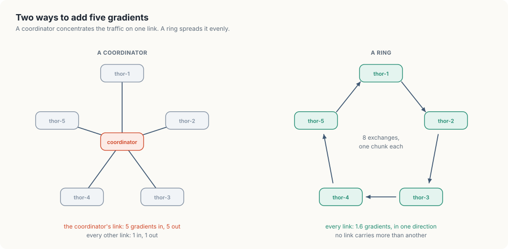
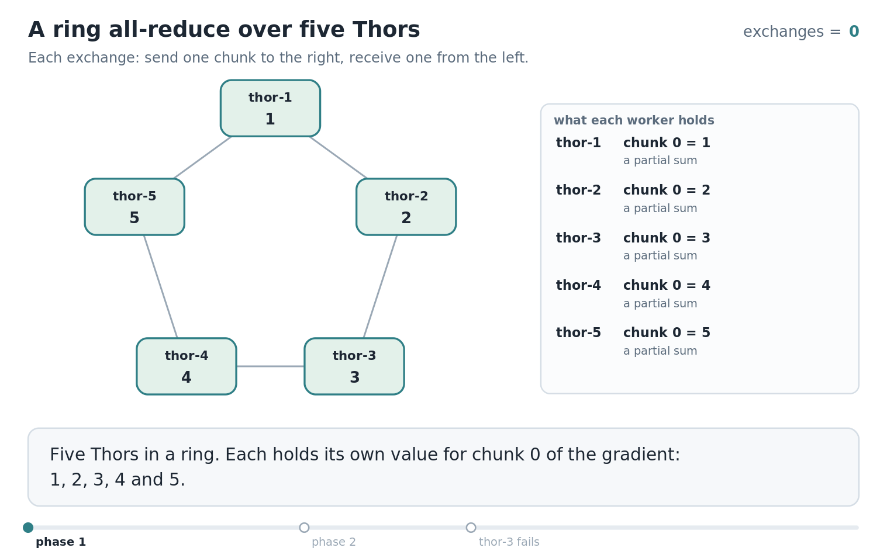

# 7. Collective communication and training failures

The jobs in the earlier chapters each ran on one machine. A model that is too large or
too slow to train on one machine is trained on several at once, and that changes what a
failure means. In this chapter, we will look at what the machines of a training job say
to each other during every step, why the failure of one machine stops all of them, and
how often a job should save its state so that a failure costs little.

We will first reason about the communication with pencil and paper, on the five Thors
from chapter 4. Then we will write `allreduce`, in Go and in Rust: five workers running
at the same time, connected in a ring, exchanging the pieces of a gradient. We will run
it healthy, run it again with one worker failing part of the way through, and finish
with the arithmetic of checkpoints.

<div class="covers">

This chapter covers

- one step of training on several machines, and the sum every machine needs
- all-reduce, and why a ring carries it better than a coordinator
- the cost of a step in gigabytes, for our Thors and our Sparks
- five concurrent workers in Go (goroutines and channels) and in Rust (threads and
  channels)
- how the failure of one worker spreads around the ring, one neighbour per exchange
- Young's formula for the time between checkpoints

</div>

## One step of training on five machines

Training adjusts a model's *parameters*, the numbers that make up the model, a little at
a time. One *step* takes a batch of training examples, measures how wrong the model's
output is for them, and computes a *gradient*: a list with one number for each
parameter, saying in which direction and how strongly that parameter should change. The
step ends by changing every parameter by a small multiple of its gradient entry.

With five machines, each holds a full copy of the model and takes a different batch.
Each computes its own gradient. Then all five have to apply the same change, or their
copies of the model drift apart. The change they apply is the average of the five
gradients, so before any machine can finish the step, every machine needs the sum of all
five gradients.

That requirement has a name. An operation in which every member of a group contributes a
value and every member receives the combined result is called *all-reduce*. It belongs
to a family called *collective communication*, a term from the MPI standard for
operations that a group of processes performs together, as opposed to one process
sending a message to one other. On NVIDIA GPUs the library that implements these
operations is NCCL, the NVIDIA Collective Communications Library, and training
frameworks call it once per step.

The gradient is as large as the model. A model with 7 billion parameters stored as
16-bit numbers has a gradient of 14 GB. The step cannot finish until 14 GB from each
machine have been combined and the result has reached every machine, so the network
between the machines is part of the inner loop of training.

## Two ways to add five gradients

The obvious design gives the job to one machine. Every worker sends its gradient to a
coordinator, the coordinator adds them, and sends the sum back to every worker.

Count what the coordinator's network link carries in one step: five gradients in and
five out. Every other link carries one in each direction. The coordinator's link is the
bottleneck, and it gets worse in proportion to the number of workers. With 14 GB
gradients and five workers, 70 GB pass through one link in each direction, every step.

The second design has no coordinator. Arrange the workers in a ring, so each has a left
and a right neighbour, and cut every gradient into as many *chunks* as there are
workers. Figure 7.1 compares the two shapes.

<figure>

<figcaption><b>Figure 7.1</b> A coordinator concentrates the traffic on one link. A ring spreads it evenly.</figcaption>
</figure>


The ring works in two phases. We follow one chunk, chunk 0, through both. Our five
workers start with the values 1, 2, 3, 4, and 5 in chunk 0, so its sum is 15.

In the first phase, each worker passes a partial sum to the right, and the receiver adds
its own value:

- `thor-1` sends its chunk 0, the value 1, to `thor-2`.
- `thor-2` adds its own 2 and sends 3 to `thor-3`.
- `thor-3` adds 3 and sends 6 to `thor-4`.
- `thor-4` adds 4 and sends 10 to `thor-5`.
- `thor-5` adds 5 and now holds 15, the finished sum of chunk 0.

That took four exchanges, one fewer than the number of workers. Meanwhile the other four
chunks made the same journey from different starting points: chunk 1 started at `thor-2`
and finished at `thor-1`, and so on. Every worker sent one chunk in every exchange, each
worker ends the phase holding the finished sum of exactly one chunk, and no two hold the
same one.

In the second phase the finished chunks travel around the ring so that everyone gets a
copy. `thor-5` sends the 15 to `thor-1`, which stores it and passes it on, and after
four more exchanges every worker holds it. The other finished chunks circulate at the
same time.

Now count what a link carries. With N workers there are 2(N − 1) exchanges, and each
sends one chunk, which is one Nth of a gradient, across every link. A worker therefore
sends 2(N − 1)/N gradients' worth of data per step. For five workers that is 1.6, and
however many workers join, it stays below 2. Every link carries the same amount, and
none is special.

Here is what that costs on our machines for the 14 GB gradient:

| Workers | Link between them | Sent by each worker per step | Time for the exchange |
|---|---|---|---|
| five Thors | one 25 GbE lane, 3.125 GB/s | 1.6 × 14 = 22.4 GB | 7.2 s |
| five Thors | four bonded lanes, 12.5 GB/s | 22.4 GB | 1.8 s |
| two Sparks | the 200 GbE cable, 25 GB/s | 1.0 × 14 = 14 GB | 0.56 s |

A step whose computation takes a second is dominated by seven seconds of communication
on a single 25 GbE lane. This is the reason the fast links on these machines exist, and
the reason chapter 8 places a job's workers by the links between them.

One more property follows from the ring's shape. Every chunk crosses every link. If one
link is slower than the rest, every chunk waits for it, and the whole step runs at the
speed of the slowest link.

## When one worker fails

The same shape decides what happens when a worker fails in the middle of a step. A
worker's every exchange depends on its left-hand neighbour: it cannot add to a chunk it
has not received. So when one worker stops, its right-hand neighbour is stuck at its
next exchange. That neighbour had already sent its chunk for the exchange, so the worker
after it completes one more exchange and is stuck at the following one. The stall
travels around the ring, one worker per exchange, until it has reached everyone.

When the stall is complete, no worker holds the sum. Each holds some finished chunks,
some partial sums, and some of its own original values, in a mixture that depends on
where it was stopped. The step cannot be finished by the workers that remain, because
the failed worker's values for some chunks were not sent.

The model in every worker's memory is intact, since the step had not yet changed it. But
a training job is built as a fixed group: its workers were started together with a fixed
ring, and the frameworks do not shrink the ring in mid-run. The practical response to
one failed worker is to stop all of them, replace the failed one, and start the whole
group again from the last saved state.

This has a consequence for the control plane that the single-machine jobs did not have.
The controller that owns a training job treats its pods as one unit: when one pod
fails, it deletes all of them and creates them all again. And it makes the two numbers
from chapter 3 matter in a new way. The time to detect the failed machine is time during
which the surviving machines hold their GPUs and do nothing.

<div class="lld">

Low-level design: `allreduce`

| Type | Holds | Rule it keeps |
|---|---|---|
| `message` | a chunk's index and its value | one message per exchange per worker |
| `Worker` | its ring position, its gradient, a channel from the left and one to the right | it only sends right and only receives left |
| `result` | exchanges completed, and why the worker stopped early | one per worker |

| Operation | Does |
|---|---|
| `Worker.Run(n)` | performs 2(n − 1) exchanges: send one chunk right, receive one from the left, add it in the first phase and store it in the second |
| `ring(n, failing, failAfter)` | builds the channels, starts every worker at once, and waits for all of them |
| `interval(jobMTBF)` | the time between checkpoints that loses the least work |

</div>

## Building `allreduce`

Each worker in the program stands for one Thor. One number stands for each chunk, which
keeps the output readable. The algorithm does the same thing to a chunk of three
gigabytes.

### A worker and its two channels

A worker has a position in the ring, its gradient, and two channels: it receives on one
and sends on the other. Both languages use a *channel*, a queue that one concurrently
running piece of code puts values into and another takes them out of. Nothing else is
shared between workers, which mirrors the real situation: machines in a training job
share no memory, only a network.

<p class="listing"><b>Listing 7.1</b> The message, the worker, and how long it waits, in Go. <a href="https://github.com/arpanpathak/cracking-the-systems-programming-interview/blob/prep-v2/gpu-accelerated-kubernetes/code/go/allreduce/main.go">code/go/allreduce/main.go</a></p>

```go
{{#include ../code/go/allreduce/main.go:worker}}
```

<p class="listing"><b>Listing 7.2</b> The message, the worker, and how long it waits, in Rust. <a href="https://github.com/arpanpathak/cracking-the-systems-programming-interview/blob/prep-v2/gpu-accelerated-kubernetes/code/rust/allreduce/src/main.rs">code/rust/allreduce/src/main.rs</a></p>

```rust
{{#include ../code/rust/allreduce/src/main.rs:worker}}
```


### The exchanges

`Run` is the algorithm. Each pass of its loop is one exchange: send a chunk to the right,
then wait for a chunk from the left. The chunk to send is found by counting backwards
from the worker's own position, one place per exchange. Working through the hand example
shows why that is right: after the first exchange, the chunk a worker sends next is
always the one it received last.

<p class="listing"><b>Listing 7.3</b> A worker's 2(n − 1) exchanges, in Go. <a href="https://github.com/arpanpathak/cracking-the-systems-programming-interview/blob/prep-v2/gpu-accelerated-kubernetes/code/go/allreduce/main.go">code/go/allreduce/main.go</a></p>

```go
{{#include ../code/go/allreduce/main.go:run}}
```

<p class="listing"><b>Listing 7.4</b> A worker's 2(n − 1) exchanges, in Rust. <a href="https://github.com/arpanpathak/cracking-the-systems-programming-interview/blob/prep-v2/gpu-accelerated-kubernetes/code/rust/allreduce/src/main.rs">code/rust/allreduce/src/main.rs</a></p>

```rust
{{#include ../code/rust/allreduce/src/main.rs:run}}
```


The wait for the left-hand neighbour has a time limit, which the program calls
`patience`. In Go the wait is a `select` with two cases, a message on the channel or the
timer from `time.After`, and whichever is ready first runs. In Rust it is the channel's
own `recv_timeout`, which returns an error if nothing arrives in time. Without the limit
a worker whose neighbour had failed would wait forever, and the program, like a training
job with no timeouts, would hang with no report of what went wrong.

The Rust version of `run` takes `self` by value and returns it. The worker is moved into
its thread when the thread starts and moved back out with the result when it ends, so
the main thread can read each worker's final gradient without any lock.

### Building the ring

`ring` creates one channel per link and gives each worker the receiving end of its own
link and the sending end of its right-hand neighbour's. It then starts every worker at
once and waits for all of them.

<p class="listing"><b>Listing 7.5</b> Connecting the workers and running them together, in Go. <a href="https://github.com/arpanpathak/cracking-the-systems-programming-interview/blob/prep-v2/gpu-accelerated-kubernetes/code/go/allreduce/main.go">code/go/allreduce/main.go</a></p>

```go
{{#include ../code/go/allreduce/main.go:ring}}
```

<p class="listing"><b>Listing 7.6</b> Connecting the workers and running them together, in Rust. <a href="https://github.com/arpanpathak/cracking-the-systems-programming-interview/blob/prep-v2/gpu-accelerated-kubernetes/code/rust/allreduce/src/main.rs">code/rust/allreduce/src/main.rs</a></p>

```rust
{{#include ../code/rust/allreduce/src/main.rs:ring}}
```


In Go each worker runs in a goroutine started with `wg.Go`, a method of
`sync.WaitGroup` that starts a function and counts it, and `wg.Wait` blocks until all
have returned. Each goroutine writes its result into its own element of `results`, so
no two goroutines write the same memory. In Rust each worker runs in a thread from
`thread::spawn`, and `join` waits for the thread and hands back what `run` returned.

The Go channels have a buffer large enough for every message a worker can send in a
step, and the Rust channels have no limit. A send therefore completes even when the
receiving worker has stopped, as it does on a real network, where data sent to a dead
machine leaves the sender and is acknowledged by nobody. The sender finds out only when
it waits for something in return.

### The time between checkpoints

The last piece is arithmetic. Saving a *checkpoint*, the model's parameters and the
position in the training data, takes time during which no training happens. Saving
rarely wastes little time on checkpoints and loses much work at each failure. Saving
often does the opposite. Somewhere between lies the interval that wastes the least.

Let C be the time one checkpoint takes, and M the job's *mean time between failures*
(MTBF), the average time from one failure to the next. With a checkpoint every T
seconds:

- the fraction of time spent writing checkpoints is C / T;
- a failure arrives, on average, halfway between two checkpoints, so it destroys T / 2
  of work, and with one failure every M seconds the fraction of time lost that way is
  T / (2M).

The total, C / T + T / (2M), is smallest when the two parts are equal, which happens at
T = √(2CM). This is *Young's formula*, published in 1974.

The M in the formula is the job's, and a job fails when any one of its machines fails. A
job on N machines therefore fails N times as often as one machine: its MTBF is one
machine's divided by N.

<p class="listing"><b>Listing 7.7</b> Young's formula, in Go. <a href="https://github.com/arpanpathak/cracking-the-systems-programming-interview/blob/prep-v2/gpu-accelerated-kubernetes/code/go/allreduce/main.go">code/go/allreduce/main.go</a></p>

```go
{{#include ../code/go/allreduce/main.go:checkpoint}}
```

<p class="listing"><b>Listing 7.8</b> Young's formula, in Rust. <a href="https://github.com/arpanpathak/cracking-the-systems-programming-interview/blob/prep-v2/gpu-accelerated-kubernetes/code/rust/allreduce/src/main.rs">code/rust/allreduce/src/main.rs</a></p>

```rust
{{#include ../code/rust/allreduce/src/main.rs:checkpoint}}
```


### The run

<p class="listing"><b>Listing 7.9</b> The healthy step, the failed step, and the checkpoint table, in Go. <a href="https://github.com/arpanpathak/cracking-the-systems-programming-interview/blob/prep-v2/gpu-accelerated-kubernetes/code/go/allreduce/main.go">code/go/allreduce/main.go</a></p>

```go
{{#include ../code/go/allreduce/main.go:main}}
```

<p class="listing"><b>Listing 7.10</b> The healthy step, the failed step, and the checkpoint table, in Rust. <a href="https://github.com/arpanpathak/cracking-the-systems-programming-interview/blob/prep-v2/gpu-accelerated-kubernetes/code/rust/allreduce/src/main.rs">code/rust/allreduce/src/main.rs</a></p>

```rust
{{#include ../code/rust/allreduce/src/main.rs:main}}
```


```console
$ go run ./allreduce
{{#include ../code/output/allreduce.txt}}
```


In the first part every worker ends with the same five sums, starting with the 15 we
computed by hand. Each sent 8 chunks, 1.6 gradients' worth, as the count predicted.

In the second part `thor-3` fails after two exchanges. `thor-4`, on its right, also
completed two and stopped at the third, waiting for `thor-3`. `thor-5` completed three,
`thor-1` four, and `thor-2` five. Reading the workers in ring order from the failure,
the counts are 2, 3, 4, 5: the stall moved one worker per exchange, as we reasoned. Each
worker names the neighbour it was waiting for, and only one of the four names the
machine that failed. A person who reads the report from `thor-2` alone would suspect
`thor-1`, which is healthy. Finding the worker that every chain of blame leads back to
is the same counting exercise as chapter 4's triage.

Animation 7.1 replays both runs on the ring, following chunk 0 in the first and the count
of completed exchanges in the second.

<figure class="anim">
<video class="motion" src="figures/ring-allreduce.mp4" autoplay loop muted playsinline preload="metadata" aria-label="Five Thors in a ring, each holding its value for chunk 0. A partial sum travels to the right and grows from 1 to 3, 6, 10 and 15, while grey dots show the other four chunks moving on the other links. The finished 15 then travels around the ring until every worker holds it. In the second part thor-3 fails after two exchanges; thor-4 stops after 2, thor-5 after 3, thor-1 after 4 and thor-2 after 5, each waiting for the neighbour on its left." data-chapters="[[0.0, &quot;phase 1&quot;], [22.26, &quot;phase 2&quot;], [35.7, &quot;thor-3 fails&quot;]]"></video>
<figcaption><b>Animation 7.1</b> One step of ring all-reduce, and the same step with one worker failing after two exchanges.</figcaption>
</figure>


The third part assumes that one machine fails every 30 days and that a checkpoint takes
50 seconds, which is 100 GB written at 2 GB per second. These are assumptions for the
arithmetic, and the formula takes whatever numbers a real fleet measures.

A job on one machine should checkpoint every 268 minutes and loses 0.6 percent of its
time. Our five Thors together fail every 144 hours, and the best interval is exactly two
hours, at a cost of 1.4 percent. At 512 machines the job fails every 1.4 hours on
average. It should checkpoint every 12 minutes, and 14.1 percent of its time goes to
checkpoints and repeated work. The machines are no less reliable than before. There are
more of them in one job, and this is why large training jobs invest in making
checkpoints fast.

## The complete program

<p class="listing"><b>Listing 7.11</b> The complete program in Go. <a href="https://github.com/arpanpathak/cracking-the-systems-programming-interview/blob/prep-v2/gpu-accelerated-kubernetes/code/go/allreduce/main.go">code/go/allreduce/main.go</a></p>

```go
{{#include ../code/go/allreduce/main.go}}
```

<p class="listing"><b>Listing 7.12</b> The complete program in Rust. <a href="https://github.com/arpanpathak/cracking-the-systems-programming-interview/blob/prep-v2/gpu-accelerated-kubernetes/code/rust/allreduce/src/main.rs">code/rust/allreduce/src/main.rs</a></p>

```rust
{{#include ../code/rust/allreduce/src/main.rs}}
```


<div class="summary">

## Summary

- Each step of training on several machines ends with an all-reduce: every worker
  contributes a gradient and every worker needs the sum.
- A ring all-reduce cuts each gradient into N chunks and takes 2(N − 1) exchanges. Each
  worker sends a little under two gradients' worth of data, and every link carries the same
  load.
- Every chunk crosses every link, so the step runs at the speed of the slowest link.
- A failed worker stalls its right-hand neighbour, and the stall moves around the ring
  one worker per exchange. The job restarts as a group from its last checkpoint.
- The time between checkpoints that wastes the least is √(2CM), where C is the cost of
  a checkpoint and M is the job's mean time between failures, which shrinks as the job
  grows.

</div>

## References

- NVIDIA, NCCL documentation:
  <https://docs.nvidia.com/deeplearning/nccl/user-guide/docs/index.html>
- A. Gibiansky, "Bringing HPC Techniques to Deep Learning", Baidu Research, 2017, which
  describes the ring all-reduce used here.
- P. Patarasuk and X. Yuan, "Bandwidth optimal all-reduce algorithms for clusters of
  workstations", Journal of Parallel and Distributed Computing, 2009.
- J. W. Young, "A first order approximation to the optimum checkpoint interval",
  Communications of the ACM, 17(9), 1974.
- MPI Forum, MPI: A Message-Passing Interface Standard, chapter on collective
  communication: <https://www.mpi-forum.org/docs/>
