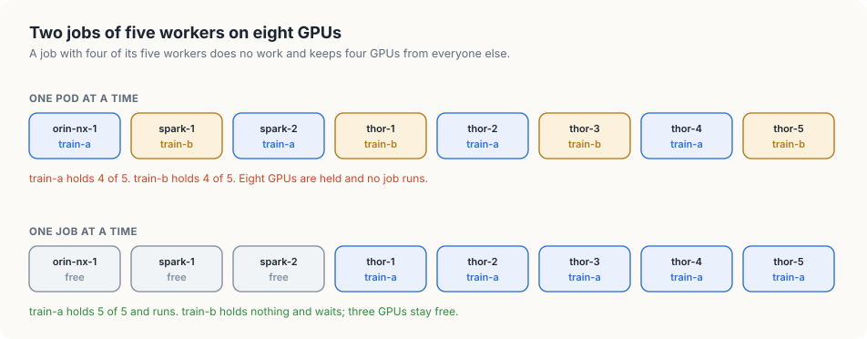
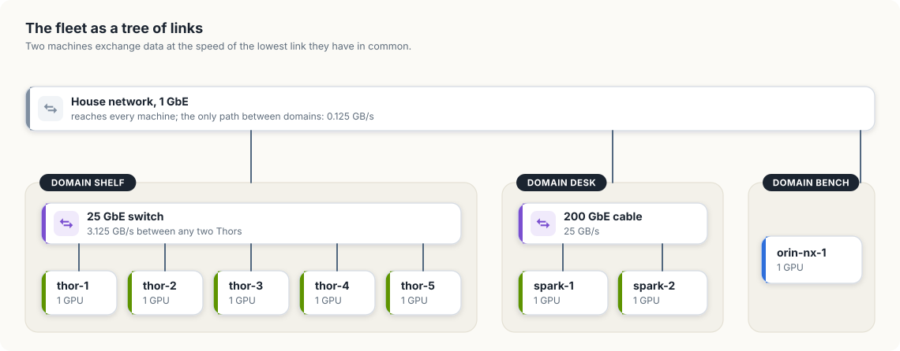

# 8. Placing jobs on GPUs

Chapter 7 established two facts about a training job that spans several machines. It
makes progress only when all of its workers are running, and its speed is set by the
slowest network link among them. This chapter covers what those facts require of the
scheduler, the component that chooses a machine for each pod.

It starts with how the Kubernetes scheduler places one pod and what goes wrong when a job
of several pods is placed that way. `gangsched`, a model in Go and in Rust, then hands out
the fleet's eight GPUs one pod at a time, then one whole job at a time, and then chooses a
job's machines by the links between them. The last section maps the model onto the pieces
of a real cluster: Kueue, pod groups, and topology labels.

<div class="covers">

This chapter covers

- how the scheduler places a single pod: filter, score, bind
- two jobs that each hold part of what they need, and neither can run
- gang scheduling: a job starts with all of its workers or stays in the queue
- topology: choosing machines that share a fast link
- packing small jobs into small groups, so large groups stay whole
- Kueue, pod groups, and node labels, which do this on a real cluster

</div>

## How one pod is placed

The scheduler is a controller in the sense of chapter 1. It watches for pods that have
no machine yet, which it recognises by an empty `spec.nodeName`, and it handles them
one at a time, in three stages.

1. *Filter.* It discards every node that cannot run the pod: nodes without enough free
   CPU, memory, or `nvidia.com/gpu`, nodes that are cordoned, as in chapter 4, and
   nodes whose labels do not satisfy the pod's `nodeSelector`, as in chapter 5.
2. *Score.* It gives each remaining node a number by a set of rules, such as preferring
   nodes that already have the pod's image.
3. *Bind.* It writes the name of the best node into the pod's `spec.nodeName`. The
   kubelet on that node sees the pod through its own watch and starts the containers.

Each pod is a separate decision. The scheduler has no notion that five pods belong
together, which causes the first problem.

## Two jobs, each with part of what it needs

Two training jobs arrive at the same moment, each made of five worker pods that ask for
one GPU, and the fleet has eight GPUs. Ten pods wait, and the scheduler takes
them in turn. The first eight are placed and the last two wait.

If the pods of the two jobs are interleaved in the queue, each job ends up with four of
its five workers. Neither can run a single step, because an all-reduce needs every
worker. Each holds four GPUs and waits for a fifth, and the only way a fifth can become
free is for the other job to give one up. Nothing in the system will make either do so.
All eight GPUs are allocated, the dashboards show a cluster in full use, and no training
is happening. Figure 8.1 shows the state.

<figure>

<figcaption><b>Figure 8.1</b> Above, one pod at a time: every GPU is held and nothing runs. Below, one job at a time: five GPUs do work, and three stay free for jobs that fit.</figcaption>
</figure>


The remedy is to make the job the unit of the decision. A job is *admitted* when all of
its workers can be placed, and all of them are placed together. Until then it holds
nothing. This is called *gang scheduling*, the gang being the group of pods that start
together or stay queued together.

With gang scheduling the same two jobs behave differently. The first is admitted and
takes five GPUs. The second needs five, finds three, and waits without taking any. One
job runs at full speed, the three free GPUs remain available to smaller jobs, and when
the first job finishes the second starts.

## Which machines

Admitting a job settles when it starts. Where it runs matters as much, because of the
links.

The eight machines are connected in three groups, called *domains* here. The five
Thors share the 25 GbE switch on the shelf. The two Sparks share the 200 GbE cable on
the desk. The Orin NX sits on the bench with 1 GbE. Between domains, the only path is
the house network that all machines use for SSH and for reaching the API server, at
1 GbE. Figure 8.2 draws this as a tree.

<figure>

<figcaption><b>Figure 8.2</b> The fleet as a tree of links. Two machines exchange data at the speed of the lowest link they have in common.</figcaption>
</figure>


Chapter 7 showed that a ring all-reduce runs at the speed of its slowest link and moves
2(N − 1)/N gradients per worker. For the 14 GB gradient of that chapter, two workers
that share the Sparks' cable need 14 / 25 = 0.56 seconds for each all-reduce. The same
two workers placed in different domains exchange their gradients over the house network
and need 14 / 0.125 = 112 seconds. The job is the same and the GPUs are equally fast.
The placement makes it two hundred times slower.

The placement rule therefore has two parts.

- *Keep a job inside one domain when one can hold it.* Then the job's slowest link is
  the domain's own.
- *Among the domains that can hold it, choose the one with the fewest free machines.* A
  two-worker job fits on the desk and on the shelf. Putting it on the shelf leaves three
  Thors, and a later job that needs four of them no longer fits anywhere. Putting it on
  the desk uses the desk completely and leaves the shelf whole.

The second part is a defence against *fragmentation*: free GPUs scattered across
domains in groups too small for the jobs that are waiting. The rule is a heuristic. It
makes good choices for the jobs it has seen and cannot know what will arrive next.

<div class="lld">

Low-level design: `gangsched`

| Type | Holds | Rule it keeps |
|---|---|---|
| `Node` | name, domain, and the job that holds its GPU | one GPU, held by at most one job |
| `Link` | a label and a rate in GB per second | one per domain, plus the house network |
| `Job` | a name and a number of workers | every worker needs one GPU |

| Operation | Does |
|---|---|
| `podAtATime(fleet, jobs)` | gives each job one GPU in turn until none are left |
| `admit(fleet, job, place)` | asks `place` for machines for every worker, and starts the job only if it gets them |
| `firstFree(open, workers)` | a placer: the first free machines in name order |
| `byTopology(open, workers)` | a placer: the tightest single domain that fits, or the first free machines if none does |
| `exchangeSeconds(nodes)` | the time of one all-reduce over the slowest link among the nodes |

</div>

## Building `gangsched`

### The fleet as the scheduler sees it

Each machine has one GPU, so a node is a name, a domain, and the job that holds its GPU.
The machines are listed in name order, which is the order in which a listing of Node
objects from the API server arrives.

<p class="listing"><b>Listing 8.1</b> Nodes, links, and jobs, in Go. <a href="https://github.com/arpanpathak/cracking-the-systems-programming-interview/blob/prep-v2/gpu-accelerated-kubernetes/code/go/gangsched/main.go">code/go/gangsched/main.go</a></p>

```go
{{#include ../code/go/gangsched/main.go:fleet}}
```

<p class="listing"><b>Listing 8.2</b> Nodes, links, and jobs, in Rust. <a href="https://github.com/arpanpathak/cracking-the-systems-programming-interview/blob/prep-v2/gpu-accelerated-kubernetes/code/rust/gangsched/src/main.rs">code/rust/gangsched/src/main.rs</a></p>

```rust
{{#include ../code/rust/gangsched/src/main.rs:fleet}}
```


The Go version names a domain with a string and looks its link up in a map. The Rust
version makes the domain an `enum` and the lookup a `match`, so a domain with no link is
a compile error.

### One pod at a time

`podAtATime` plays the scheduler without gangs. It goes round the jobs, giving each one
free GPU per turn, until a whole round passes in which nobody could be given anything.

<p class="listing"><b>Listing 8.3</b> Handing out GPUs one pod at a time, in Go. <a href="https://github.com/arpanpathak/cracking-the-systems-programming-interview/blob/prep-v2/gpu-accelerated-kubernetes/code/go/gangsched/main.go">code/go/gangsched/main.go</a></p>

```go
{{#include ../code/go/gangsched/main.go:podwise}}
```

<p class="listing"><b>Listing 8.4</b> Handing out GPUs one pod at a time, in Rust. <a href="https://github.com/arpanpathak/cracking-the-systems-programming-interview/blob/prep-v2/gpu-accelerated-kubernetes/code/rust/gangsched/src/main.rs">code/rust/gangsched/src/main.rs</a></p>

```rust
{{#include ../code/rust/gangsched/src/main.rs:podwise}}
```


### Two ways to choose machines

A *placer* is a function that takes the free machines and a number of workers and
returns the machines to use, or nothing. Making it a function lets `admit` work with
either policy.

`firstFree` takes the first free machines in the list, which is placement with no policy.

`byTopology` groups the free machines by domain, keeps the domains with enough room, and
takes the smallest of those. When no single domain can hold the job, it falls back to
`firstFree`, and the job runs across domains at the speed of the house network. A real
scheduler would let the job's owner choose between that and waiting.

<p class="listing"><b>Listing 8.5</b> The two placers, in Go. <a href="https://github.com/arpanpathak/cracking-the-systems-programming-interview/blob/prep-v2/gpu-accelerated-kubernetes/code/go/gangsched/main.go">code/go/gangsched/main.go</a></p>

```go
{{#include ../code/go/gangsched/main.go:place}}
```

<p class="listing"><b>Listing 8.6</b> The two placers, in Rust. <a href="https://github.com/arpanpathak/cracking-the-systems-programming-interview/blob/prep-v2/gpu-accelerated-kubernetes/code/rust/gangsched/src/main.rs">code/rust/gangsched/src/main.rs</a></p>

```rust
{{#include ../code/rust/gangsched/src/main.rs:place}}
```


### What a placement costs

Comparing placements requires a number. `slowest` finds the link a set of machines is
limited by: their domain's link if they share one, the house network if they do not.
`exchangeSeconds` applies chapter 7's count to it.

<p class="listing"><b>Listing 8.7</b> The slowest link and the time of one all-reduce, in Go. <a href="https://github.com/arpanpathak/cracking-the-systems-programming-interview/blob/prep-v2/gpu-accelerated-kubernetes/code/go/gangsched/main.go">code/go/gangsched/main.go</a></p>

```go
{{#include ../code/go/gangsched/main.go:cost}}
```

<p class="listing"><b>Listing 8.8</b> The slowest link and the time of one all-reduce, in Rust. <a href="https://github.com/arpanpathak/cracking-the-systems-programming-interview/blob/prep-v2/gpu-accelerated-kubernetes/code/rust/gangsched/src/main.rs">code/rust/gangsched/src/main.rs</a></p>

```rust
{{#include ../code/rust/gangsched/src/main.rs:cost}}
```


### Admitting a whole job

`admit` is gang scheduling in a dozen lines. It asks the placer for machines for every
worker. If the placer returns nothing, the job waits and the fleet is untouched. Only
when every worker has a machine does `admit` mark any of them as taken.

<p class="listing"><b>Listing 8.9</b> All of a job's workers, or none, in Go. <a href="https://github.com/arpanpathak/cracking-the-systems-programming-interview/blob/prep-v2/gpu-accelerated-kubernetes/code/go/gangsched/main.go">code/go/gangsched/main.go</a></p>

```go
{{#include ../code/go/gangsched/main.go:admit}}
```

<p class="listing"><b>Listing 8.10</b> All of a job's workers, or none, in Rust. <a href="https://github.com/arpanpathak/cracking-the-systems-programming-interview/blob/prep-v2/gpu-accelerated-kubernetes/code/rust/gangsched/src/main.rs">code/rust/gangsched/src/main.rs</a></p>

```rust
{{#include ../code/rust/gangsched/src/main.rs:admit}}
```


### The run

<p class="listing"><b>Listing 8.11</b> Four experiments on the same fleet, in Go. <a href="https://github.com/arpanpathak/cracking-the-systems-programming-interview/blob/prep-v2/gpu-accelerated-kubernetes/code/go/gangsched/main.go">code/go/gangsched/main.go</a></p>

```go
{{#include ../code/go/gangsched/main.go:main}}
```

<p class="listing"><b>Listing 8.12</b> Four experiments on the same fleet, in Rust. <a href="https://github.com/arpanpathak/cracking-the-systems-programming-interview/blob/prep-v2/gpu-accelerated-kubernetes/code/rust/gangsched/src/main.rs">code/rust/gangsched/src/main.rs</a></p>

```rust
{{#include ../code/rust/gangsched/src/main.rs:main}}
```


```console
$ go run ./gangsched
{{#include ../code/output/gangsched.txt}}
```


The first experiment is the deadlock of Figure 8.1: `train-a` and `train-b` each hold
four GPUs, all eight are taken, and zero jobs run.

In the second, `train-a` is admitted whole and placed on the five Thors, the only domain
that can hold five workers. Its all-reduce takes 7.2 seconds over one 25 GbE lane, the
figure from chapter 7's table. `train-b` waits with three GPUs free, and starts on the
Thors when `train-a` finishes.

The third experiment places three jobs on the first free machines. `pair` gets
`orin-nx-1` and `spark-1`, two machines in different domains, and each of its
all-reduces takes 112 seconds over the house network. `quad` gets the other Spark and
three Thors and takes 168 seconds per all-reduce.

The fourth places the same jobs by topology. `pair` fits on the desk and on the shelf,
and the desk is the tighter fit, so it gets the two Sparks and 0.6 seconds per
all-reduce. `quad` fits only on the shelf and gets four Thors at 6.7 seconds. `single`
fits on the bench and on the one Thor that is left. Both have a single free machine, the
bench is listed first, and it gets the Orin NX, which leaves the last Thor free. Every job runs inside one domain, and the communication of `pair` is
about two hundred times faster than in the third experiment.

Animation 8.1 plays the four experiments on the fleet.

<figure class="anim">
<video class="motion" src="figures/gang-placement.mp4" autoplay loop muted playsinline preload="metadata" aria-label="The eight machines in three groups: the bench with the Orin NX, the desk with two Sparks, and the shelf with five Thors. Placed one pod at a time, train-a and train-b each take four machines and neither runs. Placed as whole jobs, train-a takes the five Thors and train-b waits holding nothing. Three jobs placed on the first free machines put pair on the Orin NX and a Spark at 112.0 seconds per all-reduce and quad on a Spark and three Thors at 168.0 seconds. Placed by topology, pair takes the two Sparks at 0.6 seconds, quad takes four Thors at 6.7 seconds, and single takes the Orin NX." data-chapters="[[0.0, &quot;one pod at a time&quot;], [9.54, &quot;whole jobs&quot;], [22.86, &quot;first free&quot;], [35.46, &quot;by topology&quot;]]"></video>
<figcaption><b>Animation 8.1</b> The four experiments of <code>gangsched</code> on the fleet.</figcaption>
</figure>


## On a real cluster

The Kubernetes scheduler places single pods, so gang scheduling and topology are added
around it. Three pieces do the work.

*Kueue* is a job queueing controller from the Kubernetes project. It decides when a job
may start. A job managed by Kueue is created with `spec.suspend: true`, a field of the
built-in Job object that tells the Job controller to create no pods yet. Kueue keeps
such jobs in a queue and holds a quota of each resource for each team, in an object
called a *ClusterQueue*. When the whole job fits within the quota, Kueue admits it by
setting `suspend` to false, and only then do its pods exist and reach the scheduler.
This is the model's `admit` with quota in place of free machines. Kueue's quotas
are also where fairness between teams lives: each team has a share of the GPUs it is
guaranteed, and a queue may borrow what another team is not using.

A *pod group* handles the case where quota is available and the machines are not. The
scheduler can be extended with plugins, and a coscheduling plugin lets a set of pods
declare that they form a group with a minimum size. The scheduler finds a node for each
pod as usual and then, before binding, holds the pod until enough members of its group
have found nodes too. If they do not within a timeout, all of them are released and
retried. This removes the partial placements of the first experiment at the level of
individual machines.

*Topology labels* tell the scheduler which machines share a link. A node carries labels,
as chapter 5 showed, and a cluster's administrator adds one for each level of the network:
the rack, the switch, the block of racks. For this fleet one label is enough:

```console
$ kubectl label node thor-1 thor-2 thor-3 thor-4 thor-5 gpucloud.dev/domain=shelf
$ kubectl label node spark-1 spark-2 gpucloud.dev/domain=desk
$ kubectl label node orin-nx-1 gpucloud.dev/domain=bench
```

A job then asks for all of its pods to land on nodes with the same value of that label.
Kueue's topology-aware scheduling reads the levels from an object that lists the label
keys from widest to narrowest, and picks the narrowest level whose free capacity holds
the job, which is the rule `byTopology` applies to the three domains.

<div class="callout">

**Health and scheduling meet here.** A gang placed on five Thors depends on all five. If
chapter 4's controller cordons `thor-4` while a five-worker job is queued, the shelf can
hold only four workers and the job no longer fits in any domain. The scheduler needs the
health controller's verdicts as input, and the health controller's disruption budget
should count a draining machine against every gang that needs it.

</div>

## The complete program

<p class="listing"><b>Listing 8.13</b> The complete program in Go. <a href="https://github.com/arpanpathak/cracking-the-systems-programming-interview/blob/prep-v2/gpu-accelerated-kubernetes/code/go/gangsched/main.go">code/go/gangsched/main.go</a></p>

```go
{{#include ../code/go/gangsched/main.go}}
```

<p class="listing"><b>Listing 8.14</b> The complete program in Rust. <a href="https://github.com/arpanpathak/cracking-the-systems-programming-interview/blob/prep-v2/gpu-accelerated-kubernetes/code/rust/gangsched/src/main.rs">code/rust/gangsched/src/main.rs</a></p>

```rust
{{#include ../code/rust/gangsched/src/main.rs}}
```


<div class="summary">

## Summary

- The scheduler places one pod at a time by filtering nodes, scoring them, and binding
  the pod to the best one.
- Jobs placed one pod at a time can each end up with part of what they need, holding
  every GPU while none of them runs.
- Gang scheduling admits a job only when all of its workers can be placed, and a job
  that does not fit holds nothing while it waits.
- A job's workers should share one network domain, since its all-reduce runs at the
  speed of the slowest link among them.
- Among the domains that fit, the tightest one keeps larger domains whole for larger
  jobs.
- On a cluster, Kueue admits whole jobs against a quota, a pod group keeps the scheduler
  from binding part of a gang, and node labels describe the topology.

</div>

## References

- Kubernetes, Scheduling framework:
  <https://kubernetes.io/docs/concepts/scheduling-eviction/scheduling-framework/>
- Kueue documentation:
  <https://kueue.sigs.k8s.io/docs/overview/>
- Kueue, Topology aware scheduling:
  <https://kueue.sigs.k8s.io/docs/concepts/topology_aware_scheduling/>
- Kubernetes scheduler plugins, Coscheduling:
  <https://github.com/kubernetes-sigs/scheduler-plugins/tree/master/pkg/coscheduling>
- Kubernetes, Jobs, suspending a Job:
  <https://kubernetes.io/docs/concepts/workloads/controllers/job/#suspending-a-job>
