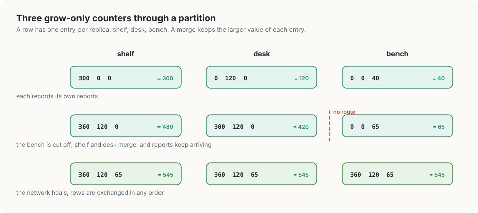
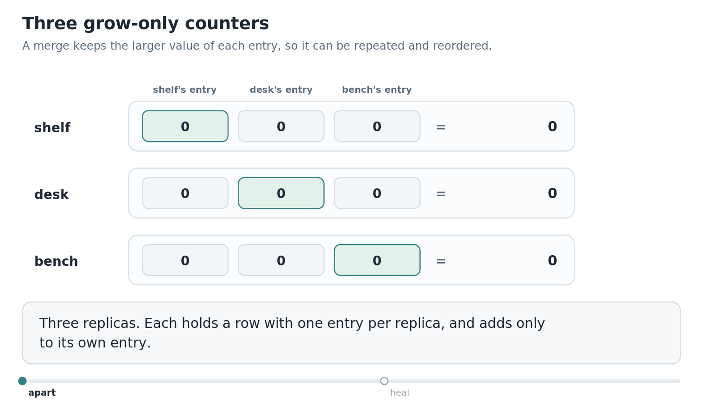
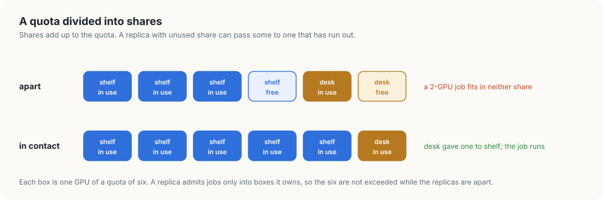

# 9. Counting across replicas

A GPU platform counts all day. It counts the GPU time each team's jobs have used, so
that the time can be billed or shared out fairly, and it counts the GPUs each team has
in use right now, so that a quota can be enforced. Inside one cluster, counting is not
hard: the API server is the single place every write passes through. A platform that
spans several sites has several places where things happen, and they cannot always
reach each other.

In this chapter, we will count across three replicas of a usage service, one beside
each group of machines in our fleet. We will first see why the obvious ways of keeping
the replicas in step lose counts or count twice. Then we will write `counter`, in Go and
in Rust, which builds a count that survives a network partition, extends it to a count
that goes down as well as up, and finally shows the one thing such a count cannot do,
which is to enforce a limit, and what does that job in its place.

<div class="covers">

This chapter covers

- one authority for a count, and what it costs when the network splits
- why "keep the larger number" and "add the other's number" both go wrong
- a grow-only counter: one entry per replica, merged by taking the larger
- the three properties of that merge, and what each one buys
- a counter that goes up and down, built from two that only grow
- a quota across replicas: why a merged count overshoots, and shares that do not

</div>

## One authority, or several

Suppose each group of machines in our fleet has a small service beside it that records
usage: one on the shelf with the Thors, one on the desk with the Sparks, one on the
bench with the Orin NX. Jobs report to the nearest one. Each of these is a *replica* of
the usage service, and all three are meant to hold the same totals.

The first design gives the count a single home. One replica, or a database that all
three write to, holds the number, and every report becomes a write to it. etcd is a
database of this kind: it stores each write on a majority of its members before it
acknowledges the write, so that all members agree on the order of writes. The count is
always exact.

The cost appears when the network between the sites fails. Our three groups are joined
only by the house network. If it goes down, the bench is alone. A replica that cannot
reach a majority has two choices, and both are bad for a usage counter:

- It can refuse reports until the network returns. The jobs near it keep running, and
  their usage for that period is not recorded.
- It can accept reports into a count of its own. Now there are two counts, and the
  design gave us no rule for combining them afterwards.

A split like this is called a *network partition*, and the choice is a general one.
During a partition, a replica that is cut off can stay *consistent*, by refusing work it
cannot coordinate, or stay *available*, by doing the work alone. It cannot do both. For
a count of usage we want availability: a report should be accepted wherever it arrives.
So we need the thing the second choice lacked, a rule for combining counts that were
kept apart.

## Two rules that do not work

Let each replica keep one number, its total. After some jobs have reported, the shelf
holds 300 GPU-seconds, the desk 120, and the bench 40. The true total is 460. Now the
replicas exchange numbers and each has to decide what its total should be.

*Keep the larger.* Each replica replaces its number with the larger of its own and the
one it received. All three end at 300. The 160 GPU-seconds recorded at the desk and the
bench are gone, because the rule treats two different counts as two versions of the same
count.

*Add the other's number.* Each replica adds what it receives to its own. After the shelf
and the desk exchange once, both say 420, which is right for those two. But exchanges
repeat, and messages are sometimes delivered twice. When the desk's 120 arrives at the
shelf a second time, the shelf says 540. A rule based on adding counts every report
again each time the replicas talk.

Both rules fail for the same reason. A single number does not say whose reports it
contains, so a replica that receives one cannot tell which part of it is news.

## One entry per replica

The fix is to keep that information. Each replica holds a row with one entry for every
replica, itself included. Two rules govern the row:

- A replica records a report by adding to *its own* entry. It leaves every other
  entry as it received it.
- When a replica receives another's row, it goes through the entries one by one and
  keeps the larger of its own value and the received one.

The count is the sum of the row.

"Keep the larger" failed for totals and works here, and the difference is what the two
numbers being compared mean. An entry is written by exactly one replica and only ever
increases. So when two values of the same entry differ, they really are an older and a
newer version of the same thing, and the larger is the newer.

Let us run the earlier example. After the first reports, written as rows of
(shelf, desk, bench):

- the shelf holds (300, 0, 0),
- the desk holds (0, 120, 0),
- the bench holds (0, 0, 40).

The shelf receives the desk's row and takes the larger in each position: (300, 120, 0),
which sums to 420. If the same row arrives again, nothing changes, because 120 is not
larger than 120. When the bench's row arrives, the shelf holds (300, 120, 40), and the
sum is 460.

This structure is called a *grow-only counter*, or G-counter. Figure 9.1 follows three
of them through a partition.

<figure>

<figcaption><b>Figure 9.1</b> Three grow-only counters through a partition. Each replica adds to its own entry, and a merge keeps the larger value of each entry.</figcaption>
</figure>


### What the merge guarantees

The merge has three properties, and each one removes a requirement from the network
between the replicas.

- Merging the same row twice gives the same result as merging it once. So a message may
  be delivered twice, and replicas may exchange rows as often as they like.
- Merging row A and then row B gives the same result as B and then A. So messages may
  arrive in any order.
- Merging A with the result of merging B and C gives the same result as merging A and B
  first and then C. So a row may travel through other replicas on its way, picking up
  their entries, and nothing is lost or doubled.

Together they mean that any two replicas that have received the same reports, by any
route, hold the same row. Nothing has to be coordinated, and a replica that was cut off
for an hour catches up with one exchange. Data structures with a merge of this kind are
called *conflict-free replicated data types* (CRDTs).

### Counting down

A count of GPUs in use has to go down when a job ends, and "keep the larger" cannot
represent a decrease: a replica that lowered its entry would have the old, larger value
merged straight back in.

The way round this is to use two grow-only counters. One counts every increase and the
other counts every decrease, and the value is the first minus the second. Both halves
only grow, so both merge safely. This is a *PN-counter*, for positive and negative.

## What a merged count cannot do

A quota is a limit: this team may use at most six GPUs at once. Enforcing it means
refusing a job when the count is at the limit, and here the merged count lets us down.

Suppose the shelf and the desk both know that four of the six GPUs are in use, and then
lose contact. A two-GPU job arrives at each. Each replica looks at its own count, sees
four in use, and admits the job, correctly by everything it knows. When contact returns
and the counts merge, eight GPUs are in use against a quota of six.

No cleverer merge fixes this. A limit is a statement about the sum of what all replicas
have done, and a replica that is cut off cannot know what the others are doing at this
moment. What we can do is divide the limit beforehand, while the replicas can still
talk. Each replica is given a *share* of the quota and admits jobs only out of its own
share. The shares add up to the quota, so whatever the replicas do while apart, the
total stays within it. When they are in contact, a replica with unused share can hand
some to one that has run out.

The price is that a job can be refused while capacity exists. If the shelf has one GPU
of its share left and the desk has one, a two-GPU job is refused at both, even though
two GPUs are free in total, until the replicas can talk and move a share across. The
partition forces a choice here too, and for a limit we chose to refuse.

<div class="lld">

Low-level design: `counter`

| Type | Holds | Rule it keeps |
|---|---|---|
| `GCounter` | one entry per replica | an entry is increased only by its own replica; `Merge` keeps the larger value of each entry |
| `PNCounter` | two `GCounter`s, `Up` and `Down` | the value is `Up` minus `Down`; both halves merge independently |

| Operation | Does |
|---|---|
| `Add(replica, n)` | records n at that replica's entry |
| `Merge(other)` | combines another replica's state into this one |
| `Value()` | the current count |

</div>

## Building `counter`

### The grow-only counter

A `GCounter` is an array with one entry per replica. `Add` touches one entry, `Merge`
takes the larger value of each, and `Value` sums them.

<p class="listing"><b>Listing 9.1</b> The grow-only counter, in Go. <a href="https://github.com/arpanpathak/cracking-the-systems-programming-interview/blob/prep-v2/gpu-accelerated-kubernetes/code/go/counter/main.go">code/go/counter/main.go</a></p>

```go
{{#include ../code/go/counter/main.go:gcounter}}
```

<p class="listing"><b>Listing 9.2</b> The grow-only counter, in Rust. <a href="https://github.com/arpanpathak/cracking-the-systems-programming-interview/blob/prep-v2/gpu-accelerated-kubernetes/code/rust/counter/src/main.rs">code/rust/counter/src/main.rs</a></p>

```rust
{{#include ../code/rust/counter/src/main.rs:gcounter}}
```


The counter is a fixed-size array in both languages, which makes it a plain value:
assigning it copies it, and "send my row to another replica" in the program is passing
the array to `Merge`.

### The counter that goes down

`PNCounter` holds two grow-only counters. A positive change goes into `Up`, a negative
one into `Down` with its sign removed.

<p class="listing"><b>Listing 9.3</b> The up-and-down counter, in Go. <a href="https://github.com/arpanpathak/cracking-the-systems-programming-interview/blob/prep-v2/gpu-accelerated-kubernetes/code/go/counter/main.go">code/go/counter/main.go</a></p>

```go
{{#include ../code/go/counter/main.go:pncounter}}
```

<p class="listing"><b>Listing 9.4</b> The up-and-down counter, in Rust. <a href="https://github.com/arpanpathak/cracking-the-systems-programming-interview/blob/prep-v2/gpu-accelerated-kubernetes/code/rust/counter/src/main.rs">code/rust/counter/src/main.rs</a></p>

```rust
{{#include ../code/rust/counter/src/main.rs:pncounter}}
```


### One number per replica

The first experiment is the rule that fails: one total per replica, synchronised by
keeping the larger.

<p class="listing"><b>Listing 9.5</b> Keeping the larger of two totals, in Go. <a href="https://github.com/arpanpathak/cracking-the-systems-programming-interview/blob/prep-v2/gpu-accelerated-kubernetes/code/go/counter/main.go">code/go/counter/main.go</a></p>

```go
{{#include ../code/go/counter/main.go:naive}}
```

<p class="listing"><b>Listing 9.6</b> Keeping the larger of two totals, in Rust. <a href="https://github.com/arpanpathak/cracking-the-systems-programming-interview/blob/prep-v2/gpu-accelerated-kubernetes/code/rust/counter/src/main.rs">code/rust/counter/src/main.rs</a></p>

```rust
{{#include ../code/rust/counter/src/main.rs:naive}}
```


### Through a partition

The second experiment gives each replica a `GCounter`. The bench is cut off, the shelf
and the desk merge with each other, and reports keep arriving on both sides. After the
partition the rows are merged in an order chosen to be untidy, with one merge repeated.

<p class="listing"><b>Listing 9.7</b> Grow-only counters, a partition, and an untidy recovery, in Go. <a href="https://github.com/arpanpathak/cracking-the-systems-programming-interview/blob/prep-v2/gpu-accelerated-kubernetes/code/go/counter/main.go">code/go/counter/main.go</a></p>

```go
{{#include ../code/go/counter/main.go:grow}}
```

<p class="listing"><b>Listing 9.8</b> Grow-only counters, a partition, and an untidy recovery, in Rust. <a href="https://github.com/arpanpathak/cracking-the-systems-programming-interview/blob/prep-v2/gpu-accelerated-kubernetes/code/rust/counter/src/main.rs">code/rust/counter/src/main.rs</a></p>

```rust
{{#include ../code/rust/counter/src/main.rs:grow}}
```


### GPUs in use

The third experiment counts jobs starting and ending. One job's end is reported to a
different replica from the one that recorded its start, which is ordinary: a job's
machine and the replica that hears of its end need not be in the same place.

<p class="listing"><b>Listing 9.9</b> Starts and ends recorded at different replicas, in Go. <a href="https://github.com/arpanpathak/cracking-the-systems-programming-interview/blob/prep-v2/gpu-accelerated-kubernetes/code/go/counter/main.go">code/go/counter/main.go</a></p>

```go
{{#include ../code/go/counter/main.go:updown}}
```

<p class="listing"><b>Listing 9.10</b> Starts and ends recorded at different replicas, in Rust. <a href="https://github.com/arpanpathak/cracking-the-systems-programming-interview/blob/prep-v2/gpu-accelerated-kubernetes/code/rust/counter/src/main.rs">code/rust/counter/src/main.rs</a></p>

```rust
{{#include ../code/rust/counter/src/main.rs:updown}}
```


### A quota, two ways

The last two experiments enforce a quota of six GPUs. `sharedLimit` lets each replica
check its own merged count. `allowances` gives each replica a share.

<p class="listing"><b>Listing 9.11</b> A limit checked against a local count, and a limit divided into shares, in Go. <a href="https://github.com/arpanpathak/cracking-the-systems-programming-interview/blob/prep-v2/gpu-accelerated-kubernetes/code/go/counter/main.go">code/go/counter/main.go</a></p>

```go
{{#include ../code/go/counter/main.go:quota}}
```

<p class="listing"><b>Listing 9.12</b> A limit checked against a local count, and a limit divided into shares, in Rust. <a href="https://github.com/arpanpathak/cracking-the-systems-programming-interview/blob/prep-v2/gpu-accelerated-kubernetes/code/rust/counter/src/main.rs">code/rust/counter/src/main.rs</a></p>

```rust
{{#include ../code/rust/counter/src/main.rs:quota}}
```


### The run

```console
$ go run ./counter
{{#include ../code/output/counter.txt}}
```


With one number per replica, every replica says 300 after synchronising, and the jobs
used 460.

With one entry per replica, the two sides of the partition disagree while it lasts: the
shelf counts 480, the desk 420, and the bench 65. That is expected, since each is
missing reports the others hold. After the untidy recovery all three hold the row
`[360 120 65]` and the count 545, which is every report added once: 300, 120, 40, 60,
and 25.

Animation 9.1 plays the second experiment, one merge at a time.

<figure class="anim">
<video class="motion" src="figures/gcounter-merge.mp4" autoplay loop muted playsinline preload="metadata" aria-label="Three rows, for the shelf, the desk and the bench, each with one entry per replica and a sum. Each replica first adds to its own entry: 300, 120 and 40. The bench is cut off, the shelf and the desk exchange rows, and more reports arrive, giving sums of 480, 420 and 65. After the network heals the rows are exchanged in an untidy order, one exchange twice, and all three rows read 360, 120, 65 with a sum of 545." data-chapters="[[0.0, &quot;apart&quot;], [22.38, &quot;heal&quot;]]"></video>
<figcaption><b>Animation 9.1</b> Grow-only counters through a partition. Every merge keeps the larger value of each entry.</figcaption>
</figure>


The count of GPUs in use comes to 3: five jobs started, and two ended, one of them
recorded at the bench.

In the fourth experiment both replicas admit a job at "6 of 6", and the merged count is
8 of 6. In the fifth, with shares of 4 and 2 and usage of 3 and 1, both replicas refuse
the two-GPU job while apart. When contact returns, the desk gives its unused GPU to the
shelf, the shelf admits the job, and the total in use is exactly 6. Figure 9.2 shows the
shares before and after.

<figure>

<figcaption><b>Figure 9.2</b> A quota divided into shares. The total stays within six whatever the replicas do while apart.</figcaption>
</figure>


## Where Kubernetes stands

Inside one cluster, Kubernetes takes the first design. A *ResourceQuota* object limits
what a namespace may use, and the API server checks it when a pod is created. The check
is exact because the API server is the one authority and etcd puts every write in a
single order: the resource version of chapter 1 is that order made visible. A cluster
whose control plane is cut off from part of itself stops accepting changes from that
part, which is the consistent choice.

The techniques of this chapter apply above that level: usage that is gathered from many
clusters into one bill, a team's quota that spans clusters in several regions, a rate
limit enforced by many copies of an API gateway. In each of these, no single API server
sees every event, and the count has to be assembled from replicas that are sometimes
apart.

## The complete program

<p class="listing"><b>Listing 9.13</b> The complete program in Go. <a href="https://github.com/arpanpathak/cracking-the-systems-programming-interview/blob/prep-v2/gpu-accelerated-kubernetes/code/go/counter/main.go">code/go/counter/main.go</a></p>

```go
{{#include ../code/go/counter/main.go}}
```

<p class="listing"><b>Listing 9.14</b> The complete program in Rust. <a href="https://github.com/arpanpathak/cracking-the-systems-programming-interview/blob/prep-v2/gpu-accelerated-kubernetes/code/rust/counter/src/main.rs">code/rust/counter/src/main.rs</a></p>

```rust
{{#include ../code/rust/counter/src/main.rs}}
```


<div class="summary">

## Summary

- A single authority gives an exact count and stops counting on the cut-off side of a
  partition.
- A single number per replica cannot be merged: keeping the larger loses counts, and
  adding counts them again on every exchange.
- A grow-only counter keeps one entry per replica. Each replica adds to its own entry,
  and a merge keeps the larger value of each entry.
- That merge can be repeated, reordered, and relayed through other replicas, so replicas
  that have received the same reports hold the same count.
- Two grow-only counters, one for increases and one for decreases, give a count that
  goes down.
- A merged count cannot enforce a limit. Dividing the limit into shares can, at the
  price of refusing some work while capacity exists.

</div>

## References

- M. Shapiro, N. Preguiça, C. Baquero, M. Zawirski, "A comprehensive study of Convergent
  and Commutative Replicated Data Types", INRIA research report 7506, 2011.
- V. Balegas and others, "Extending Eventually Consistent Cloud Databases for Enforcing
  Numeric Invariants", 34th IEEE Symposium on Reliable Distributed Systems (SRDS), 2015,
  which describes the bounded counter with transferable shares.
- S. Gilbert and N. Lynch, "Brewer's conjecture and the feasibility of consistent,
  available, partition-tolerant web services", ACM SIGACT News, 33(2), 2002.
- Kubernetes, Resource quotas:
  <https://kubernetes.io/docs/concepts/policy/resource-quotas/>
- etcd, KV API guarantees:
  <https://etcd.io/docs/latest/learning/api_guarantees/>
