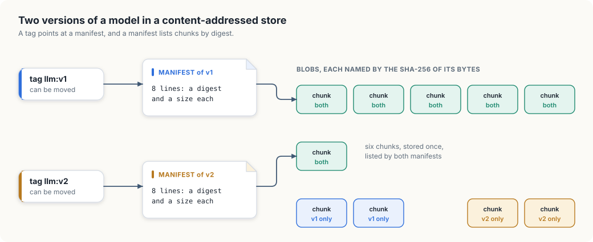
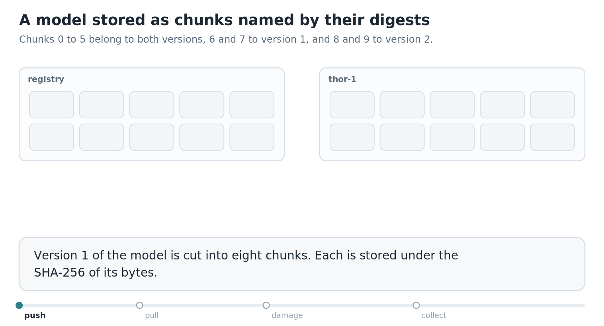

# 10. A content-addressed artifact store

Before a job can run on a machine, the machine needs two large things: the container
image with the job's programs, and usually a model's weights. A Thor or a Spark has room
for a model of a hundred gigabytes, and a training run produces a new version of such a
model every few hours. Something has to hold all of these versions, deliver them to the
machines, and do so without copying a hundred gigabytes every time one layer of a model
changes.

This chapter builds the storage scheme that container registries and model stores share.
It starts with the limits of a name someone chose and what changes when a file is named by
its own contents. `cas`, written in Go and in Rust, stores artifacts as chunks named by
their hashes. The run pushes two versions of a model, pulls one to a machine that already
has the other, detects and repairs a corrupted chunk, and reclaims space.

<div class="covers">

This chapter covers

- names that people choose, and what they fail to promise
- a digest: a name computed from the contents
- the same scheme in containerd on the cluster's node
- chunks and manifests: an artifact as a list of digests
- pushing a second version that shares most of its chunks with the first
- pulling only what a machine lacks, and verifying every byte that arrives
- garbage collection: removing what no tag leads to

</div>

## What a chosen name does not promise

Model weights stored in files named by hand, such as `llm-v1.bin`, `llm-v2.bin`, and
`llm-latest.bin`, leave three questions open. A machine that is told to load `llm-latest.bin` and has a file of that
name faces three questions that the name cannot answer.

- *Is it the right version?* `latest` pointed at one model yesterday and points at
  another today. Two machines in the same training job can hold different files under
  the same name, and the job's results depend on which machine a worker landed on.
- *Is it intact?* A file that was cut short by a full disk or changed by a failing
  memory chip still has its name.
- *Do I already have it?* If `llm-v2.bin` is `llm-v1.bin` with one layer retrained, the
  two files are almost the same bytes, and nothing in their names says so. The machine
  downloads all of it.

All three have one cause: the name and the contents are unrelated, so knowing one says
nothing about the other.

## A name computed from the contents

A *cryptographic hash function* takes any sequence of bytes and computes a short,
fixed-size value from it. SHA-256, used here, produces 256 bits, written as 64
hexadecimal digits. Two properties make it useful here. The same bytes always give the
same value, and although different inputs that give the same value must exist, nobody
knows how to find two, so in practice a value identifies one particular sequence of
bytes. The value is called a *digest*.

A *content-addressed store* uses the digest as the name. A blob of bytes is stored under
its digest and fetched by asking for that digest. This one change answers all three
questions.

- A digest names exactly one sequence of bytes, for ever. Two machines that load the
  same digest load the same model.
- Anyone who receives a blob can compute its digest and compare it with the name they
  asked for. A blob that was cut short or altered does not match.
- Two blobs with the same contents have the same name, so storing the second one is a
  lookup that finds the first. A machine that is asked for a digest it holds has nothing
  to download.

### The same scheme on the cluster's node

The cluster's container images are already stored this way. containerd keeps the parts of
every image in a directory of files named by their SHA-256 digests. On the kind node:

```console
$ docker exec gpu-lab-control-plane sh -c \
    'ls /var/lib/containerd/io.containerd.content.v1.content/blobs/sha256 | head -3'
0286df745178d6f77c036891bed8ddc93a624c1fa9c054d134674a096ee882e6
069d1e267530c2e681fbd4d481553b4d05f98082b18fafac86e7f12996dddd0b
0771a8a05619f4bb6f4c8484f942f509b21a04ebe56ee26d17a3006e250bfd46
$ docker exec gpu-lab-control-plane sh -c \
    'ls /var/lib/containerd/io.containerd.content.v1.content/blobs/sha256 | wc -l'
168
```

The node holds 168 blobs. The images built in earlier chapters are listed with the first
digits of their digests:

```console
$ docker exec gpu-lab-control-plane crictl images --digests | grep -E 'IMAGE|gpu-'
IMAGE                            TAG   DIGEST          IMAGE ID        SIZE
docker.io/library/gpu-check      1     3714eb7096522   07ee9035514b4   73.3MB
docker.io/library/gpu-sharing    1     413391f612a31   4212abdefc4b5   74.3MB
```

`gpu-check` and `gpu-sharing` were built from the same base image, so most of their
73 MB are the same blobs, stored once. A pod's spec can name an image by its digest,
`gpu-check@sha256:...`, and the kubelet then runs exactly those bytes on every node.

## Chunks and manifests

Naming a whole 100 GB file by one digest answers the first two questions and does little
for the third: change one byte and the digest changes, and the whole file is a new blob.
Sharing the unchanged parts between versions requires storing a large artifact in pieces.

- The artifact is cut into *chunks* of a fixed size. Each chunk is a blob, stored under
  its own digest.
- A *manifest* is a small text file that lists the chunks' digests in order. It is a
  blob too, and its digest names the whole artifact: a different chunk anywhere gives a
  different line in the manifest and so a different manifest digest.
- A *tag* is a name a person chose, such as `llm:v2`, that points at a manifest's
  digest. Tags are the only part of the store that can change.

Figure 10.1 shows two versions of a model stored this way.

<figure>

<figcaption><b>Figure 10.1</b> Two versions of a model. The manifests differ, and six of the eight chunks are stored once and listed by both.</figcaption>
</figure>


Version 2 is version 1 with its last quarter retrained. Its first six chunks have the
same bytes as version 1's, so they have the same digests and are the same blobs. Pushing version 2 stores two new chunks and one new manifest.

Container images have had this shape for years. An image is a manifest that lists
*layers*, each layer is a blob named by its digest, and two images built from the same
base share the base's layers. The format is standardised as the OCI image
specification, and registries that store images this way are now also used to store
model weights as *OCI artifacts*.

<div class="lld">

Low-level design: `cas`

| Type | Holds | Rule it keeps |
|---|---|---|
| `Digest` | `sha256:` and 64 hex digits | computed from the bytes it names |
| `Store` | blobs by digest, and tags by name | a blob's bytes hash to its key; only tags are ever reassigned |
| manifest (a blob) | one line per chunk: digest and size | lists the chunks in order |

| Operation | Does |
|---|---|
| `Put(bytes)` | stores a blob under its digest, once |
| `Get(digest)` | returns a blob after hashing it again and comparing |
| `Push(tag, artifact)` | chunks the artifact, stores chunks and manifest, points the tag at the manifest |
| `Pull(remote, tag)` | copies the manifest and whichever of its chunks are missing here |
| `Read(tag)` | reassembles an artifact, verifying each chunk |
| `Collect()` | removes every blob that no tag leads to |

</div>

## Building `cas`

The model store keeps its blobs in memory, in a map from digest to bytes, so that the
program has no files to clean up. A store on disk is the same map with one file per blob,
in a directory layout like containerd's.

### Blobs by digest

`Put` computes the digest and stores the bytes only if that digest is not already a key.
`Get` hashes the bytes again and compares the result
with the name it was asked for. Every read is therefore a check of the data.

<p class="listing"><b>Listing 10.1</b> Digests, the store, and verified reads, in Go. <a href="https://github.com/arpanpathak/cracking-the-systems-programming-interview/blob/prep-v2/gpu-accelerated-kubernetes/code/go/cas/main.go">code/go/cas/main.go</a></p>

```go
{{#include ../code/go/cas/main.go:store}}
```

<p class="listing"><b>Listing 10.2</b> Digests, the store, and verified reads, in Rust. <a href="https://github.com/arpanpathak/cracking-the-systems-programming-interview/blob/prep-v2/gpu-accelerated-kubernetes/code/rust/cas/src/main.rs">code/rust/cas/src/main.rs</a></p>

```rust
{{#include ../code/rust/cas/src/main.rs:store}}
```


The Go standard library includes SHA-256 in `crypto/sha256`. Rust's standard library has
no hash functions of this kind, and the Rust version uses the `sha2` crate. The two
programs print the same digests, which confirms that both computed the same function over
the same bytes.

### Pushing an artifact

`Push` walks the artifact in steps of the chunk size, stores each chunk with `Put`, and
writes one line of the manifest for it. It counts how many chunks `Put` reported as new,
which is the amount of data a push to a remote registry would have to send. The
manifest is then stored like any other blob, and the tag is pointed at it.

<p class="listing"><b>Listing 10.3</b> Chunking an artifact and writing its manifest, in Go. <a href="https://github.com/arpanpathak/cracking-the-systems-programming-interview/blob/prep-v2/gpu-accelerated-kubernetes/code/go/cas/main.go">code/go/cas/main.go</a></p>

```go
{{#include ../code/go/cas/main.go:push}}
```

<p class="listing"><b>Listing 10.4</b> Chunking an artifact and writing its manifest, in Rust. <a href="https://github.com/arpanpathak/cracking-the-systems-programming-interview/blob/prep-v2/gpu-accelerated-kubernetes/code/rust/cas/src/main.rs">code/rust/cas/src/main.rs</a></p>

```rust
{{#include ../code/rust/cas/src/main.rs:push}}
```


The model's chunks are 8 KiB so that the example stays small. Real stores use chunks of a few
megabytes: large enough that the list of digests stays short, small enough that a
change touches few of them.

### Pulling and reading

`Pull` is how a machine gets an artifact. It reads the manifest from the remote store,
and for each chunk it lists, fetches the chunk only if the local store has no blob of
that name. `Read` reassembles the artifact from local chunks, and since it goes through
`Get`, a damaged chunk stops the read with an error that says which chunk it was.

<p class="listing"><b>Listing 10.5</b> Fetching what is missing, and reading with verification, in Go. <a href="https://github.com/arpanpathak/cracking-the-systems-programming-interview/blob/prep-v2/gpu-accelerated-kubernetes/code/go/cas/main.go">code/go/cas/main.go</a></p>

```go
{{#include ../code/go/cas/main.go:pull}}
```

<p class="listing"><b>Listing 10.6</b> Fetching what is missing, and reading with verification, in Rust. <a href="https://github.com/arpanpathak/cracking-the-systems-programming-interview/blob/prep-v2/gpu-accelerated-kubernetes/code/rust/cas/src/main.rs">code/rust/cas/src/main.rs</a></p>

```rust
{{#include ../code/rust/cas/src/main.rs:pull}}
```


### Reclaiming space

A content-addressed store grows with every push, and blobs cannot be deleted one
artifact at a time, because a chunk may be listed by several manifests. The store
removes blobs by *garbage collection* in two phases. The *mark* phase starts from the
tags, which are the only names people use, and notes every manifest they point at and
every chunk those manifests list. The *sweep* phase removes every blob that was not
noted.

<p class="listing"><b>Listing 10.7</b> Mark from the tags, then sweep, in Go. <a href="https://github.com/arpanpathak/cracking-the-systems-programming-interview/blob/prep-v2/gpu-accelerated-kubernetes/code/go/cas/main.go">code/go/cas/main.go</a></p>

```go
{{#include ../code/go/cas/main.go:gc}}
```

<p class="listing"><b>Listing 10.8</b> Mark from the tags, then sweep, in Rust. <a href="https://github.com/arpanpathak/cracking-the-systems-programming-interview/blob/prep-v2/gpu-accelerated-kubernetes/code/rust/cas/src/main.rs">code/rust/cas/src/main.rs</a></p>

```rust
{{#include ../code/rust/cas/src/main.rs:gc}}
```


### The run

The model's weights are 64 KiB from a fixed pseudo-random sequence, which stand in for
gigabytes. Version 2 keeps the first 48 KiB and replaces the last 16.

<p class="listing"><b>Listing 10.9</b> Two versions, a pull, a damaged chunk, and a collection, in Go. <a href="https://github.com/arpanpathak/cracking-the-systems-programming-interview/blob/prep-v2/gpu-accelerated-kubernetes/code/go/cas/main.go">code/go/cas/main.go</a></p>

```go
{{#include ../code/go/cas/main.go:main}}
```

<p class="listing"><b>Listing 10.10</b> Two versions, a pull, a damaged chunk, and a collection, in Rust. <a href="https://github.com/arpanpathak/cracking-the-systems-programming-interview/blob/prep-v2/gpu-accelerated-kubernetes/code/rust/cas/src/main.rs">code/rust/cas/src/main.rs</a></p>

```rust
{{#include ../code/rust/cas/src/main.rs:main}}
```


```console
$ go run ./cas
{{#include ../code/output/cas.txt}}
```


Pushing `llm:v1` stores eight chunks. Pushing `llm:v2` cuts the new artifact into eight
chunks as well and finds six of them already in the store, so it adds two. The registry
holds 12 blobs, ten chunks and two manifests, in 83,152 bytes, for two artifacts that
total 131,072 bytes.

`thor-1` starts empty and fetches all eight chunks of version 1. For version 2 it
fetches two chunks, 16,384 bytes, a quarter of the artifact. On a 100 GB model with the
same proportion changed, that is 25 GB where a store of whole files would send 100, and
at the 3.125 GB per second of one 25 GbE lane it is 8 seconds where the whole file
takes 32.

Then one bit of one chunk on `thor-1` flips. The next read of `llm:v1` stops at chunk 3
and names the digest whose contents no longer match. The repair is as local as the
damage: the machine drops that one blob and pulls again, the pull finds seven chunks
present and one missing, and 8,192 bytes come from the registry. The digest printed for
the reassembled artifact, `sha256:a6a98d7f309f`, is the digest of the whole 64 KiB of
version 1.

Finally the tag `llm:v1` is deleted. Collection marks the manifest of version 2 and its
eight chunks, and sweeps three blobs: the manifest of version 1 and the two chunks that
only version 1 listed. The six shared chunks stay, because version 2 still leads to
them.

Animation 10.1 plays the run, with the registry's chunks on the left and those on `thor-1`
on the right.

<figure class="anim">
<video class="motion" src="figures/cas-chunks.mp4" autoplay loop muted playsinline preload="metadata" aria-label="Two grids of ten chunk slots, one for the registry and one for thor-1. Pushing version 1 fills chunks 0 to 7 in the registry, and pushing version 2 adds only chunks 8 and 9. thor-1 pulls version 1 and receives eight chunks, then pulls version 2 and receives two. Chunk 3 on thor-1 turns red when one bit flips; it is dropped and fetched again. When the tag for version 1 is deleted, the registry sweeps chunks 6 and 7 and keeps the six shared chunks." data-chapters="[[0.0, &quot;push&quot;], [10.5, &quot;pull&quot;], [21.54, &quot;damage&quot;], [34.62, &quot;collect&quot;]]"></video>
<figcaption><b>Animation 10.1</b> Two pushes, two pulls, a repair of one chunk, and a collection.</figcaption>
</figure>


<div class="callout warning">

**Collection and pushes at the same time.** A push stores chunks first and the manifest
and tag last. A collection that runs between those steps sees chunks that no tag leads
to yet and removes them, and the push then completes with a manifest that lists missing
chunks. Real registries prevent this either by stopping pushes during a collection or
by sweeping only blobs older than some age, long enough for any push in progress to
finish.

</div>

## What the control plane gains

Content addressing is useful to every part of the system built in the earlier chapters.

A `GpuJob` that names its image and its model by digest runs the same bytes on every
worker of a gang, which chapter 7's synchronous step depends on. The checkpoint store of
chapter 4 can be one of these: a checkpoint is an artifact, its chunks that did not
change since the last checkpoint are not written again, and the epoch check sits on the
tag, which is the only thing that is overwritten. And a machine that returns from a
reimage, the last rung of chapter 4's ladder, refills its local store by pulling, and
the verification on every chunk doubles as a test of its new disk.

## The complete program

<p class="listing"><b>Listing 10.11</b> The complete program in Go. <a href="https://github.com/arpanpathak/cracking-the-systems-programming-interview/blob/prep-v2/gpu-accelerated-kubernetes/code/go/cas/main.go">code/go/cas/main.go</a></p>

```go
{{#include ../code/go/cas/main.go}}
```

<p class="listing"><b>Listing 10.12</b> The complete program in Rust. <a href="https://github.com/arpanpathak/cracking-the-systems-programming-interview/blob/prep-v2/gpu-accelerated-kubernetes/code/rust/cas/src/main.rs">code/rust/cas/src/main.rs</a></p>

```rust
{{#include ../code/rust/cas/src/main.rs}}
```


<div class="summary">

## Summary

- A name that a person chooses says nothing about the bytes behind it. A digest is
  computed from the bytes, so it identifies them, lets any reader verify them, and makes
  identical data one blob.
- containerd stores container images as blobs named by SHA-256 digest, and an image can
  be run by digest.
- A large artifact is stored as chunks and a manifest that lists their digests. Versions
  that share data share chunks.
- A pull fetches only the chunks a machine lacks, and every read verifies what it
  returns.
- Space is reclaimed by marking everything the tags lead to and sweeping the rest.

</div>

## References

- Open Container Initiative, Image Format Specification:
  <https://github.com/opencontainers/image-spec/blob/main/spec.md>
- Open Container Initiative, Distribution Specification:
  <https://github.com/opencontainers/distribution-spec/blob/main/spec.md>
- containerd, Content flow:
  <https://github.com/containerd/containerd/blob/main/docs/content-flow.md>
- Kubernetes, Images:
  <https://kubernetes.io/docs/concepts/containers/images/>
- NIST, FIPS 180-4, Secure Hash Standard:
  <https://csrc.nist.gov/pubs/fips/180-4/upd1/final>
