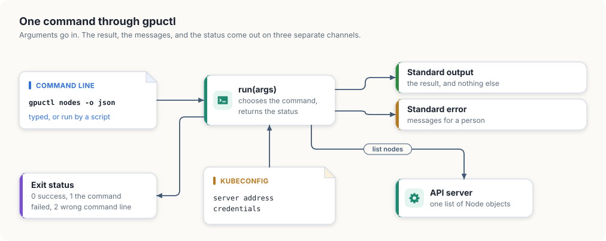
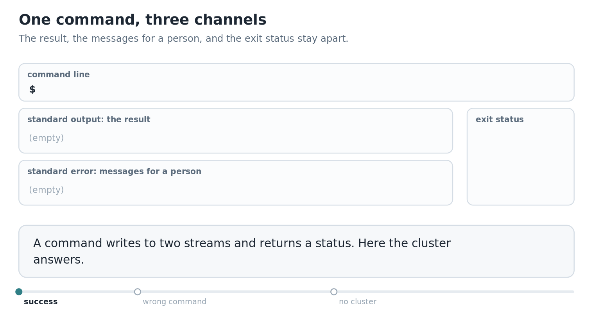
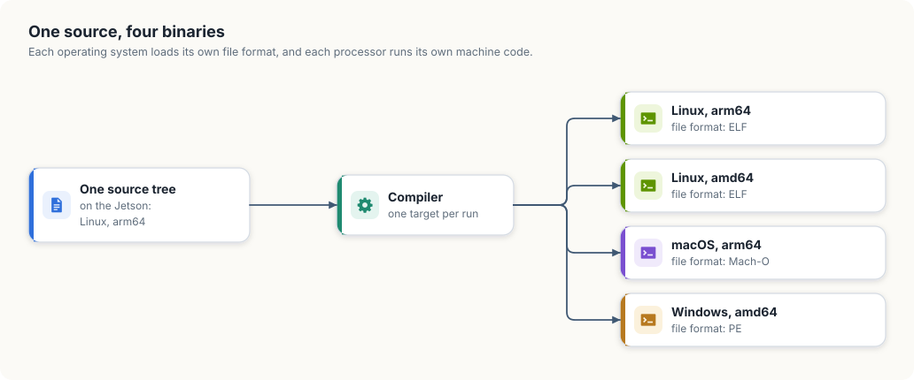

# 11. A command-line tool for Windows, macOS, and Linux

Every program in the earlier chapters runs inside the cluster or beside it, on Linux. The
people who use the cluster sit somewhere else. A researcher submits jobs from a MacBook,
an operator checks nodes from a Windows laptop, and a build pipeline does both from a
Linux container. What they all run is a command-line tool, and it is the one piece of a
GPU platform that has to work on three operating systems.

This chapter writes that tool. `gpuctl` is small: it lists a cluster's nodes with their
GPUs, reports where it keeps its files, and prints its version. The chapter sets out how a
command-line tool should behave so that both people and scripts can use it, implements it
in Go and in Rust, and builds it for the three systems from a Jetson, which shows where
each language makes cross-building straightforward and where it does not.

<div class="covers">

This chapter covers

- what a command line promises: output, messages, and an exit status
- where a tool's files belong on Linux, macOS, and Windows
- reading the cluster's nodes with client-go and with kube-rs
- a table for people and JSON for programs, from the same data
- building for three operating systems from one machine with Go
- what stops the same build in Rust, and how projects get around it

</div>

## What a command line promises

A command-line tool has two kinds of user. A person reads what it prints. A script runs
it, captures what it prints, and decides what to do next. A tool that serves both keeps
three channels apart.

- *Standard output* carries the result and nothing else. A script that runs
  `gpuctl nodes -o json` and feeds the output to another program must receive only
  JSON, with no progress messages or warnings mixed in.
- *Standard error* carries everything meant for a person: errors, warnings, and help
  text shown after a mistake.
- The *exit status* is a small number the tool returns to whatever started it. By
  convention 0 means success. A script checks the status before it trusts the output.

`gpuctl` uses three statuses. 0 is success. 1 means the command was understood and
failed, for example because the cluster could not be reached. 2 means the command line
itself was wrong. The distinction lets a script retry a failure of the first kind and
stop at once on the second, since a mistyped command stays mistyped on the next
attempt.

Figure 11.1 shows the tool's shape.

<figure>

<figcaption><b>Figure 11.1</b> One command through gpuctl: arguments in, and three separate channels out.</figcaption>
</figure>


<div class="lld">

Low-level design: `gpuctl`

| Command | Prints to standard output | Fails with |
|---|---|---|
| `gpuctl nodes [-o table\|json]` | one row per node: name, GPUs, architecture, operating system, kubelet version | 1 if the cluster cannot be reached |
| `gpuctl config` | the paths of its configuration file and of the kubeconfig | 1 if the home directory is unknown |
| `gpuctl version` | the version and the platform | |
| anything else | nothing; the usage text goes to standard error | 2 |

| Function | Does |
|---|---|
| `configFile()`, `kubeconfig()` | work out the two paths for the operating system the tool runs on |
| `listNodes()` | one list request to the API server, reduced to the fields printed |
| `printNodes(rows, format)` | writes a table or JSON |
| `run(args)` | chooses the command and returns the exit status |

</div>

## Where a tool's files live

A tool that remembers settings needs a place to keep them, and each operating system
has its own rule for where that is.

| System | Directory for a user's settings | Example for gpuctl |
|---|---|---|
| Linux | `$XDG_CONFIG_HOME`, or `~/.config` if it is unset | `/home/ana/.config/gpuctl/config.toml` |
| macOS | `~/Library/Application Support` | `/Users/ana/Library/Application Support/gpuctl/config.toml` |
| Windows | the folder named by `%AppData%` | `C:\Users\ana\AppData\Roaming\gpuctl\config.toml` |

Two details in this table catch programs that were written on one system and run on
another. The directory differs, so a path built by joining the home directory and
`.config` is wrong on two of the three. And the separator between the parts of a path
differs: Windows uses a backslash. Both languages provide a path type that joins parts
with the right separator, `filepath.Join` in Go and `PathBuf::join` in Rust, and a
portable program builds every path with it and writes no separator of its own.

Go's standard library knows the table: `os.UserConfigDir` returns the right directory
on each system. Rust's standard library has no such function, so the Rust version
writes the three cases out. `cfg!(windows)` and `cfg!(target_os = "macos")` are decided
when the program is compiled, so each build contains only its own case.

<p class="listing"><b>Listing 11.1</b> The configuration file and the kubeconfig, in Go. <a href="https://github.com/arpanpathak/cracking-the-systems-programming-interview/blob/prep-v2/gpu-accelerated-kubernetes/code/go/gpuctl/main.go">code/go/gpuctl/main.go</a></p>

```go
{{#include ../code/go/gpuctl/main.go:paths}}
```

<p class="listing"><b>Listing 11.2</b> The configuration file and the kubeconfig, in Rust. <a href="https://github.com/arpanpathak/cracking-the-systems-programming-interview/blob/prep-v2/gpu-accelerated-kubernetes/code/rust/gpuctl/src/main.rs">code/rust/gpuctl/src/main.rs</a></p>

```rust
{{#include ../code/rust/gpuctl/src/main.rs:paths}}
```


The second path is the *kubeconfig*, the file from which kubectl and every other client
reads the address of the API server and the user's credentials. Its location follows
one rule on all three systems: the `KUBECONFIG` environment variable if it is set, and
`.kube/config` under the home directory otherwise. `gpuctl` reads the same file, so it
talks to whichever cluster kubectl talks to. The Go version asks client-go's loading
rules for the path. The Rust version applies the rule itself.

## Reading the nodes

`gpuctl nodes` makes one request, a list of Node objects,
and keeps five fields of each: the name, the allocatable `nvidia.com/gpu` count from
chapter 5, and the architecture, operating system, and kubelet version that the kubelet
reports about its machine.

<p class="listing"><b>Listing 11.3</b> Listing the nodes and keeping five fields, in Go. <a href="https://github.com/arpanpathak/cracking-the-systems-programming-interview/blob/prep-v2/gpu-accelerated-kubernetes/code/go/gpuctl/main.go">code/go/gpuctl/main.go</a></p>

```go
{{#include ../code/go/gpuctl/main.go:nodes}}
```

<p class="listing"><b>Listing 11.4</b> Listing the nodes and keeping five fields, in Rust. <a href="https://github.com/arpanpathak/cracking-the-systems-programming-interview/blob/prep-v2/gpu-accelerated-kubernetes/code/rust/gpuctl/src/main.rs">code/rust/gpuctl/src/main.rs</a></p>

```rust
{{#include ../code/rust/gpuctl/src/main.rs:nodes}}
```


The Go version builds its client from the kubeconfig with `clientcmd`, the package of
client-go that implements the loading rule. Earlier programs used controller-runtime's
`GetConfigOrDie` for this. A command-line tool wants the error back as a value, so that
it can print it and choose the exit status. In the Rust version, `Client::try_default`
does the same loading and returns a `Result`.

Kubernetes stores a resource amount as a *quantity*, a number with an optional unit
suffix such as `16031232Ki`. A GPU count is a plain whole number. The Go version reads
it with the quantity's `Value` method. In `k8s-openapi` a quantity is a wrapper around
the string the API server sent, so the Rust version parses that string as an integer,
and a node with no GPUs, which has no such entry at all, counts as zero.

## One result, two forms

The rows are printed in one of two forms, chosen by the `-o` flag.

<p class="listing"><b>Listing 11.5</b> A table or JSON, in Go. <a href="https://github.com/arpanpathak/cracking-the-systems-programming-interview/blob/prep-v2/gpu-accelerated-kubernetes/code/go/gpuctl/main.go">code/go/gpuctl/main.go</a></p>

```go
{{#include ../code/go/gpuctl/main.go:output}}
```

<p class="listing"><b>Listing 11.6</b> A table or JSON, in Rust. <a href="https://github.com/arpanpathak/cracking-the-systems-programming-interview/blob/prep-v2/gpu-accelerated-kubernetes/code/rust/gpuctl/src/main.rs">code/rust/gpuctl/src/main.rs</a></p>

```rust
{{#include ../code/rust/gpuctl/src/main.rs:output}}
```


The table is for reading. Its columns are padded so that they line up, which Go's
`text/tabwriter` does from tab-separated cells and the Rust version does by measuring
each column's widest cell.

The JSON is for programs, and it is part of the tool's interface in a way the table is
not. A script that reads `gpus` from each object keeps working when a later version
adds a column to the table or changes its spacing. For that reason the field names are
written out in both versions, as struct tags in Go and as the field names of a
`Serialize` struct in Rust, and they would not be renamed lightly.

## Commands and exit statuses

`run` ties the pieces together. It looks at the first argument, carries out the
command, and returns the status. Every path through it ends in one of the three
statuses, and every message for a person goes to standard error.

<p class="listing"><b>Listing 11.7</b> Choosing the command and returning the status, in Go. <a href="https://github.com/arpanpathak/cracking-the-systems-programming-interview/blob/prep-v2/gpu-accelerated-kubernetes/code/go/gpuctl/main.go">code/go/gpuctl/main.go</a></p>

```go
{{#include ../code/go/gpuctl/main.go:exit}}
```

<p class="listing"><b>Listing 11.8</b> Choosing the command and returning the status, in Rust. <a href="https://github.com/arpanpathak/cracking-the-systems-programming-interview/blob/prep-v2/gpu-accelerated-kubernetes/code/rust/gpuctl/src/main.rs">code/rust/gpuctl/src/main.rs</a></p>

```rust
{{#include ../code/rust/gpuctl/src/main.rs:exit}}
```


<p class="listing"><b>Listing 11.9</b> The run function and main, in Go. <a href="https://github.com/arpanpathak/cracking-the-systems-programming-interview/blob/prep-v2/gpu-accelerated-kubernetes/code/go/gpuctl/main.go">code/go/gpuctl/main.go</a></p>

```go
{{#include ../code/go/gpuctl/main.go:run}}
```

<p class="listing"><b>Listing 11.10</b> The run function and main, in Rust. <a href="https://github.com/arpanpathak/cracking-the-systems-programming-interview/blob/prep-v2/gpu-accelerated-kubernetes/code/rust/gpuctl/src/main.rs">code/rust/gpuctl/src/main.rs</a></p>

```rust
{{#include ../code/rust/gpuctl/src/main.rs:run}}
```


The Go version parses the `-o` flag with the standard `flag` package and tells it to
stay silent, so that `run` prints one consistent usage text for every kind of mistake.
The Rust version matches the whole argument list against patterns. The pattern
`["nodes", "-o", "table" | "json"]` accepts exactly the two valid forms, and any other
list that starts with `nodes` falls through to the usage arm.

On the cluster, both versions print exactly this:

```console
{{#include ../code/output/gpuctl.txt}}
```

The table and the JSON hold the same row: the cluster's one node, with its one GPU, on `arm64`.
The unknown command prints its message and the usage text on standard error and exits
with 2. When the cluster cannot be reached, each version prints the error its client
library produced and exits with 1. The Go version prints:

```console
$ KUBECONFIG=/nonexistent gpuctl nodes
gpuctl: invalid configuration: no configuration has been provided, try setting KUBERNETES_MASTER environment variable
$ echo $?
1
```

Animation 11.1 shows three of these runs, each with its two streams and its status.

<figure class="anim">
<video class="motion" src="figures/cli-channels.mp4" autoplay loop muted playsinline preload="metadata" aria-label="A command line above two boxes, standard output and standard error, and a box for the exit status. gpuctl nodes -o json writes JSON to standard output, nothing to standard error, and exits with 0. gpuctl pods writes nothing to standard output, an unknown-command message and the usage text to standard error, and exits with 2. gpuctl nodes with a kubeconfig that does not exist writes an error to standard error and exits with 1." data-chapters="[[0.0, &quot;success&quot;], [7.62, &quot;wrong command&quot;], [20.22, &quot;no cluster&quot;]]"></video>
<figcaption><b>Animation 11.1</b> Three runs of <code>gpuctl</code>: a success, a wrong command line, and a failure.</figcaption>
</figure>


## Building for three systems

A program that runs on the Jetson is a file of ARM machine code in the format Linux
loads, called ELF. A Windows laptop with an Intel processor needs different machine
code in a different format, PE, and a MacBook needs ARM code in a third, Mach-O.
Producing a program for a system other than the one the compiler runs on is called
*cross-compilation*. Figure 11.2 shows the three targets.

<figure>

<figcaption><b>Figure 11.2</b> One source, four binaries. Each operating system loads its own file format, and each processor runs its own machine code.</figcaption>
</figure>


### In Go

The Go compiler and linker are written in Go and contain the code generators for every
platform Go supports. Two environment variables select the target: `GOOS` names the
operating system and `GOARCH` the processor. On the Jetson:

```console
$ GOOS=windows GOARCH=amd64 go build -o gpuctl-windows-amd64 ./gpuctl
$ GOOS=darwin  GOARCH=arm64 go build -o gpuctl-darwin-arm64  ./gpuctl
$ GOOS=linux   GOARCH=amd64 go build -o gpuctl-linux-amd64   ./gpuctl
$ file gpuctl-*
gpuctl-darwin-arm64:  Mach-O 64-bit arm64 executable, flags:<|DYLDLINK|PIE>
gpuctl-linux-amd64:   ELF 64-bit LSB executable, x86-64, version 1 (SYSV), statically linked
gpuctl-windows-amd64: PE32+ executable (console) x86-64, for MS Windows
```

Three commands on an ARM Linux board produced programs for Windows, macOS, and Intel
Linux. Each file is between 37 and 39 MB and needs nothing else installed: the Go runtime and
all of client-go are inside it. This works because `gpuctl` and everything it imports
are written in Go. A Go program that calls C code through cgo loses this property and
needs a C compiler for each target.

### In Rust

Rust selects a target with a *target triple*, such as `x86_64-unknown-linux-gnu` or
`aarch64-apple-darwin`, and `rustup target add` installs the standard library for one.
The Jetson has these installed:

```console
$ rustup target list --installed
aarch64-apple-darwin
aarch64-unknown-linux-gnu
x86_64-unknown-linux-gnu
```

The Rust compiler can generate code for all three. The build stops for another reason:

```console
$ cargo check -p gpuctl --target x86_64-unknown-linux-gnu
warning: ring@0.17.14: Compiler family detection failed due to error: ToolNotFound:
failed to find tool "x86_64-linux-gnu-gcc": No such file or directory (os error 2)
error: failed to run custom build command for `ring v0.17.14`
```

`ring` is the cryptography library that kube-rs uses, through its TLS library, for its
encrypted connection to the API server. Parts of it are written in C and assembly, and
its build compiles them with a C compiler for the target. The board has a C compiler
for ARM Linux and none for Intel Linux or for macOS. The same would happen at the last
step of any Rust build for another system: Rust calls the target system's linker to
produce the final file, and that linker has to be installed.

Cross-compiling Rust therefore means supplying a C toolchain for each target. Projects handle
this in one of two ways. Most build each target on a machine that runs it: a pipeline
with one Linux, one macOS, and one Windows runner, each running a plain `cargo build
--release` and uploading its binary. Others install cross toolchains, either one by one
or through a tool such as `cross`, which runs the build inside a container image that
has the right toolchain for the target.

A Rust program with no C in its dependencies gets further. `fleethealth` from chapter 4
uses only the standard library, and `cargo check -p fleethealth --target
aarch64-apple-darwin` passes on the Jetson, which shows that the compiler itself has no
difficulty with the target. The difficulty belongs to one dependency with C in it, the
same condition under which Go's cross-compilation stops working.

<div class="callout">

**Two names for one processor.** `gpuctl version` prints `linux/arm64` from both
versions, and the Rust version has to translate to do so. Go and Kubernetes call the
64-bit ARM architecture `arm64` and the 64-bit Intel one `amd64`. Rust and the Linux
kernel call them `aarch64` and `x86_64`. Tools that download a binary for the current
machine have to map between the two spellings, and a release that names its files by
one convention is found by scripts that expect the other only if someone wrote that
mapping down.

</div>

## The complete program

<p class="listing"><b>Listing 11.11</b> The complete program in Go. <a href="https://github.com/arpanpathak/cracking-the-systems-programming-interview/blob/prep-v2/gpu-accelerated-kubernetes/code/go/gpuctl/main.go">code/go/gpuctl/main.go</a></p>

```go
{{#include ../code/go/gpuctl/main.go}}
```

<p class="listing"><b>Listing 11.12</b> The complete program in Rust. <a href="https://github.com/arpanpathak/cracking-the-systems-programming-interview/blob/prep-v2/gpu-accelerated-kubernetes/code/rust/gpuctl/src/main.rs">code/rust/gpuctl/src/main.rs</a></p>

```rust
{{#include ../code/rust/gpuctl/src/main.rs}}
```


<div class="summary">

## Summary

- A command-line tool writes its result to standard output, its messages to standard
  error, and reports success or the kind of failure in its exit status.
- A user's settings live in a different directory on Linux, macOS, and Windows, and
  paths are joined with the path type of the language, which supplies the separator.
- The kubeconfig is found by one rule on every system, and a tool that follows it talks
  to the same cluster as kubectl.
- A table serves a reader, and JSON with stable field names serves scripts.
- Go cross-compiles a pure Go program with two environment variables. A Rust program
  cross-compiles when a C toolchain and linker for the target are present, and projects
  usually build each target on its own operating system.

</div>

## References

- Go, `os.UserConfigDir`: <https://pkg.go.dev/os#UserConfigDir>
- Go, Installing Go from source, the list of `GOOS` and `GOARCH` values:
  <https://go.dev/doc/install/source#environment>
- The rustc book, Platform support:
  <https://doc.rust-lang.org/rustc/platform-support.html>
- The Cargo book, `cargo build --target`:
  <https://doc.rust-lang.org/cargo/commands/cargo-build.html>
- Kubernetes, Organizing cluster access using kubeconfig files:
  <https://kubernetes.io/docs/concepts/configuration/organize-cluster-access-kubeconfig/>
- XDG Base Directory Specification:
  <https://specifications.freedesktop.org/basedir-spec/latest/>
- `cross`, zero-setup cross compilation for Rust: <https://github.com/cross-rs/cross>
