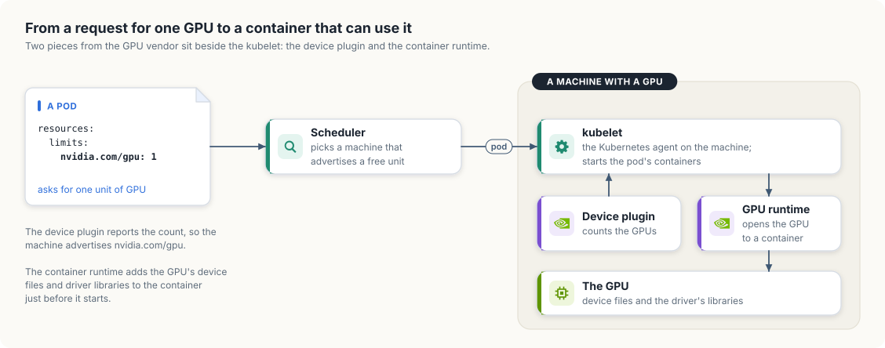

# Introduction

In this book, we will learn about running GPU workloads on Kubernetes and dive deep into
Kubernetes machinery with hands-on examples, both in Rust and Go. We will first build
intuition by reasoning and quickly prototype the data structures behind Kubernetes
machinery and concepts. Then we will build the same machinery with the libraries that
production controllers use, controller-runtime in Go and kube-rs in Rust, and run it on a
real cluster.

GPU workloads range from distributed training jobs that run across many machines to
inference services that answer requests all day. Running them by hand means choosing a
machine for each job, tracking which GPUs are free, and restarting work when something
fails, and doing that manually is error-prone and cumbersome. Kubernetes automates it: we
declare what we want to run, and its scheduler and controllers place the work and keep it
running. It is also extensible, so we can teach it about GPUs and about new kinds of work,
such as training jobs.

When a model is too large to train on one machine, we split the training across many
machines, and every training step needs every GPU in the job. This makes scheduling
harder. All of the job's workers have to start together, because a job that gets only
some of its workers holds those GPUs and makes no progress. The workers should also run
close to each other, because GPUs in the same machine exchange data much faster than GPUs
in different machines. And when several teams share one cluster, we need queues and
quotas so that every team gets its share of the GPUs. In this book, we will learn how
Kubernetes solves each of these problems, starting with how a controller learns about a
new job.

The examples run on any Kubernetes cluster with GPU nodes: a managed cluster from a cloud
provider, a cluster in our own data center, or a small cluster on a single machine.

By default, Kubernetes knows nothing about GPUs. It knows how many CPU cores and how much
memory each machine has, and it places containers on machines that have enough of both.
Two pieces of software, supplied by the GPU vendor, teach it about GPUs.

The first is the *device plugin*, a small program that runs on every machine with GPUs.
It counts the GPUs, reports the count to the kubelet (the Kubernetes agent on each
machine), and from then on the machine advertises the GPUs as a resource next to its CPU
and memory; for NVIDIA GPUs the resource is called `nvidia.com/gpu`. A *pod*, the object
in which Kubernetes runs one or more containers, can then ask for `nvidia.com/gpu: 1` in
the same way that it asks for two CPU cores, and the *scheduler*, the Kubernetes
component that chooses a machine for each new pod, places it only on a machine with a
free GPU. By default, one unit is one whole physical GPU; chapter 2 looks at what that unit
contains and at the ways a GPU can be shared or divided.

The second is a GPU-aware *container runtime*. A container normally sees none of the
machine's hardware devices, and its image does not contain the machine's GPU driver. When
a pod has been given a GPU, the runtime adds the GPU's device files and the driver's
libraries to the container just before it starts, so that a program inside it can use the
GPU.

Figure I.1 follows one request for a GPU past both pieces.

<figure>

<figcaption><b>Figure I.1</b> A pod asks for one GPU, the scheduler finds a machine that advertises one, and the two vendor pieces on that machine count the GPUs and open one to the container.</figcaption>
</figure>

We develop and test every example on a single-node cluster created with kind, a tool that
runs Kubernetes nodes as Docker containers. Appendix A shows how we build that cluster and
install both pieces on it.

We assume you can read Go and Rust and have used containers and kubectl. We explain each
Kubernetes concept when we first need it.

## Running the code

The book and all of its code live in the
[`gpu-accelerated-kubernetes`](https://github.com/arpanpathak/cracking-the-systems-programming-interview/tree/prep-v2/gpu-accelerated-kubernetes) directory of the
[cracking-the-systems-programming-interview](https://github.com/arpanpathak/cracking-the-systems-programming-interview)
repository on GitHub:

```console
$ git clone https://github.com/arpanpathak/cracking-the-systems-programming-interview.git
$ cd cracking-the-systems-programming-interview/gpu-accelerated-kubernetes
```

The listings in each chapter are included from the files under `code/`, so the code
printed in the book is the code that runs, and the `source:` link above each listing opens
that file on GitHub.

- [`code/go`](https://github.com/arpanpathak/cracking-the-systems-programming-interview/tree/prep-v2/gpu-accelerated-kubernetes/code/go) is one Go module. `informer` is the in-memory model from chapter 1, `gpujob`
  is the controller from section 1.1, built on controller-runtime, and `gpuusage` is the
  GPU accounting tool from chapter 2:

  ```console
  $ cd code/go
  $ go run ./informer
  $ go run ./gpujob/cmd/controller
  ```

- [`code/rust`](https://github.com/arpanpathak/cracking-the-systems-programming-interview/tree/prep-v2/gpu-accelerated-kubernetes/code/rust) is one Cargo workspace with the same three programs as packages. `gpujob`
  and `gpuusage` are built on kube-rs:

  ```console
  $ cd code/rust
  $ cargo run -p informer
  $ cargo run -p gpujob
  ```

- [`code/manifests`](https://github.com/arpanpathak/cracking-the-systems-programming-interview/tree/prep-v2/gpu-accelerated-kubernetes/code/manifests) holds the example objects that both controllers act on.
- [`code/gpu-sharing`](https://github.com/arpanpathak/cracking-the-systems-programming-interview/tree/prep-v2/gpu-accelerated-kubernetes/code/gpu-sharing) holds the CUDA programs and manifests for chapter 2.
- [`code/jetson-gpu`](https://github.com/arpanpathak/cracking-the-systems-programming-interview/tree/prep-v2/gpu-accelerated-kubernetes/code/jetson-gpu) holds the script, manifests, and test program for the kind cluster in
  Appendix A.

Every program has the same name in both trees. From chapter 3 on, each is one directory under
`code/go`, run with `go run ./<name>`, and one package under `code/rust`, run with
`cargo run -p <name>`:

| Chapter | Programs |
|---|---|
| 1. Keeping a local copy of the cluster | `informer` |
| 1.1 A GPU job controller on a real cluster | `gpujob` |
| 2. What one GPU means | `gpuusage`, and the CUDA programs `gpu_info` and `gpu_load` |
| 3. Knowing which machines are alive | `heartbeats`, `phi`, `leaseagent`, `leasewatch` |
| 4. A control plane for a fleet of hosts | `fleethealth`, `fencing` |
| 5. Kubernetes in a new cloud account | `provisioner` |
| 6. Virtual machines on Kubernetes | `migration` |
| 7. Collective communication and training failures | `allreduce` |
| 8. Placing jobs on GPUs | `gangsched` |
| 9. Counting across replicas | `counter` |
| 10. A content-addressed artifact store | `cas` |
| 11. A command-line tool for Windows, macOS, and Linux | `gpuctl` |

The programs of chapters 4 to 10 are models: they need no cluster, finish in well under a
second, and print the same output in Go and in Rust. The output shown in each chapter is
included from `code/output`, where a run of the program wrote it.

Each chapter introduces its programs in the same order. It starts from the problem and a
small example worked by hand, draws the design, and states the types and the rules they
keep in a box headed "Low-level design". The code then appears in short parts, each next to
the text that explains it, and the complete program is printed at the end of the chapter.

The Go module declares Go 1.26, and the Rust programs need Rust 1.89 or later, the
minimum version of the kube crate. The controllers need a Kubernetes cluster in the
current kubeconfig context.

The diagrams are drawn by `tools/draw_figures.py` and the animations by
`tools/animations.py`; `make figures` and `make animations` run them, and their output in
`src/figures` is part of the repository. The book's build removes the `ANCHOR` comments
that mark the parts of each program, with `tools/strip_anchors.py`, so Python 3 has to be
installed.

To read the book in a browser, install mdBook and run:

```console
$ mdbook serve --open
```
