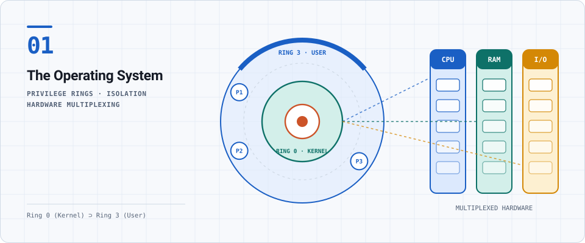

# 1. The Ontological Necessity of the Operating System

## 1.1 Architectural Limitations of Bare-Metal Execution

The requirement for an operating system is fundamentally predicated on the inherent architectural limitations of bare-metal execution. In a primitive hardware environment, a single processor core is constrained by a solitary program counter, which effectively precludes multi-program concurrency by capturing the instruction stream. Furthermore, the absence of a supervisory layer leaves the system without mechanisms for memory protection or instruction restriction, rendering any program capable of unmitigated interference with the hardware or other co-resident software. Finally, the lack of unified device drivers necessitates that every application manage its own hardware-specific communication, a process that is both inefficient and prone to catastrophic resource contention.

## 1.2 Axiomatic Roles: Abstraction, Isolation, and Resource Management

To resolve these deficiencies, the operating system implements three critical roles: abstraction, isolation, and resource management. Through abstraction, the OS mediates between complex hardware interfaces and simplified software objects, such as processes, files, and sockets, thereby decoupling program logic from physical device geometry. This abstraction, however, necessitates isolation; once multiple processes coexist within a managed environment, the OS must enforce strict boundaries to prevent cross-process interference. This enforcement is delegated to the hardware through privilege levels and page tables, ensuring that memory and resource access remain confined to authorized domains. The resulting contention for finite hardware necessitates resource management, where the OS acts as a central arbiter, orchestrating the distribution of CPU time, memory capacity, and I/O bandwidth according to evolving workload policies.

<figure>

</figure>

## 1.3 Mechanism versus Policy Separation

The implementation of these roles relies on the distinction between mechanism and policy. Mechanisms, the low-level primitives provided by the hardware, such as context switching or page table walks, remain constant across architectural iterations, while policies, the logic governing which process to schedule or which page to evict, are tuned to specific system requirements.

## 1.4 The System Call Boundary and POSIX Standard Interface

The boundary between the kernel (which executes in a privileged mode with unrestricted instruction access) and user-mode applications is mediated through the **Portable Operating System Interface (`POSIX`)** system call interface. A system call provides a hardware-supervised, deterministic transfer of control, allowing a program to request kernel services without compromising the integrity of the kernel's own address space. This transition, while computationally expensive compared to standard function calls, serves as the essential gatekeeper for system security and stability.

**Table 1-1. POSIX calls in this book.**

| Call | What it does | Chapter |
|---|---|---|
| `open` / `read` / `write` / `close` | access files through descriptors | 12, 13 |
| `fork` / `waitpid` / `execve` | create, reap, and replace processes | 3 |
| `mmap` / `mprotect` / `munmap` | map memory and change its protection | 7, 11 |
| `pipe` / `socketpair` | create communication channels | 11 |
| `poll` / `kqueue` / `epoll` | wait for readiness on many descriptors | 13 |
| `sigaction` / `sigprocmask` | install and mask signal handlers | 10 |
| `bind` / `listen` / `accept` / `connect` | establish network connections | 14 |
| `setsid` / `umask` / `chdir` | detach a daemon from its terminal | 15 |

Key idea

Every operating system balances two competing goals: **virtualization** (giving each program the illusion of a private processor, flat memory, and durable files) and **isolation** (preventing any faulty or adversarial program from corrupting sibling processes or the kernel). Separating unchanging hardware mechanisms from tunable kernel policies makes both possible.

