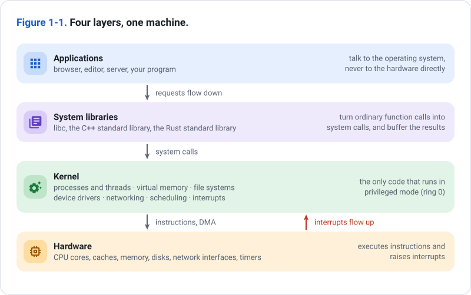

# 1. The Ontological Necessity of the Operating System

Before inspecting a single kernel data structure or POSIX system call, a systems engineer must understand *why* operating systems exist at all. Every abstraction introduced later in this book, from virtual memory page tables and preemptive schedulers to file descriptors and sockets, is a direct engineering answer to a specific failure mode of executing software directly on bare-metal hardware.

## 1.1 Architectural Limitations of Bare-Metal Execution

Consider booting a computer with zero operating system: a single compiled binary loaded into physical DRAM and executed directly by the processor. Even on modern 64-bit silicon, three structural limitations make bare-metal execution untenable for general-purpose computing:

1. **Monopolization of the Instruction Stream (No Concurrency):** A processor core possesses a single architectural Program Counter (`RIP` on x86-64; `PC` on ARM64). When a bare-metal program enters an infinite loop or waits for a slow disk read to complete, the core remains trapped inside that loop indefinitely. Running a compiler, a database, and a network daemon concurrently requires an external authority capable of periodically interrupting an executing program via a hardware timer, saving its complete register snapshot, and loading another program's registers onto the core.
2. **Absence of Memory and Fault Isolation:** Without hardware-enforced address translation configured by a trusted supervisor, every program reads and writes raw physical DRAM addresses directly. A single out-of-bounds array store in a text editor can silently overwrite the executable code of a co-resident database, corrupt hardware DMA buffers, or execute privileged `cli`/`hlt` instructions that freeze the entire machine.
3. **Hardware Heterogeneity and Device Contention:** Every NVMe SSD, Ethernet controller, and graphics card exposes proprietary Memory-Mapped I/O (MMIO) command queues, DMA ring formats, and interrupt registers. On bare metal, every application would need to embed device-specific drivers for every storage and network vendor on the market, and two programs writing to the same disk controller simultaneously would interleave commands and corrupt stored data.

## 1.2 Axiomatic Roles: Abstraction, Isolation, and Resource Management

An operating system kernel resolves these three bare-metal failure modes by assuming three interlocking architectural responsibilities, illustrated in Figure 1-1:

<figure>

</figure>

- **Abstraction (Virtualizing Raw Hardware):** The kernel transforms unruly physical components into clean, portable software primitives. A physical CPU core becomes an arbitrary number of **processes** and **threads** (Chapters 3 and 4); physical DRAM banks become private, contiguous **virtual address spaces** (Chapter 7); raw NVMe block sectors and PCIe NIC rings become unified byte streams accessed through integer **file descriptors** and **sockets** (Chapters 12 through 14). Application code written against POSIX `read()` and `write()` runs identically on an x86-64 server with NVMe storage and an Apple Silicon workstation without knowing a single hardware register layout.
- **Isolation (Hardware-Enforced Protection):** Virtualization is safe only when one program cannot inspect or corrupt another. The kernel programs the processor's privilege levels (Ring 0 / `EL1` for the kernel, Ring 3 / `EL0` for applications) and per-process hardware page tables (MMU) so that every memory reference and I/O operation is checked in silicon on every clock cycle. When a user process dereferences an unmapped pointer or executes a privileged instruction, the hardware traps into the kernel, which terminates only the offending process (`SIGSEGV`) while leaving every other process intact.
- **Resource Management (Arbitrating Contention):** When dozens of processes compete simultaneously for finite CPU cores, gigabytes of physical DRAM, and shared disk and network bandwidth, the kernel serves as the central arbiter. Schedulers allocate CPU quanta fairly while minimizing interactive latency (Chapter 5); the virtual-memory manager evicts cold pages and caches hot disk blocks in the page cache (Chapters 7 and 12); and I/O queues balance throughput against tail latency.

## 1.3 Mechanism versus Policy Separation

A foundational principle of durable operating system architecture is decoupling **mechanism** from **policy**:
- **Mechanism** answers *how* an operation is performed in hardware or low-level kernel code: saving registers and swapping `CR3` during a context switch, walking a 4-level page table, or flushing dirty pages to storage. Mechanisms are dictated by silicon constraints and remain stable for decades.
- **Policy** answers *which* choice to make under a given workload: which runnable thread to dispatch next (CFS/EEVDF proportional fairness vs. real-time `SCHED_FIFO`), which physical frame to evict under memory pressure (LRU/CLOCK vs. MGLRU), or which packets to prioritize on a saturated NIC.

Separating the two allows engineers to evolve scheduling or eviction policies across kernel releases (or tune them per container via `cgroups`, Chapter 16) without rewriting the underlying assembly context-switch or MMU fault-handling mechanisms.

## 1.4 The System Call Boundary and POSIX Standard Interface

Because applications execute in unprivileged User Mode, they cannot open files, allocate virtual mappings, spawn processes, or send network packets directly. Every such request must cross the hardware privilege boundary via a **system call** (`syscall` on x86-64; `svc #0` on ARM64, detailed in Chapter 9). The kernel validates every pointer, permission bit, and length supplied by user space, executes the privileged operation on the caller's behalf, and returns either a result or `-1` with a specific POSIX error code in `errno`.

Table 1-1 maps the core POSIX system calls studied and implemented in both C++20 and Rust 2024 throughout this textbook.

**Table 1-1. POSIX system calls examined and implemented in this book.**

| Call | Architectural Purpose | Chapter |
| :--- | :--- | :--- |
| `fork` / `waitpid` / `_exit` / `execve` | Create, reap, terminate, and replace process images | 3, 10, 19 |
| `mmap` / `mprotect` / `munmap` | Map virtual memory arenas, enforce page permissions, unmap frames | 7, 8, 11 |
| `open` / `read` / `write` / `lseek` / `fstat` / `fsync` / `close` | Access files, offsets, inode metadata, and durable storage | 9, 12 |
| `sigaction` / `sigprocmask` / `raise` | Configure asynchronous signal handlers and blocked signal masks | 10, 15 |
| `pipe` / `socketpair` / `dup2` | Establish inter-process streams and redirect file descriptors | 11, 15, 19 |
| `socket` / `setsockopt` / `bind` / `listen` / `accept` / `connect` | Construct and connect TCP/UDP network endpoints | 13, 14 |
| `poll` / `epoll` / `kqueue` / `kevent` | Multiplex readiness across thousands of descriptors and process exits | 13, 15 |
| `sendto` / `recvfrom` / `getaddrinfo` | Transmit connectionless datagrams and resolve hostnames to IPs | 14 |
| `setsid` / `umask` / `chdir` | Detach standalone daemons from controlling terminals and sanitize state | 15 |
