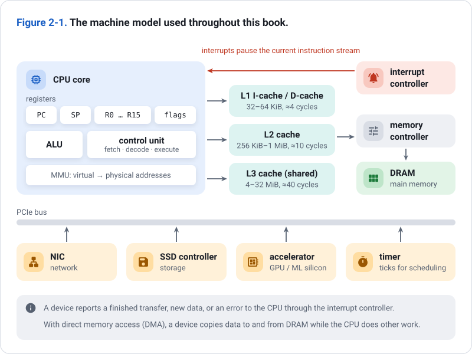
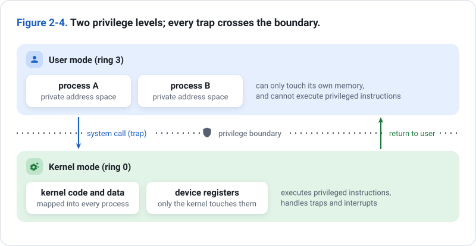

# 2. The Architectural Substrate and Execution Constraints

The design and operational behavior of an operating system are fundamentally dictated by the invariant properties of the underlying hardware. Without a supervisory kernel arbitrating execution, a bare-metal processor provides no memory isolation, no concurrent time-multiplexing, and no protection against errant or malicious instruction streams. The microarchitectural substrate defines the physical boundaries of computation, the necessity of virtual memory management, and the hardware mechanisms required to enforce system integrity.

## 2.1 The Execution Model and the Atomicity Gap

A processor core operates via a continuous fetch-decode-execute datapath cycle. At any discrete clock edge, the architectural state of an executing thread is encapsulated by its hardware register file. Across contemporary instruction set architectures—specifically x86-64 and ARM64 (AArch64)—this register complement is partitioned into control pointers, status flags, and general-purpose storage:

- **Program Counter (`PC` / `RIP` on x86-64 / `PC_EL0` on ARM64):** Holds the 64-bit linear virtual address of the next instruction to be fetched from the L1 instruction cache (I-cache). During sequential execution, the control unit automatically increments the program counter by the byte length of the decoded instruction; control-flow transfers (branches, procedure calls, traps, and hardware interrupts) overwrite this register with a target address.
- **Stack Pointer (`SP` / `RSP` on x86-64 / `SP_EL0` on ARM64):** Points to the active downward-growing boundary of the thread's call stack in virtual memory. Stack allocations decrement the stack pointer, whereas frame deallocations increment it. Both the System V AMD64 ABI and the ARM64 Procedure Call Standard (AAPCS64) mandate that the stack pointer maintain 16-byte alignment at function call boundaries to satisfy vector SIMD load/store alignment constraints.
- **Frame Pointer (`FP` / `RBP` on x86-64 / `x29` on ARM64):** Serves as an invariant base anchor within the current function activation record. While the stack pointer fluctuates dynamically during expression evaluation and outgoing parameter construction, the frame pointer remains fixed throughout the function's lifetime. Compilers store the caller's saved frame pointer at the base of the new frame (`[RBP]` or `[x29]`) and the return address immediately above it (`[RBP + 8]` or `[x29 + 8]`), establishing a contiguous, singly linked chain of activation records. Walking this frame-pointer chain enables debuggers, crash handlers, and kernel sampling profilers (`perf`, DTrace) to reconstruct full call stacks in `O(depth)` time without DWARF unwind tables.
- **Processor Status and Control Flags (`FLAGS` / `RFLAGS` on x86-64 / `PSTATE` on ARM64):** Encapsulates arithmetic condition codes—Zero (`ZF`), Carry (`CF`), Sign/Negative (`SF`/`N`), and Overflow (`OF`/`V`)—alongside privileged execution controls. Most critically for operating system design, this register contains the hardware interrupt mask: the Interrupt Enable Flag (`IF`, bit 9 of `RFLAGS`) on x86-64 and the `DAIF` (Debug, SError, IRQ, FIQ) mask bits on ARM64.
- **General-Purpose Registers (GPRs):** Provide sub-nanosecond, zero-cycle-Wait operand storage for arithmetic, bitwise logic, and memory addressing. On x86-64, the 16 GPRs (`RAX`, `RBX`, `RCX`, `RDX`, `RSI`, `RDI`, `RBP`, `RSP`, and `R8`–`R15`) are partitioned by ABI convention into caller-saved volatile registers (`RAX`, `RCX`, `RDX`, `RSI`, `RDI`, `R8`–`R11`, where `RDI`, `RSI`, `RDX`, `RCX`, `R8`, `R9` pass the first six integer arguments) and callee-saved non-volatile registers (`RBX`, `RBP`, `R12`–`R15`). On ARM64, the 31 64-bit registers (`x0`–`x30`) assign `x0`–`x7` to argument passing and return values, `x9`–`x15` to caller-saved temporaries, `x19`–`x28` to callee-saved state, `x29` to the Frame Pointer, and `x30` to the Link Register (`LR`), which captures the return address on a Branch-with-Link (`BL`) instruction.

<figure>

</figure>

### 2.1.1 The Fetch-Decode-Execute Datapath and Function Activation Records

During each instruction cycle, the control unit coordinates four microarchitectural stages across the processor datapath:
1. **Instruction Fetch (IF):** The control unit presents the virtual address in `PC` (`RIP` / `PC_EL0`) to the Memory Management Unit (MMU) and L1 instruction cache, retrieving the instruction byte stream and advancing `PC`.
2. **Instruction Decode & Register Rename (ID):** The decoder parses the opcode and operand specifiers, mapping architectural registers (`RAX`, `x0`) onto physical registers via the Register Alias Table (RAT) to eliminate false Write-After-Read (WAR) and Write-After-Write (WAW) hazards.
3. **Execute & Memory Access (EX/MEM):** The Arithmetic Logic Unit (ALU) computes arithmetic or effective virtual addresses. Memory loads and stores query the Translation Lookaside Buffer (TLB) and L1 data cache (D-cache), buffering uncommitted writes inside the core's hardware Store Buffer.
4. **Commit / Write-Back (WB):** The Reorder Buffer (ROB) retires instructions in strict program order, committing register updates and draining store-buffer entries to the coherent cache hierarchy.

When a procedure is invoked (`CALL` on x86-64, `BL` on ARM64), the processor constructs a **function activation record** (stack frame) in virtual memory. The caller places up to six (x86-64) or eight (ARM64) arguments in registers and pushes any excess arguments onto the stack. The call instruction records the return address (`RIP + instr_len` pushed to `[RSP - 8]` on x86-64; `PC + 4` stored in `x30` on ARM64). The callee prologue then pushes the caller's Frame Pointer (`push rbp; mov rbp, rsp` on x86-64, or `stp x29, x30, [sp, #-N]!; mov x29, sp` on ARM64), saves any modified callee-saved registers, and decrements `SP` to reserve space for local variables. On x86-64, the System V ABI additionally defines a 128-byte **Red Zone** immediately below `RSP` (`[RSP - 128, RSP)`), which leaf functions may utilize for temporary storage without adjusting `RSP`, provided asynchronous interrupts and signals use a separate stack.

<figure>

</figure>

### 2.1.2 Formal Derivation of the Atomicity Gap

While the reorder buffer guarantees that a single core observes its own instructions retiring in sequential program order, the hardware datapath does not preserve atomicity across composite high-level language expressions. This discrepancy between source-level syntax and machine-level execution defines the **atomicity gap**.

Consider a shared 64-bit integer counter incremented concurrently by two processor cores (`counter++`). Because RISC and CISC arithmetic units operate on registers rather than directly across coherent DRAM, the compiler decomposes the increment into a three-instruction Read-Modify-Write (RMW) sequence:

```text
// x86-64 Read-Modify-Write             // ARM64 Read-Modify-Write
1. mov  rax, QWORD PTR [rip + counter]  1. ldr  x0, [x1]        // Load shared state into core register
2. add  rax, 1                          2. add  x0, x0, #1      // Increment private register copy in ALU
3. mov  QWORD PTR [rip + counter], rax  3. str  x0, [x1]        // Store updated value back to L1 D-cache
```

If Core 0 and Core 1 execute this sequence concurrently when `counter == 42`, their instruction streams interleave across the memory bus:
- Core 0 executes Step 1 (`mov`/`ldr`), loading `42` from its L1 D-cache into its private architectural register (`RAX_0 = 42`).
- Simultaneously, Core 1 executes Step 1, reading the identical shared cache line into its own register (`RAX_1 = 42`).
- Core 0 and Core 1 both execute Step 2 in their local ALUs, computing `43` in `RAX_0` and `RAX_1`.
- Core 0 executes Step 3, invalidating Core 1's shared cache line via the hardware cache coherency protocol and writing `43`.
- Core 1 executes Step 3 immediately thereafter, overwriting the memory location with its own value of `43`.

Although two distinct increments occurred, the final state in memory is `43` rather than `44`—a concurrency failure known as a **lost update**. Bridging this atomicity gap requires hardware-enforced atomic instructions (such as `lock xadd` on x86-64, which locks the cache line throughout the RMW cycle, or Load-Linked/Store-Conditional `ldxr`/`stxr` and Large System Extensions `ldaddal` on ARM64) coupled with kernel synchronization primitives.

## 2.2 Memory Hierarchy and Locality Dynamics

The memory subsystem is architected as a tiered hierarchy that balances physical storage capacity against access latency. This hierarchy progresses from core-private registers (~0.3 ns, 1 cycle) through L1 instruction and data caches (32–64 KiB, ~1 ns, 3–4 cycles), unified L2 caches (256 KiB–1 MiB, ~3–4 ns, 10–12 cycles), and shared L3 / System-Level Caches (4–64 MiB, ~10–15 ns, 35–50 cycles) to main DRAM (gigabytes, ~60–100 ns, 200+ cycles).

The throughput of this hierarchy relies on two empirical properties of program execution:
- **Temporal Locality:** The tendency of an execution stream to access the same memory addresses repeatedly within a brief time window (e.g., loop counters, stack frame variables, hot lock words).
- **Spatial Locality:** The tendency of an execution stream to access memory addresses within contiguous physical proximity of recently accessed locations (e.g., sequential array traversal, linear instruction fetching).

Because hardware cache controllers transfer memory between DRAM and caches in fixed **64-byte cache lines** (or 128-byte lines on certain high-performance ARM64 SoCs), sequential memory traversal amortizes a single DRAM fetch across multiple subsequent loads, triggering the hardware spatial prefetcher. Conversely, pointer-chasing workloads over non-contiguous heap nodes defeat the prefetcher and stall the out-of-order execution engine on L3 cache misses. Furthermore, managing coherence at 64-byte cache-line granularity introduces **false sharing**: when two threads on distinct cores modify logically independent variables that reside within the same 64-byte cache line, the cache coherency protocol (MESI/MOESI) repeatedly invalidates and transfers the line across the inter-core interconnect, serializing parallel execution.

## 2.3 Privilege Domains and Boundary Enforcement

To prevent user applications from corrupting kernel data structures, disabling hardware interrupts, or monopolizing I/O controllers, the processor enforces a hardware privilege bifurcation between **User Mode** (Ring 3 / Current Privilege Level `CPL = 3` on x86-64; Exception Level `EL0` on ARM64) and **Kernel Mode** (Ring 0 / `CPL = 0` on x86-64; `EL1` on ARM64). Above the operating system kernel, modern processors provide hypervisor privilege domains (`VMX Root` on x86-64; `EL2` on ARM64) and secure firmware monitors (`SMM` / `EL3`).

When a core executes in User Mode (`CPL = 3` / `EL0`), the hardware control unit and MMU strictly enforce three boundary invariants:
1. **Privileged Instruction Restriction:** Any attempt to execute instructions that mutate control registers (`mov cr3`), alter interrupt masks (`cli`, `sti`, `msr daifset`), halt the core (`hlt`), or manipulate Model-Specific Registers (`wrmsr`) is blocked in silicon, immediately raising a synchronous General Protection Fault (`#GP` on x86-64) or Synchronous Exception (`EC_UNCATEGORIZED` on ARM64).
2. **Page-Table Permission Enforcement:** Every Page Table Entry (PTE) contains a User/Supervisor flag (`U/S`, bit 2 on x86-64; `AP[1]` on ARM64). While executing in User Mode, any load, store, or instruction fetch targeting a virtual page marked Supervisor-only triggers an immediate hardware Page Fault (`#PF` / Data Abort), trapping control into the kernel.
3. **I/O Port and MMIO Isolation:** Direct access to device I/O ports (`in`, `out`) and physical Memory-Mapped I/O (MMIO) control apertures is restricted exclusively to Ring 0 / `EL1`.

To minimize the latency of kernel entry during system calls and interrupts, operating systems typically map the kernel's virtual address range into the upper canonical half of every process's page table (protected by Supervisor-only PTE bits). When a trap elevates the processor from Ring 3 to Ring 0, the kernel code and data are immediately addressable without reloading the page table root register (unless Kernel Page-Table Isolation, KPTI, is enabled to mitigate speculative execution side channels such as Meltdown). Consequently, the kernel must treat every pointer supplied by user space as untrusted, validating that the entire buffer range `[ptr, ptr + len)` resides strictly within the user canonical address boundary (`< TASK_SIZE`) before dereferencing it, and utilizing specialized access routines (`copy_from_user`, `copy_to_user`) with hardware Supervisor Mode Access Prevention (`SMAP` on x86-64; Privileged Access Never `PAN` on ARM64).

<figure>

</figure>

## 2.4 Synchronous Traps and the Asynchronous Interrupt Subsystem

Control transfers across the privilege boundary from user mode (`Ring 3` / `EL0`) to kernel mode (`Ring 0` / `EL1`) are classified into two architectural categories based on their causal relationship to the executing instruction stream:

- **Synchronous Traps and Exceptions:** Triggered deterministically as a direct result of executing a specific instruction on the local core. The processor cannot retire the instruction until the kernel intervenes. Synchronous events subdivide into deliberate **system call traps** (`syscall` on x86-64, `svc #0` on ARM64), recoverable **faults** (such as a minor Page Fault `#PF`, where the kernel allocates a frame and re-executes the faulting instruction), and unrecoverable **aborts** (such as hardware machine-check exceptions `#MC` or division by zero `#DE`).
- **Asynchronous Hardware Interrupts (IRQs):** Triggered by external physical devices—such as a network interface card (NIC) completing a DMA packet transfer, an NVMe controller signaling I/O completion, or a hardware timer tick expiring. Asynchronous interrupts arrive at arbitrary clock cycles, completely independent of the instruction stream currently executing on the processor core.

### 2.4.1 Interrupt Controllers: APIC, IO-APIC, MSI-X, and ARM GIC

In a multiprocessor system with dozens of CPU cores and hundreds of peripheral interrupt sources, devices do not wire directly to a single CPU pin. Instead, interrupt routing and prioritization are arbitrated by a two-tier hardware interrupt subsystem:

1. **x86-64 Advanced Programmable Interrupt Controller (IO-APIC and Local APIC):**
   - **IO-APIC:** Resides on the system chipset and receives physical Interrupt Request Lines (IRQs) from legacy peripherals. The kernel programs the IO-APIC's **Redirection Table Entries (RTEs)** to map each physical IRQ pin to an 8-bit **Interrupt Vector Number** (`32`–`255`, as vectors `0`–`31` are reserved by Intel/AMD for processor exceptions) and a target CPU core destination mask.
   - **Message Signaled Interrupts (MSI / MSI-X):** High-speed PCIe devices (NVMe drives, 100GbE NICs, GPUs) bypass physical IRQ pins and the IO-APIC entirely. With MSI-X, the device signals an interrupt by performing a standard PCIe DMA memory write of a vector payload directly to a dedicated physical MMIO address mapped to a target core's Local APIC. This eliminates shared IRQ line contention and allows a multi-queue NIC to bind distinct receive queues to dedicated CPU cores.
   - **Local APIC (LAPIC):** Integrated directly onto every CPU core. The LAPIC receives interrupt messages from the IO-APIC, MSI-X PCIe writes, **Inter-Processor Interrupts (IPIs)** from sibling cores (used for cross-core TLB shootdowns and scheduler wakeups), and its own on-die **APIC Timer**. It Arbitrates priority between pending vectors in its Interrupt Request Register (IRR) and In-Service Register (ISR) before asserting an interrupt to the core's control unit.
2. **ARM64 Generic Interrupt Controller (GICv3 / GICv4):**
   - **Distributor (`GICD`):** Centralizes interrupt prioritization and routing across the SoC for **Shared Peripheral Interrupts (SPIs, IDs 32–1019)**.
   - **Redistributor (`GICR`):** Managed per core, controlling **Software Generated Interrupts (SGIs, IDs 0–15)** used for inter-processor signaling, **Private Peripheral Interrupts (PPIs, IDs 16–31)** such as the per-core ARM Generic Timer, and **Locality-Specific Peripheral Interrupts (LPIs, IDs 8192+)** routed via GIC Interrupt Translation Services (ITS) from PCIe MSI-X writes.
   - **CPU Interface (`ICC_*` system registers):** Delivers the highest-priority pending interrupt ID directly to the ARM64 core.

### 2.4.2 Vector Tables (IVT, IDT, VBAR_EL1) and the Hardware Context-Save Sequence

When the Local APIC or GIC presents an unmasked interrupt vector `v` to a processor core, the hardware control unit suspends the instruction fetch pipeline at the next instruction boundary and executes an atomic, hardware-sequenced privilege and stack transition before executing a single line of kernel software:

1. **Vector Table Lookup:**
   - On x86-64 (Protected/Long Mode, which supersedes the legacy 16-bit Real Mode Interrupt Vector Table, IVT), the CPU reads the **Interrupt Descriptor Table Register (`IDTR`)**, which holds the physical/linear base address and limit of the **Interrupt Descriptor Table (IDT)**. The IDT is an array of 256 16-byte **Gate Descriptors**. The processor indexes `IDT[v]` to extract the target 64-bit Interrupt Service Routine (ISR) entry address, the target Code Segment selector (`CS`, specifying `CPL = 0`), the gate type (Interrupt Gate, which automatically clears `RFLAGS.IF` to mask further interrupts, vs. Trap Gate, which leaves `IF` unchanged), and an optional 3-bit **Interrupt Stack Table (IST)** index.
   - On ARM64, the processor reads the **Vector Base Address Register (`VBAR_EL1`)**, which points to a 2 KiB-aligned table partitioned into 16 128-byte exception entry stubs grouped by exception type (Synchronous, IRQ, FIQ, SError) and source execution state (`EL0` vs. `EL1`).
2. **Privilege Elevation and Per-CPU Kernel Stack Switch:**
   - The kernel can never trust the user-mode stack pointer (`RSP` / `SP_EL0`), which may be unaligned, exhausted, or pointing to unmapped memory. If the interrupted instruction was executing in Ring 3 (`CPL = 3`), the x86-64 processor queries the current core's **Task State Segment (TSS)** and loads the privileged Ring 0 stack pointer from `TSS.rsp0` (or from `TSS.ist[n]` for critical faults like Double Fault `#DF` or Non-Maskable Interrupt `#NMI`). On ARM64, elevating from `EL0` to `EL1` automatically switches the active stack pointer register from `SP_EL0` to `SP_EL1` and masks IRQs by setting `PSTATE.I = 1`.
3. **Hardware Context Save (Trapframe Construction):**
   - On x86-64, the CPU hardware pushes a 5-word (40-byte) interrupt frame directly onto the newly activated kernel stack (`TSS.rsp0`):
     1. Interrupted Stack Segment (`SS`)
     2. Interrupted User Stack Pointer (`RSP`)
     3. Interrupted Processor Flags (`RFLAGS`)
     4. Interrupted Code Segment (`CS`, encoding the previous privilege ring `CPL = 3`)
     5. Interrupted Instruction Pointer (`RIP`)
     6. *(For specific exceptions such as `#PF` or `#GP`, the hardware pushes a 6th 64-bit word: the architectural Error Code).*
   - On ARM64, rather than pushing to memory in hardware, the core saves the interrupted program counter into the **Exception Link Register (`ELR_EL1`)**, the interrupted processor state into the **Saved Program Status Register (`SPSR_EL1`)**, and the fault syndrome into the **Exception Syndrome Register (`ESR_EL1`)**.
4. **Software Trapframe Completion:**
   - The CPU loads `RIP` / `PC` with the ISR entry point. The kernel's assembly entry stub immediately pushes all remaining general-purpose registers (`RAX`–`R15` or `x0`–`x30`) onto the kernel stack, completing the **trapframe** (`struct pt_regs`) so the interrupted thread's exact register state can be restored later.

<figure>

</figure>

### 2.4.3 Top-Half (`hardirq`) vs. Bottom-Half (`softirq`) Split and EOI Lifecycle

An Interrupt Service Routine (ISR) executes under severe architectural constraints: it runs in **interrupt context** rather than process context. Because an interrupt preempts whichever arbitrary process happened to be running on that core, the ISR has no Process Control Block (`current` points to the interrupted victim task) and **cannot sleep, block on a mutex, or perform voluntary context switches**. Furthermore, while executing with local interrupts masked (`RFLAGS.IF == 0` / `PSTATE.I == 1`), the core is deaf to subsequent hardware interrupts; prolonged execution in an ISR causes packet drops, timer drift, and I/O latency spikes.

To resolve the tension between deterministic low latency and complex protocol processing, modern operating system kernels bifurcate interrupt handling into two distinct phases:

1. **Top-Half (`hardirq` Context):**
   - Executes immediately upon hardware vector dispatch with local interrupts disabled on the core.
   - Performs only the minimum time-critical hardware interaction: reads the device's MMIO interrupt status register to verify the interrupt source, clears the device-level interrupt line, unmaps or rotates DMA descriptor ring pointers, schedules deferred work, and writes an **End of Interrupt (EOI)** command to the Local APIC EOI register (or GIC `ICC_EOIR1_EL1`). Writing EOI informs the interrupt controller that the active priority level has completed, allowing delivery of queued interrupts.
2. **Bottom-Half (`softirq`, Tasklets, NAPI, and Threaded IRQs):**
   - Executes after the top-half completes, with hardware interrupts **re-enabled** on the core (`RFLAGS.IF == 1`).
   - Handles computationally intensive work: traversing the TCP/IP network protocol stack, reassembling fragmented packets, running NAPI (New API) network ring polling loops, validating filesystem checksums, and awakening blocked threads in wait queues.
   - In Linux, static high-throughput subsystems (networking `NET_RX_SOFTIRQ`, block storage `BLOCK_SOFTIRQ`, timers `TIMER_SOFTIRQ`) execute as **`softirq`** vectors immediately upon exiting the outermost nested `hardirq` (or inside per-CPU `ksoftirqd/N` kernel threads under heavy interrupt storms), whereas work items requiring sleeping or mutex acquisition are delegated to **workqueues** (`kworker` kernel threads) or **threaded IRQ handlers** (`request_threaded_irq`).

Upon completing bottom-half processing, the kernel checks whether the interrupt awakened a higher-priority runnable thread (`TIF_NEED_RESCHED`). If preemption is required, the kernel invokes the scheduler to switch stacks to the newly selected thread; otherwise, it pops the saved general-purpose registers from the kernel stack and executes the privileged return instruction (`iretq` on x86-64; `eret` on ARM64), atomically restoring `RIP`/`ELR_EL1`, `RSP`/`SP_EL0`, and `RFLAGS`/`SPSR_EL1` while demoting the core back to User Mode (`Ring 3` / `EL0`).
