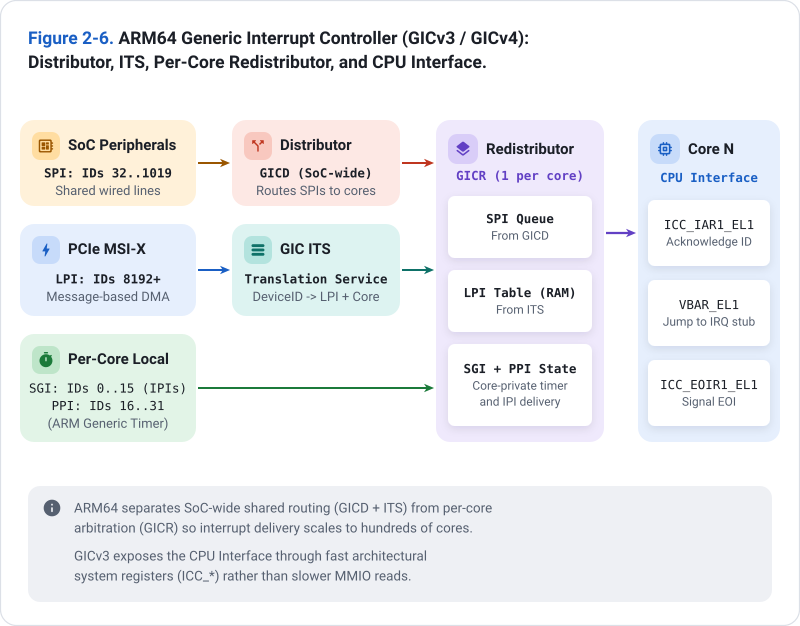

# 2. The Architectural Substrate and Execution Constraints

An operating system is not an arbitrary collection of software abstractions; every mechanism inside a kernel exists to answer a specific constraint of physical silicon. Understanding how a processor fetches instructions, how it talks to memory and external devices, why it separates user code from kernel code, and how hardware interrupts pause a running program gives you a permanent mental model for every chapter that follows.

Throughout this chapter, we build each mechanism from first principles: first the concrete physical problem, then how hardware solves it, and finally the exact x86-64 and ARM64 register names summarized in reference tables rather than stacked into prose.

## 2.1 The Execution Model and the Atomicity Gap

At its core, a processor executes a relentless loop: fetch the next machine instruction from memory, decode what operation it requests, execute that operation on values held in tiny on-chip storage slots called **registers**, and write the result back.

Because registers live directly inside the processor's execution circuitry, reading a register takes roughly one clock cycle (about 0.3 nanoseconds), whereas reading main memory takes hundreds of cycles. Everything the processor needs to know about a running thread at any frozen instant fits inside five categories of registers:

- **The Program Counter:** Holds the memory address of the next machine instruction to fetch. Normally, the processor advances this counter automatically after each instruction; branches, function calls, system calls, and interrupts change execution flow by overwriting this single register with a new target address.
- **The Stack Pointer:** Points to the top (lowest active address) of the thread's call stack in memory. On both x86-64 and ARM64, the call stack grows downward toward smaller memory addresses: allocating local variables subtracts from the stack pointer, and returning from a function adds back to it. Modern calling conventions require the stack pointer to stay aligned to a 16-byte multiple at function call boundaries so wide vector loads and stores never straddle misaligned boundaries.
- **The Frame Pointer:** Anchors the base of the current function's stack frame. While the stack pointer moves up and down as a function pushes temporary values, the frame pointer stays fixed from function entry until return. When function `A` calls function `B`, `B` saves `A`'s frame pointer on the stack right next to the return address and points its own frame pointer there. This creates a linked chain of saved frame pointers all the way back to `main()`, allowing debuggers and profilers to reconstruct a complete call stack in a few pointer hops.
- **Processor Status Flags:** A compact register of single-bit flags recording outcomes of recent arithmetic instructions (such as whether the last subtraction produced zero, a negative result, or an overflow) alongside privileged control bits. The single most important control bit for operating systems is the **interrupt enable bit**: when cleared to `0`, the core temporarily defers external hardware interrupts until the kernel finishes a delicate state update.
- **General-Purpose Registers:** Fast scratchpad registers (16 on x86-64; 31 on ARM64) used for arithmetic, pointers, and passing function arguments. By calling-convention agreement between the compiler and the operating system, some registers are **caller-saved** (a called function may overwrite them freely) and others are **callee-saved** (a called function must preserve their original values before returning).

**Table 2-1. Architectural register mapping across x86-64 and ARM64.**

| Conceptual Role | x86-64 Register | ARM64 (AArch64) Register |
| :--- | :--- | :--- |
| Program Counter | `RIP` | `PC` |
| Stack Pointer | `RSP` | `SP` (`SP_EL0` in user mode, `SP_EL1` in kernel) |
| Frame Pointer | `RBP` | `x29` (`FP`) |
| Return Address Storage | Pushed onto stack by `CALL` | Saved in Link Register `x30` (`LR`) by `BL` |
| Status & Interrupt Mask | `RFLAGS` (Interrupt Flag `IF`, bit 9) | `PSTATE` (Interrupt mask bits `DAIF`) |
| Integer Argument Registers | `RDI, RSI, RDX, RCX, R8, R9` (first 6) | `x0` through `x7` (first 8) |

<figure>

</figure>

### 2.1.1 The Fetch-Decode-Execute Datapath and Function Activation Records

To hide memory latency and execute multiple instructions per clock cycle, a modern core organizes execution into four pipeline stages:
1. **Fetch:** Read the next instruction bytes from the L1 instruction cache using the Program Counter.
2. **Decode:** Interpret the instruction opcode and map its operand registers onto internal physical registers so independent instructions can execute concurrently out of order.
3. **Execute and Memory Access:** Perform arithmetic in the Arithmetic Logic Unit (ALU) or compute a memory address, check the address translation cache (TLB) and L1 data cache, and place outgoing writes into a small hardware **store buffer** while awaiting cache ownership.
4. **Retire (Commit):** Even though instructions execute out of order internally for speed, a hardware **reorder buffer** commits their results to visible registers and caches in strict original program order. If an earlier instruction faults (for example, dividing by zero or touching an unmapped page), all younger speculative instructions are cleanly discarded.

Whenever a program calls a function, the caller and callee cooperate to construct a **stack frame** (activation record) in memory (Figure 2-3). First, the caller places integer arguments into the designated argument registers. Next, the call instruction records the return address (pushed onto the stack on x86-64; placed in the Link Register `x30` on ARM64) and jumps to the callee. The callee's prologue saves the caller's frame pointer, sets its own frame pointer to the base of the new frame, preserves any callee-saved registers it plans to modify, and subtracts from the stack pointer to carve out space for local variables. When the function returns, the epilogue reverses those exact steps and jumps back to the saved return address.

<figure>

</figure>

### 2.1.2 Formal Derivation of the Atomicity Gap

The hardware reorder buffer guarantees that a *single* core sees its own instructions take effect in program order. It makes **no** guarantee that a high-level language statement executes as one indivisible step across *multiple* cores. That mismatch defines the **atomicity gap**.

Suppose two CPU cores concurrently execute `counter++` on a shared 64-bit integer currently holding `42`. A processor core cannot add `1` directly inside a DRAM chip; it must copy the number into a private register, increment the register, and store the new value back to memory. The compiler therefore emits three separate machine instructions:

```text
// x86-64 Read-Modify-Write             // ARM64 Read-Modify-Write
1. mov  rax, QWORD PTR [rip + counter]  1. ldr  x0, [x1]        // Load 42 into private register
2. add  rax, 1                          2. add  x0, x0, #1      // Compute 43 inside local ALU
3. mov  QWORD PTR [rip + counter], rax  3. str  x0, [x1]        // Store 43 back to shared cache line
```

Because both cores run in parallel, their three steps interleave freely:
1. Core 0 executes Step 1 and loads `42` into its private register.
2. Core 1 executes Step 1 before Core 0 finishes, also loading `42`.
3. Both cores compute `43` independently in their local ALUs.
4. Core 0 executes Step 3 and stores `43` to memory.
5. Core 1 executes Step 3 and overwrites memory with `43`.

Two increments ran, yet the counter advanced from `42` to `43` instead of `44`. One update vanished permanently, a failure called a **lost update**. Closing the atomicity gap requires either special hardware atomic instructions that lock a cache line across the entire read-modify-write cycle (`lock xadd` on x86-64; `ldaddal` or load-linked/store-conditional pairs on ARM64) or kernel-backed synchronization locks, both explored in Chapters 4 and 6.

## 2.2 Memory Hierarchy and Locality Dynamics

Main memory (DRAM) is huge and inexpensive, but physically slow compared to a multi-gigahertz processor core: waiting 70 to 100 nanoseconds for a single DRAM read stalls a 3 GHz core for more than 200 clock cycles. Hardware bridges this speed gap with a staircase of progressively smaller, faster on-chip SRAM **caches**:
- **Registers:** ~0.3 ns (1 cycle), tens of words per core.
- **L1 Cache (split instruction and data):** ~1 ns (3 to 4 cycles), 32 to 64 KiB private per core.
- **L2 Cache:** ~3 to 5 ns (10 to 14 cycles), 256 KiB to 4 MiB private per core.
- **L3 / System-Level Cache:** ~12 to 20 ns (35 to 55 cycles), 8 to 128 MiB shared across cores.
- **Main DRAM:** ~60 to 100 ns (200+ cycles), gigabytes to terabytes.

Caches work because real programs exhibit two empirical access patterns: **temporal locality** (an address accessed now, such as a loop variable or stack slot, is likely to be accessed again soon) and **spatial locality** (addresses near a recently accessed byte, such as consecutive array elements, are likely to be accessed next).

To exploit spatial locality, hardware never fetches a single byte from DRAM. It transfers memory in fixed **64-byte cache lines** (128 bytes on some ARM64 processors). Walking sequentially through a contiguous array brings 8 consecutive 64-bit integers into L1 on the first miss, and the hardware prefetcher notices the pattern and fetches upcoming lines before the CPU asks for them. Conversely, chasing pointers across scattered heap objects defeats prefetching and stalls on DRAM repeatedly.

Managing coherence at 64-byte granularity also creates a subtle multi-core hazard called **false sharing**: if Core 0 writes to `counter_a` and Core 1 writes to a completely unrelated `counter_b` that happens to sit inside the same 64-byte cache line, the hardware coherence protocol (MESI) must bounce exclusive ownership of that entire 64-byte line back and forth between cores on every write, collapsing parallel performance (measured empirically in Chapter 17).

## 2.3 Privilege Domains and How the CPU Talks to Hardware Devices

If every program could disable interrupts, reprogram page tables, or write directly to disk hardware, a single buggy application could destroy every other process on the machine. Processors prevent this by dividing execution into hardware-enforced **privilege levels**:
- **User Mode (`Ring 3` on x86-64; `EL0` on ARM64):** Where normal applications run. The processor blocks privileged instructions, restricts memory accesses to pages marked user-accessible in the process's page table, and forbids direct access to hardware devices. Any violation triggers an immediate hardware trap into the kernel.
- **Kernel Mode (`Ring 0` on x86-64; `EL1` on ARM64):** Where the operating system kernel runs with full control over page tables, interrupt controllers, timers, and I/O devices. Modern CPUs also add a higher hypervisor level (`VMX Root` on x86-64; `EL2` on ARM64, covered in Chapter 16) for running virtual machines.

<figure>

</figure>

### 2.3.1 Two Physical Mechanisms Behind Every Device: MMIO and DMA

Before studying how hardware devices interrupt the CPU, two deceptively simple hardware ideas must be crystal clear, because every disk driver, network card, and interrupt controller in the rest of this book is built on them:

1. **Memory-Mapped I/O (MMIO): How the CPU sends commands to a hardware device.**
   A CPU core only knows how to execute load and store instructions against memory addresses. How, then, does the kernel tell an SSD controller to read sector 42, or tell an interrupt controller to mask a pin? Hardware designers carve out reserved ranges of the physical address space that are **not connected to DRAM chips**; instead, the motherboard's memory controller wires those physical addresses directly to control registers inside hardware devices. When the kernel (in Ring 0) writes a 32-bit command to physical address `0xFEE0_00B0`, no RAM chip is touched: the electrical write travels over the bus straight into a register inside the interrupt controller. Because user-mode page tables never map MMIO physical ranges, applications cannot touch hardware directly.
2. **Direct Memory Access (DMA): How a hardware device moves bulk data without tying up the CPU.**
   Suppose an application reads a 100 MiB file from an NVMe solid-state drive. If the CPU core had to copy all 100 million bytes one 8-byte register at a time from the drive into DRAM, the core would be completely paralyzed for the entire transfer. Instead, modern devices include a **DMA engine** that can read and write physical DRAM directly over the PCIe bus. The kernel places a descriptor in memory saying *"read 4 KiB from disk block 900 and write the bytes into physical DRAM address `0x1000_8000`,"* rings the drive's MMIO doorbell register once, and immediately switches the CPU core to run other user threads. While the CPU does useful work, the NVMe controller streams all 4,096 bytes straight into DRAM on its own. Once the final byte lands in DRAM, the drive needs one last thing: a way to tap the CPU on the shoulder and announce *"your 4 KiB block is ready."* That shoulder tap is a **hardware interrupt**.

## 2.4 Synchronous Traps and the Asynchronous Interrupt Subsystem

Control transfers from User Mode into Kernel Mode fall into two fundamentally different categories depending on what caused them:

- **Synchronous Traps and Exceptions:** Caused directly by the instruction the CPU core is executing right now. Because the event is tied to that exact instruction, it is deterministic and repeatable. Synchronous entries include intentional **system calls** (`syscall` / `svc #0`, Chapter 9), recoverable **faults** (such as a page fault when a program touches a valid but not-yet-loaded virtual page, where the kernel maps a frame and re-runs the exact same instruction), and fatal **exceptions** (such as dividing by zero or reading an invalid pointer).
- **Asynchronous Hardware Interrupts:** Caused by an external physical event outside the CPU's instruction stream: an NVMe drive finishing a DMA block read, a network card receiving an Ethernet packet, a keyboard key press, or a hardware timer ticking down to zero. An asynchronous interrupt can arrive between *any* two instructions of whatever arbitrary user program happens to be running on that core.

### 2.4.1 Why Interrupt Controllers Exist: From One Copper Pin to Multi-Core Fabrics

To build permanent intuition for modern interrupt controllers without memorizing disconnected acronyms, start from the physical wiring problem hardware architects faced as computers grew from 1 core to 64+ cores.

Early single-core PCs had literally **one** physical interrupt wire entering the CPU package. A small helper chip on the motherboard gathered eight physical copper wires from peripherals (timer, keyboard, disk, serial port), picked the highest-priority active wire, and raised that one wire into the CPU.

Now imagine trying to scale that design to a modern 64-core server with an NVMe drive, a 100-gigabit network card, and a GPU completing millions of operations per second. Three physical walls immediately break the single-wire model:
1. **Copper wire scarcity and shared-line storms:** You cannot run 500 physical copper interrupt pins across a motherboard. If four devices share one copper wire, the kernel has no idea which device raised the voltage and must wake all four drivers to check their status registers on every single interrupt.
2. **Per-core routing (cache locality):** A modern network card maintains 16 separate receive queues so 16 CPU cores can process incoming packets in parallel without locks. You want Receive Queue 4 to interrupt **Core 4 specifically** (whose L1/L2 cache already holds Queue 4's data structures), not wake a random core.
3. **Core-to-core doorbells:** CPU cores themselves need a way to interrupt each other directly in hardware, for example when Core 0 unmaps a shared memory page and must force Cores 1 through 63 to immediately discard stale cached address translations.

Once you see those three physical problems, every piece of both x86-64 and ARM64 interrupt hardware falls into place naturally. There are only **four kinds of interrupts** any multi-core chip needs to route:
1. **Shared wired legacy devices** (a keyboard, serial console, or platform controller wired to the whole machine).
2. **High-speed PCIe devices** (NVMe drives, 100GbE NICs, GPUs) needing dedicated, contention-free lanes directly to specific CPU cores.
3. **Core-private timers** (each core needs its own private countdown clock so the OS scheduler can preempt threads on every core independently without fighting over one global timer).
4. **Core-to-core doorbells** (one core sending an urgent signal to sibling cores for TLB flushes or scheduler wakeups).

#### How x86-64 Implements These Four Paths (IO-APIC, MSI-X, and Local APIC)

Intel and AMD split interrupt routing across the motherboard chipset and a small **Local Interrupt Controller (Local APIC)** built directly inside the silicon die of **every** CPU core (Figure 2-4).

<figure>

</figure>

1. **Routing legacy wired pins (the Chipset IO-APIC):** Legacy peripherals still connect via physical copper wires to a chipset component called the **IO-APIC** (Input/Output Advanced Programmable Interrupt Controller). Inside the IO-APIC sits a tiny programmable lookup table of 24 (or more) **Redirection Table Entries**. At boot, the OS writes one row per physical wire telling the IO-APIC two things: *"when wire `k` goes high, attach 8-bit interrupt number `v` (chosen from `32..255`, because numbers `0..31` are permanently reserved by the CPU for internal exceptions like divide-by-zero and page faults) and mail it over the bus to Core `N`."*
2. **Deriving Message Signaled Interrupts (MSI-X) from DMA and MMIO:** Applying the two mechanisms from Section 2.3.1 eliminates physical interrupt wires completely. A modern PCIe NVMe drive can already write bytes to any physical address over the PCIe bus via **DMA**, and every CPU core's Local APIC already listens on a reserved physical **MMIO** address (`0xFEE0_0000`, encoding the target core ID in its upper address bits). Hardware designers realized that running copper interrupt wires from PCIe cards to the IO-APIC was unnecessary: the PCIe device signals an interrupt by performing a 4-byte DMA memory write straight to the target core's Local APIC MMIO address, carrying the interrupt vector number (`32..255`) as the 4-byte data value. This mechanism is called **MSI-X** (Message Signaled Interrupts Extended). It bypasses the chipset IO-APIC completely, supports up to 2,048 distinct vectors per PCIe card, eliminates shared-wire storms, and pins each NIC or NVMe queue directly to its own CPU core. Even better, because PCIe strictly orders DMA writes, the device's data bytes are guaranteed to have landed in DRAM before its 4-byte MSI-X write arrives at the Local APIC.
3. **Inside every CPU core (the Local APIC, `IRR`, `ISR`, and `EOI`):** Every CPU core contains its own on-die **Local APIC** that receives all four interrupt feeds: routed messages from the IO-APIC, direct MSI-X writes from PCIe cards, **Inter-Processor Interrupts (IPIs)** mailed by sibling cores, and ticks from its own private **APIC Timer**.
   - *Why does the Local APIC need two 256-bit bitmaps (`IRR` and `ISR`)?* Imagine an NVMe interrupt (`0x30`) arrives on Core 0 while Core 0 is already halfway through handling a lower-priority keyboard interrupt (`0x21`), and a third interrupt arrives a microsecond later. To track both what is *waiting* and what is *currently running* without losing a single signal, the Local APIC maintains two 256-bit registers (one bit per vector `0..255`):
     - The **Pending Bitmap (Interrupt Request Register, `IRR`)** sets bit `v = 1` the instant vector `v` arrives at the core.
     - The **Active Bitmap (In-Service Register, `ISR`)** records which vector's handler Core 0 is *currently executing*.
   - Hardware continuously compares the highest-priority bit set in `IRR` against the highest bit set in `ISR`. Only when a waiting interrupt in `IRR` outranks the currently active interrupt in `ISR` (and the core's interrupt-enable flag is `1`) does the Local APIC move bit `v` from `IRR` to `ISR` and interrupt the core. Once the OS handler finishes talking to the device, it writes `0` to the Local APIC's **End-of-Interrupt (`EOI`)** MMIO register. That single write clears the active bit in `ISR`, signaling that Core 0 is ready for the next waiting interrupt from `IRR`.

#### How ARM64 Implements the Exact Same Four Paths (GICv3 / GICv4)

ARM64 server and mobile chips solve the exact same four physical routing problems using the **Generic Interrupt Controller (GICv3 / GICv4)** (Figure 2-5). Instead of memorizing ARM acronyms in isolation, map each piece directly onto the four physical roles you already understand:

<figure>

</figure>

- **Chip-wide wired devices:** Routed by the central **Distributor (`GICD`)**, the ARM counterpart to x86-64's IO-APIC. ARM labels these wired chip-wide lines **Shared Peripheral Interrupts (`SPI`, IDs `32..1019`)**.
- **High-speed PCIe MSI-X writes:** Translated by the **Interrupt Translation Service (`ITS`)**, which intercepts PCIe DMA doorbell writes and maps `(DeviceID, EventID)` to a scalable RAM-backed table of **Locality-Specific Peripheral Interrupts (`LPI`, IDs `8192+`)** targeting a chosen core.
- **Per-core arbitration and private interrupts:** Every ARM64 core owns a private **Redistributor (`GICR`)** (analogous to per-core Local APIC state). Each Redistributor locally tracks core-private **Software Generated Interrupts (`SGI`, IDs `0..15`, ARM's name for cross-core IPIs)** and **Private Peripheral Interrupts (`PPI`, IDs `16..31`, such as each core's local ARM Generic Timer)**, merging them with incoming SPIs and LPIs for that core.
- **Fast register handshake with the core:** Rather than forcing the kernel to do slower uncached MMIO reads on every interrupt, GICv3 exposes each core's **CPU Interface** as fast architectural system registers: the kernel reads **`ICC_IAR1_EL1`** to learn which interrupt ID won arbitration and writes **`ICC_EOIR1_EL1`** when finished to signal End of Interrupt.

**Table 2-2. Side-by-side mental map: physical interrupt role to x86-64 and ARM64 hardware names.**

| Physical Hardware Need | x86-64 (APIC) | ARM64 (GICv3 / GICv4) |
| :--- | :--- | :--- |
| Shared wired peripheral lines | Chipset **IO-APIC** (`RTE` -> Vectors `32..255`) | **Distributor (`GICD`)** -> `SPI` (IDs `32..1019`) |
| High-speed PCIe DMA interrupts | **MSI-X** write straight to core LAPIC MMIO | **ITS** translates DMA write -> `LPI` (IDs `8192+`) |
| Core-private preemption timer | Per-core **Local APIC Timer** | Per-core **Redistributor (`GICR`)** `PPI` (IDs `16..31`) |
| Core-to-core doorbell (TLB flush) | **IPI** (Inter-Processor Interrupt) | **SGI** (Software Generated Interrupt, IDs `0..15`) |
| End-of-Interrupt handshake | Write `0` to Local APIC **EOI** register | Write winning ID to **`ICC_EOIR1_EL1`** register |

### 2.4.2 Vector Tables (`IDT`, `VBAR_EL1`), `TSS.rsp0`, and Hardware Trapframe Construction

Now trace what happens on the exact clock cycle Core 0's Local APIC accepts Vector `0x30` (our NVMe disk completion) while Core 0 is executing a user application in Ring 3. Before a single line of C or Rust kernel code can run, CPU silicon must solve two concrete problems atomically:
1. **Where is the kernel function that handles Vector `0x30`?**
2. **Where can the CPU safely save the interrupted user program's registers so it can resume later without corrupting anything?**

Why can CPU silicon **never** push the interrupted user program's registers onto the application's own user stack? Because user-mode code controls the user stack pointer (`RSP`): a buggy or malicious program can set `RSP = 0`, point `RSP` into read-only memory, or point `RSP` directly into kernel memory. Attempting to push a hardware return frame onto an untrusted user stack would crash or compromise the kernel immediately. Hardware must therefore switch to a clean, kernel-owned stack first (Figure 2-6).

<figure>

</figure>

On **x86-64**, hardware executes four steps atomically before fetching the first instruction of the kernel handler:
1. **Look up the handler in the Interrupt Descriptor Table (`IDT`):** During boot, the OS builds an array of 256 16-byte descriptors in kernel memory called the **IDT** and loads its address into the CPU's privileged **`IDTR`** register. When Vector `0x30` arrives, silicon reads entry `IDT[0x30]`, extracting the 64-bit kernel handler address, the target privilege level (`Ring 0`), and the gate type (an **Interrupt Gate** automatically clears the interrupt-enable flag `RFLAGS.IF = 0` so a second interrupt cannot disrupt entry while the frame is half-built).
2. **Switch from the untrusted user stack to the thread's kernel stack (`TSS.rsp0`):** Seeing that Core 0 was running in Ring 3 while `IDT[0x30]` runs in Ring 0, silicon reads a small per-core kernel descriptor called the **Task State Segment (`TSS`)** and loads a trusted kernel stack pointer from **`TSS.rsp0`** (which the OS scheduler keeps pointed to the top of the current thread's private 8 to 16 KiB kernel stack). For emergency faults where even the regular kernel stack may have overflowed (such as a Double Fault `#DF` or Non-Maskable Interrupt `#NMI`), `IDT[v]` points to an isolated backup stack in **`TSS.ist[1..7]`**.
3. **Push the 5-word hardware return frame onto the kernel stack:** Silicon automatically saves the five architectural values needed to resume the interrupted user thread later: User Stack Segment (`SS`), User Stack Pointer (`RSP`), Processor Flags (`RFLAGS`), Code Segment (`CS`, recording that the thread came from Ring 3), and the exact interrupted Instruction Pointer (`RIP`). For certain synchronous faults (such as a page fault `#PF`), silicon pushes a 6th word: an **Error Code** describing whether the fault was caused by a read, a write, or a permission check.
4. **Save the remaining general-purpose registers in software (`struct pt_regs`):** Silicon jumps to the kernel assembly entry stub at `IDT[0x30]`, which pushes all general-purpose registers (`RAX` through `R15`) onto the kernel stack right below the hardware frame. That complete snapshot is the **trapframe** (`struct pt_regs`). Normal C or Rust kernel code can now execute freely using standard registers without disturbing a single bit of the user thread's saved state.

On **ARM64**, silicon performs the exact same isolation using dedicated exception registers rather than pushing to memory in hardware: elevating from `EL0` to `EL1` automatically switches the stack pointer from `SP_EL0` to the kernel's `SP_EL1`, masks further IRQs, saves the interrupted program counter in **`ELR_EL1`** and flags in **`SPSR_EL1`**, records the cause in **`ESR_EL1`**, and jumps into a 128-byte vector slot inside the table pointed to by **`VBAR_EL1`**, where the kernel stub saves `x0` through `x30` onto `SP_EL1`.

### 2.4.3 Top-Half (`hardirq`) vs. Bottom-Half (`softirq`) Split and EOI Lifecycle

Once inside the kernel's interrupt handler, two hard constraints govern what the handler is allowed to do:
1. **An interrupt handler can never sleep or wait on a mutex.** The interrupt preempted whatever innocent user thread happened to be running on Core 0 at that instant. Calling `sleep()` or blocking on a lock would put that unrelated user thread to sleep; even worse, if that exact interrupted thread *already held* that lock when the interrupt fired, Core 0 would deadlock with itself forever.
2. **An interrupt handler must finish in a few microseconds.** While local interrupts are masked (`IF == 0`) and the vector's active bit sits in the Local APIC's `ISR`, Core 0 cannot service other incoming interrupts. Spending milliseconds walking TCP tables or checking filesystem metadata inside a masked handler causes dropped network packets, audio glitches, and missed timer ticks.

To resolve this conflict, every modern kernel splits interrupt work into two distinct phases (Figure 2-7):

<figure>

</figure>

1. **Top-Half (`hardirq`, Interrupts Masked, Microseconds):** Runs immediately upon vector dispatch and performs only the urgent hardware handshake that cannot wait: reads the device's status register, advances the hardware DMA ring pointers so the device can continue receiving packets or disk blocks, marks a deferred-work flag in kernel memory, and writes **End of Interrupt (EOI)** to the Local APIC (or `ICC_EOIR1_EL1` on ARM64). Writing EOI clears the active bit in `ISR` so the interrupt controller can immediately deliver new events.
2. **Bottom-Half (`softirq`, NAPI, and Workqueues, Interrupts Re-Enabled):** Runs right after the top-half finishes, with hardware interrupts **turned back on** (`IF == 1`) so urgent hardware signals can preempt heavy software processing cleanly:
   - **Deferred lock-free processing (`softirq` and NAPI):** In Linux, heavy non-blocking work such as TCP/IP packet parsing (`NET_RX_SOFTIRQ`), block storage completions (`BLOCK_SOFTIRQ`), and timer expirations (`TIMER_SOFTIRQ`) runs immediately before returning to user space (or spills onto per-CPU `ksoftirqd` kernel threads under heavy traffic storms). Under 100GbE packet rates, Linux **NAPI** intentionally switches a busy network card from one-interrupt-per-packet to batched polling inside `NET_RX_SOFTIRQ` so the core spends its cycles processing packets rather than drowning in interrupt entry overhead.
   - **Work that needs to sleep (`workqueues` and Threaded IRQs):** Any driver task that must acquire sleeping mutexes or wait on secondary I/O is handed off to a normal schedulable kernel thread (`kworker` or a threaded IRQ handler), which has its own Process Control Block and can block safely.

Finally, before leaving kernel mode, the exit path checks whether the interrupt woke up a higher-priority runnable thread (for example, a blocked web server whose network packet has arrived). If preemption is needed, the scheduler switches stacks to that thread. Otherwise, the exit stub restores `RAX..R15` from the trapframe and executes **`iretq`** (x86-64) or **`eret`** (ARM64), which atomically pops the saved `RIP`, `CS`, `RFLAGS`, `RSP`, and `SS`, re-enables interrupts, and resumes the interrupted user program at the exact instruction where it paused.
