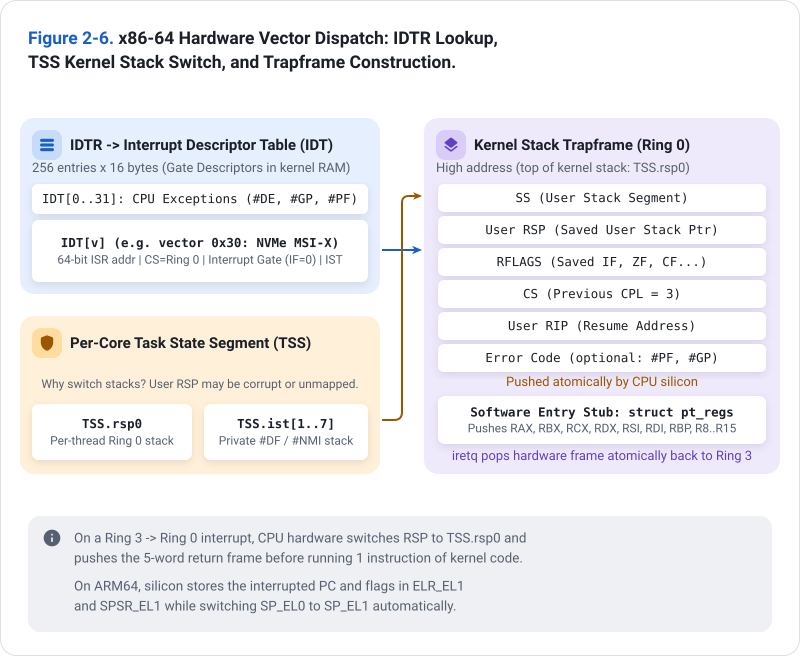

# 2. The Architectural Substrate and Execution Constraints

The design and operational behavior of an operating system are fundamentally dictated by the invariant properties of the underlying hardware. Without a supervisory kernel arbitrating execution, a bare-metal processor provides no memory isolation, no concurrent time-multiplexing, and no protection against errant or malicious instruction streams. The microarchitectural substrate defines the physical boundaries of computation, the necessity of virtual memory management, and the hardware mechanisms required to enforce system integrity.

## 2.1 The Execution Model and the Atomicity Gap

A processor core operates via a continuous fetch-decode-execute datapath cycle. At any discrete clock edge, the architectural state of an executing thread is encapsulated by its hardware register file. Across contemporary instruction set architectures (specifically x86-64 and ARM64/AArch64), this register file is partitioned into control pointers, status flags, and general-purpose storage:

- **Program Counter (`PC` / `RIP` on x86-64 / `PC_EL0` on ARM64):** Holds the 64-bit linear virtual address of the next instruction to be fetched from the L1 instruction cache (I-cache). During sequential execution, the control unit automatically increments the program counter by the byte length of the decoded instruction; control-flow transfers (branches, procedure calls, traps, and hardware interrupts) overwrite this register with a target address.
- **Stack Pointer (`SP` / `RSP` on x86-64 / `SP_EL0` on ARM64):** Points to the active downward-growing boundary of the thread's call stack in virtual memory. Stack allocations decrement the stack pointer, whereas frame deallocations increment it. Both the System V AMD64 ABI and the ARM64 Procedure Call Standard (AAPCS64) mandate that the stack pointer maintain 16-byte alignment at function call boundaries to satisfy vector SIMD load/store alignment constraints.
- **Frame Pointer (`FP` / `RBP` on x86-64 / `x29` on ARM64):** Serves as an invariant base anchor within the current function activation record. While the stack pointer fluctuates dynamically during expression evaluation and outgoing parameter construction, the frame pointer remains fixed throughout the function's lifetime. Compilers store the caller's saved frame pointer at the base of the new frame (`[RBP]` or `[x29]`) and the return address immediately above it (`[RBP + 8]` or `[x29 + 8]`), establishing a contiguous, singly linked chain of activation records. Walking this frame-pointer chain enables debuggers, crash handlers, and kernel sampling profilers (`perf`, DTrace) to reconstruct full call stacks in `O(depth)` time without DWARF unwind tables.
- **Processor Status and Control Flags (`FLAGS` / `RFLAGS` on x86-64 / `PSTATE` on ARM64):** Encapsulates arithmetic condition codes (Zero `ZF`, Carry `CF`, Sign/Negative `SF`/`N`, and Overflow `OF`/`V`) alongside privileged execution controls. Most critically for operating system design, this register contains the hardware interrupt mask: the Interrupt Enable Flag (`IF`, bit 9 of `RFLAGS`) on x86-64 and the `DAIF` (Debug, SError, IRQ, FIQ) mask bits on ARM64.
- **General-Purpose Registers (GPRs):** Provide sub-nanosecond, zero-cycle-Wait operand storage for arithmetic, bitwise logic, and memory addressing. On x86-64, the 16 GPRs (`RAX`, `RBX`, `RCX`, `RDX`, `RSI`, `RDI`, `RBP`, `RSP`, and `R8`–`R15`) are partitioned by ABI convention into caller-saved volatile registers (`RAX`, `RCX`, `RDX`, `RSI`, `RDI`, `R8`–`R11`, where `RDI`, `RSI`, `RDX`, `RCX`, `R8`, `R9` pass the first six integer arguments) and callee-saved non-volatile registers (`RBX`, `RBP`, `R12`–`R15`). On ARM64, the 31 64-bit registers (`x0`–`x30`) assign `x0`–`x7` to argument passing and return values, `x9`–`x15` to caller-saved temporaries, `x19`–`x28` to callee-saved state, `x29` to the Frame Pointer, and `x30` to the Link Register (`LR`), which captures the return address on a Branch-with-Link (`BL`) instruction.

<figure>

</figure>

### 2.1.1 The Fetch-Decode-Execute Datapath and Function Activation Records

During each instruction cycle, the control unit coordinates four microarchitectural stages across the processor datapath:
1. **Instruction Fetch (IF):** The control unit presents the virtual address in `PC` (`RIP` / `PC_EL0`) to the Memory Management Unit (MMU) and L1 instruction cache, retrieving the instruction byte stream and advancing `PC`.
2. **Instruction Decode & Register Rename (ID):** The decoder parses the opcode and operand specifiers, mapping architectural registers (`RAX`, `x0`) onto physical registers via the Register Alias Table (RAT) to eliminate false Write-After-Read (WAR) and Write-After-Write (WAW) hazards.
3. **Execute & Memory Access (EX/MEM):** The Arithmetic Logic Unit (ALU) computes arithmetic or effective virtual addresses. Memory loads and stores query the Translation Lookaside Buffer (TLB) and L1 data cache (D-cache), buffering uncommitted writes inside the core's hardware Store Buffer.
4. **Commit / Write-Back (WB):** The Reorder Buffer (ROB) retires instructions in strict program order, committing register updates and draining store-buffer entries to the coherent cache hierarchy.

When a procedure is invoked (`CALL` on x86-64, `BL` on ARM64), the processor constructs a **function activation record** (stack frame) in virtual memory. The caller places up to six (x86-64) or eight (ARM64) arguments in registers and pushes any excess arguments onto the stack. The call instruction records the return address (`RIP + instr_len` pushed to `[RSP - 8]` on x86-64; `PC + 4` stored in `x30` on ARM64). The callee prologue then pushes the caller's Frame Pointer (`push rbp; mov rbp, rsp` on x86-64, or `stp x29, x30, [sp, #-N]!; mov x29, sp` on ARM64), saves any modified callee-saved registers, and decrements `SP` to reserve space for local variables. On x86-64, the System V ABI additionally defines a 128-byte **Red Zone** immediately below `RSP` (`[RSP - 128, RSP)`), which leaf functions may utilize for temporary storage without adjusting `RSP`, provided asynchronous interrupts and signals use a separate stack.

<figure>

</figure>

### 2.1.2 Formal Derivation of the Atomicity Gap

While the reorder buffer guarantees that a single core observes its own instructions retiring in sequential program order, the hardware datapath does not preserve atomicity across composite high-level language expressions. This discrepancy between source-level syntax and machine-level execution defines the **atomicity gap**.

Consider a shared 64-bit integer counter incremented concurrently by two processor cores (`counter++`). Because RISC and CISC arithmetic units operate on registers rather than directly across coherent DRAM, the compiler decomposes the increment into a three-instruction Read-Modify-Write (RMW) sequence:

```text
// x86-64 Read-Modify-Write             // ARM64 Read-Modify-Write
1. mov  rax, QWORD PTR [rip + counter]  1. ldr  x0, [x1]        // Load shared state into core register
2. add  rax, 1                          2. add  x0, x0, #1      // Increment private register copy in ALU
3. mov  QWORD PTR [rip + counter], rax  3. str  x0, [x1]        // Store updated value back to L1 D-cache
```

If Core 0 and Core 1 execute this sequence concurrently when `counter == 42`, their instruction streams interleave across the memory bus:
- Core 0 executes Step 1 (`mov`/`ldr`), loading `42` from its L1 D-cache into its private architectural register (`RAX_0 = 42`).
- Simultaneously, Core 1 executes Step 1, reading the identical shared cache line into its own register (`RAX_1 = 42`).
- Core 0 and Core 1 both execute Step 2 in their local ALUs, computing `43` in `RAX_0` and `RAX_1`.
- Core 0 executes Step 3, invalidating Core 1's shared cache line via the hardware cache coherency protocol and writing `43`.
- Core 1 executes Step 3 immediately thereafter, overwriting the memory location with its own value of `43`.

Although two distinct increments occurred, the final state in memory is `43` rather than `44`, a concurrency failure known as a **lost update**. Bridging this atomicity gap requires hardware-enforced atomic instructions (such as `lock xadd` on x86-64, which locks the cache line throughout the RMW cycle, or Load-Linked/Store-Conditional `ldxr`/`stxr` and Large System Extensions `ldaddal` on ARM64) coupled with kernel synchronization primitives.

## 2.2 Memory Hierarchy and Locality Dynamics

The memory subsystem is architected as a tiered hierarchy that balances physical storage capacity against access latency. This hierarchy progresses from core-private registers (~0.3 ns, 1 cycle) through L1 instruction and data caches (32–64 KiB, ~1 ns, 3–4 cycles), unified L2 caches (256 KiB–1 MiB, ~3–4 ns, 10–12 cycles), and shared L3 / System-Level Caches (4–64 MiB, ~10–15 ns, 35–50 cycles) to main DRAM (gigabytes, ~60–100 ns, 200+ cycles).

The throughput of this hierarchy relies on two empirical properties of program execution:
- **Temporal Locality:** The tendency of an execution stream to access the same memory addresses repeatedly within a brief time window (e.g., loop counters, stack frame variables, hot lock words).
- **Spatial Locality:** The tendency of an execution stream to access memory addresses within contiguous physical proximity of recently accessed locations (e.g., sequential array traversal, linear instruction fetching).

Because hardware cache controllers transfer memory between DRAM and caches in fixed **64-byte cache lines** (or 128-byte lines on certain high-performance ARM64 SoCs), sequential memory traversal amortizes a single DRAM fetch across multiple subsequent loads, triggering the hardware spatial prefetcher. Conversely, pointer-chasing workloads over non-contiguous heap nodes defeat the prefetcher and stall the out-of-order execution engine on L3 cache misses. Furthermore, managing coherence at 64-byte cache-line granularity introduces **false sharing**: when two threads on distinct cores modify logically independent variables that reside within the same 64-byte cache line, the cache coherency protocol (MESI/MOESI) repeatedly invalidates and transfers the line across the inter-core interconnect, serializing parallel execution.

## 2.3 Privilege Domains and Boundary Enforcement

To prevent user applications from corrupting kernel data structures, disabling hardware interrupts, or monopolizing I/O controllers, the processor enforces a hardware privilege bifurcation between **User Mode** (Ring 3 / Current Privilege Level `CPL = 3` on x86-64; Exception Level `EL0` on ARM64) and **Kernel Mode** (Ring 0 / `CPL = 0` on x86-64; `EL1` on ARM64). Above the operating system kernel, modern processors provide hypervisor privilege domains (`VMX Root` on x86-64; `EL2` on ARM64) and secure firmware monitors (`SMM` / `EL3`).

When a core executes in User Mode (`CPL = 3` / `EL0`), the hardware control unit and MMU strictly enforce three boundary invariants:
1. **Privileged Instruction Restriction:** Any attempt to execute instructions that mutate control registers (`mov cr3`), alter interrupt masks (`cli`, `sti`, `msr daifset`), halt the core (`hlt`), or manipulate Model-Specific Registers (`wrmsr`) is blocked in silicon, immediately raising a synchronous General Protection Fault (`#GP` on x86-64) or Synchronous Exception (`EC_UNCATEGORIZED` on ARM64).
2. **Page-Table Permission Enforcement:** Every Page Table Entry (PTE) contains a User/Supervisor flag (`U/S`, bit 2 on x86-64; `AP[1]` on ARM64). While executing in User Mode, any load, store, or instruction fetch targeting a virtual page marked Supervisor-only triggers an immediate hardware Page Fault (`#PF` / Data Abort), trapping control into the kernel.
3. **I/O Port and MMIO Isolation:** Direct access to device I/O ports (`in`, `out`) and physical Memory-Mapped I/O (MMIO) control apertures is restricted exclusively to Ring 0 / `EL1`.

To minimize the latency of kernel entry during system calls and interrupts, operating systems typically map the kernel's virtual address range into the upper canonical half of every process's page table (protected by Supervisor-only PTE bits). When a trap elevates the processor from Ring 3 to Ring 0, the kernel code and data are immediately addressable without reloading the page table root register (unless Kernel Page-Table Isolation, KPTI, is enabled to mitigate speculative execution side channels such as Meltdown). Consequently, the kernel must treat every pointer supplied by user space as untrusted, validating that the entire buffer range `[ptr, ptr + len)` resides strictly within the user canonical address boundary (`< TASK_SIZE`) before dereferencing it, and utilizing specialized access routines (`copy_from_user`, `copy_to_user`) with hardware Supervisor Mode Access Prevention (`SMAP` on x86-64; Privileged Access Never `PAN` on ARM64).

<figure>

</figure>

## 2.4 Synchronous Traps and the Asynchronous Interrupt Subsystem

Control transfers across the privilege boundary from user mode (`Ring 3` / `EL0`) to kernel mode (`Ring 0` / `EL1`) are classified into two architectural categories based on their causal relationship to the executing instruction stream:

- **Synchronous Traps and Exceptions:** Triggered deterministically as a direct result of executing a specific instruction on the local core. The processor cannot retire the instruction until the kernel intervenes. Synchronous events subdivide into deliberate **system call traps** (`syscall` on x86-64, `svc #0` on ARM64), recoverable **faults** (such as a minor Page Fault `#PF`, where the kernel allocates a frame and re-executes the faulting instruction), and unrecoverable **aborts** (such as hardware machine-check exceptions `#MC` or division by zero `#DE`).
- **Asynchronous Hardware Interrupts (IRQs):** Triggered by external physical devices, such as a network interface card (NIC) completing a DMA packet transfer, an NVMe controller signaling I/O completion, or a hardware timer tick expiring. Asynchronous interrupts arrive at arbitrary clock cycles, completely independent of the instruction stream currently executing on the processor core.

### 2.4.1 Why Interrupt Controllers Exist: From One Copper Pin to Multi-Core Fabrics

To understand modern interrupt hardware without memorizing disconnected acronyms, begin with the physical wiring problem hardware architects had to solve. Early single-core microprocessors (such as the Intel 8086) had literally **one** physical interrupt input pin (`INTR`) entering the CPU package. A simple motherboard chip (the 8259A Programmable Interrupt Controller) gathered eight physical device wires (timer, keyboard, disk, serial port), chose the highest-priority active wire, and raised that single `INTR` pin to tap the CPU on the shoulder.

That single-pin model collapses completely on a modern server with 64 CPU cores and dozens of high-speed PCIe devices (NVMe drives, 100GbE network cards, GPUs) completing millions of operations per second. Three physical problems forced the evolution of modern two-tier interrupt fabrics:
1. **Pin scarcity and shared-line contention:** Routing hundreds of dedicated copper IRQ traces across a motherboard is physically impractical. When multiple devices share one copper pin, the kernel cannot tell which device fired and must wake every driver attached to that pin to poll its status registers, wasting thousands of cycles per interrupt.
2. **Multi-core affinity routing:** A single interrupt wire cannot steer Network Receive Queue 4 to Core 4 while steering NVMe Completion Queue 7 to Core 7. Keeping a device queue pinned to one specific core preserves warm L1/L2 cache lines for that queue's ring buffer and driver state.
3. **Cross-core coordination:** Cores must be able to interrupt *each other* directly in hardware. For example, when Core 0 unmaps a shared memory page via `munmap()`, Core 0 must send a hardware signal to Cores 1 through 63 forcing them to flush stale entries from their private TLBs (Chapter 7).

#### x86-64 Interrupt Architecture: IO-APIC, PCIe MSI-X, and Per-Core Local APICs

Intel and AMD solve all three problems by splitting interrupt handling across two hardware tiers: external routing logic on the chipset or PCIe bus, and an **on-die Local APIC** built directly inside every CPU core (Figure 2-4).

<figure>

</figure>

- **Chipset IO-APIC (Legacy Wired Devices):** Sits on the motherboard chipset and replaces the legacy 8259A for fixed physical IRQ pins (keyboard, serial UART, legacy SATA, power buttons). Inside the IO-APIC lives a programmable **Redirection Table** containing 24 (or more) 64-bit **Redirection Table Entries (RTEs)**, one per physical input pin. During boot, the OS kernel writes each RTE with four key fields: an 8-bit **Interrupt Vector Number** in the range `32` through `255` (vectors `0` through `31` are permanently reserved by CPU silicon for processor exceptions such as `#DE` divide error, `#GP` general protection fault, and `#PF` page fault), the **Destination Core APIC ID** that should handle the pin, the electrical trigger mode (edge-triggered vs. level-triggered), and a mask bit. When a legacy device raises pin `k`, the IO-APIC looks up `RTE[k]` and sends an interrupt message over the system interconnect to the designated CPU core's Local APIC.
- **Message Signaled Interrupts (MSI and MSI-X) for High-Speed PCIe Devices:** Modern PCIe peripherals (NVMe SSDs, 100GbE NICs, GPUs) eliminate physical interrupt pins and bypass the IO-APIC altogether. Instead, they signal interrupts using the exact same mechanism they already use to transfer data: a **DMA memory write** across the PCIe bus. During driver initialization, the kernel programs the device's PCIe **MSI-X Table** (supporting up to 2,048 independent vectors per device), writing a target physical **MMIO address** (encoding a specific CPU core's Local APIC window, such as `0xFEE0_0000` with the target core's APIC ID encoded in bits 19:12) paired with a 32-bit **data payload** (encoding the vector number `32..255`). When NVMe Completion Queue 3 finishes writing a 4 KiB disk block into DRAM, the NVMe controller issues a single 4-byte PCIe write to Core 3's Local APIC address containing Vector `0x30`. Because PCIe guarantees that earlier DMA writes to DRAM are ordered ahead of subsequent MSI-X writes, the data is already visible in memory the instant the interrupt arrives, with zero shared-pin contention and exact per-queue core affinity.
- **Per-Core Local APIC (LAPIC):** Integrated directly onto the silicon die of **every** CPU core. Each core's LAPIC accepts four independent interrupt feeds: routed messages from the IO-APIC, direct MSI-X writes from PCIe devices, **Inter-Processor Interrupts (IPIs)** dispatched by sibling cores (for TLB shootdowns, scheduler wakeups, and system-wide halts), and its own private on-die **APIC Timer** (providing independent preemption ticks per core without contending on a single motherboard timer).
- **Why Every LAPIC Maintains Two 256-Bit Bitmaps (`IRR` and `ISR`):** Multiple interrupts can arrive while a core is already executing an interrupt handler. To arbitrate priority cleanly in hardware without dropping signals, every LAPIC contains two 256-bit registers (one bit per vector `0..255`):
  1. **Interrupt Request Register (`IRR`):** Records every vector that has *arrived* at this core and is waiting to be delivered. Setting bit `0x30` in `IRR` means "Vector `0x30` is pending."
  2. **In-Service Register (`ISR`):** Records every vector whose handler the core is *currently executing*.
  On each cycle, the LAPIC compares the highest-priority set bit in `IRR` (priority class is determined by the upper four bits, `vector >> 4`) against the highest-priority set bit in `ISR`. Only when a pending vector in `IRR` strictly outranks the currently active vector in `ISR` (and `RFLAGS.IF == 1`) does the LAPIC atomically clear that bit in `IRR`, set it in `ISR`, and signal the core's control unit to dispatch `IDT[vector]`. When the OS handler finishes acknowledging the hardware device, it writes `0` to the LAPIC's **End-of-Interrupt (`EOI`)** register; that single write clears the highest set bit in `ISR`, unlocking the LAPIC to deliver the next waiting vector from `IRR`.

#### ARM64 Interrupt Architecture: Generic Interrupt Controller (GICv3 / GICv4)

ARM64 server and mobile SoCs solve the exact same multi-core routing and priority problem through the **Generic Interrupt Controller (GICv3 / GICv4)**, cleanly separating SoC-wide shared routing from per-core arbitration (Figure 2-5). Mapping each GIC component directly to its x86-64 counterpart makes both architectures easy to retain permanently:

<figure>

</figure>

- **Distributor (`GICD`):** The SoC-wide counterpart to the x86-64 IO-APIC. It manages **Shared Peripheral Interrupts (`SPI`, Interrupt IDs `32..1019`)**, which are physical wired interrupt lines from on-chip controllers (UART, I2C, storage, legacy platform devices). The kernel programs `GICD` routing registers to assign each SPI a priority byte and a target core affinity.
- **Interrupt Translation Service (`ITS`):** The ARM64 counterpart to x86-64 MSI-X routing. High-speed PCIe devices write a `(DeviceID, EventID)` payload to a dedicated ITS doorbell register; the ITS translates that pair through in-RAM device tables into a **Locality-Specific Peripheral Interrupt (`LPI`, Interrupt IDs `8192+`)** and forwards it directly to the target core's Redistributor. Because LPI state lives in main RAM rather than fixed flip-flops inside the controller, GICv3 scales smoothly to tens of thousands of PCIe and virtualized interrupt vectors.
- **Per-Core Redistributor (`GICR`):** The per-core counterpart to x86-64 LAPIC state, instantiated once per CPU core so hundreds of cores never contend on a single global distributor lock. Each core's `GICR` manages two core-private namespaces directly without crossing the SoC fabric: **Software Generated Interrupts (`SGI`, IDs `0..15`)** used for cross-core IPIs, and **Private Peripheral Interrupts (`PPI`, IDs `16..31`)** wired privately to one core (most notably each core's local ARM Generic Timer). The `GICR` merges incoming SPIs, LPIs, SGIs, and PPIs and forwards the single highest-priority pending ID to the core.
- **CPU Interface (`ICC_*` System Registers):** Rather than forcing the kernel to execute slower uncached MMIO loads and stores on every interrupt entry and exit, GICv3 maps the CPU Interface directly into fast architectural system registers. Upon entering the IRQ handler via `VBAR_EL1`, the kernel executes a single register read of **`ICC_IAR1_EL1`** (Interrupt Acknowledge Register) to obtain the winning Interrupt ID and atomically transition it from pending to active; when the handler finishes, a single register write to **`ICC_EOIR1_EL1`** signals End of Interrupt.

### 2.4.2 Vector Tables (`IDT`, `VBAR_EL1`), `TSS.rsp0`, and Hardware Trapframe Construction

Once a Local APIC or GIC presents an unmasked interrupt vector `v` (for example, Vector `0x30` from an NVMe MSI-X completion arriving while Core 0 is executing an application loop in Ring 3), the processor cannot immediately call a C or Rust function. First, the hardware control unit must solve two safety problems in silicon before running even one instruction of kernel code: **how to locate the kernel's handler address**, and **where to save the interrupted program's registers without trusting the user-mode stack**.

Why can the CPU never push the interrupted state onto the application's own user stack (`RSP`)? Because user-mode code controls `RSP`: a buggy or malicious program might set `RSP = 0`, point `RSP` into read-only memory, or point `RSP` into kernel memory. Pushing a hardware interrupt frame onto an untrusted `RSP` would trigger a recursive page fault or overwrite kernel memory. Therefore, every privilege elevation from Ring 3 to Ring 0 must atomically switch to a kernel-owned stack first (Figure 2-6).

<figure>

</figure>

On **x86-64**, hardware executes four strictly ordered steps atomically on the clock cycle an interrupt is accepted:
1. **Vector Table Lookup (`IDTR` and `IDT`):** The CPU reads the privileged **Interrupt Descriptor Table Register (`IDTR`)**, which holds the base linear address of the kernel's **Interrupt Descriptor Table (IDT)** (superseding the legacy 16-bit Real Mode Interrupt Vector Table, IVT). The IDT is a 4 KiB array of 256 16-byte **Gate Descriptors**. The processor indexes `IDT[v]` (for example, `IDT[0x30]`) to read four fields: the 64-bit target Interrupt Service Routine (ISR) address, the target Code Segment selector (`CS`, specifying `CPL = 0`), the Gate Type (**Interrupt Gate**, which automatically clears `RFLAGS.IF = 0` to mask nested interrupts during entry, versus **Trap Gate**, which leaves `IF` unchanged), and an optional 3-bit **Interrupt Stack Table (IST)** index.
2. **Privilege Elevation and Per-Thread Kernel Stack Switch (`TSS.rsp0`):** Seeing that the interrupted code ran at `CPL = 3` while `IDT[v]` targets `CPL = 0`, the hardware reads the current core's **Task State Segment (TSS)** and loads a fresh, trusted Ring 0 stack pointer from **`TSS.rsp0`** (which the kernel scheduler updates on every context switch to point to the top of the current thread's private 8 to 16 KiB kernel stack). For catastrophic exceptions where even the normal kernel stack might be overflowed (such as Double Fault `#DF` or Non-Maskable Interrupt `#NMI`), `IDT[v]` specifies a non-zero IST index so hardware switches to an emergency dedicated stack in **`TSS.ist[1..7]`**.
3. **Atomic Hardware Context Save:** On the newly activated Ring 0 kernel stack, CPU silicon pushes a 5-word (40-byte) architectural return frame in descending address order:
   1. Interrupted User Stack Segment (`SS`)
   2. Interrupted User Stack Pointer (`RSP`)
   3. Interrupted Processor Flags (`RFLAGS`, preserving the user thread's condition codes and `IF = 1`)
   4. Interrupted Code Segment (`CS`, recording the previous `CPL = 3`)
   5. Interrupted Instruction Pointer (`RIP`, the exact address to resume when the handler finishes)
   6. *(For specific synchronous faults such as `#PF` or `#GP`, silicon pushes a 6th 64-bit word: the architectural Error Code encoding whether a page fault was caused by a read, write, instruction fetch, or permission violation).*
4. **Software Trapframe Completion (`struct pt_regs`):** The CPU loads `RIP` with the ISR entry address from `IDT[v]`. The kernel's assembly entry stub immediately pushes every remaining general-purpose register (`RAX` through `R15`) directly below the hardware frame on the kernel stack, completing **`struct pt_regs`**. From this point onward, normal C or Rust kernel code can run safely using standard calling conventions without clobbering a single bit of the interrupted user thread's state.

On **ARM64**, the hardware achieves the exact same isolation with dedicated exception registers instead of pushing a frame to memory in silicon: elevating from `EL0` to `EL1` automatically switches the active stack pointer from `SP_EL0` to the kernel's `SP_EL1`, masks further IRQs (`PSTATE.I = 1`), saves the interrupted `PC` in **`ELR_EL1`** (Exception Link Register), saves the interrupted flags and mode in **`SPSR_EL1`** (Saved Program Status Register), records the fault cause in **`ESR_EL1`** (Exception Syndrome Register), and jumps to an entry stub inside the 2 KiB-aligned table pointed to by **`VBAR_EL1`** (Vector Base Address Register, organized into 16 128-byte slots grouped by exception type and source exception level). The kernel entry stub then spills `x0` through `x30`, `ELR_EL1`, `SPSR_EL1`, and `SP_EL0` onto `SP_EL1`.

### 2.4.3 Top-Half (`hardirq`) vs. Bottom-Half (`softirq`) Split and EOI Lifecycle

An Interrupt Service Routine executes in **interrupt context**, not process context, which imposes two strict rules that shape all kernel driver architecture:
- **Interrupt handlers can never sleep or block on a mutex:** Because the interrupt hijacked whatever unrelated process happened to be running on Core 0 at that nanosecond, calling `schedule()` to sleep on a lock would suspend an innocent victim process. Worse, if the interrupted process *already held* that exact kernel mutex when the interrupt fired on Core 0, attempting to acquire the mutex inside the ISR would deadlock Core 0 permanently.
- **Interrupt handlers must complete in microseconds:** While executing with local interrupts masked (`RFLAGS.IF == 0` / `PSTATE.I == 1`) and the active vector bit set in the LAPIC `ISR`, the core cannot service subsequent lower-priority or same-priority interrupts. Parsing TCP headers, validating filesystem checksums, or allocating memory inside a masked handler causes network ring-buffer drops, audio glitches, and timer drift.

To keep interrupt masking as brief as possible while still performing complex protocol processing safely, modern kernels split interrupt execution into two distinct halves (Figure 2-7):

<figure>

</figure>

1. **Top-Half (`hardirq` Context, Interrupts Masked):** Runs immediately upon vector dispatch for at most a few microseconds. It performs only the hardware actions that cannot wait: reads the device's status register to confirm the completion, advances or acknowledges the hardware DMA descriptor ring so the device can resume accepting work, sets a bit in the kernel's per-CPU deferred-work mask, and writes **End of Interrupt (EOI)** to the Local APIC EOI register (or GIC `ICC_EOIR1_EL1`). Writing EOI clears the vector's bit in the LAPIC `ISR`, immediately allowing the interrupt controller to deliver new hardware events.
2. **Bottom-Half (`softirq`, NAPI, and Workqueues, Interrupts Re-Enabled):** Runs immediately after the top-half exits, with hardware interrupts **re-enabled** (`RFLAGS.IF == 1`) so urgent hardware signals can preempt heavy software work cleanly.
   - **High-throughput lock-free subsystems (`softirq` and NAPI):** In Linux, network packet processing (`NET_RX_SOFTIRQ`), block I/O completion (`BLOCK_SOFTIRQ`), and timer wheel expiration (`TIMER_SOFTIRQ`) execute as static **`softirq`** handlers on the local core right before returning to user space. Under sustained 100GbE traffic, Linux **NAPI (New API)** intentionally disables further NIC interrupts while polling batches of packets inside `NET_RX_SOFTIRQ`, preventing interrupt livelock; if softirq load exceeds a budget, work spills onto per-CPU **`ksoftirqd/N`** kernel threads so user applications are not starved.
   - **Blocking work (`workqueues` and Threaded IRQs):** Any driver cleanup that must acquire sleeping mutexes or wait on secondary I/O is enqueued onto a **workqueue** executed by normal schedulable **`kworker`** kernel threads (or registered via `request_threaded_irq`), which possess full Process Control Blocks and may sleep freely.

Finally, before returning to user space, the kernel inspects the interrupted task's `TIF_NEED_RESCHED` flag. If the interrupt woke up a higher-priority thread (for example, a blocked web server thread whose network packet has arrived), the kernel invokes `schedule()` to context-switch directly to the newly runnable thread. Otherwise, the exit stub restores `RAX..R15` from `struct pt_regs` and executes **`iretq`** (x86-64) or **`eret`** (ARM64), which atomically pops `RIP`, `CS`, `RFLAGS`, `RSP`, and `SS` (or restores `ELR_EL1` and `SPSR_EL1`), re-enables interrupts, and returns Core 0 cleanly to Ring 3 / `EL0` at the exact instruction that was preempted.
