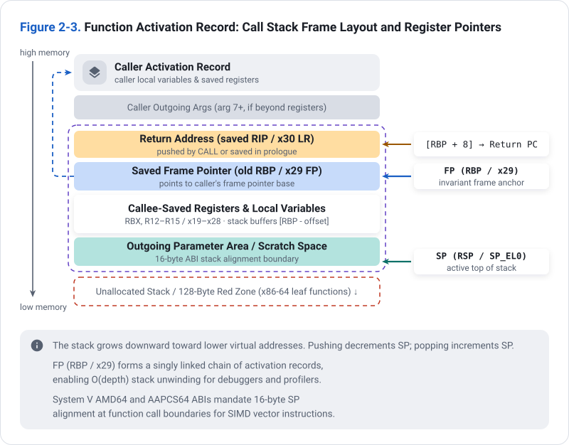
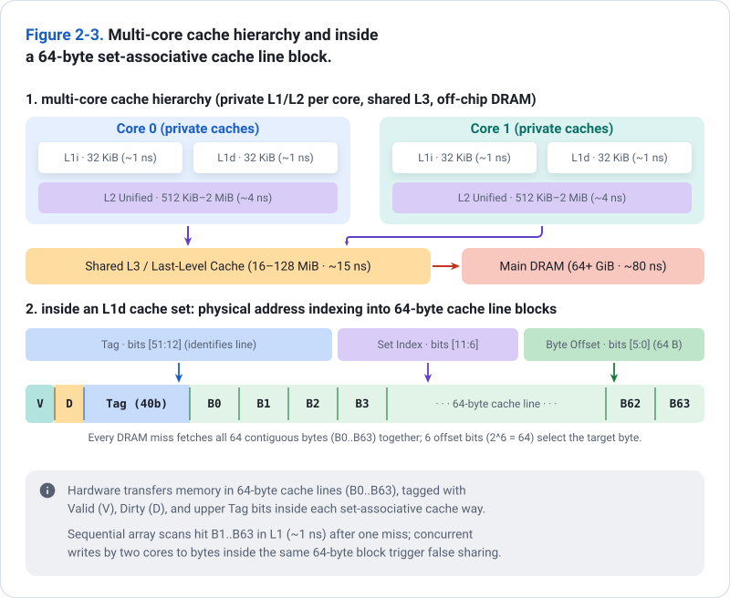
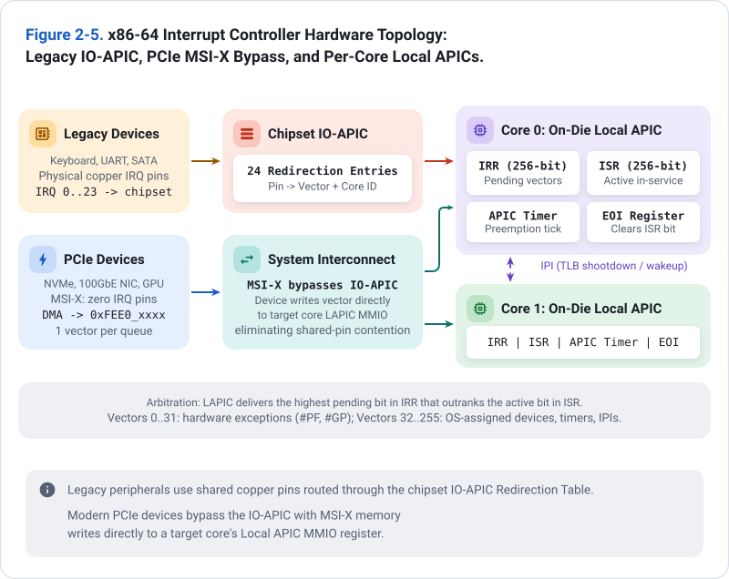
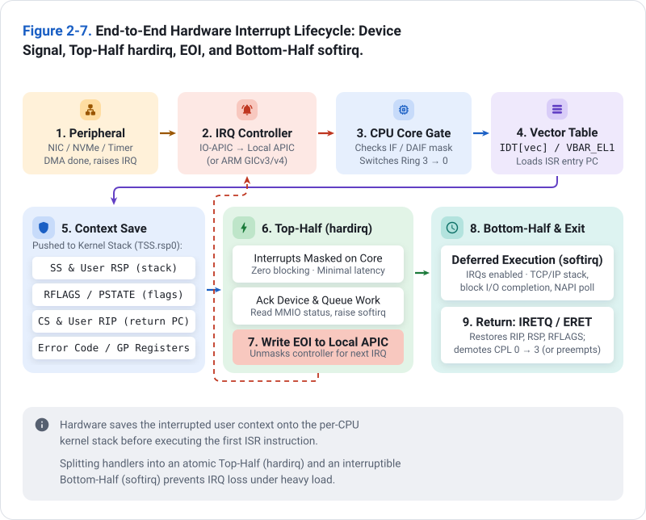

# 2. The Architectural Substrate and Execution Constraints

The design and operational behavior of an **Operating System (`OS`)** are dictated by the invariant properties of the underlying hardware. Those architectural properties define the boundaries of sequential instruction execution, the necessity of virtual memory management, and the hardware mechanisms required to enforce system integrity and asynchronous **Input/Output (`I/O`)** coordination.

To keep architectural concepts independent of vendor-specific mnemonics, each mechanism in this chapter is presented first in general hardware terms, followed by consolidated reference mappings across x86-64 and ARM64 (AArch64) in Tables 2-1 and 2-4.

## 2.1 The Execution Model and the Atomicity Gap

A processor core operates through a continuous fetch-decode-execute cycle. At any discrete clock edge, the architectural state of an executing thread is encapsulated by its on-chip register file. Because registers reside directly inside the execution pipeline, register access completes within a single clock cycle (approximately 0.3 nanoseconds on a 3 GHz core), whereas off-chip main memory requires hundreds of cycles. Across contemporary 64-bit architectures, the register file is organized into five functional roles summarized in Table 2-1.

Execution control depends on two registers: the **Program Counter (`PC`)** and the **Processor Status and Control Flags**. The program counter holds the virtual address of the next machine instruction to be fetched from the L1 instruction cache. During sequential execution, the control unit advances the program counter automatically by the length of the decoded instruction; control-flow transfers (branches, procedure calls, system calls, and hardware interrupts) overwrite this register with a new target address. Alongside the program counter, the status register stores arithmetic condition codes (zero, carry, sign, and overflow) together with privileged control bits. For kernel code, the critical control bit is the hardware **interrupt mask**: clearing the interrupt-enable bit causes the core to defer external asynchronous interrupts while updating sensitive kernel structures.

Procedure invocation and local storage rely on the **Stack Pointer (`SP`)** and the **Frame Pointer (`FP`)**. The stack pointer tracks the active downward-growing boundary of the thread's call stack in virtual memory: allocating space for local variables decrements the stack pointer, whereas deallocating a frame increments it. Both the System V AMD64 **Application Binary Interface (`ABI`)** and the ARM64 Procedure Call Standard (`AAPCS64`) mandate 16-byte stack alignment at procedure call boundaries to satisfy vector load and store alignment requirements. The frame pointer anchors the invariant base of the current function's activation record. Although the stack pointer fluctuates as temporary operands are pushed and popped, the frame pointer remains fixed from function entry until return. Saving the caller's frame pointer adjacent to the return address creates a singly linked chain of activation records, enabling debuggers and kernel sampling profilers to reconstruct call stacks in `O(depth)` pointer dereferences.

Finally, **General-Purpose Registers (`GPRs`)** provide single-cycle operand storage for arithmetic, pointer manipulation, and argument passing (16 general-purpose registers on x86-64; 31 on ARM64). By calling-convention contract, these registers are partitioned into **caller-saved** (volatile) registers, which a callee may overwrite freely, and **callee-saved** (non-volatile) registers, whose prior values the callee must preserve on the stack before returning. This split directly reduces context-switch and function-call overhead: a cooperative kernel switch between two threads needs to save only the callee-saved subset, whereas an asynchronous hardware interrupt must preserve every volatile register because the interrupted function had no opportunity to save them.

**Table 2-1. Architectural register mapping across x86-64 and ARM64.**

| Functional Role | x86-64 Register | ARM64 (AArch64) Register |
| :--- | :--- | :--- |
| Program Counter | `RIP` | `PC` |
| Stack Pointer | `RSP` | `SP` (`SP_EL0` in user mode, `SP_EL1` in kernel mode) |
| Frame Pointer | `RBP` | `x29` (`FP`) |
| Return Address Storage | Pushed onto stack by `CALL` | Stored in Link Register `x30` (`LR`) by `BL` |
| Status and Interrupt Mask | `RFLAGS` (Interrupt Flag `IF`, bit 9) | `PSTATE` (Interrupt mask bits `DAIF`) |
| Integer Argument Registers | `RDI, RSI, RDX, RCX, R8, R9` (first 6) | `x0` through `x7` (first 8) |

<figure>

</figure>

### 2.1.1 The Fetch-Decode-Execute Datapath and Function Activation Records

Sustaining high instruction throughput despite multi-cycle memory latency requires a superscalar processor to overlap execution across four microarchitectural stages. During **instruction fetch**, the front end retrieves instruction bytes from the L1 instruction cache using the program counter. During **decode and register rename**, the core parses opcodes and maps architectural register names onto a much larger pool of internal physical registers so independent instructions can execute concurrently out of order without false write-after-read or write-after-write hazards.

During **execute and memory access**, arithmetic instructions dispatch to the **Arithmetic Logic Unit (`ALU`)**, while loads and stores compute effective virtual addresses, consult the **Translation Lookaside Buffer (`TLB`)** and L1 data cache, and buffer uncommitted writes inside the core's hardware **store buffer**. During **commit (retire)**, the **reorder buffer** retires completed instructions in strict program order, making architectural register updates visible and draining stores into the coherent cache hierarchy. This in-order retirement guarantees **precise exceptions**: if an instruction triggers a page fault or divides by zero, the reorder buffer discards every younger speculative instruction cleanly so the operating system observes an exact architectural state at the faulting program counter.

Upon procedure invocation (`CALL` on x86-64; `BL` on ARM64), caller and callee cooperate to construct a **function activation record** (stack frame) in virtual memory (Figure 2-2). The caller places integer parameters in the designated argument registers and records the return address. The callee prologue saves the caller's frame pointer, anchors its own frame pointer to the base of the new frame, preserves any callee-saved registers it modifies, and decrements the stack pointer to reserve local storage. Upon function return, the epilogue reverses these operations and transfers control back to the saved return address.

<figure>

</figure>

### 2.1.2 Formal Derivation of the Atomicity Gap

Although the reorder buffer preserves sequential semantics within a single core, the processor datapath does not guarantee that a composite high-level language statement executes atomically across multiple cores. This discrepancy between source-level notation and machine-level execution defines the **atomicity gap**.

Consider a shared 64-bit integer counter incremented concurrently by two processor cores (`counter++`), with initial value `42`. Because arithmetic units operate on core-private registers rather than directly on main memory, the compiler lowers the increment into a three-instruction **Read-Modify-Write (`RMW`)** sequence:

```text
// x86-64 Read-Modify-Write             // ARM64 Read-Modify-Write
1. mov  rax, QWORD PTR [rip + counter]  1. ldr  x0, [x1]        // Load 42 into core-private register
2. add  rax, 1                          2. add  x0, x0, #1      // Compute 43 in local ALU
3. mov  QWORD PTR [rip + counter], rax  3. str  x0, [x1]        // Store 43 back to coherent cache line
```

Under concurrent execution, the two cores can interleave these three instructions across the memory subsystem as traced in Table 2-2.

**Table 2-2. Interleaving trace of an unsynchronized Read-Modify-Write increment across two cores.**

| Step | Core 0 Instruction | Core 1 Instruction | Core 0 Register | Core 1 Register | Shared Cache Line |
| :---: | :--- | :--- | :---: | :---: | :---: |
| 0 | Initial state | Initial state | (unset) | (unset) | `42` |
| 1 | `mov rax, [counter]` | (idle) | `42` | (unset) | `42` |
| 2 | (idle) | `mov rax, [counter]` | `42` | `42` | `42` |
| 3 | `add rax, 1` | `add rax, 1` | `43` | `43` | `42` |
| 4 | `mov [counter], rax` | (idle) | `43` | `43` | `43` |
| 5 | (idle) | `mov [counter], rax` | `43` | `43` | `43` |

Despite two distinct increments, the final stored value is `43` rather than `44`, producing a concurrency anomaly termed a **lost update**. Eliminating the atomicity gap requires either hardware atomic instructions that maintain exclusive cache-line ownership across the entire Read-Modify-Write cycle (`lock xadd` on x86-64; `ldaddal` or load-linked/store-conditional pairs on ARM64) or kernel-coordinated synchronization primitives, detailed in Chapters 4 and 6.

## 2.2 Memory Hierarchy and Locality Dynamics

The memory subsystem is organized as a multi-tiered hierarchy balancing capacity against access latency. Waiting 60 to 100 nanoseconds for an off-chip **Dynamic Random-Access Memory (`DRAM`)** read stalls a 3 GHz processor for more than 200 clock cycles. Hardware mitigates this disparity through progressively smaller, lower-latency on-chip **Static Random-Access Memory (`SRAM`)** caches whose typical latencies, capacities, and sharing scopes are summarized in Table 2-3.

**Table 2-3. Typical latency and capacity tiers of a modern 3 GHz multi-core memory hierarchy.**

| Memory Tier | Typical Latency | Approximate Cycles (3 GHz) | Typical Capacity | Sharing Scope |
| :--- | :--- | :--- | :--- | :--- |
| Architectural Registers | ~0.3 ns | 1 cycle | ~256 to 512 bytes | Private per pipeline |
| L1 Cache (split L1i / L1d) | ~1 ns | 3 to 4 cycles | 32 to 64 KiB each | Private per core |
| L2 Cache | ~3 to 5 ns | 10 to 14 cycles | 256 KiB to 4 MiB | Private per core |
| L3 / System-Level Cache | ~12 to 20 ns | 35 to 55 cycles | 8 to 128 MiB | Shared across cores |
| Main DRAM | ~60 to 100 ns | 200 to 300+ cycles | GiB to TiB | Shared across sockets |

The effectiveness of this hierarchy depends directly on two empirical properties of program memory access: **temporal locality** and **spatial locality**. Temporal locality reflects the high probability that recently referenced addresses (such as loop counters, hot function pointers, and active stack frames) will be referenced again shortly, justifying retention in L1 and L2 SRAM. Spatial locality reflects the high probability that addresses contiguous to a recently referenced byte (such as adjacent elements of a contiguous array) will be accessed next.

To exploit spatial locality, the memory subsystem transfers data between DRAM and cache in fixed **64-byte cache lines** (128 bytes on certain ARM64 implementations). The performance impact of cache-line geometry is substantial. Traversing a contiguous 1 MiB array of 131,072 64-bit integers touches 16,384 cache lines (eight integers per 64-byte line); hardware stride prefetchers fetch upcoming lines ahead of demand loads, keeping effective access latency near a few cycles per element. By contrast, chasing pointers across 131,072 scattered heap-allocated linked-list nodes triggers an unpredictable DRAM miss on nearly every dereference, consuming roughly `131,072 * 200 cycles ≈ 26.2 million cycles` (~8.7 milliseconds) compared to under 0.5 milliseconds for the contiguous array.

Maintaining cache coherence at 64-byte granularity introduces the multi-core pathology of **false sharing**. When Core 0 and Core 1 modify logically independent variables residing inside the same 64-byte cache line, the hardware coherence protocol (such as **Modified-Exclusive-Shared-Invalid (`MESI`)**) must repeatedly invalidate the peer's copy and transfer exclusive ownership of the entire line across the on-chip interconnect, degrading parallel throughput by an order of magnitude (measured empirically in Chapter 17). Padding hot per-core or per-thread counters to 64-byte boundaries eliminates false sharing completely.

<figure>

</figure>

## 2.3 Privilege Domains and Boundary Enforcement

System integrity relies on the hardware-mediated bifurcation of execution into distinct **privilege levels**. Application processes execute in **User Mode** (`Ring 3` on x86-64; `EL0` on ARM64), a restricted domain in which the processor prohibits privileged instructions (such as modifying page-table root registers, altering hardware interrupt masks, or programming device controllers) and confines memory references to virtual pages marked user-accessible. Any violation raises an immediate hardware exception that transfers control to the kernel.

The operating system kernel executes in **Kernel Mode** (`Ring 0` on x86-64; `EL1` on ARM64), possessing unrestricted access to memory-management hardware, timers, interrupt controllers, and peripheral buses. Contemporary processors additionally define a hypervisor tier (`VMX Root` on x86-64; `EL2` on ARM64, detailed in Chapter 16) to isolate guest kernels from one another and from the host hypervisor.

To reduce the latency of mode transitions, the kernel is commonly mapped into the upper portion of each process's virtual address space, marked accessible solely in kernel privilege mode. While this shared mapping avoids a full page-table replacement on system call entry (barring side-channel mitigations such as Kernel Page-Table Isolation), it imposes a strict security invariant: the kernel must validate every user-supplied pointer and buffer length before dereferencing it, ensuring an unprivileged caller cannot trick the kernel into reading or overwriting kernel memory on its behalf.

<figure>

</figure>

### 2.3.1 Device Communication Mechanisms: MMIO and DMA

Interaction between the processor and external peripheral controllers relies on two complementary hardware mechanisms: **Memory-Mapped Input/Output (`MMIO`)** and **Direct Memory Access (`DMA`)**.

Under MMIO, the platform reserves dedicated ranges of the physical address space and routes them away from DRAM chips directly to control and status registers inside hardware controllers (storage controllers, network interfaces, and interrupt controllers). When kernel code executes an ordinary store instruction to an MMIO physical address (for example, `0xFEE0_00B0` on x86-64), the bus interconnect delivers that write directly to the target device register. Because user-mode page tables omit MMIO physical ranges, unprivileged processes cannot manipulate device registers directly.

Transferring bulk storage blocks or network packets via CPU-driven MMIO loads and stores would consume processor cycles proportionally to I/O bandwidth. Sustaining 4 GiB/s from a **Non-Volatile Memory Express (`NVMe`)** drive through 8-byte programmed-I/O transfers would require 536 million uncached bus transactions per second, saturating multiple CPU cores. Modern **Peripheral Component Interconnect Express (`PCIe`)** controllers therefore incorporate a **DMA engine** capable of reading and writing physical DRAM directly over the bus independently of the CPU. To initiate a 128 KiB read, the kernel writes one 64-byte descriptor in DRAM specifying the target physical address and transfer length, notifies the controller with a single MMIO doorbell write, and schedules other runnable threads on the core. At 4 GiB/s, 128 KiB transfers require only 32,768 doorbells per second, consuming less than 0.1% of one core. Once the DMA engine finishes writing the requested bytes into DRAM, the peripheral signals completion asynchronously by asserting a **hardware interrupt**.

## 2.4 Synchronous Traps and the Asynchronous Interrupt Subsystem

Control transfers from user mode to kernel mode fall into two fundamental classes determined by their causal relationship to the executing instruction stream. **Synchronous traps and exceptions** are triggered directly by the currently executing instruction and are therefore deterministic with respect to the instruction stream. This class comprises intentional **system calls** (`syscall` on x86-64; `svc #0` on ARM64, Chapter 9), recoverable **faults** (such as a page fault, where the kernel maps the missing physical frame and restarts the faulting instruction), and unrecoverable **exceptions** (such as integer division by zero or illegal opcode execution).

**Asynchronous hardware interrupts**, by contrast, originate outside the processor's instruction stream, such as a DMA transfer completion from an NVMe controller, packet arrival at a **Network Interface Card (`NIC`)**, or expiration of a hardware preemption timer. An asynchronous interrupt may arrive between any two machine instructions of whichever thread currently occupies the core.

### 2.4.1 Interrupt Controllers and Routing Topologies (APIC and GICv3)

Early uniprocessor systems multiplexed a small number of physical peripheral interrupt lines through a single programmable interrupt controller wired to one interrupt pin on the processor. Scaling to multi-core servers with high-throughput PCIe devices invalidates that single-wire topology for three structural reasons. First, physical interrupt wires cannot scale to hundreds of independent device queues; sharing a single line among multiple peripherals forces the kernel to poll every attached driver on each assertion. Second, multi-queue network and storage controllers maintain distinct per-core submission and completion queues; directing Queue `k` completions specifically to Core `k` preserves L1/L2 cache locality and eliminates cross-core lock contention. Third, multi-core kernels require a low-latency hardware mechanism by which one core interrupts sibling cores to coordinate TLB invalidations (shootdowns) or scheduler wakeups. Modern multi-core interrupt subsystems therefore support four distinct signaling paths: shared legacy peripheral wires, message-based PCIe interrupts, per-core preemption timers, and inter-processor interrupts.

#### x86-64 Interrupt Architecture (IO-APIC, MSI-X, and Local APIC)

The x86-64 architecture distributes interrupt routing between the platform chipset and a dedicated **Local Advanced Programmable Interrupt Controller (`Local APIC`)** integrated onto the die of each CPU core (Figure 2-5).

<figure>

</figure>

Legacy platform peripherals connect via physical wires to the chipset **IO-APIC**, which maintains a programmable table of 24 or more **Redirection Table Entries (`RTEs`)**. During initialization, the kernel programs each RTE to associate physical wire `k` with an 8-bit interrupt vector (`32..255`; vectors `0..31` are architecturally reserved for internal processor exceptions) and a destination Local APIC core identifier.

For modern PCIe devices, **Message Signaled Interrupts-Extended (`MSI-X`)** combines DMA and MMIO (Section 2.3.1) to eliminate physical interrupt wiring altogether. Because every core's Local APIC is mapped to a well-known physical MMIO region (`0xFEE0_0000`, with the destination core ID encoded in upper address bits), a PCIe controller signals an interrupt by issuing a 4-byte DMA write directly to that MMIO address, encoding the target vector (`32..255`) in the payload. MSI-X bypasses the chipset IO-APIC, provides up to 2,048 independent vectors per device, eliminates shared-line polling, and maps individual device queues directly to designated cores. Furthermore, PCIe write ordering guarantees that all preceding DMA data writes are globally visible in DRAM before the MSI-X interrupt write reaches the Local APIC.

Each core's Local APIC aggregates four inputs: routed IO-APIC messages, direct PCIe MSI-X writes, **Inter-Processor Interrupts (`IPIs`)** transmitted by peer cores, and local **APIC Timer** expirations. To arbitrate concurrent arrivals without dropping signals, the Local APIC maintains two 256-bit state registers (one bit per vector `0..255`). The **Interrupt Request Register (`IRR`)** records pending vectors received by the core that have not yet begun execution, while the **In-Service Register (`ISR`)** records vectors whose handlers are currently executing on the core. When the highest-priority pending bit in `IRR` outranks the highest active bit in `ISR` (and `RFLAGS.IF == 1`), the Local APIC atomically clears the bit in `IRR`, sets the corresponding bit in `ISR`, and delivers the vector to the core. Upon completing the urgent device handshake, the kernel writes `0` to the Local APIC **End-of-Interrupt (`EOI`)** register, clearing the highest active bit in `ISR` and enabling delivery of subsequent pending vectors.

#### ARM64 Interrupt Architecture (GICv3 / GICv4)

ARM64 systems implement the identical four signaling paths through the **Generic Interrupt Controller (`GICv3` / `GICv4`)** architecture (Figure 2-6). A centralized **Distributor (`GICD`)** manages configuration and routing for chip-wide wired lines, designated **Shared Peripheral Interrupts (`SPI`, IDs `32..1019`)**. PCIe MSI-X DMA doorbell writes arrive at the **Interrupt Translation Service (`ITS`)**, which translates `(DeviceID, EventID)` tuples through memory-resident tables into **Locality-Specific Peripheral Interrupts (`LPI`, IDs `8192+`)** routed directly to a designated core.

Each core connects to a private **Redistributor (`GICR`)** that arbitrates core-local sources: **Software Generated Interrupts (`SGI`, IDs `0..15`)** for cross-core signaling and **Private Peripheral Interrupts (`PPI`, IDs `16..31`)** for per-core hardware such as the ARM Generic Timer. Rather than relying on uncached MMIO reads during interrupt entry, GICv3 exposes each core's CPU interface through architectural system registers: the kernel reads `ICC_IAR1_EL1` to acknowledge the highest-priority pending interrupt ID and writes `ICC_EOIR1_EL1` to signal End of Interrupt. Table 2-4 maps the x86-64 APIC components onto their ARM64 GICv3 counterparts.

<figure>

</figure>

**Table 2-4. Architectural correspondence between x86-64 APIC and ARM64 GICv3/GICv4 interrupt subsystems.**

| Interrupt Function | x86-64 (APIC) | ARM64 (GICv3 / GICv4) |
| :--- | :--- | :--- |
| Shared wired peripheral lines | Chipset **IO-APIC** (`RTE` -> Vectors `32..255`) | **Distributor (`GICD`)** -> `SPI` (IDs `32..1019`) |
| PCIe DMA message interrupts | **MSI-X** write to target Local APIC MMIO | **ITS** translation -> `LPI` (IDs `8192+`) |
| Per-core preemption timer | Per-core **Local APIC Timer** | Per-core **Redistributor (`GICR`)** `PPI` (IDs `16..31`) |
| Inter-core signaling (TLB flush) | **IPI** (Inter-Processor Interrupt) | **SGI** (Software Generated Interrupt, IDs `0..15`) |
| End-of-Interrupt completion | Write `0` to Local APIC **EOI** register | Write acknowledged ID to **`ICC_EOIR1_EL1`** |

### 2.4.2 Vector Tables, Kernel Stack Switching, and Trapframe Construction

When an interrupt vector is accepted while a core executes in user mode, hardware must perform two operations atomically before fetching the first instruction of the kernel handler: locate the handler entry point and preserve the interrupted thread's architectural state on trusted kernel memory.

Hardware cannot push the saved register frame onto the interrupted application's user stack because user-mode code controls the user stack pointer (`RSP` / `SP_EL0`); an invalid, unmapped, or kernel-pointing user stack pointer would immediately trigger a nested fault or corrupt kernel memory. Consequently, hardware switches to a pre-allocated, kernel-owned stack prior to saving state (Figure 2-7).

<figure>

</figure>

On **x86-64**, interrupt entry proceeds through four deterministic hardware and software steps. First, during system initialization, the kernel populates a 256-entry **Interrupt Descriptor Table (`IDT`)** of 16-byte descriptors in memory and loads its base address into the privileged `IDTR` register. Upon receiving vector `v`, hardware indexes `IDT[v]` to obtain the 64-bit handler entry address, target privilege level (`Ring 0`), and gate type (an **Interrupt Gate** automatically clears `RFLAGS.IF = 0` to mask nested external interrupts during entry).

Second, detecting a Ring 3 to Ring 0 privilege elevation, hardware consults the per-core **Task State Segment (`TSS`)** and loads the trusted kernel stack pointer from `TSS.rsp0`, which the scheduler updates on every context switch to point to the current thread's dedicated 8 to 16 KiB kernel stack. For critical faults where the regular kernel stack itself may be exhausted (such as a Double Fault `#DF` or Non-Maskable Interrupt `#NMI`), `IDT[v]` selects an isolated emergency stack from the Interrupt Stack Table (`TSS.ist[1..7]`).

Third, hardware pushes a 5-word architectural return frame onto the kernel stack consisting of the user Stack Segment (`SS`), user Stack Pointer (`RSP`), `RFLAGS`, Code Segment (`CS`), and interrupted Instruction Pointer (`RIP`), plus a 6th **Error Code** word for synchronous exceptions such as a page fault (`#PF`). Fourth, execution transfers to the kernel assembly entry stub, which pushes the remaining general-purpose registers (`RAX` through `R15`) directly beneath the hardware frame. The resulting contiguous structure forms the **trapframe** (`struct pt_regs`), allowing higher-level kernel code in C or Rust to execute safely without disturbing the interrupted thread's register context.

On **ARM64**, the processor achieves the same isolation through banked exception registers: transitioning from `EL0` to `EL1` switches the active stack pointer from `SP_EL0` to `SP_EL1`, sets the `DAIF` interrupt mask bits, captures the interrupted program counter in `ELR_EL1`, saves processor flags in `SPSR_EL1`, records exception syndrome metadata in `ESR_EL1`, and vectors execution into the 128-byte entry offset within the vector table referenced by `VBAR_EL1`, where the entry stub saves `x0` through `x30` onto `SP_EL1`.

### 2.4.3 Top-Half and Bottom-Half Decomposition and EOI Lifecycle

Execution inside a hardware interrupt handler is governed by two strict operational invariants: **non-blocking execution** and **bounded latency**. An interrupt handler executes in **interrupt context**, borrowing the kernel stack of whichever user thread happened to be active on that core. Because it possesses no independent process context, it must never sleep or block on a sleeping mutex; attempting to acquire a lock already held by the interrupted thread on the same core induces an immediate self-deadlock. Furthermore, while local interrupts remain masked (`IF == 0`) and the vector's bit remains set in the Local APIC `ISR`, the core cannot service equal- or lower-priority interrupts. Prolonged execution inside a masked handler causes missed timer ticks and dropped network or storage completions.

To reconcile microsecond-scale interrupt latency with complex protocol and filesystem processing, modern kernels partition interrupt servicing into two phases (Figure 2-8).

<figure>

</figure>

The **top-half (`hardirq`)** executes immediately upon trapframe construction with local hardware interrupts masked, lasting only a few microseconds. It performs strictly hardware-critical operations: reading device status registers, advancing DMA descriptor ring indices, recording a deferred-work flag in kernel memory, and issuing **End-of-Interrupt (`EOI`)** to the Local APIC (or writing `ICC_EOIR1_EL1` on ARM64). Writing EOI clears the vector's active bit in `ISR` so the interrupt controller can deliver subsequent events.

The **bottom-half** executes after the top-half exits, with hardware interrupts re-enabled (`IF == 1`) so higher-priority hardware signals can preempt software processing. In Linux, computationally intensive non-blocking tasks such as **Transmission Control Protocol / Internet Protocol (`TCP/IP`)** packet processing (`NET_RX_SOFTIRQ`), block I/O completion (`BLOCK_SOFTIRQ`), and timer callbacks (`TIMER_SOFTIRQ`) execute inside **softirqs** before returning to user mode, or offload to per-CPU `ksoftirqd` kernel threads under sustained load. Under high packet rates, Linux **New API (`NAPI`)** transitions a saturated network interface from per-packet interrupts to bounded polling within `NET_RX_SOFTIRQ`, amortizing interrupt entry overhead across batches of frames. Driver work that requires sleeping locks or secondary I/O is enqueued instead onto **workqueues** (`kworker` kernel thread pools) or threaded **Interrupt Request (`IRQ`)** handlers, each backed by a full Process Control Block capable of blocking safely.

Prior to returning to user mode, the kernel exit path inspects whether the interrupt awakened a higher-priority runnable thread. If preemption is required, the scheduler performs a context switch to that thread; otherwise, the exit stub restores all general-purpose registers from the trapframe and executes `iretq` (x86-64) or `eret` (ARM64), atomically restoring the saved instruction pointer, stack pointer, privilege level, and interrupt mask to resume the interrupted thread transparently.

<div class="callout keyidea">
<span class="label">Key idea</span>

Hardware privilege rings (`Ring 3`/`Ring 0`, `EL0`/`EL1`) and interrupt dispatch tables (`IDT`, `VBAR_EL1`) turn a general-purpose processor into a multi-tenant operating system. Without timer interrupts and hardware-enforced traps, a single infinite loop in user code could monopolize the machine indefinitely.

</div>

<div class="callout experiment">
<span class="label">Experiment</span>

On Linux, inspect `/proc/interrupts` twice separated by one second (`cat /proc/interrupts; sleep 1; cat /proc/interrupts`) to observe per-core Local `APIC` timer ticks (`LOC`) and `NVMe` or `NIC` `MSI-X` interrupt counters incrementing in real time across physical cores.

</div>

<div class="callout caution">
<span class="label">Common Pitfall</span>

Performing blocking allocations (`kmalloc(..., GFP_KERNEL)`) or acquiring sleeping mutexes inside a top-half `hardirq` handler deadlocks the core because hardware interrupts are masked and no process context exists to schedule back onto the CPU. Blocking work belongs strictly in bottom-half workqueues or threaded `IRQ` handlers.

</div>
