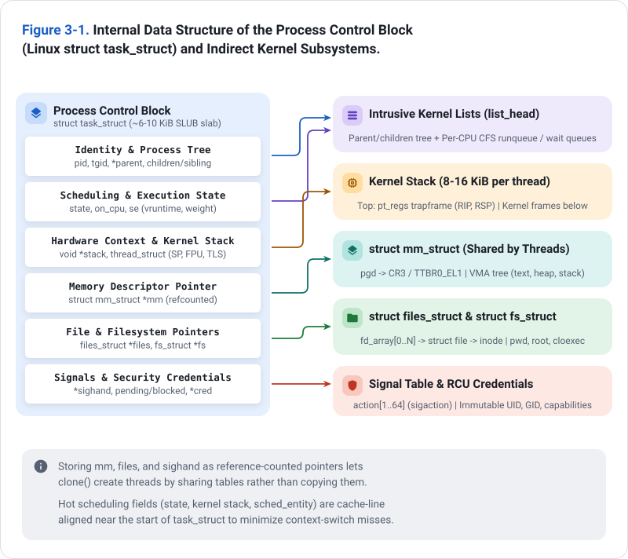

# 3. Process Abstraction and Lifecycle

A program stored on disk is a static sequence of machine instructions and initialized data; it becomes a **process** only when the operating system instantiates it into an active execution environment. A process is defined by its architectural execution state, its kernel-tracked resource ownership, and its isolated virtual address space.

## 3.1 The Process Control Block and Address Space Topology

To manage multiple concurrent executions on a finite number of processor cores, the kernel maintains a **Process Control Block (`PCB`)** for every active process. The PCB serves as the primary vehicle for context switching, storing the process's unique **Process Identifier (`PID`)**, its lineage, its current scheduling state, and the saved hardware registers required to resume execution. Beyond execution state, the PCB references the process's environmental resources: its page tables for memory isolation, its open file descriptor table, its signal configuration, and its security credentials.

### 3.1.1 Internal Data Structure of the Process Control Block

In production kernels, the PCB is a large, cache-line-aligned kernel structure allocated from a dedicated slab cache (`task_struct_cachep` under Linux's **Unqueued Slab Allocator (`SLUB`)**, Chapter 8). Rather than embedding every kernel subsystem inline, the PCB places hot scheduling and context-switch fields directly at the front of the struct and references heavier resource tables through reference-counted pointers (Figure 3-1).

<figure>

</figure>

The following simplified C layout captures the six functional groups present in Linux's `struct task_struct` (which spans approximately 6 to 10 KiB in modern kernels):

```c
struct pcb {
    /* 1. Scheduling and execution state (cache-hot on every context switch) */
    volatile unsigned int   state;          /* TASK_RUNNING, INTERRUPTIBLE, ZOMBIE */
    void                   *kstack;         /* Base of 8-16 KiB per-thread kernel stack */
    int                     on_cpu;         /* Currently executing CPU core index */
    struct sched_entity     se;             /* CFS vruntime, weight, red-black tree node */
    struct list_head        run_node;       /* Intrusive link into runqueue or wait queue */

    /* 2. Identity and process hierarchy */
    pid_t                   pid;            /* Unique kernel thread ID (TID) */
    pid_t                   tgid;           /* Thread group ID (POSIX PID seen in user space) */
    struct pcb             *parent;         /* Parent process notified by SIGCHLD */
    struct list_head        children;       /* Head of this process's child list */
    struct list_head        sibling;        /* Link into parent->children */
    int                     exit_code;      /* Packed exit status retained for waitpid() */

    /* 3. Saved hardware execution context */
    struct thread_struct    thread;         /* Kernel SP, callee-saved regs, FPU/SIMD, TLS */

    /* 4. Virtual memory descriptor (shared across threads of one process) */
    struct mm_struct       *mm;             /* Page-table root (pgd -> CR3) and VMA tree */

    /* 5. File descriptors and filesystem namespace */
    struct files_struct    *files;          /* fd_array[0..N] -> struct file, cloexec mask */
    struct fs_struct       *fs;             /* Current working directory (pwd) and root */

    /* 6. Signal dispositions and security credentials */
    struct sighand_struct  *sighand;        /* Signal handler table (action[1..64]) */
    sigset_t                blocked;        /* Currently masked signals (sigprocmask) */
    sigset_t                pending;        /* Signals generated but awaiting delivery */
    const struct cred      *cred;           /* Immutable UID, GID, and capability bitmasks */
};
```

Each functional group inside the PCB enforces a concrete operating system invariant. Fields touched on every timer tick and context switch (`state`, `kstack`, `on_cpu`, `se`, and `run_node`) sit at the front of the structure, separated from read-mostly fields by cache-line alignment boundaries to prevent false sharing. Embedding intrusive `struct list_head` pointers directly inside the PCB allows a single task to reside simultaneously in the parent-child hierarchy, a scheduler runqueue, or a futex wait queue with zero separate heap node allocations (Section 8.2.2).

Identity and lineage fields (`pid`, `tgid`, `parent`, `children`, `sibling`, `exit_code`) encode the Unix process tree. On Linux, every kernel-scheduled execution context owns a distinct `task_struct`. All threads belonging to the same **Portable Operating System Interface (`POSIX`)** process share a common **Thread Group Identifier (`tgid`)**, which is the value returned by `getpid()`, while each thread owns a distinct kernel `pid` (returned by `gettid()`). When a child terminates, `exit_code` preserves its 8-bit exit status or terminating signal number inside the zombie PCB until the parent reclaims it via `waitpid()`.

Hardware execution context is split between `kstack` and `thread`. Whenever the CPU traps from user mode into kernel mode on a system call or hardware interrupt, silicon switches to the thread's private 8 to 16 KiB kernel stack (`kstack`) and records the user-mode register snapshot (`struct pt_regs`, Section 2.4.2) at the top of that stack. During an in-kernel context switch (`switch_to`), the scheduler saves the remaining kernel-mode callee-saved registers, kernel stack pointer, floating-point and **Single Instruction, Multiple Data (`SIMD`)** register bank (`XMM`/`YMM`/`NEON`), and **Thread-Local Storage (`TLS`)** base register (`FS_BASE` on x86-64; `TPIDR_EL0` on ARM64) inside `thread_struct`.

Memory, files, and security descriptors are referenced indirectly through pointers so sibling threads can share them safely. The virtual memory descriptor (`struct mm_struct *mm`) holds the physical address of the top-level page directory (`pgd`, loaded into `CR3` or `TTBR0_EL1` during context switches) alongside the balanced tree of **Virtual Memory Areas (`vm_area_struct`, `VMAs`)** describing every valid segment and its read/write/execute permissions. Storing `mm` as a reference-counted pointer allows `clone(CLONE_VM)` to spawn threads sharing one address space by incrementing `mm_users`, whereas `fork()` allocates a new `mm_struct` with copy-on-write page-table entries. Similarly, `files_struct` maps integer file descriptors (`0, 1, 2, ...`) to kernel `struct file` open file descriptions (Section 12.1) together with the per-descriptor `close_on_exec` bitmask inspected by `execve()`, while `fs_struct` stores the working directory, filesystem root, and `umask`. Signal handler dispositions (`sighand_struct`) are process-wide, whereas the signal mask (`blocked`) is per-thread so individual threads can control asynchronous delivery independently (Chapter 10). Security credentials (`cred`: real, effective, and saved **User Identifier (`UID`)** and **Group Identifier (`GID`)** plus Linux capability sets) are stored as immutable structures replaced via copy-on-write and **Read-Copy-Update (`RCU`)**, allowing permission checks on every `open()` or `kill()` system call to execute without locking.

Kernels differ in whether they unify processes and threads into one PCB structure or split resource ownership from execution state (Table 3-1).

**Table 3-1. Kernel PCB representation across Linux and macOS/Darwin (XNU).**

| PCB Subsystem | Linux (`struct task_struct`) | macOS / Darwin XNU (`proc` + `task` + `thread`) |
| :--- | :--- | :--- |
| Process identity & POSIX state | `task_struct` (`tgid`, `parent`, `children`) | BSD layer `struct proc` (`p_pid`, `p_pptr`, `p_children`) |
| Address space & Mach ports | `task_struct->mm` (`struct mm_struct`) | Mach layer `struct task` (`vm_map_t map`, IPC port space) |
| Schedulable execution context | `task_struct` (`pid`, `se`, `kstack`, `thread`) | Mach layer `struct thread` (kernel stack, saved registers, runqueue) |
| Open file descriptors | `task_struct->files` (`struct files_struct`) | `proc->p_fd` (`struct filedesc`) |
| Credentials & signals | `task_struct->cred`, `task_struct->sighand` | `proc->p_ucred` (`kauth_cred_t`), `proc->p_sigacts` |

### 3.1.2 Virtual Address Space Layout and Empirical Observation

Each process views memory through a structured virtual address space (Figure 3-2) that remains uniform regardless of where physical frames reside in **Dynamic Random-Access Memory (`DRAM`)**. Table 3-2 summarizes the five standard segments and connects each one to the empirical addresses observed in Output 3-1.

<figure>

</figure>

**Table 3-2. Standard virtual address space segments mapped to empirical addresses from Output 3-1.**

| Segment | Permissions | Contents and Backing | Growth Direction | Observed Address (Output 3-1) |
| :--- | :--- | :--- | :--- | :--- |
| Text | `R-X` | Read-only machine code; shared across processes running the same binary | Fixed at load | `0x101A225E0` |
| Data | `RW-` | Explicitly initialized global and static variables | Fixed at load | `0x101A24000` |
| **Block Started by Symbol (`BSS`)** | `RW-` | Zero-initialized global and static variables; demand-zeroed by kernel | Fixed at load | `0x101A24004` |
| Heap | `RW-` | Dynamic allocations (`malloc`, `new`, `Box`); backed by `brk`/`mmap` | Toward higher addresses | `0x600000B00040` |
| Stack | `RW-` | Function activation records, return addresses, local variables | Toward lower addresses | `0x7FF7BE4DC1EC` |
| Kernel Space | Supervisor only | Kernel text, slabs, direct physical map; unaccessible in user mode | Upper canonical range | Hidden above user space |

Output 3-1 exposes concrete details of how the linker and kernel arrange these regions. The `text` symbol (`&anchor` at `0x101A225E0`) sits on a separate 4 KiB page below `data` (`&g_initialized` at `0x101A24000`) because hardware enforces `R-X` versus `RW-` permissions at page granularity (`4,096` bytes). Inside the writable data page, `g_uninitialized` (`0x101A24004`) sits exactly 4 bytes after the 4-byte `int g_initialized`. Vast unmapped virtual gaps separate the binary image (`~0x1_01A2_0000`), the dynamic heap (`0x6000_00B0_0040`), and the stack (`0x7FF7_BE4D_C1EC`), giving both heap and stack gigabytes of room to grow while **Address Space Layout Randomization (`ASLR`)** shifts base addresses on every execution to hinder memory-corruption exploits.

**Listing 3-1. Printing one address from each region (C++20).**

```cpp
{{#include ../code/ch03/layout.cpp}}
```

**Output 3-1. One run on the verification machine.**

```text
{{#include ../code/out/ch03_layout.out}}
```

**Listing 3-2. The same program in Rust (2024 edition).**

```rust
{{#include ../code/ch03/layout.rs}}
```

**Output 3-2.**

```text
{{#include ../code/out/ch03_layout_rs.out}}
```

### 3.1.3 Limited Direct Execution and Preemptive Context Switching

Creating isolated address spaces solves spatial protection, yet leaves a core CPU-virtualization problem: how does the operating system share a single physical processor across many processes at near-native speed without surrendering control? Interpreting every user instruction in software would preserve total control, yet would slow execution by 10x to 100x. Letting user processes execute directly on bare silicon achieves full speed, yet fails whenever a process attempts a privileged operation or enters an infinite loop.

Modern kernels resolve this tension through **Limited Direct Execution (`LDE`)**, which pairs direct user-mode execution on the CPU with two hardware-enforced control mechanisms. First, **restricted operations** trap automatically into kernel mode via the trap table (`IDT` on x86-64; `VBAR_EL1` on ARM64) initialized at boot, ensuring only the kernel can perform I/O or alter page tables. Second, **preemptive timer interrupts** break CPU monopolies: during boot, the kernel programs a per-core hardware timer to fire every 1 to 4 milliseconds. Even if a user process executes `while (true) {}` and never issues a system call, the timer interrupt forcibly traps the core back into kernel mode, handing control to the scheduler.

Table 3-3 traces a complete timer-driven context switch from Process A to Process B under Limited Direct Execution, distinguishing what hardware saves automatically from what the kernel's `switch_to()` routine saves explicitly.

**Table 3-3. Step-by-step trace of a preemptive context switch from Process A to Process B.**

| Step | Execution Mode | Active Stack | Hardware or Kernel Action |
| :---: | :--- | :--- | :--- |
| 1 | User (Process A) | User Stack A | Process A executes user instructions until the per-core hardware timer expires. |
| 2 | Hardware Trap | Kernel Stack A | Silicon elevates to Ring 0 / EL1, loads `TSS.rsp0` (Kernel Stack A), pushes user `RIP`, `RSP`, `RFLAGS`, and jumps to the timer vector. |
| 3 | Kernel (Timer ISR) | Kernel Stack A | Entry stub pushes Process A's general-purpose registers (`pt_regs`), acknowledges `EOI`, and marks Process A's time slice expired. |
| 4 | Kernel (`schedule`) | Kernel Stack A | Scheduler selects Process B from the Ready runqueue and invokes `switch_to(A, B)`. |
| 5 | Kernel (`switch_to`) | Kernel Stack A -> B | Saves A's kernel callee-saved registers and kernel `SP` into `PCB_A.thread`; loads `PCB_B.mm->pgd` into `CR3`/`TTBR0_EL1`; updates `TSS.rsp0` to Kernel Stack B; restores B's kernel `SP` and callee-saved registers. |
| 6 | Kernel (Exit Stub) | Kernel Stack B | Pops Process B's previously saved `pt_regs` from Kernel Stack B and executes `iretq` / `eret`. |
| 7 | User (Process B) | User Stack B | Silicon atomically restores Process B's user `RIP`, `RSP`, `RFLAGS`, and Ring 3 / EL0; Process B resumes at the exact instruction where it was previously paused. |

Every transition in Table 3-3 preserves two invariants: user-mode code never touches kernel stacks or page-table root registers, and neither Process A nor Process B can observe that the switch occurred except through elapsed wall-clock time.

## 3.2 Process Creation and the Mechanics of `fork`

On Unix-like systems, process creation is split into two distinct primitives: `fork()` clones the calling process, and `execve()` replaces the calling process's memory image with a new executable. Implementing `fork()` by eagerly copying the parent's entire address space would be prohibitively slow. Consider a 4 GiB in-memory database server (1,048,576 4 KiB pages) that forks a short-lived helper process to run `/bin/gzip`. Copying 4 GiB across a 20 GiB/s memory bus would stall the database for approximately 200 milliseconds and temporarily double physical DRAM consumption to 8 GiB, only for `execve()` to discard all 1,048,576 copied pages microseconds later.

To avoid this waste, modern kernels implement `fork()` using **Copy-on-Write (`CoW`)**. Rather than duplicating physical data frames, `fork()` allocates a new `mm_struct`, copies only the parent's page-table entries (approximately 8 MiB of metadata for a 4 GiB process, completing in roughly 1 millisecond), increments the physical-page reference counts, and marks every shared writable **Page Table Entry (`PTE`)** as read-only in both parent and child.

As long as both processes only read memory, they share the same physical frames with zero copying. The instant either process executes a store to a shared CoW page, the **Memory Management Unit (`MMU`)** raises a synchronous write page fault (`#PF`). The kernel's page-fault handler inspects the corresponding `vm_area_struct`, confirms that the segment is logically writable and that the physical frame's reference count exceeds 1, allocates a fresh 4 KiB physical frame, copies the 4 KiB contents into it, updates the faulting process's PTE to point to the new writable frame, decrements the old frame's reference count, invalidates the stale **Translation Lookaside Buffer (`TLB`)** entry, and restarts the faulting store instruction. If the child calls `execve()` immediately after `fork()`, almost no CoW faults ever trigger.

A subtle interaction arises between `fork()` and user-space **Standard Input/Output (`stdio`)** buffering. Because `fork()` duplicates the process's entire user-space heap, any unwritten bytes sitting inside a `FILE *` buffer (such as `stdout`) are inherited by both parent and child. When `stdout` is connected to an interactive terminal, the C library defaults to *line buffering*, flushing on every `\n`. When `stdout` is redirected to a file or pipe, the C library switches to *full block buffering* (typically 4 KiB or 8 KiB). In Listing 3-3, the first `printf("before fork: pid=%d\n", getpid())` stays inside `stdout`'s user-space buffer when output is captured to a file; after `fork()`, both the child's explicit `fflush(stdout)` and the parent's exit flush that identical buffered line, causing `before fork: pid=65087` to appear twice in Output 3-3. Calling `fflush(stdout)` immediately before `fork()` eliminates the duplication.

### 3.2.1 The Process Creation and Reaping System Call Interface (`fork`, `_exit`, `waitpid`)

Before examining Listings 3-3 and 3-4, the exact parameter contracts, return conventions, and status encodings of the POSIX process-control primitives clarify every branch in the code:

```c
pid_t fork(void);
pid_t getpid(void);
pid_t getppid(void);
void  _exit(int status);
pid_t waitpid(pid_t pid, int *wstatus, int options);
```

Calling `fork()` accepts no arguments, yet returns **twice** on success: once in the parent (returning the child's positive `pid_t > 0`) and once in the newly created child (returning `0`). When process limits (`RLIMIT_NPROC`) or physical memory are exhausted, `fork()` creates no child and returns `-1` solely in the parent (`EAGAIN` or `ENOMEM`), so callers always branch across all three cases (`< 0`, `== 0`, `> 0`). The query helpers `getpid()` and `getppid()` take no arguments and never fail, returning the caller's own `PID` and parent `PID`.

When terminating a forked child that did not invoke `execve()`, calling `_exit(status)` rather than the C library `exit(status)` is essential. Both store only the lowest 8 bits (`status & 0xFF`) in the zombie PCB, yet `exit()` runs `atexit` destructors and flushes duplicated `stdio` buffers inherited from the parent, causing buffered output to print twice. Because `_exit()` enters the kernel immediately without flushing user-space buffers, the child explicitly flushes its own stream with `fflush(stdout)` right before calling `_exit(7)`.

To collect a terminated child and release its zombie PCB, the parent invokes `waitpid(pid, wstatus, options)`. The `pid` selector chooses which children match (`pid > 0` waits for that exact child; `-1` waits for any direct child; `0` waits for any child in the caller's process group), while `options` selects blocking (`0`) or non-blocking polling (`WNOHANG`, returning `0` immediately if live children remain). The integer written to `*wstatus` is a packed bitfield rather than the raw exit code; callers decode it through standard `<sys/wait.h>` macros: `WIFEXITED(status)` and `WEXITSTATUS(status)` for normal exits, or `WIFSIGNALED(status)` and `WTERMSIG(status)` when terminated by an uncaught signal. On success `waitpid()` returns the reaped child's `PID`, or `-1` on error (`ECHILD` when no matching children exist, or `EINTR` on signal interruption).

<figure>

</figure>

**Listing 3-3. fork, waitpid, and the exit status (C++20).**

```cpp
{{#include ../code/ch03/fork.cpp}}
```

**Output 3-3. The first line is printed twice.**

```text
{{#include ../code/out/ch03_fork.out}}
```

**Listing 3-4. The same sequence in Rust, using the libc crate.**

```rust
{{#include ../code/ch03/fork.rs}}
```

**Output 3-4.**

```text
{{#include ../code/out/ch03_fork_rs.out}}
```

## 3.3 Lifecycle Management, State Automaton, and Termination

The operational lifecycle of a process is governed by a formal five-state finite automaton managed by the kernel scheduler and process subsystem, coupled with four primary system call transitions: `fork` (or `clone`) for instantiation, `execve` for binary image replacement, `_exit` for termination, and `waitpid` for parent acknowledgment and resource reclamation.

### 3.3.1 The Five-State Process Lifecycle Automaton

At any instant between creation and final reclamation, a process's PCB records its exact scheduling disposition across five canonical states (Figure 3-4 and Table 3-4).

<figure>

</figure>

A process begins in the **New (Embryonic)** state when its parent invokes `fork()`. The kernel allocates a fresh PCB (`struct task_struct` on Linux; `struct proc` on Darwin/XNU), assigns a unique PID, duplicates the parent's file descriptor table, and clones the parent's virtual memory areas with Copy-on-Write page-table protections. Once initialization completes, the kernel admits the PCB into a per-CPU scheduler runqueue, transitioning the process to **Ready (Runnable)**, where it holds every resource required for execution except an available physical core. (In Linux, both Ready and Running states share the `TASK_RUNNING` descriptor flag, distinguished by whether the task is currently the active `curr` pointer on a CPU runqueue.)

When the dispatcher selects the process from the Ready queue, it loads the process's page-table root into the MMU (`CR3` on x86-64; `TTBR0_EL1` on ARM64), restores its saved registers, and returns to user mode; the process is now **Running**. If a running process issues a system call whose completion depends on an asynchronous external event (reading from an empty pipe or socket, waiting on a contended futex, or faulting on a disk-backed page), busy-waiting in kernel mode would waste processor cycles. The kernel instead transitions the process to **Blocked (Sleeping)**, removing its PCB from the CPU runqueue, appending it to a wait queue associated with the target event (`TASK_INTERRUPTIBLE` if signals may wake it early, or `TASK_UNINTERRUPTIBLE` for critical hardware **Direct Memory Access (`DMA`)** waits), and immediately calling `schedule()`. When a hardware interrupt or peer thread satisfies the event, the wakeup handler moves the PCB from the wait queue back to the Ready runqueue.

Upon voluntary termination (`_exit(status)` or returning from `main`) or involuntary termination via an unhandled fatal signal (`SIGSEGV`, `SIGKILL`), the process enters the **Zombie (`EXIT_ZOMBIE`)** state. The kernel immediately closes all open file descriptors, frees the process's user-space virtual memory mappings and physical frames, and notifies the parent with `SIGCHLD`. The kernel cannot deallocate the PCB or release the PID slot yet, because the parent may subsequently query the child's termination status via `waitpid()`.

**Table 3-4. Canonical process state transitions and kernel actions.**

| From State | Trigger / Event | To State | Kernel Action |
| :--- | :--- | :--- | :--- |
| New | `fork()` initialization finishes | Ready | Admits PCB into a per-CPU runqueue |
| Ready | Scheduler dispatches task | Running | Loads `CR3`/`TTBR0_EL1`, switches stack, restores `pt_regs` |
| Running | Timer `IRQ` expires quantum | Ready | Saves context, re-enqueues PCB on runqueue |
| Running | Blocking syscall (`read`, `waitpid`) | Blocked | Removes PCB from runqueue, appends to event wait queue |
| Blocked | Device `IRQ` or peer wakeup | Ready | Removes PCB from wait queue, enqueues on runqueue |
| Running | `_exit()` or fatal signal | Zombie | Frees `mm_struct` and file descriptors, retains PCB, sends `SIGCHLD` |
| Zombie | Parent calls `waitpid()` | Reaped | Copies `exit_code` to parent, frees PCB and releases PID slot |

To observe these transitions in action, consider a single-core CPU running two processes: a compute-bound Process A and an I/O-bound Process B that reads a 4 KiB block from disk. At `t = 0 ms`, Process B is Running and Process A is Ready. At `t = 0.2 ms`, Process B invokes `read()`, which initiates an NVMe DMA transfer and transitions Process B to Blocked; the scheduler immediately dispatches Process A to Running. While the disk fetches the block over the next 0.04 ms, Process A executes useful computation rather than stalling the core. At `t = 0.24 ms`, the NVMe controller fires an MSI-X completion interrupt; the interrupt handler moves Process B from Blocked to Ready. At the next scheduling decision, the kernel preempts Process A (Running -> Ready) and resumes Process B (Ready -> Running) to consume its freshly loaded buffer.

### 3.3.2 Zombie Reaping, Orphan Reparenting, and `execve` Mechanics

A process in the **Zombie** state consumes zero user-space RAM and executes zero instructions, yet retains its kernel PCB and occupies one slot in the global PID allocation bitmap. The process transitions from Zombie to **Reaped** only when its parent invokes `waitpid(pid, &status, options)`, which copies the 8-bit exit code and terminating signal mask out of the zombie PCB and frees the `task_struct` and PID.

Two lifecycle boundary conditions require explicit handling in production software. **Zombie accumulation leaks** occur when a long-running parent spawns child workers and neglects to call `waitpid()` (and does not set its `SIGCHLD` disposition to `SIG_IGN`). Every terminated child remains permanently trapped in the Zombie state until the host exhausts its process limit (`pid_max` or `RLIMIT_NPROC`), preventing any new process or thread from starting across the system. Conversely, **orphan reparenting** occurs when a parent terminates while its children remain active. Because every process requires a parent to reap its eventual zombie PCB, the kernel walks the terminating parent's child list and reparents all orphaned descendants to **PID 1** (`launchd` on macOS, `systemd` or `init` on Linux) or to the nearest ancestor registered as a subreaper (`PR_SET_CHILD_SUBREAPER`). PID 1 continuously runs a `waitpid()` loop in its main event cycle, reaping reparented orphans upon termination.

Finally, the `execve(path, argv, envp)` system call replaces a process's executing program without allocating a new PID. When invoked, the kernel tears down the entire existing user-space virtual address space (text, data, BSS, heap, and stack), parses the target executable binary header (**Executable and Linkable Format (`ELF`)** on Linux; Mach-O on macOS), maps the new program segments into fresh page tables, initializes a clean user stack containing the `argv` argument vector and `envp` environment strings, resets caught signal handlers to `SIG_DFL` (because the prior handler addresses no longer exist in the new image), and transfers control to the new binary's entry point (`_start`).

What `execve()` preserves is equally deliberate: the PID, parent PID, process group, working directory, credentials (absent `setuid` bits), and all open file descriptors not marked with the close-on-exec flag (`FD_CLOEXEC` / `O_CLOEXEC`) survive unaltered across the image replacement. This selective preservation underpins Unix shell pipelines. When a shell executes `ls > out.txt`, it calls `fork()`, then inside the child opens `out.txt`, redirects file descriptor `1` (`stdout`) via `dup2()`, closes the temporary descriptor, and invokes `execve("/bin/ls", ...)`. The newly loaded `ls` binary writes to descriptor `1` without any awareness that its output flows into a file rather than a terminal.

<div class="callout keyidea">
<span class="label">Key idea</span>

Splitting process creation into `fork()` (clone) and `execve()` (replace) allows a shell to rewire standard descriptors (`dup2`), drop privileges, and adjust signal masks inside the child *after* `fork()` and *before* `execve()`, without bloating `execve()` into a 40-argument system call.

</div>

<div class="callout experiment">
<span class="label">Experiment</span>

Run Listing 3-3 (`code/ch03/fork.cpp`) with stdout redirected to a file (`./fork > /tmp/out.txt && cat /tmp/out.txt`) and then remove `fflush(stdout)` before `fork()`. Notice how `before fork` prints **twice** because full block buffering retains the line in user-space `stdio` memory, duplicating it across the `fork()` boundary.

</div>

<div class="callout caution">
<span class="label">Common Pitfall</span>

Calling `fork()` inside a multi-threaded process duplicates **only the calling thread** into the child while preserving every user-space mutex in whatever locked state sibling threads held at that instant. Calling `malloc()` or `printf()` in the child before `execve()` can therefore deadlock permanently; invoke strictly async-signal-safe system calls between `fork()` and `execve()`.

</div>
