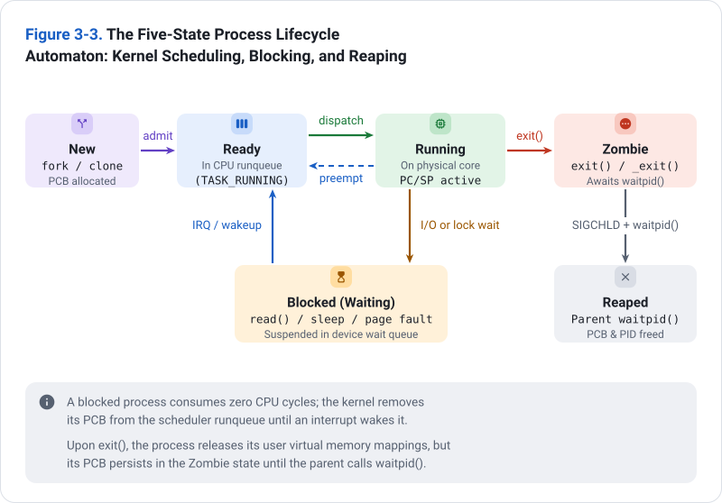

# 3. Process Abstraction and Lifecycle

A program is a static sequence of instructions; it becomes a process only when the operating system instantiates it into an active execution environment. A process is defined by its execution state, its resource ownership, and its isolated address space.

## 3.1 The Process Control Block and Address Space Topology

To manage multiple concurrent executions, the kernel maintains a Process Control Block (PCB) for every active process. The PCB serves as the primary vehicle for context switching, storing the process's unique identifier (PID), its lineage, its current execution state (running, ready, or blocked), and the precise architectural state, including registers and the program counter, required to resume execution. Beyond execution state, the PCB tracks the process's environmental resources, including its page tables for memory isolation, its file descriptor table, and its signal configuration.

### 3.1.1 Internal Data Structure of the Process Control Block

In production kernels, the PCB is a large, cache-line-aligned kernel structure allocated from a dedicated slab cache (`task_struct_cachep` under Linux's **Unqueued Slab Allocator (`SLUB`)**, Chapter 8). Rather than embedding every kernel subsystem inline, the PCB holds hot scheduling and context-switch fields directly at the front of the struct and references heavier resource tables through reference-counted pointers (Figure 3-1).

<figure>

</figure>

The following simplified C layout captures the six functional groups present in Linux's `struct task_struct` (which spans approximately 6 to 10 KiB in modern kernels):

```c
struct pcb {
    /* 1. Scheduling and execution state (cache-hot on every context switch) */
    volatile unsigned int   state;          /* TASK_RUNNING, INTERRUPTIBLE, ZOMBIE */
    void                   *kstack;         /* Base of 8-16 KiB per-thread kernel stack */
    int                     on_cpu;         /* Currently executing CPU core index */
    struct sched_entity     se;             /* CFS vruntime, weight, red-black tree node */
    struct list_head        run_node;       /* Intrusive link into runqueue or wait queue */

    /* 2. Identity and process hierarchy */
    pid_t                   pid;            /* Unique kernel thread ID (TID) */
    pid_t                   tgid;           /* Thread group ID (POSIX PID seen in user space) */
    struct pcb             *parent;         /* Parent process notified by SIGCHLD */
    struct list_head        children;       /* Head of this process's child list */
    struct list_head        sibling;        /* Link into parent->children */
    int                     exit_code;      /* Packed exit status retained for waitpid() */

    /* 3. Saved hardware execution context */
    struct thread_struct    thread;         /* Kernel SP, callee-saved regs, FPU/SIMD, TLS */

    /* 4. Virtual memory descriptor (shared across threads of one process) */
    struct mm_struct       *mm;             /* Page-table root (pgd -> CR3) and VMA tree */

    /* 5. File descriptors and filesystem namespace */
    struct files_struct    *files;          /* fd_array[0..N] -> struct file, cloexec mask */
    struct fs_struct       *fs;             /* Current working directory (pwd) and root */

    /* 6. Signal dispositions and security credentials */
    struct sighand_struct  *sighand;        /* Signal handler table (action[1..64]) */
    sigset_t                blocked;        /* Currently masked signals (sigprocmask) */
    sigset_t                pending;        /* Signals generated but awaiting delivery */
    const struct cred      *cred;           /* Immutable UID, GID, and capability bitmasks */
};
```

Each group inside the PCB reflects a specific operating system invariant:

1. **Scheduling and Execution State (`state`, `kstack`, `se`):** Fields touched on every timer tick and context switch are placed near the beginning of the structure (separated from read-mostly fields by cache-line alignment boundaries to prevent false sharing). Embedding intrusive `struct list_head` pointers directly inside the PCB allows a single process to belong simultaneously to the parent-child tree, a scheduler runqueue, or a futex wait queue with zero separate heap node allocations (Section 8.2.2).
2. **Identity and Lineage (`pid`, `tgid`, `parent`, `children`, `exit_code`):** On Linux, every kernel-scheduled execution context has its own `task_struct`. All threads belonging to the same **Portable Operating System Interface (`POSIX`)** process share a common **Thread Group Identifier (`tgid`)**, which is the value returned by `getpid()`, while each thread owns a distinct kernel `pid` (returned by `gettid()`). When a child terminates, `exit_code` preserves its 8-bit exit status or terminating signal number inside the zombie PCB until the parent reclaims it via `waitpid()`.
3. **Hardware Execution Context and Kernel Stack (`kstack`, `thread`):** Whenever the CPU traps from user mode into kernel mode on a system call or hardware interrupt, silicon switches to the thread's private 8 to 16 KiB kernel stack (`kstack`) and records the user-mode register snapshot (`struct pt_regs`, Section 2.4.2) at the top of that stack. During an in-kernel context switch (`switch_to`), the scheduler saves the remaining kernel-mode callee-saved registers, kernel stack pointer, floating-point and **Single Instruction, Multiple Data (`SIMD`)** register bank (`XMM`/`YMM`/`NEON`), and Thread-Local Storage base register (`FS_BASE` on x86-64; `TPIDR_EL0` on ARM64) inside `thread_struct`.
4. **Virtual Memory Descriptor (`struct mm_struct *mm`):** The `mm_struct` holds the physical address of the top-level page directory (`pgd`, loaded into `CR3` or `TTBR0_EL1` during context switch) alongside the balanced tree of **Virtual Memory Areas (`vm_area_struct`, VMAs)** describing every valid segment (text, data, heap, `mmap` regions, and stack) and its read/write/execute permissions. Storing `mm` as a reference-counted pointer rather than inline allows `clone(CLONE_VM)` to spawn threads that share one address space by incrementing `mm_users`, whereas `fork()` allocates a new `mm_struct` with copy-on-write page-table entries.
5. **File Descriptor Table and Filesystem Context (`*files`, `*fs`):** `files_struct` contains the integer-indexed array mapping process file descriptors (`0, 1, 2, ...`) to kernel `struct file` open file descriptions (Section 12.1), together with the per-descriptor `close_on_exec` bitmask inspected by `execve()`. Separating `fs_struct` (`pwd`, `root`, and `umask`) enables threads to share a working directory by default while permitting containers to isolate filesystem roots independently.
6. **Signal State and Security Credentials (`*sighand`, `blocked`, `pending`, `*cred`):** Signal handler dispositions (`sighand_struct`) are process-wide, whereas the signal mask (`blocked`) is per-thread so individual threads can control asynchronous delivery independently (Chapter 10). Security credentials (`cred`: real, effective, and saved **User Identifier (`UID`)** and **Group Identifier (`GID`)** plus Linux capability sets) are stored as immutable structures replaced via copy-on-write and **Read-Copy-Update (`RCU`)**, allowing permission checks on every `open()` or `kill()` system call to execute without locking.

Kernels differ in whether they unify processes and threads into one PCB structure or split resource ownership from execution state (Table 3-1).

**Table 3-1. Kernel PCB representation across Linux and macOS/Darwin (XNU).**

| PCB Subsystem | Linux (`struct task_struct`) | macOS / Darwin XNU (`proc` + `task` + `thread`) |
| :--- | :--- | :--- |
| Process identity & POSIX state | `task_struct` (`tgid`, `parent`, `children`) | BSD layer `struct proc` (`p_pid`, `p_pptr`, `p_children`) |
| Address space & Mach ports | `task_struct->mm` (`struct mm_struct`) | Mach layer `struct task` (`vm_map_t map`, IPC port space) |
| Schedulable execution context | `task_struct` (`pid`, `se`, `kstack`, `thread`) | Mach layer `struct thread` (kernel stack, saved registers, runqueue) |
| Open file descriptors | `task_struct->files` (`struct files_struct`) | `proc->p_fd` (`struct filedesc`) |
| Credentials & signals | `task_struct->cred`, `task_struct->sighand` | `proc->p_ucred` (`kauth_cred_t`), `proc->p_sigacts` |

The process's memory is organized into a structured address space, which provides a consistent view of memory regardless of the underlying physical allocation. This topology typically includes:
- **Text Segment:** The read-only machine code of the program, which can be shared across multiple processes to conserve physical memory.
- **Data and **Block Started by Symbol (`BSS`)** Segments:** Regions for initialized and zero-initialized global variables, respectively.
- **Heap:** A dynamically expanding region for runtime memory allocation, growing toward higher addresses.
- **Stack:** A region that manages function activation records, growing toward lower addresses.
- **Kernel Space:** A protected region at the apex of the address space, mapped into every process but inaccessible in user mode, facilitating efficient system calls.

<figure>

</figure>

**Listing 3-1. Printing one address from each region (C++20).**

```cpp
{{#include ../code/ch03/layout.cpp}}
```

**Output 3-1. One run on the verification machine.**

```text
{{#include ../code/out/ch03_layout.out}}
```

**Listing 3-2. The same program in Rust (2024 edition).**

```rust
{{#include ../code/ch03/layout.rs}}
```

**Output 3-2.**

```text
{{#include ../code/out/ch03_layout_rs.out}}
```

## 3.2 Process Creation and the Mechanics of `fork`

On Unix-like systems, process creation is facilitated through the `fork` system call, which implements a "copy-on-write" (COW) paradigm. Rather than performing an immediate, computationally expensive duplication of the parent's entire address space, the kernel initially permits the parent and child to share the same physical pages, marking them as read-only. A private copy is only instantiated when one of the processes attempts a write operation. This mechanism ensures that `fork` remains highly efficient, particularly when the child intends to immediately replace its image using `execve`.

A critical nuance of `fork` involves the inheritance of process state, specifically the buffers within standard I/O libraries. Because `fork` duplicates the process's memory, including any unwritten data in user-mode buffers, a child process may inadvertently re-output data that was buffered by the parent prior to the fork. This necessitates explicit synchronization, such as calling `fflush` before a `fork` operation, to maintain output integrity.

### 3.2.1 The Process Creation and Reaping System Call Interface (`fork`, `_exit`, `waitpid`)

Before examining Listings 3-3 and 3-4, it is essential to understand the exact parameter contracts, return conventions, and status encodings of the POSIX process-control primitives:

```c
pid_t fork(void);
pid_t getpid(void);
pid_t getppid(void);
void  _exit(int status);
pid_t waitpid(pid_t pid, int *wstatus, int options);
```

Calling `fork()` accepts no arguments, yet returns **twice** on success: once in the parent (returning the child's positive `pid_t > 0`) and once in the newly created child (returning `0`). When process limits (`RLIMIT_NPROC`) or physical memory are exhausted, `fork()` creates no child and returns `-1` solely in the parent (`EAGAIN` or `ENOMEM`), so callers always branch across all three cases (`< 0`, `== 0`, `> 0`). The query helpers `getpid()` and `getppid()` take no arguments and never fail, returning the caller's own `PID` and parent `PID`.

When terminating a forked child that did not invoke `execve()`, calling `_exit(status)` rather than the C library `exit(status)` is essential. Both store only the lowest 8 bits (`status & 0xFF`) in the zombie PCB, yet `exit()` runs `atexit` destructors and flushes duplicated `stdio` buffers inherited from the parent, causing buffered output to print twice. Because `_exit()` enters the kernel immediately without flushing user-space buffers, the child explicitly flushes its own stream with `fflush(stdout)` right before calling `_exit()`.

To collect a terminated child and release its zombie PCB, the parent invokes `waitpid(pid, wstatus, options)`. The `pid` selector chooses which children match (`pid > 0` waits for that exact child; `-1` waits for any direct child; `0` waits for any child in the caller's process group), while `options` selects blocking (`0`) or non-blocking polling (`WNOHANG`, returning `0` immediately if live children remain). The integer written to `*wstatus` is a packed bitfield rather than the raw exit code; callers decode it through standard `<sys/wait.h>` macros: `WIFEXITED(status)` and `WEXITSTATUS(status)` for normal exits, or `WIFSIGNALED(status)` and `WTERMSIG(status)` when terminated by an uncaught signal. On success `waitpid()` returns the reaped child's `PID`, or `-1` on error (`ECHILD` when no matching children exist, or `EINTR` on signal interruption).

<figure>

</figure>

**Listing 3-3. fork, waitpid, and the exit status (C++20).**

```cpp
{{#include ../code/ch03/fork.cpp}}
```

**Output 3-3. The first line is printed twice.**

```text
{{#include ../code/out/ch03_fork.out}}
```

**Listing 3-4. The same sequence in Rust, using the libc crate.**

```rust
{{#include ../code/ch03/fork.rs}}
```

**Output 3-4.**

```text
{{#include ../code/out/ch03_fork_rs.out}}
```

## 3.3 Lifecycle Management, State Automaton, and Termination

The operational lifecycle of a process is governed by a formal five-state finite automaton managed by the kernel scheduler and process subsystem, coupled with four primary system call transitions: `fork` (or `clone`) for instantiation, `execve` for binary image replacement, `_exit` for termination, and `waitpid` for parent acknowledgment and resource reclamation.

### 3.3.1 The Five-State Process Lifecycle Automaton

At any instant between creation and final reclamation, a process's PCB records its exact scheduling disposition across five canonical states:

1. **New (Embryonic):** The parent process has invoked `fork()`. The kernel allocates a new Process Control Block (`struct task_struct` on Linux; `struct proc` on Darwin/XNU), assigns a unique Process Identifier (PID), duplicates the parent's file descriptor table, and clones the parent's virtual memory areas (`vm_area_struct`) with copy-on-write (COW) page-table protections. The process does not yet compete for CPU execution until initialization completes and the scheduler admits it into a per-CPU runqueue.
2. **Ready (Runnable):** The process possesses all resources required for execution save for an available physical processor core. Its PCB resides in a per-CPU scheduler runqueue (in Linux, both Ready and Running states share the `TASK_RUNNING` descriptor flag, distinguished by whether the task is currently the active `curr` pointer on a CPU runqueue).
3. **Running:** The kernel dispatcher has selected the process from the Ready queue, loaded its page table root address into the **Memory Management Unit (`MMU`)** base register (`CR3` on x86-64; `TTBR0_EL1` on ARM64), restored its architectural register context (`RIP`, `RSP`, `RBP`, `RFLAGS`, and GPRs), and returned control to user mode (`iretq` / `eret`).
4. **Blocked (Waiting / Sleeping):** The running process has issued a system call whose completion depends on an asynchronous external event, such as reading from an empty pipe or network socket, waiting on a contended futex or mutex, or faulting on a disk-backed virtual page. Because busy-waiting in kernel mode would waste processor cycles, the kernel transitions the process out of the CPU runqueue, appends its PCB to a wait queue associated with the target event (`TASK_INTERRUPTIBLE` if signals may wake it early, or `TASK_UNINTERRUPTIBLE` for critical hardware **Direct Memory Access (`DMA`)** waits), and immediately invokes the scheduler (`schedule()`) to context-switch to another Ready process. When the hardware interrupt or peer thread satisfies the condition, the wakeup handler moves the PCB from the wait queue back to the Ready runqueue.
5. **Zombie (Defunct / `EXIT_ZOMBIE`):** The process has terminated, either voluntarily by invoking `_exit(status)` / returning from `main`, or involuntarily via an unhandled fatal signal (`SIGSEGV`, `SIGKILL`). Upon entering `_exit`, the kernel immediately closes all open file descriptors, releases the process's user-space virtual memory mappings and physical page frames, and notifies the parent process via `SIGCHLD`. However, the kernel **cannot** deallocate the PCB or release the PID slot yet, because the parent process may subsequently query the child's termination status.

<figure>

</figure>

### 3.3.2 Zombie Reaping, Orphan Reparenting, and `execve` Mechanics

When a process resides in the **Zombie** state, it consumes no user-space RAM and executes zero instructions, but it retains its kernel PCB entry and occupies a slot in the global PID allocation bitmap. The process transitions from **Zombie** to **Reaped (Terminated)** only when its parent invokes `waitpid(pid, &status, options)`, which copies the 8-bit exit code and termination signal mask out of the zombie's PCB and finally frees the kernel `task_struct` and PID.

Two critical lifecycle boundary conditions arise in production systems:
- **Zombie Accumulation Leaks:** If a long-running parent process spawns child workers and neglects to invoke `waitpid` (and does not explicitly set its `SIGCHLD` disposition to `SIG_IGN`), every terminated child remains permanently trapped in the Zombie state, eventually exhausting the kernel's maximum process limit (`pid_max` / `RLIMIT_NPROC`) and preventing any new processes or threads from spawning across the host.
- **Orphan Reparenting:** If a parent process terminates while one or more of its children are still active, those children become **orphans**. Because every process requires a parent to reap its eventual zombie PCB, the kernel walks the terminating parent's child list and reparents all orphaned descendants to the root supervisor process, **PID 1** (`launchd` on macOS, `systemd` or `init` on Linux), or to the nearest ancestor designated as a subreaper (`PR_SET_CHILD_SUBREAPER`). PID 1 continuously executes a `waitpid` loop in its main event cycle, automatically reaping reparented orphans upon their termination.

Finally, the `execve(path, argv, envp)` system call enables a process to replace its executing program without spawning a new PID. When invoked, the kernel tears down the process's entire existing user-space virtual address space (text, data, BSS, heap, and stack), parses the target executable binary header (ELF on Linux; Mach-O on macOS), maps the new program segments into fresh page tables, initializes a clean user stack containing the `argv` argument vector and `envp` environment strings, resets caught signal handlers to `SIG_DFL` (because the old handler function pointers no longer exist in the new address space), and jumps to the new binary's entry point (`_start`). However, the PID, parent PID, process group, working directory, and all open file descriptors not marked with the close-on-exec flag (`FD_CLOEXEC` / `O_CLOEXEC`) persist unaltered across `execve`, forming the foundation for shell I/O redirection and process supervision.

<div class="callout keyidea">
<span class="label">Key idea</span>

Splitting process creation into `fork()` (clone) and `execve()` (replace) allows a shell to rewire standard descriptors (`dup2`), drop privileges, and adjust signal masks inside the child *after* `fork()` and *before* `execve()`, without bloating `execve()` into a 40-argument system call.

</div>

<div class="callout experiment">
<span class="label">Experiment</span>

Run Listing 3-3 (`code/ch03/fork.cpp`) with stdout redirected to a file (`./fork > /tmp/out.txt && cat /tmp/out.txt`) and then remove `fflush(stdout)` before `fork()`. Notice how `before fork` prints **twice** because full block buffering retains the line in user-space `stdio` memory, duplicating it across the `fork()` boundary.

</div>

<div class="callout caution">
<span class="label">Common Pitfall</span>

Calling `fork()` inside a multi-threaded process duplicates **only the calling thread** into the child while preserving every user-space mutex in whatever locked state sibling threads held at that instant. Calling `malloc()` or `printf()` in the child before `execve()` can therefore deadlock permanently; invoke strictly async-signal-safe system calls between `fork()` and `execve()`.

</div>
