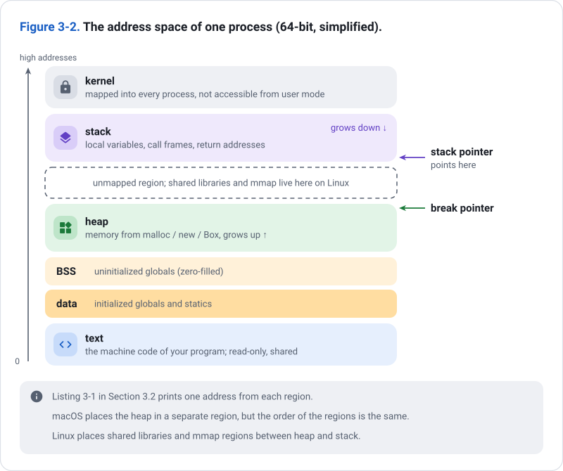
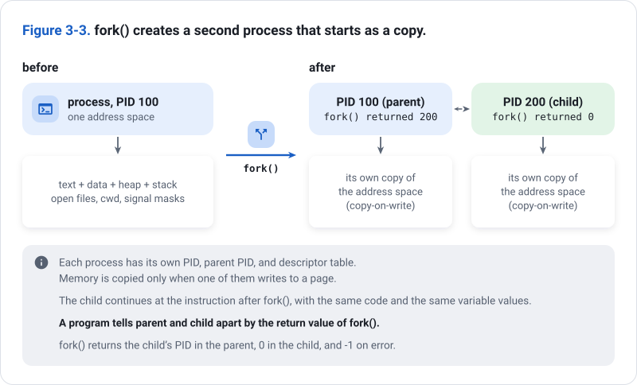

# 3. Process Abstraction and Lifecycle

A program is a static sequence of instructions; it becomes a process only when the operating system instantiates it into an active execution environment. A process is defined by its execution state, its resource ownership, and its isolated address space.

## 3.1 The Process Control Block and Address Space Topology

To manage multiple concurrent executions, the kernel maintains a Process Control Block (PCB) for every active process. The PCB serves as the primary vehicle for context switching, storing the process's unique identifier (PID), its lineage, its current execution state (running, ready, or blocked), and the precise architectural state, including registers and the program counter, required to resume execution. Beyond execution state, the PCB tracks the process's environmental resources, including its page tables for memory isolation, its file descriptor table, and its signal configuration.

The process's memory is organized into a structured address space, which provides a consistent view of memory regardless of the underlying physical allocation. This topology typically includes:
- **Text Segment:** The read-only machine code of the program, which can be shared across multiple processes to conserve physical memory.
- **Data and BSS Segments:** Regions for initialized and uninitialized global variables, respectively.
- **Heap:** A dynamically expanding region for runtime memory allocation, growing toward higher addresses.
- **Stack:** A region that manages function activation records, growing toward lower addresses.
- **Kernel Space:** A protected region at the apex of the address space, mapped into every process but inaccessible in user mode, facilitating efficient system calls.

<figure>

</figure>

**Listing 3-1. Printing one address from each region (C++20).**

```cpp
{{#include ../code/ch03/layout.cpp}}
```

**Output 3-1. One run on the verification machine.**

```text
{{#include ../code/out/ch03_layout.out}}
```

**Listing 3-2. The same program in Rust (2024 edition).**

```rust
{{#include ../code/ch03/layout.rs}}
```

**Output 3-2.**

```text
{{#include ../code/out/ch03_layout_rs.out}}
```

## 3.2 Process Creation and the Mechanics of `fork`

On Unix-like systems, process creation is facilitated through the `fork` system call, which implements a "copy-on-write" (COW) paradigm. Rather than performing an immediate, computationally expensive duplication of the parent's entire address space, the kernel initially permits the parent and child to share the same physical pages, marking them as read-only. A private copy is only instantiated when one of the processes attempts a write operation. This mechanism ensures that `fork` remains highly efficient, particularly when the child intends to immediately replace its image using `execve`.

A critical nuance of `fork` involves the inheritance of process state, specifically the buffers within standard I/O libraries. Because `fork` duplicates the process's memory, including any unwritten data in user-mode buffers, a child process may inadvertently re-output data that was buffered by the parent prior to the fork. This necessitates explicit synchronization, such as calling `fflush` before a `fork` operation, to maintain output integrity.

<figure>

</figure>

**Listing 3-3. fork, waitpid, and the exit status (C++20).**

```cpp
{{#include ../code/ch03/fork.cpp}}
```

**Output 3-3. The first line is printed twice.**

```text
{{#include ../code/out/ch03_fork.out}}
```

**Listing 3-4. The same sequence in Rust, using the libc crate.**

```rust
{{#include ../code/ch03/fork.rs}}
```

**Output 3-4.**

```text
{{#include ../code/out/ch03_fork_rs.out}}
```

## 3.3 Lifecycle Management, State Automaton, and Termination

The operational lifecycle of a process is governed by a formal five-state finite automaton managed by the kernel scheduler and process subsystem, coupled with four primary system call transitions: `fork` (or `clone`) for instantiation, `execve` for binary image replacement, `_exit` for termination, and `waitpid` for parent acknowledgment and resource reclamation.

### 3.3.1 The Five-State Process Lifecycle Automaton

At any instant between creation and final reclamation, a process's PCB records its exact scheduling disposition across five canonical states:

1. **New (Embryonic):** The parent process has invoked `fork()`. The kernel allocates a new Process Control Block (`struct task_struct` on Linux; `struct proc` on Darwin/XNU), assigns a unique Process Identifier (PID), duplicates the parent's file descriptor table, and clones the parent's virtual memory areas (`vm_area_struct`) with copy-on-write (COW) page-table protections. The process does not yet compete for CPU execution until initialization completes and the scheduler admits it into a per-CPU runqueue.
2. **Ready (Runnable):** The process possesses all resources required for execution save for an available physical processor core. Its PCB resides in a per-CPU scheduler runqueue (in Linux, both Ready and Running states share the `TASK_RUNNING` descriptor flag, distinguished by whether the task is currently the active `curr` pointer on a CPU runqueue).
3. **Running:** The kernel dispatcher has selected the process from the Ready queue, loaded its page table root address into the MMU base register (`CR3` on x86-64; `TTBR0_EL1` on ARM64), restored its architectural register context (`RIP`, `RSP`, `RBP`, `RFLAGS`, and GPRs), and returned control to user mode (`iretq` / `eret`).
4. **Blocked (Waiting / Sleeping):** The running process has issued a system call whose completion depends on an asynchronous external event, such as reading from an empty pipe or network socket, waiting on a contended futex or mutex, or faulting on a disk-backed virtual page. Because busy-waiting in kernel mode would waste processor cycles, the kernel transitions the process out of the CPU runqueue, appends its PCB to a wait queue associated with the target event (`TASK_INTERRUPTIBLE` if signals may wake it early, or `TASK_UNINTERRUPTIBLE` for critical hardware DMA waits), and immediately invokes the scheduler (`schedule()`) to context-switch to another Ready process. When the hardware interrupt or peer thread satisfies the condition, the wakeup handler moves the PCB from the wait queue back to the Ready runqueue.
5. **Zombie (Defunct / `EXIT_ZOMBIE`):** The process has terminated, either voluntarily by invoking `_exit(status)` / returning from `main`, or involuntarily via an unhandled fatal signal (`SIGSEGV`, `SIGKILL`). Upon entering `_exit`, the kernel immediately closes all open file descriptors, releases the process's user-space virtual memory mappings and physical page frames, and notifies the parent process via `SIGCHLD`. However, the kernel **cannot** deallocate the PCB or release the PID slot yet, because the parent process may subsequently query the child's termination status.

<figure>

</figure>

### 3.3.2 Zombie Reaping, Orphan Reparenting, and `execve` Mechanics

When a process resides in the **Zombie** state, it consumes no user-space RAM and executes zero instructions, but it retains its kernel PCB entry and occupies a slot in the global PID allocation bitmap. The process transitions from **Zombie** to **Reaped (Terminated)** only when its parent invokes `waitpid(pid, &status, options)`, which copies the 8-bit exit code and termination signal mask out of the zombie's PCB and finally frees the kernel `task_struct` and PID.

Two critical lifecycle boundary conditions arise in production systems:
- **Zombie Accumulation Leaks:** If a long-running parent process spawns child workers and neglects to invoke `waitpid` (and does not explicitly set its `SIGCHLD` disposition to `SIG_IGN`), every terminated child remains permanently trapped in the Zombie state, eventually exhausting the kernel's maximum process limit (`pid_max` / `RLIMIT_NPROC`) and preventing any new processes or threads from spawning across the host.
- **Orphan Reparenting:** If a parent process terminates while one or more of its children are still active, those children become **orphans**. Because every process requires a parent to reap its eventual zombie PCB, the kernel walks the terminating parent's child list and reparents all orphaned descendants to the root supervisor process, **PID 1** (`launchd` on macOS, `systemd` or `init` on Linux), or to the nearest ancestor designated as a subreaper (`PR_SET_CHILD_SUBREAPER`). PID 1 continuously executes a `waitpid` loop in its main event cycle, automatically reaping reparented orphans upon their termination.

Finally, the `execve(path, argv, envp)` system call enables a process to replace its executing program without spawning a new PID. When invoked, the kernel tears down the process's entire existing user-space virtual address space (text, data, BSS, heap, and stack), parses the target executable binary header (ELF on Linux; Mach-O on macOS), maps the new program segments into fresh page tables, initializes a clean user stack containing the `argv` argument vector and `envp` environment strings, resets caught signal handlers to `SIG_DFL` (because the old handler function pointers no longer exist in the new address space), and jumps to the new binary's entry point (`_start`). Crucially, the PID, parent PID, process group, working directory, and all open file descriptors not marked with the close-on-exec flag (`FD_CLOEXEC` / `O_CLOEXEC`) persist unaltered across `execve`, forming the foundation for shell I/O redirection and process supervision.
