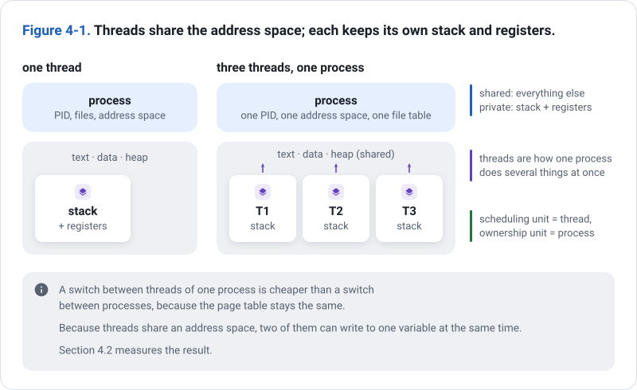
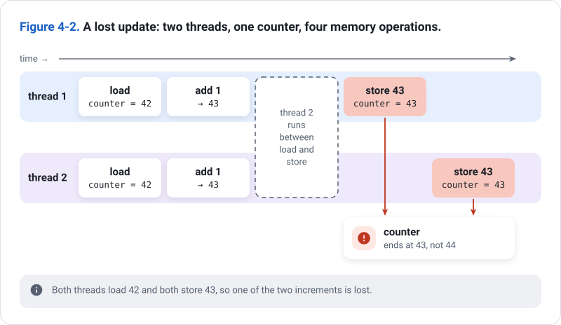

# 4. Threaded Execution and Concurrency Hazards

While a process provides a fundamental unit of isolation, it is often insufficient for expressing fine-grained parallelism. To achieve concurrency within a single execution context, a process employs threads, independent sequences of instructions that operate within the same administrative boundaries.

## 4.1 Shared Address Space and the Loss of Intra-Process Isolation

A thread is characterized by a dual nature: it possesses a private architectural state, including a unique program counter, register set, and stack, yet it operates within the shared address space of its parent process. This architecture allows threads to communicate via shared memory, allowing one thread to observe the updates of another via ordinary loads and stores, without the overhead of inter-process communication (IPC) or expensive system calls.

However, this efficiency comes at a significant cost to safety. While hardware and the kernel provide robust isolation between distinct processes via page tables, no such mechanism exists to isolate threads within a single process. Consequently, the shared memory model exposes the program to data races: conditions where the correctness of a program depends on the non-deterministic interleaving of instructions across multiple threads. When multiple threads concurrently access and modify the same memory location without proper synchronization, the integrity of the data is compromised by the atomicity gaps inherent in the CPU's execution cycle.

<figure>

</figure>

## 4.2 Atomicity and the Resolution of Data Races

The most fundamental concurrency hazard arises from the decomposition of high-level operations into discrete machine instructions. An operation that appears indivisible in a high-level language, such as an integer increment, typically translates to a sequence of load, modify, and store instructions. In a multi-core environment, if two threads interleave these steps, one thread's intermediate state may be overwritten by another, resulting in a "lost update."

To mitigate this, modern processor architectures provide atomic instructions, such as `lock xadd` on x86 or `ldaddal` on arm64, which guarantee that a sequence of operations is perceived by the rest of the system as a single, indivisible unit. These instructions ensure that no other core can observe or intervene in the memory location during the operation.

It is critical to distinguish between **atomicity** and **memory ordering**. Atomicity refers to the indivisibility of a single operation, ensuring no partial states are observable. Ordering, conversely, governs the visibility and sequence of effects on *different* memory locations across threads. An operation can be atomic without being ordered, a distinction that is central to the design of high-performance concurrent algorithms and the use of relaxed memory models.

<figure>

</figure>

**Listing 4-1. Eight threads increment one counter without synchronization (C++20).**

```cpp
{{#include ../code/ch04/race.cpp}}
```

**Output 4-1. One run. The observed value differs from run to run.**

```text
{{#include ../code/out/ch04_race.out}}
```

**Listing 4-2. The same race in Rust, written with `unsafe`.**

```rust
{{#include ../code/ch04/race.rs}}
```

**Output 4-2.**

```text
{{#include ../code/out/ch04_race_rs.out}}
```

**Listing 4-3. The counter as a `std::atomic` (C++20).**

```cpp
{{#include ../code/ch04/race_atomic.cpp}}
```

**Output 4-3. The observed value equals the expected value in every run.**

```text
{{#include ../code/out/ch04_race_atomic.out}}
```

**Listing 4-4. The atomic counter in Rust.**

```rust
{{#include ../code/ch04/race_atomic.rs}}
```

**Output 4-4.**

```text
{{#include ../code/out/ch04_race_atomic_rs.out}}
```

## 4.3 Thread Lifecycle, State Transitions, and Language-Level Safety

Whereas a process lifecycle revolves around address-space creation (`fork`), binary replacement (`execve`), and process-table reaping (`waitpid`), a thread lifecycle operates entirely within the shared virtual address space of its host process. The operating system kernel schedules threads, not processes, as the fundamental unit of CPU execution, maintaining a **Thread Control Block (TCB)** for each thread to track its private architectural registers (`PC`, `SP`, `FP`, `FLAGS`, GPRs), thread-local storage (TLS) base register (`FS` or `GS` on x86-64; `TPIDR_EL0` on ARM64), signal mask, and kernel scheduling state.

### 4.3.1 The Thread Lifecycle State Automaton

From creation to memory reclamation, a kernel-scheduled thread (allocated via `clone(CLONE_VM | CLONE_FS | CLONE_FILES | CLONE_SIGHAND | CLONE_THREAD, ...)` on Linux or `bsdthread_create` on macOS) transitions across five distinct operational states:

1. **Spawned (Initialized):** The runtime library (`pthread_create`, `std::thread::spawn`) allocates a contiguous user-mode virtual memory region for the thread's execution stack (typically 2–8 MiB, guarded at its lower boundary by a `PROT_NONE` guard page to trap stack overflows) alongside its Thread-Local Storage (TLS) block. The kernel initializes a TCB pointing its saved `PC` to the thread entry trampoline and its saved `SP` to the top of the newly mapped stack, then admits the TCB into a core's runqueue.
2. **Runnable (Ready):** The thread is eligible for execution and resides in a processor core's scheduling runqueue, awaiting dispatch.
3. **Running:** The thread is actively executing instructions on a physical CPU core. Because all sibling threads share the same virtual address space, context-switching between two threads of the same process requires saving and restoring only the TCB register file and TLS base pointer; the hardware page table root register (`CR3` / `TTBR0_EL1`) remains unchanged, avoiding costly TLB flushes.
4. **Sleeping / Parked (Blocked):** The thread has suspended execution waiting for an intra-process synchronization primitive (such as a contended mutex via `futex(FUTEX_WAIT)`, a condition variable `wait`, or an I/O readiness event). The kernel removes the TCB from the runqueue and parks it on the synchronization object's wait queue, where it consumes zero processor cycles until a peer thread invokes `futex(FUTEX_WAKE)` or an interrupt handler signals completion.
5. **Terminated and Reclaimed (`join` vs. `detach`):** When the thread's entry function returns (or invokes `pthread_exit`), the thread ceases execution. How its stack and TCB are reclaimed depends on its detachment contract:
   - **Joinable Threads:** By default, a thread is *joinable*. Upon termination, its user-space stack virtual memory mapping and TCB metadata remain allocated so that another thread can invoke `pthread_join` (or `JoinHandle::join`), which synchronizes on thread completion, extracts the thread's return value (or panic payload), and unmaps the thread's stack and TCB. Failing to join or detach a terminated joinable thread leaks its virtual stack mapping and TCB, which is the thread-level equivalent of a zombie process.
   - **Detached Threads:** If a thread is detached (`pthread_detach`), it relinquishes any synchronization contract with a parent caller; the runtime and kernel automatically unmap its stack and deallocate its TCB immediately upon thread exit.

<figure>

</figure>

### 4.3.2 Language-Level Thread Safety: C++20 vs. Rust 2024

Different systems programming languages enforce starkly different invariants across the thread lifecycle boundary:

- **C++20 (`std::thread` and `std::jthread`):** In C++11, if a `std::thread` object is destroyed while still `joinable()` (neither `.join()` nor `.detach()` was called), its destructor immediately invokes `std::terminate()`, aborting the entire process to prevent silent stack-reference corruption. C++20 introduced `std::jthread`, which adheres to strict RAII semantics by automatically requesting cooperative cancellation (`std::stop_token`) and invoking `.join()` inside its destructor. However, the C++ type system does not prevent threads from capturing raw pointers or references to a caller's stack frame that may expire before a detached thread finishes, nor does it statically reject unsynchronized concurrent mutations of shared state.
- **Rust 2024 (`std::thread::spawn`, `Send`, and `Sync`):** Rust's `std::thread::spawn` returns a `JoinHandle<T>`. Unlike C++ `std::thread`, dropping a `JoinHandle` in Rust safely *detaches* the background thread without aborting the process. To guarantee that a detached thread can never access dangling stack pointers from its creator, `std::thread::spawn` enforces a `'static` lifetime bound on its closure (unless `std::thread::scope` is used, which statically guarantees that all scoped threads are joined before the scope block exits). Furthermore, Rust's compiler enforces compile-time data-race freedom via two auto-traits:
  - **`Send`:** Certifies that ownership of a type may be safely transferred across thread boundaries (precluding thread-pinned types such as non-atomic reference counters `Rc<T>` or raw pointers).
  - **`Sync`:** Certifies that a type may be safely referenced concurrently by multiple threads via shared immutable references (`T: Sync` if and only if `&T: Send`). Shared mutation across threads is statically rejected unless mediated by types implementing thread-safe interior mutability, such as atomic primitives (`AtomicU64`) or synchronization guards (`Arc<Mutex<T>>`).

**Listing 4-5. Four threads in one process (C++20).**

```cpp
{{#include ../code/ch04/threads.cpp}}
```

**Output 4-5. The order of the lines differs from run to run.**

```text
{{#include ../code/out/ch04_threads.out}}
```

**Listing 4-6. The same four threads in Rust.**

```rust
{{#include ../code/ch04/threads.rs}}
```

**Output 4-6.**

```text
{{#include ../code/out/ch04_threads_rs.out}}
```
