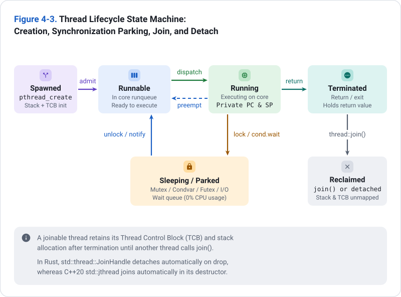

# 4. Threaded Execution and Concurrency Hazards

Processes provide strong spatial isolation, yet process-level concurrency imposes a structural tax whenever cooperating tasks must exchange fine-grained state: every cross-process communication requires copying bytes through kernel buffers (pipes or sockets) or explicitly configuring shared memory segments, and switching between two processes replaces the hardware page-table root register, invalidating cached address translations. To express fine-grained parallelism inside a single protection domain, modern operating systems provide **threads**: independent sequences of instruction execution that share one virtual address space.

## 4.1 Shared Address Space, Thread Stacks, and Thread-Local Storage

A thread exhibits a dual nature. It owns a private architectural execution context: a dedicated **Program Counter (`PC`)**, general-purpose register file, condition flags, signal mask, and call stack, all tracked by the kernel in a **Thread Control Block (`TCB`)**. Simultaneously, every thread inside a process shares the same `mm_struct` virtual address space, including the executable text segment, global data and **Block Started by Symbol (`BSS`)** segments, dynamic heap, and open file descriptor table (Figure 4-1).

This shared-memory topology makes inter-thread communication fast: Thread 1 can allocate an object on the heap and hand its pointer to Thread 2, which reads and mutates the object through ordinary single-cycle load and store instructions with zero system calls. Context switching between sibling threads is also faster than switching between distinct processes, because the kernel leaves the **Memory Management Unit (`MMU`)** page-table root (`CR3` on x86-64; `TTBR0_EL1` on ARM64) unchanged, avoiding costly **Translation Lookaside Buffer (`TLB`)** flushes.

<figure>

</figure>

### 4.1.1 Thread Stacks, Sizing, and Guard Pages

In a single-threaded process, placing the lone call stack at the top of user virtual memory and letting it grow downward toward the heap is straightforward. In a multi-threaded process, every thread requires its own independent call stack so concurrent function invocations do not overwrite one another's activation records and return addresses.

When a runtime library spawns a thread (`pthread_create` or `std::thread::spawn`), it reserves a fixed-size contiguous virtual memory region via `mmap()` (typically 8 MiB by default on Linux, 512 KiB for secondary threads on macOS, and 2 MiB in Rust's `std::thread`). Two kernel mechanisms make these multi-megabyte reservations practical and safe. First, **lazy physical backing** ensures that reserving 8 MiB of virtual address space consumes zero physical **Dynamic Random-Access Memory (`DRAM`)** frames until the thread actually touches pages; the kernel maps physical 4 KiB frames on demand as stack depth grows. Spawning 10,000 threads with 8 MiB virtual stacks reserves 80 GiB of virtual address space (a tiny fraction of a 48-bit, 128 TiB user address space), yet if each thread uses only 16 KiB of user stack plus a 16 KiB kernel stack, actual physical DRAM consumption is `10,000 * 32 KiB = 320 MiB`.

Second, the runtime places a non-accessible **guard page** (at least one 4 KiB page mapped with `PROT_NONE`) immediately below the lower boundary of every thread stack. If runaway recursion or an oversized stack-allocated array exhausts the thread's stack budget, the very next push touches the `PROT_NONE` guard page and triggers an immediate, deterministic hardware page fault (`SIGSEGV`). Without a guard page, the overflowing stack would overwrite adjacent heap allocations or a sibling thread's stack frames, producing subtle, delayed corruption.

### 4.1.2 Thread-Local Storage (`TLS`)

Many systems facilities require variables that behave like globals within a single thread yet remain isolated across sibling threads. Classic examples include POSIX `errno`, per-thread memory allocator caches (`tcmalloc` or `jemalloc` free lists), and per-thread random number generator state. Threading such context pointers manually through every function parameter list clutters interfaces, whereas storing them in a global hash table keyed by thread ID (`gettid()`) incurs a system call or synchronization lookup on every access.

Hardware solves this through a dedicated **Thread-Local Storage (`TLS`)** base register (`FS_BASE` on x86-64; `TPIDR_EL0` on ARM64). When the runtime initializes a thread, it allocates a private TLS block adjacent to the thread's control metadata and registers its base address with the kernel (`arch_prctl(ARCH_SET_FS, ...)` on Linux x86-64). On every thread context switch, the kernel restores that thread's TLS base register alongside its general-purpose registers. Accessing a C++ `thread_local` variable or a Rust `thread_local!` slot then compiles to a single-cycle offset load (`mov rax, fs:[offset]`) with zero locks and zero system calls.

## 4.2 Concurrency Hazards: Interleaving Traces, Atomicity, and Memory Ordering

Sharing one address space removes page-table isolation between threads. When two or more threads access the same memory location concurrently and at least one access is a write without synchronization, the program exhibits a **data race**. Under both the C++20 and Rust 2024 memory models, a data race constitutes **Undefined Behavior (`UB`)**, permitting the compiler and hardware to produce arbitrary, non-deterministic results.

### 4.2.1 Worked Interleaving Trace of a Lost Update

Consider Listing 4-1, in which eight threads each increment a shared 64-bit `counter` 20,000,000 times. Mathematically, the final value should equal `8 * 20,000,000 = 160,000,000`. In Output 4-1, however, the observed final count is `39,242,198`, meaning more than 75% of all increments vanished.

As derived in Section 2.1.2, the single C++ statement `counter = counter + 1` compiles into a three-instruction **Read-Modify-Write (`RMW`)** sequence: load `[counter]` into a register, add `1` in the **Arithmetic Logic Unit (`ALU`)**, and store the register back to `[counter]`. Notice that Listing 4-1 marks `counter` as `volatile`. Without `volatile`, an optimizing compiler at `-O2` would hoist the unsynchronized loop completely into a private register and emit a single `add [counter], 20000000` at loop exit, masking the race in the assembly. Adding `volatile` forces the compiler to emit every load and store to memory, exposing the underlying hardware race without fixing it.

A lost update occurs even on a single processor core whenever a timer interrupt preempts Thread 1 mid-sequence, and occurs continuously across multiple cores executing simultaneously (Figure 4-2 and Table 4-1).

<figure>

</figure>

**Table 4-1. Preemptive single-core interleaving trace causing a lost update on `counter` (initial value `50`).**

| Step | Event / Instruction | Thread 1 `RAX` | Thread 2 `RAX` | Memory `[counter]` |
| :---: | :--- | :---: | :---: | :---: |
| 1 | Thread 1 executes `mov rax, [counter]` | `50` | (unset) | `50` |
| 2 | Thread 1 executes `add rax, 1` | `51` | (unset) | `50` |
| 3 | **Timer interrupt:** kernel saves Thread 1's `RAX = 51` in `TCB_1`, switches to Thread 2 | `51` (saved) | (unset) | `50` |
| 4 | Thread 2 executes `mov rax, [counter]` | `51` (saved) | `50` | `50` |
| 5 | Thread 2 executes `add rax, 1` | `51` (saved) | `51` | `50` |
| 6 | Thread 2 executes `mov [counter], rax` | `51` (saved) | `51` | `51` |
| 7 | **Timer interrupt:** kernel switches back to Thread 1, restoring `RAX = 51` | `51` | `51` (saved) | `51` |
| 8 | Thread 1 executes `mov [counter], rax` (overwrites Thread 2's update) | `51` | `51` (saved) | `51` |

Thread 1's private register preserved the stale value `51` across the context switch, overwriting Thread 2's completed increment. Across eight cores executing 160 million iterations simultaneously, hundreds of millions of overlapping load-add-store windows collide, collapsing the final total to a fraction of the expected sum.

**Listing 4-1. Eight threads increment one counter without synchronization (C++20).**

```cpp
{{#include ../code/ch04/race.cpp}}
```

**Output 4-1. One run. The observed value differs from run to run.**

```text
{{#include ../code/out/ch04_race.out}}
```

**Listing 4-2. The same race in Rust, written with `unsafe`.**

```rust
{{#include ../code/ch04/race.rs}}
```

**Output 4-2.**

```text
{{#include ../code/out/ch04_race_rs.out}}
```

### 4.2.2 Hardware Atomicity versus Compiler and CPU Reordering

Correct concurrent programs must address three distinct layers: **hardware atomicity**, **compiler reordering**, and **hardware memory ordering**.

Hardware atomicity eliminates the RMW interleaving window on a single memory word. Modern processors provide indivisible RMW instructions, such as `lock xadd` on x86-64 or `ldaddal` (and load-linked/store-conditional pairs) on ARM64. Executing `lock xadd` forces the core's cache controller to acquire exclusive **Modified-Exclusive-Shared-Invalid (`MESI`)** ownership of the 64-byte cache line and hold it until the load, addition, and store all complete, preventing any peer core from reading or modifying the location mid-operation. Listings 4-3 and 4-4 replace the plain integer with `std::atomic<uint64_t>` (C++20) and `AtomicU64` (Rust 2024), invoking `fetch_add(1, ...)` so Outputs 4-3 and 4-4 report the exact expected `40,000,000` on every run.

Atomicity alone, however, governs only a single memory address. **Memory ordering** governs when writes to *different* memory locations become visible across cores. Both optimizing compilers and out-of-order CPU pipelines freely reorder independent loads and stores to maximize single-thread throughput. Consider a producer-consumer message-passing pattern across two threads where `data = 0` and `ready = false` initially:

```text
// Thread 1 (Producer)                        // Thread 2 (Consumer)
data = 42;                                    while (!ready.load(relaxed)) {}
ready.store(true, memory_order_relaxed);      assert(data == 42);  // Can fail on ARM64!
```

Even though `ready` is atomic, `memory_order_relaxed` forbids neither the compiler nor a weakly ordered CPU (such as ARM64) from making `ready = true` visible to Thread 2 before `data = 42` drains from Thread 1's store buffer, or allowing Thread 2 to speculatively load `data` before observing `ready == true`. Thread 2 can therefore exit the spin loop and observe the stale value `data == 0`.

Establishing a **happens-before** edge between Thread 1's write to `data` and Thread 2's read requires **acquire-release semantics**: Thread 1 executes `ready.store(true, memory_order_release)` (guaranteeing all prior writes are visible before `ready` becomes true), and Thread 2 executes `ready.load(memory_order_acquire)` (preventing any subsequent reads from hoisting above the load of `ready`). Table 4-2 summarizes the three primary memory orderings used in systems code.

**Table 4-2. Core C++20 / Rust 2024 atomic memory orderings and their guarantees.**

| Memory Ordering | Atomicity on Target Word | Cross-Variable Visibility Guarantee | Typical Use Case |
| :--- | :--- | :--- | :--- |
| `relaxed` (`Relaxed`) | Guaranteed | None; compiler and CPU may reorder surrounding accesses | Independent metrics and reference-count increments (Listing 4-3) |
| `acquire` / `release` (`Acquire` / `Release`) | Guaranteed | Release store publishes all prior writes to a matching Acquire load | Mutex lock/unlock, producer-consumer queues, publishing initialized pointers |
| `seq_cst` (`SeqCst`) | Guaranteed | Acquire-Release plus a single total global order across all `seq_cst` operations | Dekker/Peterson algorithms, default when reasoning clarity outweighs barrier cost |

In Listings 4-3 and 4-4, `memory_order_relaxed` is completely sound because the threads update only one independent counter and never publish other memory locations through it; joining all threads via `.join()` establishes the final happens-before synchronization edge before `main()` reads the result.

**Listing 4-3. The counter as a `std::atomic` (C++20).**

```cpp
{{#include ../code/ch04/race_atomic.cpp}}
```

**Output 4-3. The observed value equals the expected value in every run.**

```text
{{#include ../code/out/ch04_race_atomic.out}}
```

**Listing 4-4. The atomic counter in Rust.**

```rust
{{#include ../code/ch04/race_atomic.rs}}
```

**Output 4-4.**

```text
{{#include ../code/out/ch04_race_atomic_rs.out}}
```

## 4.3 Threading Models, Lifecycle, and Language-Level Safety

Whereas a process lifecycle revolves around address-space duplication (`fork`), image replacement (`execve`), and process-table reaping (`waitpid`), a thread lifecycle operates entirely within the shared virtual address space of its host process. The kernel schedules threads, rather than whole processes, as the fundamental unit of CPU execution.

### 4.3.1 Threading Models: 1:1 Kernel Threads versus M:N User-Space Schedulers

A foundational runtime design choice is how language-level execution tasks map onto kernel-scheduled threads. Standard **Portable Operating System Interface (`POSIX`)** threads (`pthreads`), C++ `std::thread`, and Rust `std::thread` implement a **1:1 model**: each user thread corresponds directly to one kernel-scheduled TCB (created via `clone(CLONE_VM | CLONE_FS | CLONE_FILES | CLONE_SIGHAND | CLONE_THREAD, ...)` on Linux or `bsdthread_create` on macOS). Because the kernel schedules every thread individually, 1:1 threads exploit all physical cores automatically, receive preemptive timer fairness, and isolate blocking system calls (one thread blocking on disk I/O leaves sibling threads free to run). The cost is kernel overhead: each thread requires an 8 to 16 KiB kernel stack, a 1 to 2 microsecond kernel context switch, and a system call (`futex`) whenever it parks on a contended lock.

High-concurrency network servers handling hundreds of thousands of simultaneous connections often adopt an **M:N model** (used by Go goroutines, Erlang processes, and Rust `async` runtimes such as Tokio), multiplexing `M` lightweight user-space tasks onto a small pool of `N` kernel threads (typically one per physical core). Switching between two user-space tasks avoids kernel traps altogether, completing in 50 to 200 nanoseconds, and per-task state starts at 2 KiB or less (either a growable stack or a compiler-generated state machine). The trade-off shifts scheduling complexity into user space: an M:N runtime must integrate with non-blocking I/O multiplexers (`epoll`, `kqueue`, or `io_uring`, Chapter 13) so a single blocking system call does not stall an entire OS worker thread, and must inject cooperative safepoints or signal-based preemption so a CPU-bound loop cannot starve peer tasks sharing the same worker. Table 4-3 contrasts these two models.

**Table 4-3. Trade-offs between 1:1 kernel threading and M:N user-space scheduling.**

| Dimension | 1:1 Kernel Threads (`pthread`, `std::thread`) | M:N User-Space Tasks (Goroutines, `async` Runtimes) |
| :--- | :--- | :--- |
| Context-switch cost | ~1 to 2 microseconds (kernel trap + scheduler) | ~50 to 200 nanoseconds (user-space register swap or poll) |
| Memory per task | 8 to 16 KiB kernel stack + multi-MiB virtual user stack | ~2 KiB growable stack or compact heap state machine |
| Blocking system calls | Isolated to the calling thread automatically | Can stall an OS worker thread unless offloaded or non-blocking |
| Preemption | Hardware timer `IRQ` enforced by kernel | Cooperative yield points or runtime-injected preemption |
| Practical scale | Thousands to tens of thousands per host | Hundreds of thousands to millions per host |

### 4.3.2 The Thread Lifecycle State Automaton

From creation to memory reclamation, a 1:1 kernel-scheduled thread transitions across five operational states (Figure 4-3 and Table 4-4).

<figure>

</figure>

When a caller spawns a thread, the runtime allocates its user stack, guard page, and TLS block, while the kernel initializes a TCB pointing its saved `PC` to the thread entry trampoline and its saved `SP` to the top of the new stack (**Spawned**). Once admitted to a core's runqueue, the thread becomes **Runnable**, waiting for the dispatcher to load its registers and TLS base pointer onto a physical core (**Running**).

If a running thread blocks on an intra-process synchronization primitive (such as a contended mutex via `futex(FUTEX_WAIT)`, a condition variable, or an I/O wait), the kernel removes its TCB from the runqueue and parks it on the synchronization object's wait queue (**Sleeping / Parked**), where it consumes zero processor cycles until a peer thread invokes `futex(FUTEX_WAKE)` or an interrupt signals completion.

When the thread's entry function returns (or invokes `pthread_exit`), the thread enters **Terminated**. Memory reclamation depends on its detachment contract. By default, a thread is **joinable**: its stack virtual mapping and TCB metadata remain allocated until another thread invokes `pthread_join` (or `JoinHandle::join`), which synchronizes on completion, extracts any return value or panic payload, and unmaps the stack and TCB (**Reclaimed**). Neglecting to join or detach a terminated joinable thread leaks its virtual stack and TCB, forming the thread-level analogue of a zombie process. Conversely, marking a thread **detached** (`pthread_detach`) relinquishes the synchronization contract so the runtime and kernel reclaim its stack and TCB automatically upon exit.

**Table 4-4. Thread lifecycle transitions within a shared process address space.**

| From State | Trigger / Event | To State | Runtime or Kernel Action |
| :--- | :--- | :--- | :--- |
| Spawned | `clone()` / `bsdthread_create()` completes | Runnable | Maps stack + guard page + `TLS`, enqueues `TCB` |
| Runnable | Dispatcher selects `TCB` | Running | Restores registers and `FS_BASE`/`TPIDR_EL0`; keeps `CR3` intact |
| Running | `futex(FUTEX_WAIT)` or blocking syscall | Sleeping / Parked | Removes `TCB` from runqueue, appends to wait queue |
| Sleeping / Parked | `futex(FUTEX_WAKE)` or device `IRQ` | Runnable | Moves `TCB` back to a per-CPU runqueue |
| Running | Entry function returns or `pthread_exit` | Terminated | Stops execution; holds exit metadata if joinable |
| Terminated | `pthread_join` (or automatic if detached) | Reclaimed | Unmaps user stack, frees `TLS` block and kernel `TCB` |

### 4.3.3 Language-Level Thread Safety: C++20 versus Rust 2024

Systems languages differ sharply in how much of the thread lifecycle and shared-memory contract they enforce at compile time versus runtime (Table 4-5).

In **C++20**, destroying a `std::thread` object while it remains `joinable()` (neither `.join()` nor `.detach()` was called) immediately invokes `std::terminate()`, aborting the entire process to prevent silent corruption of references to expired stack frames. C++20 introduced `std::jthread`, which follows strict **Resource Acquisition Is Initialization (`RAII`)** semantics by automatically requesting cooperative cancellation (`std::stop_token`) and calling `.join()` in its destructor. Even with `std::jthread`, however, the C++ type system does not statically reject dangling stack references captured by detached threads or unsynchronized concurrent mutations of shared variables.

In **Rust 2024**, `std::thread::spawn` returns a `JoinHandle<T>` whose destructor detaches the background thread cleanly without aborting the process. To guarantee that a detached thread can never dereference a dangling stack pointer from its creator, `std::thread::spawn` requires its closure to satisfy the `'static` lifetime bound (while `std::thread::scope` permits borrowing local stack variables by statically guaranteeing all scoped threads join before the scope exits). Furthermore, Rust enforces compile-time data-race freedom through two auto-traits: **`Send`** certifies that ownership of a value may transfer safely across thread boundaries (excluding thread-pinned types such as non-atomic `Rc<T>`), and **`Sync`** certifies that a type may be referenced concurrently via shared immutable references (`T: Sync` if and only if `&T: Send`). Shared mutation across threads is rejected at compile time unless mediated by thread-safe interior mutability such as `AtomicU64` or `Arc<Mutex<T>>`.

**Table 4-5. Compile-time and lifecycle thread-safety guarantees in C++20 versus Rust 2024.**

| Safety Property | C++20 (`std::thread` / `std::jthread`) | Rust 2024 (`std::thread::spawn` / `scope`) |
| :--- | :--- | :--- |
| Dropping a live handle | `std::thread`: calls `std::terminate()`; `std::jthread`: joins | Detaches thread safely; `scope` joins automatically |
| Dangling stack references | Allowed by type system; runtime Undefined Behavior | Rejected at compile time via `'static` or `thread::scope` |
| Unsynchronized shared writes | Allowed by type system; requires ThreadSanitizer to detect | Rejected at compile time unless wrapped in `Send`/`Sync` primitives |

Listings 4-5 and 4-6 spawn four threads inside one process, synchronizing writes to standard output with a mutex so lines do not interleave character by character. Because the kernel scheduler dispatches the four runnable TCBs across available cores independently, the relative order of the four lines varies non-deterministically from run to run (Outputs 4-5 and 4-6), whereas `all threads joined` always prints last because `main()` joins every worker before returning.

**Listing 4-5. Four threads in one process (C++20).**

```cpp
{{#include ../code/ch04/threads.cpp}}
```

**Output 4-5. The order of the lines differs from run to run.**

```text
{{#include ../code/out/ch04_threads.out}}
```

**Listing 4-6. The same four threads in Rust.**

```rust
{{#include ../code/ch04/threads.rs}}
```

**Output 4-6.**

```text
{{#include ../code/out/ch04_threads_rs.out}}
```

<div class="callout keyidea">
<span class="label">Key idea</span>

Threads share code, heap, and file descriptors through one `mm_struct` (avoiding `CR3` reloads and `TLB` flushes on context switch), yet each thread owns a private execution stack and register file. That shared-memory speed is precisely what exposes multi-instruction Read-Modify-Write sequences to data races.

</div>

<div class="callout experiment">
<span class="label">Experiment</span>

Compile Listing 4-1 (`code/ch04/race.cpp`) with `-fsanitize=thread` (`clang++ -std=c++20 -O2 -fsanitize=thread code/ch04/race.cpp -o /tmp/race && /tmp/race`) and observe ThreadSanitizer pinpointing the exact conflicting unsynchronized store instructions across threads. Compare its report against Listing 4-3 (`race_atomic.cpp`).

</div>

<div class="callout caution">
<span class="label">Common Pitfall</span>

Assuming `volatile` in C or C++ makes a counter thread-safe. `volatile` prevents compiler register caching (needed for `MMIO` registers and `sig_atomic_t`), yet emits plain non-atomic load/add/store instructions that still lose updates across CPU cores; always use `std::atomic<T>` or Rust's `Atomic*` types for cross-thread synchronization.

</div>
