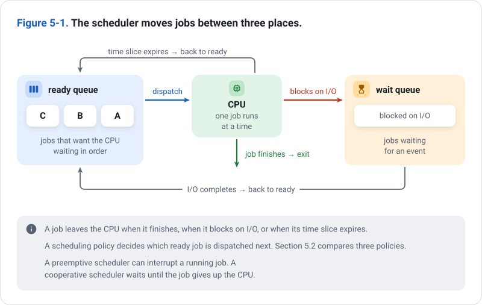
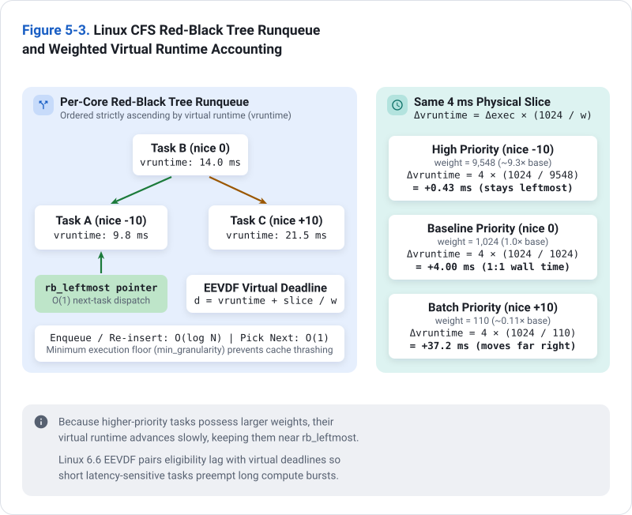

# 5. Scheduling Theory and Policy

A bare-metal multiprocessor provides a fixed number of physical **Central Processing Unit (`CPU`)** cores, each capable of advancing a single hardware instruction stream on any clock cycle. When the number of runnable threads exceeds the available core count, the hardware itself has no mechanism to enforce proportional fairness, bounded interactive latency, or priority arbitration. Without supervisory intervention, the first thread dispatched onto a core would retain control of the fetch-decode-execute pipeline until it halted or terminated, starving all other workloads on the machine.

The **kernel scheduler** resolves this physical contention by time-multiplexing hardware cores across competing execution contexts. Consistent with the architectural principle established in Section 1.3, the scheduling subsystem separates hardware-enforced **mechanism** from kernel **policy**. The **mechanism** resides in the hardware and dispatch layer: periodic hardware timer interrupts (the per-core Local **Advanced Programmable Interrupt Controller (`APIC`)** Timer on x86-64 and the ARM Generic Timer on ARM64), architectural trapframe serialization, and context-switch routines that exchange stack pointers (`RSP` / `SP_EL1`), thread-local base registers (`FS_BASE` / `TPIDR_EL0`), and page-table roots (`CR3` / `TTBR0_EL1`). The **policy** resides in the arbitration algorithm that evaluates the set of runnable scheduling entities to determine which thread occupies a physical core next, the duration of its execution quantum, and the target core selected to preserve hardware cache locality.

## 5.1 Scheduling Dynamics and Performance Metrics

The kernel invokes the scheduler at four deterministic state transitions within a thread's lifecycle: when a running thread blocks voluntarily on an **Input/Output (`I/O`)** descriptor or synchronization primitive (transitioning to a **wait queue**), when an external hardware interrupt or lock release awakens a blocked thread (transitioning to a **ready queue**), when a running thread exits, or when the hardware timer interrupt asserts preemption upon expiration of the thread's allotted execution quantum.

<figure>

</figure>

Evaluating a scheduling policy requires measuring how it balances throughput against interactive responsiveness. Table 5-1 defines the three primary scheduling metrics used throughout operating systems analysis.

**Table 5-1. Primary quantitative metrics for evaluating CPU scheduling policies.**

| Metric | Formal Definition | Primary Optimization Target | Microarchitectural Tension |
| :--- | :--- | :--- | :--- |
| **Turnaround Time** | `T_completion - T_arrival` | Batch pipelines, compilation farms, scientific compute | Minimized by running short jobs to completion without preemption, preserving L1/L2 cache warmth |
| **Wait Time** | `Turnaround Time - CPU Burst` | Queueing fairness and overload visibility | Excludes voluntary I/O blocking; measures pure ready-queue delay awaiting core dispatch |
| **Response Time** | `T_first_run - T_arrival` | Interactive user interfaces, audio engines, low-latency **Remote Procedure Call (`RPC`)** services | Minimized by frequent preemption, which increases context-switch cost and cold cache refills |

These metrics represent competing optimization objectives. Minimizing mean turnaround time favors executing short jobs to completion without interruption, which reduces context-switch frequency and preserves cache locality. Minimizing response time requires frequent preemption so that newly awakened interactive threads receive processor time within strict latency bounds, even at the cost of increased context-switch overhead and degraded throughput for long-running compute jobs.

## 5.2 Fundamental Scheduling Policies

Classical scheduling theory starts from an idealized workload model (known job lengths, zero I/O, and single-core execution) and progressively relaxes each assumption. Examining three foundational policies under this model exposes the exact mathematical trade-offs that motivate every modern kernel scheduler.

### 5.2.1 First-Come, First-Served and the Convoy Effect

**First-Come, First-Served (`FCFS`)** dispatches runnable jobs non-preemptively in strict arrival order through a **First-In, First-Out (`FIFO`)** queue. Dispatch executes in O(1) time with minimal bookkeeping, and jobs suffer zero involuntary preemption overhead.

This simplicity breaks down whenever burst lengths vary. Consider a workload of four jobs arriving simultaneously at `t = 0`: a compute-intensive job **A** requiring `100 ms`, followed immediately by three short interactive jobs **B**, **C**, and **D** requiring `10 ms` each. Under `FCFS`, Job A monopolizes the processor from `t = 0` to `t = 100 ms`. Job B completes at `110 ms`, Job C at `120 ms`, and Job D at `130 ms`. Mean turnaround time reaches `(100 + 110 + 120 + 130) / 4 = 115.0 ms`, and mean response time reaches `(0 + 100 + 110 + 120) / 4 = 82.5 ms`. Every short interactive task waits behind the single heavyweight compute job, a pathology termed the **convoy effect**.

### 5.2.2 Shortest Job First, Shortest Remaining Time First, and Starvation

To eliminate the convoy effect, **Shortest Job First (`SJF`)** selects the runnable job with the smallest CPU burst duration. On the same `{A = 100, B = 10, C = 10, D = 10}` arrival set, `SJF` dispatches B, C, and D before A, yielding completion times of `10`, `20`, `30`, and `130 ms`. Mean turnaround time drops from `115.0 ms` to `(10 + 20 + 30 + 130) / 4 = 47.5 ms`, and mean response time falls from `82.5 ms` to `(0 + 10 + 20 + 30) / 4 = 15.0 ms`. For any static set of jobs arriving simultaneously, `SJF` is provably optimal for mean turnaround time.

Non-preemptive `SJF` still fails when arrival times are staggered. If Job A (`100 ms`) arrives at `t = 0` and begins executing immediately, while Jobs B, C, and D (`10 ms` each) arrive at `t = 10 ms`, non-preemptive `SJF` cannot interrupt A; B, C, and D wait `90 ms` for A to finish, restoring the convoy effect. Introducing preemption produces **Shortest Remaining Time First (`SRTF`)**: whenever a newly arrived job has a shorter remaining burst than the currently running job, the scheduler preempts the active job. At `t = 10 ms`, A has `90 ms` remaining while B, C, and D each require `10 ms`. `SRTF` preempts A, runs B (`10` to `20 ms`), C (`20` to `30 ms`), and D (`30` to `40 ms`), and then resumes A (`40` to `130 ms`). Turnaround times become `130`, `10`, `20`, and `30 ms`, reducing mean turnaround time from `110.0 ms` under non-preemptive `SJF` to `47.5 ms`.

Both `SJF` and `SRTF` face two practical barriers in general-purpose operating systems. First, the kernel cannot know future CPU burst durations in advance without historical estimation. Second, a continuous stream of short interactive arrivals can indefinitely delay a long-running compute job, causing **starvation**.

### 5.2.3 Round-Robin Time-Slicing and Quantum Calibration

Because neither `FCFS` nor `SJF` bounds interactive response time when long jobs arrive first or burst lengths are unknown, **Round-Robin (`RR`)** replaces run-to-completion dispatch with preemptive time-slicing. Each runnable thread receives a fixed execution **quantum** (`q`). Upon quantum expiration, the hardware timer interrupt preempts the active thread and appends it to the tail of the ready queue. For *N* runnable threads, `RR` bounds maximum response latency prior to initial dispatch at `(N - 1) × q`.

Selecting `q` requires balancing responsiveness against microarchitectural context-switch amortization. Suppose saving registers, switching address spaces, and refilling cold L1/L2 cache lines consumes `10 µs` (`0.01 ms`) per context switch. With a `100 µs` (`0.1 ms`) quantum, switching overhead consumes `0.01 / 0.1 = 10%` of total core cycles. Increasing `q` to `10 ms` amortizes the same `10 µs` switch cost to `0.1%` of core cycles while keeping worst-case response latency under `90 ms` for ten runnable threads. Making `q` arbitrarily large reduces switching overhead further, yet degrades interactive responsiveness back toward `FCFS`.

### 5.2.4 Worked Comparison Trace

To make these trade-offs concrete, consider the three-job workload simulated in Listings 5-1 and 5-2 and illustrated in Figure 5-2: Job **A** (`10` units), Job **B** (`5` units), and Job **C** (`5` units), all arriving at `t = 0`. Table 5-2 records the exact dispatch, completion, turnaround, wait, and response times across `FCFS`, `SJF`, and `RR` (`q = 5`).

**Table 5-2. Exact scheduling metrics for jobs A (10), B (5), and C (5) arriving at t = 0.**

| Policy | Dispatch Sequence | Job Completion (`A, B, C`) | Turnaround (`A, B, C`) | Mean Turnaround | Wait (`A, B, C`) | Mean Wait | Response (`A, B, C`) | Mean Response |
| :--- | :--- | :---: | :---: | :---: | :---: | :---: | :---: | :---: |
| **`FCFS`** | `A[0..10], B[10..15], C[15..20]` | `10, 15, 20` | `10, 15, 20` | **`15.00`** | `0, 10, 15` | **`8.33`** | `0, 10, 15` | **`8.33`** |
| **`SJF`** | `B[0..5], C[5..10], A[10..20]` | `20, 5, 10` | `20, 5, 10` | **`11.67`** | `10, 0, 5` | **`5.00`** | `10, 0, 5` | **`5.00`** |
| **`RR` (`q = 5`)** | `A[0..5], B[5..10], C[10..15], A[15..20]` | `20, 10, 15` | `20, 10, 15` | **`15.00`** | `10, 5, 10` | **`8.33`** | `0, 5, 10` | **`5.00`** |

Under `RR` (`q = 5`), mean response time matches `SJF` (`5.00` units) without requiring prior knowledge of job lengths, while mean turnaround time (`15.00` units) remains equal to `FCFS` because stretching Job A across two slices delays its completion to `t = 20`. Shrinking `q` further to `1` unit lowers mean response time to `(0 + 1 + 2) / 3 = 1.00` unit, yet pushes completion times to `B = 14`, `C = 15`, `A = 20` (mean turnaround `16.33` units), confirming the fundamental tension between response time and turnaround time.

<figure>

</figure>

**Listing 5-1. A simulator for FCFS, SJF, and RR (C++20).**

```cpp
{{#include ../code/ch05/sched_sim.cpp}}
```

**Output 5-1. The completion times agree with Figure 5-2.**

```text
{{#include ../code/out/ch05_sched.out}}
```

**Listing 5-2. The same simulator in Rust.**

```rust
{{#include ../code/ch05/sched_sim.rs}}
```

**Output 5-2.**

```text
{{#include ../code/out/ch05_sched_rs.out}}
```

## 5.3 Feedback Queues and Proportional-Share Scheduling: MLFQ, CFS, and EEVDF

General-purpose operating systems execute mixed workloads without advance knowledge of future CPU burst durations. A scheduler must simultaneously deliver low response latency to interactive threads that issue brief bursts between I/O waits and high throughput without starvation to long-running compute jobs. Two major architectural families address this problem: historical **Multi-Level Feedback Queues (`MLFQ`)** and modern proportional-share schedulers (**Completely Fair Scheduler (`CFS`)** and **Earliest Eligible Virtual Deadline First (`EEVDF`)**).

### 5.3.1 Multi-Level Feedback Queues and Anti-Gaming Invariants

The **Multi-Level Feedback Queue (`MLFQ`)** solves the unknown-burst problem by using observed execution history to infer job behavior dynamically. Runnable threads reside in an array of discrete priority queues, where the scheduler always dispatches from the highest non-empty queue and applies Round-Robin time-slicing among threads sharing the same priority level.

An initial three-rule `MLFQ` places every newly arriving job at the highest priority queue (optimistically assuming it is short), demotes any job that consumes an entire time slice to the next lower queue, and leaves any job that voluntarily relinquishes the CPU for I/O before its slice expires at its current priority level. Under this design, short jobs finish rapidly at top priority (approximating `SJF`), interactive threads that block frequently on keyboard or network events stay at high priority, and long CPU-bound jobs drift downward into lower queues with longer quanta.

In practice, that three-rule design fails under two concrete workloads. First, if a sustained stream of interactive jobs keeps the top queues non-empty, a demoted compute-bound job in the lowest queue suffers indefinite **starvation**; similarly, a compute job that later transitions into an interactive phase remains trapped at low priority. Second, an adversarial compute-bound process can **game the scheduler**: knowing the top-queue quantum is `10 ms`, the process executes compute instructions for `9.9 ms` and issues a dummy `1`-byte I/O call right before quantum expiration. Because it relinquished the CPU prior to slice expiry, the scheduler resets its slice counter and leaves it at top priority, allowing it to monopolize `99%` of the processor.

Production `MLFQ` implementations (such as the classic BSD 4.4 scheduler and Windows thread scheduling) close both vulnerabilities with two additional invariants, summarized in Table 5-3.

**Table 5-3. The five rules of the Multi-Level Feedback Queue and the pathologies each rule prevents.**

| Rule | Scheduling Mechanism | Pathology Prevented |
| :--- | :--- | :--- |
| **Rule 1 (Priority Dispatch)** | If `Priority(A) > Priority(B)`, dispatch A | Ensures interactive threads preempt long-running background work |
| **Rule 2 (Peer Time-Slicing)** | If `Priority(A) == Priority(B)`, run A and B in Round-Robin | Prevents one job from monopolizing a priority tier |
| **Rule 3 (Optimistic Entry)** | Place newly arriving jobs in the highest priority queue | Approximates `SJF` for short jobs without advance burst estimates |
| **Rule 4 (Cumulative Allotment)** | Demote a job once its *cumulative* CPU time at a level exhausts the level's allotment, regardless of voluntary yields | Eliminates scheduler gaming via pre-expiry I/O yields |
| **Rule 5 (Periodic Priority Boost)** | Every `S` milliseconds, move all runnable jobs back to the top priority queue | Eliminates starvation of compute jobs and adapts to phase changes |

Despite these refinements, `MLFQ` policies rely on empirically tuned constants: the number of queues, per-level allotments, and the boost period `S`. Choosing `S` too small causes compute jobs to crowd out interactive tasks; choosing `S` too large allows prolonged starvation.

### 5.3.2 Virtual Runtime (`vruntime`) Accounting and Nice Weights

To replace heuristic feedback constants with a rigorous mathematical model of processor allocation, Linux adopted **proportional-share scheduling**, implemented initially by the **Completely Fair Scheduler (`CFS`)** and superseded in Linux 6.6 by **Earliest Eligible Virtual Deadline First (`EEVDF`)**.

`CFS` models an idealized fluid-flow processor capable of executing *N* equal-priority runnable tasks concurrently, allocating exactly `1 / N` of the physical execution rate to each task at every instant. Because a physical core executes only one thread on any clock cycle, the kernel tracks each task's cumulative weighted CPU consumption in a monotonically increasing 64-bit nanosecond counter termed **virtual runtime (`vruntime`)**.

When task *i* executes for an actual physical duration `Δexec_i`, the scheduler increments its virtual runtime in inverse proportion to its priority weight `weight_i`:

```text
Δvruntime_i = Δexec_i × (weight_0 / weight_i)
```

In this formulation, `weight_0 = 1,024` represents the baseline weight corresponding to **Portable Operating System Interface (`POSIX`)** priority `nice = 0`. Linux maps the forty integer `nice` values (`-20` highest priority to `+19` lowest priority) onto a geometric weight table (`sched_prio_to_weight`) approximated by `weight(nice) ≈ 1,024 / 1.25^nice`, so each unit decrement in `nice` increases CPU share by approximately `10%` relative to a peer at the adjacent level.

To illustrate the arithmetic directly, consider three runnable threads, Task A (`nice = -10`, `weight = 9,548`), Task B (`nice = 0`, `weight = 1,024`), and Task C (`nice = +10`, `weight = 110`), competing for a single core with a combined weight of `9,548 + 1,024 + 110 = 10,682`. Table 5-4 compares their virtual runtime increments after an identical `4.00 ms` physical burst alongside their steady-state CPU shares.

**Table 5-4. Worked `CFS` virtual runtime arithmetic and steady-state CPU shares across three `nice` levels.**

| Task | Nice Level | CFS Weight | Physical Execution (`Δexec`) | Virtual Runtime Increment (`Δvruntime`) | Steady-State Share (`weight_i / Σ weight_j`) | Scheduling Effect |
| :--- | :---: | :---: | :---: | :---: | :---: | :--- |
| **Task A** | `-10` (High) | `9,548` | `4.00 ms` | `4.00 × (1024 / 9548) = +0.43 ms` | `9,548 / 10,682 = 89.4%` | Advances ~9.3&times; slower than wall time; remains nearest `rb_leftmost` |
| **Task B** | `0` (Default) | `1,024` | `4.00 ms` | `4.00 × (1024 / 1024) = +4.00 ms` | `1,024 / 10,682 = 9.6%` | Advances at a 1:1 ratio with physical wall-clock execution |
| **Task C** | `+10` (Batch) | `110` | `4.00 ms` | `4.00 × (1024 / 110) = +37.24 ms` | `110 / 10,682 = 1.0%` | Advances ~9.3&times; faster than wall time; migrates to the right subtree |

This weighted accounting enforces starvation freedom without periodic priority-boost timers. Every physical cycle consumed by Task A strictly increases its `vruntime`, guaranteeing eventual dispatch of Task B and Task C once Task A's `vruntime` catches up, while Task A's attenuated virtual clock rate allocates each runnable thread a long-term CPU share equal to `weight_i / Σ weight_j`.

### 5.3.3 Red-Black Tree Runqueue and the Transition to EEVDF

To identify the runnable entity with the minimum `vruntime` efficiently under high thread counts, each per-CPU runqueue organizes its runnable scheduling entities in a self-balancing **Red-Black Tree** keyed strictly by `vruntime`. The runqueue caches a direct pointer (`rb_leftmost`) referencing the leftmost node in the tree, allowing next-thread selection to execute in constant O(1) time. Enqueueing a newly awakened thread or re-inserting a preempted thread requires logarithmic O(log N) time relative to the core's local runnable count *N*.

Two subtle edge cases require explicit invariants in the runqueue implementation. First, if a thread sleeps for ten seconds while active threads advance the runqueue's `vruntime` by ten billion nanoseconds, waking that sleeper with its stale, pre-sleep `vruntime` would let it monopolize the core for ten seconds to catch up. The kernel prevents this sleeper starvation pathology by clamping a waking thread's `vruntime` against the runqueue's monotonic floor (`min_vruntime`), allowing at most a bounded latency credit. Second, preempting the active thread on every microsecond shift in `vruntime` would induce severe context-switch overhead and L1/L2 cache thrashing; `CFS` therefore enforces a minimum execution interval (`sysctl_sched_min_granularity`, typically `0.75` to `3.0 ms`) before involuntary preemption.

Under pure `CFS`, equal-weight tasks received identical dispatch priority irrespective of whether a task required a `0.5 ms` interactive wakeup or a `20 ms` batch computation. Linux 6.6 superseded `CFS` with **Earliest Eligible Virtual Deadline First (`EEVDF`)**, which augments each scheduling entity with two formal parameters: **eligibility** and **virtual deadline**. A task's **lag** measures the difference between the ideal fluid-flow service it should have received and the service it actually received; a task is **eligible** for dispatch only when `lag >= 0` (meaning its `vruntime` does not exceed the weighted mean virtual runtime of the runqueue). Among all eligible tasks, `EEVDF` selects the entity with the earliest **virtual deadline**:

```text
d_i = vruntime_i + (slice_i / weight_i)
```

Consider two equal-weight (`weight = 1,024`) eligible tasks sharing the same current `vruntime = 100.0 ms`: an interactive audio worker configured with a short request slice (`slice = 0.5 ms`) and a batch compiler configured with a long slice (`slice = 20.0 ms`). Because the audio worker computes a virtual deadline of `100.5 ms` against the compiler's `120.0 ms`, `EEVDF` dispatches the audio worker ahead of the compiler deterministically. Over long intervals, both tasks still receive identical `50%` proportional CPU share because each execution burst advances `vruntime` at the same rate. Table 5-5 summarizes the architectural shift from `CFS` to `EEVDF`.

**Table 5-5. Comparison of Linux `CFS` and `EEVDF` scheduling policies.**

| Dimension | Completely Fair Scheduler (`CFS`) | Earliest Eligible Virtual Deadline First (`EEVDF`) |
| :--- | :--- | :--- |
| **Dispatch Criterion** | Minimum `vruntime` (`rb_leftmost`) | Earliest virtual deadline `d_i` among eligible tasks (`lag >= 0`) |
| **Runqueue Structure** | Red-Black Tree ordered by `vruntime` | Augmented Red-Black Tree ordered by `d_i` with subtree minimum `vruntime` |
| **Interactive Latency Control** | Heuristic `sleeper fairness` bonuses and `latency_nice` patches | Formal short request slices (`slice_i`) yielding earlier virtual deadlines |
| **Long-Term Fairness** | Proportional to `weight_i / Σ weight_j` | Identical proportional share (`weight_i / Σ weight_j`) with bounded lag |

<figure>

</figure>

## 5.4 Priority Inversion and Priority Inheritance Protocols

In priority-preemptive scheduling environments (including real-time Linux `SCHED_FIFO` and `SCHED_RR`, Darwin/XNU audio and compositor subsystems, and embedded avionics kernels), strict priority preemption combined with mutual exclusion locks introduces a critical liveness pathology termed **unbounded priority inversion**.

Consider three threads sharing a single execution core: a high-priority real-time thread **T<sub>High</sub>**, a medium-priority compute-bound thread **T<sub>Med</sub>**, and a low-priority thread **T<sub>Low</sub>** that shares mutex **M** with **T<sub>High</sub>**. Table 5-6 traces the four-stage failure sequence that stalls **T<sub>High</sub>** indefinitely.

**Table 5-6. Timeline of unbounded priority inversion on a single core.**

| Timestamp | Active Thread | Mutex `M` Owner | Blocked Waiters | Scheduling Event and Consequence |
| :--- | :---: | :---: | :---: | :--- |
| **`T = 0 ms`** | **T<sub>Low</sub>** | **T<sub>Low</sub>** | None | **T<sub>Low</sub>** acquires mutex **M** and enters its critical section |
| **`T = 2 ms`** | **T<sub>High</sub>** | **T<sub>Low</sub>** | **T<sub>High</sub>** (on **M**) | Interrupt awakens **T<sub>High</sub>**; it preempts **T<sub>Low</sub>**, calls `lock(M)`, and blocks |
| **`T = 3 ms`** | **T<sub>Med</sub>** | **T<sub>Low</sub>** | **T<sub>High</sub>** (on **M**) | **T<sub>Med</sub>** becomes runnable; because `prio(T_Med) > prio(T_Low)`, **T<sub>Med</sub>** preempts **T<sub>Low</sub>** |
| **`T > 3 ms`** | **T<sub>Med</sub>** | **T<sub>Low</sub>** | **T<sub>High</sub>** (on **M**) | **T<sub>Med</sub>** and any subsequent medium-priority work starve **T<sub>Low</sub>**, preventing `unlock(M)` |

Because **T<sub>Low</sub>** receives zero CPU cycles to finish its critical section and release **M**, **T<sub>High</sub>** suffers unbounded blocking latency caused by lower-priority work that does not even touch mutex **M**. This exact interaction triggered repeated watchdog resets on the 1997 Mars Pathfinder spacecraft when medium-priority communications tasks preempted a low-priority meteorological task holding a shared bus mutex required by the high-priority bus management task.

<figure>

</figure>

Production kernels mitigate unbounded priority inversion by coupling mutex ownership directly to scheduling priority through two formal synchronization protocols. Under the **Priority Inheritance Protocol (`PIP`)** (exposed via `PTHREAD_PRIO_INHERIT`, Linux `FUTEX_LOCK_PI`, and Darwin `os_unfair_lock`), whenever **T<sub>High</sub>** blocks on mutex **M** owned by **T<sub>Low</sub>**, the kernel temporarily elevates **T<sub>Low</sub>**'s effective priority to `max(eff_prio(T_Low), prio(T_High))`. Executing at **T<sub>High</sub>**'s priority, **T<sub>Low</sub>** preempts **T<sub>Med</sub>**, completes its critical section, and releases **M**. Upon `unlock(M)`, the kernel restores **T<sub>Low</sub>**'s base priority and dispatches **T<sub>High</sub>**. Real-time kernels propagate this boost transitively across nested lock-ownership chains: if **T<sub>High</sub>** waits on **M<sub>1</sub>** held by **T<sub>Mid</sub>**, which in turn waits on **M<sub>2</sub>** held by **T<sub>Low</sub>**, the kernel walks the lock-waiter graph and boosts both **T<sub>Mid</sub>** and **T<sub>Low</sub>** to `prio(T_High)`.

Under the **Priority Ceiling Protocol (`PCP`)** (`PTHREAD_PRIO_PROTECT`), every mutex **M** is configured statically with a ceiling priority equal to the maximum priority of any thread permitted to acquire **M**. Immediately upon acquiring **M**, the owner is elevated to **M**'s ceiling priority even before any waiter blocks. Table 5-7 compares the operational guarantees and deployment trade-offs of both protocols.

**Table 5-7. Comparison of Priority Inheritance and Priority Ceiling protocols.**

| Property | Priority Inheritance Protocol (`PIP`) | Priority Ceiling Protocol (`PCP`) |
| :--- | :--- | :--- |
| **Priority Boost Trigger** | Dynamic, upon a higher-priority thread blocking on the mutex | Immediate, upon any thread acquiring the mutex |
| **Static Configuration** | None required; kernel discovers waiter priorities at runtime | Requires static knowledge of all threads that may acquire each mutex |
| **Deadlock Prevention** | Does not prevent circular-wait deadlocks | Provably precludes circular-wait deadlocks and chained blocking |
| **Blocking Bound** | Bounded by the sum of nested critical sections along the lock chain | Bounded by at most a single lower-priority critical section |
| **Production Interfaces** | `PTHREAD_PRIO_INHERIT`, Linux `FUTEX_LOCK_PI`, Darwin `os_unfair_lock` | `PTHREAD_PRIO_PROTECT`, Ada/RTEMS real-time avionics kernels |

<div class="callout keyidea">
<span class="label">Key idea</span>

Unbounded priority inversion arises when a medium-priority thread indirectly blocks a high-priority waiter by preempting the low-priority owner of a shared mutex. Priority inheritance restores bounded blocking latency by temporarily elevating the lock owner's effective priority to match the highest-priority blocked waiter until `unlock()`.

</div>

## 5.5 Multi-Core Work Stealing, Cache Affinity, and NUMA Domains

In **Symmetric Multiprocessing (`SMP`)** and **Non-Uniform Memory Access (`NUMA`)** architectures, maintaining a single global ready queue creates a severe serialization bottleneck: every context switch, wakeup, and timer tick must acquire one global runqueue spinlock, saturating inter-core cache coherence interconnects.

Modern kernels eliminate this contention by partitioning scheduling state into **per-CPU runqueues** coordinated by a topology-aware load balancer. While a thread executes on Core 2, its active working set populates Core 2's private L1 and L2 caches and **Translation Lookaside Buffer (`TLB`)**. Dispatching that thread back onto Core 2 following a brief blocking interval preserves **cache affinity**, avoiding cold cache refills and cross-core **Modified-Exclusive-Shared-Invalid (`MESI`)** coherence invalidations. Schedulers enforce **soft affinity** automatically by biasing wakeups toward the thread's previous core, while exposing explicit pinning interfaces (`sched_setaffinity`) for **hard affinity** in deterministic latency-critical deployments.

Partitioned runqueues permit transient load imbalance in which one core holds multiple queued threads while a sibling core becomes idle. Upon emptying its local runqueue, or at periodic load-balancing ticks, an idle core invokes **work stealing**, migrating a cache-cold runnable thread from an overloaded sibling runqueue. Because migration cost depends strongly on physical interconnect distance, the kernel encodes hardware topology as a hierarchy of **scheduling domains** (Table 5-8).

**Table 5-8. Hierarchical scheduling domains and cross-domain thread migration penalties.**

| Scheduling Domain | Shared Hardware Resources | Migration Cost | Load-Balancing Policy |
| :--- | :--- | :--- | :--- |
| **Simultaneous Multithreading (`SMT`) Siblings** | Physical execution core, L1/L2 caches, L1 `TLB` | Minimal (nanoseconds; L1/L2 already warm) | Aggressive balancing to prevent idle hardware thread slots |
| **Core / Last-Level Cache (`LLC`) Domain** | Unified L3 cache on the same socket or chiplet | Moderate (L1/L2 warm-up from shared L3) | Primary work-stealing tier; equalizes queue depth within the socket |
| **`NUMA` Socket Domain** | Independent processor sockets linked via Intel **Ultra Path Interconnect (`UPI`)** or AMD Infinity Fabric | High (30% to 100% remote **Dynamic Random-Access Memory (`DRAM`)** latency penalty) | Migrates threads only when load imbalance exceeds the remote-memory access penalty |

Migrating a thread across `NUMA` boundaries decouples it from its locally allocated physical `DRAM` pages, forcing subsequent cache misses across inter-socket links. Load balancers therefore equalize queue depth within an `LLC` domain first and cross `NUMA` boundaries only when sustained imbalance justifies the remote-memory latency penalty.

<div class="callout experiment">
<span class="label">Experiment</span>

Modify Listing 5-1 (`code/ch05/sched.cpp`) to add one long-running 500 ms CPU-bound job at `t = 0` ahead of five 5 ms interactive jobs. Compare the average response time under First-Come, First-Served (`FCFS`) versus Round-Robin (`RR`) with a 10 ms quantum to observe the convoy effect directly.

</div>

<div class="callout caution">
<span class="label">Common Pitfall</span>

Treating `nice` values or thread priorities as hard real-time guarantees. Under proportional-share schedulers (`CFS` / `EEVDF`), a low-priority background thread still receives non-zero CPU share, and priority inversion can stall a high-priority thread indefinitely unless priority inheritance is enabled on the contended mutex.

</div>
