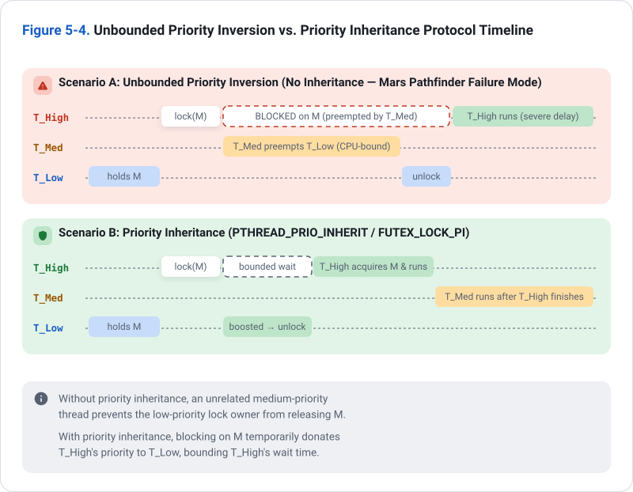

# 5. Scheduling Theory and Policy

A bare-metal multiprocessor provides a fixed number of physical CPU cores, each capable of advancing a single hardware instruction stream on any clock cycle. When the number of runnable threads exceeds the available core count, the hardware itself has no mechanism to enforce proportional fairness, bounded interactive latency, or priority arbitration. Without supervisory intervention, the first thread dispatched onto a core would retain control of the fetch-decode-execute pipeline until it halted or terminated, starving all other workloads on the machine.

The **kernel scheduler** resolves this physical contention by time-multiplexing hardware cores across competing execution contexts. Consistent with the architectural principle established in Section 1.3, the scheduling subsystem strictly separates hardware-enforced **mechanism** from kernel **policy**:
- **Mechanism (Hardware and Dispatch Layer):** Periodic hardware timer interrupts (the per-core Local APIC Timer on x86-64 and the ARM Generic Timer on ARM64), architectural trapframe serialization, and context-switch routines that exchange stack pointers (`RSP` / `SP_EL1`), thread-local base registers (`FS_BASE` / `TPIDR_EL0`), and page-table roots (`CR3` / `TTBR0_EL1`).
- **Policy (Arbitration Algorithm):** The selection rule that evaluates the set of runnable scheduling entities to determine which thread occupies a physical core next, the duration of its execution quantum, and the target core selected to preserve hardware cache locality.

## 5.1 Scheduling Dynamics and Performance Metrics

The kernel invokes the scheduler at four deterministic state transitions within a thread's lifecycle: when a running thread blocks voluntarily on an I/O descriptor or synchronization primitive (transitioning to a **wait queue**), when an external hardware interrupt or lock release awakens a blocked thread (transitioning to a **ready queue**), when a running thread exits, or when the hardware timer interrupt asserts preemption upon expiration of the thread's allotted execution quantum.

<figure>

</figure>

The operational behavior of a scheduling policy is quantified by three primary metrics:
- **Turnaround Time (`T_completion - T_arrival`):** The total elapsed interval from the instant a job enters the ready queue until its final instruction retires. Throughput-oriented batch pipelines and compilation workloads optimize primarily for minimal mean turnaround time.
- **Wait Time:** The cumulative duration a job resides in the ready queue, runnable and awaiting dispatch onto a physical core, excluding productive CPU execution and voluntary I/O wait intervals.
- **Response Time (`T_first_run - T_arrival`):** The latency interval between a job's arrival (or wakeup from a blocked state) and its initial dispatch onto an execution core. Interactive user interfaces, real-time audio pipelines, and low-latency network RPC services optimize primarily for bounded tail response time.

These metrics represent competing optimization objectives. Minimizing mean turnaround time requires executing short jobs to completion without interruption, which reduces context-switch frequency and preserves cache locality; minimizing response time requires frequent preemption so that newly awakened interactive threads receive processor time within strict latency bounds, even at the cost of increased context-switch overhead and reduced throughput for long-running compute jobs.

## 5.2 Fundamental Scheduling Policies

Classical scheduling theory establishes three foundational policies that formalize the trade-offs between throughput, fairness, and response latency:

1. **First-Come, First-Served (FCFS):** Dispatches runnable jobs non-preemptively in strict arrival order via a FIFO queue. Although dispatch complexity is O(1), FCFS exhibits the **convoy effect**: a single compute-intensive task arriving ahead of multiple short interactive tasks monopolizes the processor until completion, inflating both mean turnaround time and response latency for all subsequent arrivals.
2. **Shortest Job First (SJF) and Shortest Remaining Time First (SRTF):** Selects the runnable job possessing the minimum remaining CPU burst duration. For any static arrival set, SJF achieves the provably optimal minimum mean turnaround time. In general-purpose operating systems, however, future execution burst durations cannot be determined a priori without historical estimation, and a sustained stream of short tasks induces indefinite **starvation** for long-running compute workloads.
3. **Round-Robin (RR):** Enforces preemptive time-slicing by assigning each runnable thread a fixed execution **quantum** (`q`). Upon quantum expiration, the timer interrupt preempts the active thread and appends it to the tail of the ready queue. For *N* runnable threads, Round-Robin bounds maximum wait latency prior to dispatch at `(N - 1) × q`. Selection of `q` requires balancing preemption responsiveness against microarchitectural overhead: an excessively small quantum causes context-switch register saves and L1/L2 cache refills to consume a substantial fraction of total core cycles, whereas an excessively large quantum degrades interactive responsiveness toward FCFS behavior.

<figure>

</figure>

**Listing 5-1. A simulator for FCFS, SJF, and RR (C++20).**

```cpp
{{#include ../code/ch05/sched_sim.cpp}}
```

**Output 5-1. The completion times agree with Figure 5-2.**

```text
{{#include ../code/out/ch05_sched.out}}
```

**Listing 5-2. The same simulator in Rust.**

```rust
{{#include ../code/ch05/sched_sim.rs}}
```

**Output 5-2.**

```text
{{#include ../code/out/ch05_sched_rs.out}}
```

## 5.3 Proportional-Share Scheduling: Linux CFS and EEVDF

Historical Unix schedulers employed Multi-Level Feedback Queues (MLFQ), partitioning runnable threads across discrete priority levels and demoting threads that exhausted full execution quanta while retaining I/O-bound interactive threads at elevated priorities. While effective in practice, heuristic MLFQ policies depend on empirically tuned priority-decay constants and permit adversarial workloads to preserve artificially high priority by relinquishing the processor immediately prior to quantum expiration.

To establish a rigorous mathematical model for processor allocation, Linux replaced discrete feedback queues with **proportional-share scheduling**, implemented initially by the **Completely Fair Scheduler (CFS)** and superseded in Linux 6.6 by **EEVDF** (Earliest Eligible Virtual Deadline First).

### 5.3.1 Virtual Runtime (`vruntime`) Accounting

CFS models an idealized fluid-flow processor capable of executing *N* equal-priority runnable tasks concurrently, allocating exactly `1 / N` of the physical execution rate to each task at every instant. Because a physical core executes only one thread at any clock cycle, the kernel tracks each task's cumulative weighted CPU consumption in a monotonically increasing 64-bit nanosecond counter termed **virtual runtime (`vruntime`)**.

When task *i* executes for an actual physical duration `Δexec_i`, the scheduler increments its virtual runtime in inverse proportion to its priority weight `weight_i`:

```text
Δvruntime_i = Δexec_i × (weight_0 / weight_i)
```

In this formulation, `weight_0 = 1,024` represents the baseline weight corresponding to POSIX priority `nice = 0`. Linux maps the forty integer `nice` values (`-20` highest priority to `+19` lowest priority) onto a geometric weight table in which each unit decrement in `nice` increases CPU share by approximately 10% (a weight ratio of approximately `1.25` per step).

To illustrate the arithmetic directly, consider three runnable threads, Task A (`nice = -10`, `weight = 9,548`), Task B (`nice = 0`, `weight = 1,024`), and Task C (`nice = +10`, `weight = 110`), each executing for an identical physical duration of **4.00 ms**:

| Task | Nice Level | CFS Weight | Physical Execution (`Δexec`) | Virtual Runtime Increment (`Δvruntime`) | Scheduling Effect |
| :--- | :---: | :---: | :---: | :---: | :--- |
| **Task A** | `-10` (High) | `9,548` | `4.00 ms` | `4.00 × (1024 / 9548) = +0.43 ms` | Advances ~9.3&times; slower than wall time; remains nearest `rb_leftmost` |
| **Task B** | `0` (Default) | `1,024` | `4.00 ms` | `4.00 × (1024 / 1024) = +4.00 ms` | Advances at a 1:1 ratio with physical wall-clock execution |
| **Task C** | `+10` (Batch) | `110` | `4.00 ms` | `4.00 × (1024 / 110) = +37.24 ms` | Advances ~9.3&times; faster than wall time; migrates to the right subtree |

This weighted accounting enforces starvation freedom without ad hoc priority-boost timers. Every physical cycle consumed by Task A strictly increases its `vruntime`, guaranteeing eventual dispatch of Task B and Task C, while Task A's attenuated virtual clock rate allocates each runnable thread a long-term CPU share proportional to `weight_i / Σ weight_j`.

### 5.3.2 Red-Black Tree Runqueue and the Transition to EEVDF

To identify the runnable entity with the minimum `vruntime` efficiently under high thread counts, each per-CPU runqueue organizes its runnable scheduling entities in a self-balancing **Red-Black Tree** keyed strictly by `vruntime`:

- **O(1) Selection (`rb_leftmost`):** The runqueue caches a direct pointer (`rb_leftmost`) referencing the leftmost node in the tree, corresponding to the runnable thread with the minimum `vruntime`. Selecting the next thread for dispatch executes in constant O(1) time.
- **O(log N) Insertion and Removal:** Enqueueing a newly awakened thread or re-inserting a preempted thread requires logarithmic O(log N) time relative to the core's local runnable count *N*. To prevent a thread that slept for an extended duration from monopolizing the processor upon wakeup with an outdated `vruntime`, the kernel clamps its initial `vruntime` against the runqueue's monotonic floor (`min_vruntime`).
- **Minimum Execution Granularity (`min_granularity`):** Preempting the active thread upon every microsecond shift in `vruntime` would induce excessive context-switch overhead and L1/L2 cache thrashing. CFS enforces a minimum execution interval (`sysctl_sched_min_granularity`, typically 0.75–3.0 ms) prior to involuntary preemption.
- **EEVDF (Earliest Eligible Virtual Deadline First):** Under pure CFS, equal-weight tasks received identical dispatch priority irrespective of whether a task required a 0.5 ms interactive wakeup or a 20 ms batch slice. Linux 6.6 adopted **EEVDF**, augmenting each scheduling entity with two formal parameters:
  1. **Eligibility (`lag >= 0`):** A task is eligible for dispatch only when its accumulated virtual runtime does not exceed the weighted mean virtual runtime of the runqueue.
  2. **Virtual Deadline (`d_i = vruntime_i + slice_i / weight_i`):** Among all eligible tasks, EEVDF selects the entity with the earliest virtual deadline. Latency-sensitive threads configured with short request slices (`slice_i`) obtain earlier virtual deadlines and preempt long-slice compute tasks deterministically while preserving long-term proportional CPU share.

<figure>

</figure>

## 5.4 Priority Inversion and Priority Inheritance Protocols

In priority-preemptive scheduling environments (including real-time Linux `SCHED_FIFO`/`SCHED_RR`, Darwin/XNU audio and compositor subsystems, and embedded avionics kernels), strict priority preemption combined with mutual exclusion locks introduces a critical liveness pathology termed **unbounded priority inversion**.

Consider three threads sharing a single execution core: a high-priority real-time thread **T<sub>High</sub>**, a medium-priority compute-bound thread **T<sub>Med</sub>**, and a low-priority thread **T<sub>Low</sub>** that shares mutex **M** with **T<sub>High</sub>**. The failure evolves across four sequential steps:

1. **T = 0 ms:** **T<sub>Low</sub>** executes, acquires mutex **M**, and enters its critical section.
2. **T = 2 ms:** **T<sub>High</sub>** becomes runnable upon an interrupt. Because **prio(T<sub>High</sub>) &gt; prio(T<sub>Low</sub>)**, the scheduler preempts **T<sub>Low</sub>** and dispatches **T<sub>High</sub>**. **T<sub>High</sub>** invokes `lock(M)`, observes that **M** is held by **T<sub>Low</sub>**, and blocks on **M**'s wait queue.
3. **T = 3 ms:** **T<sub>Med</sub>** becomes runnable. Although **T<sub>Med</sub>** does not reference mutex **M**, **T<sub>High</sub>** is blocked and **prio(T<sub>Med</sub>) &gt; prio(T<sub>Low</sub>)**; consequently, the scheduler dispatches **T<sub>Med</sub>** ahead of **T<sub>Low</sub>**.
4. **Unbounded Blocking:** **T<sub>Med</sub>**, along with any subsequently arriving medium-priority threads, preempts **T<sub>Low</sub>** indefinitely. Because **T<sub>Low</sub>** receives zero CPU cycles to complete its critical section and invoke `unlock(M)`, **T<sub>High</sub>** experiences unbounded blocking latency induced by lower-priority work. This exact interaction produced repeated watchdog resets on the 1997 Mars Pathfinder spacecraft when medium-priority communications tasks preempted a low-priority meteorological task holding a shared bus mutex required by the high-priority bus management task.

<figure>

</figure>

Production kernels mitigate unbounded priority inversion through two synchronization protocols enforced within mutex acquisition:

- **Priority Inheritance Protocol (`PTHREAD_PRIO_INHERIT`, Linux `FUTEX_LOCK_PI`, Darwin `os_unfair_lock`):** When **T<sub>High</sub>** blocks on mutex **M** owned by **T<sub>Low</sub>**, the kernel elevates **T<sub>Low</sub>**'s effective scheduling priority to **max(eff_prio(T<sub>Low</sub>), prio(T<sub>High</sub>))**. Executing at **T<sub>High</sub>**'s priority, **T<sub>Low</sub>** immediately preempts **T<sub>Med</sub>**, completes its critical section, and releases **M**. Upon `unlock(M)`, the kernel restores **T<sub>Low</sub>**'s base priority and dispatches **T<sub>High</sub>**. Priority inheritance propagates transitively across nested lock-ownership chains.
- **Priority Ceiling Protocol (`PTHREAD_PRIO_PROTECT`):** Each mutex **M** is assigned a static ceiling priority equal to the maximum priority of any thread permitted to acquire **M**. Immediately upon locking **M**, the acquiring thread is elevated to **M**'s ceiling priority. This protocol prevents both unbounded priority inversion and circular-wait deadlocks, at the cost of requiring complete static knowledge of lock acquisition sets prior to deployment.

<div class="callout keyidea">
<span class="label">Key idea</span>

Unbounded priority inversion arises when a medium-priority thread indirectly blocks a high-priority waiter by preempting the low-priority owner of a shared mutex. Priority inheritance restores bounded blocking latency by temporarily elevating the lock owner's effective priority to match the highest-priority blocked waiter until `unlock()`.

</div>

## 5.5 Multi-Core Work Stealing, Cache Affinity, and NUMA Domains

In symmetric multiprocessing (SMP) and Non-Uniform Memory Access (NUMA) architectures, maintaining a single global ready queue creates a severe serialization bottleneck: every context switch, wakeup, and timer tick must acquire a single global runqueue spinlock, saturating inter-core cache coherence interconnects.

Modern kernels resolve this contention by partitioning scheduling state into **per-CPU runqueues** managed by a topology-aware load balancer:

- **Cache Affinity:** While a thread executes on Core 2, its active working set populates Core 2's private L1/L2 caches and TLBs. Dispatching that thread back onto Core 2 following a brief blocking interval eliminates cold cache refills and cross-core **Modified-Exclusive-Shared-Invalid (`MESI`)** coherence invalidations. Schedulers enforce **soft affinity** automatically by biasing wakeups toward the thread's previous core, while providing explicit pinning interfaces (`sched_setaffinity`) for **hard affinity** in deterministic latency-critical deployments.
- **Work-Stealing Load Balancing:** Partitioned runqueues permit transient imbalance in which one core holds multiple queued threads while a sibling core becomes idle. Upon emptying its local runqueue, or at periodic load-balancing ticks, an idle core invokes **work stealing**, migrating a cache-cold runnable thread from an overloaded sibling runqueue.
- **Hierarchical Scheduling Domains and NUMA Awareness:** The kernel encodes physical hardware topology as a hierarchy of **scheduling domains**:
  1. **Simultaneous Multithreading (`SMT`) / Hyperthread Siblings:** Hardware threads sharing a physical core and L1/L2 caches (minimal migration cost).
  2. **Core / Last-Level Cache (LLC) Domain:** Distinct cores sharing a unified L3 cache (moderate migration cost limited to L1/L2 warm-up).
  3. **NUMA Socket Domain:** Independent processor sockets connected across inter-socket links (Intel **Ultra Path Interconnect (`UPI`)**, AMD Infinity Fabric) with local **Dynamic Random-Access Memory (`DRAM`)** controllers. Migrating a thread across NUMA boundaries decouples it from its locally allocated physical `DRAM` pages, increasing remote memory latency by 30–100%. Load balancers therefore equalize queue depth within an LLC domain first and migrate threads across NUMA nodes only when load imbalance exceeds the remote-memory access penalty.

<div class="callout experiment">
<span class="label">Experiment</span>

Modify Listing 5-1 (`code/ch05/sched.cpp`) to add one long-running 500 ms CPU-bound job at `t = 0` ahead of five 5 ms interactive jobs. Compare the average response time under First-Come, First-Served (`FCFS`) versus Round-Robin (`RR`) with a 10 ms quantum to observe the convoy effect directly.

</div>

<div class="callout caution">
<span class="label">Common Pitfall</span>

Treating `nice` values or thread priorities as hard real-time guarantees. Under proportional-share schedulers (`CFS` / `EEVDF`), a low-priority background thread still receives non-zero CPU share, and priority inversion can stall a high-priority thread indefinitely unless priority inheritance is enabled on the contended mutex.

</div>
