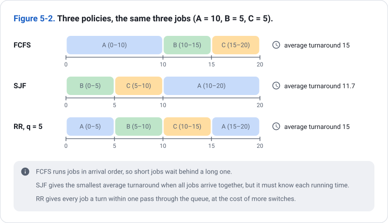

# 5. Scheduling Theory and Policy

The scheduler is the kernel component responsible for the multiplexing of processing resources, deciding which threads occupy available CPU cores at any given moment. This decision-making process is governed by specific policies that attempt to optimize various performance metrics, each representing a different set of user or system requirements.

## 5.1 Scheduling Dynamics and Performance Metrics

A scheduler operates by transitioning threads between various execution states. When a thread terminates, blocks on an event (such as I/O or synchronization), or exhausts its allotted time slice, the kernel invokes the scheduler to select a new thread from the **ready queue** and dispatch it to a core. The efficiency of these policies is evaluated using three primary metrics:
- **Turnaround Time:** The interval from a job's initial arrival to its ultimate completion, a metric critical for batch-oriented workloads.
- **Wait Time:** The cumulative duration a job resides in the ready queue.
- **Response Time:** The latency between a job's arrival and its initial execution, which is the primary metric for interactive and time-sensitive applications.

Optimization of these metrics is often a zero-sum game; policies that minimize turnaround time frequently do so at the expense of response time, and vice versa.

<figure>

</figure>

## 5.2 Fundamental Scheduling Policies

The theoretical foundation of scheduling rests on three classic policies:

1. **First-Come, First-Served (FCFS):** A non-preemptive policy where jobs are processed in strict arrival order. While computationally trivial, FCFS is susceptible to the "convoy effect," where a single long-running task obstructs the progress of numerous subsequent short tasks, drastically increasing average turnaround time.
2. **Shortest Job First (SJF):** An optimal policy for minimizing average turnaround time, which prioritizes tasks with the smallest predicted execution bursts. However, its practical implementation is limited by the inherent difficulty of accurately predicting future execution requirements.
3. **Round-Robin (RR):** A preemptive policy that distributes CPU time via fixed-duration increments known as **quanta**. RR excels at providing low response times by ensuring that every job receives a portion of the CPU within a single pass of the ready queue. However, the overhead of frequent context switching and the potential for increased turnaround time must be managed by carefully selecting the quantum size.

<figure>

</figure>

**Listing 5-1. A simulator for FCFS, SJF, and RR (C++20).**

```cpp
{{#include ../code/ch05/sched_sim.cpp}}
```

**Output 5-1. The completion times agree with Figure 5-2.**

```text
{{#include ../code/out/ch05_sched.out}}
```

**Listing 5-2. The same simulator in Rust.**

```rust
{{#include ../code/ch05/sched_sim.rs}}
```

**Output 5-2.**

```text
{{#include ../code/out/ch05_sched_rs.out}}
```

## 5.3 Advanced Heuristics in Production Schedulers

Modern production kernels, such as Linux and macOS, extend these fundamental policies through sophisticated heuristics designed to handle diverse and unpredictable workloads.

- **Priority-Based Scheduling:** Assigns varying levels of importance to threads, allowing latency-sensitive tasks (e.g., audio processing) to preempt background tasks.
- **Multi-Level Feedback Queues:** Employs past behavior as a proxy for future requirements. Threads that exhaust their full quantum are categorized as compute-bound and relegated to lower-priority queues, whereas threads that block frequently are identified as interactive and maintained at higher priorities.
- **Preemption:** Utilizes hardware timer interrupts to enforce time-slicing, ensuring that no single thread can monopolize a core indefinitely.
- **Processor Affinity and Topology Awareness:** Leverages cache locality and hardware topology to prefer scheduling threads on cores where their data is already resident or on cores that are topologically close to their memory, minimizing data transfer latencies.
